# S08 · 库存中心

> 适用岗位：Java 资深开发、Java 架构师。[《S01 秒杀系统》](S01-秒杀系统.md)讲的是单个热点商品的极限并发，本文讲的是日常的库存系统：几百万个 SKU、多个仓库、下单预占、支付扣减、取消回补，以及怎么保证数字始终对得上。
> 版本基线：JDK 21 / 25、MySQL 8.4、Redis 7.x / 8.x。
> 事实核对：
> - 数据库条件更新防超卖、Redis 原子扣减的原理，沿用[《24 高并发》](../06-三高与架构/24-高并发.md)24-12 和 S01 的结论。
> - TCC 的空回滚与防悬挂，沿用[《09 分布式理论》](../03-分布式与微服务/09-分布式理论.md)09-10 的结论。
> - 本机运行（macOS 27.2、Apple M1 Max、JDK 25）：1 段"预占、确认、释放"的代码只依赖 JDK，文中贴的是实际运行输出。
> - 本机没有 MySQL 服务端，文中的 SQL 都没有实际执行。
> 相关分类：[《24 高并发》](../06-三高与架构/24-高并发.md)（库存扣减、热点）、[《09 分布式理论》](../03-分布式与微服务/09-分布式理论.md)（TCC、幂等）、[《15 MySQL》](../04-数据存储/15-MySQL.md)（行锁、死锁）、[《S01 秒杀系统》](S01-秒杀系统.md)、[《S07 订单中心》](S07-订单中心.md)

## 45 分钟答题版

| 时间 | 做什么 | 要讲出的关键点 | 子题 |
| --- | --- | --- | --- |
| 0～5 分钟 | 澄清概念 | 库存不是一个数：可售、预占、已售、实物；**不超卖，数字对得上** | S08-01 |
| 5～12 分钟 | 扣减时机 | 下单减、付款减的问题；**下单预占、支付确认、取消释放** | S08-02 |
| 12～25 分钟 | 正确性 | 条件更新防超卖；流水表与幂等；空回滚与防悬挂；多 SKU 的原子性和死锁 | S08-03 ～ S08-05 |
| 25～35 分钟 | 扩展 | 多仓与寻源；热点 SKU；缓存里的库存怎么用 | S08-06 ～ S08-08 |
| 35～45 分钟 | 同步与兜底 | 仓库入库、盘点怎么同步；对账；真的超卖了怎么办 | S08-09、S08-10 |

## 知识地图

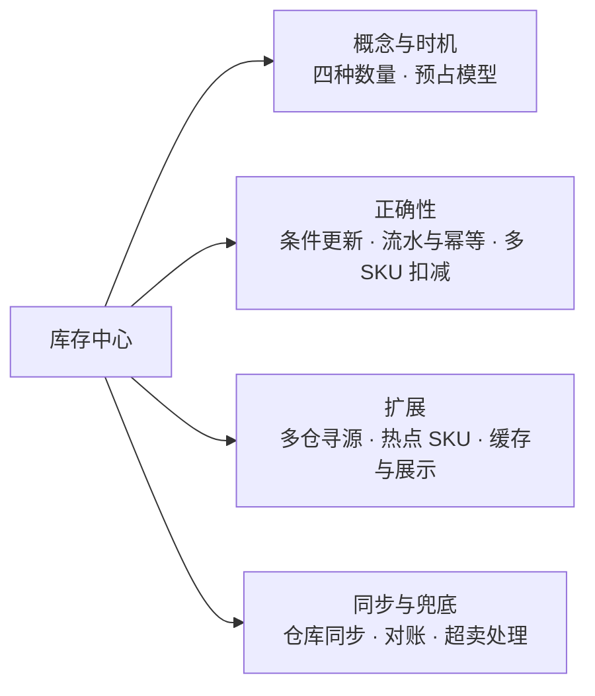

## 题目索引

| 编号 | 题目 | 难度 |
| --- | --- | --- |
| S08-01 | "库存"到底有哪几个数？要澄清哪些需求？ | ★★ |
| S08-02 | 库存在什么时候扣？下单减还是付款减？ | ★★★ |
| S08-03 | 怎么保证不超卖？数据库和 Redis 怎么选？ | ★★★ |
| S08-04 | 库存流水怎么设计？重复请求和乱序消息怎么处理？ | ★★★ |
| S08-05 | 一个订单有多个 SKU，怎么保证要么全扣、要么全不扣？ | ★★★ |
| S08-06 | 多个仓库的库存怎么管理？一个订单从哪个仓发货？ | ★★ |
| S08-07 | 热门 SKU 的扣减成了瓶颈怎么办？ | ★★★ |
| S08-08 | 商品页展示的库存从哪读？和真实库存不一致怎么办？ | ★★ |
| S08-09 | 仓库的入库、出库、盘点怎么同步到销售库存？ | ★★ |
| S08-10 | 怎么对账？真的超卖了怎么处理？ | ★★ |

---

## 一、概念与时机

### S08-01 "库存"到底有哪几个数？要澄清哪些需求？

> ★★ ｜ 资深 / 架构师 ｜ 高频

**考察意图**：很多方案出问题，是因为只用一个数字表示库存。看你是否知道库存在不同阶段有不同的含义。

**30 秒版回答**：

- **销售库存**（面向用户，库存中心管理）：
  - **可售库存**：现在还能卖多少。下单时判断和扣减的就是它；
  - **预占库存**：已经下单、还没支付的数量。它不能再卖给别人，但也还没真正卖出去；
  - **已售库存**：已经支付、等待出库的数量。
- **实物库存**（面向仓库，仓储系统管理）：仓库里实际有多少件。它和销售库存不是同一个数：已售未出库的货还在仓库里，但已经不能卖了。
- **恒等式**：可售 + 预占 + 已售未出库 = 可用于销售的实物库存。任何时候这个等式都应该成立，它是对账的基础。
- **两个硬约束**：**不超卖**（可售不能小于 0）；**数字可追溯**（每一次变化都有流水，知道为什么变）。

**深入剖析**

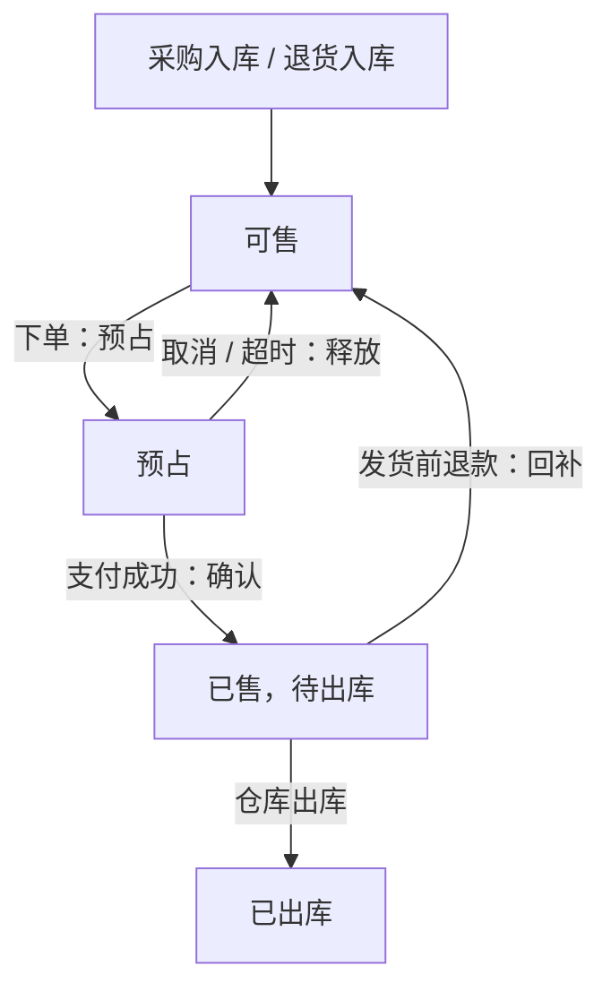

| 问题 | 为什么要问 | 本文的假设 |
| --- | --- | --- |
| 有多少 SKU？ | 决定数据量和是否分库分表 | 500 万个 SKU |
| 单仓还是多仓？ | 多仓涉及寻源和拆单 | 多仓，全国十几个仓库 |
| 下单峰值？ | 决定扣减方案 | 每秒 5 万单，每单平均 2 个 SKU |
| 能否接受少卖？ | 决定一致性的严格程度 | 可以短暂少卖，不能超卖 |
| 有没有预售、虚拟库存？ | 可售库存可以大于实物库存 | 普通商品为主，预留扩展 |

**追问链**

1. **为什么销售库存和实物库存要分开？** 变化的原因和频率不同。销售库存跟着订单变，每秒几万次；实物库存跟着仓库作业变（入库、出库、盘点、报损），频率低得多，而且由仓储系统负责。分开之后，销售库存可以为高并发优化，实物库存可以为准确性和作业流程优化，两者通过事件同步、定期对账。
2. **可售库存可以大于实物库存吗？** 可以。预售商品还没到货就开始卖；在途的采购单可以提前释放为可售。这类"虚拟库存"是运营配置的结果，库存中心只认可售库存这个数字，至于它背后有没有实物，由供应链保证。

---

### S08-02 库存在什么时候扣？下单减还是付款减？

> ★★★ ｜ 资深 / 架构师 ｜ 高频

**考察意图**：这是库存系统最基础的设计决策。看你是否清楚两种方式各自的问题，以及预占模型怎样兼顾。

**30 秒版回答**：

| 方式 | 做法 | 问题 |
| --- | --- | --- |
| 下单减库存 | 提交订单时直接扣 | 恶意下单不付款，就能把库存占光，别人买不了 |
| 付款减库存 | 支付成功时才扣 | 下单时有货，付完钱发现没货了：**超卖**，或者只能退款 |
| **预占** | 下单时把库存从"可售"移到"预占"；支付成功后从"预占"转为"已售"；取消或超时则回到"可售" | 需要可靠的超时释放 |

- 推荐**预占**：下单时就锁定了库存，付款的人一定有货；不付款的订单超时后自动释放，不会一直占着。
- 配套：订单超时取消（[《S02 订单超时取消与延迟任务》](S02-订单超时取消与延迟任务.md)）；对频繁下单不付款的账号做风控限制。
- 预占的时间越短，被恶意占用的影响越小。秒杀这类场景把支付时限缩短到几分钟，就是这个原因。

**深入剖析**

预占模型下，库存表的结构：

```sql
CREATE TABLE t_inventory (
    sku_id       BIGINT   NOT NULL,
    warehouse_id BIGINT   NOT NULL COMMENT '仓库，单仓时为固定值',
    available    INT      NOT NULL COMMENT '可售',
    reserved     INT      NOT NULL COMMENT '预占',
    sold         INT      NOT NULL COMMENT '已售待出库',
    version      BIGINT   NOT NULL,
    update_time  DATETIME(3) NOT NULL,
    PRIMARY KEY (sku_id, warehouse_id)
);
```

三个动作对应三条条件更新：

```sql
-- 预占：可售 → 预占
UPDATE t_inventory SET available = available - #{n}, reserved = reserved + #{n}
WHERE sku_id = #{skuId} AND warehouse_id = #{whId} AND available >= #{n};

-- 确认：预占 → 已售
UPDATE t_inventory SET reserved = reserved - #{n}, sold = sold + #{n}
WHERE sku_id = #{skuId} AND warehouse_id = #{whId} AND reserved >= #{n};

-- 释放：预占 → 可售
UPDATE t_inventory SET reserved = reserved - #{n}, available = available + #{n}
WHERE sku_id = #{skuId} AND warehouse_id = #{whId} AND reserved >= #{n};
```

每条更新都必须和一条**库存流水**的插入放在同一个事务里（S08-04），否则重复执行就会多扣或者多补。

**追问链**

1. **预占和 TCC 是什么关系？** 预占就是 TCC 里的 Try，确认是 Confirm，释放是 Cancel。库存是 TCC 最典型的例子：资源可以被"预留"，预留之后要么确认、要么取消。
2. **有些平台就是"付款减库存"，为什么？** 当商品库存充足、几乎不会卖完时，付款减库存更简单，也不怕恶意占库存。它的风险只在库存快卖完的那一小段时间。这种场景下可以接受少量超卖，用"缺货后协商退款或延迟发货"来处理。选择哪种方式，取决于超卖的代价和被恶意占用的代价哪个更高。
3. **预占的库存，前台展示时算不算"有货"？** 不算。展示用的是可售库存。所以大量未支付的订单会让商品显示"无货"，这些订单超时释放后又变成"有货"。秒杀结束后过一会儿又能抢到，就是这个原因。

---

## 二、正确性

### S08-03 怎么保证不超卖？数据库和 Redis 怎么选？

> ★★★ ｜ 资深 / 架构师 ｜ 高频

**考察意图**：防超卖的原理人人会背。看你是否能说清楚日常场景和热点场景分别用什么，以及为什么不是一上来就用 Redis。

**30 秒版回答**：

- **超卖的原因**：先查询库存、再在程序里判断、最后写回去。两个请求同时查到"还有 1 件"，都判断可以卖。
- **数据库条件更新**：把判断和扣减放在一条 SQL 里，`WHERE available >= n`。数据库的行锁保证同一行的更新是串行的，不会超卖。
- **日常商品用数据库就够了**：几百万个 SKU 的并发是分散的，单个 SKU 每秒只有很少的扣减，行锁几乎不会冲突。数据库方案最简单，而且库存和流水在同一个事务里，天然一致。
- **热点商品才需要 Redis**：单个 SKU 每秒成千上万次扣减时，数据库的行锁会排起长队。这时把扣减前移到 Redis，用 Lua 脚本原子地执行，数据库异步落库（[《S01 秒杀系统》](S01-秒杀系统.md)S01-05 ～ S01-09）。
- **不要一上来就用 Redis**：Redis 加数据库是两份数据，要处理两边的一致性、Redis 丢数据、异步落库失败。这些复杂度只有在数据库确实扛不住时才值得引入。

**深入剖析**

| | 数据库条件更新 | Redis Lua + 异步落库 |
| --- | --- | --- |
| 原子性的来源 | 行锁 + 事务 | 脚本在 Redis 中原子执行 |
| 单 SKU 的并发能力 | 每秒几百到上千次（受行锁和事务耗时限制） | 每秒几万次以上 |
| 库存和流水的一致性 | 同一个本地事务 | 两个系统，靠消息和对账 |
| 数据可靠性 | 高 | 取决于 Redis 的持久化和复制，主从切换可能丢失最近的写入 |
| 复杂度 | 低 | 高 |
| 适用 | 绝大多数商品 | 秒杀、爆款 |

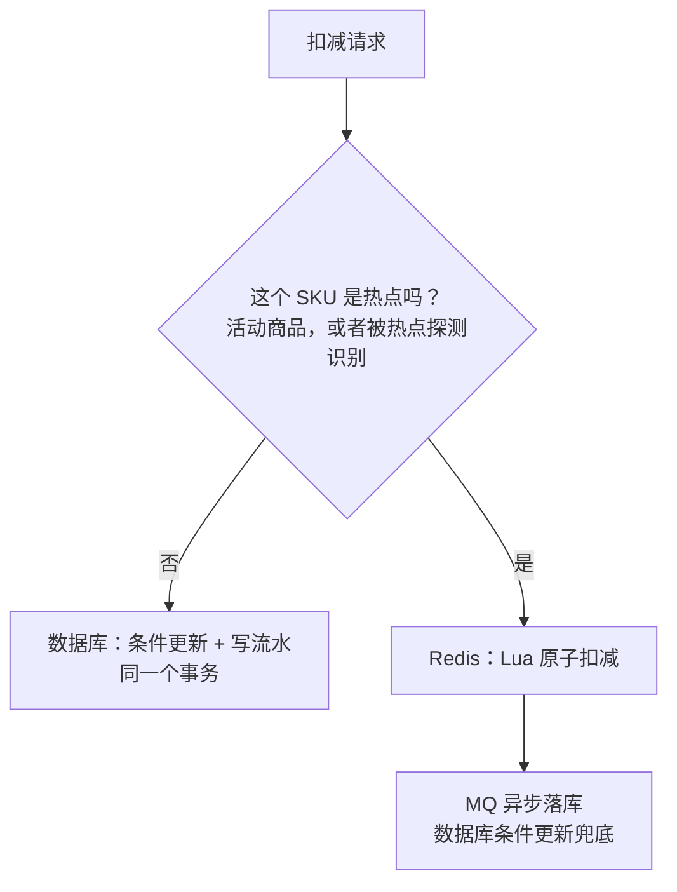

**追问链**

1. **用乐观锁（版本号）行不行？** `WHERE version = ?` 也能防超卖，但在并发稍高时会大量失败：10 个请求同时读到版本 5，只有 1 个能更新成功，其余 9 个要重试。`WHERE available >= n` 不依赖读到的旧值，只要库存够就能成功，不会有无谓的失败。库存扣减应该用后者。
2. **`SELECT ... FOR UPDATE` 再更新行不行？** 能保证正确，但持有行锁的时间更长（从查询到更新提交），吞吐更低。一条条件更新就能完成的事，不需要先加锁再查。
3. **怎么知道一个 SKU 是不是热点？** 两种来源：运营提前标记的活动商品；系统实时探测（统计一小段时间内每个 SKU 的访问次数）。热点的发现和治理见[《24 高并发》](../06-三高与架构/24-高并发.md)24-11。

---

### S08-04 库存流水怎么设计？重复请求和乱序消息怎么处理？

> ★★★ ｜ 资深 / 架构师 ｜ 高频

**考察意图**：库存的每个动作都可能被重复调用，取消和预占还可能乱序到达。看你是否用流水表把这些情况都收住。

**30 秒版回答**：

- **流水表**：每一次库存变化记一条，包含 SKU、仓库、数量、动作类型、业务单号、变化前后的数量、时间。
- **幂等**：流水表上以"业务单号 + SKU + 动作类型"为唯一索引。插入流水和更新库存在**同一个事务**里：流水插入成功才更新库存；唯一索引冲突说明处理过了，直接返回成功。
- **重复请求**：同一个订单的预占请求来两次，第二次流水冲突，库存不会被扣两次。
- **乱序**：
  - **空回滚**：预占请求超时，调用方发起释放，但预占其实没有执行。释放时找不到预占流水，这时**不加库存，但要记下"已释放"**；
  - **防悬挂**：之后那个迟到的预占请求到了，发现这个订单已经有释放的记录，**拒绝执行**。否则这份预占永远没有人来释放；
  - **确认之后的释放**：订单已经支付，一条迟到的取消消息到达。发现已有确认记录，拒绝释放。
- 流水同时是**对账的依据**：库存的当前值 = 初始值 + 所有流水的累计。

**深入剖析**

```sql
CREATE TABLE t_inventory_journal (
    id           BIGINT      NOT NULL PRIMARY KEY,
    sku_id       BIGINT      NOT NULL,
    warehouse_id BIGINT      NOT NULL,
    biz_no       VARCHAR(64) NOT NULL COMMENT '业务单号：订单号、入库单号……',
    action       VARCHAR(16) NOT NULL COMMENT 'RESERVE / CONFIRM / RELEASE / INBOUND / ADJUST……',
    quantity     INT         NOT NULL,
    available_after INT      NOT NULL COMMENT '变化之后的可售数量',
    create_time  DATETIME(3) NOT NULL,
    UNIQUE KEY uk_biz (biz_no, sku_id, action)
);
```

用 JDK 模拟这套规则：库存 100 件，500 个买家并发下单，其中三分之一不付款；每个成功的动作都重复发一次（本机 JDK 25 运行）。代码里的一把锁对应数据库里的一个本地事务：

```java
import java.util.Map;
import java.util.concurrent.ConcurrentHashMap;
import java.util.concurrent.CountDownLatch;
import java.util.concurrent.ExecutorService;
import java.util.concurrent.Executors;
import java.util.concurrent.atomic.AtomicInteger;

/**
 * 库存的"预占 → 确认 / 释放"模型，每次变更都记一条流水，流水以"订单号 + 动作"为唯一键保证幂等。
 * 一把锁对应数据库里的一个本地事务：插入流水（唯一索引）和更新库存行在同一个事务里。
 */
public class InventoryDemo {

    private static final int INITIAL_STOCK = 100;
    private static final int BUYERS = 500;
    private static final int THREADS = 32;

    enum Action { RESERVE, CONFIRM, RELEASE }

    static final class Sku {
        private int available;                 // 可售库存
        private int reserved;                  // 预占库存：已下单未支付
        private int sold;                      // 已售出
        /** 库存流水，key = 订单号 + 动作，相当于流水表上的唯一索引 */
        private final Map<String, Integer> journal = new ConcurrentHashMap<>();

        Sku(int stock) {
            this.available = stock;
        }

        /** 下单：可售 → 预占。对应 UPDATE ... SET available = available - n, reserved = reserved + n WHERE available >= n */
        synchronized boolean reserve(String orderNo, int quantity) {
            if (journal.containsKey(key(orderNo, Action.RESERVE))) {
                return true;                   // 重复请求：按第一次的结果返回
            }
            if (journal.containsKey(key(orderNo, Action.RELEASE))) {
                return false;                  // 防悬挂：这个订单已经被释放过，迟到的预占不能再生效
            }
            if (available < quantity) {
                return false;
            }
            journal.put(key(orderNo, Action.RESERVE), quantity);
            available -= quantity;
            reserved += quantity;
            return true;
        }

        /** 支付成功：预占 → 已售 */
        synchronized boolean confirm(String orderNo) {
            Integer quantity = journal.get(key(orderNo, Action.RESERVE));
            if (quantity == null || journal.containsKey(key(orderNo, Action.RELEASE))) {
                return false;
            }
            if (journal.putIfAbsent(key(orderNo, Action.CONFIRM), quantity) != null) {
                return true;
            }
            reserved -= quantity;
            sold += quantity;
            return true;
        }

        /** 取消或超时：预占 → 可售。没有预占记录时也要记下"已释放"，这就是空回滚 */
        synchronized boolean release(String orderNo) {
            if (journal.containsKey(key(orderNo, Action.CONFIRM))) {
                return false;                  // 已经确认售出，不能再释放
            }
            if (journal.putIfAbsent(key(orderNo, Action.RELEASE), 0) != null) {
                return true;                   // 重复释放：不再加库存
            }
            Integer quantity = journal.get(key(orderNo, Action.RESERVE));
            if (quantity != null) {
                reserved -= quantity;
                available += quantity;
            }
            return true;
        }

        synchronized String snapshot() {
            return "available=" + available + ", reserved=" + reserved + ", sold=" + sold
                    + ", total=" + (available + reserved + sold);
        }

        private static String key(String orderNo, Action action) {
            return orderNo + ":" + action;
        }
    }

    public static void main(String[] args) throws InterruptedException {
        Sku sku = new Sku(INITIAL_STOCK);
        AtomicInteger reservedOk = new AtomicInteger();
        AtomicInteger paid = new AtomicInteger();
        AtomicInteger cancelled = new AtomicInteger();
        CountDownLatch done = new CountDownLatch(BUYERS);

        try (ExecutorService pool = Executors.newFixedThreadPool(THREADS)) {
            for (int i = 0; i < BUYERS; i++) {
                String orderNo = "O" + i;
                boolean willPay = i % 3 != 0;   // 三分之一的订单最终不付款
                pool.execute(() -> {
                    // 成功的动作都重复发一次，模拟超时重试和重复消息
                    boolean ok = sku.reserve(orderNo, 1);
                    if (ok) {
                        sku.reserve(orderNo, 1);
                        reservedOk.incrementAndGet();
                        if (willPay) {
                            sku.confirm(orderNo);
                            sku.confirm(orderNo);
                            paid.incrementAndGet();
                        } else {
                            sku.release(orderNo);
                            sku.release(orderNo);
                            cancelled.incrementAndGet();
                        }
                    }
                    done.countDown();
                });
            }
            done.await();
        }

        System.out.println("buyers=" + BUYERS + ", initial stock=" + INITIAL_STOCK);
        System.out.println("reserved ok=" + reservedOk.get() + ", paid=" + paid.get() + ", cancelled=" + cancelled.get());
        System.out.println(sku.snapshot());

        // 另一个 SKU，库存 2 件，用来演示两种乱序
        Sku other = new Sku(2);
        // 空回滚与防悬挂：预占请求超时，调用方先发了释放；随后迟到的预占请求才到达
        System.out.println("release before reserve -> " + other.release("LATE"));
        System.out.println("late reserve arrives   -> " + other.reserve("LATE", 1));
        // 已经支付的订单，收到一条迟到的取消消息
        other.reserve("PAID", 1);
        other.confirm("PAID");
        System.out.println("release after confirm  -> " + other.release("PAID"));
        System.out.println(other.snapshot());
    }
}
```

```text
buyers=500, initial stock=100
reserved ok=152, paid=100, cancelled=52
available=0, reserved=0, sold=100, total=100
release before reserve -> true
late reserve arrives   -> false
release after confirm  -> false
available=1, reserved=0, sold=1, total=2
```

- 预占成功的次数（152 次，每次运行略有不同）大于库存 100：因为取消的订单把库存释放了出来，后面的人又能买。最终**支付的正好 100 单**，可售、预占都归零，三个数加起来始终等于 100；
- 所有动作都重复执行了一次，结果没有被影响；
- 后三行是乱序的情况：先释放、后预占，预占被拒绝（防悬挂）；先确认、后释放，释放被拒绝。最后一行的库存 2 件里，1 件已售、1 件可售，没有被迟到的消息搞乱。

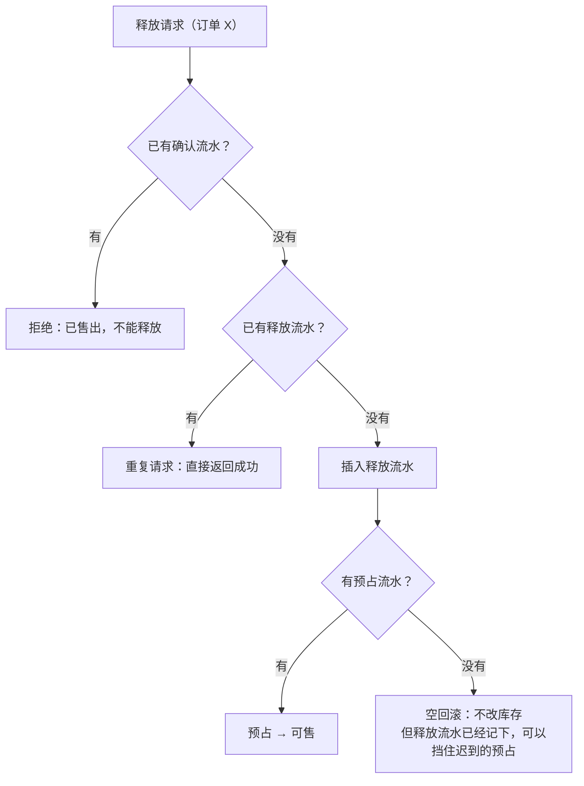

**追问链**

1. **流水表会非常大，怎么办？** 按 SKU 或者按时间分库分表；超过一定时间的流水归档。幂等只需要覆盖"可能重试的时间范围"，但对账和审计需要更长的历史，归档后的数据仍然要可查。
2. **为什么幂等键里要有动作类型？** 同一个订单对同一个 SKU 会有多个动作：预占、确认或释放。只用"订单号 + SKU"的话，预占之后的确认会被当成重复。
3. **部分释放怎么办？比如订单里的 3 件退了 1 件？** 那是另一个业务动作（售后回补），用售后单号作为业务单号，动作类型是"退货回补"。不要复用订单的释放动作。每一种库存变化都应该能追溯到一张具体的业务单据。

**生产实践 / 踩坑**

- **预占失败后重试，却丢弃了重试的结果**：写这段演示代码时就遇到了：第一次预占因为库存不足失败，紧接着的重试恰好赶上别人释放了库存而成功，但调用方用的是第一次的返回值，认为没有占上，于是这份预占永远没人确认或释放。调用方必须以**最后一次调用的结果**为准；库存侧也要有超时释放的兜底。
- **流水和库存更新不在同一个事务里**：流水写成功、库存更新失败，重试时流水冲突被认为"已处理"，库存就永远少扣了一次。

---

### S08-05 一个订单有多个 SKU，怎么保证要么全扣、要么全不扣？

> ★★★ ｜ 资深 ｜ 中频

**考察意图**：多行更新的原子性和死锁。这是日常开发里真实会遇到的问题。

**30 秒版回答**：

- **同一个库里**：放在**一个本地事务**里依次预占每个 SKU，任何一个失败就回滚整个事务。
- **死锁**：订单 A 先扣 SKU 1 再扣 SKU 2，订单 B 先扣 SKU 2 再扣 SKU 1，两个事务互相等待对方的行锁。**解决办法是固定加锁顺序**：所有事务都按 SKU ID 从小到大的顺序更新。
- **库存分库分表后**，多个 SKU 可能在不同的库里，本地事务管不了。做法是逐个预占，任何一个失败，就把前面已经成功的逐个释放。预占和释放都是幂等的，释放失败就重试。
- **部分有货怎么办**是业务规则：整单失败让用户修改；或者只下有货的部分。库存中心提供"全部成功或全部失败"的批量接口，以及"逐个返回结果"的接口，由调用方选择。

**深入剖析**

死锁是怎么形成的：

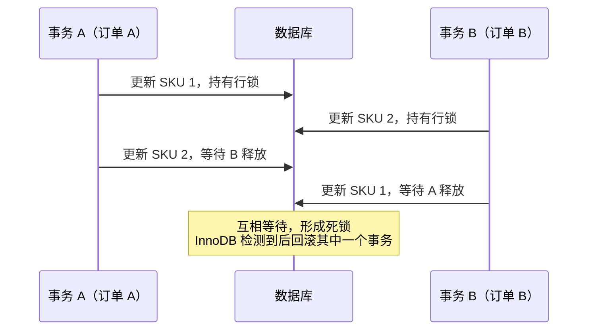

按 SKU ID 排序之后，两个事务都先更新 SKU 1，后到的在 SKU 1 上等待，不会出现互相等待的环。InnoDB 的死锁检测和排查见[《15 MySQL》](../04-数据存储/15-MySQL.md)。

跨库时的处理：

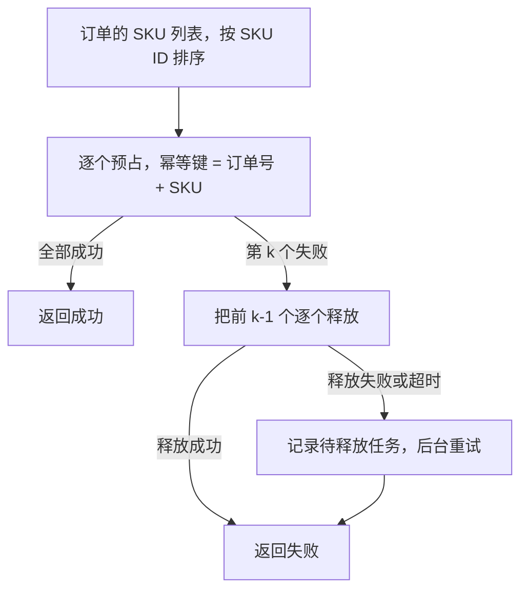

**追问链**

1. **一个事务里更新几十个 SKU，会不会太慢？** 大订单确实会。可以把同一个库里的多个 SKU 合并成一条批量更新，减少往返次数。但要注意批量更新时"哪些成功了"的判断：需要比较影响的行数和期望的行数，不相等就回滚。
2. **死锁之后怎么办？** 被回滚的事务会收到死锁错误，应用捕获后**重试整个事务**即可。固定加锁顺序能避免大部分死锁，但间隙锁等情况仍可能引发，所以重试逻辑还是要有。
3. **能不能给整个订单加一把分布式锁？** 锁订单没有用，冲突发生在 SKU 上：不同的订单争抢同一个 SKU。给每个 SKU 加分布式锁可以，但一个订单要获取多把锁，同样有顺序问题，而且比数据库的行锁更重。数据库的行锁已经足够。

---

## 三、扩展

### S08-06 多个仓库的库存怎么管理？一个订单从哪个仓发货？

> ★★ ｜ 资深 / 架构师 ｜ 中频

**考察意图**：从"一个数字"扩展到"多个地点的多个数字"。看你是否知道下单时扣的是哪个库存。

**30 秒版回答**：

- **库存按"SKU + 仓库"存储**。一个 SKU 在 10 个仓各有一条记录。
- **用户看到的库存**是按收货地址**可配送的那些仓库**的可售库存之和。同一个商品，北京的用户看到有货，新疆的用户可能看到无货。
- **寻源**（决定从哪个仓发）：根据收货地址、各仓的库存、配送时效和成本，选出发货仓。规则通常是：优先选能单仓发齐的、离用户最近的。
- **什么时候寻源**：
  - **下单时寻源**：预占的是具体某个仓的库存。库存准确，但下单链路变长；
  - **下单时只占"逻辑库存"，支付后再寻源**：下单时在一个区域的汇总库存上预占，支付后由履约系统决定具体从哪个仓发。下单更快，寻源可以做得更优（比如合并多个订单一起优化），但需要保证汇总库存和各仓的库存一致。
- **一个仓发不齐时**拆成多个包裹，从不同的仓发货。

**深入剖析**

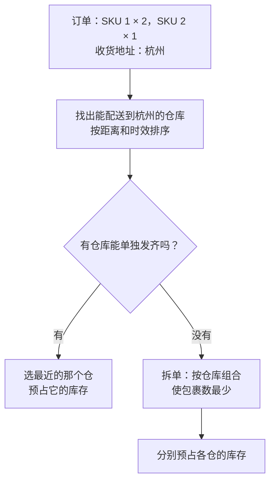

两层库存的做法：

| 层 | 粒度 | 用途 |
| --- | --- | --- |
| 区域库存（逻辑） | SKU + 销售区域 | 前台展示、下单预占。是这个区域内各仓库存的汇总 |
| 仓库库存（物理） | SKU + 仓库 | 寻源、出库。和仓储系统对应 |

下单时预占区域库存，支付后寻源，把预占"落"到具体的仓上。区域库存和仓库库存之间要保持：区域的可售 = 区域内各仓的可售之和。仓与仓之间调拨时，如果跨了区域，两个区域的库存都要变化。

**追问链**

1. **寻源的规则会很复杂吗？** 会。除了距离和库存，还有：仓库的产能和截单时间、商品的特殊属性（大件、冷链、危险品只能从特定仓发）、成本（尽量少拆包裹）、商家的指定仓。这些规则放在履约或寻源服务里，库存中心只提供"查询各仓库存"和"预占指定仓的库存"两个能力。
2. **下单时显示有货，支付后寻源发现没货怎么办？** 用两层库存时，区域库存和仓库库存之间可能出现短暂的不一致。预防的办法是区域库存留一点**安全余量**（区域可售 = 各仓可售之和 − 缓冲量）；兜底的办法是从相邻区域的仓调货，或者按缺货流程处理（S08-10）。
3. **多个销售渠道（自营 App、第三方平台）共用库存怎么办？** 把可售库存按渠道**分配配额**，每个渠道只能卖自己配额内的；或者所有渠道共享同一个可售库存，实时同步。前者不会互相抢占但可能一边卖光一边积压，需要动态调配；后者效率高，但要处理第三方平台同步延迟导致的超卖。

---

### S08-07 热门 SKU 的扣减成了瓶颈怎么办？

> ★★★ ｜ 架构师 ｜ 中频

**考察意图**：单行的行锁是数据库方案的上限。看你有哪些手段突破这个上限，以及各自的代价。

**30 秒版回答**：

瓶颈在于：对同一个 SKU 的所有扣减，都要争抢数据库里同一行的行锁。办法按引入的复杂度从低到高：

1. **缩短事务**：事务里只有"插流水 + 更新库存"两条语句，不夹带任何远程调用。持有行锁的时间越短，吞吐越高。
2. **合并扣减**：把短时间内对同一个 SKU 的多个请求攒成一批，在一个事务里一次扣减总数。锁竞争从"每个请求一次"变成"每一批一次"。
3. **库存分桶**：把一个 SKU 的库存拆成多行（比如 10 个桶，每桶 100 件），请求随机或者按用户哈希落到不同的桶上。竞争被分散到多行。代价是会有"这个桶没了、别的桶还有"的情况，需要重试其他桶，快卖完时要合并。
4. **前移到 Redis**：Lua 原子扣减，数据库异步落库。这是秒杀的方案，能力最强，复杂度也最高。

选择的原则：先用简单的，压测证明不够再往下走。

**深入剖析**

合并扣减的过程：

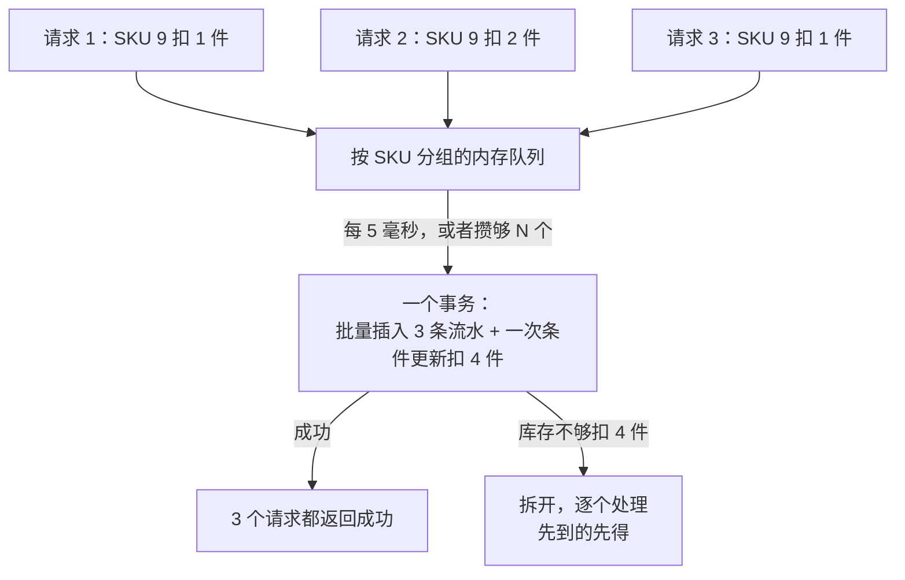

合并扣减用几毫秒的等待，换来锁竞争的大幅减少，和 MySQL 自己的组提交是同一个思路。要注意：攒在内存里的请求在进程崩溃时会丢失，调用方会收到超时，按超时处理（重试或释放）即可，不会造成不一致。

分桶之后的问题和处理：

| 问题 | 处理 |
| --- | --- |
| 请求落到的桶没货了 | 换下一个桶重试，最多试几个 |
| 剩余库存很少，分散在各个桶里 | 总量低于阈值时，把各桶合并回一个桶 |
| 一次要买多件，单个桶不够 | 从多个桶扣，在一个事务里完成 |
| 查询总库存 | 所有桶求和，可以缓存 |

Redis 里对热点库存 Key 的分段，思路相同，见[《S01 秒杀系统》](S01-秒杀系统.md)S01-07。

**追问链**

1. **怎么判断瓶颈真的在行锁上？** 看数据库的锁等待指标和慢查询：同一个 SKU 的更新语句大量处于等待行锁的状态，而数据库整体的 CPU 和 IO 并不高。如果是数据库整体负载高，那是容量问题，分库或者扩容更对症。
2. **把热点 SKU 单独放到一个库里有用吗？** 有一定作用：它的锁等待不会占满其他商品所在库的连接。但对这个 SKU 自己，单行的并发上限没有变。它解决的是**隔离**问题，不是**吞吐**问题。

---

### S08-08 商品页展示的库存从哪读？和真实库存不一致怎么办？

> ★★ ｜ 资深 ｜ 中频

**考察意图**：读和写对一致性的要求不同。看你是否知道展示可以"差不多"，扣减必须精确。

**30 秒版回答**：

- **展示读缓存，扣减走数据库**（或者走 Redis 的原子操作）。两者对一致性的要求不一样：
  - 商品页的访问量是下单量的几十上百倍，全部查库存库不现实；
  - 展示的库存差几件、晚几秒，用户基本没有感知。
- **展示不需要精确的数字**：多数情况下只显示"有货 / 无货 / 仅剩 N 件"。只有库存很少时才需要比较准确。
- **不一致是允许的，但方向要对**：缓存显示有货、实际没货，用户下单时被告知无货，体验差一点，没有错误；缓存显示无货、实际有货，会损失销量。两者都要控制在很短的时间内。
- **更新缓存**：库存变化后通过 binlog 或者事件异步更新缓存；缓存设置较短的过期时间作为兜底。售罄和补货这两个"状态翻转"的时刻要尽快更新。
- **以扣减的结果为准**：无论页面上显示什么，最终能不能买，由预占时的条件更新决定。

**深入剖析**

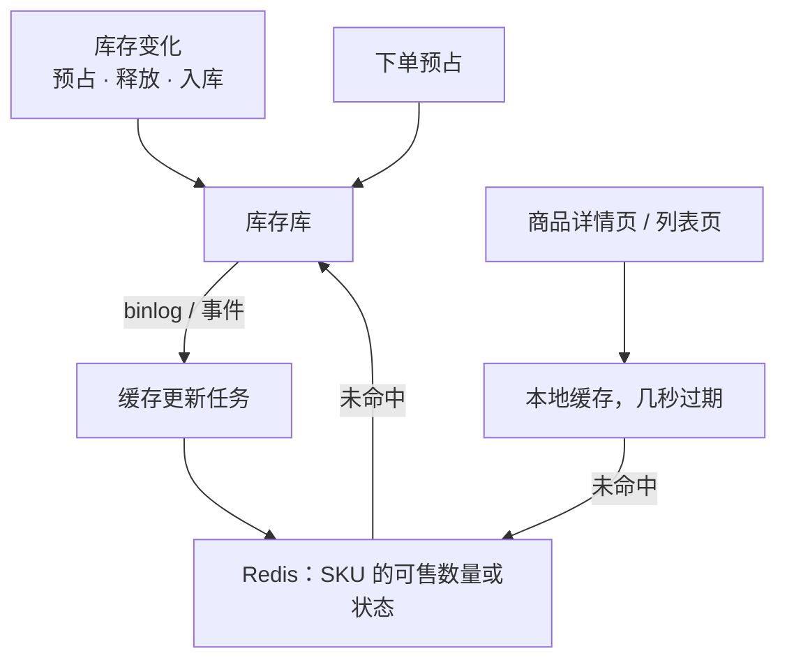

按库存水位区分更新策略：

| 库存水位 | 展示 | 缓存更新的及时性 |
| --- | --- | --- |
| 充足（远大于日销量） | "有货" | 不需要每次变化都更新，定时刷新即可 |
| 紧张（低于阈值） | "仅剩 N 件" | 每次变化都更新，过期时间缩短 |
| 售罄 | "无货"，按钮置灰 | 立即更新；有释放或补货时立即恢复 |

库存充足的商品占绝大多数，它们的缓存几乎不需要更新，这样就把缓存更新的压力集中到了少数真正需要准确的商品上。

**追问链**

1. **列表页要展示几十个商品的库存状态，怎么查？** 批量读取缓存（一次 `MGET` 或者管道），不要逐个查询。更进一步，列表页只需要"有货 / 无货"，可以把这个状态同步到搜索引擎的索引里，查询列表时一并返回，还能支持"只看有货"的筛选。
2. **缓存和数据库的一致性用什么策略？** 库存的展示缓存适合"变更后异步更新 + 短过期时间"：它能容忍短暂不一致，而且更新很频繁，不适合每次变更都同步删缓存。通用的缓存一致性策略见[《17 Redis》](../04-数据存储/17-Redis.md)17-14。
3. **多级缓存的本地缓存，怎么在售罄时尽快失效？** 本地缓存设置很短的过期时间（一两秒）；或者售罄时通过消息广播通知所有实例清除，见[《18 本地缓存》](../04-数据存储/18-本地缓存.md)18-08。

---

## 四、同步与兜底

### S08-09 仓库的入库、出库、盘点怎么同步到销售库存？

> ★★ ｜ 资深 / 架构师 ｜ 中频

**考察意图**：库存不只会减少。看你是否考虑了来自仓库侧的变化，以及这些变化和销售侧的并发。

**30 秒版回答**：

- **来源**：采购入库、退货入库、调拨、盘点调整（盘盈、盘亏）、报损。这些发生在仓储系统里。
- **同步方式**：仓储系统每完成一个作业，发出一个事件（带作业单号、SKU、仓库、数量）；库存中心消费事件，更新销售库存并记流水。**幂等键是作业单号**。
- **增加库存**（入库、盘盈）：可售直接增加，没有风险。
- **减少库存**（盘亏、报损）最要小心：
  - 减少的是可售库存。如果可售不够减（剩下的货已经被订单占用了），不能把可售减成负数；
  - 能减多少减多少，不够的部分意味着**已经卖出去的货实际不存在**，要进入缺货处理流程。
- **出库**：订单的货出库时，"已售待出库"减少。它不影响可售。
- **以事件驱动增量同步，再用定期全量对账兜底**。

**深入剖析**

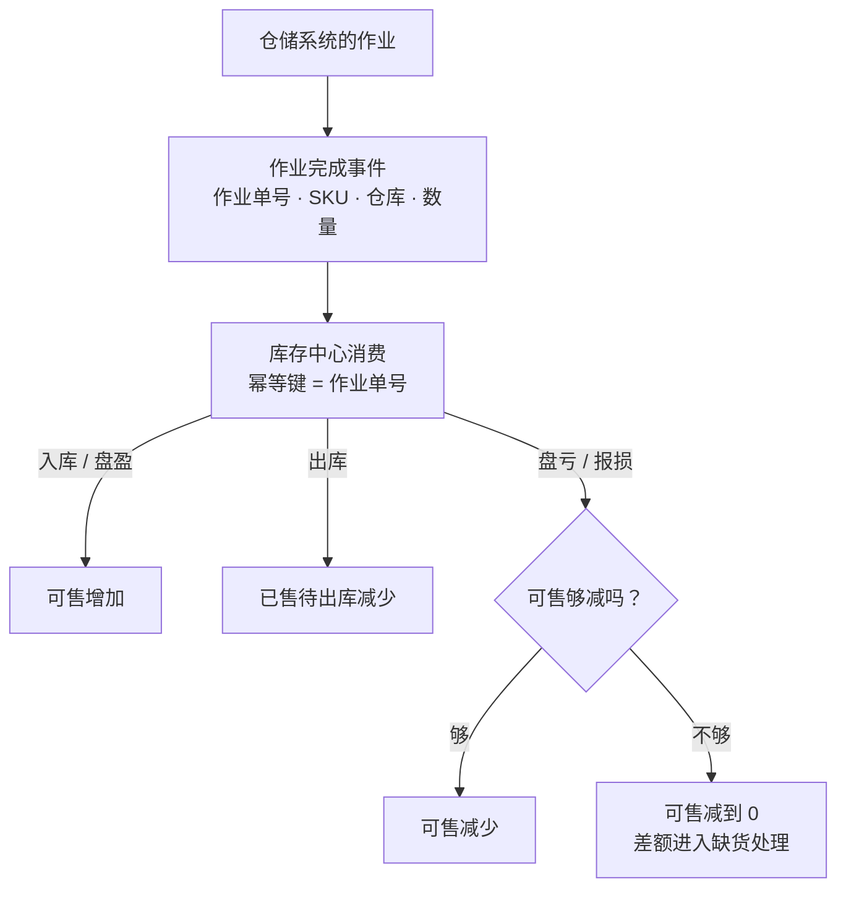

为什么不让销售库存直接等于"实物库存 − 已占用"实时计算：实物库存在仓储系统里，每次下单都跨系统查询一次，性能和可用性都受仓储系统的影响。销售库存是库存中心自己维护的一份数据，仓储系统短暂不可用时，销售不受影响。代价就是两边需要同步和对账。

**追问链**

1. **事件乱序了怎么办？比如同一个 SKU 的两次调整？** 每个事件是一个**增量**（加多少、减多少），而不是"把库存设置成多少"。增量操作之间的顺序不影响最终结果（加法满足交换律），所以不怕乱序。如果仓储系统只能提供"当前实物库存是 N"这种**全量**数据，那就必须带上版本号或时间戳，丢弃比当前更旧的数据。
2. **盘点期间还在卖货，盘出来的数字怎么用？** 盘点得到的是某一时刻的实物数量，而这期间销售还在发生。稳妥的做法是只同步**差异**（盘盈多少、盘亏多少），由仓储系统在盘点的那个时点和它自己的账面数比较得出，而不是用盘点的结果去覆盖销售库存。

---

### S08-10 怎么对账？真的超卖了怎么处理？

> ★★ ｜ 资深 / 架构师 ｜ 中频

**考察意图**：承认系统会出错。看你有没有发现问题的手段，以及出了问题之后的业务处理流程。

**30 秒版回答**：

- **内部对账**（库存中心自己）：每个 SKU，当前的可售、预占、已售，等于期初值加上流水的累计。不平说明库存的更新和流水不一致。
- **和订单对账**：待支付订单的商品数量之和 = 预占库存；已支付未出库订单的数量之和 = 已售待出库。不平说明有预占泄漏、重复扣减或者遗漏。
- **和仓储对账**：可售 + 预占 + 已售待出库 = 仓库里可用于销售的实物库存。
- **缓存和数据库对账**：热点商品在 Redis 里的库存，与数据库一致。
- **超卖了怎么办**（订单已支付，但没有货）：按优先级：从其他仓调货 → 联系供应商紧急补货并告知用户延迟发货 → 和用户协商换货或退款并给予补偿。同时冻结这个 SKU 的销售，查明原因。
- 超卖的处理主要是**业务流程**，系统要做的是尽早发现、准确定位受影响的订单。

**深入剖析**

| 对账 | 等式 | 不平时常见的原因 |
| --- | --- | --- |
| 库存 ↔ 流水 | 当前值 = 期初 + 流水累计 | 绕过流水直接改了库存；流水和库存不在同一个事务 |
| 预占 ↔ 待支付订单 | 预占量 = 待支付订单的数量之和 | 订单取消后没有释放；下单失败后预占泄漏 |
| 已售 ↔ 已支付订单 | 已售待出库 = 已支付未出库订单的数量之和 | 支付成功事件丢失；重复确认 |
| 销售库存 ↔ 实物库存 | 可售 + 预占 + 已售待出库 = 可销售的实物库存 | 仓储事件丢失；盘点差异没有同步 |
| Redis ↔ 数据库 | 两边的可售数量一致 | 异步落库失败；Redis 数据丢失 |

预占泄漏是最常见的问题：预占了但既没有确认也没有释放，可售库存越来越少，商品明明有货却显示无货。专门的检查任务：

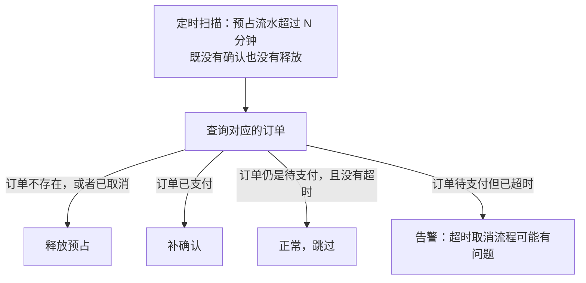

**追问链**

1. **对账时库存还在变，怎么比？** 不比"此刻"的值，而是比某个时间点之前已经稳定的数据：只统计 N 分钟之前创建的订单和流水，给在途的异步流程留出完成的时间。或者在低峰期对单个 SKU 短暂加锁后比较。
2. **发现可售库存比实际多了（会导致超卖），怎么修？** 先把这个 SKU 的可售调整为正确的值，用一条"对账调整"类型的流水记录下来（带上对账批次号作为业务单号），而不是直接改数字。再检查这期间有没有因此超卖的订单。
3. **超卖的原因通常有哪些？** 库存的增加被重复执行（入库事件重复消费且没有幂等）；释放被重复执行；Redis 主从切换后库存回退；人工在后台改错了数字；盘亏没有及时同步。前两种靠流水的唯一索引防止，后几种靠对账发现。

**架构师加分点**

- 库存中心的设计可以归结为一句话：**库存不是一个数字，而是一本账**。每一次变化都是一笔有来源单据的流水，当前值只是这本账的余额。有了这个认识，幂等（同一张单据不记两次）、追溯（这个数为什么是这样）、对账（余额等于流水累计），都是自然的结果，而不是后来打的补丁。这和账务系统的思路完全一致，见[《S09 账务与钱包》](S09-账务与钱包.md)。
