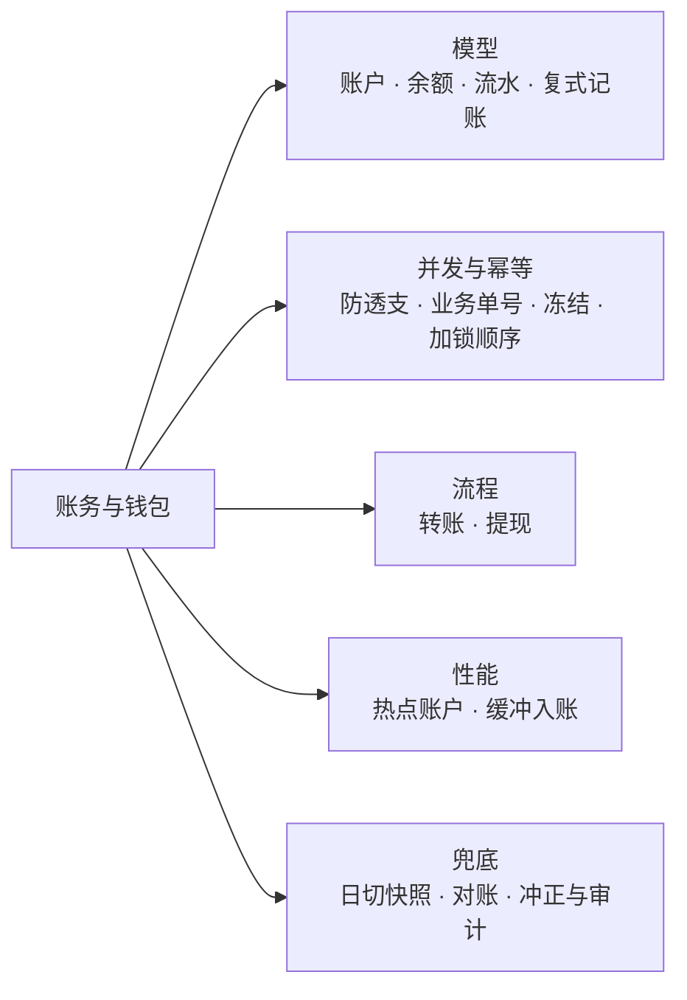
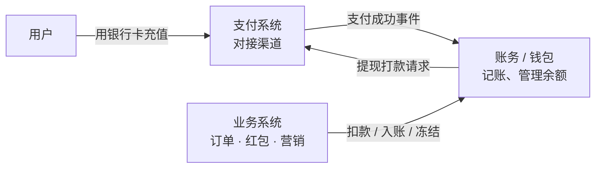
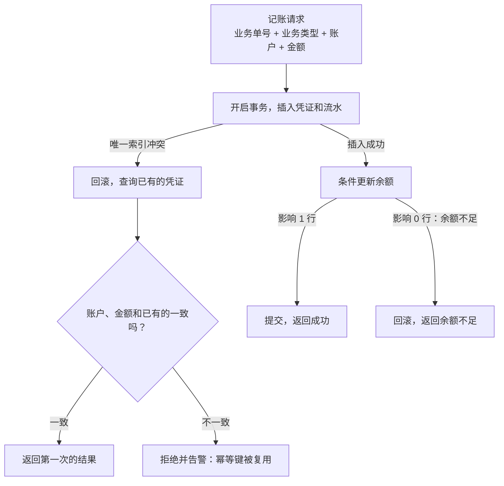
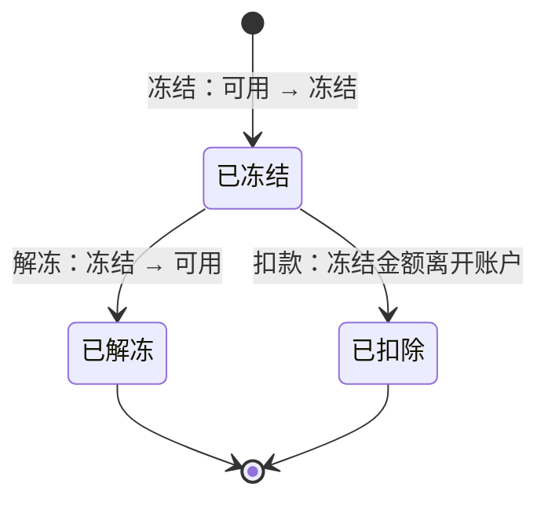
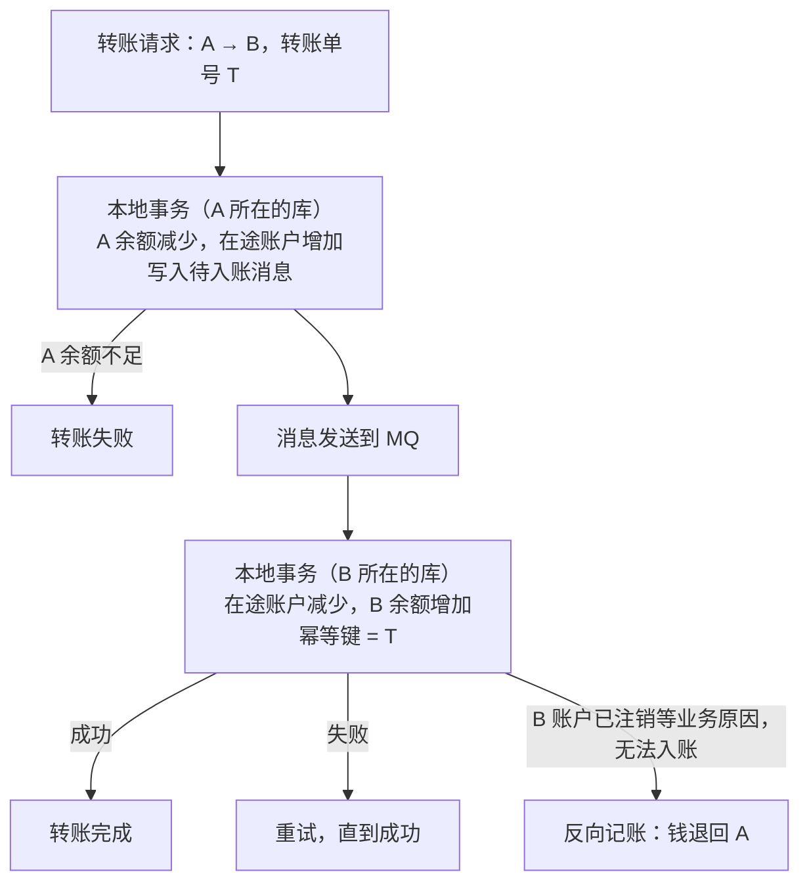
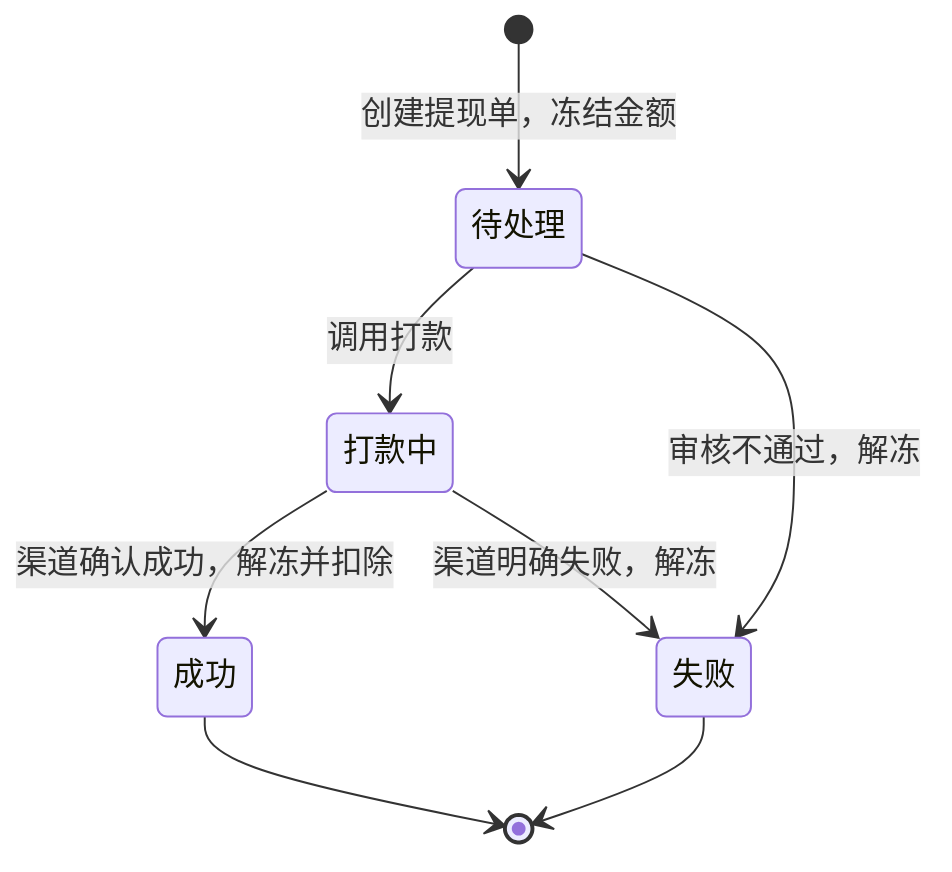
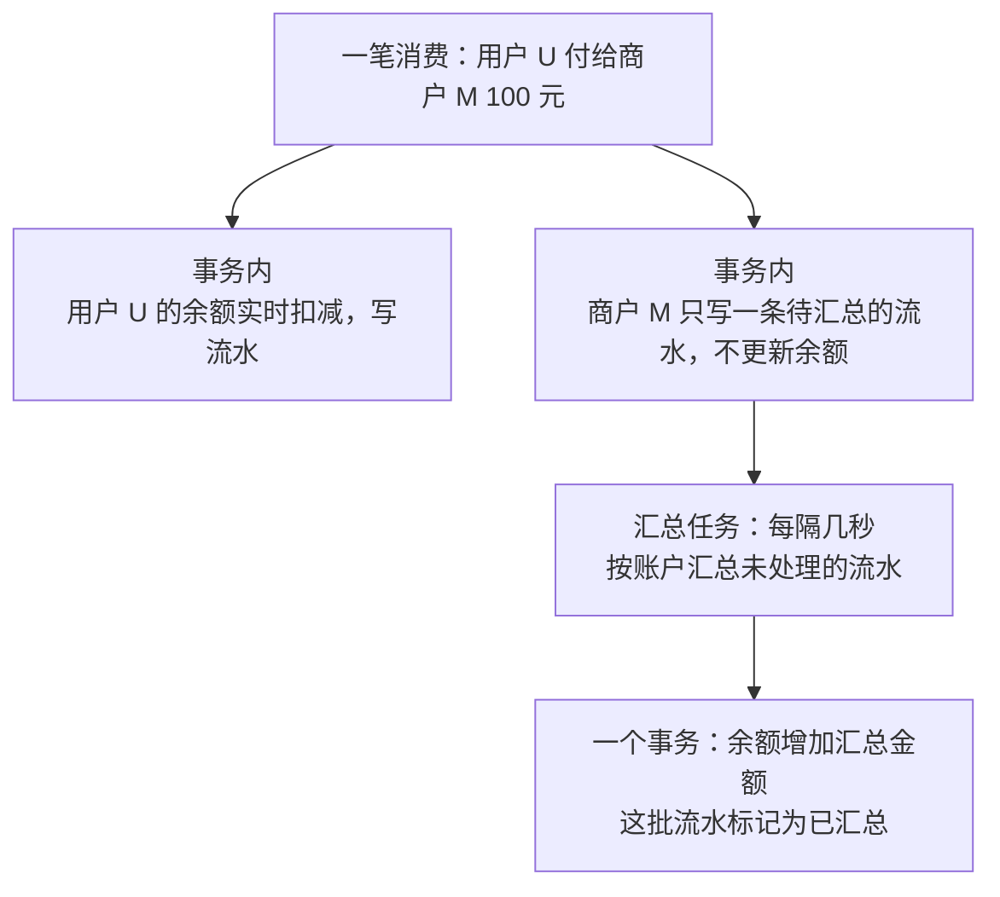
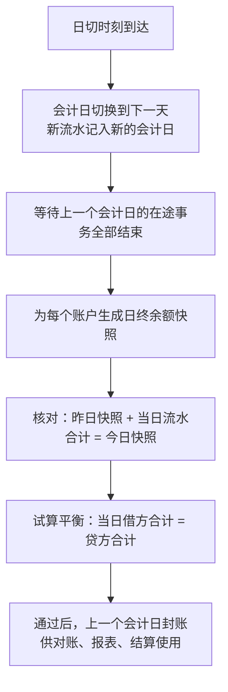

# S09 · 账务与钱包

> 适用岗位：Java 资深开发、Java 架构师。钱包（余额）是很多业务的基础设施：充值、消费、转账、提现、红包、退款都落在它上面。这道题考察的是账户和流水的建模、余额变更的并发安全，以及复式记账带来的自校验能力。
> 版本基线：JDK 21 / 25、MySQL 8.4。
> 事实核对：
> - 复式记账的规则（有借必有贷、借贷必相等；资产 = 负债 + 所有者权益）是会计的通用准则，本文只用到了其中最基本的部分。科目的设置各公司不同，文中的科目是为了说明问题而简化的。
> - 本机运行（macOS 27.2、Apple M1 Max、JDK 25）：1 段复式记账的代码只依赖 JDK，文中贴的是实际运行输出。
> - 本机没有 MySQL 服务端，文中的 SQL 都没有实际执行。
> 相关分类：[《S03 支付系统》](S03-支付系统.md)（支付单、渠道、记账的触发）、[《S04 对账系统》](S04-对账系统.md)（试算平衡、内部对账）、[《S06 抢红包》](S06-抢红包.md)（入账、退回）、[《09 分布式理论》](../03-分布式与微服务/09-分布式理论.md)（幂等、分布式事务）、[《15 MySQL》](../04-数据存储/15-MySQL.md)（行锁、死锁、事务）

## 45 分钟答题版

| 时间 | 做什么 | 要讲出的关键点 | 子题 |
| --- | --- | --- | --- |
| 0～5 分钟 | 澄清范围 | 余额的增减、冻结、转账、提现；**钱不能凭空多出来或者消失** | S09-01 |
| 5～15 分钟 | 模型 | 账户、余额、流水；复式记账与试算平衡 | S09-02、S09-03 |
| 15～28 分钟 | 并发与幂等 | 条件更新防透支；业务单号幂等；冻结与解冻；转账的加锁顺序 | S09-04 ～ S09-07 |
| 28～36 分钟 | 流程 | 提现：冻结、打款、确认或解冻；跨库转账 | S09-07、S09-08 |
| 36～45 分钟 | 性能与兜底 | 热点账户；日切与余额快照；对账、冲正、审计 | S09-09 ～ S09-11 |

## 知识地图



## 题目索引

| 编号 | 题目 | 难度 |
| --- | --- | --- |
| S09-01 | 钱包系统的范围是什么？有哪些硬约束？ | ★★ |
| S09-02 | 账户、余额、流水怎么建模？ | ★★★ |
| S09-03 | 什么是复式记账？它怎么帮助发现错误？ | ★★★ |
| S09-04 | 扣减余额怎么保证并发安全、不透支？ | ★★★ |
| S09-05 | 记账的幂等怎么做？ | ★★ |
| S09-06 | 冻结和解冻怎么设计？ | ★★ |
| S09-07 | 转账怎么做？两个账户不在同一个库怎么办？ | ★★★ |
| S09-08 | 提现的流程怎么设计？打款结果未知怎么办？ | ★★★ |
| S09-09 | 平台账户、大商户账户成了热点怎么办？ | ★★★ |
| S09-10 | 什么是日切？余额快照有什么用？ | ★★ |
| S09-11 | 账记错了怎么改？怎么对账和审计？ | ★★ |

---

## 一、模型

### S09-01 钱包系统的范围是什么？有哪些硬约束？

> ★★ ｜ 资深 / 架构师 ｜ 中频

**考察意图**：先明确这是一个"记账"系统，而不是"支付"系统，并把资金安全的要求讲清楚。

**30 秒版回答**：

- **范围**：管理用户和商户在平台内的**账户余额**。提供充值入账、消费扣款、转账、冻结与解冻、提现、退款入账、流水查询。它不直接和银行、第三方支付打交道，那是支付系统的事（[《S03 支付系统》](S03-支付系统.md)）。
- **硬约束**：
  1. **不透支**：余额不能被扣成负数（除非明确允许的账户）；
  2. **不丢不多**：每一笔余额变化都有对应的流水，余额 = 流水的累计；钱只能从一个账户到另一个账户，不能凭空产生或消失；
  3. **幂等**：同一笔业务只记一次账；
  4. **可追溯、不可篡改**：流水只增不改，错了用新的流水冲正。
- **优先级**：正确性第一，其次是可用性，最后才是性能。
- **合规**：在平台内保存用户资金通常受到监管（例如需要相应的资质、资金要由持牌机构存管）。面试时点到即可，说明技术方案要在合规框架内设计。

**深入剖析**

| 问题 | 为什么要问 | 本文的假设 |
| --- | --- | --- |
| 账户有哪些类型？ | 决定账户模型 | 用户余额账户、商户账户、平台内部账户 |
| 一个用户有几个账户？ | 是否区分现金、赠送金、积分 | 一个用户可以有多个账户，按资金类型区分 |
| 交易量多大？ | 决定分库分表和热点处理 | 1 亿个账户，日均 5000 万笔记账，峰值每秒 1 万笔 |
| 需要冻结吗？ | 提现、担保交易需要 | 需要 |
| 余额有没有利息、有效期？ | 增加计算和批处理 | 没有利息；赠送金有有效期 |

钱包和支付的关系：



**追问链**

1. **余额和积分、优惠券有什么不同？** 余额是真实的资金，可以提现，受监管约束，一分钱都不能错。积分和券是营销权益，规则由平台自己定。技术上它们都是"账户 + 流水"的模型，可以用同一套账务引擎承载，但要用不同的账户类型隔离，不能混在一个余额里。
2. **赠送金和现金为什么要分开？** 赠送的钱通常不能提现、有有效期、消费时的扣减顺序有规定。如果和现金混在一个余额里，这些规则都无法执行，退款时也分不清该退到哪里。每一种性质不同的资金，用一个独立的账户。

---

### S09-02 账户、余额、流水怎么建模？

> ★★★ ｜ 资深 / 架构师 ｜ 高频

**考察意图**：账务系统的三张核心表。看你是否知道流水才是事实，余额只是流水的汇总结果。

**30 秒版回答**：

- **账户表**：一个账户一行。账户号、所属主体（用户或商户）、账户类型、币种、**可用余额**、**冻结余额**、状态、版本号。
- **账户流水表**：账户的每一次余额变化一行。账户号、业务单号、方向（收入或支出）、金额、**变化后的余额**、流水类型、时间。只增不改。
- **记账凭证表**：一笔业务对应一张凭证，一张凭证包含多条分录（至少一借一贷）。它记录的是"这笔业务让哪些账户发生了什么变化"。
- **谁是事实**：流水和凭证是事实，余额是它们累计的结果。任何时候，账户的余额都应该能由流水重新计算出来。余额字段的存在只是为了查询快。
- **余额和流水必须在同一个事务里更新**。

**深入剖析**

```sql
CREATE TABLE t_account (
    account_no     VARCHAR(32)  NOT NULL PRIMARY KEY,
    owner_id       BIGINT       NOT NULL COMMENT '用户或商户 ID',
    account_type   VARCHAR(16)  NOT NULL COMMENT 'CASH / BONUS / MERCHANT / INTERNAL……',
    currency       CHAR(3)      NOT NULL,
    balance        BIGINT       NOT NULL COMMENT '可用余额，单位分',
    frozen         BIGINT       NOT NULL DEFAULT 0 COMMENT '冻结金额',
    status         VARCHAR(16)  NOT NULL COMMENT 'NORMAL / FROZEN / CLOSED',
    version        BIGINT       NOT NULL,
    update_time    DATETIME(3)  NOT NULL,
    UNIQUE KEY uk_owner_type (owner_id, account_type, currency)
);

CREATE TABLE t_account_journal (
    id            BIGINT       NOT NULL PRIMARY KEY,
    account_no    VARCHAR(32)  NOT NULL,
    voucher_no    VARCHAR(32)  NOT NULL COMMENT '所属的记账凭证',
    biz_no        VARCHAR(64)  NOT NULL COMMENT '业务单号',
    biz_type      VARCHAR(32)  NOT NULL COMMENT 'RECHARGE / PAY / TRANSFER_OUT / WITHDRAW……',
    direction     CHAR(1)      NOT NULL COMMENT 'D 借 / C 贷',
    amount        BIGINT       NOT NULL,
    balance_after BIGINT       NOT NULL COMMENT '这笔流水之后的余额',
    create_time   DATETIME(3)  NOT NULL,
    UNIQUE KEY uk_biz (account_no, biz_no, biz_type),
    KEY idx_account_time (account_no, create_time)
);
```

`balance_after` 的作用：

- 用户看到的账单里，每一笔后面都有"余额"；
- 核对时不用从头累加：相邻两条流水，后一条的 `balance_after` 应该等于前一条的 `balance_after` 加上或减去后一条的金额。任何一处断了，就定位到了出错的那一笔；
- 账户的当前余额应该等于它最后一条流水的 `balance_after`。

**追问链**

1. **为什么不只存流水，余额每次现算？** 一个活跃账户可能有几十万条流水，每次查余额都累加一遍太慢。余额是一个物化的汇总值。事件溯源的系统里也是一样的处理：事件是事实，再配一个随事件更新的当前状态（快照）。
2. **账户表按什么分库分表？** 按账户号（或者所属主体的 ID）分片。流水表用同样的分片键，保证一个账户的余额和流水在同一个库里，可以用本地事务更新。
3. **用户的"账单"查询直接查流水表吗？** 近期的可以。流水表很大，历史数据要归档；面向用户的账单还需要商户名称、商品信息等，这些不在账务里。常见的做法是另建一个面向展示的账单服务，由账务流水和业务数据组合而成，账务流水表只服务于记账和对账。

---

### S09-03 什么是复式记账？它怎么帮助发现错误？

> ★★★ ｜ 架构师 ｜ 中频

**考察意图**：是否理解复式记账不是财务的繁文缛节，而是一种自带校验的数据模型。

**30 秒版回答**：

- **单式记账**：只记"这个账户加了多少、减了多少"。A 给 B 转 30 元，记两条互不相关的流水。如果程序只执行了一半（A 扣了，B 没加），没有任何数据能看出来。
- **复式记账**：每一笔业务记成一张**凭证**，凭证里的分录**有借必有贷，借贷必相等**。钱从哪里来、到哪里去，同时记录。
- **自校验**：
  - 单张凭证：借方合计 = 贷方合计，不相等的凭证不允许入账；
  - 全局：所有分录的借方总额 = 贷方总额（**试算平衡**）；
  - 会计恒等式：资产 = 负债 + 所有者权益（收入最终归入权益）。
- **用户的余额是平台的负债**：用户充值 100 元，平台的银行存款（资产）增加 100，同时欠用户的钱（负债）增加 100。这解释了为什么用户余额的增加记在"贷方"。
- 这些等式都可以由程序每天自动检查。不平，就一定有 bug 或者有数据被改过。

**深入剖析**

用 JDK 实现一个最小的复式记账引擎（本机 JDK 25 运行）：

```java
import java.util.ArrayList;
import java.util.LinkedHashMap;
import java.util.List;
import java.util.Map;
import java.util.Random;
import java.util.concurrent.ConcurrentHashMap;
import java.util.concurrent.CountDownLatch;
import java.util.concurrent.ExecutorService;
import java.util.concurrent.Executors;
import java.util.concurrent.locks.ReentrantLock;

/**
 * 复式记账的最小实现：一张凭证包含若干条分录，借方合计必须等于贷方合计；
 * 凭证按业务单号幂等；用户账户不允许透支；多个账户加锁时按账户号排序，避免死锁。
 */
public class LedgerDemo {

    enum Side { DEBIT, CREDIT }

    /** 账户类型决定余额的方向：资产类借方增加，负债类和收入类贷方增加 */
    enum AccountType {
        ASSET(Side.DEBIT), LIABILITY(Side.CREDIT), INCOME(Side.CREDIT);

        final Side increaseSide;

        AccountType(Side increaseSide) {
            this.increaseSide = increaseSide;
        }
    }

    record Entry(String account, Side side, long amountCent) { }

    static final class Account {
        final String no;
        final AccountType type;
        final boolean overdraftAllowed;
        final ReentrantLock lock = new ReentrantLock();
        long balanceCent;

        Account(String no, AccountType type, boolean overdraftAllowed) {
            this.no = no;
            this.type = type;
            this.overdraftAllowed = overdraftAllowed;
        }

        long delta(Entry entry) {
            return entry.side() == type.increaseSide ? entry.amountCent() : -entry.amountCent();
        }
    }

    static final class Ledger {
        private final Map<String, Account> accounts = new LinkedHashMap<>();
        /** 已入账的凭证，key 是业务单号，相当于凭证表上的唯一索引 */
        private final Map<String, List<Entry>> vouchers = new ConcurrentHashMap<>();

        void open(String no, AccountType type, boolean overdraftAllowed) {
            accounts.put(no, new Account(no, type, overdraftAllowed));
        }

        /** 记一张凭证。返回值说明处理结果 */
        String post(String bizNo, List<Entry> entries) {
            long debit = entries.stream().filter(e -> e.side() == Side.DEBIT).mapToLong(Entry::amountCent).sum();
            long credit = entries.stream().filter(e -> e.side() == Side.CREDIT).mapToLong(Entry::amountCent).sum();
            if (debit != credit) {
                return "REJECTED: debit " + debit + " != credit " + credit;
            }
            // 按账户号排序加锁：所有凭证的加锁顺序一致，不会出现互相等待
            List<Account> locked = entries.stream().map(e -> accounts.get(e.account())).distinct()
                    .sorted((a, b) -> a.no.compareTo(b.no)).toList();
            locked.forEach(account -> account.lock.lock());
            try {
                if (vouchers.containsKey(bizNo)) {
                    return "DUPLICATE: ignored";
                }
                Map<Account, Long> after = new LinkedHashMap<>();
                for (Entry entry : entries) {
                    Account account = accounts.get(entry.account());
                    after.merge(account, account.delta(entry), Long::sum);
                }
                for (Map.Entry<Account, Long> change : after.entrySet()) {
                    Account account = change.getKey();
                    if (!account.overdraftAllowed && account.balanceCent + change.getValue() < 0) {
                        return "REJECTED: insufficient balance of " + account.no;
                    }
                }
                after.forEach((account, change) -> account.balanceCent += change);
                vouchers.put(bizNo, entries);
                return "POSTED";
            } finally {
                locked.forEach(account -> account.lock.unlock());
            }
        }

        /** 冲正：不修改原凭证，记一张借贷方向相反的新凭证 */
        String reverse(String bizNo) {
            List<Entry> original = vouchers.get(bizNo);
            List<Entry> reversed = new ArrayList<>();
            for (Entry entry : original) {
                reversed.add(new Entry(entry.account(), entry.side() == Side.DEBIT ? Side.CREDIT : Side.DEBIT,
                        entry.amountCent()));
            }
            return post("REVERSE-" + bizNo, reversed);
        }

        void trialBalance() {
            long debit = 0;
            long credit = 0;
            Map<String, Long> fromEntries = new LinkedHashMap<>();
            for (List<Entry> entries : vouchers.values()) {
                for (Entry entry : entries) {
                    if (entry.side() == Side.DEBIT) {
                        debit += entry.amountCent();
                    } else {
                        credit += entry.amountCent();
                    }
                    fromEntries.merge(entry.account(), accounts.get(entry.account()).delta(entry), Long::sum);
                }
            }
            boolean balancesMatch = accounts.values().stream()
                    .allMatch(a -> a.balanceCent == fromEntries.getOrDefault(a.no, 0L));
            long assets = sumOf(AccountType.ASSET);
            long liabilities = sumOf(AccountType.LIABILITY);
            long income = sumOf(AccountType.INCOME);
            System.out.println("  vouchers=" + vouchers.size() + ", total debit=" + debit + ", total credit=" + credit);
            System.out.println("  every balance equals the sum of its entries: " + balancesMatch);
            System.out.println("  assets " + assets + " = liabilities " + liabilities + " + income " + income
                    + " : " + (assets == liabilities + income));
        }

        private long sumOf(AccountType type) {
            return accounts.values().stream().filter(a -> a.type == type).mapToLong(a -> a.balanceCent).sum();
        }

        long balance(String no) {
            return accounts.get(no).balanceCent;
        }
    }

    private static final int USER_COUNT = 20;
    private static final int TRANSFER_COUNT = 20_000;
    private static final long RANDOM_SEED = 20261112L;

    public static void main(String[] args) throws InterruptedException {
        Ledger ledger = new Ledger();
        ledger.open("BANK", AccountType.ASSET, true);          // 平台在银行的存款
        ledger.open("FEE", AccountType.INCOME, true);          // 手续费收入
        ledger.open("USER-A", AccountType.LIABILITY, false);   // 用户余额：平台欠用户的钱
        ledger.open("USER-B", AccountType.LIABILITY, false);

        System.out.println("1 recharge A 100.00    : " + ledger.post("RECHARGE-1", List.of(
                new Entry("BANK", Side.DEBIT, 10_000), new Entry("USER-A", Side.CREDIT, 10_000))));
        List<Entry> transfer = List.of(
                new Entry("USER-A", Side.DEBIT, 3_000), new Entry("USER-B", Side.CREDIT, 3_000));
        System.out.println("2 transfer A->B 30.00  : " + ledger.post("TRANSFER-1", transfer));
        System.out.println("3 same transfer again  : " + ledger.post("TRANSFER-1", transfer));
        System.out.println("4 reverse transfer-1   : " + ledger.reverse("TRANSFER-1"));
        System.out.println("  A=" + ledger.balance("USER-A") + ", B=" + ledger.balance("USER-B"));
        System.out.println("5 transfer A->B 30.00  : " + ledger.post("TRANSFER-2", transfer));
        System.out.println("6 withdraw B 20, fee 1 : " + ledger.post("WITHDRAW-1", List.of(
                new Entry("USER-B", Side.DEBIT, 2_000), new Entry("BANK", Side.CREDIT, 1_900),
                new Entry("FEE", Side.CREDIT, 100))));
        System.out.println("7 transfer A->B 100.00 : " + ledger.post("TRANSFER-3", List.of(
                new Entry("USER-A", Side.DEBIT, 10_000), new Entry("USER-B", Side.CREDIT, 10_000))));
        System.out.println("8 unbalanced voucher   : " + ledger.post("BAD-1", List.of(
                new Entry("USER-A", Side.DEBIT, 500), new Entry("USER-B", Side.CREDIT, 400))));
        System.out.println("9 reverse transfer-2   : " + ledger.reverse("TRANSFER-2"));
        System.out.println("  A=" + ledger.balance("USER-A") + ", B=" + ledger.balance("USER-B")
                + ", BANK=" + ledger.balance("BANK") + ", FEE=" + ledger.balance("FEE"));
        ledger.trialBalance();

        // 并发：20 个用户各充值 1000 元，然后 2 万笔随机转账同时进行
        Ledger bank = new Ledger();
        bank.open("BANK", AccountType.ASSET, true);
        for (int i = 0; i < USER_COUNT; i++) {
            bank.open("U" + i, AccountType.LIABILITY, false);
            bank.post("INIT-" + i, List.of(new Entry("BANK", Side.DEBIT, 100_000), new Entry("U" + i, Side.CREDIT, 100_000)));
        }
        Random random = new Random(RANDOM_SEED);
        CountDownLatch done = new CountDownLatch(TRANSFER_COUNT);
        Map<String, Integer> results = new ConcurrentHashMap<>();
        try (ExecutorService pool = Executors.newFixedThreadPool(16)) {
            for (int i = 0; i < TRANSFER_COUNT; i++) {
                int from = random.nextInt(USER_COUNT);
                int to = (from + 1 + random.nextInt(USER_COUNT - 1)) % USER_COUNT;
                long amount = 1 + random.nextInt(60_000);
                String bizNo = "T" + i;
                pool.execute(() -> {
                    String result = bank.post(bizNo, List.of(
                            new Entry("U" + from, Side.DEBIT, amount), new Entry("U" + to, Side.CREDIT, amount)));
                    results.merge(result.startsWith("POSTED") ? "posted" : "rejected", 1, Integer::sum);
                    done.countDown();
                });
            }
            done.await();
        }
        long total = 0;
        long min = Long.MAX_VALUE;
        for (int i = 0; i < USER_COUNT; i++) {
            total += bank.balance("U" + i);
            min = Math.min(min, bank.balance("U" + i));
        }
        System.out.println("concurrent transfers: " + results);
        System.out.println("  sum of user balances=" + total + " (must be " + USER_COUNT * 100_000L + "), min balance=" + min);
        bank.trialBalance();
    }
}
```

```text
1 recharge A 100.00    : POSTED
2 transfer A->B 30.00  : POSTED
3 same transfer again  : DUPLICATE: ignored
4 reverse transfer-1   : POSTED
  A=10000, B=0
5 transfer A->B 30.00  : POSTED
6 withdraw B 20, fee 1 : POSTED
7 transfer A->B 100.00 : REJECTED: insufficient balance of USER-A
8 unbalanced voucher   : REJECTED: debit 500 != credit 400
9 reverse transfer-2   : REJECTED: insufficient balance of USER-B
  A=7000, B=1000, BANK=8100, FEE=100
  vouchers=5, total debit=21000, total credit=21000
  every balance equals the sum of its entries: true
  assets 8100 = liabilities 8000 + income 100 : true
concurrent transfers: {rejected=4881, posted=15119}
  sum of user balances=2000000 (must be 2000000), min balance=3895
  vouchers=15139, total debit=410316275, total credit=410316275
  every balance equals the sum of its entries: true
  assets 2000000 = liabilities 2000000 + income 0 : true
```

前半部分是 9 个操作，对应的分录和结果：

| 步骤 | 业务 | 借方 | 贷方 | 结果 |
| --- | --- | --- | --- | --- |
| 1 | A 充值 100 元 | 银行存款 100 | A 余额 100 | 入账 |
| 2 | A 转给 B 30 元 | A 余额 30 | B 余额 30 | 入账 |
| 3 | 同一笔转账重复提交 | — | — | 按业务单号识别为重复，忽略 |
| 4 | 冲正第 2 步的转账 | B 余额 30 | A 余额 30 | 入账，A 回到 100 元，B 回到 0 |
| 5 | A 再转给 B 30 元 | A 余额 30 | B 余额 30 | 入账 |
| 6 | B 提现 20 元，手续费 1 元 | B 余额 20 | 银行存款 19、手续费收入 1 | 入账 |
| 7 | A 转给 B 100 元 | — | — | 拒绝：A 只有 70 元 |
| 8 | 借 5 元、贷 4 元的凭证 | — | — | 拒绝：借贷不平 |
| 9 | 冲正第 5 步的转账 | — | — | 拒绝：B 只剩 10 元，不够退回 30 元 |

最后三行是试算的结果：借方总额等于贷方总额；每个账户的余额等于它的分录累计；银行存款 81 元 = 用户余额 80 元 + 手续费收入 1 元。

第 9 步值得注意：冲正也是一张普通的凭证，同样受"不允许透支"的约束。B 已经把钱提走了，这时想把转账撤回，系统不会让 B 的余额变成负数。现实中这种情况要走追偿的业务流程，而不是在账上硬改。

后半部分是并发测试：20 个用户各有 1000 元，2 万笔随机转账由 16 个线程同时执行。结果是用户余额的总和不变、没有任何账户为负、试算平衡。成功和被拒绝的笔数与线程调度有关，每次运行不同，这几个等式不变。

**追问链**

1. **借和贷到底是什么意思？** 只是两个方向的名字，可以理解成"左边"和"右边"。规则是：资产类账户，借方表示增加；负债类和收入类账户，贷方表示增加。记住"用户余额是平台的负债"，就能推出用户余额增加记贷方、减少记借方。面试时不需要展开会计理论，能说清这一点和几个恒等式就够了。
2. **每笔业务都要记到平台的内部账户上吗？** 是的，这正是复式记账的要求。用户之间转账，借贷双方都是用户账户；但充值、提现、手续费、营销补贴，另一方一定是平台的内部账户（银行存款、手续费收入、营销费用、待清算款）。内部账户的余额有明确的业务含义，比如"待清算款"的余额就是"渠道还没有结算给我们的钱"。
3. **复式记账会不会让写入量翻倍，影响性能？** 一笔业务至少两条分录，写入量确实更大。但资金系统里正确性优先。真正的性能问题来自热点账户（所有业务都要记到同一个内部账户上），它有专门的解法（S09-09）。

**架构师加分点**

- 复式记账的价值在于它把"钱不会凭空产生或消失"这条业务规则，变成了数据层面可以自动检查的等式。很多团队的钱包系统只有"用户余额表 + 流水表"，出了问题只能靠人工翻日志。加上内部账户和借贷平衡之后，任何一笔单边的错误都会在当天的试算里暴露出来。

---

## 二、并发与幂等

### S09-04 扣减余额怎么保证并发安全、不透支？

> ★★★ ｜ 资深 / 架构师 ｜ 高频

**考察意图**：和库存扣减是同一类问题，但多了"变化后的余额"要写进流水。看你是否处理好了这一点。

**30 秒版回答**：

- **错误的做法**：先查余额，在程序里判断够不够，再把"余额 − 金额"写回去。两个并发请求读到同一个余额，后写的覆盖先写的，钱只扣了一次，或者扣成了负数。
- **条件更新**：`UPDATE ... SET balance = balance - ? WHERE account_no = ? AND balance >= ?`。判断和扣减是一条语句，数据库的行锁保证同一个账户的更新是串行的。影响 0 行就是余额不足。
- **流水里要记"变化后的余额"**，所以需要知道扣减之后的值。两种做法：
  - 在同一个事务里，条件更新之后再查一次余额（此时持有行锁，读到的就是更新后的值）；
  - 先 `SELECT ... FOR UPDATE` 锁住账户行，程序里计算，再更新并写流水。
- **更新余额、写流水、写凭证，在同一个本地事务里**。
- 入账（加钱）不需要判断余额，但同样要走事务，同样要写流水。

**深入剖析**

扣款的完整事务：

```sql
BEGIN;

-- 1. 幂等：先插入流水的"占位"，唯一索引冲突说明已处理过（见 S09-05）
-- 2. 条件更新，防止透支
UPDATE t_account
SET balance = balance - #{amount}, version = version + 1, update_time = NOW(3)
WHERE account_no = #{accountNo} AND status = 'NORMAL' AND balance >= #{amount};
-- 影响 0 行：余额不足或者账户状态不正常，回滚

-- 3. 读取更新后的余额（当前事务持有这一行的锁）
SELECT balance FROM t_account WHERE account_no = #{accountNo};

-- 4. 写流水，带上变化后的余额
INSERT INTO t_account_journal (..., amount, balance_after, ...) VALUES (..., #{amount}, #{balanceAfter}, ...);

COMMIT;
```

三种并发控制方式的比较：

| 方式 | 写法 | 特点 |
| --- | --- | --- |
| 条件更新 | `WHERE balance >= ?` | 一条语句完成判断和扣减，持锁时间短。推荐 |
| 悲观锁 | `SELECT ... FOR UPDATE`，再更新 | 逻辑直观，适合一个事务里要读多个字段做复杂判断的情况；持锁时间稍长 |
| 乐观锁 | `WHERE version = ?` | 并发高时大量失败和重试，不适合热点账户；适合冲突很少的账户 |

**追问链**

1. **为什么不用 Redis 扣余额？** 余额是资金，Redis 的持久化和主从复制都不能保证已经确认的写入不丢。库存丢了可以少卖，余额丢了就是资损。余额的唯一依据必须是数据库。Redis 最多用来缓存余额用于展示。
2. **余额字段用 `UNSIGNED` 来防止负数行不行？** 可以作为最后一道保险：扣成负数时数据库会报错。但不能只依赖它：报错的方式不如"影响 0 行"好处理，而且有些账户（平台内部账户）允许为负。主要的保证还是 `WHERE balance >= ?`。
3. **一笔消费要同时扣现金和赠送金，怎么做？** 在一个事务里对两个账户分别做条件更新，顺序由规则决定（比如先扣赠送金，不够再扣现金）。两个账户要按固定的顺序加锁（S09-07）。退款时按原来各自扣了多少退回去，所以流水里要分别记录。

---

### S09-05 记账的幂等怎么做？

> ★★ ｜ 资深 ｜ 高频

**考察意图**：账务系统被很多业务调用，每个调用方都可能重试。看你是否把幂等做在账务系统内部，而不是寄希望于调用方。

**30 秒版回答**：

- **幂等键**：业务单号 + 业务类型，由调用方传入。例如"订单号 + 支付扣款""红包 ID + 用户 ID + 入账"。
- **实现**：流水表（或凭证表）上以"账户号 + 业务单号 + 业务类型"为**唯一索引**。记账的事务里插入流水，冲突就说明已经记过。
- **重复请求的返回**：返回第一次记账的结果（成功，以及当时的流水号），而不是报错。调用方无法区分"第一次成功"和"重复请求"，也不需要区分。
- **参数校验**：同一个幂等键，金额或账户和第一次不一样，说明调用方有 bug，要拒绝并告警，而不是当成重复请求返回成功。
- **幂等键里要有业务类型**：同一个订单号会有"扣款"和"退款"两笔记账，只用订单号的话，退款会被当成重复。

**深入剖析**



注意最后一个分支：余额不足时事务回滚，流水没有留下。之后用同一个幂等键重试，会重新判断余额，这是合理的（用户可能已经充值了）。如果业务上要求"失败的结果也要幂等"（同一个请求永远返回同样的失败），就需要单独记录一条"记账请求"并保存它的处理结果。多数场景不需要。

**追问链**

1. **先查有没有记过，没有再记，可以吗？** 查询和插入之间有时间差，两个并发请求可能都查不到，然后都去记。所以必须依靠唯一索引。"先查"可以作为一种优化，让大多数重复请求不必开启事务。
2. **调用方超时了，怎么知道记没记成功？** 用同一个幂等键重试，或者调用查询接口。账务系统要提供"按业务单号查询记账结果"的接口。调用方绝不能在超时后换一个新的单号再发一次。
3. **幂等的通用设计？** 见[《09 分布式理论》](../03-分布式与微服务/09-分布式理论.md)09-17。

---

### S09-06 冻结和解冻怎么设计？

> ★★ ｜ 资深 ｜ 中频

**考察意图**：很多业务需要"先把钱占住，等结果出来再决定扣不扣"。看你是否把冻结设计成一种有凭据、可追溯的操作。

**30 秒版回答**：

- **场景**：提现（打款结果出来之前）、担保交易（确认收货之前）、预授权、风控临时限制。
- **模型**：账户上有两个数字，**可用余额**和**冻结金额**。冻结是把钱从可用移到冻结，总额不变。
- **每一次冻结是一张冻结单**：冻结单号、账户、金额、已解冻金额、已扣除金额、对应的业务单号、状态。解冻和扣款都要指定是针对哪一张冻结单。
- **三个动作**，都是条件更新：
  - **冻结**：可用减少，冻结增加，条件是可用余额足够；
  - **解冻**：冻结减少，可用增加；
  - **解冻并扣款**：冻结减少，钱真正离开这个账户。
- 为什么需要冻结单，而不是只有一个冻结金额：一个账户可能同时有多笔冻结（两笔提现在途）。只有一个总数的话，无法知道这次解冻的是哪一笔，也无法防止重复解冻。

**深入剖析**



```sql
-- 冻结
UPDATE t_account SET balance = balance - #{amount}, frozen = frozen + #{amount}
WHERE account_no = #{accountNo} AND balance >= #{amount};

-- 解冻（先条件更新冻结单的状态：已冻结 → 已解冻，影响 1 行才执行下面的语句）
UPDATE t_account SET frozen = frozen - #{amount}, balance = balance + #{amount}
WHERE account_no = #{accountNo} AND frozen >= #{amount};
```

解冻的幂等靠冻结单的状态流转：只有成功地把冻结单从"已冻结"改成"已解冻"的那一次，才去改账户的金额。重复的解冻请求在冻结单这一步就被挡住了。这和退款单、支付单的做法一致，见[《S03 支付系统》](S03-支付系统.md)S03-08。

**追问链**

1. **冻结要不要记流水？** 要。冻结和解冻虽然没有改变账户的总额，但改变了可用余额，用户会问"我的钱为什么不能用了"。可以把"可用"和"冻结"看成同一个主体下的两个子账户，冻结就是它们之间的一次转账，同样记凭证。
2. **支持部分解冻吗？** 需要的话，冻结单上记录"已解冻金额"和"已扣除金额"，条件是两者之和不超过冻结金额。担保交易里的部分退款就是这种情况。
3. **冻结了很久没有人处理怎么办？** 冻结单要有超时时间和负责的业务方。定时任务扫描长时间未处理的冻结单并告警，由对应的业务流程去推进（查询打款结果、取消交易），账务系统自己不应该擅自解冻。

---

### S09-07 转账怎么做？两个账户不在同一个库怎么办？

> ★★★ ｜ 资深 / 架构师 ｜ 高频

**考察意图**：同库转账考死锁，跨库转账考分布式一致性。两者都是经典问题。

**30 秒版回答**：

- **同一个库**：一个本地事务里，扣 A、加 B、写两条流水和一张凭证。要么都成功，要么都回滚。
- **死锁**：A 转给 B 和 B 转给 A 同时发生，两个事务各锁住一个账户，再去等对方。**解决办法是固定加锁顺序**：无论谁转给谁，都先更新账户号小的那个。
- **不同的库**：本地事务管不了。常用的做法是引入一个**在途账户**，把一次转账拆成两步，每一步都是本地事务：
  1. 扣 A，贷记在途账户（和 A 在同一个库）。同一个事务里写一条"待入账"的消息；
  2. 消息驱动：借记在途账户，加 B（和 B 在同一个库）。幂等键是转账单号。
- **顺序是先扣后加**：第二步失败可以重试，B 晚一点收到钱；如果先加后扣，扣款失败时 B 已经把钱花了。
- 第一步完成、第二步未完成的这段时间，钱在在途账户里。在途账户的余额长期不为零，说明有转账卡住了。

**深入剖析**



同库转账里的加锁顺序，演示代码的 `post` 方法里有同样的处理：先把涉及的账户按账户号排序，再依次加锁。2 万笔随机方向的并发转账没有出现死锁。数据库里对应的做法是按账户号从小到大的顺序执行 `UPDATE`。

跨库方案的比较：

| 方案 | 做法 | 特点 |
| --- | --- | --- |
| 在途账户 + 可靠消息 | 上面的两步 | 最常用。最终一致，账上每一刻都是平的 |
| TCC | 冻结 A → 加 B → 确认扣除 A；失败则解冻 | 转出方的钱在确认前只是冻结，体验上更"稳"；接口多 |
| XA / 两阶段提交 | 数据库层面的分布式事务 | 强一致，但性能差，持锁时间长，协调者故障时会阻塞 |

分布式事务方案的选择见[《09 分布式理论》](../03-分布式与微服务/09-分布式理论.md)09-08。

**追问链**

1. **用户转账后立刻查，A 扣了 B 还没到，怎么解释？** 这是最终一致性的正常表现，延迟通常在秒级以内。产品上展示"转账处理中"。重要的是账务上任何时刻都是平的：这笔钱在在途账户里，没有消失。
2. **第二步一直失败怎么办？** 区分原因。系统原因（数据库故障、网络问题）：一直重试，同时告警。业务原因（B 的账户被冻结、已注销）：不会因为重试而成功，要走**冲退**，把钱从在途账户退回 A。能自动判断的自动退，判断不了的转人工。
3. **为什么固定加锁顺序能避免死锁？** 死锁需要"循环等待"：事务 1 持有 X 等 Y，事务 2 持有 Y 等 X。如果所有事务都按同一个全局顺序获取锁，就不可能出现后面的锁被持有的同时还在等前面的锁，循环形成不了。InnoDB 的死锁检测见[《15 MySQL》](../04-数据存储/15-MySQL.md)。

---

## 三、流程

### S09-08 提现的流程怎么设计？打款结果未知怎么办？

> ★★★ ｜ 资深 / 架构师 ｜ 中频

**考察意图**：提现是钱离开平台，涉及外部渠道，结果是异步的。看你是否把冻结、状态机和"未知结果"串起来。

**30 秒版回答**：

- **流程**：
  1. 用户申请提现 → 校验（实名、限额、风控）→ 创建提现单 → **冻结**对应的金额；
  2. 调用支付系统向银行卡打款；
  3. 打款**成功**：把冻结的金额**解冻并扣除**，记账（用户余额减少，银行存款减少）；
  4. 打款**明确失败**：**解冻**，钱回到可用余额；
  5. 打款**结果未知**：保持冻结，等待回调、主动查询、对账确认。**绝不能在结果未知时解冻**。
- **为什么要先冻结而不是直接扣**：打款可能失败。先冻结，失败时解冻即可；如果直接扣了，失败时要再记一笔退回，用户的流水里会多出"扣款、退回"两条，而且中间的状态说不清。
- **为什么不是打款成功后再扣**：打款过程中用户可能把钱花掉，打款成功后发现余额不够扣。
- 提现单有自己的状态机，所有流转用条件更新。

**深入剖析**



"结果未知就解冻"会发生什么：打款请求超时，系统以为失败了，把钱解冻还给用户。用户再次发起提现。之后第一笔打款其实成功了。用户收到了两笔钱，账户里只扣了一次。这是提现系统里最典型的资损场景。正确的做法和支付一样：未知就是未知，保持在"打款中"，靠查询和对账得到确定的结果（[《S03 支付系统》](S03-支付系统.md)S03-06）。

提现的风控和限制：

| 控制 | 目的 |
| --- | --- |
| 实名认证，只能提到本人的银行卡 | 防止盗号后转移资金 |
| 单笔、单日限额 | 限制单次事故的损失 |
| 新绑定的卡、异常登录后的提现延迟到账 | 给用户和风控留出反应时间 |
| 大额提现人工审核 | 高风险操作双重确认 |
| 平台备付金不足时排队 | 避免打款大面积失败 |

**追问链**

1. **提现的手续费怎么记？** 在"成功"那一步的凭证里：用户余额减少 20 元，银行存款减少 19 元，手续费收入增加 1 元，借贷相等。演示代码的第 6 步就是这张凭证。
2. **打款成功了，但扣除冻结金额的那一步失败了怎么办？** 提现单停在"打款中"，冻结还在。回调重发或者主动查询会再次触发"确认成功"，这个动作是幂等的（提现单的条件更新 + 冻结单的条件更新）。最坏的情况是用户的钱被多冻结了一会儿，不会造成损失。
3. **银行退票（打款成功后又被银行退回）怎么处理？** 这是一笔新的业务：按"退票"记一张新的凭证，把钱加回用户的余额，并通知用户。不要去修改原来那笔成功的提现单。

---

## 四、性能

### S09-09 平台账户、大商户账户成了热点怎么办？

> ★★★ ｜ 架构师 ｜ 中频

**考察意图**：复式记账让每一笔业务都要更新内部账户，这些账户必然成为热点。看你是否有针对性的解法。

**30 秒版回答**：

- **现象**：每一笔充值都要更新"银行存款"账户，每一笔消费都要更新某个大商户的账户。这一行的行锁成为整个系统的瓶颈。
- **关键的观察**：这类账户大多**只进不出**，或者进的远多于出的，而且**没人需要实时看到它的精确余额**。入账不需要判断余额是否足够，所以不必实时更新。
- **缓冲入账（汇总记账）**：
  - 记账时，**只写流水，不更新热点账户的余额**；
  - 后台任务定时（比如每几秒）把这段时间的流水汇总，**一次性**更新余额。
  - 对热点账户的行锁竞争，从每笔一次变成每几秒一次。
- **拆分子账户**：把一个热点账户拆成 N 个子账户，记账时按规则（比如交易号取模）分散到不同的子账户上；余额是所有子账户之和。
- **扣款方向的热点**（商户提现、平台出款）：金额大、频率低，通常不是问题。如果需要，先把子账户的钱归集到一个出款账户，再从它扣。
- 用户自己的余额账户不是热点，仍然实时更新。

**深入剖析**



缓冲入账的代价和处理：

| 问题 | 处理 |
| --- | --- |
| 余额不是实时的 | 商户看到的"余额"分成"已入账"和"入账中"两部分；需要实时值时用"余额 + 未汇总流水之和" |
| 汇总任务失败 | 流水有"是否已汇总"的标记，任务可以重跑；更新余额和标记流水在同一个事务里 |
| 流水里的 `balance_after` 没法实时填 | 这类账户的流水在汇总时再补，或者不提供逐笔的余额 |
| 扣款时余额可能不是最新的 | 扣款前先触发一次汇总，或者扣款只允许使用"已入账"的部分 |

为什么只能对"入账"这样做：出账必须判断余额够不够，这需要一个准确的当前值。入账没有这个约束，晚一点加上去不会造成任何错误，只是余额暂时偏小。偏小的方向是安全的。

**追问链**

1. **拆成子账户和缓冲入账，选哪个？** 可以结合。子账户把竞争分散到多行，实时性好，但子账户数是固定的，并发再高还是会饱和；缓冲入账把竞争降到几乎为零，代价是延迟。平台的内部账户（银行存款、收入类）通常直接用缓冲入账，因为没有人需要实时看它；大商户的收款账户可以用子账户，商户能看到比较及时的余额。
2. **把同一个账户的多笔记账合并成一个事务（攒批）行不行？** 可以，和库存的合并扣减是同一个思路（[《S08 库存中心》](S08-库存中心.md)S08-07）。它适合"同一个账户短时间内有很多笔"的情况，在应用层按账户排队、攒批。缓冲入账相当于把攒批的窗口拉长，并且把聚合放到了数据库里。
3. **热点账户会不会影响同一个库里的其他账户？** 行锁的等待会占用数据库连接，连接被占满之后其他账户的记账也会排队。所以热点账户除了降低竞争，最好放在独立的库里做隔离。

---

## 五、兜底

### S09-10 什么是日切？余额快照有什么用？

> ★★ ｜ 资深 / 架构师 ｜ 低频

**考察意图**：账务系统有"会计日"的概念。看你是否知道为什么需要一个固定的时间切面。

**30 秒版回答**：

- **会计日**：每一笔流水属于哪一天。它不一定等于自然日的 0 点到 24 点，可以由系统控制。
- **日切**：把当前的会计日切换到下一天的动作。日切之后，新的流水记在新的会计日，上一个会计日的数据不再变化。
- **为什么需要**：对账、报表、结算都需要一个**不再变化的数据集**。如果一天的数据还在不断写入，任何统计都对不上。
- **余额快照**：日切后，为每个账户记录"这个会计日结束时的余额"。
- **快照的用途**：
  - **核对**：昨日余额 + 今日流水合计 = 今日余额。每天检查一次，问题不会累积；
  - **查询历史**：某一天结束时某个账户有多少钱，直接查快照，不用从头累加流水；
  - **重算的起点**：需要重新计算余额时，从最近的快照开始，而不是从开户那天开始。

**深入剖析**



实现上的要点：

- 流水上有一个"会计日"字段，记账时取当前的会计日，而不是在统计时根据创建时间推算。这样日切的时刻是明确的，不受时钟误差和事务提交延迟的影响；
- 生成快照不需要锁住所有账户。日切之后上一个会计日的流水不再增加，每个账户的日终余额 = 上一日的快照 + 这一日的流水合计，可以在后台慢慢算；没有流水的账户，快照直接沿用上一日的值；
- 账户数量很大时，只为当天有流水的账户生成新的快照。

**追问链**

1. **日切的那一刻，正在进行中的事务算哪一天？** 以流水写入时取到的会计日为准。日切的实现要保证：切换之后，不会再有新的流水写进旧的会计日。常见的做法是在切换之后等待一小段时间（大于事务的最长执行时间），确认旧会计日的流水数量不再变化，再开始生成快照。
2. **不做日切，直接按自然日的时间戳统计不行吗？** 小系统可以。问题在于：一个 23:59:59 开始、00:00:01 提交的事务，流水的时间戳和它实际可见的时间不在同一天；各台机器的时钟有偏差；跨时区的业务对"一天"的定义不同。显式的会计日把这些不确定性都消除了。

---

### S09-11 账记错了怎么改？怎么对账和审计？

> ★★ ｜ 资深 / 架构师 ｜ 中频

**考察意图**：是否坚持"账本只追加"的原则，以及知道账务系统需要哪些层面的校验。

**30 秒版回答**：

- **不改、不删**：已经入账的流水和凭证不允许 `UPDATE` 和 `DELETE`。
- **冲正**：记一张**借贷方向相反**的新凭证，把错误的那笔抵消掉，再记一张正确的。新的凭证要关联原凭证，并注明原因。
- **冲正也是普通的记账**：同样要幂等、同样受余额约束。用户已经把钱花掉了，冲正会因为余额不足而失败，这时要走追偿的业务流程。
- **对账**（由程序每天执行）：
  - 账户层面：余额 = 最后一条流水的 `balance_after`；昨日快照 + 当日流水 = 今日余额；
  - 全局：借方合计 = 贷方合计；资产 = 负债 + 权益；
  - 跨系统：账务的凭证与支付单、订单、红包等业务单据逐笔对应（[《S04 对账系统》](S04-对账系统.md)S04-08）；
  - 与外部：内部"银行存款"账户的余额与银行的实际余额一致。
- **审计**：人工调账必须有审批和双人复核，操作留痕；数据库层面限制对账务表的直接修改权限。

**深入剖析**

演示代码里的第 4 步就是一次冲正：没有修改或删除第 2 步的转账凭证，而是新增了一张方向相反的凭证。冲正之后，账本里有三张凭证（充值、转账、冲正），A 的余额回到了 100 元。事后查看，能完整地看到"转了一笔、又撤回了"。

| 校验 | 检查的内容 | 能发现的问题 |
| --- | --- | --- |
| 流水连续性 | 每条流水的 `balance_after` = 上一条的 `balance_after` ± 本条金额 | 流水缺失；余额被直接修改 |
| 余额与流水 | 账户余额 = 最后一条流水的 `balance_after` | 更新余额和写流水不在一个事务里 |
| 日终核对 | 昨日快照 + 当日流水合计 = 今日快照 | 当日的任何余额错误 |
| 试算平衡 | 借方合计 = 贷方合计 | 单边记账 |
| 会计恒等式 | 资产 = 负债 + 权益 | 科目使用错误 |
| 业务对账 | 凭证 ↔ 业务单据 | 漏记、重复记 |
| 资金对账 | 内部银行存款账户 ↔ 银行实际余额 | 钱和账不一致 |

如何让"只追加"不只是一句约定：

- 应用使用的数据库账号，对流水表和凭证表只有 `INSERT` 和 `SELECT` 权限；
- 流水可以带上**链式校验值**：每条流水保存"上一条流水的校验值 + 本条内容"的哈希。任何一条被修改，后面所有的校验值都对不上；
- 定期把流水归档到只能写入一次的存储里。

**追问链**

1. **线上发现一批账记错了（比如手续费算多了），怎么处理？** 先止血：修复程序，停止继续出错。再定范围：用流水和业务单据找出所有受影响的记录。然后修正：为每一笔生成冲正凭证和正确的凭证，用批处理执行，幂等键由"修复批次号 + 原凭证号"组成，可以重跑。最后验证：重新跑一遍试算平衡和业务对账。整个过程要有审批，并且先在小范围验证。
2. **运营说"直接改一下余额最快"，怎么回应？** 直接改余额，流水和余额就对不上了，下一次核对会报错，而且没有任何记录说明为什么改。正确的途径是提供一个"调账"的功能：它本质上也是记一张凭证（借方或贷方是一个专门的调账科目），有申请、审批、复核的流程。这样账仍然是平的，每一次调整都能追溯。
3. **账务系统的数据库权限要注意什么？** 生产库的直接写权限只给应用的服务账号；研发和运维查询生产数据走只读的副本，并且有审计；任何绕过应用的数据修改都要走工单，并在事后核对。

**生产实践 / 踩坑**

- **余额和流水分别在两个事务里更新**：其中一个失败，余额和流水就对不上了，而且很难发现是哪一笔。它们必须在同一个本地事务里。
- **幂等键只用了订单号**：同一个订单的扣款和退款用了同一个幂等键，退款被当成重复请求忽略了，用户没有收到退款。幂等键必须包含业务类型。
- **提现超时后直接解冻**：见 S09-08，这是最典型的资损场景。
- **用浮点数保存或计算金额**：累加之后出现几分钱的误差，试算永远不平。金额一律用整数（分）或者 `BigDecimal`。
