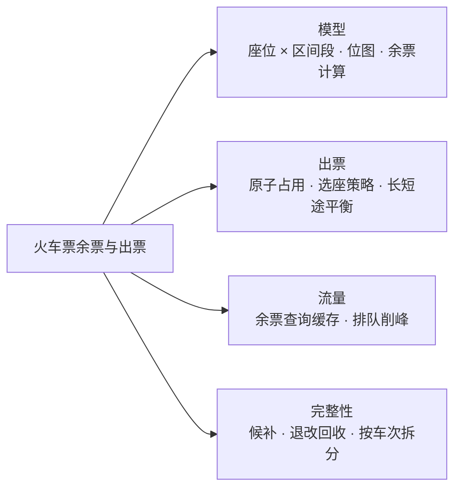
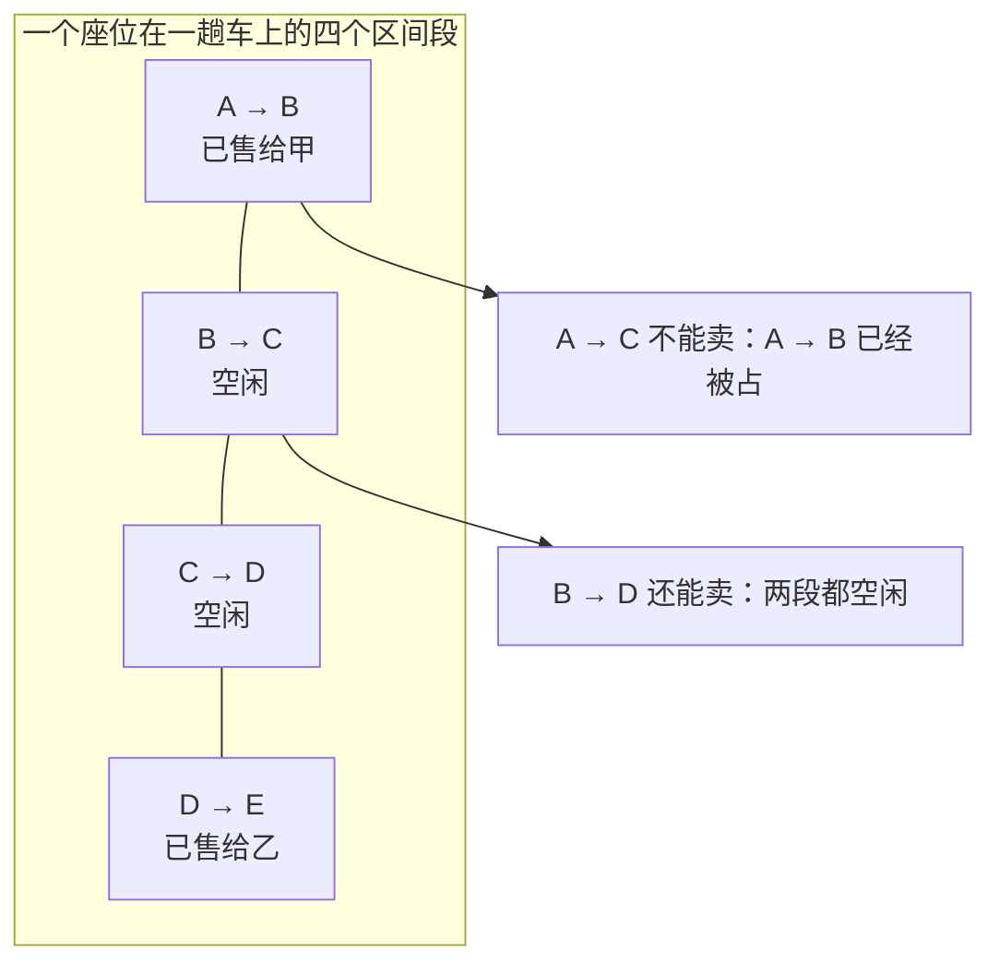
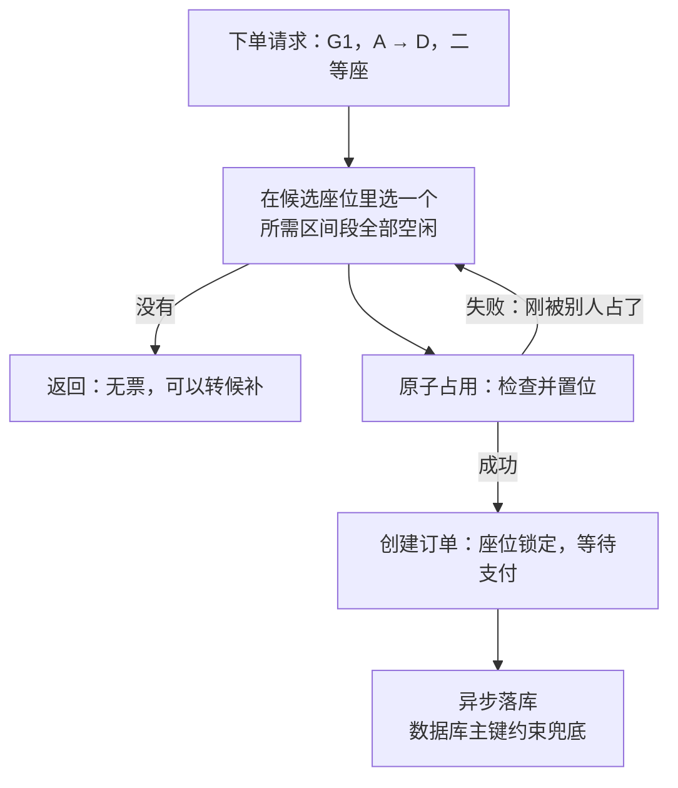
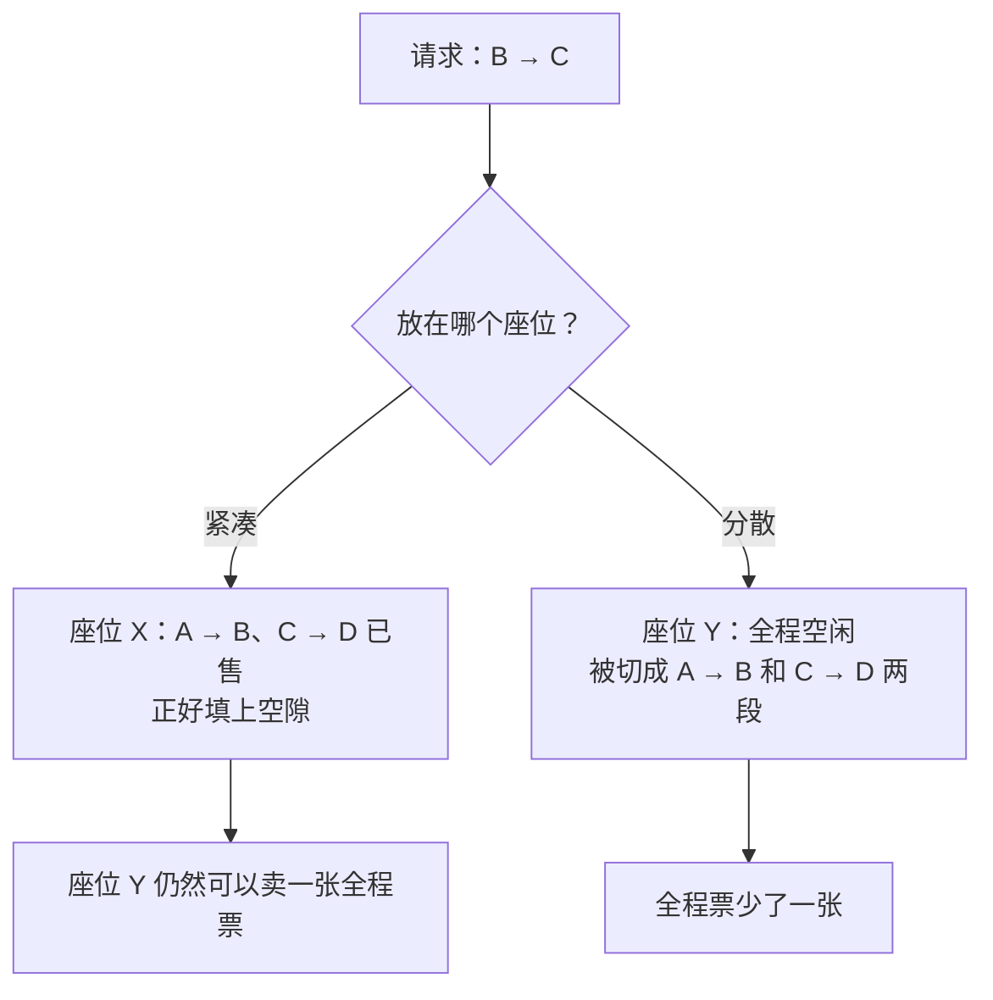
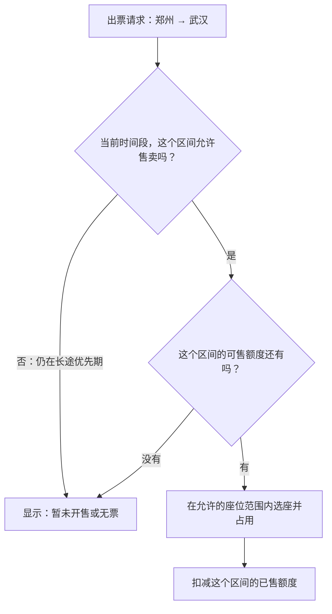
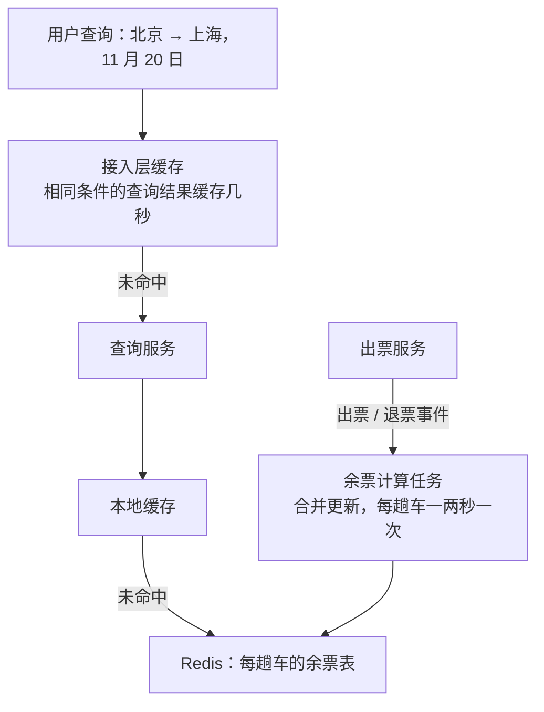
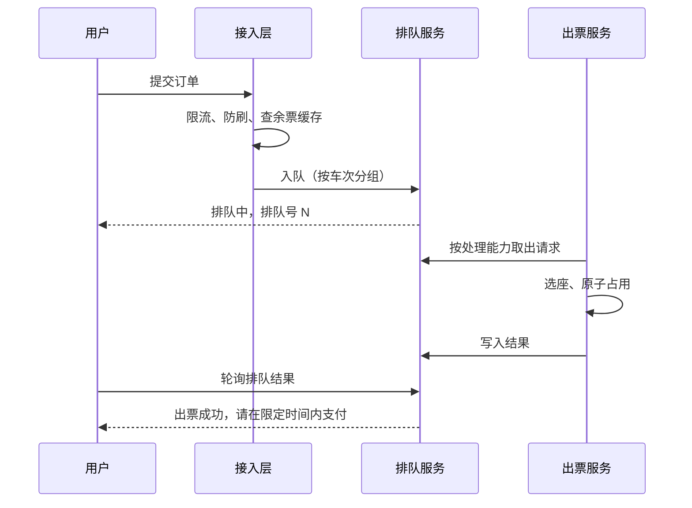
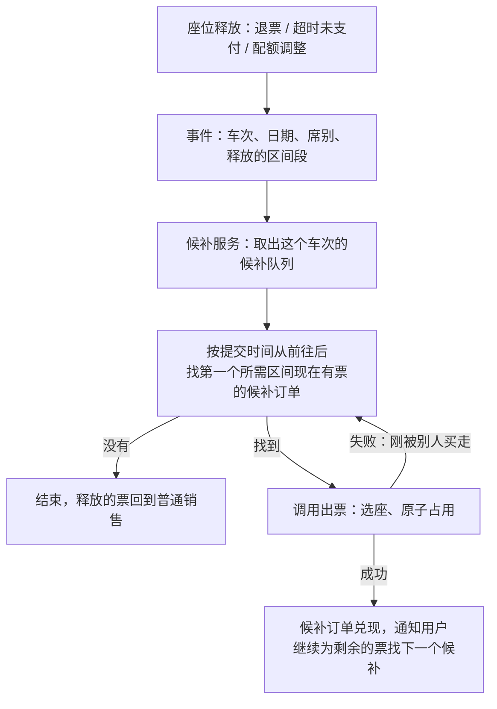
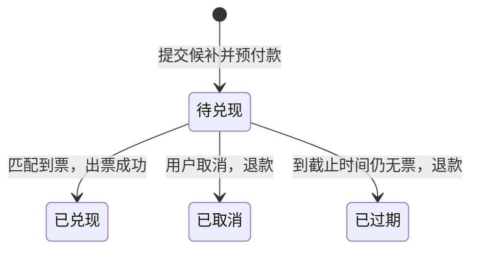
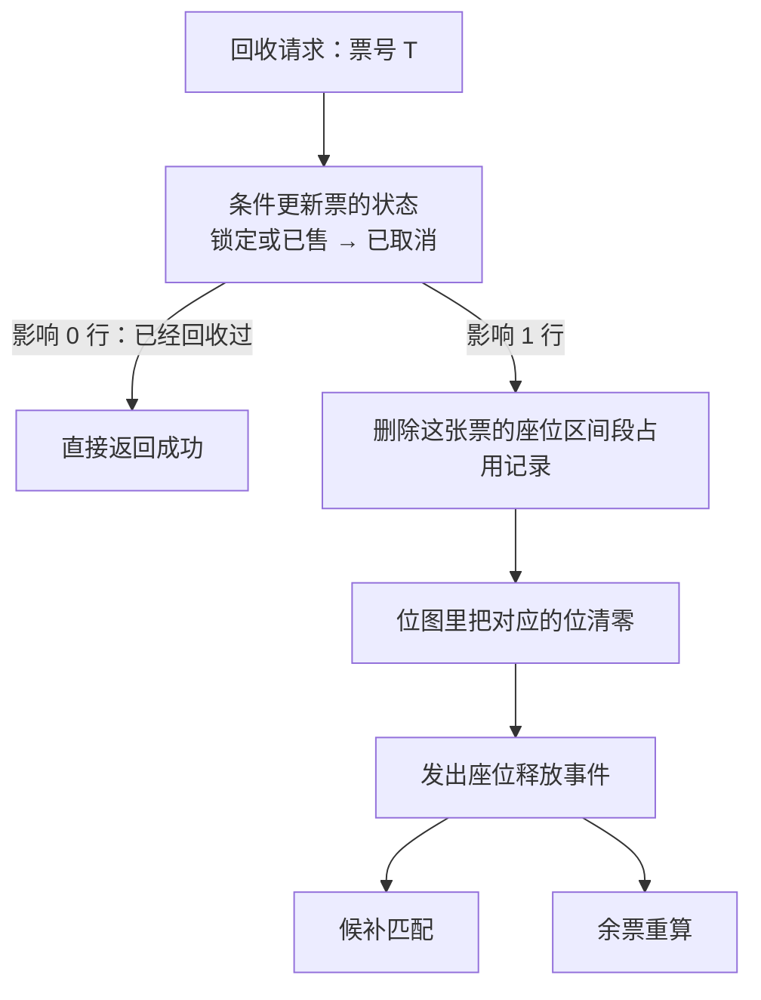

# S10 · 火车票余票与出票（12306）

> 适用岗位：Java 资深开发、Java 架构师。这道题常被叫作"设计 12306"。它和秒杀都是抢有限的资源，但库存模型完全不同：一个座位可以分段卖给多个人，卖出一张短途票会影响多个区间的余票。
> 版本基线：JDK 21 / 25、Redis 7.x / 8.x、MySQL 8.4。
> 事实核对：
> - 本文讨论的是"区间库存"这类问题的通用设计方法，**不是对 12306 内部实现的还原**。文中的车站数、座位数、放票规则都是为了说明问题而做的假设。候补购票、不同车站起售时间不同，是用户可以直接看到的产品功能，本文只把它们作为需求来设计。
> - 本机运行（macOS 27.2、Apple M1 Max、JDK 25、Redis 6.2.6）：
>   - 1 段位图余票与选座策略的代码只依赖 JDK，随机数种子固定，文中贴的是实际运行输出；
>   - 按区间段位图出票的 Lua 脚本，在本机临时启动的 Redis 6.2.6 上用 redis-cli 实际执行；
>   - 本机没有 MySQL 服务端，文中的 SQL 都没有实际执行。
> 相关分类：[《S01 秒杀系统》](S01-秒杀系统.md)（分层过滤、排队、防刷）、[《S08 库存中心》](S08-库存中心.md)（预占、流水）、[《17 Redis》](../04-数据存储/17-Redis.md)（Bitmap）、[《24 高并发》](../06-三高与架构/24-高并发.md)（削峰、缓存）

## 45 分钟答题版

| 时间 | 做什么 | 要讲出的关键点 | 子题 |
| --- | --- | --- | --- |
| 0～5 分钟 | 澄清需求 | 库存是"座位 × 区间段"；**同一个座位的同一段不能卖两次**；查询量远大于下单量 | S10-01 |
| 5～15 分钟 | 模型与余票 | 每个座位一个位图；区间余票 = 所需区间段全部空闲的座位数 | S10-02、S10-03 |
| 15～27 分钟 | 出票 | 多个区间段原子占用；选座策略影响上座率；长短途的平衡 | S10-04 ～ S10-06 |
| 27～37 分钟 | 流量 | 余票查询走缓存，允许不精确；下单排队削峰 | S10-07、S10-08 |
| 37～45 分钟 | 完整性 | 候补；退票、改签、未支付的回收；按车次拆分 | S10-09、S10-10 |

## 知识地图



## 题目索引

| 编号 | 题目 | 难度 |
| --- | --- | --- |
| S10-01 | 火车票的库存和普通商品有什么不同？要澄清哪些需求？ | ★★★ |
| S10-02 | 数据模型怎么设计？ | ★★★ |
| S10-03 | 某个区间的余票怎么算？ | ★★★ |
| S10-04 | 出票时怎么保证同一个座位的同一段不会卖两次？ | ★★★ |
| S10-05 | 有很多座位可选时，选哪一个？对上座率有影响吗？ | ★★★ |
| S10-06 | 短途票把长途票"切断"了怎么办？ | ★★ |
| S10-07 | 余票查询量是下单量的上百倍，怎么扛？ | ★★★ |
| S10-08 | 放票瞬间的下单洪峰怎么削？ | ★★ |
| S10-09 | 候补购票怎么设计？ | ★★ |
| S10-10 | 退票、改签、超时未支付，座位怎么回收？系统怎么拆分？ | ★★ |

---

## 一、模型

### S10-01 火车票的库存和普通商品有什么不同？要澄清哪些需求？

> ★★★ ｜ 资深 / 架构师 ｜ 高频

**考察意图**：能否一开始就指出这道题的核心：库存不是一个数字，而是一个二维的结构。说不出这一点，后面的设计都会走偏。

**30 秒版回答**：

- **普通商品**：库存是一个数，卖一件减一。
- **火车票**：一趟车从 A 经 B、C 到 D，一个座位可以先卖 A→B，再卖 B→D 给另一个人。库存的最小单位是 **"座位 × 区间段"**。
- **由此带来的三个特点**：
  1. **余票要算，不能直接读**：A→C 的余票，是"在 A→B 和 B→C 两段都空闲"的座位数；
  2. **卖一张票影响多个区间的余票**：卖出一张 B→C，所有经过 B→C 的区间（A→C、A→D、B→D……）余票都可能减少；
  3. **卖的顺序和选的座位，会影响最终能卖出多少**：短途票切碎了座位，长途票就卖不出去。
- **约束**：同一个座位的同一个区间段**绝不能卖两次**；查询量远大于下单量；放票瞬间有极高的并发。

**深入剖析**



| 问题 | 为什么要问 | 本文的假设 |
| --- | --- | --- |
| 一趟车多少站、多少座位？ | 决定单趟车的数据量 | 最多 30 站，1000～2000 个座位 |
| 每天多少趟车？提前多久售票？ | 决定总数据量 | 每天 1 万趟，提前 15 天售票 |
| 余票要多精确？ | 决定查询能不能走缓存 | 查询结果可以有几秒的延迟；出票必须精确 |
| 用户选座还是系统分配？ | 决定选座策略的自由度 | 系统分配为主，支持靠窗、靠过道等偏好 |
| 有没有候补、改签？ | 影响回收流程 | 都有 |
| 峰值有多高？ | 决定削峰方案 | 热门线路放票瞬间，请求量是座位数的上千倍 |

数据量的估算：一趟车 30 站是 29 个区间段，2000 个座位，每个座位用 29 个二进制位表示，共 2000 × 29 位 ≈ 7 KB。每天 1 万趟、售 15 天，共 15 万个"车次 × 日期"，总共约 1 GB。**单趟车的库存数据非常小**，可以完全放在内存里；难点不在存储，而在并发和计算。

**追问链**

1. **还有哪些业务是"区间库存"？** 酒店房间（房间 × 日期，连住几晚要每一晚都有房）、会议室预订（房间 × 时间段）、机票的多航段、租车。它们的模型是相通的：资源 × 时间或空间的片段，一次占用连续的多个片段。
2. **和秒杀比，哪个更难？** 并发模型类似，都需要分层过滤和削峰。火车票多出来的难度在库存模型：扣减不是一次 `DECR`，而是"找到一个合适的座位，并原子地占用它的多个区间段"；余票的计算和缓存也复杂得多。

---

### S10-02 数据模型怎么设计？

> ★★★ ｜ 资深 / 架构师 ｜ 高频

**考察意图**：能否选出一种既能表达区间占用、又便于计算的数据结构。

**30 秒版回答**：

- **基础数据**（变化少）：车次、经停站及顺序、车厢和座位、席别（二等座、一等座、卧铺）。
- **库存的粒度**："车次 + 日期 + 席别"是一个独立的库存单元，不同单元之间互不影响。
- **座位占用的两种表示**：
  1. **每个座位一个位图**：一个整数，第 i 位表示第 i 个区间段是否已售。判断能不能卖：`(座位的位图 & 需要的区间段) == 0`；
  2. **每个区间段一个位图**：位图的第 n 位表示第 n 个座位在这一段是否已售。计算余票：把需要的几个区间段的位图**按位或**，结果里 0 的个数就是余票。
  - 两者是同一个二维表的两种切法。第一种适合在应用内存里选座，第二种适合用 Redis 的位图命令直接计算余票。
- **持久化**：数据库里保存每一张售出的票（车次、日期、座位、起止站、订单号）。位图可以由这些记录重建，它只是一个便于计算的派生结构。

**深入剖析**

把"座位 × 区间段"画成一张表（1 表示已售）：

| | A→B | B→C | C→D | D→E | 按座位的位图 |
| --- | --- | --- | --- | --- | --- |
| 座位 0 | 1 | 0 | 0 | 1 | `1001` |
| 座位 1 | 1 | 1 | 1 | 0 | `0111` |
| 座位 2 | 0 | 0 | 0 | 0 | `0000` |
| 按区间段的位图 | `110` | `010` | `010` | `100` | |

（"按座位的位图"从右往左读：最右边的位是 A→B。"按区间段的位图"从左往右读：依次是座位 0、1、2。）

- 横着看是"每个座位一个位图"：座位 0 是 `1001`，表示 A→B 和 D→E 已售；
- 竖着看是"每个区间段一个位图"：A→B 这一段，座位 0 和座位 1 已售。

数据库里的售票记录：

```sql
CREATE TABLE t_ticket (
    ticket_id    BIGINT       NOT NULL PRIMARY KEY,
    train_no     VARCHAR(16)  NOT NULL,
    travel_date  DATE         NOT NULL,
    seat_class   VARCHAR(8)   NOT NULL COMMENT '席别',
    seat_no      INT          NOT NULL COMMENT '座位在本席别内的序号',
    from_idx     INT          NOT NULL COMMENT '上车站的序号',
    to_idx       INT          NOT NULL COMMENT '下车站的序号',
    order_no     VARCHAR(32)  NOT NULL,
    status       VARCHAR(16)  NOT NULL COMMENT 'LOCKED / SOLD / CANCELLED',
    create_time  DATETIME(3)  NOT NULL,
    KEY idx_train_date (train_no, travel_date, seat_class)
);

-- 每个座位在每个区间段只能有一条有效的占用记录
CREATE TABLE t_seat_segment (
    train_no    VARCHAR(16) NOT NULL,
    travel_date DATE        NOT NULL,
    seat_class  VARCHAR(8)  NOT NULL,
    seat_no     INT         NOT NULL,
    segment_idx INT         NOT NULL COMMENT '区间段的序号',
    ticket_id   BIGINT      NOT NULL,
    PRIMARY KEY (train_no, travel_date, seat_class, seat_no, segment_idx)
);
```

`t_seat_segment` 的主键是数据库层面"同一个座位的同一段不能卖两次"的最终保证：一张 A→D 的票要插入 3 行，其中任何一行已经存在，整个事务失败。

**追问链**

1. **站点的顺序号为什么重要？** 位图里的位是按区间段的顺序排的，"A→C"要换算成"第 0 段和第 1 段"。每个车次要有一张经停站的顺序表。车次的经停站在售票期内不能随便调整，否则已售的位图就对不上了。
2. **卧铺的上中下铺、靠窗靠过道怎么表达？** 这是座位的属性，存在基础数据里。选座时先按属性过滤出候选的座位，再在候选里用位图判断是否空闲。
3. **座位数超过一个 `long` 的位数怎么办？** "每个座位一个位图"里，位数是区间段数（最多几十个），一个 `int` 或 `long` 就够。"每个区间段一个位图"里，位数是座位数（几千个），用字节数组或者 Redis 的位图，它们没有 64 位的限制。

---

### S10-03 某个区间的余票怎么算？

> ★★★ ｜ 资深 ｜ 高频

**考察意图**：这是这道题的核心计算。看你能不能给出正确而且高效的算法。

**30 秒版回答**：

- **定义**：从第 from 站到第 to 站的余票 = 在第 from 到 to−1 个区间段上**全部空闲**的座位数。
- **常见的错误**：取各个区间段余票的最小值。A→B 剩 5 个座位，B→C 也剩 5 个，但如果这是 10 个不同的座位，那么 A→C 的余票是 0。最小值只是一个上限。
- **按座位的位图**：先算出需要的区间段的掩码，然后遍历座位，数出 `(位图 & 掩码) == 0` 的个数。几千个座位，一次遍历在微秒级。
- **按区间段的位图**：把需要的几个区间段的位图按位或，数结果里 0 的个数。Redis 里是 `BITOP OR` 加 `BITCOUNT`。
- 一趟车所有"起点 → 终点"的组合有几百种（30 站是 435 种），全部算一遍也只是毫秒级，所以可以**预先算好整张余票表**放进缓存（S10-07）。

**深入剖析**

下面的代码包含三部分：余票计算、选座策略的对比（S10-05）、并发出票（S10-04）。本机 JDK 25 运行：

```java
import java.util.ArrayList;
import java.util.List;
import java.util.Random;
import java.util.concurrent.CountDownLatch;
import java.util.concurrent.ExecutorService;
import java.util.concurrent.Executors;
import java.util.concurrent.atomic.AtomicInteger;
import java.util.concurrent.atomic.AtomicIntegerArray;

/**
 * 区间库存：一趟车有 N 个车站、N-1 个区间段，每个座位用一个整数的二进制位记录"哪些区间段已经被占用"。
 * 从第 from 站到第 to 站的票，需要占用第 from ～ to-1 个区间段。
 */
public class SeatBitmapDemo {

    private static final int STATION_COUNT = 8;      // 8 个车站，7 个区间段
    private static final int SEAT_COUNT = 100;
    private static final int REQUEST_COUNT = 600;
    private static final int ROUNDS = 200;
    /** 占用 4 个及以上区间段的票算长途票 */
    private static final int LONG_TRIP_SEGMENTS = 4;
    private static final long RANDOM_SEED = 20261112L;

    /** FIRST_FIT：第一个能坐的座位；BEST_FIT：空闲段最贴合的座位；WORST_FIT：空闲段最长的座位（尽量分散） */
    enum Strategy { FIRST_FIT, BEST_FIT, WORST_FIT }

    record Request(int from, int to) { }

    static final class Train {
        /** 每个座位一个整数，第 i 位为 1 表示第 i 个区间段已售出 */
        private final AtomicIntegerArray seats;

        Train(int seatCount) {
            this.seats = new AtomicIntegerArray(seatCount);
        }

        /** from 站到 to 站需要占用的区间段：第 from ～ to-1 位 */
        static int need(int from, int to) {
            return ((1 << (to - from)) - 1) << from;
        }

        /** 余票：需要的区间段全部空闲的座位数 */
        int remaining(int from, int to) {
            int need = need(from, to);
            int count = 0;
            for (int i = 0; i < seats.length(); i++) {
                if ((seats.get(i) & need) == 0) {
                    count++;
                }
            }
            return count;
        }

        /** 出票：选一个座位，用 CAS 把需要的位从 0 改成 1。返回座位号，-1 表示无票 */
        int sell(int from, int to, Strategy strategy) {
            int need = need(from, to);
            while (true) {
                int chosen = -1;
                int chosenMask = 0;
                int bestGap = strategy == Strategy.WORST_FIT ? -1 : Integer.MAX_VALUE;
                for (int i = 0; i < seats.length(); i++) {
                    int mask = seats.get(i);
                    if ((mask & need) != 0) {
                        continue;
                    }
                    if (strategy == Strategy.FIRST_FIT) {
                        chosen = i;
                        chosenMask = mask;
                        break;
                    }
                    // gap 是"包含这个区间的连续空闲段"的长度。BEST_FIT 选最短的，WORST_FIT 选最长的
                    int gap = freeGap(mask, from, to);
                    boolean better = strategy == Strategy.BEST_FIT ? gap < bestGap : gap > bestGap;
                    if (better) {
                        bestGap = gap;
                        chosen = i;
                        chosenMask = mask;
                    }
                }
                if (chosen < 0) {
                    return -1;
                }
                if (seats.compareAndSet(chosen, chosenMask, chosenMask | need)) {
                    return chosen;
                }
                // CAS 失败：这个座位刚被别的线程改过，重新选
            }
        }

        /** 包含 [from, to) 的连续空闲区间段的长度 */
        private static int freeGap(int mask, int from, int to) {
            int left = from;
            while (left > 0 && (mask & (1 << (left - 1))) == 0) {
                left--;
            }
            int right = to;
            while (right < STATION_COUNT - 1 && (mask & (1 << right)) == 0) {
                right++;
            }
            return right - left;
        }

        int occupiedSegments() {
            int total = 0;
            for (int i = 0; i < seats.length(); i++) {
                total += Integer.bitCount(seats.get(i));
            }
            return total;
        }
    }

    public static void main(String[] args) throws InterruptedException {
        // 1. 一个座位、4 个车站 A-B-C-D：同一个座位可以卖给不重叠的两段
        Train tiny = new Train(1);
        System.out.println("sell A->B : seat " + tiny.sell(0, 1, Strategy.FIRST_FIT));
        System.out.println("sell C->D : seat " + tiny.sell(2, 3, Strategy.FIRST_FIT));
        System.out.println("sell A->D : seat " + tiny.sell(0, 3, Strategy.FIRST_FIT) + " (-1 = sold out)");
        System.out.println("remaining B->C = " + tiny.remaining(1, 2) + ", A->C = " + tiny.remaining(0, 2));

        // 2. 同样的随机请求序列，比较三种选座策略。跑 200 组不同的序列取平均
        Random random = new Random(RANDOM_SEED);
        int strategyCount = Strategy.values().length;
        long[] sold = new long[strategyCount];
        long[] longTrips = new long[strategyCount];
        long[] used = new long[strategyCount];
        for (int round = 0; round < ROUNDS; round++) {
            List<Request> requests = new ArrayList<>();
            for (int i = 0; i < REQUEST_COUNT; i++) {
                int from = random.nextInt(STATION_COUNT - 1);
                int to = from + 1 + random.nextInt(STATION_COUNT - 1 - from);
                requests.add(new Request(from, to));
            }
            for (Strategy strategy : Strategy.values()) {
                Train train = new Train(SEAT_COUNT);
                for (Request request : requests) {
                    if (train.sell(request.from(), request.to(), strategy) >= 0) {
                        sold[strategy.ordinal()]++;
                        if (request.to() - request.from() >= LONG_TRIP_SEGMENTS) {
                            longTrips[strategy.ordinal()]++;
                        }
                    }
                }
                used[strategy.ordinal()] += train.occupiedSegments();
            }
        }
        int capacity = SEAT_COUNT * (STATION_COUNT - 1);
        for (Strategy strategy : Strategy.values()) {
            int i = strategy.ordinal();
            System.out.printf("%-9s: tickets sold %.1f, long trips %.1f, seat-segments used %.1f / %d (%.1f%%)%n",
                    strategy, sold[i] / (double) ROUNDS, longTrips[i] / (double) ROUNDS,
                    used[i] / (double) ROUNDS, capacity, used[i] * 100.0 / ROUNDS / capacity);
        }

        // 3. 并发：400 个请求同时抢 100 个座位的全程票，CAS 保证一个座位只卖一次
        Train hot = new Train(SEAT_COUNT);
        AtomicInteger success = new AtomicInteger();
        int buyers = 400;
        CountDownLatch done = new CountDownLatch(buyers);
        try (ExecutorService pool = Executors.newFixedThreadPool(16)) {
            for (int i = 0; i < buyers; i++) {
                pool.execute(() -> {
                    if (hot.sell(0, STATION_COUNT - 1, Strategy.FIRST_FIT) >= 0) {
                        success.incrementAndGet();
                    }
                    done.countDown();
                });
            }
            done.await();
        }
        System.out.println("concurrent: buyers=" + buyers + ", success=" + success.get()
                + ", remaining=" + hot.remaining(0, STATION_COUNT - 1)
                + ", seat-segments used=" + hot.occupiedSegments());
    }
}
```

```text
sell A->B : seat 0
sell C->D : seat 0
sell A->D : seat -1 (-1 = sold out)
remaining B->C = 1, A->C = 0
FIRST_FIT: tickets sold 288.3, long trips 53.4, seat-segments used 640.7 / 700 (91.5%)
BEST_FIT : tickets sold 288.1, long trips 53.4, seat-segments used 640.8 / 700 (91.5%)
WORST_FIT: tickets sold 328.1, long trips 35.3, seat-segments used 605.5 / 700 (86.5%)
concurrent: buyers=400, success=100, remaining=0, seat-segments used=700
```

先看前四行，只有一个座位、四个车站 A-B-C-D：

- A→B 卖出，座位 0；
- C→D 还能卖，**仍然是座位 0**：两段不重叠；
- A→D 卖不出去了：它需要的三段里有两段已经被占；
- 这时 B→C 的余票是 1，A→C 的余票是 0。

掩码的计算 `((1 << (to - from)) - 1) << from`：比如 from = 1、to = 3，需要第 1、2 两个区间段。`(1 << 2) - 1` 是二进制的 `11`，再左移 1 位得到 `110`，正好是第 1 位和第 2 位。

**追问链**

1. **为什么"各段余票的最小值"是错的？** 余票数只告诉你每一段有几个空座，不告诉你是**哪几个**。能卖 A→C 的座位，必须是**同一个座位**在两段都空。只有保留了"哪个座位"的信息（位图），才能算对。
2. **每次查询都遍历所有座位，会不会慢？** 单次很快，但查询量极大时不应该每次都算。做法是在库存发生变化时（出票、退票）重新计算这趟车受影响的区间的余票，写入缓存；查询只读缓存。出票的频率远低于查询。
3. **用 Redis 的 `BITOP` 算余票要注意什么？** `BITOP` 会把结果写入一个新的 Key，是一次写操作，时间和位图的长度成正比。几千个座位的位图很小，没有问题。在 Cluster 里，参与运算的 Key 必须在同一个槽位，所以同一趟车的所有 Key 要用相同的哈希标签。Redis 位图的用法见[《17 Redis》](../04-数据存储/17-Redis.md)17-04。

---

## 二、出票

### S10-04 出票时怎么保证同一个座位的同一段不会卖两次？

> ★★★ ｜ 资深 / 架构师 ｜ 高频

**考察意图**：出票是"选座位 + 占用多个区间段"，必须是原子的。看你能否在不同的存储上给出实现。

**30 秒版回答**：

- **要原子完成的事**：检查这个座位在所需的每个区间段都空闲，然后把它们全部标记为已占用。中间不能被别的请求插入。
- **三种实现**：
  1. **应用内存 + CAS**：每个座位的位图是一个原子整数。读出当前值，确认所需的位都是 0，用 `compareAndSet` 把这些位改成 1。失败说明被别人改了，重新选座；
  2. **Redis Lua 脚本**：脚本里先检查所有区间段的位，都是 0 再全部置 1；
  3. **数据库**：一个事务里插入多行"座位 + 区间段"的记录，主键冲突则回滚。
- **实际的组合**：内存或 Redis 负责高并发下的快速占用；数据库的主键约束负责最终保证；两者之间是异步落库和对账。
- **占用分两步**：下单时是"锁定"（等待支付），支付成功后才是"已售"。超时未支付要释放（S10-10）。

**深入剖析**

上一题代码的 `sell` 方法用的是 CAS。输出的最后一行是并发测试：400 个请求同时抢 100 个座位的全程票，**成功的正好 100 个**，占用的座位区间段是 700（100 个座位 × 7 段），没有一个座位被卖了两次。

Redis 里的实现，用"每个区间段一个位图"的结构（已在本机 Redis 6.2.6 上执行）：

```lua
-- KEYS：这张票要占用的每个区间段的位图（每个区间段一个 Key，第 n 位代表第 n 个座位）
-- ARGV[1]：座位号
for _, key in ipairs(KEYS) do
    if redis.call('GETBIT', key, ARGV[1]) == 1 then
        return 0  -- 这个座位在某个区间段已经售出
    end
end
for _, key in ipairs(KEYS) do
    redis.call('SETBIT', key, ARGV[1], 1)
end
return 1
```

```text
# 车次 G1、4 个区间段（seg0～seg3）、8 个座位。先把每个位图的长度撑到 8 位
# 座位 0 卖出 seg0（A→B）
1
# 座位 1 卖出 seg0～seg2（A→D）
1
# 座位 1 再卖 seg2～seg3（C→E）：seg2 已售，整张票失败，seg3 没有被改动
0
0
# 座位 0 再卖 seg1～seg3（B→E）：和它已售的 seg0 不重叠，成功
1
# 查 A→C（seg0、seg1）的余票：两个位图按位或，数 1 的个数就是不可用的座位数
occupied = 2, remaining = 6
```

（`#` 开头的行是说明，其余是 redis-cli 的返回。）

- 第三步：座位 1 的 seg2 已经售出，整张票失败。随后查询 seg3 的位是 0，说明脚本没有留下"占了一半"的状态；
- 第四步：座位 0 的 A→B 已售，再卖 B→E 成功，这就是一个座位分段卖给两个人；
- 最后用 `BITOP OR` 和 `BITCOUNT` 算出 A→C 的余票是 6。



**追问链**

1. **选座和占用之间有时间差，会不会选好的座位被别人抢走？** 会，所以占用是原子的"检查并置位"，失败就重新选。这是乐观的做法：不在选座时加锁，冲突了再重试。同一趟车的并发很高时，重试会变多，这时把同一趟车的出票请求放进一个**单线程的队列**里串行处理更有效：没有竞争，也就没有重试。
2. **为什么可以单线程？** 单趟车的库存很小（几 KB），一次出票只是几次位运算，单线程每秒可以处理几十万次。瓶颈不在计算，而在后面的落库。把一趟车的所有操作交给一个线程（或者一个 Redis 分片），是这类问题常见的高效解法。Redis 本身就是单线程执行命令的，Lua 脚本天然串行。
3. **内存里占用成功了，落库失败怎么办？** 和秒杀一样：重试，多次失败则回滚内存里的占用并通知用户。数据库的主键约束保证不会出现两条冲突的记录。定期对账：位图和数据库的售票记录是否一致。

---

### S10-05 有很多座位可选时，选哪一个？对上座率有影响吗？

> ★★★ ｜ 架构师 ｜ 中频

**考察意图**：这是这道题里最能拉开差距的问题。看你是否意识到选座策略会影响收益，并且能用数据而不是直觉来回答。

**30 秒版回答**：

- **有影响**。同样的购票请求，不同的选座方式，最终卖出的"座位公里"不同。
- **原则：紧凑分配，不要把完整的空座切碎**。一张 B→C 的短途票，应该放在一个 A→B 和 C→D 已经被占的座位上（填补空隙），而不是放在一个全程都空的座位上（把它切成两段，全程票就少了一张）。
- **实测**（见下）：把票尽量集中在已经用过的座位上，比尽量分散开，座位利用率高约 5 个百分点；卖出的长途票多一半。
- **一个容易误判的指标**：分散分配卖出的**票数**反而更多，因为它卖出了更多的短途票。但铁路的收入和"座位 × 里程"相关，要看的是**座位区间段的利用率**，不是票数。
- "第一个能坐的座位"和"空隙最贴合的座位"这两种紧凑策略，实测结果几乎一样。

**深入剖析**

S10-03 代码输出的中间三行，是三种策略在 200 组随机请求序列上的平均结果（100 个座位、8 个车站、每组 600 个请求，请求的起止站随机）：

| 策略 | 做法 | 卖出的票数 | 其中长途票 | 座位区间段利用率 |
| --- | --- | --- | --- | --- |
| FIRST_FIT | 从头找，第一个能坐的座位 | 288.3 | 53.4 | 91.5% |
| BEST_FIT | 选"包含这段的连续空闲最短"的座位 | 288.1 | 53.4 | 91.5% |
| WORST_FIT | 选"包含这段的连续空闲最长"的座位 | 328.1 | 35.3 | 86.5% |

（长途票指占用 4 个及以上区间段的票。）

怎么读这组数据：

- **FIRST_FIT 和 BEST_FIT 几乎没有差别**。写这段代码之前，我预期"最贴合"会明显好于"第一个"，实测不是这样。原因是 FIRST_FIT 总是从编号小的座位开始找，票自然就集中在前面的座位上，后面的座位保持完整，效果上已经是紧凑的了；
- **WORST_FIT 把票分散到最空的座位上**，每个座位都被切了一小段。结果是短途票卖得多（总票数 328 比 288 多），长途票卖得少（35 比 53 少三分之一），利用率低了 5 个百分点；
- 如果只看"卖了多少张票"，会得出 WORST_FIT 更好的错误结论。



这组结果的适用范围：请求是均匀随机的，没有考虑真实客流的分布（大站之间的需求远高于小站）、放票的时间顺序和票价。它能说明"选座策略确实影响利用率、紧凑优于分散"，不能直接当作真实系统的收益数字。真实的系统还会结合历史客流预测来做决定。

**追问链**

1. **用户要选座（靠窗、和同伴挨着）怎么办？** 用户的偏好是硬约束，在满足偏好的候选座位里再按紧凑的原则选。同行的人要连座，就把"相邻的几个座位在所需区间段都空闲"作为一个整体来找。偏好会降低利用率，这是为体验付出的代价。
2. **有没有理论上最优的分配？** 如果事先知道全部的请求，这是一个区间调度问题，可以求出最优解。但售票是在线进行的，请求一个一个到来，不知道后面是什么，只能用启发式的策略。紧凑分配是简单而有效的一种。更进一步的手段是从需求侧入手：控制什么时候放哪些区间的票（S10-06）。
3. **系统分配的座位，同一订单的几个人不在一起，用户抱怨怎么办？** 把"同一订单尽量相邻"作为选座的一个优化目标：优先找连续的空座；找不到时，尽量在同一个车厢。

**架构师加分点**

- 这个问题说明了一件事：对设计方案的直觉要用数据验证。"最佳适应"听起来比"首次适应"高级，实测却没有差别；"卖出的票数"听起来是合理的指标，实际上会把结论带反。面试时如果能说出"我会先写一个模拟，用利用率而不是票数来比较策略"，比背出某种算法的名字更有说服力。

---

### S10-06 短途票把长途票"切断"了怎么办？

> ★★ ｜ 架构师 ｜ 中频

**考察意图**：选座策略是在座位层面的优化。这个问题上升到了销售策略：从需求侧控制卖什么。

**30 秒版回答**：

- **问题**：一趟北京到广州的车，如果开售时任何区间都可以买，中间的短途票（比如郑州到武汉）会很快把座位切碎，想买全程票的人买不到；而且切出来的两头（北京到郑州、武汉到广州）不一定卖得出去，座位空跑。
- **手段**：
  1. **区间限售**：开售初期只卖长途票（比如只卖覆盖一定里程以上的区间），临近发车再放开短途；
  2. **配额**：把座位按区间预先分配。比如 60% 的座位留给全程和长途，40% 给各个短途区间。各配额内独立售卖；
  3. **动态调整**：某个配额卖不动时，把它释放给其他区间。临近发车时，所有剩余的座位向所有区间开放；
  4. **分时起售**：不同车站的起售时间错开，既分散了系统压力，也是一种对客流的引导。
- **技术上的实现**：在座位位图之上再加一层"可售规则"。出票时先检查这个区间当前是否允许售卖、配额是否还有，再去选座位。

**深入剖析**

配额的两种做法：

| | 固定配额 | 共享池 + 限售规则 |
| --- | --- | --- |
| 做法 | 把座位划成几组，每组只卖给特定的区间 | 所有座位在一个池子里，用规则限制某些区间在某些时间段不能卖，或者最多卖多少张 |
| 优点 | 简单，各区间互不影响 | 灵活，座位不会因为划分而浪费 |
| 缺点 | 一个配额卖完了，另一个配额还有空座却不能卖 | 规则复杂，需要预测和持续调整 |
| 余票计算 | 在各自的组内计算 | 余票 = min（座位上算出的余票，这个区间剩余的可售额度） |



**追问链**

1. **用户看到"无票"，过一会儿又有票了，是系统的问题吗？** 不一定。可能是配额调整（长途的配额释放给了短途）、有人退票、未支付的订单超时释放。这些都是正常的业务行为。所以"候补"功能有意义：让系统在有票的时候自动为用户下单（S10-09）。
2. **配额怎么定？** 依据历史客流：每个区间的需求量、提前多久购买。这是收益管理的范畴，由数据分析和运营策略决定。系统要提供的是：配额和规则可以按车次、按日期配置，可以在售票期内动态调整，调整能立刻生效。
3. **这和航空公司的舱位控制是一回事吗？** 思路相通：都是把有限的、会过期的资源，在不同价值的需求之间分配，以求总体收益最大。航空公司用不同的舱位等级和价格来区分需求，铁路主要用区间和时间来控制。

---

## 三、流量

### S10-07 余票查询量是下单量的上百倍，怎么扛？

> ★★★ ｜ 资深 / 架构师 ｜ 高频

**考察意图**：读和写对一致性的要求不同。看你是否把查询和出票彻底分开，并接受查询结果的不精确。

**30 秒版回答**：

- **读写分离**：余票查询和出票是两个系统。查询只读缓存，**不碰出票的库存数据**。
- **预计算余票表**：对每个"车次 + 日期 + 席别"，算好所有"起点 → 终点"组合的余票，整张表放进缓存。查询一次就是一次读缓存。
- **更新时机**：出票、退票之后，异步重新计算这趟车的余票表。高峰期可以合并更新：每隔一两秒算一次，而不是每卖一张票算一次。
- **允许不精确**：用户看到"有票"，点进去可能已经没了。这是可以接受的，因为**最终能不能买到由出票时的原子占用决定**。不需要也不可能让几亿次查询看到完全实时的数据。
- **展示可以模糊**：余票充足时显示"有"，少于一定数量才显示具体数字。显示"有"的车次，缓存可以更久。
- **多级缓存**：按线路的查询结果在接入层或 CDN 上缓存几秒；应用本地缓存；分布式缓存。

**深入剖析**



一次"北京 → 上海"的查询涉及几十上百趟车。查询服务先从"线路 → 车次列表"的索引里找出所有车次，再批量读取这些车次的余票表，取出对应区间的数字。车次列表是基础数据，几乎不变，可以长期缓存。

各层缓存的作用：

| 层 | 缓存的内容 | 过期时间 | 挡住的流量 |
| --- | --- | --- | --- |
| 接入层 | 完整的查询结果（按出发地、目的地、日期） | 几秒 | 热门线路上大量相同的查询 |
| 应用本地 | 车次的余票表 | 一两秒 | 同一个实例上对同一趟车的重复读取 |
| Redis | 所有车次的余票表 | 由更新驱动，另设兜底的过期时间 | 所有查询，不让它们到达出票系统 |

**追问链**

1. **显示有票，下单时却没票，用户体验怎么保证？** 缩短热门车次的缓存时间；余票很少时如实显示数量，让用户有预期；下单失败时直接引导到候补或者相邻的车次。抢票软件频繁刷新查询接口，本质上就是在对抗这个延迟，所以查询接口本身也要限流和防刷。
2. **合并更新会不会让余票"一直不变"？** 合并只是限制了更新的频率，比如每趟车每秒最多重算一次。一秒内卖出了 50 张票，余票表只更新一次，但更新后是准确的。对用户来说是"最多延迟一秒"。
3. **缓存里的余票表丢了怎么办？** 它是派生数据，可以随时从座位位图重新计算。缓存未命中时触发一次计算并回填。要防止大量请求同时触发重算（缓存击穿）：同一趟车的重算用互斥，其他请求等待或者返回旧值，见[《17 Redis》](../04-数据存储/17-Redis.md)。

---

### S10-08 放票瞬间的下单洪峰怎么削？

> ★★ ｜ 资深 / 架构师 ｜ 高频

**考察意图**：和秒杀相通的部分。看你是否能说出排队的作用，以及它和直接拒绝的区别。

**30 秒版回答**：

- **现象**：热门车次放票的那一秒，下单请求是座位数的成百上千倍，而且抢票软件会持续重试。
- **分层过滤**（和秒杀一样）：接入层限流和防刷 → 用余票缓存快速拒绝明显无票的请求 → 进入出票。
- **排队**：通过了前面过滤的请求，不直接出票，而是进入一个**按车次分组的队列**，返回"排队中"。出票服务按自己的处理能力从队列里取，逐个处理，结果通过轮询或推送告诉用户。
- **排队的好处**：
  - 把瞬时的洪峰摊平，出票服务不会被压垮；
  - 同一趟车的请求串行处理，没有并发冲突（S10-04）；
  - 先到的先处理，相对公平；
  - 可以告诉用户排在第几位、预计等多久。
- **队列长度要有上限**：排队的人数超过余票数的若干倍，后面的人直接告知"排队人数过多"，不再入队。
- 支付放在出票成功之后，有时间限制，超时释放座位。

**深入剖析**



排队和秒杀里"MQ 异步下单"的关系：做法是一样的，都是用队列把前端的并发和后端的处理能力解耦。区别在于秒杀里扣库存是在入队**之前**（Redis 里已经扣了，队列里的都是抢到的），而这里选座和占用是在出队**之后**。原因是火车票的"扣减"涉及选座策略，逻辑更复杂，放在一个串行的处理环节里更容易做对。

**追问链**

1. **排队的结果怎么通知用户？** 客户端按间隔轮询排队结果的接口；或者用长连接推送。轮询更简单，对服务端的连接压力小，间隔可以由服务端根据排队位置动态返回（排在前面的轮询得密一些）。几种方式的对比见[《37 计算机网络》](../08-计算机基础/37-计算机网络.md)37-19。
2. **用户排着队，关掉了页面怎么办？** 出票照常进行。成功后座位被锁定，等待支付；用户没有在限定时间内支付，座位释放。所以支付的时限不能太长，否则大量的座位被"排到了但人走了"的订单占着。
3. **防刷怎么做？** 实名制是最有效的一条：一个证件同一时间段只能有一张有效的票，限制了黄牛囤票的能力。此外是登录验证、设备和行为风控、对异常高频的账号限流。通用的手段见[《S01 秒杀系统》](S01-秒杀系统.md)S01-13。

---

## 四、完整性

### S10-09 候补购票怎么设计？

> ★★ ｜ 资深 / 架构师 ｜ 中频

**考察意图**：候补把"用户不停刷新"变成了"系统替用户等"。看你是否能设计出一个公平、可靠的匹配流程。

**30 秒版回答**：

- **需求**：没票时用户提交候补订单（车次或者几个备选车次、区间、席别），并预付票款。之后有票释放出来（退票、改签、未支付超时、配额调整），系统自动为候补的用户出票。
- **数据**：候补队列，按"车次 + 日期 + 席别"分组，按提交时间排序。
- **触发**：座位被释放时，产生一个事件。候补服务收到后，在对应的队列里找出**所需区间被这次释放满足**的、排在最前面的候补订单，尝试出票。
- **匹配不是简单的先进先出**：释放的是 B→C 这一段，排在第一的人要的是 A→D，他用不上。要往后找第一个能满足的。所以是"在能满足的人里，先到先得"。
- **出票走和普通购票相同的原子占用**，不单独写一套。候补只是另一个请求来源。
- **兑现失败或者到截止时间仍未兑现**：退还预付款。
- 好处：减少无效的刷新流量；释放出来的票优先给等待的人，而不是给刷得最快的人。

**深入剖析**



候补订单的状态：



**追问链**

1. **释放的票应该先给候补，还是先放回普通销售？** 先给候补。如果先放回普通销售，这张票大概率被正在刷新的抢票软件买走，候补就没有意义了。实现上，释放的座位先进入一个短暂的"候补优先"状态，候补服务处理完之后，没被用掉的才对普通销售可见。
2. **一个用户候补了多个车次，都兑现了怎么办？** 一个候补订单包含多个备选，任何一个兑现，这个订单就结束，其余的备选自动取消。实现上是对候补订单做条件更新（待兑现 → 已兑现），只有成功的那一次才真正出票；出票和状态更新的一致性，用"先占座、再更新订单状态、更新失败则释放座位"来保证。
3. **候补队列很长，每次释放都从头扫描，效率怎么样？** 单趟车的候补量有限（可以设上限），而且扫描只发生在有票释放的时候，频率不高。可以按所需的区间给候补订单建索引，释放某个区间段时，只检查需求包含这一段的候补订单。

---

### S10-10 退票、改签、超时未支付，座位怎么回收？系统怎么拆分？

> ★★ ｜ 资深 / 架构师 ｜ 中频

**考察意图**：库存不只是减少。看你是否考虑了座位回到可售状态的各种路径，以及这个系统天然的拆分方式。

**30 秒版回答**：

- **回收的来源**：下单后超时未支付、用户退票、改签（旧票退、新票出）。
- **回收的动作**：把这张票占用的区间段的位清零；数据库里把占用记录删除或者标记为无效；触发余票重算和候补匹配。
- **幂等**：回收以票号为幂等键。同一张票只能释放一次，重复的释放请求不能影响这个座位后来被别人买走的记录。做法是先条件更新票的状态（已售 → 已退），影响 1 行才去清位图。
- **改签**：先出新票，成功后再退旧票。顺序反过来的话，旧票退了、新票没买到，用户就没票了。
- **拆分**：以"车次 + 日期"为单元。不同的车次之间**没有任何共享的库存**，天然可以水平拆分：
  - 每个单元的库存放在同一个 Redis 分片或者同一个出票进程里，单元内串行处理；
  - 数据库按车次和日期分库分表，过了发车日期的数据整体归档；
  - 热门线路的车次可以分配到独立的资源上，和普通车次隔离。

**深入剖析**



为什么清位图之前必须先确认票的状态：假设票 T 占着座位 5 的 A→B。T 被退票，位清零；之后另一个人买了座位 5 的 A→B。这时如果一条重复的"退票 T"的消息到达，并且直接去清位图，就会把**别人的票**对应的位清掉，这个座位就可能再被卖一次。条件更新保证了"退票 T"只生效一次。

系统的拆分：

| 维度 | 拆分方式 | 说明 |
| --- | --- | --- |
| 读和写 | 余票查询、出票是两个独立的系统 | 查询量大、可以不精确；出票量小、必须精确 |
| 出票 | 按"车次 + 日期"分片 | 单元之间无共享状态，单元内串行 |
| 订单 | 按用户分片 | "我的订单"按用户查询 |
| 时间 | 发车之后的数据归档 | 在线库只保留售票期内的车次 |

**追问链**

1. **用户买的是联程票（两趟车中转）怎么办？** 两趟车是两个独立的库存单元，要么都出票成功，要么都不出。做法是依次占用，第二趟失败则释放第一趟。这是一个小型的 Saga，和下单时"占库存、锁优惠券"的处理方式一样，见[《S07 订单中心》](S07-订单中心.md)S07-05。
2. **发车之后，没卖出去的区间段怎么处理？** 车开过了一个站，这个站之前的区间段就没有意义了，但之后的区间段还可以卖（途中补票）。库存按"当前所在的站"截断：只展示和售卖还没经过的区间。
3. **一个出票进程挂了，它负责的车次怎么办？** 内存里的位图是派生数据，可以从数据库的占用记录重建。进程重启或者由别的实例接管时，先加载这些车次的占用记录、重建位图，再开始处理请求。重建期间这些车次暂时不能出票，所以负责的车次数不能太多，重建要足够快。用 Redis 存位图时，同样要考虑主从切换后和数据库的核对。

**生产实践 / 踩坑**

- **用各区间段余票的最小值作为区间余票**：显示有票，实际一张也卖不出去。必须按座位计算。
- **退票时直接清位图，没有先校验票的状态**：重复的退票消息清掉了别人的占用，同一个座位被卖了两次。这是这类系统里最严重的错误。
- **余票查询直接读出票的库存数据**：查询的流量是出票的上百倍，直接把出票系统拖垮。查询必须走独立的缓存。
- **只用"卖出的票数"评估选座策略**：见 S10-05，这个指标会给出相反的结论。
