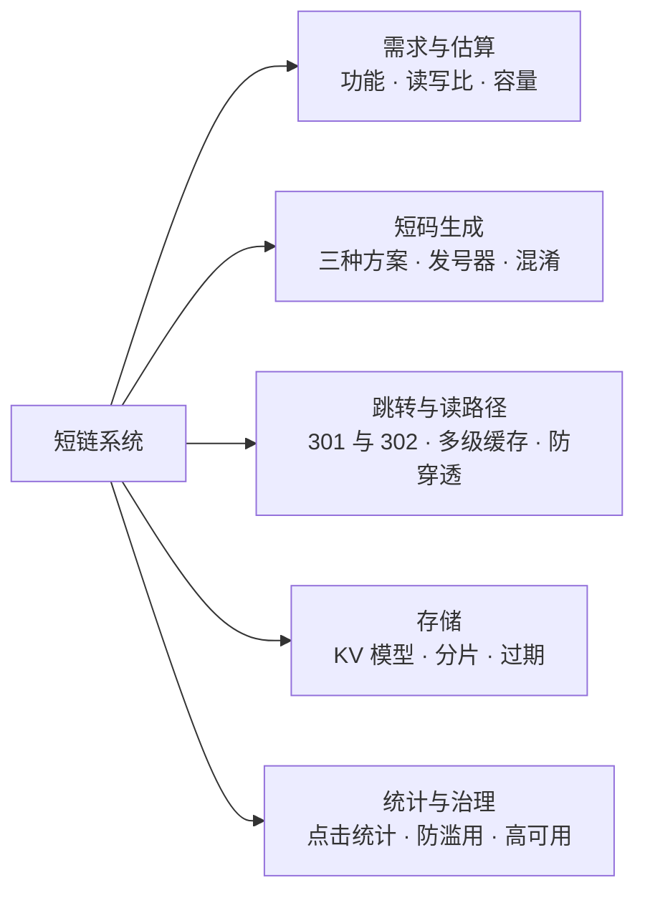
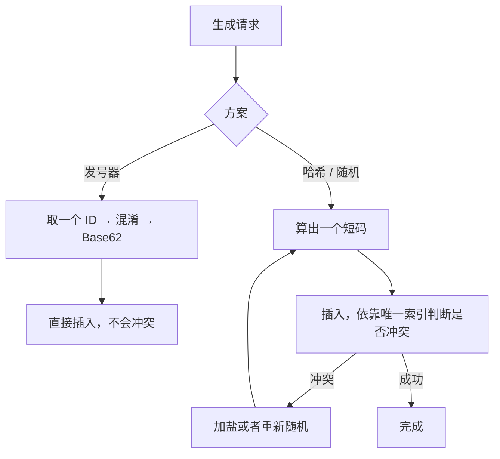
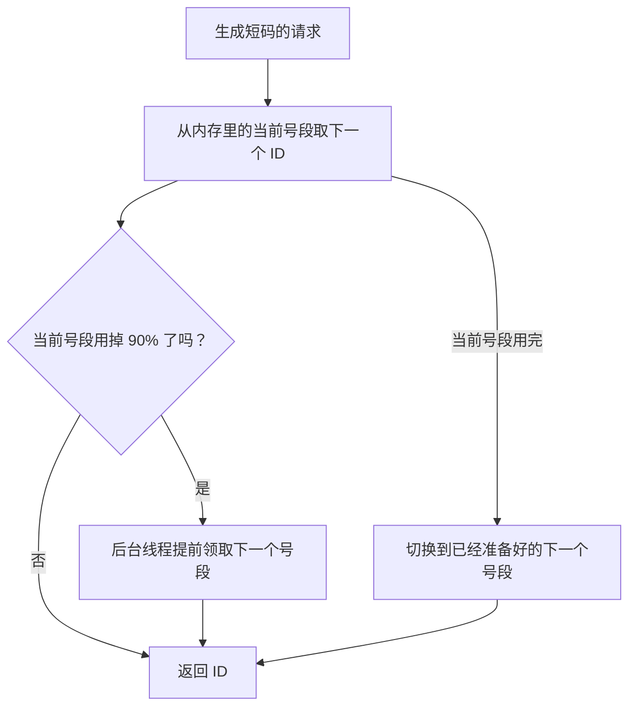
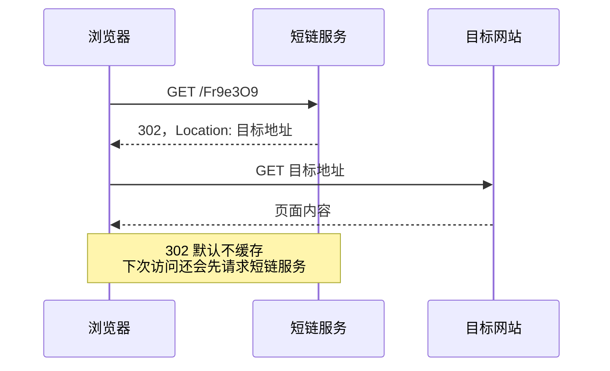
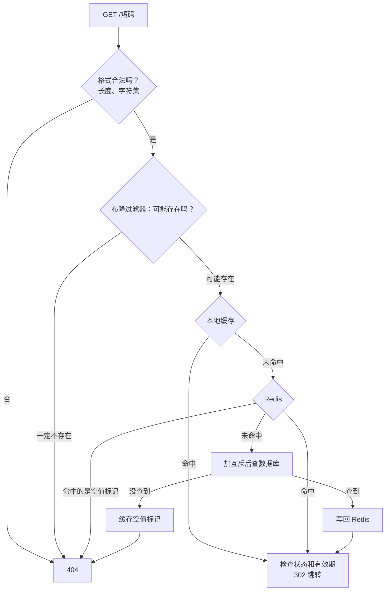
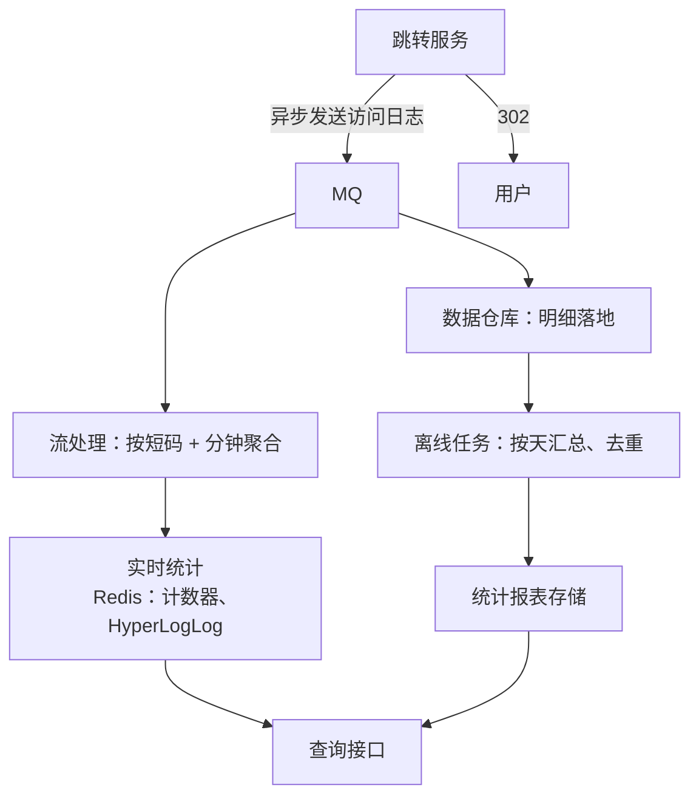
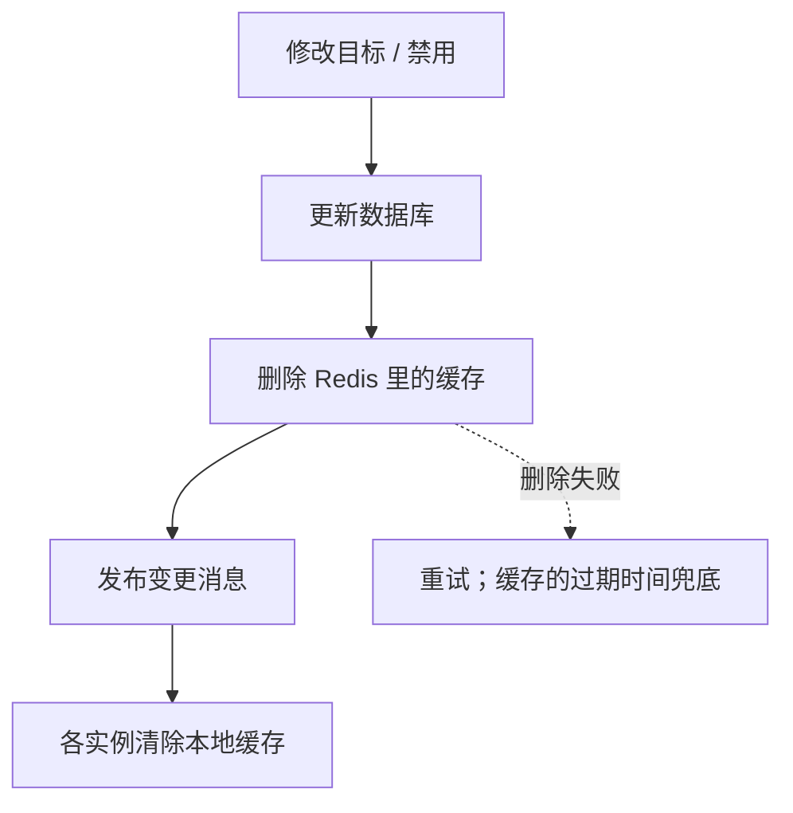

# S11 · 短链系统

> 适用岗位：Java 资深开发、Java 架构师。短链系统的功能很简单，适合用来考察基本功：容量估算、ID 生成、读多写少的缓存设计、异步统计。速查版见[《29 场景题》](../06-三高与架构/29-场景题.md)的 29-09。
> 版本基线：JDK 21 / 25、Redis 7.x / 8.x、MySQL 8.4。
> 事实核对：
> - HTTP 重定向状态码的语义依据 RFC 9110（HTTP Semantics）第 15.4 节：301 和 308 是永久重定向，302 和 307 是临时重定向；301、308 的响应默认可以被缓存。
> - 本机运行（macOS 27.2、Apple M1 Max、JDK 25）：1 段短码生成与混淆的代码只依赖 JDK，文中贴的是实际运行输出。
> - 本机没有 MySQL 服务端，文中的 SQL 都没有实际执行。
> 相关分类：[《09 分布式理论》](../03-分布式与微服务/09-分布式理论.md)（分布式 ID）、[《17 Redis》](../04-数据存储/17-Redis.md)（缓存穿透、布隆过滤器、HyperLogLog）、[《18 本地缓存》](../04-数据存储/18-本地缓存.md)、[《24 高并发》](../06-三高与架构/24-高并发.md)（多级缓存、计数）、[《39 网络安全》](../08-计算机基础/39-网络安全.md)

## 45 分钟答题版

| 时间 | 做什么 | 要讲出的关键点 | 子题 |
| --- | --- | --- | --- |
| 0～5 分钟 | 需求与估算 | 生成、跳转、统计、过期；读远多于写；7 位 Base62 的容量 | S11-01 |
| 5～18 分钟 | 短码生成 | 发号器 + Base62；号段模式；连续短码的混淆 | S11-02 ～ S11-04 |
| 18～25 分钟 | 跳转 | 302 而不是 301，以及原因 | S11-05 |
| 25～35 分钟 | 存储与读路径 | KV 模型、按短码分片；本地缓存 + Redis + 布隆过滤器 | S11-06、S11-07 |
| 35～45 分钟 | 统计与治理 | 点击日志异步汇总；过期与自定义；防滥用；高可用 | S11-08 ～ S11-10 |

## 知识地图



## 题目索引

| 编号 | 题目 | 难度 |
| --- | --- | --- |
| S11-01 | 短链系统要澄清哪些需求？容量怎么估算？ | ★★ |
| S11-02 | 短码有哪几种生成方式？怎么选？ | ★★ |
| S11-03 | 发号器怎么设计？ | ★★ |
| S11-04 | 连续的短码容易被遍历，怎么办？ | ★★★ |
| S11-05 | 跳转用 301 还是 302？ | ★★ |
| S11-06 | 数据怎么存？怎么分库分表？ | ★★ |
| S11-07 | 跳转的读路径怎么设计？不存在的短码怎么拦截？ | ★★★ |
| S11-08 | 点击量怎么统计？ | ★★ |
| S11-09 | 过期、修改目标、自定义短码、相同长链接去重，怎么支持？ | ★★ |
| S11-10 | 怎么防止被滥用？跳转服务的高可用怎么做？ | ★★ |

---

## 一、需求与估算

### S11-01 短链系统要澄清哪些需求？容量怎么估算？

> ★★ ｜ 资深 ｜ 高频

**考察意图**：估算的基本功。能否从业务量推出 QPS、存储和短码长度，并用估算结果指导后面的设计。

**30 秒版回答**：

- **功能**：
  - 生成：长链接 → 短链接；
  - 跳转：访问短链接，重定向到长链接；
  - 可选：点击统计、有效期、自定义短码、修改或禁用。
- **非功能**：跳转要**快**（它在用户访问目标页面之前，多出的每一毫秒都是纯开销）、要**稳**（短链不可用，印在海报和短信里的所有链接都失效）。
- **估算**（假设每天新生成 1000 万条）：
  - 写：1000 万 ÷ 86400 ≈ 116 QPS，峰值按 10 倍约 1200 QPS；
  - 读：假设平均每条短链被访问 100 次，每天 10 亿次，平均约 1.2 万 QPS，峰值约 10 万 QPS；
  - 存储：每条约 500 字节，每天 5 GB，一年约 1.8 TB；
  - 短码：7 位 Base62 有 62⁷ ≈ 3.5 万亿个，每天 1000 万条可以用 900 多年。
- **结论**：这是一个**读远多于写**的系统。设计的重点是读路径，写路径只要保证短码不冲突即可。

**深入剖析**

| 问题 | 为什么要问 | 本文的假设 |
| --- | --- | --- |
| 每天生成多少？ | 决定写入量和短码长度 | 1000 万条 |
| 读写比？ | 决定缓存的重要性 | 100 : 1 |
| 短链要保留多久？ | 决定存储总量和能否回收短码 | 默认永久，支持设置有效期 |
| 需要统计吗？到什么粒度？ | 决定跳转方式和日志链路 | 需要点击量、访客数，按天汇总 |
| 谁在用？ | 内部业务用和对外开放，安全要求差别很大 | 内部各业务 + 对外的开放接口 |
| 短码有长度要求吗？ | 短信按字数计费，越短越好 | 7 位以内 |

不同长度的短码容量：

| 长度 | 容量 | 每天 1000 万条可以用多久 |
| --- | --- | --- |
| 6 位 | 62⁶ ≈ 568 亿 | 约 15 年 |
| 7 位 | 62⁷ ≈ 3.5 万亿 | 约 960 年 |
| 8 位 | 62⁸ ≈ 218 万亿 | 不用考虑 |

**追问链**

1. **为什么是 62 个字符？** 10 个数字、26 个小写字母、26 个大写字母，都是在 URL 里不需要转义的字符。也可以用 64 个（加上 `-` 和 `_`），但有的场景下这两个符号在链接末尾时容易被识别错（比如被聊天软件当成标点截断）。有的系统会去掉容易混淆的字符（0 和 O、1 和 l），用 58 个。
2. **读的流量分布有什么特点？** 极不均匀。绝大多数短链只被访问几次，少数热点短链（一条群发短信、一个热门活动）在短时间内被访问几百万次；而且新生成的短链访问最集中，过几天就很少有人访问了。这决定了缓存的策略：热点放本地缓存，近期的放 Redis，老的回源数据库即可。

---

## 二、短码生成

### S11-02 短码有哪几种生成方式？怎么选？

> ★★ ｜ 资深 ｜ 高频

**考察意图**：三种方案各自的问题。重点是"冲突"：哪些方案需要查重，查重的代价是什么。

**30 秒版回答**：

| 方案 | 做法 | 优点 | 缺点 |
| --- | --- | --- | --- |
| **发号器 + Base62** | 发号器生成全局唯一的递增 ID，转成 62 进制 | **不会冲突**，不需要查重；实现简单 | 短码连续，容易被遍历（S11-04） |
| 哈希 | 对长链接计算哈希，取若干位再转 Base62 | 同一个长链接得到同一个短码 | 会冲突，每次写入都要查库确认；冲突后要加盐重算 |
| 随机 | 随机生成 7 位 | 不可预测 | 同样要查重；用的越多，冲突越频繁 |

- 推荐**发号器 + Base62**：唯一性由发号器保证，写入时不需要任何查重。
- 哈希和随机的问题是一样的：短码的空间有限，生成的数量越多，撞上已有短码的概率越高，每次写入都要"先查后写"，还要处理并发下两个请求同时选中同一个短码的情况。

**深入剖析**

随机方案的冲突概率可以用"生日问题"估算：在大小为 N 的空间里随机取 n 个，发生冲突的次数大约是 n² ÷ (2N)。S11-04 的演示代码里做了一次实验：在 62⁵（约 9.2 亿）的空间里随机生成 100 万个短码，撞上已有短码的有 598 次，和公式估算的 546 次在同一个量级。

换算到真实的规模：7 位的空间是 3.5 万亿，听起来很大，但存量达到 10 亿条时，每新生成一条，撞上已有短码的概率是 10 亿 ÷ 3.5 万亿 ≈ 0.03%。每天 1000 万条，就有约 3000 次冲突要重试。能处理，但每一次写入都多了一次查询，并且要靠唯一索引兜底。



**追问链**

1. **哈希方案"同一个长链接得到同一个短码"不是优点吗？** 在需要去重的场景下是。但很多时候恰恰不希望去重：两个运营人员对同一个活动页各生成一条短链，是为了分别统计各自渠道的点击。而且哈希方案里，"同一个长链接"还要先规范化（参数的顺序、末尾的斜杠、大小写），否则看起来一样的链接哈希值不同。需要去重时，更清晰的做法是单独维护一个"长链接 → 短码"的索引（S11-09）。
2. **用 UUID 行不行？** UUID 有 128 位，转成 Base62 是 22 个字符，不"短"了。截取其中一部分，就退化成了随机方案。
3. **用数据库的自增主键当发号器行不行？** 小规模可以。问题是每生成一个短码都要访问数据库，而且分库分表后各库的自增 ID 会重复。号段模式解决了这两个问题（S11-03）。

---

### S11-03 发号器怎么设计？

> ★★ ｜ 资深 ｜ 高频

**考察意图**：号段模式是分布式 ID 的基本功。看你是否了解它的原理、容灾，以及"不连续"为什么可以接受。

**30 秒版回答**：

- **号段模式**：数据库里有一张表，记录"当前已经分配到的最大值"。每个应用实例一次从数据库**领取一段**（比如 1000 个），在内存里逐个发放，用完再领。
- **领取**用一条原子更新：`UPDATE ... SET max_id = max_id + step`，然后读出新的 `max_id`，本实例拿到的号段就是 `(max_id - step, max_id]`。
- **优点**：绝大多数发号在内存里完成，不访问数据库；数据库只在领号段时被访问，压力极小；数据库短暂不可用时，内存里剩余的号还能继续用。
- **不连续**：实例重启时，内存里没用完的号就丢了，ID 会出现空洞。这对短码没有任何影响，只是浪费了一点空间。
- **双号段缓冲**：当前号段用到一定比例（比如 90%）时，后台线程提前领取下一段。这样号段切换时不会有请求等待数据库。
- **高可用**：多个实例各自领号段，互不依赖；数据库用主从。也可以按机房或者业务划分不同的起始值和步长，避免单点。
- 雪花算法也能生成唯一 ID，但它生成的 ID 有 64 位，转成 Base62 要 11 个字符，对短链来说太长。

**深入剖析**

```sql
CREATE TABLE t_id_segment (
    biz_tag     VARCHAR(32) NOT NULL PRIMARY KEY COMMENT '业务标识，例如 short_link',
    max_id      BIGINT      NOT NULL COMMENT '已经分配出去的最大 ID',
    step        INT         NOT NULL COMMENT '每次领取的数量',
    update_time DATETIME(3) NOT NULL
);

-- 领取一个号段：两条语句在同一个事务里
UPDATE t_id_segment SET max_id = max_id + step, update_time = NOW(3) WHERE biz_tag = 'short_link';
SELECT max_id, step FROM t_id_segment WHERE biz_tag = 'short_link';
```



步长的取舍：

| 步长 | 好处 | 代价 |
| --- | --- | --- |
| 小（100） | 重启时浪费的号少 | 领号段更频繁；数据库故障时能撑的时间短 |
| 大（10000） | 数据库故障时能撑更久 | 重启时浪费的号多 |

经验做法是让一个号段能用几分钟到十几分钟：按"实例的发号 QPS × 期望的时间"估算步长。

**追问链**

1. **多个实例各自持有号段，生成的 ID 不是全局递增的，有问题吗？** 没有。短码只要求唯一，不要求按时间有序。实例 A 发出 1001，实例 B 同时发出 2001，都不会和别人重复。
2. **发号器的数据库挂了很久怎么办？** 各实例内存里的号段用完之后就无法生成新的短链。但**跳转不受影响**，因为跳转不需要发号。这是可以接受的降级：生成功能暂时不可用，已有的短链照常工作。要进一步提高可用性，可以准备多个发号的数据源，用不同的起始值错开（比如库 A 发奇数段，库 B 发偶数段）。
3. **分布式 ID 的其他方案？** 见[《09 分布式理论》](../03-分布式与微服务/09-分布式理论.md)09-16。

---

### S11-04 连续的短码容易被遍历，怎么办？

> ★★★ ｜ 资深 / 架构师 ｜ 中频

**考察意图**：发号器方案的固有问题。看你能否给出一个保持"不冲突"优点的解法，并且清楚它的强度。

**30 秒版回答**：

- **问题**：ID 是连续的，短码也是连续的。知道了 `0004c92`，就能猜出 `0004c93`、`0004c94`。别人可以遍历所有短链，看到不该看的内容（带令牌的链接、未公开的活动页），还能估算出你的业务量。
- **思路**：在 ID 和短码之间加一步**一一映射的混淆**。一一映射保证了"ID 不重复，短码就不重复"，不需要查重；混淆让相邻的 ID 对应的短码看起来不相邻。
- **简单的做法**：ID 乘以一个与短码空间大小**互质**的大数，再对空间大小取模。因为互质，这个变换是可逆的（存在模逆元）。
- **它的强度有限**：这是一个线性变换，知道几个连续的短码就能推算出规律。它能防"随手改一位试试"，防不住有心的分析。
- **更强的做法**：用密钥对 ID 做保留格式的加密（比如几轮 Feistel 网络），没有密钥就无法从一个短码推出下一个。
- **根本的原则**：**短码不是访问控制**。敏感的内容不能只靠"链接猜不到"来保护，目标页面自己要有鉴权。

**深入剖析**

```java
import java.math.BigInteger;
import java.util.HashSet;
import java.util.Random;
import java.util.Set;

/**
 * 短码生成：发号器 ID → 可逆混淆 → Base62。
 * 混淆用"乘以一个与空间大小互质的数再取模"，它是一一映射，可以用模逆元还原。
 */
public class ShortLinkDemo {

    private static final char[] ALPHABET =
            "0123456789abcdefghijklmnopqrstuvwxyzABCDEFGHIJKLMNOPQRSTUVWXYZ".toCharArray();
    private static final int BASE = ALPHABET.length;
    private static final int CODE_LENGTH = 7;
    /** 7 位 Base62 的空间大小：62^7 */
    private static final BigInteger SPACE = BigInteger.valueOf(BASE).pow(CODE_LENGTH);
    /** 混淆用的乘数：和空间大小同一个量级，并且与 62^7 互质（不含因子 2 和 31） */
    private static final BigInteger MULTIPLIER = BigInteger.valueOf(2_176_477_738_737L);
    private static final BigInteger INVERSE = MULTIPLIER.modInverse(SPACE);
    private static final long RANDOM_SEED = 20261112L;

    static String encode(long value) {
        char[] chars = new char[CODE_LENGTH];
        for (int i = CODE_LENGTH - 1; i >= 0; i--) {
            chars[i] = ALPHABET[(int) (value % BASE)];
            value /= BASE;
        }
        return new String(chars);
    }

    static long decode(String code) {
        long value = 0;
        for (char c : code.toCharArray()) {
            value = value * BASE + new String(ALPHABET).indexOf(c);
        }
        return value;
    }

    /** 混淆：id × 乘数 mod 空间大小。相邻的 id 会被映射到相距很远的位置 */
    static long obfuscate(long id) {
        return BigInteger.valueOf(id).multiply(MULTIPLIER).mod(SPACE).longValueExact();
    }

    static long restore(long obfuscated) {
        return BigInteger.valueOf(obfuscated).multiply(INVERSE).mod(SPACE).longValueExact();
    }

    public static void main(String[] args) {
        System.out.println("space = 62^7 = " + SPACE + ", gcd(multiplier, space) = " + MULTIPLIER.gcd(SPACE));
        System.out.println("id          plain     obfuscated  restored");
        for (long id = 1_000_000L; id < 1_000_005L; id++) {
            long mixed = obfuscate(id);
            System.out.printf("%-10d  %s   %s     %d%n", id, encode(id), encode(mixed), restore(decode(encode(mixed))));
        }

        // 一一映射的验证：100 万个连续 ID，混淆后没有重复，并且都能还原
        Set<Long> seen = new HashSet<>();
        boolean allRestored = true;
        for (long id = 0; id < 1_000_000L; id++) {
            long mixed = obfuscate(id);
            seen.add(mixed);
            allRestored &= restore(mixed) == id;
        }
        System.out.println("1,000,000 sequential ids -> distinct codes = " + seen.size() + ", all restored = " + allRestored);

        // 对比：随机生成短码。空间用 62^5（约 9.2 亿），生成 100 万个，看有多少个撞上已有的
        long smallSpace = BigInteger.valueOf(BASE).pow(5).longValueExact();
        Random random = new Random(RANDOM_SEED);
        Set<Long> codes = new HashSet<>();
        int collisions = 0;
        int total = 1_000_000;
        for (int i = 0; i < total; i++) {
            if (!codes.add((long) (random.nextDouble() * smallSpace))) {
                collisions++;
            }
        }
        double expected = (double) total * total / (2.0 * smallSpace);
        System.out.printf("random codes in 62^5 space: generated %d, collisions %d (birthday estimate %.0f)%n",
                total, collisions, expected);
    }
}
```

本机运行输出（JDK 25）：

```text
space = 62^7 = 3521614606208, gcd(multiplier, space) = 1
id          plain     obfuscated  restored
1000000     0004c92   37qph16     1000000
1000001     0004c93   Fr9e3O9     1000001
1000002     0004c94   hKS2QBc     1000002
1000003     0004c95   U4ARDof     1000003
1000004     0004c96   wojGqbi     1000004
1,000,000 sequential ids -> distinct codes = 1000000, all restored = true
random codes in 62^5 space: generated 1000000, collisions 598 (birthday estimate 546)
```

- 第一行：乘数和空间大小 62⁷ 的最大公约数是 1，说明互质，变换可逆；
- 中间五行：连续的 ID 1000000 到 1000004，直接编码得到 `0004c92` 到 `0004c96`，一眼就能看出规律；混淆后的短码看上去毫无关联，并且都能还原成原来的 ID；
- 仔细看混淆后短码的**最后一位**：6、9、c、f、i，每次增加 3。这就是线性变换留下的痕迹：相邻 ID 的短码之差是一个固定值。拿到几个连续的短码，就可以算出这个差值，进而推出后面的。所以它只能算混淆，不能算加密；
- 第七行：100 万个连续的 ID，混淆后得到 100 万个各不相同的值，并且全部可以还原。一一映射成立，不会产生冲突。

为什么乘数要和空间大小互质：如果它们有公因子，不同的 ID 就可能映射到同一个值。62⁷ = 2⁷ × 31⁷，所以乘数只要不是偶数、也不是 31 的倍数就可以。乘数的大小要和空间在同一个量级，否则相邻 ID 的短码只在后几位上不同，仍然看得出规律。

三种强度的对比：

| 做法 | 是否一一映射 | 强度 | 说明 |
| --- | --- | --- | --- |
| 打乱 Base62 的字母表顺序 | 是 | 很弱 | 相邻的 ID 仍然只有最后一位不同 |
| 乘以互质的数再取模 | 是 | 弱 | 线性关系，几个样本就能推算 |
| 带密钥的 Feistel 网络 | 是 | 强 | 没有密钥无法推算，密钥要妥善保管 |

**追问链**

1. **混淆之后还需要存 ID 吗？** 数据库里可以只存短码作为主键，也可以存 ID。跳转时只用短码查询，不需要还原。还原的能力在排查问题时有用：从短码算出 ID，就能知道它大概是什么时候生成的。
2. **直接用随机短码不就不可预测了吗？** 是，代价是每次写入要查重（S11-02）。"发号器 + 可逆混淆"的价值在于两者兼得：既不可预测，又不需要查重。
3. **遍历短链的请求怎么发现和拦截？** 遍历会产生大量"短码不存在"的请求，而且短码有规律。按来源 IP 统计"未命中的次数"，超过阈值就限流或者要求验证。布隆过滤器让这些请求在最前面就被拒绝，不会访问缓存和数据库（S11-07）。

---

## 三、跳转与读路径

### S11-05 跳转用 301 还是 302？

> ★★ ｜ 资深 ｜ 高频

**考察意图**：是否理解两个状态码在缓存行为上的差别，以及它对业务的实际影响。

**30 秒版回答**：

- **301（永久重定向）**：浏览器会**缓存**这个跳转。同一个用户第二次访问这条短链时，浏览器直接去目标地址，不再请求短链服务。
- **302（临时重定向）**：浏览器默认不缓存，每次访问都会请求短链服务。
- **用 302**。原因：
  1. **统计**：用 301 的话，重复访问不经过服务端，点击量统计不到；
  2. **可控**：短链需要能过期、禁用、修改目标。301 被浏览器缓存之后，服务端就管不了了；
  3. **安全**：发现目标是恶意网站后要能立刻拦截。
- **代价**：每次访问都要经过短链服务，服务端的压力更大。这正是读路径要重点设计的原因。
- 只有在"目标永远不变、不需要统计、想尽量减少服务端压力"时才考虑 301。

**深入剖析**



四个重定向状态码：

| 状态码 | 含义 | 浏览器是否默认缓存 | 是否保持原请求的方法 |
| --- | --- | --- | --- |
| 301 | 永久 | 是 | 历史上允许把 POST 改成 GET |
| 302 | 临时 | 否 | 历史上允许把 POST 改成 GET |
| 307 | 临时 | 否 | 是，POST 仍然是 POST |
| 308 | 永久 | 是 | 是 |

短链的跳转都是 GET 请求，方法是否保持没有影响，所以用最通用的 302 即可。

**追问链**

1. **想减轻服务端的压力，又不想失去控制，有折中吗？** 可以在 302 的响应里加一个很短的缓存时间（`Cache-Control: max-age=60` 之类）。一分钟内的重复点击不再请求服务端，统计会少算一些，但短链的修改最多延迟一分钟生效。是否值得，取决于对统计精度的要求。
2. **对搜索引擎有影响吗？** 301 会把原地址的权重转移到新地址，302 不会。短链本身一般不需要被搜索引擎收录，所以这不是主要的考虑。
3. **跳转之前想做点别的事（比如判断是不是在 App 里、要不要唤起 App）怎么办？** 那就不是直接 302 了，而是返回一个很小的中间页，由页面上的脚本判断环境后再跳转。这会多一次页面加载，只在有这类需求的短链上使用。

---

### S11-06 数据怎么存？怎么分库分表？

> ★★ ｜ 资深 ｜ 中频

**考察意图**：数据模型非常简单，考察的是能否根据访问模式选存储和分片键。

**30 秒版回答**：

- **模型**：本质是一个 **Key-Value**：短码 → 长链接，外加几个属性（创建者、创建时间、过期时间、状态）。
- **访问模式**：几乎全部是"按短码查一条"。没有范围查询，没有关联查询。
- **存储选择**：
  - **MySQL 分库分表**：短码作为主键，按短码的哈希值分片。熟悉、可靠；
  - **KV 存储**（HBase、分布式 KV 数据库）：天然适合这种模型，水平扩展更省心。
- **分片键是短码**：跳转时只有短码，必须能直接定位到分片。
- **容量**：一年 36.5 亿条、约 1.8 TB。按单表 5000 万条估算需要约 70 张表，取 128 张，可以用很多年。
- **"我创建的短链"这种按创建者的查询**：访问量很小，另建一张按创建者分片的索引表，或者同步到 Elasticsearch。

**深入剖析**

```sql
CREATE TABLE t_short_link (
    code        VARCHAR(8)    NOT NULL PRIMARY KEY COMMENT '短码',
    long_url    VARCHAR(2048) NOT NULL,
    creator_id  BIGINT        NOT NULL,
    status      TINYINT       NOT NULL COMMENT '1 正常 2 禁用',
    expire_time DATETIME(3)   NULL COMMENT '为空表示永久有效',
    create_time DATETIME(3)   NOT NULL
) COLLATE = utf8mb4_bin;
```

两个容易忽略的细节：

- **短码区分大小写**。`aB3` 和 `Ab3` 是两个不同的短码。MySQL 默认的排序规则不区分大小写，会把它们当成同一个主键，插入时报重复。这一列（或者整张表）必须使用区分大小写的排序规则，比如 `utf8mb4_bin`；
- **长链接可能很长**。URL 没有统一的长度上限，要规定一个系统接受的最大长度（比如 2048 个字符）并在入口校验。

用发号器 ID 做主键还是用短码做主键：

| | ID 做主键，短码做唯一索引 | 短码做主键 |
| --- | --- | --- |
| 写入 | ID 递增，顺序写入，页分裂少 | 混淆后的短码是随机的，插入位置分散 |
| 读取 | 按短码查要先走唯一索引，再回表 | 一次主键查询 |
| 结论 | 写多时更好 | 读多写少的短链更适合 |

也可以不存短码，只存 ID：跳转时先把短码还原成 ID，再按 ID 查主键。这样既是顺序写入，又是主键查询，前提是混淆是可逆的。

**追问链**

1. **老数据怎么处理？** 过期的短链可以直接删除。永久有效的短链不能删，但很久没人访问的可以迁移到成本更低的存储，在线库只保留近期的数据；查询未命中时再回查冷存储。
2. **为什么不直接只存在 Redis 里？** Redis 的数据在内存里，一年 1.8 TB 的成本很高；而且 Redis 的持久化不是为"唯一的数据来源"设计的。Redis 做缓存，数据库或者持久化的 KV 存储做最终的存储。
3. **分库分表之后怎么扩容？** 按短码哈希分片，扩容要迁移数据。从一开始就多分一些（比如 128 或者 256 张表放在少量的库里），之后扩容只需要把表整体搬到新的库，不需要拆表。见[《16 分库分表》](../04-数据存储/16-分库分表.md)16-11。

---

### S11-07 跳转的读路径怎么设计？不存在的短码怎么拦截？

> ★★★ ｜ 资深 / 架构师 ｜ 高频

**考察意图**：这是短链系统的性能核心。看你是否把多级缓存、热点、穿透这些知识点组合成一条完整的读路径。

**30 秒版回答**：

- **读路径**：布隆过滤器 → 本地缓存 → Redis → 数据库。越靠前越快，越靠后越全。
- **本地缓存**：放最热的短链，有容量上限和较短的过期时间（比如几十秒到几分钟）。热点短链的请求在应用进程内就返回了。
- **Redis**：放近期创建和近期访问过的短链，设置过期时间，访问时可以续期。
- **缓存穿透**（查询不存在的短码，每次都落到数据库）：
  - **布隆过滤器**：所有已生成的短码都加入过滤器。过滤器说"不存在"的，一定不存在，直接返回 404；
  - **缓存空值**：数据库里查不到的短码，在 Redis 里缓存一个"不存在"的标记，过期时间设短一些。
- **缓存击穿**（一个热点短链的缓存恰好过期，大量请求同时回源）：回源时加互斥，只让一个请求去查数据库，其他请求等待或者返回旧值。
- **创建时预热**：短链生成后立刻写入 Redis，因为刚生成的短链马上就会被访问。

**深入剖析**



第一步的格式校验是最便宜的一层：短码有固定的长度和字符集，不符合的请求（各种扫描器发来的 `/admin`、`/wp-login.php`）连布隆过滤器都不用查。

布隆过滤器在这里特别合适，因为短链的数据几乎**只增不删**：

- 普通的布隆过滤器不支持删除，而短码一旦生成就一直存在（过期和禁用的短码仍然留在过滤器里，后面由状态检查来拦截）；
- 假阳性（过滤器说可能存在，实际不存在）只是让少量请求多查一次缓存，不影响正确性；
- 内存占用：10 亿个短码、1% 的误判率，大约需要 1.2 GB。参数的计算见[《40 数据结构》](../08-计算机基础/40-数据结构.md)40-06，原理见[《17 Redis》](../04-数据存储/17-Redis.md)17-16。

各层缓存的定位：

| 层 | 容量 | 命中时的耗时 | 放什么 |
| --- | --- | --- | --- |
| 本地缓存 | 每个实例几万到几十万条 | 微秒级 | 当前最热的短链 |
| Redis | 几亿条 | 1 毫秒左右 | 近期创建和访问的短链 |
| 数据库 | 全量 | 几毫秒 | 全部 |

**追问链**

1. **短链被禁用了，本地缓存里还有，怎么办？** 本地缓存的过期时间短，最多延迟几十秒生效。需要立即生效时（比如发现了恶意链接），通过消息广播让所有实例清除这个短码的本地缓存，见[《18 本地缓存》](../04-数据存储/18-本地缓存.md)18-08。
2. **布隆过滤器放在哪？** 放在每个应用实例的内存里，查询最快，但每个实例都要加载全量的短码，新生成的短码要通过消息同步给所有实例；放在 Redis 里（位图或者布隆过滤器模块），所有实例共享，多一次网络访问。读的压力非常大时用前者，否则用后者更简单。
3. **新生成的短码，在布隆过滤器同步之前就被访问了怎么办？** 过滤器会说"不存在"，用户看到 404。所以顺序必须是：**先加入过滤器，再把短链返回给用户**。本地过滤器的同步有延迟时，可以让"最近几秒生成的短码"走一条不经过过滤器的旁路，或者生成接口等同步确认后再返回。
4. **多级缓存的通用设计？** 见[《24 高并发》](../06-三高与架构/24-高并发.md)24-05。

---

## 四、统计与治理

### S11-08 点击量怎么统计？

> ★★ ｜ 资深 ｜ 中频

**考察意图**：统计不能拖慢跳转。看你是否把它彻底异步化，并知道几种指标的不同算法。

**30 秒版回答**：

- **原则**：跳转的路径上**不做任何同步的写入**。跳转服务只负责把一条访问日志发出去，然后立刻返回 302。
- **链路**：跳转服务 → 访问日志写入 MQ（或者写本地文件再由采集程序收集）→ 流处理或者批处理汇总 → 写入统计存储 → 查询。
- **日志内容**：短码、时间、IP、User-Agent、Referer。由它们可以算出点击量、访客数、地域、设备、来源。
- **指标**：
  - **点击量（PV）**：计数。按"短码 + 时间窗口"聚合后批量累加，不要每次点击都更新一次数据库；
  - **独立访客数（UV）**：需要去重。精确去重要记住每一个访客，成本高；用 **HyperLogLog** 做近似统计，每个计数器只占约 12 KB，标准误差约 0.81%；
  - **地域、设备、来源**：解析 IP 和 User-Agent 后分组计数。
- **实时性**：实时看板用流处理按分钟汇总；详细的报表用离线任务按天计算，离线的结果更准确，用来校正实时的数字。

**深入剖析**



发送日志的可靠性取舍：

| 做法 | 可靠性 | 对跳转的影响 |
| --- | --- | --- |
| 同步发送 MQ，等待确认 | 高 | 每次跳转多一次网络往返，MQ 故障时跳转受影响 |
| 异步发送，内存缓冲，批量发出 | 进程崩溃时丢失缓冲里的日志 | 几乎没有 |
| 写本地日志文件，采集程序收集 | 落盘后不丢 | 很小 |

统计数据允许少量的丢失，而跳转不能被拖慢，所以选后两种。MQ 不可用时，日志直接丢弃或者写本地，**不能阻塞跳转**。

**追问链**

1. **热点短链每秒几万次点击，计数器怎么更新？** 不是每次点击加 1，而是在流处理里按时间窗口聚合，每个窗口对每个短码只更新一次（加上这个窗口内的次数）。高频计数的通用做法见[《24 高并发》](../06-三高与架构/24-高并发.md)24-13。
2. **怎么过滤爬虫和刷量？** 根据 User-Agent 识别已知的爬虫；同一个 IP 短时间内的大量点击只算一次或者标记为异常；微信、短信平台等会在用户点击之前"预览"链接，产生一次访问，要按它们的特征过滤。过滤规则放在统计链路里，不放在跳转链路里。
3. **HyperLogLog 的原理和合并？** 见[《40 数据结构》](../08-计算机基础/40-数据结构.md)40-07。它的一个重要性质是可以合并：7 天的 UV 可以由 7 个日 HyperLogLog 合并得到，而不能把 7 天的 UV 数字直接相加。

---

### S11-09 过期、修改目标、自定义短码、相同长链接去重，怎么支持？

> ★★ ｜ 资深 ｜ 中频

**考察意图**：几个常见的扩展需求。每一个都不难，看你是否注意到它们对缓存和唯一性的影响。

**30 秒版回答**：

- **过期**：记录过期时间。跳转时判断，过期的返回 404 或者提示页。Redis 里的缓存过期时间不超过短链的剩余有效期。过期的数据由后台任务定期清理。
- **修改目标、禁用**：更新数据库，然后删除 Redis 缓存，并广播清除各实例的本地缓存。这也是必须用 302 的原因。
- **自定义短码**：用户指定短码。写入时依靠主键唯一约束判断是否被占用。要防止它和自动生成的短码冲突：规定自定义短码的长度或格式与自动生成的不同（比如自动生成的固定 7 位，自定义的要求 4～6 位或者 8 位以上），两者的空间不重叠。
- **相同长链接去重**：不是默认行为。需要时，另建一张"长链接的哈希 → 短码"的索引表，生成前先查；按"创建者 + 长链接"去重更合理，不同的人各有各的短链和统计。

**深入剖析**

修改或禁用一条短链时的缓存处理：



缓存与数据库的一致性策略见[《17 Redis》](../04-数据存储/17-Redis.md)17-14。短链的修改频率极低，"先更新数据库，再删除缓存"足够了。

自定义短码要校验的内容：

| 校验 | 原因 |
| --- | --- |
| 字符集和长度 | 只允许 URL 安全的字符；和自动生成的空间不重叠 |
| 保留词 | 不能占用系统自己的路径（`api`、`admin`、`health`、`static`） |
| 敏感词 | 不能包含违规的词语，也不能冒充知名品牌 |
| 唯一性 | 主键约束；冲突时提示换一个 |

**追问链**

1. **过期的短码能不能回收再用？** 技术上可以，但有风险：旧的短链可能还印在某张海报上，回收之后指向了完全不同的内容。7 位的空间足够大，没有必要回收。自定义短码因为稀缺，可以在过期一段较长的时间后重新开放。
2. **去重时怎么判断两个长链接"相同"？** 先规范化再比较：协议和域名转小写、去掉默认端口、去掉片段标识（`#` 后面的部分）、对查询参数排序。规范化的程度要谨慎：有些网站的参数顺序和大小写是有意义的。保守的做法是只做没有争议的那几项。
3. **修改目标会不会被用来做坏事？** 会：先用一个正常的地址通过审核，传播开之后再改成恶意地址。所以修改目标时要重新做安全检查，对外开放的短链可以干脆不允许修改。

---

### S11-10 怎么防止被滥用？跳转服务的高可用怎么做？

> ★★ ｜ 资深 / 架构师 ｜ 中频

**考察意图**：短链天然适合隐藏真实地址，是被滥用的重灾区。看你是否有安全意识，以及是否清楚这个系统里什么最不能挂。

**30 秒版回答**：

- **滥用的方式**：用短链隐藏钓鱼网站、恶意软件下载、违规内容的真实地址；大量生成短链消耗资源；遍历短码探测内容。
- **生成环节的防护**：
  - 鉴权和配额：谁可以生成、每天能生成多少；
  - 目标地址检查：域名白名单（内部使用时）或者黑名单、安全评级服务；不允许指向内网地址；不允许指向另一个短链（避免跳转链）；
  - 频率限制。
- **跳转环节的防护**：对可疑的或者第三方的目标显示中间提示页（"您即将离开本站"）；发现恶意链接后立即禁用。
- **事后**：举报入口；定期重新检查存量短链的目标（网站可能后来才变成恶意的）。
- **高可用**：**跳转是核心，生成和统计都可以降级**。
  - 跳转服务无状态，多实例、多机房部署；
  - 依赖越少越好：跳转只依赖缓存和数据库。统计日志发不出去不影响跳转；
  - Redis 故障时直接查数据库，并限流保护数据库；
  - 短链的域名本身要做好 DNS 的高可用，它一旦解析失败，所有短链都打不开。

**深入剖析**

| 功能 | 故障时的影响 | 降级方式 |
| --- | --- | --- |
| 跳转 | 所有已发出的短链失效 | 不能降级，必须保证 |
| 生成 | 不能创建新的短链 | 可以暂时不可用；发号器有内存里的号段缓冲 |
| 统计 | 点击数据缺失 | 日志丢弃或者写本地，事后补 |
| 管理后台 | 不能修改、查询 | 可以暂时不可用 |

为什么要禁止目标地址是内网地址：短链服务如果会去访问目标地址（比如做安全检查、抓取页面标题），攻击者就可以提交内网地址，让服务器替他访问内部系统。这是服务端请求伪造（SSRF），见[《39 网络安全》](../08-计算机基础/39-网络安全.md)。即使服务端不访问目标，把指向内网的短链发给内网的用户，也是一种诱导手段。

**追问链**

1. **什么是"开放重定向"？** 网站上有一个可以跳转到任意地址的入口，攻击者用它构造出看起来属于你域名的链接，实际跳到钓鱼网站。短链服务本质上就是一个开放重定向，区别在于它是受控的：目标是事先登记并检查过的，不是由请求参数随意指定的。
2. **一条短链突然成为热点，会不会打垮服务？** 热点短链的请求在本地缓存就能返回，每个实例每秒处理几万次没有问题。要注意的是统计链路：热点带来的日志量很大，MQ 和流处理要有缓冲和限速的能力，并且和跳转隔离。
3. **多机房怎么部署？** 跳转服务在每个机房都有，就近访问。数据由一个主机房写入，同步到其他机房的只读副本和缓存。短链生成后同步到其他机房有延迟，这段时间内在其他机房访问可能查不到：查不到时回源到主机房查询一次。

**生产实践 / 踩坑**

- **数据库的短码列不区分大小写**：`aB3` 和 `Ab3` 被当成同一个，插入时报主键冲突，或者跳转到了别人的链接。这一列必须使用区分大小写的排序规则。
- **在跳转的请求里同步更新点击数**：每次跳转一次数据库写入，热点短链直接把数据库打满，跳转也跟着变慢。统计必须异步。
- **用了 301 之后想改目标**：浏览器已经缓存了旧的跳转，修改对这些用户不生效，而且没有办法清除。
- **布隆过滤器没有和新生成的短码同步**：新短链被过滤器判定为不存在，用户点开是 404。
