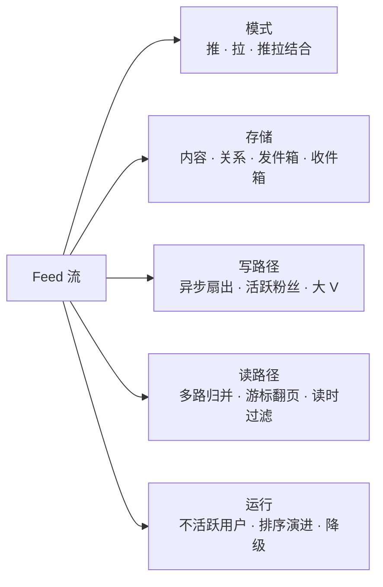
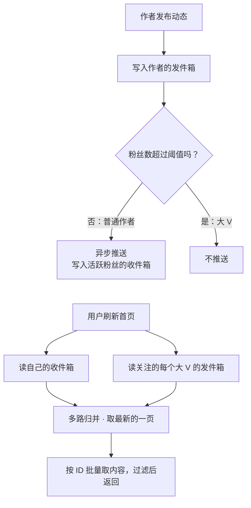
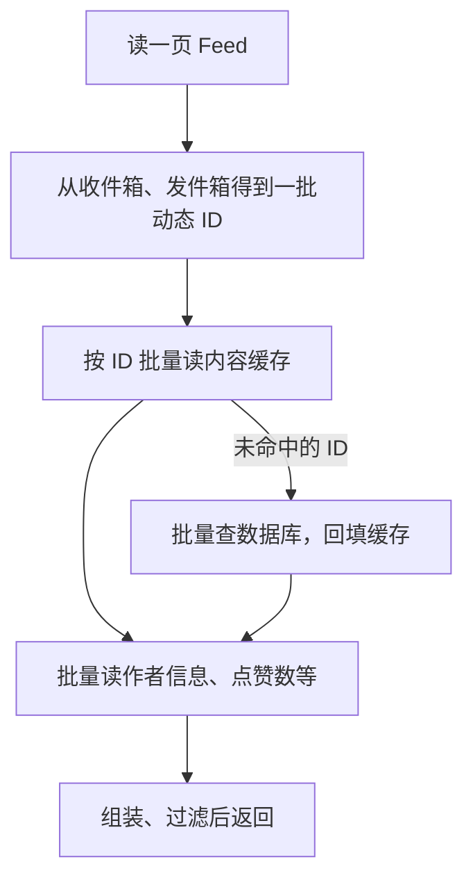
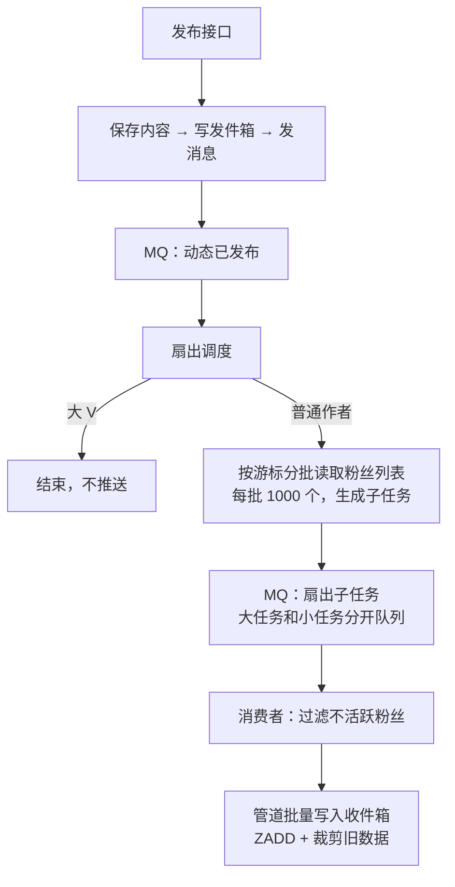
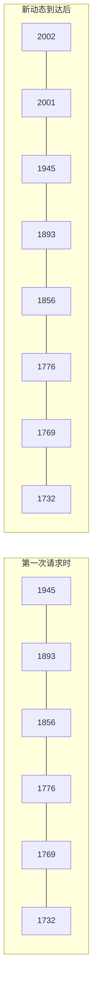
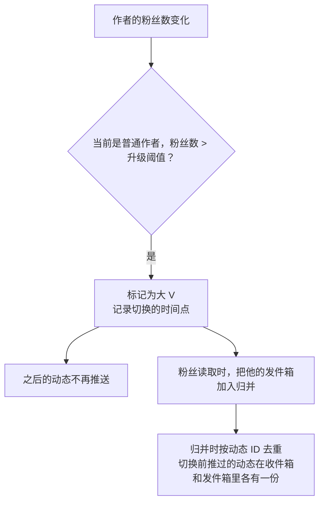
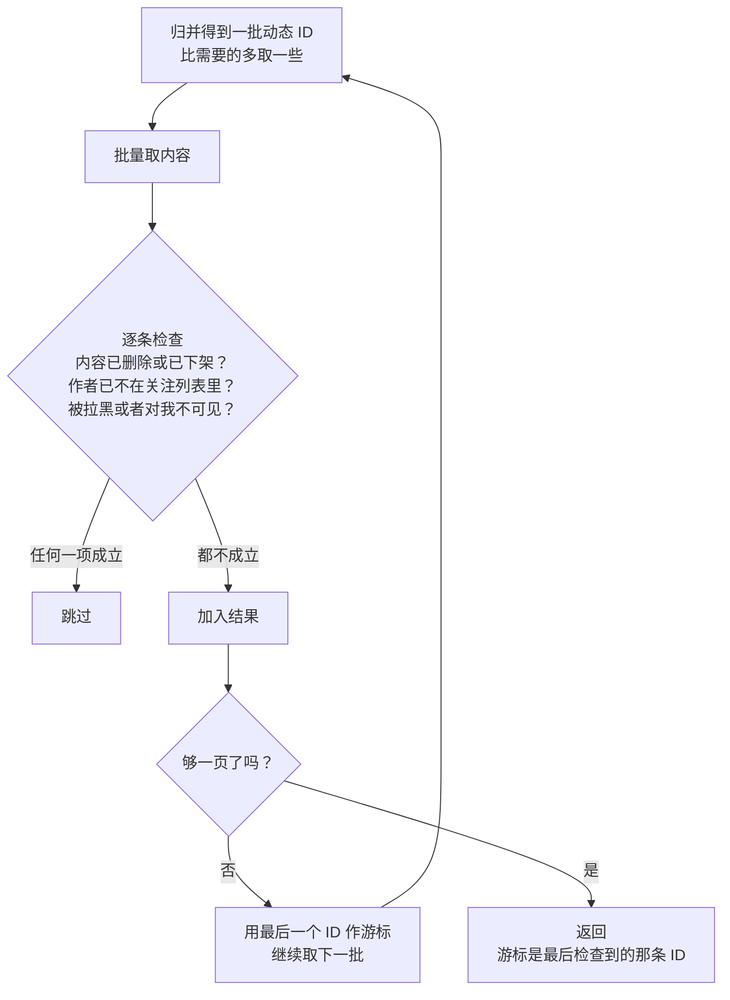
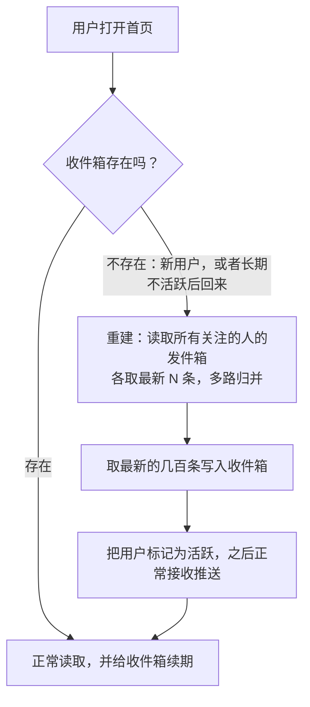
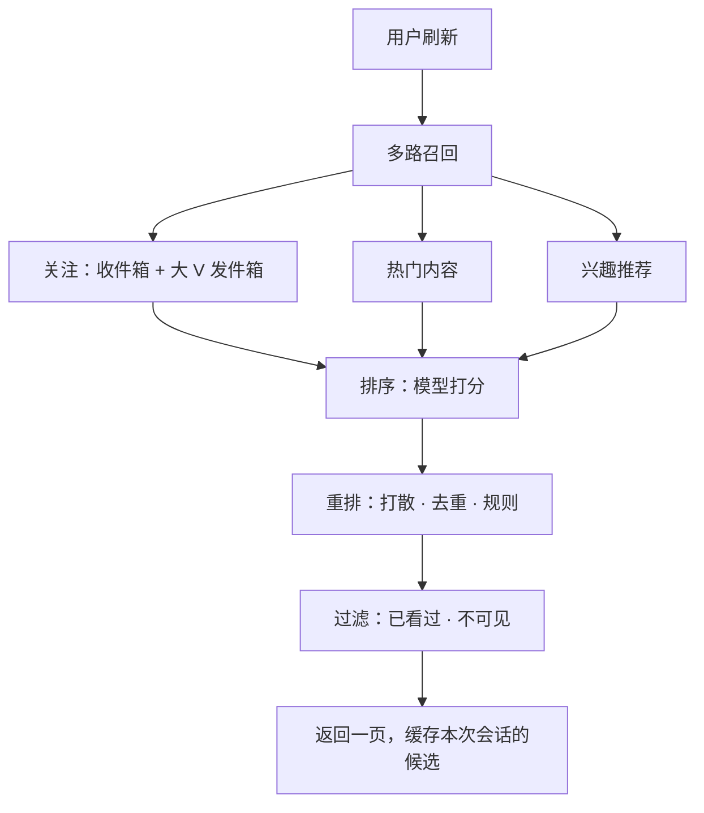

# S12 · Feed 流（关注动态）

> 适用岗位：Java 资深开发、Java 架构师。Feed 流是社交产品的核心：用户打开首页，看到自己关注的人发布的动态。这道题考察的是写扩散和读扩散的取舍、大 V 的处理，以及翻页、删除这些细节。速查版见[《29 场景题》](../06-三高与架构/29-场景题.md)的 29-10。
> 版本基线：JDK 21 / 25、Redis 7.x / 8.x、MySQL 8.4、Kafka 4.x 或 RocketMQ 5.x。
> 事实核对：
> - Redis ZSET 的内存占用（100 万个成员约 97 MB），沿用[《29 场景题》](../06-三高与架构/29-场景题.md)29-12 中的本机实测结果。
> - 本机运行（macOS 27.2、Apple M1 Max、JDK 25）：1 段推拉结合的代码只依赖 JDK，随机数种子固定，文中贴的是实际运行输出。演示里的用户数、粉丝数是为了说明问题而设定的，比真实系统小几个数量级。
> 相关分类：[《17 Redis》](../04-数据存储/17-Redis.md)（ZSET、大 Key）、[《20 MQ 通用与选型》](../05-消息队列/20-MQ通用与选型.md)、[《24 高并发》](../06-三高与架构/24-高并发.md)（读写模式、计数）、[《19 Elasticsearch》](../04-数据存储/19-Elasticsearch.md)（深分页）、[《16 分库分表》](../04-数据存储/16-分库分表.md)

## 45 分钟答题版

| 时间 | 做什么 | 要讲出的关键点 | 子题 |
| --- | --- | --- | --- |
| 0～5 分钟 | 需求与估算 | 按时间倒序的关注动态；读远多于写；粉丝数极不均匀 | S12-01 |
| 5～15 分钟 | 推还是拉 | 写扩散、读扩散各自的问题；**推拉结合** | S12-02 |
| 15～22 分钟 | 存储 | 内容只存一份；收件箱、发件箱只存 ID；关注关系两个方向 | S12-03 |
| 22～35 分钟 | 写和读 | 扇出异步、分批、只推活跃粉丝；读取时多路归并；游标翻页 | S12-04 ～ S12-06 |
| 35～45 分钟 | 细节 | 大 V 的阈值；删除和取关读时过滤；不活跃用户；降级 | S12-07 ～ S12-10 |

## 知识地图



## 题目索引

| 编号 | 题目 | 难度 |
| --- | --- | --- |
| S12-01 | Feed 流要澄清哪些需求？规模怎么估算？ | ★★ |
| S12-02 | 推模式、拉模式、推拉结合，怎么选？ | ★★★ |
| S12-03 | 内容、关注关系、收件箱、发件箱分别怎么存？ | ★★★ |
| S12-04 | 发布一条动态之后，怎么推给粉丝？ | ★★★ |
| S12-05 | 读取时，收件箱和大 V 的发件箱怎么合并？ | ★★★ |
| S12-06 | 翻页为什么不能用 offset？ | ★★ |
| S12-07 | 多少粉丝算大 V？粉丝数变化了怎么切换？ | ★★ |
| S12-08 | 删除动态、取消关注、拉黑，收件箱里的数据怎么办？ | ★★ |
| S12-09 | 不活跃的用户怎么处理？收件箱要存多少条？ | ★★ |
| S12-10 | 改成按推荐排序后架构怎么变？Feed 流怎么降级？ | ★★★ |

---

## 一、需求与模式

### S12-01 Feed 流要澄清哪些需求？规模怎么估算？

> ★★ ｜ 资深 / 架构师 ｜ 高频

**考察意图**：Feed 流的方案完全取决于读写比和粉丝数的分布。看你是否先问这两个数。

**30 秒版回答**：

- **功能**：用户发布动态；用户的首页展示他关注的人的动态，**按时间倒序**；下拉刷新看最新的，上滑加载更早的。
- **要问的**：
  - 排序是按时间，还是按推荐算法？（先按时间设计，再讨论推荐，S12-10）
  - 关注数和粉丝数有没有上限？分布如何？
  - 新动态要多快出现在粉丝的首页？（几秒内可以接受）
  - 有多少日活？每人每天刷几次、发几条？
- **两个决定架构的特点**：
  1. **读远多于写**：刷首页的次数是发动态的几十上百倍；
  2. **粉丝数极不均匀**：绝大多数人只有几十到几百个粉丝，极少数大 V 有几百万、几千万。
- **估算**（假设日活 1 亿）：读约 1.2 万 QPS，峰值 10 万；发布约 116 条/秒；如果全部用推模式，平均每秒要写 2 万多次收件箱，一个千万粉丝的大 V 发一条就是 1000 万次写入。

**深入剖析**

| 项目 | 假设 | 推算 |
| --- | --- | --- |
| 日活 | 1 亿 | — |
| 读 | 每人每天刷 10 次首页 | 10 亿次/天 ≈ 1.2 万 QPS，峰值按 8 倍约 10 万 QPS |
| 写 | 每天 1000 万条动态 | ≈ 116 条/秒 |
| 读写比 | — | 约 100 : 1 |
| 推模式的写入量 | 平均每个作者 200 个粉丝 | 1000 万 × 200 = 20 亿次/天 ≈ 2.3 万次/秒 |
| 大 V | 1000 万粉丝 | 发一条 = 1000 万次收件箱写入 |
| 拉模式的读取量 | 每人关注 200 个作者 | 每次刷新要查 200 个发件箱，10 万 QPS × 200 = 2000 万次/秒 |

最后两行就是这道题的核心矛盾：**纯推模式死在大 V 的写入上，纯拉模式死在普通用户的读取上**。

**追问链**

1. **"几秒内可以接受"这个条件为什么重要？** 它允许推送是异步的：发布接口只负责保存内容，然后立即返回；推给粉丝的动作在后台慢慢做。如果要求"发布成功的同时所有粉丝都能看到"，就只能用拉模式，或者同步地写所有收件箱，这在粉丝多的时候做不到。
2. **朋友圈和微博的 Feed 流有什么不同？** 朋友圈是双向的好友关系，好友数有上限，没有大 V 的问题，适合纯推模式；微博是单向的关注关系，粉丝数没有上限，必须处理大 V。先问清楚关系模型，方案就定了一大半。

---

### S12-02 推模式、拉模式、推拉结合，怎么选？

> ★★★ ｜ 架构师 ｜ 高频

**考察意图**：这道题的核心。不只是说出三种模式，而是能讲清楚它们是在用什么换什么。

**30 秒版回答**：

| 模式 | 发布时 | 读取时 | 适合 |
| --- | --- | --- | --- |
| **推（写扩散）** | 把动态 ID 写进**每个粉丝的收件箱** | 只读自己的收件箱，一次查询 | 粉丝数有上限的场景（好友关系） |
| **拉（读扩散）** | 只写自己的发件箱 | 查**每个关注的人的发件箱**，合并排序 | 读很少、或者关注数很少的场景 |
| **推拉结合** | 普通作者推；大 V 只写发件箱 | 读自己的收件箱，再加上关注的大 V 的发件箱，合并 | 单向关注、粉丝数差别极大的场景 |

- **本质**：推和拉是在**写入成本**和**读取成本**之间交换。推把计算提前到了写入时，拉把计算推迟到了读取时。
- **选择的依据**：这份计算，在写的时候做便宜，还是在读的时候做便宜？
  - 普通作者：粉丝少，推一次的成本很低，而他的每个粉丝之后都能直接读到。**推更便宜**；
  - 大 V：推一次要写几百万、几千万次，而且其中大部分粉丝今天根本不会打开 App。**拉更便宜**。
- **推拉结合就是对这两类作者分别选更便宜的那一种**。读取时要合并的发件箱数量，只是用户关注的大 V 的数量，通常是个位数到几十个，不是全部的关注数。

**深入剖析**



用代码模拟的结果（完整代码见 S12-05）：1 万个用户，其中 5 个大 V 各有 6000 个粉丝，其余作者的粉丝数在 0 到 60 之间；发布 2000 条动态，其中约 2% 来自大 V。

- 纯推模式：收件箱写入 233,972 次；
- 推拉结合：收件箱写入 59,972 次，是纯推的 **26%**。

也就是说，占动态总数不到 2% 的大 V 动态，贡献了 74% 的写入量。把它们改成拉，写入量降到了原来的四分之一。真实系统里粉丝数的差距比这个演示大得多，效果也更明显。

**追问链**

1. **推拉结合之后，读取变慢了多少？** 多了"读几个大 V 的发件箱"和"合并"。一个用户关注的大 V 数量有限，这些发件箱可以并行读取，而且大 V 的发件箱被大量的粉丝读取，非常适合缓存（所有粉丝读的是同一份数据）。合并是内存里的归并，耗时可以忽略。
2. **能不能反过来：读的时候把拉到的大 V 动态也写进收件箱？** 可以作为优化：用户刷新时，把这次拉到的大 V 动态合并进自己的收件箱，下次翻页就不用再拉了。这相当于"按需的推"：只为真正打开了 App 的粉丝做扩散。要注意去重，以及大 V 删除动态时的处理。
3. **纯拉模式有没有适用的场景？** 有。关注数很少、读取不频繁的场景，比如"我关注的专栏有没有更新"；或者系统规模还小的时候。它的优点是没有冗余数据，删除、取关都不需要清理。很多系统是从纯拉开始，在读取压力上来之后才引入收件箱。

**架构师加分点**

- 推拉的取舍不是 Feed 流独有的。物化视图和实时查询、预计算的报表和即席查询、缓存和回源，都是同一个问题：**一份结果，是在数据变化时算好存起来，还是在有人要的时候现算**。判断的依据都是读写的频率比和扩散的系数。面试时把 Feed 流的推拉放到这个更大的框架里讲，能体现出抽象能力。

---

### S12-03 内容、关注关系、收件箱、发件箱分别怎么存？

> ★★★ ｜ 资深 / 架构师 ｜ 高频

**考察意图**：四类数据的访问模式完全不同。看你是否为每一类选了合适的存储，以及是否知道"收件箱里只存 ID"。

**30 秒版回答**：

| 数据 | 内容 | 访问模式 | 存储 |
| --- | --- | --- | --- |
| **动态内容** | 文字、图片地址、作者、时间 | 按动态 ID 批量读取 | 数据库（按动态 ID 分片）+ 缓存；图片视频在对象存储和 CDN |
| **关注关系** | 谁关注了谁 | 两个方向都要查：我关注的人、我的粉丝 | 两张表（或两份索引），各按一个方向分片 |
| **发件箱** | 某个作者发过的动态 ID | 按作者读最新的 N 条 | 数据库（按作者 ID 分片）+ Redis ZSET 缓存最近的部分 |
| **收件箱** | 推送给某个用户的动态 ID | 按用户读最新的 N 条；写入极频繁 | Redis ZSET，只保留最近的几百条 |

- **内容只存一份**。收件箱和发件箱里只有动态 ID（和时间），读取时再按 ID 批量取内容。一条动态被推给 1 万个粉丝，是 1 万个 ID，不是 1 万份内容。
- **动态 ID 用按时间递增的 ID**（比如雪花算法）。ID 本身就能排序，ZSET 的分数直接用 ID 即可。
- **收件箱是可以重建的派生数据**：丢了可以用拉模式重新生成（S12-09）。所以它可以只放在 Redis 里，不需要落数据库。

**深入剖析**

关注关系的两个方向：

```sql
-- 我关注了谁：按 user_id 分片
CREATE TABLE t_following (
    user_id     BIGINT      NOT NULL,
    followee_id BIGINT      NOT NULL,
    create_time DATETIME(3) NOT NULL,
    PRIMARY KEY (user_id, followee_id)
);

-- 谁关注了我：按 user_id 分片（这里的 user_id 是被关注的人）
CREATE TABLE t_follower (
    user_id     BIGINT      NOT NULL,
    follower_id BIGINT      NOT NULL,
    create_time DATETIME(3) NOT NULL,
    PRIMARY KEY (user_id, follower_id)
);
```

一次关注要写两张表，它们在不同的分片上。做法是先写"我关注了谁"（这是用户操作的直接结果），再通过消息或者 binlog 异步写"谁关注了我"。两张表之间短暂的不一致可以接受。

收件箱在 Redis 里的结构：

```text
Key:    inbox:{用户 ID}
类型:   ZSET
成员:   动态 ID
分数:   动态 ID（按时间递增，所以也就是时间顺序）
```

内存的估算：按 29-12 里的实测，ZSET 每个成员约占 97 字节。每个用户的收件箱保留 500 条，约 50 KB；1 亿个活跃用户就是约 5 TB。这个量级说明两件事：收件箱必须限制长度；不活跃的用户不应该占用收件箱（S12-09）。



**追问链**

1. **大 V 的粉丝列表有几千万行，怎么存、怎么用？** 存在按被关注者分片的粉丝表里，这个大 V 的数据会集中在一个分片上，是一个热点分片，可以对超大的粉丝列表单独再拆分。好在推拉结合之后，大 V 发动态**不需要读粉丝列表**。粉丝列表主要用于展示粉丝数（用计数器，不实时 count）和分页查看。
2. **内容的缓存怎么设计？** 按动态 ID 缓存。动态发布之后很少修改，缓存的命中率很高。热门动态（被大量用户的 Feed 包含）可以再加一层本地缓存。批量读取用 `MGET` 或者管道，一页 20 条动态只需要一次往返。
3. **点赞数、评论数放在内容里吗？** 不放。它们变化非常频繁，放在内容里会让内容缓存不断失效。计数单独存储、单独缓存，读取时和内容分别批量获取再组装。高频计数的做法见[《24 高并发》](../06-三高与架构/24-高并发.md)24-13。

---

## 二、写路径与读路径

### S12-04 发布一条动态之后，怎么推给粉丝？

> ★★★ ｜ 资深 / 架构师 ｜ 高频

**考察意图**：扇出（fan-out）是推模式的写入主体。看你是否把它做成了异步、可分批、可重试、可限速的任务。

**30 秒版回答**：

- **发布接口只做三件事**：保存内容、写入作者的发件箱、发一条"动态已发布"的消息。然后立即返回。
- **扇出由消费者异步完成**：
  1. 判断作者是不是大 V，是就结束；
  2. **分批**读取粉丝列表（比如每批 1000 个）；
  3. 每一批生成一个子任务，由多个消费者并行处理；
  4. 子任务里，过滤掉**不活跃**的粉丝，对其余的粉丝，用管道批量执行"写入收件箱 + 裁剪到最大长度"。
- **只推给活跃粉丝**：最近 N 天没有打开过 App 的用户不推。这通常能省掉一大半的写入。
- **失败重试**：子任务失败由 MQ 重试。写入收件箱是幂等的（ZSET 里同一个成员重复添加没有影响），可以放心重试。
- **限速和隔离**：一个有几十万粉丝的"中 V"发动态，会产生几百个子任务。不能让它们堵住普通作者的扇出，要按任务大小分到不同的队列。

**深入剖析**



写入一个粉丝的收件箱是两条命令：

```text
ZADD inbox:{粉丝 ID} {动态 ID} {动态 ID}
ZREMRANGEBYRANK inbox:{粉丝 ID} 0 -501      # 只保留分数最大的 500 条
```

1000 个粉丝就是 2000 条命令，放在管道里一次发出。这些 Key 分布在 Redis Cluster 的不同节点上，客户端会按节点把命令分组，各发一个管道。

活跃粉丝的判断：维护一个"最近活跃的用户"集合（比如按天的位图，或者每个用户的最后活跃时间）。扇出时批量查询这一批粉丝的活跃状态。

**追问链**

1. **粉丝的首页多久能看到新动态？** 取决于扇出的延迟。普通作者只有几十、几百个粉丝，一个子任务就完成了，延迟在秒级以内。几十万粉丝的作者要几百个子任务，最后一批粉丝可能要等十几秒。要监控扇出的延迟（从发布到最后一个子任务完成的时间），它是 Feed 流实时性的核心指标。
2. **作者自己发的动态，要在自己的首页立刻看到，怎么保证？** 读取自己的 Feed 时，把自己的发件箱也作为一路参与归并。这样不依赖扇出，发布成功后刷新立刻可见。
3. **扇出到一半，作者删除了这条动态怎么办？** 不需要中止扇出，也不需要去每个收件箱里删除。读取时取内容的那一步会发现它已经被删除，直接跳过（S12-08）。
4. **为什么分批读粉丝列表要用游标？** 粉丝列表在不断变化（有人关注、有人取关），用 `LIMIT offset` 分批会漏掉或者重复。用"上一批最后一个粉丝 ID"作为游标继续往后读。

---

### S12-05 读取时，收件箱和大 V 的发件箱怎么合并？

> ★★★ ｜ 资深 ｜ 高频

**考察意图**：多路归并的实际应用。看你是否知道每一路只需要取一小部分，而不是全部取回来再排序。

**30 秒版回答**：

- **输入**：1 个收件箱 + K 个大 V 的发件箱，每一个都是按时间有序的列表。
- **目标**：取出其中最新的 N 条（一页）。
- **做法：多路归并**。每一路只取游标之前最新的 N 条（因为最终结果的 N 条里，任何一路最多贡献 N 条）；然后用一个堆，每次取出最新的一条，再把这一路的下一条放进堆里，直到凑够 N 条。
- **并行读取**：K + 1 路的读取互不依赖，并行发出。总耗时取决于最慢的一路，而不是所有路的总和。
- **大 V 的发件箱适合缓存**：它被这个大 V 的所有粉丝共享，命中率极高。
- **限制 K**：一个用户关注的大 V 太多时，只取最近有更新的那些。

**深入剖析**

完整的演示代码，包含推拉结合的写入、多路归并的读取、两种翻页方式的对比（本机 JDK 25 运行）：

```java
import java.util.ArrayList;
import java.util.HashMap;
import java.util.HashSet;
import java.util.List;
import java.util.Map;
import java.util.PriorityQueue;
import java.util.Random;
import java.util.Set;

/**
 * Feed 流的推拉结合：普通作者发布时把动态 ID 推进粉丝的收件箱；大 V 不推，读的时候从他的发件箱拉。
 * 动态 ID 按发布顺序递增，所以 ID 越大越新。
 */
public class FeedDemo {

    private static final int USER_COUNT = 10_000;
    private static final int BIG_V_COUNT = 5;
    private static final int BIG_V_FOLLOWERS = 6_000;
    private static final int NORMAL_MAX_FOLLOWERS = 60;
    private static final int POST_COUNT = 2_000;
    private static final int PAGE_SIZE = 5;
    private static final long RANDOM_SEED = 20261112L;

    /** 作者 → 粉丝 */
    private final Map<Integer, List<Integer>> followers = new HashMap<>();
    /** 用户 → 关注的大 V */
    private final Map<Integer, List<Integer>> followedBigV = new HashMap<>();
    /** 发件箱：作者 → 自己发的动态 ID，按时间升序 */
    private final Map<Integer, List<Long>> outbox = new HashMap<>();
    /** 收件箱：用户 → 被推送进来的动态 ID，按时间升序 */
    private final Map<Integer, List<Long>> inbox = new HashMap<>();
    private long nextPostId = 1;
    private long pushWrites;
    private long pureFanOutWrites;

    private boolean isBigV(int author) {
        return author < BIG_V_COUNT;
    }

    void follow(int user, int author) {
        followers.computeIfAbsent(author, k -> new ArrayList<>()).add(user);
        if (isBigV(author)) {
            followedBigV.computeIfAbsent(user, k -> new ArrayList<>()).add(author);
        }
    }

    long publish(int author) {
        long postId = nextPostId++;
        outbox.computeIfAbsent(author, k -> new ArrayList<>()).add(postId);
        List<Integer> fans = followers.getOrDefault(author, List.of());
        pureFanOutWrites += fans.size();               // 如果所有人都用推模式，要写这么多次
        if (!isBigV(author)) {
            for (int fan : fans) {
                inbox.computeIfAbsent(fan, k -> new ArrayList<>()).add(postId);
                pushWrites++;
            }
        }
        return postId;
    }

    /**
     * 读一页：把"自己的收件箱"和"关注的每个大 V 的发件箱"做多路归并，取 ID 小于游标的最新 pageSize 条。
     * 每一路都是有序的，所以用一个大顶堆，每次弹出最新的一条，再把这一路的下一条放进去。
     */
    List<Long> readPage(int user, long cursor, int pageSize) {
        List<List<Long>> sources = new ArrayList<>();
        sources.add(inbox.getOrDefault(user, List.of()));
        for (int bigV : followedBigV.getOrDefault(user, List.of())) {
            sources.add(outbox.getOrDefault(bigV, List.of()));
        }
        // 堆里的元素：{动态 ID, 来自第几路, 这一路里的下标}
        PriorityQueue<long[]> heap = new PriorityQueue<>((a, b) -> Long.compare(b[0], a[0]));
        for (int i = 0; i < sources.size(); i++) {
            int index = lastIndexBelow(sources.get(i), cursor);
            if (index >= 0) {
                heap.add(new long[] {sources.get(i).get(index), i, index});
            }
        }
        List<Long> page = new ArrayList<>();
        while (page.size() < pageSize && !heap.isEmpty()) {
            long[] top = heap.poll();
            page.add(top[0]);
            int next = (int) top[2] - 1;
            if (next >= 0) {
                heap.add(new long[] {sources.get((int) top[1]).get(next), top[1], next});
            }
        }
        return page;
    }

    /** 二分查找：有序列表里最后一个小于 cursor 的元素的下标 */
    private static int lastIndexBelow(List<Long> sorted, long cursor) {
        int low = 0;
        int high = sorted.size() - 1;
        int answer = -1;
        while (low <= high) {
            int mid = (low + high) >>> 1;
            if (sorted.get(mid) < cursor) {
                answer = mid;
                low = mid + 1;
            } else {
                high = mid - 1;
            }
        }
        return answer;
    }

    /** 对照用：按 offset 翻页，先归并出全部内容再截取 */
    List<Long> readByOffset(int user, int offset, int pageSize) {
        List<Long> all = readPage(user, Long.MAX_VALUE, Integer.MAX_VALUE);
        return all.subList(Math.min(offset, all.size()), Math.min(offset + pageSize, all.size()));
    }

    public static void main(String[] args) {
        FeedDemo feed = new FeedDemo();
        Random random = new Random(RANDOM_SEED);
        // 0 ～ 4 号是大 V，各有 6000 个粉丝；其余作者的粉丝数在 0 ～ 60 之间
        for (int author = 0; author < USER_COUNT; author++) {
            int count = feed.isBigV(author) ? BIG_V_FOLLOWERS : random.nextInt(NORMAL_MAX_FOLLOWERS + 1);
            Set<Integer> chosen = new HashSet<>();
            while (chosen.size() < count) {
                int fan = random.nextInt(USER_COUNT);
                if (fan != author && chosen.add(fan)) {
                    feed.follow(fan, author);
                }
            }
        }
        // 2000 条动态，其中 2% 是大 V 发的
        for (int i = 0; i < POST_COUNT; i++) {
            int author = random.nextInt(100) < 2 ? random.nextInt(BIG_V_COUNT)
                    : BIG_V_COUNT + random.nextInt(USER_COUNT - BIG_V_COUNT);
            feed.publish(author);
        }
        System.out.println("posts=" + POST_COUNT + ", inbox writes: pure push=" + feed.pureFanOutWrites
                + ", push+pull=" + feed.pushWrites
                + " (" + Math.round(feed.pushWrites * 100.0 / feed.pureFanOutWrites) + "% of pure push)");

        // 找一个既关注了大 V、收件箱里也有内容的用户
        int reader = -1;
        for (int user = BIG_V_COUNT; user < USER_COUNT && reader < 0; user++) {
            if (feed.followedBigV.getOrDefault(user, List.of()).size() >= 2
                    && feed.inbox.getOrDefault(user, List.of()).size() >= 8) {
                reader = user;
            }
        }
        System.out.println("reader=" + reader + ", inbox size=" + feed.inbox.get(reader).size()
                + ", follows big V " + feed.followedBigV.get(reader));

        List<Long> page1 = feed.readPage(reader, Long.MAX_VALUE, PAGE_SIZE);
        System.out.println("page 1            : " + page1);

        // 用户看完第一页后，他关注的一个普通作者和一个大 V 各发了一条新动态
        int normalAuthor = -1;
        for (int author = BIG_V_COUNT; author < USER_COUNT && normalAuthor < 0; author++) {
            if (feed.followers.getOrDefault(author, List.of()).contains(reader)) {
                normalAuthor = author;
            }
        }
        long newPost1 = feed.publish(normalAuthor);
        long newPost2 = feed.publish(feed.followedBigV.get(reader).get(0));
        System.out.println("new posts arrive  : " + newPost1 + " (pushed), " + newPost2 + " (big V, pulled)");

        List<Long> byOffset = feed.readByOffset(reader, PAGE_SIZE, PAGE_SIZE);
        List<Long> byCursor = feed.readPage(reader, page1.get(page1.size() - 1), PAGE_SIZE);
        List<Long> repeated = new ArrayList<>(byOffset);
        repeated.retainAll(page1);
        System.out.println("page 2 by offset  : " + byOffset + "  repeated from page 1: " + repeated);
        System.out.println("page 2 by cursor  : " + byCursor);
        System.out.println("refresh (top)     : " + feed.readPage(reader, Long.MAX_VALUE, PAGE_SIZE));
    }
}
```

```text
posts=2000, inbox writes: pure push=233972, push+pull=59972 (26% of pure push)
reader=5, inbox size=8, follows big V [0, 1, 2, 3]
page 1            : [1945, 1893, 1856, 1776, 1769]
new posts arrive  : 2001 (pushed), 2002 (big V, pulled)
page 2 by offset  : [1776, 1769, 1732, 1714, 1648]  repeated from page 1: [1776, 1769]
page 2 by cursor  : [1732, 1714, 1648, 1599, 1568]
refresh (top)     : [2002, 2001, 1945, 1893, 1856]
```

- 第一行是 S12-02 引用的写入量对比；
- 用户 5 的收件箱里有 8 条普通作者推来的动态，同时关注了 4 个大 V。第一页的 5 条是这 5 路数据归并后最新的 5 条；
- 后面几行是翻页的对比，在 S12-06 里讲。

`readPage` 的关键步骤：

1. 每一路用二分查找定位到"小于游标的最后一个元素"。Redis 里对应的是 `ZRANGE key (游标 -inf BYSCORE REV LIMIT 0 N`；
2. 把每一路的这个元素放进大顶堆；
3. 弹出堆顶（当前最新的一条），加入结果，再把它所在那一路的前一个元素放进堆；
4. 重复第 3 步，直到取够 N 条或者堆空了。

每一路的数据是有序的，所以归并的时间只和"路数"和"取的条数"有关，和每一路的总长度无关。

**追问链**

1. **实际实现中需要逐条地"取一条、补一条"吗？** 不需要。每一路一次取回 N 条（一次网络往返），在应用内存里归并。取回的总量是 (K + 1) × N 条 ID，K 是十几、N 是 20 的话只有几百个 ID，很小。逐条去 Redis 取才是不可接受的。
2. **其中一路读取超时了怎么办？** 不要让整个请求失败。跳过这一路，用其余的数据返回结果，这一页可能少了某个大 V 的动态，下次刷新会补上。Feed 流对"不完整"的容忍度很高，对"打不开"的容忍度很低。
3. **合并后的结果要不要缓存？** 可以把用户最近一次合并的结果缓存一小段时间，短时间内的重复刷新直接返回。更进一步就是 S12-02 追问 2 里的做法：把合并结果写回收件箱。

---

### S12-06 翻页为什么不能用 offset？

> ★★ ｜ 资深 ｜ 高频

**考察意图**：一个很具体的细节，却是真实系统里常见的 bug。看你是否理解数据在变化时 offset 的问题。

**30 秒版回答**：

- **现象**：用户看完第一页，往上滑加载第二页，看到了**刚才已经看过的内容**。
- **原因**：Feed 的头部在不断插入新的动态。用户读第一页时拿到的是第 1～5 条；这时来了 2 条新动态，原来的第 4、5 条变成了第 6、7 条。用户用 `offset = 5` 取第二页，拿到的是现在的第 6～10 条，其中前两条正是刚才的第 4、5 条。
- **解决：用游标翻页**。第二页的请求带上"上一页最后一条的 ID"，服务端返回 **ID 小于这个值**的最新 N 条。新插入的动态 ID 都更大，不会影响游标后面的内容。
- **另一个好处**：offset 越大越慢（要跳过前面所有的数据），游标翻页的耗时和翻到第几页无关。
- **刷新和翻页是两个操作**：下拉刷新不带游标，取最新的一页；上滑加载带游标，取更早的。

**深入剖析**

上一题的输出里：

```text
page 1            : [1945, 1893, 1856, 1776, 1769]
new posts arrive  : 2001 (pushed), 2002 (big V, pulled)
page 2 by offset  : [1776, 1769, 1732, 1714, 1648]  repeated from page 1: [1776, 1769]
page 2 by cursor  : [1732, 1714, 1648, 1599, 1568]
refresh (top)     : [2002, 2001, 1945, 1893, 1856]
```

- 用户看完第一页后，来了两条新动态（2001 和 2002）；
- 按 offset 取第二页：1776 和 1769 **重复出现**了，因为它们被两条新动态挤到了第二页的位置；
- 按游标取第二页（ID 小于 1769）：没有重复，紧接着第一页的内容；
- 两条新动态在下拉刷新时出现在最上面。其中 2001 是普通作者推进收件箱的，2002 是读取时从大 V 的发件箱拉到的，合并后顺序正确。



第一次请求时，offset 5 之后是 1732；新动态到达后，offset 5 之后变成了 1776。同一个 offset，指向的位置变了。游标 1769 指向的位置始终不变。

**追问链**

1. **游标用时间戳还是 ID？** 用 ID。时间戳可能重复（同一毫秒发布的两条动态），用"小于这个时间"会漏掉同一毫秒的另一条，用"小于等于"又会重复。ID 是唯一的，而且雪花 ID 本身按时间递增，一个值就够了。如果只能用时间排序，游标就要用"时间 + ID"两个字段。
2. **按推荐排序的 Feed 没有固定的顺序，怎么翻页？** 不能用"小于某个 ID"了。常见的做法是服务端为这次会话生成一份排好序的候选列表并缓存起来，翻页就是在这份快照上取下一段；或者每次请求都重新推荐，由客户端传回已经展示过的 ID 用于去重。
3. **Elasticsearch、MySQL 的深分页是同一个问题吗？** offset 大时性能差是同一个问题，解法也一样：用上一页最后一条的排序值作为起点。见[《19 Elasticsearch》](../04-数据存储/19-Elasticsearch.md)19-08、[《16 分库分表》](../04-数据存储/16-分库分表.md)16-06。

---

## 三、细节

### S12-07 多少粉丝算大 V？粉丝数变化了怎么切换？

> ★★ ｜ 架构师 ｜ 中频

**考察意图**：阈值不是一个拍脑袋的数字。看你是否能说出它背后的成本模型，以及切换时的数据衔接。

**30 秒版回答**：

- **阈值的依据是成本**：一条动态推给 F 个粉丝的写入成本，和这些粉丝之后来拉它的读取成本，哪个大。粉丝越多、其中活跃的比例越低，推就越不划算。
- **实际的考虑**：
  - **扇出的延迟**：推给 F 个粉丝需要多久？如果超过了可接受的延迟（比如 10 秒），就应该改成拉；
  - **用户关注的大 V 数量**：阈值定得太低，大 V 太多，每个用户读取时要合并的路数就多。
- 经验上阈值在几万到几十万之间，是一个可以调整的配置。
- **切换**：
  - **普通 → 大 V**（粉丝涨过了阈值）：从此不再推送。之前推进粉丝收件箱的动态留着不动；读取时把他的发件箱作为一路加入归并，和收件箱里已有的他的动态去重；
  - **大 V → 普通**：开始推送新的动态。不需要补推历史的动态，读取时继续拉他的发件箱一段时间即可。
- **避免来回切换**：升级和降级用不同的阈值（比如涨到 10 万升级，跌到 8 万才降级）。

**深入剖析**



用户读取时怎么知道"我关注的人里哪些是大 V"：

- 大 V 的总数不多（几万到几十万个），可以把全量的大 V 名单放在每个实例的本地缓存里；
- 读取时，取出用户的关注列表，和大 V 名单求交集。关注列表也有缓存；
- 更高效的做法：为每个用户单独维护一份"我关注的大 V"的小列表，在关注、取关、以及某个作者升级为大 V 时更新。

**追问链**

1. **能不能不分两类，而是每个作者都"推给活跃粉丝，其余的拉"？** 这是更精细的方案：推的对象不由作者决定，而是由粉丝决定。在线的、最近活跃的粉丝收到推送；其他粉丝在下次打开 App 时拉取。这样大 V 的活跃粉丝也能及时看到。代价是读取时要判断"哪些内容已经推过、哪些需要拉"，逻辑更复杂。
2. **大 V 发动态的瞬间，几百万粉丝同时来拉，发件箱扛得住吗？** 大 V 的发件箱是一个极热的 Key。它的内容对所有粉丝是一样的，所以适合多级缓存：本地缓存 + Redis，过期时间很短。热点 Key 的处理见[《17 Redis》](../04-数据存储/17-Redis.md)17-07。
3. **粉丝数是怎么得到的？** 计数器，在关注和取关时增减。不要每次都对粉丝表做 `COUNT`。

---

### S12-08 删除动态、取消关注、拉黑，收件箱里的数据怎么办？

> ★★ ｜ 资深 ｜ 中频

**考察意图**：推模式制造了大量的冗余数据。看你是否知道不需要同步地清理它们。

**30 秒版回答**：

- **原则：写时不清理，读时过滤**。收件箱里的 ID 只是一个"线索"，最终展示什么由读取时的校验决定。
- **删除动态**：只把内容标记为已删除。读取时按 ID 取内容，发现已删除就跳过。不需要去几万个粉丝的收件箱里删除这个 ID。
- **取消关注**：读取时，用当前的关注列表过滤一遍，不在关注列表里的作者的动态跳过。同时异步清理收件箱里这个作者的动态，清理完之前靠读时过滤保证正确。
- **拉黑、设为私密、内容被审核下架**：同样是读时过滤。可见性的规则在读取时统一判断。
- **过滤导致一页不够 N 条**：多取一些。比如每页要 20 条，就取 30 条，过滤后不够再继续往后取。
- **为什么不在写的时候清理**：一次删除要扇出到所有粉丝的收件箱，代价和发布一样大，而它带来的收益（收件箱里少一个无效的 ID）很小。

**深入剖析**



注意最后一步：返回给客户端的游标，应该是**这次检查到的最后一条**的 ID，不管它有没有通过过滤。否则被过滤掉的内容下次还会被再取一遍。

各种变更的处理方式：

| 变更 | 写时 | 读时 | 异步清理 |
| --- | --- | --- | --- |
| 删除动态 | 标记内容为已删除，清内容缓存 | 取到已删除的内容就跳过 | 不需要，收件箱里的 ID 会随着裁剪自然消失 |
| 取消关注 | 更新关注关系 | 按当前的关注列表过滤 | 从收件箱里删除这个作者的动态 |
| 拉黑 | 更新黑名单，同时解除关注关系 | 按黑名单过滤 | 同上 |
| 动态改为私密 | 更新可见性 | 按可见性规则过滤 | 不需要 |

**追问链**

1. **取关之后的异步清理怎么做？** 收件箱的 ZSET 里只有动态 ID，不知道每条动态的作者是谁。两种办法：成员里编码进作者 ID（比如"作者 ID:动态 ID"），清理时遍历收件箱找出这个作者的条目；或者不清理，完全依靠读时过滤，反正收件箱只保留几百条，过一段时间就被新内容挤出去了。后者更简单，多数情况下够用。
2. **读时过滤需要查很多东西，会不会很慢？** 需要的数据都是批量获取并且有缓存的：内容（本来就要取）、关注列表（一个用户一份）、黑名单（一个用户一份）。过滤本身是内存里的判断。
3. **大 V 删除了一条动态，粉丝还能看到吗？** 大 V 的动态是从发件箱拉的。删除时从发件箱里移除，并清掉发件箱的缓存。即使缓存还没过期，取内容时也会发现已删除。两道检查，任何一道都能拦住。

---

### S12-09 不活跃的用户怎么处理？收件箱要存多少条？

> ★★ ｜ 资深 / 架构师 ｜ 中频

**考察意图**：收件箱是用内存换读取速度。看你是否控制了这个成本，以及知道收件箱没有了怎么恢复。

**30 秒版回答**：

- **不活跃的用户不推**：给一个一个月没打开 App 的用户推送，这些写入和内存都是浪费的。扇出时跳过不活跃的粉丝。
- **不活跃用户的收件箱可以过期**：每次用户活跃时给收件箱续期；长期不活跃，收件箱自动被回收。
- **用户回来了怎么办：重建**。打开 App 时发现没有收件箱，就用**拉模式**现场生成一次：读取他关注的所有人的发件箱，各取最新的若干条，归并后取前几百条，写入收件箱。之后恢复成正常的推送。
- **收件箱的长度**：只保留最近的几百条。大多数用户一次只会看前几页。翻到收件箱的末尾之后，再往前的内容用拉模式获取。
- 这样，收件箱的内存只和**活跃用户数**成正比，而不是和注册用户数成正比。

**深入剖析**



重建的代价和控制：

- 一个用户关注了 500 人，重建就要读 500 个发件箱。这是一次昂贵的操作，但每个用户很久才发生一次；
- 发件箱的读取要并行、要有超时；关注数特别多的用户，只读最近有更新的那部分作者；
- 重建期间可以先返回一个不完整的结果（比如先返回大 V 的内容），重建完成后刷新；
- 大量用户同时回归时（比如一次全量推送把沉睡的用户唤醒了），重建请求会突增，要限流并排队。

收件箱长度的取舍：

| 长度 | 内存 | 翻页体验 |
| --- | --- | --- |
| 短（100 条） | 小 | 翻几页就到头，之后要走较慢的拉模式 |
| 长（2000 条） | 大 | 几乎不会翻到头 |

可以按用户的活跃程度区别对待：重度用户的收件箱长一些，普通用户短一些。

**追问链**

1. **"活跃"怎么定义和记录？** 比如最近 7 天内打开过 App。记录每个用户的最后活跃时间，扇出时批量查询。用户量很大时，可以用按天的位图：每天一个位图，用户活跃就把对应的位置 1；判断"7 天内活跃"就是查 7 个位图。位图的用法见[《17 Redis》](../04-数据存储/17-Redis.md)17-04。
2. **翻到收件箱末尾之后，怎么接上更早的内容？** 用游标（最后一条的 ID）切换到拉模式：对每个关注的人的发件箱，取 ID 小于游标的内容，归并。发件箱的历史数据在数据库里，是完整的。这种深度翻页很少发生，慢一点可以接受。
3. **Redis 里的收件箱全丢了怎么办？** 所有用户都触发重建，相当于全员用拉模式，会压垮发件箱的存储。要按批次、限速地重建，优先重建当前在线的用户。这也是为什么发件箱必须有持久化的存储，而收件箱可以没有：发件箱是事实，收件箱是可以从事实推导出来的缓存。

---

### S12-10 改成按推荐排序后架构怎么变？Feed 流怎么降级？

> ★★★ ｜ 架构师 ｜ 中频

**考察意图**：是否了解时间线只是 Feed 流的起点，以及在压力下哪些可以舍弃。

**30 秒版回答**：

- **按推荐排序后，Feed 流变成一个推荐系统**，分成四步：
  1. **召回**：从多个来源取候选。关注的人的动态（就是上面的收件箱和发件箱）、热门内容、根据兴趣推荐的内容；
  2. **粗排、精排**：用模型给候选打分；
  3. **重排**：打散同一个作者的内容、插入广告、去重、应用规则；
  4. **过滤**：已看过的、不可见的。
- **收件箱和发件箱仍然有用**，它们从"最终的结果"变成了"召回的一路"。
- **翻页不能再用"小于某个 ID"**，因为顺序不再是时间。要缓存本次会话的推荐结果，或者由客户端回传已展示的列表（S12-06 追问 2）。
- **降级**（由轻到重）：
  1. 关闭个性化推荐，退回按时间排序的关注流；
  2. 关闭大 V 的拉取，只返回收件箱里的内容；
  3. 读取本地缓存或者上一次的结果，不保证最新；
  4. 返回通用的热门内容。
- 原则：**宁可内容不够新、不够全，也不能让首页打不开**。

**深入剖析**



依赖和降级的对应关系：

| 依赖 | 故障时 | 降级 |
| --- | --- | --- |
| 推荐、排序服务 | 超时或不可用 | 按时间排序 |
| 大 V 的发件箱 | 读取超时 | 跳过这一路 |
| 收件箱（Redis） | 不可用 | 用拉模式读发件箱（限流），或者返回热门内容 |
| 内容服务 | 部分内容取不到 | 跳过取不到的，返回其余的 |
| 计数服务（点赞数等） | 不可用 | 不展示计数，或者展示缓存的旧值 |
| 扇出的消费者 | 积压 | 新动态出现得晚一些；监控并扩容 |

写路径的降级：扇出积压严重时，可以临时**调低大 V 的阈值**，让更多的作者从推变成拉，立刻减少写入量。阈值是一个配置，这个调整不需要发版。

**追问链**

1. **"已看过"怎么过滤？** 要记住每个用户看过哪些内容。精确记录的成本很高，常用布隆过滤器：每个用户一个，看过的内容 ID 加进去。它可能把少量没看过的内容误判为看过（少推几条，可以接受），但不会把看过的判为没看过。过滤器按时间滚动，只保留最近一段时间的。
2. **Feed 流的核心监控指标有哪些？** 读取接口的耗时和错误率；空结果的比例；扇出的延迟和积压；收件箱的命中率（有多少请求触发了重建）；每次读取合并的路数；降级开关的状态。
3. **发布的峰值（比如热点事件）怎么扛？** 发布接口本身很轻（存内容、写发件箱、发消息），峰值主要压在扇出上。扇出是异步的，MQ 天然削峰；延迟会增大，但不会影响发布和读取。

**生产实践 / 踩坑**

- **发布接口里同步扇出**：粉丝稍多一点，发布接口就超时。扇出必须异步。
- **收件箱里存了完整的内容**：内存占用是只存 ID 的几十倍，修改和删除内容还要更新所有的副本。
- **读取时对关注列表里的每个人各查一次**：这就是纯拉模式的 N 次查询。至少要并行、要批量，更好的做法是只拉大 V。
- **翻页用 offset**：用户反馈"刷到重复的内容"，原因见 S12-06。
- **取关后首页仍然出现对方的动态**：只做了异步清理，没有做读时过滤，清理完成之前内容还在。
