# S13 · IM 系统

> 适用岗位：Java 资深开发、Java 架构师。即时通讯系统考察两类能力：长连接的接入层怎么设计，以及一条消息怎样做到不丢、不重、有序。速查版见[《29 场景题》](../06-三高与架构/29-场景题.md)的 29-11。
> 版本基线：JDK 21 / 25、Netty 4.2、Redis 7.x / 8.x、MySQL 8.4 或宽表存储。
> 事实核对：
> - Netty 的心跳与空闲检测、背压、长连接服务的设计要点，沿用[《08 Netty》](../02-框架与容器/08-Netty.md)08-11、08-12、08-17 的结论；WebSocket 与其他推送方式的对比，沿用[《37 计算机网络》](../08-计算机基础/37-计算机网络.md)37-19 的结论。
> - 单机能维持的长连接数、心跳间隔、移动网络回收空闲连接的时间，和硬件、内核参数、运营商有关，文中给的是量级，不是确定的数字。
> - 本机运行（macOS 27.2、Apple M1 Max、JDK 25）：1 段消息可靠性的代码只依赖 JDK，网络的丢包、重复、乱序用固定种子的随机数模拟，文中贴的是实际运行输出。
> 相关分类：[《08 Netty》](../02-框架与容器/08-Netty.md)、[《37 计算机网络》](../08-计算机基础/37-计算机网络.md)（长连接、心跳、WebSocket）、[《17 Redis》](../04-数据存储/17-Redis.md)、[《09 分布式理论》](../03-分布式与微服务/09-分布式理论.md)（一致性哈希、幂等）、[《S12 Feed 流》](S12-Feed流.md)（读扩散与写扩散）

## 45 分钟答题版

| 时间 | 做什么 | 要讲出的关键点 | 子题 |
| --- | --- | --- | --- |
| 0～5 分钟 | 需求与估算 | 单聊、群聊、离线、多端；在线连接数；**不丢、不重、有序** | S13-01 |
| 5～15 分钟 | 架构 | 接入层（长连接网关）只管连接；逻辑层管消息；路由表 | S13-02、S13-03 |
| 15～30 分钟 | 可靠性 | 发送确认与重发；按客户端消息 ID 去重；会话内序号；推送 + 拉取兜底 | S13-04 ～ S13-06 |
| 30～38 分钟 | 群聊与同步 | 读扩散和写扩散；大群；离线消息与多端同步 | S13-07、S13-08 |
| 38～45 分钟 | 存储与高可用 | 消息存储模型；未读数与已读回执；网关宕机与重连风暴 | S13-09 ～ S13-11 |

## 知识地图

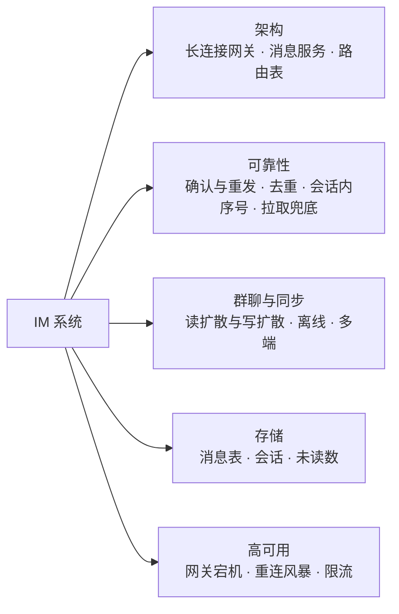

## 题目索引

| 编号 | 题目 | 难度 |
| --- | --- | --- |
| S13-01 | IM 系统要澄清哪些需求？规模怎么估算？ | ★★ |
| S13-02 | 整体架构怎么分层？ | ★★★ |
| S13-03 | 长连接网关怎么设计？消息怎么找到用户所在的网关？ | ★★★ |
| S13-04 | 怎么保证消息不丢？ | ★★★ |
| S13-05 | 怎么保证消息不重复、顺序正确？ | ★★★ |
| S13-06 | 会话内的序号怎么生成？ | ★★ |
| S13-07 | 群聊消息怎么存、怎么投递？读扩散还是写扩散？ | ★★★ |
| S13-08 | 离线消息和多端同步怎么做？ | ★★★ |
| S13-09 | 消息怎么存储？ | ★★ |
| S13-10 | 未读数和已读回执怎么实现？ | ★★ |
| S13-11 | 网关宕机了怎么办？重连风暴怎么防？ | ★★★ |

---

## 一、需求与架构

### S13-01 IM 系统要澄清哪些需求？规模怎么估算？

> ★★ ｜ 资深 / 架构师 ｜ 高频

**考察意图**：IM 的范围可以很大。看你是否先划定范围，并估算出最关键的两个数：同时在线的连接数和消息的吞吐量。

**30 秒版回答**：

- **功能**：单聊、群聊、在线消息实时送达、离线消息、多端同步、消息历史。可选：已读回执、撤回、图片和文件、音视频（通常是独立的系统）。
- **核心指标**：
  - **可靠**：不丢、不重、会话内有序；
  - **实时**：在线消息的端到端延迟在几百毫秒内；
  - **规模**：同时在线的连接数、每秒的消息数。
- **要问的**：日活和同时在线人数、群的人数上限、消息保存多久、要不要支持多个设备同时在线、是面向社交还是面向企业（企业 IM 对已读、消息漫游的要求更高）。
- **估算**（假设日活 1 亿）：同时在线 2000 万；每人每天发 40 条，平均约 4.6 万条/秒，峰值 20 万条/秒；每条消息约 300 字节，每天约 1.2 TB。

**深入剖析**

| 项目 | 假设 | 推算 |
| --- | --- | --- |
| 日活 | 1 亿 | — |
| 同时在线 | 日活的 20% | 2000 万个长连接 |
| 网关数量 | 每台维持 20 万～50 万连接 | 40～100 台 |
| 发送量 | 每人每天 40 条 | 40 亿条/天 ≈ 4.6 万条/秒，峰值约 20 万条/秒 |
| 群聊的放大 | 群消息占 30%，平均群 50 人 | 投递量是发送量的十几倍 |
| 存储 | 每条 300 字节 | 每天约 1.2 TB，一年约 440 TB |
| 心跳 | 每个连接每几分钟一次 | 每秒十几万次心跳 |

三个结论：

1. **连接数**决定了接入层的规模，和消息量无关：2000 万个连接即使一条消息都不发，也要这么多网关；
2. **群聊**是投递量的主要来源：一条群消息要送给群里的每一个在线成员；
3. **存储**是长期成本的主要来源，要考虑冷热分离和保存期限。

**追问链**

1. **面向社交和面向企业的 IM 有什么不同？** 社交 IM 用户量大、群可以很大、消息丢一条的后果相对小；企业 IM 用户量小得多，但要求消息永久漫游（换设备能看到全部历史）、精确的已读未读、组织架构和权限、审计。两者在存储模型和同步模型上会做不同的选择。
2. **音视频通话是 IM 的一部分吗？** 信令（发起呼叫、接听、挂断）可以走 IM 的消息通道；媒体流（声音和画面）走专门的实时传输协议和媒体服务器，是另一套系统。面试时说明范围即可。

---

### S13-02 整体架构怎么分层？

> ★★★ ｜ 架构师 ｜ 高频

**考察意图**：能否把"有状态的连接"和"无状态的业务"分开。这是 IM 架构最重要的一个决定。

**30 秒版回答**：

- **接入层（长连接网关）**：维持客户端的长连接，负责连接的建立、鉴权、心跳、收发数据。**只管连接，不处理业务**。它是有状态的（持有连接），但状态很轻，丢了可以靠重连恢复。
- **逻辑层（消息服务）**：无状态。负责消息的校验、去重、分配序号、存储、决定投递给谁。
- **路由层**：一张"用户 → 所在网关"的映射表。消息服务根据它把消息交给正确的网关。
- **存储层**：消息、会话、用户的同步位置。
- **离线推送**：用户不在线时，通过手机系统的推送通道提醒。
- **为什么要分开**：网关和业务的变化频率不同。业务逻辑经常发版，而每次重启网关都会断开几十万个连接。把业务从网关里拿出去，网关就可以很少变更。

**深入剖析**

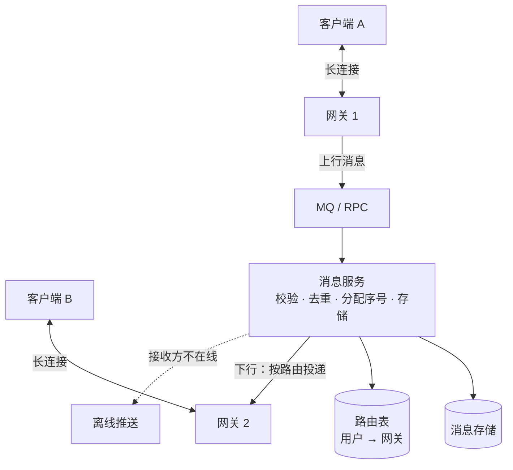

一条单聊消息经过的路径：

1. A 的客户端通过长连接把消息发给网关 1；
2. 网关 1 不解析业务内容，把消息转给消息服务（通过 RPC 或者 MQ）；
3. 消息服务校验权限（是不是好友、有没有被拉黑）、去重、分配序号、**落库**；
4. 消息服务给 A 回确认；
5. 消息服务查路由表，发现 B 连在网关 2 上，把消息交给网关 2；
6. 网关 2 通过 B 的长连接推送下去；B 不在线，就走离线推送。

网关和消息服务之间用什么通信：

| 方式 | 优点 | 缺点 |
| --- | --- | --- |
| RPC | 延迟低，链路简单 | 消息服务变慢时，网关的线程会被占住，需要严格的超时和隔离 |
| MQ | 削峰，网关和消息服务完全解耦 | 多一跳的延迟；要保证同一个会话的消息有序 |

上行（客户端到服务端）常用 RPC，因为要给发送方同步的确认；下行（服务端到网关）两种都有，用 MQ 时每个网关订阅自己专属的队列。

**追问链**

1. **网关为什么不直接访问数据库？** 网关的职责是维持连接和转发，要尽量简单、稳定。一旦网关里有业务逻辑和数据库访问，它就会频繁变更，而且数据库的抖动会直接影响连接的稳定性。
2. **客户端用 TCP 还是 WebSocket？** App 通常用自定义的二进制协议直接跑在 TCP（加 TLS）上，头部小、可以自己控制心跳和重连。网页端只能用 WebSocket。网关同时支持两种接入，解析成统一的内部消息后，后面的处理完全一样。WebSocket 的握手和特点见[《37 计算机网络》](../08-计算机基础/37-计算机网络.md)37-19。
3. **协议要设计哪些内容？** 消息头：协议版本、消息类型（登录、心跳、上行消息、下行消息、确认）、序列号、消息体长度。消息体：用紧凑的序列化格式。用"长度字段"解决 TCP 的粘包拆包，见[《08 Netty》](../02-框架与容器/08-Netty.md)08-10。

---

### S13-03 长连接网关怎么设计？消息怎么找到用户所在的网关？

> ★★★ ｜ 资深 / 架构师 ｜ 高频

**考察意图**：接入层的细节：连接怎么管理、怎么知道连接还活着、路由表怎么维护。

**30 秒版回答**：

- **连接管理**：基于事件驱动的网络框架（Netty）。每个连接一个 Channel，网关在内存里维护"用户 ID + 设备 → Channel"的映射。
- **建立连接**：客户端连接后先发登录包（带令牌），网关校验通过才认为连接有效；规定时间内不登录的连接直接关闭。
- **心跳**：客户端定期发心跳包，网关回应。网关在一段时间内没有收到任何数据，就认为连接已经断了，关闭它并清理路由。心跳同时用来保活：移动网络会回收长时间没有数据的连接。
- **路由表**：用户登录时，写入"用户 ID + 设备 → 网关地址"（放在 Redis 里，带过期时间，心跳时续期）；断开时删除。
- **投递**：消息服务查路由表得到网关地址，把消息发给那台网关；网关在本地映射里找到 Channel，写出去。
- **客户端怎么选网关**：先请求一个调度接口，拿到一组可用的网关地址，再去连接。不要让所有客户端都连同一个固定的域名，这样才能做负载均衡和快速摘除故障节点。

**深入剖析**

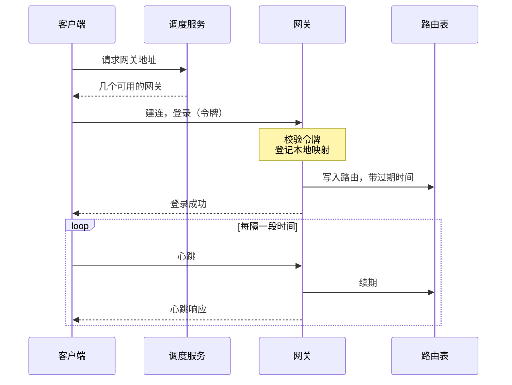

路由表的几个问题：

| 问题 | 处理 |
| --- | --- |
| 网关宕机，来不及删除路由 | 路由带过期时间，靠心跳续期。网关宕机后不再续期，路由自动过期 |
| 路由表显示在线，但连接其实已经断了 | 消息交给网关后发现 Channel 不存在或者写失败，网关告诉消息服务"投递失败"，消息服务清理路由并转为离线处理 |
| 用户在新设备登录，旧连接还在 | 多端同时在线：路由表里一个用户有多条记录，都要投递。同类设备互踢：给旧连接发下线通知再关闭 |
| 每条消息都查一次 Redis | 消息服务可以对路由做短时间的本地缓存；投递失败时清除缓存并重查 |

心跳间隔的取舍：

- 太短：耗电、耗流量，服务端的处理量大（2000 万连接每 30 秒一次就是每秒 60 多万次）；
- 太长：连接断了很久才发现；移动网络可能已经把这条空闲的连接回收了，而两端都不知道。
- 通常在几十秒到几分钟之间。有的客户端会动态探测当前网络能容忍的最大间隔。网关侧的空闲检测见[《08 Netty》](../02-框架与容器/08-Netty.md)08-11，TCP Keepalive 和应用层心跳的区别见[《37 计算机网络》](../08-计算机基础/37-计算机网络.md)37-06。

**追问链**

1. **单台网关能维持多少连接？** 主要受内存限制：每个连接要占用内核的套接字缓冲区和应用层的对象。调优之后单机维持几十万连接是常见的量级。还要调整文件句柄上限等内核参数。连接数不是唯一的瓶颈：消息量大时，CPU 和网卡带宽会先到上限。设计要点见 08-17。
2. **为什么不用一致性哈希把用户固定到某台网关，省掉路由表？** 客户端的连接要经过负载均衡，而且网关会扩缩容、会故障，用户实际连到哪台是不确定的。路由表反映的是"实际连在哪"，一致性哈希只能表达"应该连在哪"。有的系统两者结合：用一致性哈希给客户端推荐网关，减少路由表的变动。
3. **下行消息写不出去（客户端网络很差）怎么办？** 连接的发送缓冲区会积压。网关要设置高低水位线：积压超过高水位就停止往这个连接写，并通知上游；积压太久就断开连接，让客户端重连后通过拉取来补。不能让一个慢连接占用无限的内存。背压的处理见 08-12。

---

## 二、可靠性

### S13-04 怎么保证消息不丢？

> ★★★ ｜ 资深 / 架构师 ｜ 高频

**考察意图**：TCP 已经是可靠传输了，为什么应用层还要做确认？看你是否清楚丢消息发生在哪里，以及最终靠什么兜底。

**30 秒版回答**：

- **TCP 的可靠只管"两端的内核之间"**。数据到了内核缓冲区，应用还没读走进程就崩溃了；连接断了，缓冲区里没发出去的数据丢了；这些 TCP 都不管。所以需要**应用层的确认**。
- **上行（发送方 → 服务端）**：
  - 发送方发出消息后启动定时器，等服务端的确认；
  - 服务端**落库成功之后**才回确认；
  - 超时没收到确认，用**同一个客户端消息 ID** 重发。
- **下行（服务端 → 接收方）**：
  - 服务端推送后等接收方的确认；
  - 没有确认，过一会儿重推。
- **最终的兜底是拉取**：推送只是为了快，不是可靠性的保证。接收方记录自己在每个会话里**已经连续收到的最大序号**，在重连时、发现序号不连续时、定时地，向服务端拉取这个序号之后的消息。只要消息在服务端落了库，接收方迟早能拉到。
- 所以整个设计可以归结为：**消息先落库；推送尽力而为；拉取保证最终送达**。

**深入剖析**

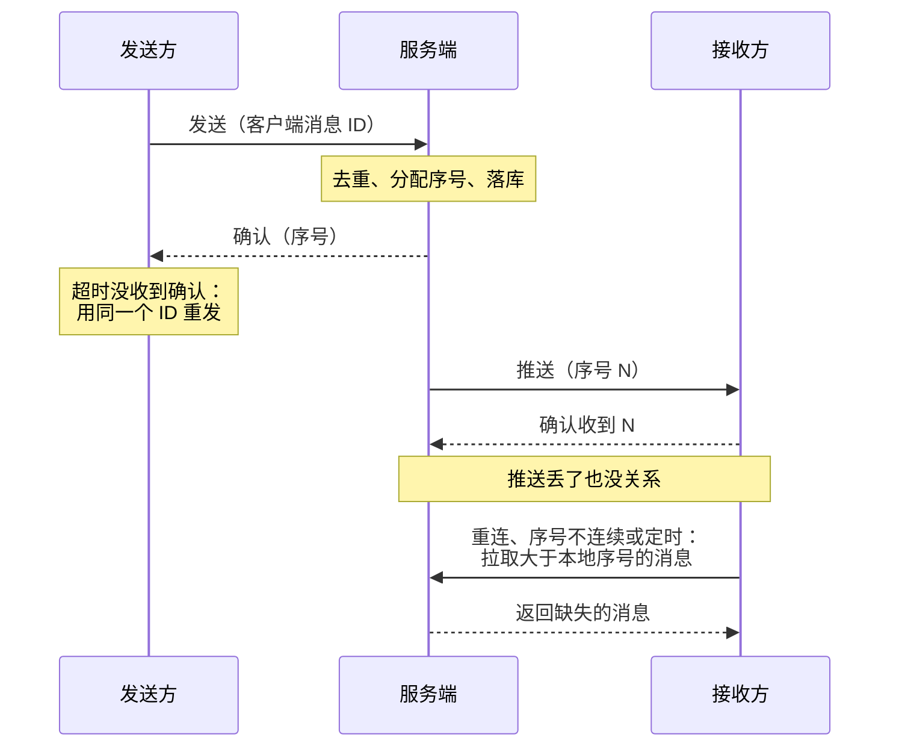

可能丢消息的位置和对应的手段：

| 位置 | 场景 | 手段 |
| --- | --- | --- |
| 发送方 → 服务端 | 请求在网络上丢了；网关收到后崩溃 | 发送方超时重发 |
| 服务端内部 | 网关转给消息服务时失败；落库失败 | 落库成功才确认；没确认发送方会重发 |
| 服务端 → 接收方 | 推送时连接刚好断了；路由表过时 | 接收方拉取 |
| 接收方 | 收到后还没保存，App 被杀掉 | 保存到本地之后才更新"已收到的序号"；下次启动时按序号拉取 |

**追问链**

1. **服务端对每条推送都维护一个重推的定时器，成本高吗？** 高。在线连接数千万、每个连接有多条未确认的消息时，定时器的数量很大。所以很多系统简化成：服务端推送后不逐条等待确认，可靠性完全交给"接收方按序号拉取"。推送只负责通知"有新消息"，甚至可以不带消息内容（只带最新的序号），由客户端来拉。这种做法叫"推拉结合"或者"通知 + 拉取"。
2. **发送方一直重发都失败怎么办？** 重发几次之后，在界面上把这条消息标记为"发送失败"（常见的红色感叹号），由用户手动重试。手动重试仍然用原来的客户端消息 ID。
3. **服务端落库成功、确认发出之前崩溃了，发送方重发，会不会存两条？** 不会，靠去重（S13-05）。

---

### S13-05 怎么保证消息不重复、顺序正确？

> ★★★ ｜ 资深 / 架构师 ｜ 高频

**考察意图**：重发带来了重复，并发和网络带来了乱序。看你是否用"两个 ID"把这两个问题解决掉。

**30 秒版回答**：

- **两个 ID，各管一件事**：
  - **客户端消息 ID**：发送方生成（比如 UUID），每条消息唯一。用来**去重**；
  - **会话内序号**：服务端分配，在一个会话里单调递增。用来**排序**和**发现缺失**。
- **不重**：
  - 服务端：收到消息时按"发送者 + 客户端消息 ID"查重。已经处理过的，不再分配新的序号，直接返回上次的序号；
  - 接收方：按序号去重。序号小于等于"已连续收到的最大序号"的，或者已经在本地的，丢弃。
- **有序**：
  - 不需要全局有序，**会话内有序**就够了；
  - 以**服务端分配的序号**为准，不能用客户端的时间（各个设备的时钟不一致）；
  - 接收方按序号排列。收到的序号比期望的大，说明中间有消息还没到：先暂存，拉取缺失的部分，补齐之后再按顺序展示。

**深入剖析**

用 JDK 模拟整个过程。1000 条消息，每一次网络传输（发送请求、确认、推送）有 15% 的概率丢失，推送有 10% 的概率重复，并且在 5 条的窗口内被打乱顺序（本机 JDK 25 运行，随机数种子固定）：

```java
import java.util.ArrayList;
import java.util.Collections;
import java.util.HashMap;
import java.util.List;
import java.util.Map;
import java.util.Random;
import java.util.TreeMap;

/**
 * IM 消息的"不丢、不重、有序"：
 * 发送方超时重发 + 服务端按客户端消息 ID 去重；服务端分配会话内序号；
 * 接收方按序号去重，发现序号不连续就向服务端拉取缺失的消息。
 * 网络用固定种子的随机数模拟：请求可能丢失、确认可能丢失、推送可能丢失、重复或乱序。
 */
public class ImReliabilityDemo {

    private static final int MESSAGE_COUNT = 1_000;
    private static final double LOSS_RATE = 0.15;        // 每一次传输有 15% 的概率丢失
    private static final double DUPLICATE_RATE = 0.10;   // 推送有 10% 的概率重复
    private static final int SHUFFLE_WINDOW = 5;         // 推送在 5 条的窗口内乱序
    private static final long RANDOM_SEED = 20261112L;

    record Message(long seq, String clientMsgId, String body) { }

    /** 服务端：一个会话 */
    static final class Conversation {
        private long nextSeq = 1;
        private final Map<String, Long> seqByClientMsgId = new HashMap<>();
        private final TreeMap<Long, Message> store = new TreeMap<>();
        int duplicateRequests;

        /** 收到发送请求：同一个客户端消息 ID 只分配一次序号、只存一次 */
        long accept(String clientMsgId, String body) {
            Long existing = seqByClientMsgId.get(clientMsgId);
            if (existing != null) {
                duplicateRequests++;
                return existing;
            }
            long seq = nextSeq++;
            seqByClientMsgId.put(clientMsgId, seq);
            store.put(seq, new Message(seq, clientMsgId, body));
            return seq;
        }

        /** 拉取序号在 (afterSeq, untilSeq] 之间的消息 */
        List<Message> pull(long afterSeq, long untilSeq) {
            return new ArrayList<>(store.subMap(afterSeq, false, untilSeq, true).values());
        }

        long latestSeq() {
            return nextSeq - 1;
        }
    }

    /** 接收方 */
    static final class Receiver {
        private long maxContinuousSeq;                       // 已经连续收到的最大序号
        private final TreeMap<Long, Message> pending = new TreeMap<>();   // 超前到达、暂时不能展示的消息
        final List<Message> displayed = new ArrayList<>();
        int duplicatesDropped;
        int gapPulls;

        void onPush(Message message, Conversation server) {
            if (message.seq() <= maxContinuousSeq || pending.containsKey(message.seq())) {
                duplicatesDropped++;
                return;
            }
            pending.put(message.seq(), message);
            if (message.seq() > maxContinuousSeq + 1) {
                // 序号不连续：中间有消息没收到，主动拉取
                gapPulls++;
                for (Message missing : server.pull(maxContinuousSeq, message.seq() - 1)) {
                    pending.putIfAbsent(missing.seq(), missing);
                }
            }
            drain();
        }

        /** 重连或定时同步：把服务端最新序号之前缺的都拉回来 */
        void sync(Conversation server) {
            for (Message missing : server.pull(maxContinuousSeq, server.latestSeq())) {
                pending.putIfAbsent(missing.seq(), missing);
            }
            drain();
        }

        private void drain() {
            while (pending.containsKey(maxContinuousSeq + 1)) {
                displayed.add(pending.remove(maxContinuousSeq + 1));
                maxContinuousSeq++;
            }
        }
    }

    public static void main(String[] args) {
        Random random = new Random(RANDOM_SEED);
        Conversation server = new Conversation();
        Receiver receiver = new Receiver();
        int sendAttempts = 0;
        int pushLost = 0;
        int pushDuplicated = 0;
        List<Message> pushQueue = new ArrayList<>();

        for (int i = 1; i <= MESSAGE_COUNT; i++) {
            String clientMsgId = "c-" + i;
            // 发送方：没有收到确认就用同一个客户端消息 ID 重发
            long seq = -1;
            while (seq < 0) {
                sendAttempts++;
                if (random.nextDouble() < LOSS_RATE) {
                    continue;                                   // 请求丢了，服务端没收到
                }
                long assigned = server.accept(clientMsgId, "msg " + i);
                if (random.nextDouble() < LOSS_RATE) {
                    continue;                                   // 服务端处理了，但确认丢了
                }
                seq = assigned;
            }
            // 服务端推送给接收方：可能丢失，也可能重复
            Message message = server.pull(seq - 1, seq).get(0);
            if (random.nextDouble() < LOSS_RATE) {
                pushLost++;
            } else {
                pushQueue.add(message);
                if (random.nextDouble() < DUPLICATE_RATE) {
                    pushQueue.add(message);
                    pushDuplicated++;
                }
            }
            // 每攒够一个窗口就打乱顺序后送达，模拟乱序
            if (pushQueue.size() >= SHUFFLE_WINDOW || i == MESSAGE_COUNT) {
                Collections.shuffle(pushQueue, random);
                for (Message pushed : pushQueue) {
                    receiver.onPush(pushed, server);
                }
                pushQueue.clear();
            }
        }
        int beforeSync = receiver.displayed.size();
        receiver.sync(server);

        boolean inOrder = true;
        for (int i = 0; i < receiver.displayed.size(); i++) {
            inOrder &= receiver.displayed.get(i).seq() == i + 1
                    && receiver.displayed.get(i).body().equals("msg " + (i + 1));
        }
        System.out.println("sender  : messages=" + MESSAGE_COUNT + ", send attempts=" + sendAttempts);
        System.out.println("server  : stored=" + server.latestSeq() + ", duplicate requests ignored=" + server.duplicateRequests);
        System.out.println("network : pushes lost=" + pushLost + ", pushes duplicated=" + pushDuplicated);
        System.out.println("receiver: duplicates dropped=" + receiver.duplicatesDropped + ", gap pulls=" + receiver.gapPulls
                + ", displayed before final sync=" + beforeSync);
        System.out.println("receiver: displayed=" + receiver.displayed.size() + ", complete and in order=" + inOrder);
    }
}
```

```text
sender  : messages=1000, send attempts=1382
server  : stored=1000, duplicate requests ignored=172
network : pushes lost=146, pushes duplicated=87
receiver: duplicates dropped=534, gap pulls=258, displayed before final sync=1000
receiver: displayed=1000, complete and in order=true
```

- **发送方**：1000 条消息一共发了 1382 次，多出来的 382 次是因为请求或者确认丢了而重发；
- **服务端**：只存了 1000 条。172 次重复的请求（服务端已经处理过、但确认丢了的那些）被识别出来，没有产生新的消息；
- **网络**：146 次推送丢失，87 次推送重复；
- **接收方**：丢弃了 534 条重复的消息（除了网络造成的重复，还包括"已经通过拉取补回来、之后推送才迟到"的那些）；因为发现序号不连续而主动拉取了 258 次；
- **结果**：接收方展示了 1000 条，**完整并且有序**。

接收方的处理逻辑（代码里的 `onPush` 和 `drain`）：

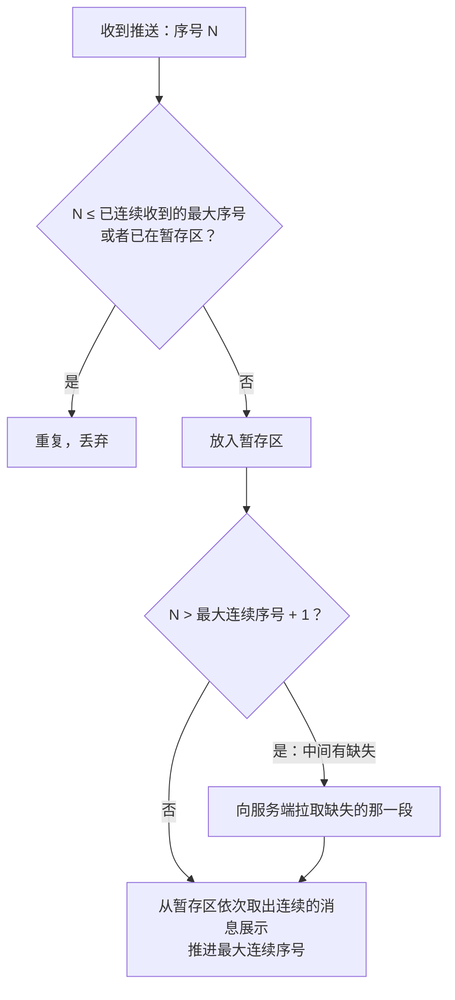

**追问链**

1. **服务端的去重记录要保存多久？** 覆盖发送方可能重发的最长时间即可，比如几分钟到几小时。可以放在 Redis 里并设置过期时间。更稳妥的做法是在消息表上对"发送者 + 客户端消息 ID"建唯一索引，作为最终的保证。
2. **A 和 B 同时给对方发消息，两边看到的顺序会不会不一样？** 不会。两条消息到达服务端的先后决定了它们的序号，A 和 B 的客户端都按这个序号排列，看到的顺序一致。发送方自己那条消息，在收到确认之前先显示在最后，拿到序号后按序号重新定位。
3. **"发送中"的消息显示在哪里？** 先插在本地列表的末尾，状态是"发送中"。收到确认后拿到了服务端的序号，如果这期间收到了序号更小的别人的消息，要把它们排到这条消息的前面。很多产品为了避免界面跳动，本地按"收到的顺序"展示，只在重新加载历史时按序号排列。这是体验上的取舍，数据上以序号为准。

---

### S13-06 会话内的序号怎么生成？

> ★★ ｜ 资深 ｜ 中频

**考察意图**：序号是可靠性的基础。看你是否清楚它需要什么性质、不需要什么性质。

**30 秒版回答**：

- **需要的性质**：在**一个会话内**单调递增、不重复。
- **不需要的**：全局唯一、全局有序。不同会话的序号互不相干。
- **是否需要连续**：取决于接收方怎么发现缺失。
  - 用"序号是否连续"判断缺失（S13-05 的做法），序号就必须连续，不能跳号；
  - 如果做不到严格连续，可以让每条消息带上**前一条消息的序号**，接收方用这条链来判断中间有没有缺。
- **实现**：
  - Redis 的 `INCR`，Key 是会话 ID。简单，性能足够；
  - 数据库里每个会话一个计数器，分配序号和写入消息在同一个事务里；
  - 号段：消息服务的实例为某个会话预取一段序号。要保证同一个会话在同一时刻只由一个实例处理，否则顺序会乱。
- **容灾**：Redis 主从切换可能丢失最近的几次 `INCR`，导致**序号回退、重复**。所以消息表上要有"会话 ID + 序号"的唯一约束；切换之后，把计数器跳到一个足够大的值，宁可跳号也不能重复。

**深入剖析**

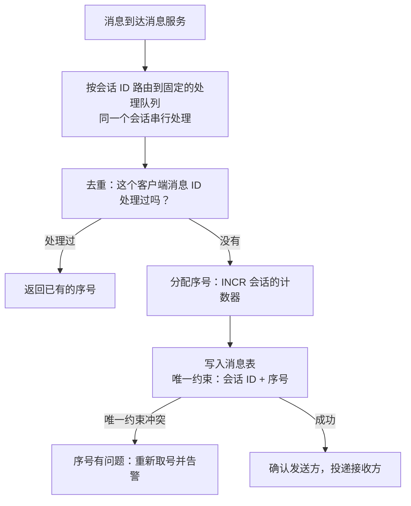

为什么"同一个会话串行处理"很重要：先分配序号、后落库，这两步不是原子的。两个线程并发处理同一个会话的两条消息，可能出现"序号 5 先分配、后落库；序号 6 后分配、先落库并且先推送"。接收方先收到 6，以为 5 缺失去拉取，这时 5 还没落库，拉不到。把同一个会话的消息按会话 ID 哈希到同一个队列（或者 MQ 的同一个分区）里顺序处理，就没有这个问题。

序号跳号的影响和处理：

| 接收方判断缺失的方式 | 跳号的后果 | 处理 |
| --- | --- | --- |
| 序号连续性 | 接收方认为中间缺了消息，反复去拉，却永远拉不到 | 拉取的结果里告诉客户端"到序号 N 为止没有更多的了"，客户端据此跳过空洞 |
| 前序序号链 | 没有影响 | — |

**追问链**

1. **用雪花 ID 当序号行不行？** 雪花 ID 能保证递增和唯一，但不连续，接收方没法用它发现缺失。可以用它作为消息的全局唯一 ID 和排序依据，再配合"前序 ID 链"或者"每次重连都拉取最新一批"来保证不丢。
2. **单聊的会话 ID 怎么定？** 两个用户 ID 按大小排序后拼接（或者计算出一个确定的值）。这样 A 发给 B 和 B 发给 A 属于同一个会话，共用一个序号空间。
3. **Redis 的 `INCR` 每秒几十万次，扛得住吗？** 单个 Redis 实例每秒可以处理十万次以上的简单命令；会话 ID 是天然的分片键，用 Cluster 分散到多个节点即可。

---

## 三、群聊与同步

### S13-07 群聊消息怎么存、怎么投递？读扩散还是写扩散？

> ★★★ ｜ 架构师 ｜ 高频

**考察意图**：和 Feed 流是同一个取舍，但 IM 里多了"多端同步"这个因素。看你是否能把两者联系起来。

**30 秒版回答**：

- **读扩散**：群消息**只存一份**，存在群的消息列表里，用群内的序号排序。每个成员记录自己在这个群里读到了哪个序号。
  - 优点：写入一次，存储小；
  - 缺点：用户有 500 个群，同步时要分别检查 500 个群有没有新消息。
- **写扩散**：每条群消息，给**每个成员的收件箱**各写一条记录（通常只写消息 ID，内容仍然只存一份）。每个用户有一个**统一递增的序号**（用户维度的时间线）。
  - 优点：同步非常简单，客户端只记一个序号，"把我的序号之后的都给我"；
  - 缺点：写放大，500 人的群一条消息要写 500 次。
- **常见的选择**：
  - 单聊和普通群：**写扩散**，换来简单的多端同步；
  - 大群（几千、几万人）：**读扩散**，避免写放大；
  - 超大群（直播间、频道）：不保证每条消息都送达，见[《S18 直播弹幕》](S18-直播弹幕.md)。
- **在线投递**和存储模型是两回事：无论怎么存，在线的成员都是通过"查路由表 → 交给网关 → 推送"来实时收到消息的。

**深入剖析**

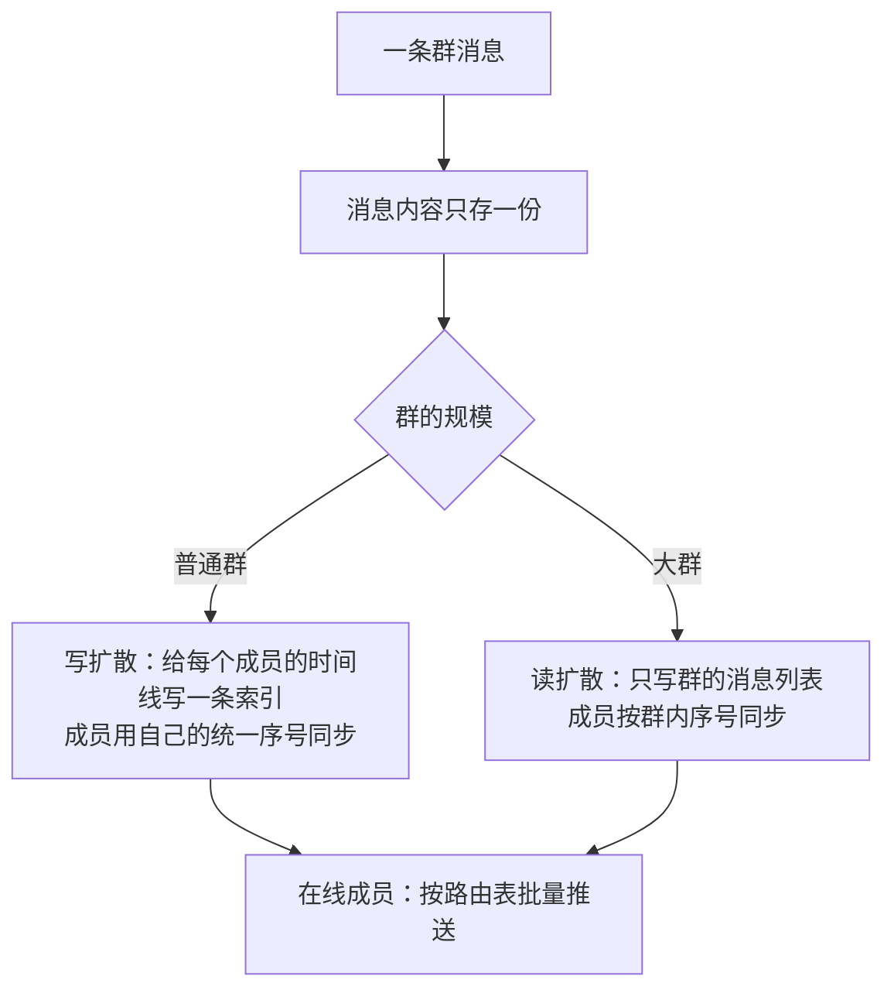

| | 读扩散 | 写扩散 |
| --- | --- | --- |
| 一条消息的写入次数 | 1 | 群成员数 |
| 同步时客户端要维护的位置 | 每个会话一个序号 | 整个账号一个序号 |
| 新设备登录、离线很久后同步 | 要遍历所有会话 | 一次请求 |
| 存储 | 小 | 索引多，内容不重复 |
| 适合 | 大群 | 单聊、小群 |

这和 Feed 流里的推拉取舍是一回事（[《S12 Feed 流》](S12-Feed流.md)S12-02）：写扩散对应推，读扩散对应拉；群成员数对应粉丝数；大群对应大 V。

群消息的在线投递：

1. 取出群成员列表（有缓存）；
2. 批量查路由表，得到在线的成员以及他们各自所在的网关；
3. **按网关分组**，一个网关一次批量请求，带上这台网关上所有要接收的用户；
4. 网关在本地逐个写入连接。

不要对每个成员单独查一次路由、单独调用一次网关。500 人的群，按网关分组之后可能只有几十次调用。

**追问链**

1. **万人大群，一条消息要推给一万人，扛得住吗？** 一条消息可以，问题是大群往往很活跃，每秒几十条消息，就是每秒几十万次推送。手段：消息合并（一小段时间内的多条消息打包成一次推送）；只推给当前正打开这个群的成员，其他人只更新未读数；对不活跃的成员降低推送频率。超过一定规模后，群就不应该再当成"可靠消息"来处理了。
2. **@某人、群公告这种重要消息怎么保证送达？** 它们数量少，单独走写扩散：给被 @ 的人单独写一条提醒，走可靠的投递和离线推送。也就是说，同一个群里，普通消息用读扩散，重要消息用写扩散。
3. **新成员入群，能看到之前的消息吗？** 读扩散下，取决于给他设置的起始序号：从入群时的最新序号开始，就看不到历史；从更早的序号开始，就能看到。写扩散下，入群之前的消息没有写进他的时间线，默认看不到。这是产品规则，存储模型都能支持。

---

### S13-08 离线消息和多端同步怎么做？

> ★★★ ｜ 资深 / 架构师 ｜ 高频

**考察意图**：离线消息不是"一个单独的离线队列"。看你是否把在线、离线、多端统一到一个同步模型里。

**30 秒版回答**：

- **统一的模型：时间线同步**。每个用户有一条自己的时间线，所有发给他的消息（的索引）按一个统一的序号排列。每个设备记住自己同步到的序号。
- **同步**：设备连上之后，告诉服务端"我同步到了序号 N"，服务端返回 N 之后的消息。在线时收到推送，也是按这个序号推进。
- **离线消息**：不需要单独的概念。设备离线期间，消息照常写入时间线；设备上线后，从自己的序号开始拉取，自然就得到了离线期间的消息。
- **多端**：每个设备有各自的序号，互不影响。手机读到了 100，平板还停在 60，平板上线后拉 60 之后的即可。
- **用户自己发的消息也要进自己的时间线**：这样在手机上发的消息，电脑上也能同步到。
- **离线推送**只是一个**提醒**：通过系统的推送通道告诉用户"有新消息"，用户点开 App 之后，仍然通过时间线同步拿到真正的消息。
- **离线太久的设备**：时间线只保留一定数量或一定时间。超出范围时不再逐条同步，改为"每个会话拉取最新的若干条"。

**深入剖析**

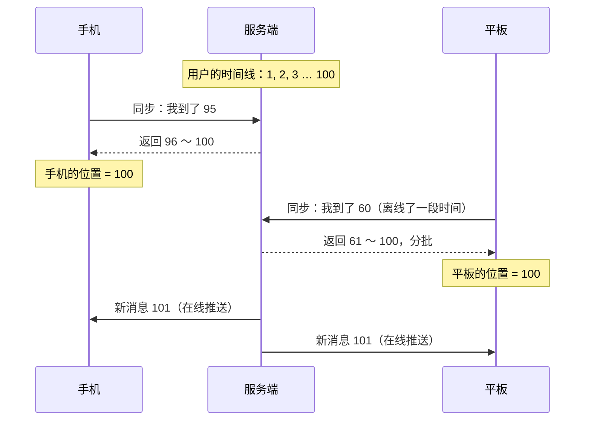

"旧的做法"和时间线模型的对比：

| | 单独的离线消息队列 | 时间线同步 |
| --- | --- | --- |
| 做法 | 用户不在线时，把消息放进他的离线队列；上线后取走并删除 | 所有消息都进时间线；设备按自己的位置拉取 |
| 多端 | 一个设备取走了，另一个设备就取不到 | 每个设备有自己的位置，互不影响 |
| 在线和离线 | 两套逻辑，切换的瞬间容易丢或者重复 | 一套逻辑 |
| 消息漫游（新设备看到历史） | 不支持 | 支持，取决于时间线保留多长 |

同步请求的细节：

- **分批**：离线一周积累了几万条消息，不能一次返回。每批几百条，客户端循环拉取直到追上；
- **优先最近的**：用户打开 App 最想看到的是最新的消息。先拉每个会话最新的几条用于展示会话列表，再在后台补全；
- **压缩和合并**：同一个群的大量消息、已经被撤回的消息，可以在服务端合并处理后再返回。

**追问链**

1. **离线推送的内容显示什么？** 通常是发送者和消息的摘要。涉及隐私时只显示"你收到了一条新消息"。推送通道由手机厂商或者系统提供，有各自的频率和内容限制，详见[《S16 消息推送平台》](S16-消息推送平台.md)。
2. **怎么判断该不该发离线推送？** 用户的所有设备都不在线，或者只有电脑端在线而手机不在线（产品规则），就发。App 在后台、长连接已经被系统断开时，也算不在线。发了离线推送之后用户很快上线了，推送就多余了，但无害。
3. **消息撤回怎么实现？** 撤回本身是一条新的"指令消息"，同样进入时间线、同样有序号。各个设备同步到它时，把对应的原消息替换成"对方撤回了一条消息"。这样离线的设备上线后也能正确处理。已读、删除等操作同理：**所有需要多端一致的状态变化，都当成消息来同步**。

---

## 四、存储与高可用

### S13-09 消息怎么存储？

> ★★ ｜ 资深 / 架构师 ｜ 中频

**考察意图**：消息的数据量大、写多读少、访问有很强的时间局部性。看你选的存储和分片方式是否匹配这些特点。

**30 秒版回答**：

- **三类数据**：
  - **消息内容**：消息 ID、会话 ID、序号、发送者、类型、内容、时间。只存一份；
  - **时间线索引**（写扩散时）：用户 ID、用户序号 → 消息 ID；
  - **会话列表**：用户的每个会话的最新一条消息、未读数、置顶和免打扰设置。
- **访问模式**：按"会话 ID + 序号范围"读取（翻看历史）；按"用户 ID + 序号范围"读取（同步）。都是按主键的范围扫描，没有复杂的查询。
- **存储选择**：
  - MySQL 分库分表：消息表按会话 ID 分片，时间线按用户 ID 分片。数据量不是特别大时可行；
  - **宽表存储**（HBase、Cassandra 这一类基于 LSM 树的存储）：写入吞吐高，天然按主键有序、支持范围扫描，水平扩展方便。消息这种"写多、按主键范围读、几乎不修改"的数据非常适合。
- **冷热分离**：最近的消息访问频繁，放在高性能的存储和缓存里；很久之前的消息很少被访问，归档到成本更低的存储，或者按保存期限删除。
- **图片、文件、语音**：内容放对象存储，消息里只存地址。

**深入剖析**

```sql
-- 消息表：按 conversation_id 分片
CREATE TABLE t_message (
    conversation_id BIGINT      NOT NULL,
    seq             BIGINT      NOT NULL COMMENT '会话内序号',
    msg_id          BIGINT      NOT NULL COMMENT '全局唯一的消息 ID',
    sender_id       BIGINT      NOT NULL,
    client_msg_id   VARCHAR(64) NOT NULL,
    msg_type        TINYINT     NOT NULL,
    content         BLOB        NOT NULL,
    create_time     DATETIME(3) NOT NULL,
    PRIMARY KEY (conversation_id, seq),
    UNIQUE KEY uk_client_msg (conversation_id, sender_id, client_msg_id)
);

-- 用户时间线：按 user_id 分片（写扩散时使用）
CREATE TABLE t_timeline (
    user_id         BIGINT NOT NULL,
    user_seq        BIGINT NOT NULL COMMENT '用户维度的统一序号',
    conversation_id BIGINT NOT NULL,
    seq             BIGINT NOT NULL,
    PRIMARY KEY (user_id, user_seq)
);
```

- 消息表的主键是"会话 ID + 序号"：同一个会话的消息在物理上相邻，翻看历史就是一次主键范围扫描；这个主键同时保证了序号在会话内不重复；
- `uk_client_msg` 是去重的最终保证（S13-05）。

读取消息的路径：

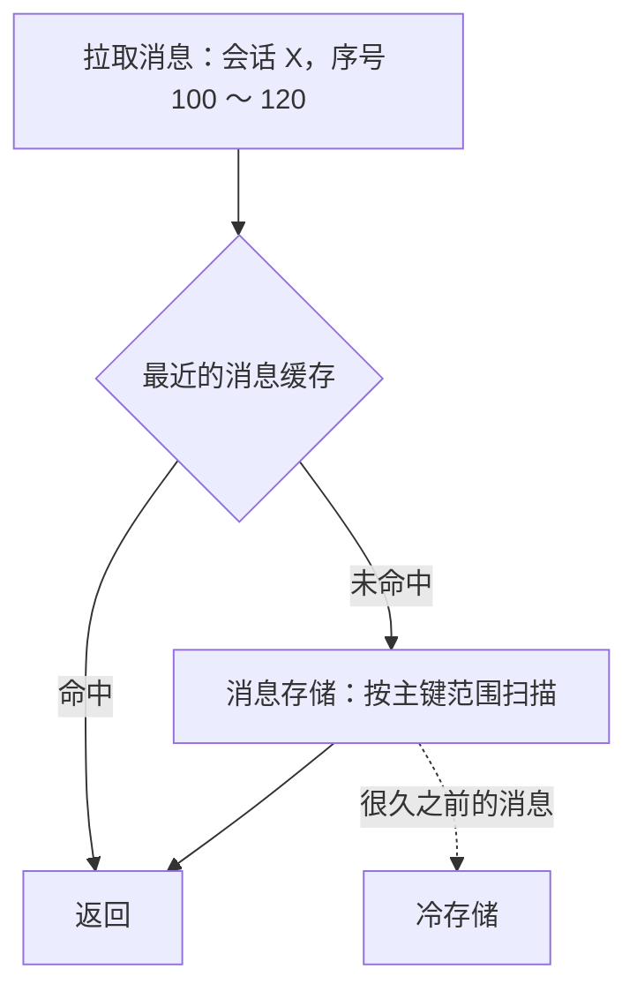

**追问链**

1. **为什么说 LSM 树的存储适合消息？** 消息是持续的追加写入，几乎不更新。LSM 树把随机写变成了顺序写，写入吞吐比 B+ 树高；数据按主键有序，范围读取效率好。它的弱点（读取可能要查多层、合并时有抖动）在消息场景下可以接受。B+ 树和 LSM 树的对比见[《40 数据结构》](../08-计算机基础/40-数据结构.md)40-10。
2. **消息要不要加密存储？** 至少传输过程要加密（TLS）。存储是否加密、用什么方式，取决于产品的定位和合规要求。端到端加密下，服务端只保存密文，无法做内容搜索和审核，这是一个产品层面的重大取舍。
3. **消息搜索怎么做？** 服务端搜索：把消息同步到 Elasticsearch，按用户能访问的会话做过滤。数据量很大，成本高，通常只对企业 IM 或者付费功能提供。客户端搜索：消息在本地数据库里，直接在本地搜，只能搜到已经同步到本地的部分。

---

### S13-10 未读数和已读回执怎么实现？

> ★★ ｜ 资深 ｜ 中频

**考察意图**：未读数看起来简单，其实是一个容易不一致的计数。看你是否用"位置"而不是"计数器"来定义它。

**30 秒版回答**：

- **不要把未读数当成一个要不断加减的计数器**。计数器在并发、重试、多端下很容易错，错了之后还会一直错下去。
- **用两个位置来定义**：每个会话的未读数 = **会话的最新序号** − **用户已读到的序号**。两个值都是单调递增的，更新是幂等的（取较大值），天然不怕重复和乱序。
- **读消息**：客户端上报"我在这个会话读到了序号 N"。服务端把已读位置更新为 `max(当前值, N)`。
- **多端同步**：已读位置变化后，通知这个用户的其他设备，它们把这个会话的未读数清掉。
- **总未读数**（App 图标上的数字）：各个会话未读数之和，排除免打扰的会话。可以在客户端计算，也可以在服务端维护一份。
- **已读回执**（对方读了没有）：
  - 单聊：对方的已读位置 ≥ 这条消息的序号，就是已读。把对方的已读位置同步给发送方即可；
  - 群聊：每条消息要知道"哪些人读了"。根据每个成员的已读位置实时计算，或者只在查看详情时才计算。群越大成本越高，通常只对小群或者企业场景提供。

**深入剖析**

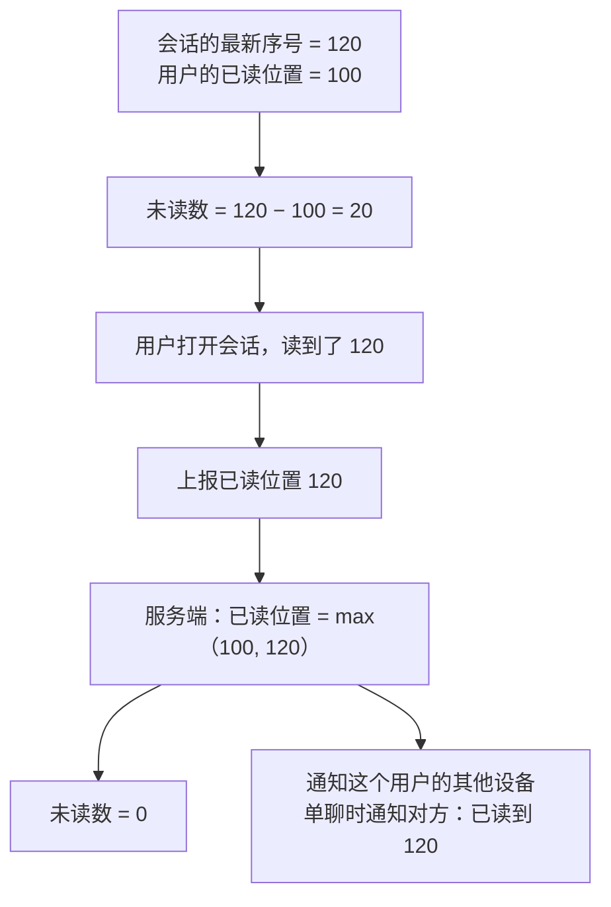

为什么"位置"比"计数器"可靠：

| 场景 | 计数器（来一条 +1，读了清零） | 位置（最新序号 − 已读序号） |
| --- | --- | --- |
| 消息重复投递 | 多加了一次 | 最新序号不变，没有影响 |
| 清零和 +1 并发 | 可能先 +1 再被清零，丢了一条未读；或者相反 | 两个位置各自取最大值，结果确定 |
| 多端各自上报已读 | 清零的时机不同，各端显示不一致 | 所有端最终都看到同一个已读位置 |
| 出错之后 | 一直错，直到下一次清零 | 下一次更新位置时自动纠正 |

群聊里的特殊情况：未读数里通常不计算自己发的消息；被 @ 的消息要单独标记，所以除了数量，还要记录"未读的消息里有没有 @ 我的"。

**追问链**

1. **用户有几百个会话，总未读数每次都求和吗？** 服务端可以维护一个总数，在每个会话的未读数变化时增减。它是一个派生值，要有校正的机制：定期或者在用户同步时，用各个会话的值重新求和，覆盖掉可能漂移的总数。
2. **已读位置上报很频繁（每读一条报一次），怎么办？** 客户端合并上报：离开会话时，或者每隔几秒，上报一次当前的最大已读序号。因为是"取最大值"，中间的上报都可以省略。
3. **群消息"已读 23 / 未读 7"这种展示怎么实现？** 查询时取出所有成员的已读位置，和这条消息的序号比较。成员的已读位置在缓存里，一次批量读取。对几百人的群可行；群再大，就只提供"已读人数"的近似值，或者不提供。

---

### S13-11 网关宕机了怎么办？重连风暴怎么防？

> ★★★ ｜ 架构师 ｜ 中频

**考察意图**：长连接系统特有的故障模式。看你是否意识到"故障恢复的过程本身"可能造成更大的故障。

**30 秒版回答**：

- **网关宕机**：它上面的几十万个连接全部断开。
  - 不丢消息：消息在消息服务那里已经落库，和网关无关。客户端重连到其他网关后，按序号拉取断线期间的消息；
  - 路由：宕机网关的路由记录靠过期时间自动清理；投递到已经不存在的网关会失败，失败时主动清理路由。
- **重连风暴**：几十万个客户端在同一秒发现断线，同一秒发起重连。它们会带来：TLS 握手（很耗 CPU）、登录鉴权、路由写入、每个客户端的消息同步请求。这一波流量可能压垮剩下的网关和后端，造成连锁故障。
- **防止重连风暴**：
  1. **客户端随机退避**：断线后等待一个随机的时间再重连；连续失败时，间隔按指数增长并且有上限；
  2. **服务端限流**：网关限制每秒新建连接的数量和登录的速率，超出的直接拒绝，让客户端稍后再试；
  3. **同步请求错峰**：重连成功后，同步消息的请求也加随机延迟；
  4. **容量预留**：每台网关平时只用到容量的一部分，留出接管其他网关连接的余量。
- **发布也是一次"计划内的宕机"**：重启网关之前，先通知它上面的客户端分批迁移到其他网关，而不是直接关闭。

**深入剖析**

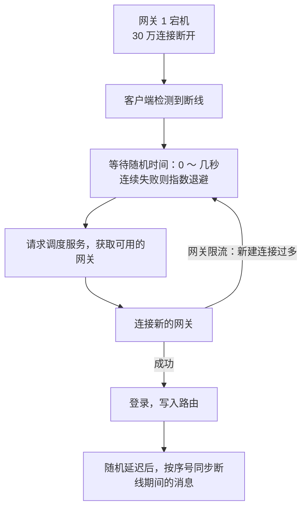

没有退避时会发生什么：30 万个客户端在 1 秒内同时重连。假设剩下 9 台网关，每台要在 1 秒内处理 3 万多次 TLS 握手，远超它的能力。握手超时，客户端认为连接失败，立即再次重连。请求越积越多，原本健康的网关也被拖垮，更多的连接断开，更多的客户端加入重连。这就是雪崩。

网关的优雅下线（发布时）：

1. 把这台网关从调度服务里摘掉，不再有新的连接进来；
2. 给它上面的连接**分批**发送"请重连"的指令，每批间隔一小段时间；
3. 客户端收到指令后主动连接其他网关，连上之后再关闭旧连接；
4. 所有连接迁移完（或者超过等待时间），网关退出。

这样几十万个连接的迁移被摊开到了几分钟，而不是集中在一瞬间。

**追问链**

1. **消息服务或者存储出故障时，网关应该怎么做？** 保持连接，不要因为后端的故障而断开客户端：断开只会引发重连，让情况更糟。上行消息快速失败，告诉客户端"发送失败，稍后重试"；心跳照常响应。后端恢复后，消息的收发自然恢复。
2. **机房级的故障怎么办？** 多机房部署网关和消息服务。客户端的调度接口返回多个机房的网关地址，一个机房不可用时切换到另一个。难点在数据：消息的存储要跨机房同步，序号的分配要在机房之间保持一致。常见的做法是按用户或者会话划分归属的机房，同一个会话的写入只在一个机房进行，见[《26 高可用》](../06-三高与架构/26-高可用.md)26-11。
3. **要监控哪些指标？** 在线连接数及其变化率（突然下降说明有网关或者网络出了问题）；新建连接的速率；消息的端到端延迟；上行消息的确认耗时；下行的投递成功率；客户端同步时拉取的消息数量（突然变大说明推送丢失严重）；各网关的连接数是否均衡。

**生产实践 / 踩坑**

- **只依赖推送，没有拉取兜底**：网络稍有抖动就丢消息，而且丢了之后没有任何途径补回来。
- **用客户端的时间给消息排序**：用户的手机时间不准，消息顺序错乱，甚至一条新消息显示在很久以前。
- **未读数用计数器加减**：各种并发和重试之后，未读数和实际对不上，出现"明明都读了，还显示有 1 条未读"。
- **网关里写业务逻辑**：每次业务发版都要重启网关，所有用户断线重连。
- **客户端断线后立即重连、没有退避**：一次网关重启引发整个接入层的雪崩。
