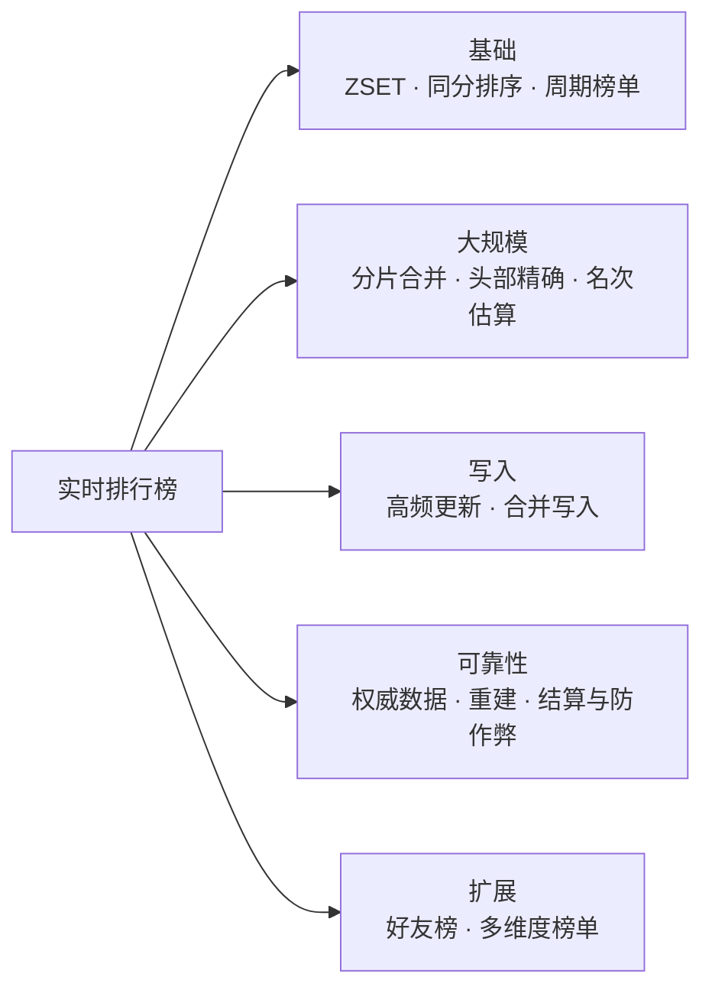
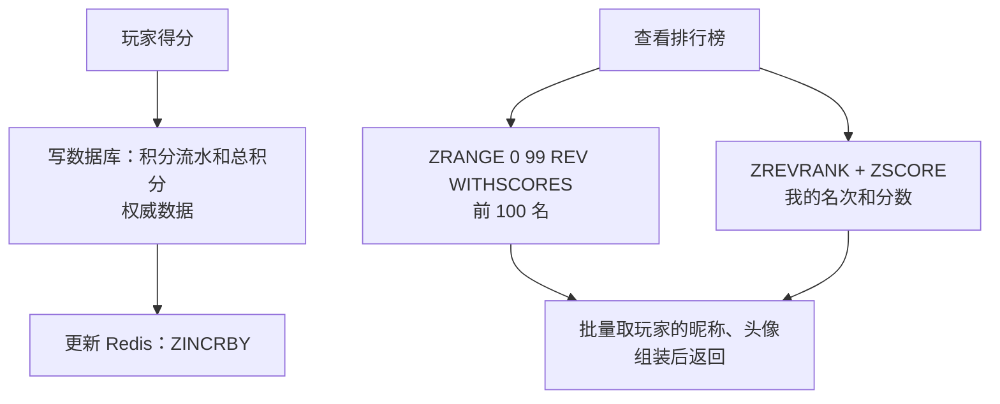
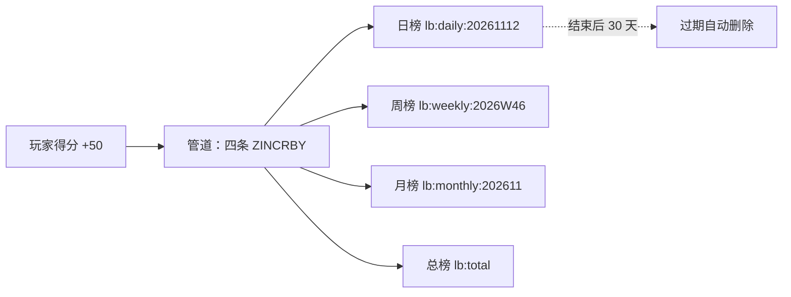
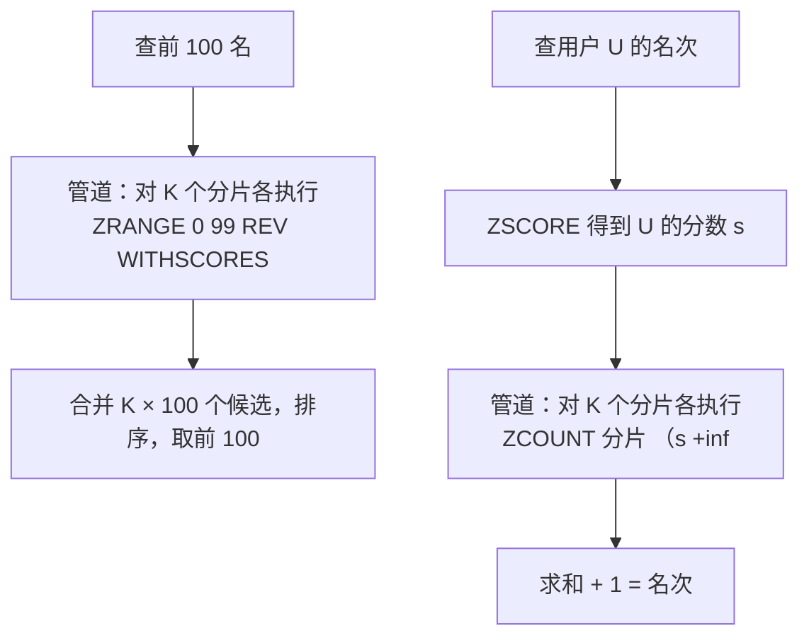
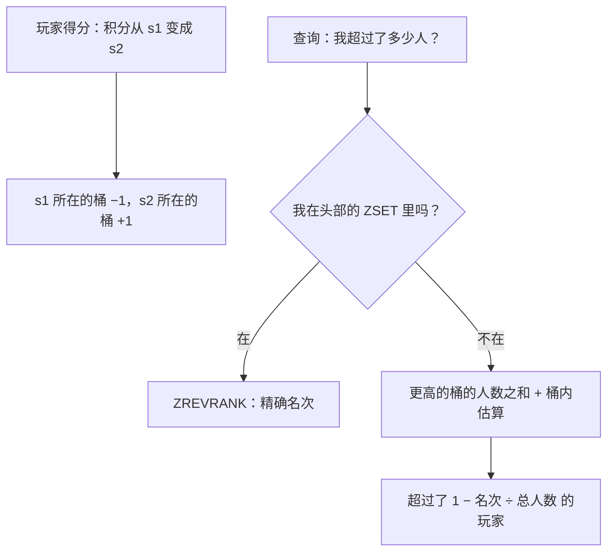
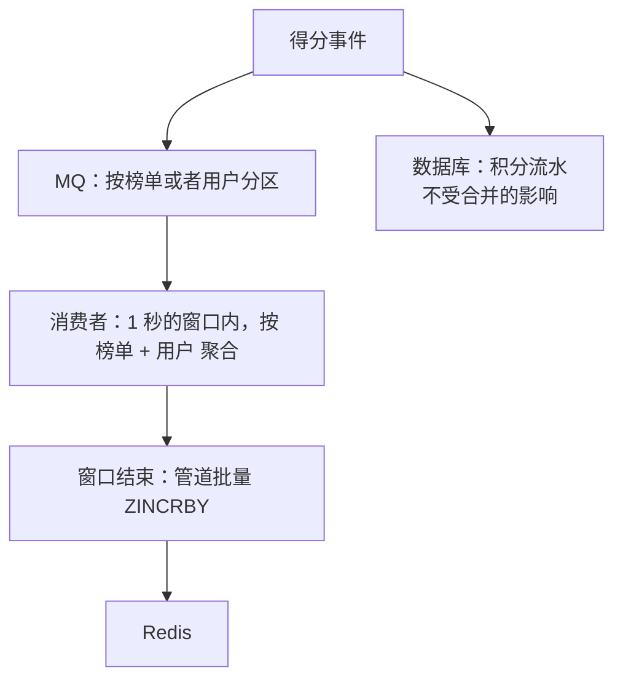
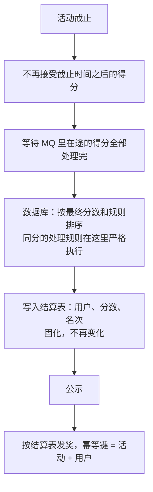
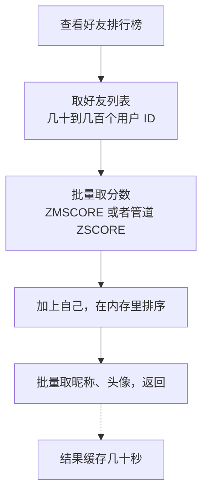
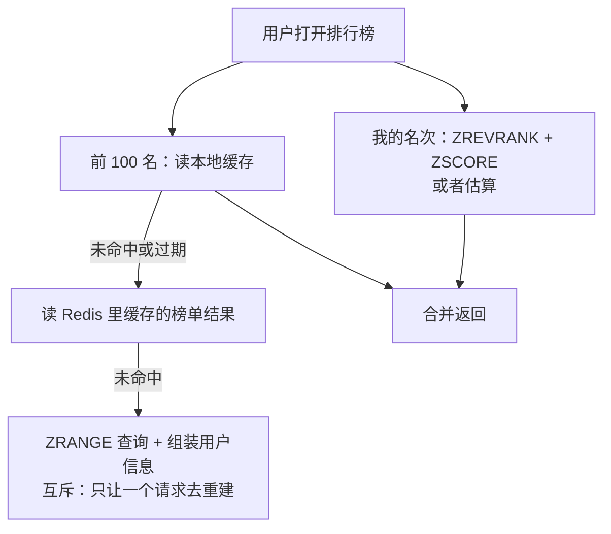

# S14 · 实时排行榜

> 适用岗位：Java 资深开发、Java 架构师。排行榜的起点很简单（Redis ZSET），深入下去会遇到同分排序、周期榜单、千万级用户、高频更新这些问题。速查版见[《29 场景题》](../06-三高与架构/29-场景题.md)的 29-12。
> 版本基线：JDK 21 / 25、Redis 7.x / 8.x、MySQL 8.4。
> 事实核对：
> - `ZRANGE ... REV` 取代 `ZREVRANGE`（Redis 6.2 起后者标记为弃用）、ZSET 同分时按成员的字典序排序、ZSET 的内存占用（100 万成员约 97 MB），沿用[《29 场景题》](../06-三高与架构/29-场景题.md)29-12 中对照 Redis 源码和本机实测的结论。
> - ZSET 用跳表实现的原因，见[《17 Redis》](../04-数据存储/17-Redis.md)17-03。
> - 本机运行（macOS 27.2、Apple M1 Max、JDK 25、Redis 6.2.6）：
>   - 复合分数的 Lua 脚本，在本机临时启动的 Redis 6.2.6 上用 redis-cli 实际执行；
>   - 1 段分片合并与排名估算的代码只依赖 JDK，随机数种子固定，文中贴的是实际运行输出。
> 相关分类：[《17 Redis》](../04-数据存储/17-Redis.md)（ZSET、大 Key）、[《40 数据结构》](../08-计算机基础/40-数据结构.md)（跳表）、[《24 高并发》](../06-三高与架构/24-高并发.md)（高频计数）、[《42 编程题》](../10-编码与思维/42-编程题.md)（Top K）

## 45 分钟答题版

| 时间 | 做什么 | 要讲出的关键点 | 子题 |
| --- | --- | --- | --- |
| 0～5 分钟 | 澄清需求 | 多少人上榜、要不要精确名次、更新频率、周期 | S14-01 |
| 5～12 分钟 | 基础方案 | Redis ZSET：更新、取前 N 名、查名次，都是 O(log N) | S14-02 |
| 12～20 分钟 | 同分排序 | 把时间编码进分数；浮点数精度的上限；用 Lua 更新 | S14-03 |
| 20～27 分钟 | 周期榜单 | 每个周期一个 Key；日榜合并成周榜；过期 | S14-04 |
| 27～38 分钟 | 大规模 | 分片 + 合并；只对头部精确，其余估算；高频更新的合并写入 | S14-05 ～ S14-07 |
| 38～45 分钟 | 可靠性 | 权威数据在数据库；结算与防作弊；好友榜；Redis 故障 | S14-08 ～ S14-10 |

## 知识地图



## 题目索引

| 编号 | 题目 | 难度 |
| --- | --- | --- |
| S14-01 | 排行榜要澄清哪些需求？ | ★★ |
| S14-02 | 用 Redis ZSET 怎么实现？为什么它适合？ | ★★ |
| S14-03 | 分数相同时，怎么让先达到的人排在前面？ | ★★★ |
| S14-04 | 日榜、周榜、月榜怎么做？ | ★★ |
| S14-05 | 几千万用户都要上榜，一个 ZSET 放不下怎么办？ | ★★★ |
| S14-06 | 不需要精确名次时，怎么估算"超过了多少人"？ | ★★★ |
| S14-07 | 分数更新非常频繁，写入压力怎么降？ | ★★ |
| S14-08 | Redis 里的榜单丢了怎么办？最终名次以谁为准？ | ★★ |
| S14-09 | 好友排行榜、地区排行榜怎么做？ | ★★ |
| S14-10 | 怎么防刷榜？排行榜的读取怎么优化？ | ★★ |

---

## 一、基础方案

### S14-01 排行榜要澄清哪些需求？

> ★★ ｜ 资深 ｜ 高频

**考察意图**："排行榜"三个字背后的需求差别很大。几个问题的答案，直接决定用一个 ZSET 就够，还是需要一套复杂的方案。

**30 秒版回答**：

- **多少人参与排名？** 几万人，一个 ZSET 解决；几千万人，要分片或者估算。
- **展示什么？** 只展示前 100 名，还是每个人都要看到自己的精确名次？后者难得多。
- **多实时？** 分数变化后几秒内更新，还是每小时、每天更新一次？
- **分数怎么变？** 只增不减（积分、销量），还是有增有减（战力、段位）？更新频率多高？
- **同分怎么排？** 先达到的在前，还是并列？
- **周期？** 总榜、日榜、周榜、赛季榜。到期后要不要结算发奖？
- **维度？** 全服榜、地区榜、好友榜。
- **准确性要求？** 涉及发奖的榜单，最终名次必须准确，而且经得起申诉；纯展示的榜单可以有少量误差。

**深入剖析**

| 需求组合 | 方案 |
| --- | --- |
| 人数不多（百万以内），全员精确名次 | 单个 ZSET |
| 人数很多，只展示前 N 名 | 只维护头部的 ZSET，分数低于门槛的不进榜 |
| 人数很多，每个人都要精确名次 | 分片的 ZSET（S14-05） |
| 人数很多，头部精确，其余只要"超过了百分之几" | 头部 ZSET + 分数区间统计（S14-06） |
| 不要求实时 | 离线计算，定期生成榜单 |

本文采用的假设：一个游戏活动，3000 万玩家参与；积分只增不减；前 1000 名展示精确名次，其他玩家展示"超过了 xx% 的玩家"；有日榜和总榜；活动结束后按总榜发奖。

**追问链**

1. **为什么"每个人的精确名次"比"前 N 名"难这么多？** 前 N 名只需要关心头部的一小部分数据。而每个人的名次都精确，意味着任何一个人的分数变化，都可能改变成千上万人的名次；系统必须维护全量数据的完整顺序。
2. **实时榜单和离线榜单怎么选？** 看用户是否需要"我刚得了分，马上看到排名变化"的反馈。游戏和直播打赏需要；销量榜、热搜榜这类按小时或者按天更新就足够，而且离线计算可以做更多的数据清洗（去掉刷的量）。

---

### S14-02 用 Redis ZSET 怎么实现？为什么它适合？

> ★★ ｜ 资深 ｜ 高频

**考察意图**：基础的 API 和复杂度。能说出为什么数据库的 `ORDER BY` 不适合这个场景。

**30 秒版回答**：

- **数据结构**：有序集合（ZSET）。成员是用户 ID，分数是积分。
- **操作**（N 是成员数，M 是返回的数量）：
  - 加分：`ZINCRBY key 增量 用户ID`，O(log N)；
  - 取前 100 名：`ZRANGE key 0 99 REV WITHSCORES`，O(log N + M)；
  - 查某人的名次：`ZREVRANK key 用户ID`，O(log N)，结果从 0 开始；
  - 查某人的分数：`ZSCORE key 用户ID`，O(1)；
  - 查某人前后各 5 名：先 `ZREVRANK` 得到名次，再 `ZRANGE ... REV` 取那一段。
- **为什么适合**：ZSET 内部是**跳表加哈希表**。跳表保持成员按分数有序，并且每个节点记录了跨度，所以"查名次"不需要数前面有多少人，沿着跳表往上走、把跨度加起来就行，是 O(log N)。哈希表让按成员查分数是 O(1)。
- **为什么不用数据库**：`SELECT COUNT(*) FROM t WHERE score > ?` 查名次要扫描所有分数更高的行；分数频繁更新，带索引的更新成本也高。数据库适合存权威数据，不适合做实时排序。

**深入剖析**



ZSET 里只放"用户 ID 和分数"。昵称、头像这些展示信息不要放进成员里：它们会变，而且会让成员变大。展示时按 ID 批量获取。

跳表怎样做到 O(log N) 查名次：每个节点在每一层的前进指针上，记录了这一步跨过了多少个节点。查找一个成员时，把沿途经过的指针的跨度加起来，就是它的名次。跳表的结构和 Redis 的选择理由见[《17 Redis》](../04-数据存储/17-Redis.md)17-03、[《40 数据结构》](../08-计算机基础/40-数据结构.md)40-11。

**追问链**

1. **为什么用 `ZRANGE ... REV` 而不是 `ZREVRANGE`？** Redis 6.2 把按排名、按分数、按字典序的几种范围查询统一到了 `ZRANGE` 的参数里，`ZREVRANGE`、`ZRANGEBYSCORE` 等被标记为弃用。新代码用 `ZRANGE`。老命令目前仍然可用。
2. **先写数据库还是先写 Redis？** 先写数据库。数据库是权威数据，写成功了才算得分成立；然后更新 Redis。Redis 更新失败不回滚数据库，靠重试和定期校正（S14-08）。更稳妥的做法是通过消息或者 binlog 驱动 Redis 的更新，这样得分的主流程不依赖 Redis。
3. **分数有增有减时有什么不同？** ZSET 本身支持，`ZINCRBY` 可以传负数。不同的是"只保留头部"的优化（S14-05 追问 2）不再成立：一个榜外的玩家可能涨分进榜，一个榜内的玩家可能掉分出榜，需要有榜外数据的来源来补位。

---

### S14-03 分数相同时，怎么让先达到的人排在前面？

> ★★★ ｜ 资深 ｜ 高频

**考察意图**：ZSET 的一个不那么显然的行为，以及"把多个排序条件编码进一个分数"的技巧和它的限制。

**30 秒版回答**：

- **ZSET 的默认行为**：分数相同的成员，按**成员名的字典序**排列，和谁先达到这个分数没有关系。
- **需求**：积分相同，先达到的排在前面。
- **做法：把时间编码进分数的低位**。
  `分数 = 积分 × 10^k + (10^k − 1 − 时间)`
  - 高位是积分，积分高的分数一定更大；
  - 低位是"时间的反码"：时间越早，这部分越大，同积分时排在前面。
- **精度限制**：ZSET 的分数是双精度浮点数，只能精确表示 2⁵³（约 9 × 10¹⁵）以内的整数。低位留的位数越多，积分的上限就越小。
  - 用秒级的绝对时间戳（10 位）：积分上限约 90 万；
  - 用**相对于活动开始的秒数**（比如 7 位，可以表示约 115 天）：积分上限约 9 亿。
- **更新不能用 `ZINCRBY`**：加分时低位的时间也要换成新的。用 Lua 脚本读出旧的积分，算出新的复合分数，再 `ZADD`。

**深入剖析**

更新脚本（已在本机 Redis 6.2.6 上执行）：

```lua
-- KEYS[1]：榜单（ZSET）
-- ARGV[1]：成员  ARGV[2]：本次增加的积分  ARGV[3]：当前时间（相对于活动开始的秒数）
-- 分数 = 积分 × 10^7 + (9999999 − 时间)：积分高的在前；积分相同，先达到的在前
local TIME_SPACE = 10000000
local old = redis.call('ZSCORE', KEYS[1], ARGV[1])
local points = 0
if old then
    points = math.floor(tonumber(old) / TIME_SPACE)
end
points = points + tonumber(ARGV[2])
local score = points * TIME_SPACE + (TIME_SPACE - 1 - tonumber(ARGV[3]))
redis.call('ZADD', KEYS[1], score, ARGV[1])
return points
```

```text
# 对照：不带时间的普通分数，三个人都是 100 分
user:c user:b user:a
# 复合分数：a 在第 1000 秒得到 100 分，b 在第 1100 秒得到 100 分
user:a 1009998999 user:b 1009998899
# b 在第 1200 秒再得 50 分
user:b 1509998799 user:a 1009998999
# a 在第 1300 秒也得 50 分：两人都是 150 分，b 先达到，排在前面
user:b 1509998799 user:a 1509998699
# 查 a 的名次（从 0 开始）和积分
rank=1, points=150
# 精度上限：积分 900000000 时，分数约 9 × 10^15，接近 2^53
9000000009999998
```

（`#` 开头的行是说明，其余是 redis-cli 的返回。）

- 第一组是对照：三个人都是 100 分，结果按成员名倒序排列（c、b、a），和时间无关；
- a 先得到 100 分（第 1000 秒），b 后得到（第 1100 秒）：a 的分数低位是 9998999，比 b 的 9998899 大，a 排在前面；
- b 再得 50 分，变成 150 分，排到了 a 的前面；
- a 也到了 150 分，但时间是第 1300 秒，晚于 b 的第 1200 秒：两人同分，**b 仍然在前**；
- 最后一组检验精度：积分 9 亿时，分数是 9000000009999998，每一位都准确。这个值已经接近 2⁵³ = 9007199254740992，再大就不能保证低位精确了。

解码：积分 = 分数 ÷ 10⁷ 取整；达到的时间 = 10⁷ − 1 − （分数对 10⁷ 取余）。

位数的分配：

| 低位（时间）的设计 | 低位的位数 | 积分的上限（约） |
| --- | --- | --- |
| 秒级的绝对时间戳 | 10 位 | 90 万 |
| 相对活动开始的秒数，活动不超过 115 天 | 7 位 | 9 亿 |
| 相对活动开始的分钟数，活动不超过 69 天 | 5 位 | 900 亿 |

**追问链**

1. **积分的范围超过了上限怎么办？** 几种选择：降低时间的精度（秒改成分钟），腾出位数；把成员设计成"时间 + 用户 ID"的形式，利用同分时按成员字典序排序的规则（成员名变了，更新时要先删后加）；或者不在 Redis 里解决同分排序，只对出现同分的少数情况在应用层再排一次。
2. **为什么脚本里用 `ZADD` 而不是算出差值再 `ZINCRBY`？** 浮点数的加法在大数值上可能有舍入误差，多次累加后低位会不准。每次都用整数算出完整的新分数再整体写入，不会累积误差。
3. **只按"先达到"还不够，还要再按别的条件排怎么办？** 一个浮点数能编码的信息有限。超过两个排序条件时，更实际的做法是 ZSET 只负责主要的排序，取出一段之后在应用内存里按完整的规则再排一次。只要同分的人不是特别多，这样做的代价很小。

---

### S14-04 日榜、周榜、月榜怎么做？

> ★★ ｜ 资深 ｜ 中频

**考察意图**：周期榜单的 Key 设计，以及"合并"和"分别累加"两种做法的取舍。

**30 秒版回答**：

- **每个周期一个 Key**，把日期编进 Key 里：`lb:daily:20261112`、`lb:weekly:2026W46`、`lb:monthly:202611`。到了新的周期，自然写入新的 Key，旧的不用清理。
- **得分时同时更新多个榜**：一次得分，对日榜、周榜、月榜、总榜各执行一次加分（放在一个管道里）。实现简单，每个榜都是实时的。
- **或者由日榜合并出周榜**：只实时维护日榜，周榜用 `ZUNIONSTORE` 把 7 个日榜按分数相加合并。写入少，但合并是一次 O(N) 的操作，周榜不是实时的。
- **过期**：给每个周期的 Key 设置过期时间（比如周期结束后保留 30 天），到期自动删除。
- **周期切换时的结算**：周期结束时，把最终的榜单固化下来（写入数据库），再按它发奖。不要直接拿 Redis 里"当时的样子"发奖（S14-08）。
- **滑动窗口**（"最近 7 天"而不是"本周"）：每天的数据一个 Key，查询时合并最近 7 个；或者每天凌晨合并一次，结果缓存一天。

**深入剖析**



两种做法的比较：

| | 得分时同时更新各个榜 | 用日榜合并出周榜 |
| --- | --- | --- |
| 写入量 | 每次得分写 N 个榜 | 每次得分只写日榜 |
| 周榜的实时性 | 实时 | 取决于合并的频率 |
| 内存 | 每个榜各存一份 | 周榜是合并的结果，可以只在需要时生成 |
| 实现 | 简单 | 需要定时任务；合并是 O(N) 的操作，数据量大时要放在从节点或者低峰期 |
| 同分排序用了复合分数时 | 各榜各自计算，没有问题 | **不能直接相加**：复合分数相加后低位的时间没有意义 |

最后一行是一个容易踩的坑：如果分数里编码了时间（S14-03），`ZUNIONSTORE` 的求和会把时间部分也加起来，结果是错的。这种情况下只能用"同时更新各个榜"的做法。

**追问链**

1. **周期怎么界定，按服务器的时间吗？** 按业务规定的时区和时间点。Key 里的日期要由统一的函数生成，不能在各处用服务器的本地时间各算各的。零点前后的得分归到哪一天，以得分事件的发生时间为准，而不是处理的时间：一条 23:59:59 产生、00:00:01 才被处理的得分，应该记在前一天。
2. **跨零点时会不会有问题？** 新周期的 Key 一开始是空的，排行榜页面会短暂显示"暂无数据"。可以在产品上处理（显示上一期的榜单，直到新榜单有足够的数据）。
3. **总榜会一直增长，怎么办？** 总榜的成员数等于所有参与过的玩家数。活动类的榜单有结束时间，结束后归档删除。长期存在的总榜要考虑 S14-05 的大 Key 问题。

---

## 二、大规模

### S14-05 几千万用户都要上榜，一个 ZSET 放不下怎么办？

> ★★★ ｜ 资深 / 架构师 ｜ 高频

**考察意图**：大 Key 的问题，以及分片之后"前 N 名"和"名次"这两个查询分别怎么做。

**30 秒版回答**：

- **问题**：一个 ZSET 放 3000 万个成员，约 3 GB（按 100 万成员 97 MB 估算）。这是一个巨大的 Key：
  - 只能放在一个节点上，不能分摊到集群；
  - 主从全量同步、持久化、迁移槽位时耗时很长；
  - 删除它会阻塞（要用 `UNLINK`）；
  - 所有的读写都压在一个节点的一个线程上。
- **分片**：按用户 ID 哈希，分成 K 个 ZSET。每个分片是一个独立的小榜。
- **前 N 名**：每个分片取前 N 名，合并这 K × N 个候选，再取前 N 名。全局的前 N 名一定在各分片的前 N 名里。
- **某个人的名次**：在每个分片里数"分数比他高的有多少人"（`ZCOUNT`），全部加起来再加 1。需要 K 次查询，可以用管道并行发出。
- **更省的做法**：先想清楚是不是真的需要全员精确排名。只对头部精确、其余估算（S14-06），通常是更合理的方案。

**深入剖析**

用 JDK 验证分片之后两种查询的正确性：100 万个用户分成 16 片，和全局排序的结果对比（本机 JDK 25 运行）：

```java
import java.util.ArrayList;
import java.util.Arrays;
import java.util.Comparator;
import java.util.List;
import java.util.Random;

/**
 * 大榜单的两种做法：
 * 1. 分片：按用户 ID 分成多个小榜，前 N 名由各分片的前 N 名合并得到，名次由各分片里"比我高的人数"相加得到；
 * 2. 估算：按分数区间统计人数，名次 = 更高区间的人数 + 本区间内按比例估算。
 */
public class LeaderboardDemo {

    private static final int USER_COUNT = 1_000_000;
    private static final int SHARD_COUNT = 16;
    private static final int TOP_N = 100;
    private static final int MAX_SCORE = 100_000;
    private static final int BUCKET_WIDTH = 100;
    private static final long RANDOM_SEED = 20261112L;

    record Entry(int userId, int score) { }

    /** 分数高的在前；分数相同，用户 ID 小的在前 */
    private static final Comparator<Entry> ORDER =
            Comparator.comparingInt(Entry::score).reversed().thenComparingInt(Entry::userId);

    public static void main(String[] args) {
        Random random = new Random(RANDOM_SEED);
        Entry[] all = new Entry[USER_COUNT];
        List<List<Entry>> shards = new ArrayList<>();
        for (int i = 0; i < SHARD_COUNT; i++) {
            shards.add(new ArrayList<>());
        }
        int[] buckets = new int[MAX_SCORE / BUCKET_WIDTH];
        for (int userId = 0; userId < USER_COUNT; userId++) {
            // 分数偏向低分：大多数人分数不高，少数人很高，接近真实榜单的分布
            int score = (int) (MAX_SCORE * Math.pow(random.nextDouble(), 3));
            Entry entry = new Entry(userId, score);
            all[userId] = entry;
            shards.get(userId % SHARD_COUNT).add(entry);
            buckets[score / BUCKET_WIDTH]++;
        }
        for (List<Entry> shard : shards) {
            shard.sort(ORDER);                      // 相当于每个分片是一个 ZSET
        }
        Entry[] global = all.clone();
        Arrays.sort(global, ORDER);                 // 全局精确排序，只用来核对结果

        // 1. 前 N 名：每个分片取前 N 名，合并后再取前 N 名
        List<Entry> candidates = new ArrayList<>();
        for (List<Entry> shard : shards) {
            candidates.addAll(shard.subList(0, TOP_N));
        }
        candidates.sort(ORDER);
        boolean topMatches = candidates.subList(0, TOP_N).equals(Arrays.asList(global).subList(0, TOP_N));
        System.out.println("top " + TOP_N + ": merged " + candidates.size() + " candidates from " + SHARD_COUNT
                + " shards, equals global top " + TOP_N + " = " + topMatches);

        // 2. 名次：精确值 = 各分片里排在我前面的人数之和 + 1；估算值来自分数区间的人数
        System.out.println("userId   score   exact rank   by shards   estimated   error");
        for (int userId : new int[] {7, 123_456, 500_000, 654_321, 999_999}) {
            Entry me = all[userId];
            int exact = Arrays.binarySearch(global, me, ORDER) + 1;
            int byShards = 1;
            for (List<Entry> shard : shards) {
                byShards += countBefore(shard, me);
            }
            int higher = 0;
            for (int b = me.score() / BUCKET_WIDTH + 1; b < buckets.length; b++) {
                higher += buckets[b];
            }
            int bucketStart = me.score() / BUCKET_WIDTH * BUCKET_WIDTH;
            double fractionAbove = (bucketStart + BUCKET_WIDTH - 1 - me.score()) / (double) BUCKET_WIDTH;
            int estimated = higher + (int) Math.round(buckets[me.score() / BUCKET_WIDTH] * fractionAbove) + 1;
            System.out.printf("%-8d %-7d %-12d %-11d %-11d %.2f%%%n", userId, me.score(), exact, byShards, estimated,
                    Math.abs(estimated - exact) * 100.0 / USER_COUNT);
        }
        System.out.println("buckets=" + buckets.length + " counters, versus " + USER_COUNT + " members in a full ranking");
    }

    /** 在一个有序的分片里，排在 target 前面的人数（二分查找，相当于 ZSET 的 ZCOUNT / ZRANK） */
    private static int countBefore(List<Entry> sortedShard, Entry target) {
        int low = 0;
        int high = sortedShard.size();
        while (low < high) {
            int mid = (low + high) >>> 1;
            if (ORDER.compare(sortedShard.get(mid), target) < 0) {
                low = mid + 1;
            } else {
                high = mid;
            }
        }
        return low;
    }
}
```

```text
top 100: merged 1600 candidates from 16 shards, equals global top 100 = true
userId   score   exact rank   by shards   estimated   error
7        4480    644993       644993      644963      0.00%
123456   88193   40964        40964       40959       0.00%
500000   58762   162228       162228      162256      0.00%
654321   73      909781       909781      926002      1.62%
999999   6158    605430       605430      605395      0.00%
buckets=1000 counters, versus 1000000 members in a full ranking
```

- **前 100 名**：16 个分片各取前 100 名，共 1600 个候选，合并后的前 100 名和全局排序的前 100 名**完全一致**；
- **名次**：表里的"by shards"一列，是各分片里排在这个用户前面的人数之和加 1，和"exact rank"一列（全局排序得到的精确名次）**完全一致**；
- "estimated"一列是下一题的估算方法。

为什么"全局前 N 名一定在各分片的前 N 名里"：假设某个全局前 N 名的成员，在它所在的分片里排在第 N 名之后，那么这个分片里就至少有 N 个成员比它分数高，它的全局名次就不可能在前 N。



同分时的名次：`ZCOUNT key (s +inf` 数的是分数**严格大于** s 的人数，得到的是并列名次里最好的那个。如果用了复合分数（S14-03），每个人的分数几乎都不相同，直接得到确定的名次。

**追问链**

1. **分多少片？** 让每个分片的大小落在合理的范围（比如几百万成员以内）。分片数也决定了查名次时的查询次数，不宜过多。3000 万用户分 16 到 32 片比较合适。
2. **只展示前 1000 名，能不能只存头部？** 可以，这是最省的方案。维护一个最多几千人的 ZSET：得分后，如果分数高于榜上的最低分，就加入并淘汰最后一名。绝大多数玩家的得分根本不会触及这个 ZSET。条件是分数**只增不减**；如果分数会减少，榜上的人掉出去之后，谁来补位就需要全量数据。
3. **分片后，前 N 名的查询要访问所有分片，会不会太慢？** K 次查询通过管道并行发出，耗时取决于最慢的一个。前 N 名的结果变化不频繁，可以缓存一两秒，所有用户读同一份（S14-10）。

---

### S14-06 不需要精确名次时，怎么估算"超过了多少人"？

> ★★★ ｜ 架构师 ｜ 中频

**考察意图**：用很小的代价得到"足够好"的答案。看你是否能想到用分布来估算，并且知道它的误差在哪里。

**30 秒版回答**：

- **观察**：排在第 1,234,567 名和第 1,234,890 名，对用户没有区别。他想知道的是"我大概在什么位置"。所以头部之外，不需要精确名次。
- **做法：按分数区间统计人数**（直方图）。
  - 把分数范围切成若干个区间（桶），每个桶记录"分数落在这个区间的人数"；
  - 某人的名次 ≈ 分数更高的那些桶的人数之和 + 他所在的桶里按位置估算的人数；
  - "超过了 xx% 的玩家" = 1 − 名次 ÷ 总人数。
- **成本**：只需要几百到几千个计数器，和用户数无关。得分时，旧分数所在的桶减 1，新分数所在的桶加 1。
- **误差**来自桶内：假设桶里的人均匀分布，实际不一定。桶越窄、桶里的人越少，误差越小。
- **组合**：前 1000 名用 ZSET 给出精确名次；1000 名以外用直方图给出百分比。两者在边界上衔接。

**深入剖析**

上一题输出里的"estimated"和"error"两列，就是用 1000 个桶（每个桶宽 100 分）估算的结果：

| 用户 | 分数 | 精确名次 | 估算名次 | 误差（占总人数的比例） |
| --- | --- | --- | --- | --- |
| 7 | 4480 | 644,993 | 644,963 | 0.00% |
| 123456 | 88193 | 40,964 | 40,959 | 0.00% |
| 500000 | 58762 | 162,228 | 162,256 | 0.00% |
| 654321 | 73 | 909,781 | 926,002 | 1.62% |
| 999999 | 6158 | 605,430 | 605,395 | 0.00% |

- 四个用户的估算名次和精确名次只差几十名，在 100 万人里可以忽略；
- **用户 654321 的误差明显更大**：差了约 1.6 万名。他的分数是 73，落在最低的那个桶（0 到 99 分）里。演示数据的分数分布是偏向低分的，这个桶里挤了 10 万人，而且在桶内的分布很不均匀（越接近 0 分人越多），"桶内均匀分布"的假设在这里不成立。

这说明了桶应该怎么划分：**不要等宽，要让每个桶里的人数大致相等**。人多的分数段桶要窄，人少的分数段桶可以宽。可以定期根据实际的分布重新划分桶的边界。



桶的计数器放在哪：一个 Redis Hash，字段是桶的编号，值是人数。得分时用 `HINCRBY` 更新两个字段；查询时 `HGETALL` 取回全部的桶（几百上千个数字，很小），在应用里求和。这个 Hash 可以在应用本地缓存几秒。

**追问链**

1. **桶的计数和实际不一致怎么办？** "旧桶减 1、新桶加 1"依赖于知道旧的分数。并发更新或者重复处理会让计数漂移。它是一个派生数据，可以定期从数据库或者数据仓库重新统计一次来校正。少量的漂移对"百分比"的展示没有可见的影响。
2. **头部和其余部分的边界怎么衔接？** 头部 ZSET 保存前 1000 名。用户的分数高于 ZSET 里的最低分，就查 ZSET；否则用直方图。直方图里也包含头部的人（总人数是全体），所以估算出的名次不会小于 1000。边界附近可能出现"估算的名次比第 1000 名还靠前"的情况，取两者中靠后的那个即可。
3. **还有别的近似方法吗？** 分位数的近似算法（比如 t-digest）可以在更小的空间里给出更准的分位估计，尤其是在分布的两端。直方图的优点是简单、容易解释和校正。对排行榜来说通常够用。

**架构师加分点**

- 这道题体现了一种常用的设计思路：**先问清楚需求需要多精确，再决定为精确付出多少成本**。"每个人的精确名次"需要 3 GB 的内存和 K 次查询；"头部精确 + 其余估算"只需要一个几千人的 ZSET 和一千个计数器。两者在用户看来几乎没有区别。主动提出这个替代方案，并说明它的误差范围，是架构师应有的判断。

---

### S14-07 分数更新非常频繁，写入压力怎么降？

> ★★ ｜ 资深 ｜ 中频

**考察意图**：直播打赏、游戏击杀这类场景，每秒有几万到几十万次得分。看你是否知道合并写入。

**30 秒版回答**：

- **现象**：一个热门直播间，每秒几千次打赏，每一次都要更新主播榜、观众贡献榜、日榜、周榜。Redis 的写入量是得分次数的好几倍。
- **合并写入**：得分事件先进入 MQ。消费者按一个很短的时间窗口（比如 1 秒）在内存里聚合：同一个用户、同一个榜的多次得分合并成一次。窗口结束时，用管道批量执行。
  - 一个用户在 1 秒内得分 20 次，变成一次 `ZINCRBY`；
  - 榜单的更新延迟最多 1 秒，用户基本感知不到。
- **只更新必要的榜**：分数远低于上榜门槛的得分，不需要去更新"只保留头部"的榜。
- **写和读分离**：写主节点，读从节点。排行榜的读取允许短暂的延迟。
- **热点 Key**：一个超热的榜单 Key 的所有写入都在一个 Redis 节点上。合并写入之后，写入量通常已经降到可以接受的范围。

**深入剖析**



合并的效果取决于"同一个 Key 在窗口内被更新了多少次"。热点越集中，合并的效果越好：1 秒内 5000 次打赏集中在 200 个用户身上，就从 5000 次写入变成了 200 次。

要注意的细节：

- **权威数据不合并**：数据库里的积分流水逐条记录，合并只发生在更新 Redis 榜单这一步；
- **消费者崩溃**：窗口里还没写出去的聚合结果丢了。MQ 的位点要在批量写入成功之后才提交，这样重启后会重新消费这一批。重新消费会不会重复加分，取决于有没有做幂等（比如记录已经处理到的位点）；排行榜可以接受少量的偏差，并由定期的校正修复；
- **复合分数的榜**（S14-03）：合并后用窗口里**最后一次**得分的时间作为达到时间。

**追问链**

1. **合并窗口多长合适？** 窗口越长合并得越多，延迟也越大。一般几百毫秒到几秒。可以按负载动态调整：平时窗口短，高峰期拉长。
2. **为什么不在应用服务器的内存里直接聚合，而要经过 MQ？** 应用实例有很多个，同一个用户的得分分散在不同的实例上，各自聚合的效果差；实例重启会丢失内存里的数据。经过 MQ 并按 Key 分区之后，同一个用户的得分集中到同一个消费者上，聚合效果好，而且有位点可以恢复。
3. **高频计数的通用做法？** 见[《24 高并发》](../06-三高与架构/24-高并发.md)24-13。排行榜是它的一个特例：除了计数，还要维护顺序。

---

## 三、可靠性与扩展

### S14-08 Redis 里的榜单丢了怎么办？最终名次以谁为准？

> ★★ ｜ 资深 / 架构师 ｜ 高频

**考察意图**：是否清楚 Redis 里的榜单是"视图"而不是"事实"。涉及发奖时，这一点尤其重要。

**30 秒版回答**：

- **权威数据在数据库**：每一次得分记一条流水（谁、什么时候、因为什么、得了多少分），以及每个用户的总分。Redis 里的榜单是由这些数据派生出来的，**可以随时重建**。
- **Redis 丢数据的情况**：主从切换丢失最近的写入；实例故障；误删。
- **重建**：从数据库读出所有用户的分数，批量写入 Redis。数据量大时要分批、限速，先重建头部（按分数倒序读取），让榜单尽快可用。
- **日常校正**：定期（比如每小时）抽样或者全量比对 Redis 和数据库的分数，修复不一致的。
- **结算以数据库为准**：活动结束时，
  1. 停止接受新的得分（过了截止时间的得分不计入）；
  2. 等待在途的数据全部落库；
  3. 用数据库里的最终分数生成名次，固化成一张结算表；
  4. 按结算表发奖。
- **实时榜单只用于展示**。展示的名次和最终的名次可能有细微的差别，要在规则里说明"最终排名以活动结束后的公示为准"。

**深入剖析**



为什么结算不能直接读 Redis：

| 风险 | 说明 |
| --- | --- |
| 数据不完整 | 截止的瞬间，还有得分在 MQ 里没有处理 |
| 数据可能丢失 | 主从切换丢了几次写入，榜单和实际的分数不一致 |
| 合并写入的延迟 | 榜单比真实的得分晚一个窗口 |
| 无法追溯 | 用户申诉时，Redis 里只有一个分数，没有它是怎么来的 |
| 没有经过反作弊的清洗 | 刷的分还在榜上 |

**追问链**

1. **全量重建 3000 万用户的榜单要多久？** 从数据库按主键分段读取，用管道批量 `ZADD`，每秒可以写入几万到十几万条，几分钟到十几分钟。期间榜单不完整。所以更重要的是先把头部重建出来，头部是用户最关心的。
2. **怎么知道 Redis 和数据库不一致了？** 定期抽样比对；对头部的用户全量比对；监控 Redis 榜单的成员数和数据库里的参与人数。主从切换之后，主动触发一次校正。
3. **得分的流水要保存多久？** 至少到活动结算并且过了申诉期。流水是处理争议的唯一依据。

---

### S14-09 好友排行榜、地区排行榜怎么做？

> ★★ ｜ 资深 ｜ 中频

**考察意图**：不同维度的榜单，规模和算法完全不同。看你是否会根据"参与排名的集合有多大"来选方案。

**30 秒版回答**：

- **地区榜、服务器榜、分组榜**（维度的取值是有限的、固定的）：每个地区一个 ZSET。得分时，根据用户所属的地区，同时更新全服榜和地区榜。和周期榜单是同样的做法：多一个维度，多一组 Key。
- **好友榜**（每个人看到的集合都不一样）：**不能为每个用户维护一个 ZSET**。一次得分要更新所有好友的榜单，是写扩散，而好友榜的访问频率并不高。
  - **读时计算**：查看好友榜时，取出好友列表（几十到几百人），批量取这些人的分数，在内存里排序。数据量很小，直接算就行；
  - 批量取分数：对全服榜的 ZSET 用管道执行多次 `ZSCORE`（Redis 6.2 起可以用 `ZMSCORE` 一次取多个），或者从缓存里的用户分数表批量读取。
- **选择的原则**：参与排名的集合如果是**少数几个大集合**，预先维护；如果是**大量的小集合**，读的时候现算。

**深入剖析**



好友榜的两种做法：

| | 每人一个好友榜 ZSET（写扩散） | 读时计算（读扩散） |
| --- | --- | --- |
| 一次得分的写入 | 好友数 | 0 |
| 一次查看的读取 | 1 次 | 取好友列表 + 批量取分数 + 排序 |
| 存储 | 用户数 × 好友数 | 无额外存储 |
| 好友关系变化 | 要修改双方的榜单 | 自然生效 |
| 适合 | 好友榜是产品的核心，查看极其频繁 | 绝大多数情况 |

这又是推和拉的取舍（[《S12 Feed 流》](S12-Feed流.md)S12-02）。得分的频率通常远高于查看好友榜的频率，所以读时计算更合算。

**追问链**

1. **地区很多（几千个城市），每次得分都要更新城市榜、省榜、全国榜，写入会不会太多？** 每次得分更新 3 个榜，可以接受。如果维度更多（城市 × 段位 × 职业……），组合起来的榜单数量会爆炸。这时只为确实要展示的组合维护榜单，其余的组合用离线计算。
2. **好友特别多（比如几千个）的用户怎么办？** 批量取几千个分数仍然很快。可以把结果缓存起来。也可以只展示好友中的前若干名加上自己的位置。
3. **"在好友中排第几"需要实时吗？** 通常不需要。缓存几十秒到几分钟，用户不会察觉。

---

### S14-10 怎么防刷榜？排行榜的读取怎么优化？

> ★★ ｜ 资深 / 架构师 ｜ 中频

**考察意图**：排行榜关系到奖励和荣誉，一定会有人作弊。读取方面，考察是否利用了"所有人看到的榜单都一样"这个特点。

**30 秒版回答**：

- **防刷**：
  - **得分的入口校验**：分数由服务端根据可信的事件计算，不接受客户端上报的分数；每次得分有合理性检查（单次上限、频率上限、和游戏进度是否匹配）；
  - **得分幂等**：每次得分有唯一的事件 ID，重复的事件不重复加分；
  - **风控**：异常的增长曲线、多个账号的协同、设备和 IP 的聚集；
  - **事后清洗**：结算前用完整的数据再检查一遍，剔除作弊的账号，名次顺延；
  - **榜单的展示可以延迟**：实时榜单在活动的最后阶段隐藏或者延迟更新，防止最后几秒冲榜。
- **读取优化**：
  - **前 N 名是公共数据**：所有用户看到的都一样。缓存整个结果（本地缓存加上 Redis），一两秒更新一次。无论多少人查看，对 ZSET 的查询只有每秒一两次；
  - **"我的名次"是个性化的**：每个用户不同，无法共享。它是一次 O(log N) 的查询，本身很快；也可以对单个用户缓存几秒；
  - **读从节点**：榜单的读取可以走从节点；
  - **昵称、头像**：批量获取并缓存。

**深入剖析**



前 N 名缓存的更新方式：与其等缓存过期后由用户的请求触发重建，不如用一个后台任务**每秒主动刷新一次**。这样不会有缓存击穿，用户读到的永远是一份已经准备好的数据，最多落后一秒。

| 作弊的方式 | 对策 |
| --- | --- |
| 伪造或篡改客户端上报的分数 | 服务端计算分数；关键的事件由服务端判定 |
| 重放同一个得分请求 | 事件 ID 幂等 |
| 脚本、外挂刷分 | 频率和行为的风控；人机识别 |
| 多个小号给一个大号送分 | 关联分析（设备、IP、交易关系） |
| 活动结束前的最后几秒突击冲榜 | 最后阶段隐藏实时排名；结算时的完整性检查 |
| 利用系统的 bug 得分 | 单次和单日的得分上限；异常的得分告警 |

**追问链**

1. **发现榜上有作弊的账号，怎么处理？** 从 Redis 的榜单里移除（`ZREM`），并把账号加入黑名单，后续的得分不再进榜。数据库里的流水保留，标记为无效。结算时按清洗后的数据重新计算名次。
2. **排行榜的翻页怎么做？** `ZRANGE key start stop REV`，按名次的区间取。和 Feed 流不同，这里用"名次的偏移"是合适的：ZSET 按排名取一段是 O(log N + M)，不会因为偏移大而变慢。翻页过程中榜单变化导致的少量重复或者遗漏，对排行榜来说可以接受。
3. **Redis 不可用时排行榜怎么降级？** 返回上一次缓存的榜单结果，并提示"数据更新中"。得分照常写入数据库，Redis 恢复后通过重建或者积压的消息追上。排行榜不是核心链路，它的故障不应该影响得分本身。

**生产实践 / 踩坑**

- **以为同分时先达到的排在前面**：ZSET 同分按成员的字典序排列。不处理的话，同分时排名看起来是"随机"的，而且用户 ID 小的永远占便宜。
- **复合分数超过了 2⁵³**：低位的时间部分被舍入，同分的排序错乱，而且这种错误只在分数很高的头部出现，最难发现。上线前要按最大的可能积分验证精度。
- **对复合分数的榜做 `ZUNIONSTORE` 求和**：时间部分被加在了一起，合并出的榜单顺序是错的。
- **直接按 Redis 里的实时榜单发奖**：数据不完整、没有经过清洗、无法追溯。
- **把昵称拼在 ZSET 的成员里**：用户改名之后，榜上出现两个"他"。成员只放不变的 ID。
