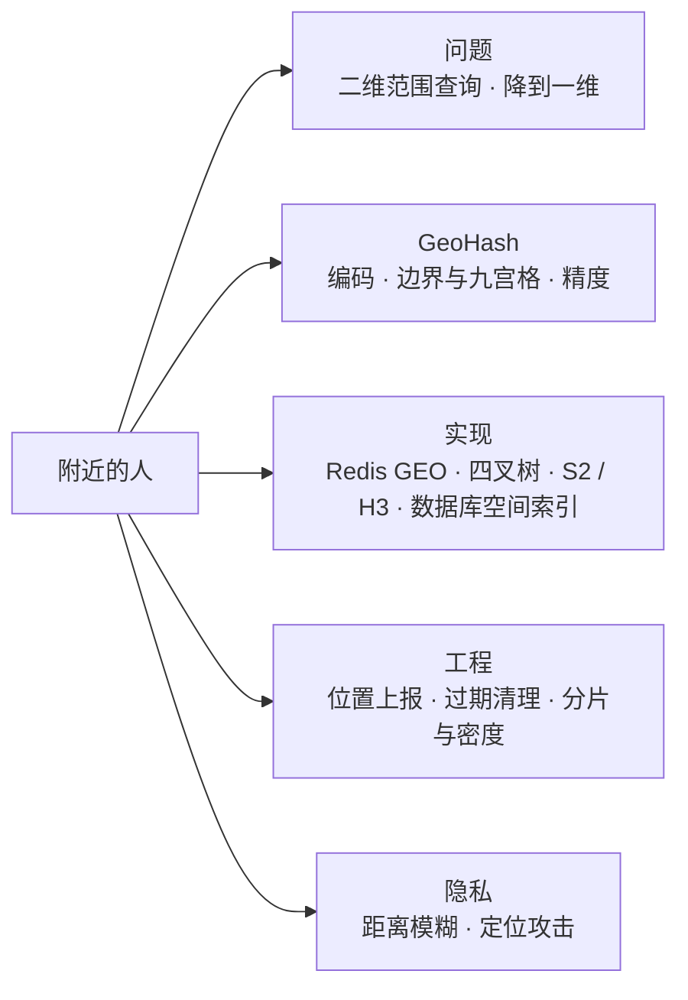
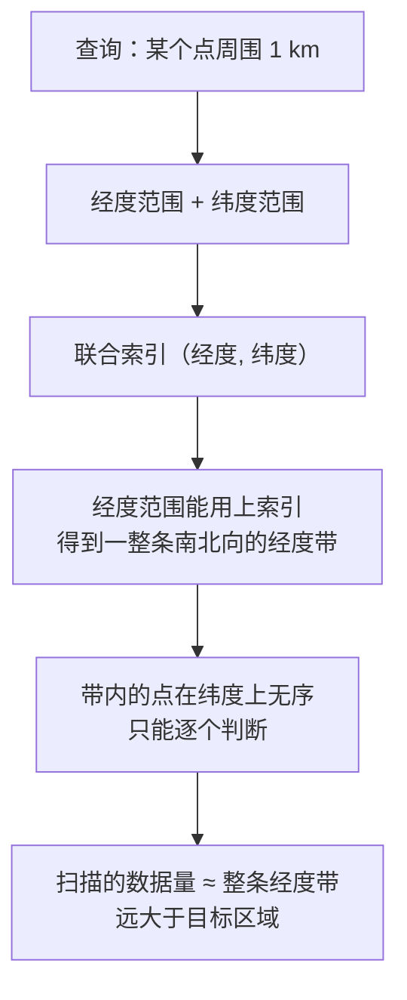
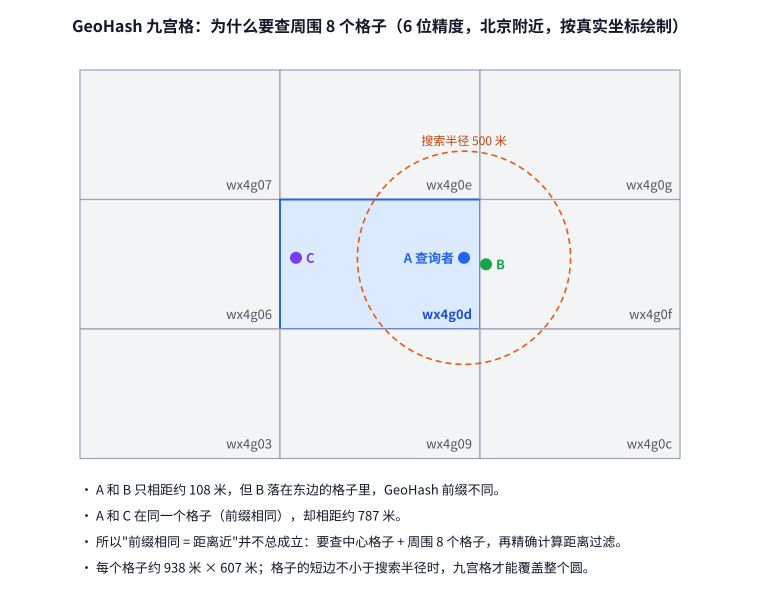
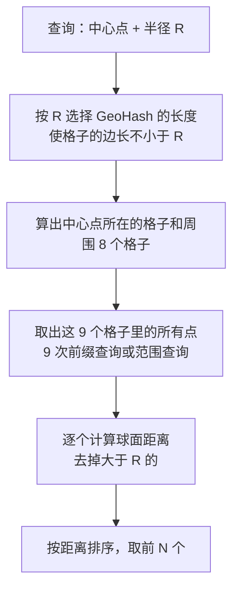
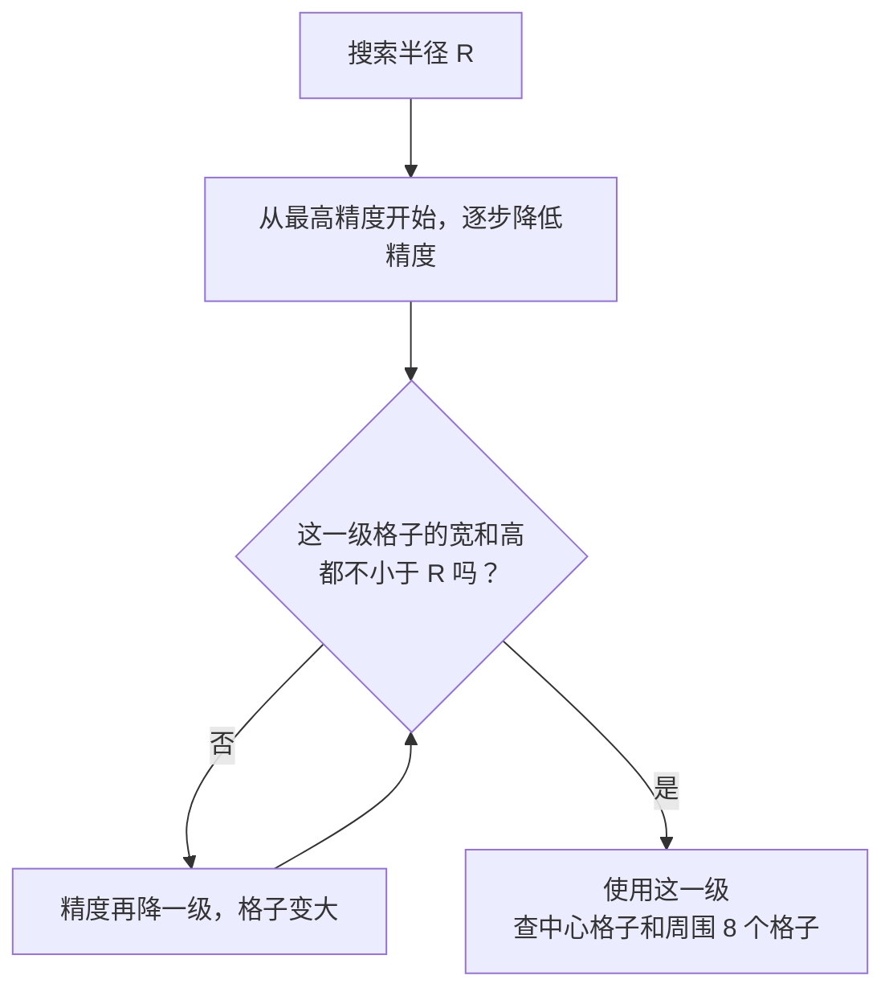
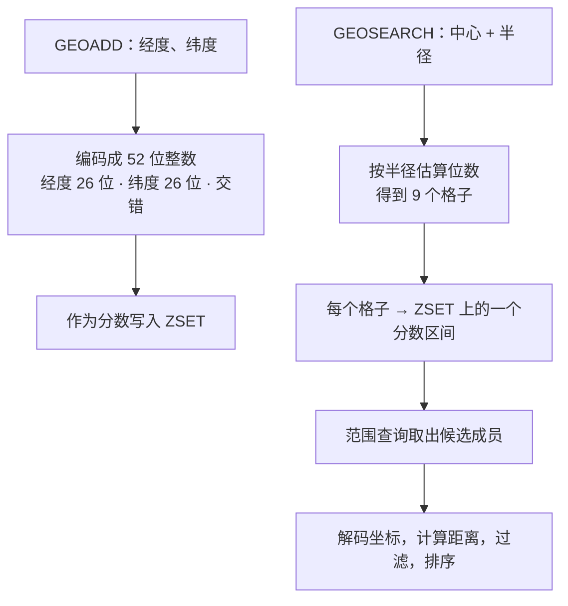
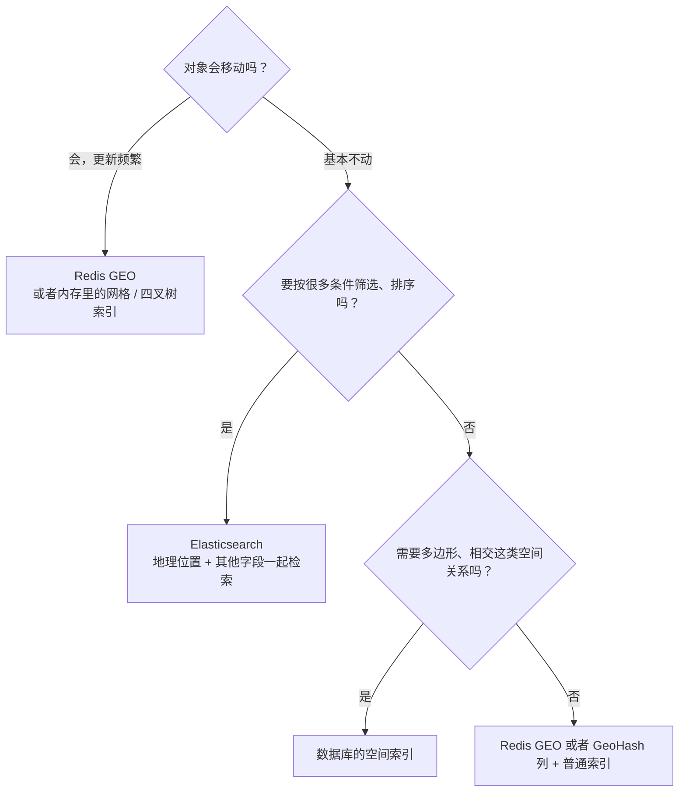
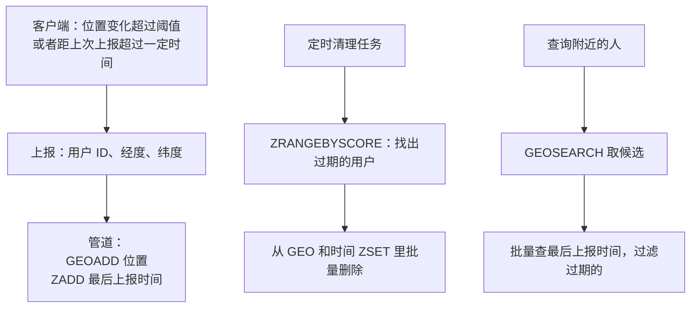
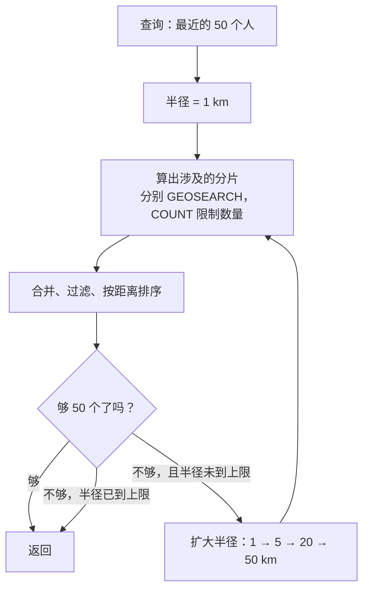
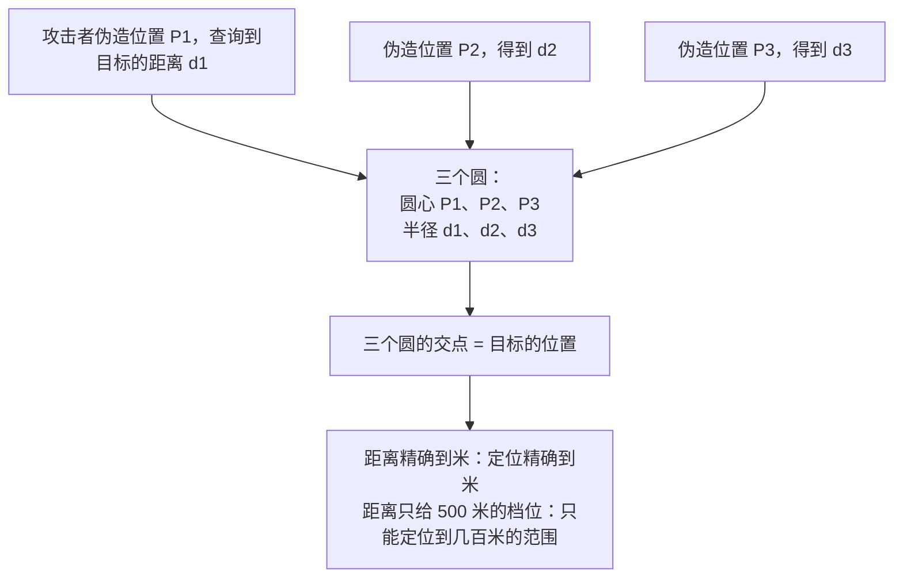

# S15 · 附近的人

> 适用岗位：Java 资深开发、Java 架构师。"附近的人""附近的店""附近的车"是同一类问题：给定一个位置和半径，快速找出范围内的对象。这道题考察空间索引的原理（GeoHash）、它的边界问题，以及位置数据的更新和隐私。速查版见[《29 场景题》](../06-三高与架构/29-场景题.md)的 29-13。
> 版本基线：JDK 21 / 25、Redis 7.x / 8.x、MySQL 8.4、Elasticsearch 9.x。
> 事实核对：
> - Redis GEO 的实现（底层是 ZSET、分数是 52 位的 GeoHash、先按半径选精度再搜索九个格子并逐个计算距离），沿用[《29 场景题》](../06-三高与架构/29-场景题.md)29-13 中对照 Redis 源码核对的结论；`GEOSEARCH` 在 Redis 6.2 引入，取代 `GEORADIUS`。
> - `GEOHASH` 命令返回的 11 个字符里，第 11 个固定是 `0`：本次对照 Redis 6.2 分支和 unstable 分支的 `src/geo.c` 核对，源码注释写明内部只有 52 位，为了兼容仍然输出 11 个字符，最后一个按 0 处理；输出前会用标准的纬度范围（−90 到 90）重新编码。
> - 本机运行（macOS 27.2、Apple M1 Max、JDK 25）：1 段 GeoHash 的代码只依赖 JDK，文中贴的是实际运行输出，并和 29-13 里本机 Redis 6.2.6 的实测结果做了对照。
> 相关分类：[《17 Redis》](../04-数据存储/17-Redis.md)（GEO、ZSET）、[《19 Elasticsearch》](../04-数据存储/19-Elasticsearch.md)、[《15 MySQL》](../04-数据存储/15-MySQL.md)（索引）、[《39 网络安全》](../08-计算机基础/39-网络安全.md)、《S22 派单系统》（附近的车）

## 45 分钟答题版

| 时间 | 做什么 | 要讲出的关键点 | 子题 |
| --- | --- | --- | --- |
| 0～5 分钟 | 澄清需求 | 找人还是找店（位置变不变）；半径、数量、实时性 | S15-01 |
| 5～10 分钟 | 问题的本质 | 二维的范围查询，普通索引只能用上一个维度 | S15-02 |
| 10～25 分钟 | GeoHash | 二分、交错、Base32；前缀相同即同格；边界问题与九宫格；精度和半径的匹配 | S15-03 ～ S15-05 |
| 25～32 分钟 | 实现 | Redis GEO；其他方案的对比 | S15-06、S15-07 |
| 32～45 分钟 | 工程问题 | 位置上报与过期；按城市分 Key、密度不均；隐私 | S15-08 ～ S15-10 |

## 知识地图



## 题目索引

| 编号 | 题目 | 难度 |
| --- | --- | --- |
| S15-01 | "附近的人"要澄清哪些需求？ | ★★ |
| S15-02 | 为什么不能直接对经度、纬度建索引来查？ | ★★ |
| S15-03 | GeoHash 的原理是什么？ | ★★★ |
| S15-04 | GeoHash 的边界问题是什么？怎么解决？ | ★★★ |
| S15-05 | GeoHash 的长度和搜索半径怎么匹配？ | ★★ |
| S15-06 | Redis GEO 是怎么实现的？怎么用？ | ★★ |
| S15-07 | 除了 GeoHash，还有哪些方案？怎么选？ | ★★★ |
| S15-08 | 用户的位置一直在变，怎么上报？不活跃的怎么清理？ | ★★ |
| S15-09 | 全国的用户怎么分片？人口密度不均匀怎么办？ | ★★★ |
| S15-10 | 位置隐私怎么保护？ | ★★ |

---

## 一、问题

### S15-01 "附近的人"要澄清哪些需求？

> ★★ ｜ 资深 ｜ 中频

**考察意图**：同样是"附近的 XX"，对象是静止的还是移动的，方案的重点完全不同。

**30 秒版回答**：

- **对象会不会动**：
  - **静止的**（店铺、充电桩、景点）：数据量固定，很少变化。读多写少，可以建好索引后长期缓存；
  - **移动的**（人、车、骑手）：位置不断更新。写入量大，还要处理过期。
- **查询的形式**：指定半径内的全部？还是最近的 N 个？要不要同时按其他条件筛选（性别、年龄、是否营业）？
- **实时性**：位置要多新？"附近的人"几分钟内的位置就可以；"附近的车"要秒级。
- **规模**：有多少对象、每秒多少次位置更新、每秒多少次查询。
- **精度**：距离要多准？展示"500 米以内"和展示"327 米"的要求不一样。
- **隐私**：是否暴露精确位置，用户能不能关闭。

**深入剖析**

| 场景 | 对象 | 更新频率 | 查询的特点 | 侧重 |
| --- | --- | --- | --- | --- |
| 附近的人 | 用户 | 分钟级 | 半径内 + 按条件筛选 + 分页 | 隐私、过期清理 |
| 附近的店 | 店铺 | 很少 | 半径内 + 复杂筛选 + 排序 | 检索能力，用搜索引擎 |
| 附近的车 | 司机 | 秒级 | 最近的 N 辆，还要考虑状态 | 写入吞吐、实时性 |

本文的假设（附近的人）：

- 日活 1 亿，其中 10% 使用这个功能，同时在线并开启位置的约 100 万人；
- 位置上报：每人约每 30 秒一次，约 3.3 万次/秒；
- 查询：每秒几千次，每次返回半径 5 km 内最近的 50 人，支持按性别筛选；
- 位置超过 30 分钟没有更新，就不再出现在别人的结果里。

**追问链**

1. **"最近的 N 个"和"半径 R 以内"哪个更难？** 最近的 N 个更难，因为事先不知道要搜多大的范围：人多的地方 500 米内就有几百人，人少的地方 50 公里内也没有 N 个。做法是从一个小半径开始，结果不够就扩大半径再搜（S15-09）。
2. **数据量有多大？** 每个对象就是一个 ID 加一对坐标。1000 万个对象在 Redis 的 GEO 里约 1 GB（按 ZSET 每个成员约 97 字节估算）。存储不是问题，难点在索引结构和更新。

---

### S15-02 为什么不能直接对经度、纬度建索引来查？

> ★★ ｜ 资深 ｜ 中频

**考察意图**：是否理解 B+ 树索引的本质是一维有序，以及二维范围查询为什么用不好它。

**30 秒版回答**：

- **直观的写法**：`WHERE lon BETWEEN ? AND ? AND lat BETWEEN ? AND ?`，在 `(lon, lat)` 上建联合索引。
- **问题**：B+ 树的联合索引先按 `lon` 排序，`lon` 相同再按 `lat` 排序。`lon` 是一个范围条件，范围内的数据在 `lat` 上是无序的。所以索引只能用上 `lon` 这一个维度：它找出**一整条经度带**内的所有点，再逐个判断纬度。
- **后果**：一条经度带从南到北贯穿整个地图。要找北京某个点附近 1 公里的人，可能要扫描同一条经度带上从黑龙江到广东的所有人。
- **根本原因**：B+ 树是**一维**的有序结构，而位置是**二维**的。两个维度的范围条件没法同时利用。
- **解决的思路有两类**：
  1. **降维**：把二维坐标映射成一个一维的值，并且尽量让空间上相近的点，映射后的值也相近。然后用普通的一维索引。GeoHash 就是这样；
  2. **用多维索引**：R 树、四叉树这类专门为空间数据设计的结构。

**深入剖析**



联合索引在范围条件之后的列无法继续用于定位，这是最左前缀原则的直接结果，见[《15 MySQL》](../04-数据存储/15-MySQL.md)15-03。MySQL 的索引下推可以在索引层过滤纬度，减少回表，但扫描的索引条目数量没有减少。

降维之后的查询：

- 把地图划分成网格，每个格子有一个编号；
- 每个点存它所在格子的编号，在编号上建普通的索引；
- 查询时，算出目标区域覆盖了哪些格子，变成 `WHERE cell IN (...)` 或者几个范围查询；
- 取出这些格子里的点，再精确计算距离，过滤掉格子里但在圆外的点。

关键在于格子的编号怎么设计：要让"相邻的格子编号也接近"，这样一片区域才能对应到编号的少数几个连续区间。GeoHash、S2 用的都是空间填充曲线，就是为了这个目的。

**追问链**

1. **数据量不大时，全表扫描算距离行不行？** 几万个点以内完全可以，甚至放在应用内存里遍历也很快。空间索引是为了数据量大的时候。不要过早引入。
2. **经度范围和纬度范围怎么由半径算出来？** 纬度方向，1 度约等于 111 公里，处处相同。经度方向，1 度的长度随纬度变化：赤道上约 111 公里，纬度 φ 处约 111 × cos φ 公里，北京（北纬 40 度）约 85 公里。所以同样是 1 公里，换算成的经度差在高纬度地区更大。

---

## 二、GeoHash

### S15-03 GeoHash 的原理是什么？

> ★★★ ｜ 资深 ｜ 高频

**考察意图**：能否把编码的过程讲清楚，并说出它最重要的性质：前缀相同的点在同一个格子里。

**30 秒版回答**：

- **三步**：
  1. **二分**：把经度范围 [−180, 180] 对半分，点在右半边记 1，左半边记 0；再把所在的那一半对半分，继续记……纬度范围 [−90, 90] 同样处理。每多分一次，范围缩小一半；
  2. **交错**：把经度的位和纬度的位交替排列：经、纬、经、纬……；
  3. **编码**：每 5 位转成一个 Base32 字符（0～9 和去掉 a、i、l、o 的小写字母）。
- **性质**：
  - 一个 GeoHash 字符串代表的不是一个点，而是一个**矩形格子**；
  - 字符串越长，格子越小、精度越高；
  - **前缀相同的两个点，一定落在这个前缀对应的大格子里**。所以"找附近的点"变成了"找前缀相同的字符串"，而字符串的前缀查询可以用普通的有序索引完成。
- 它是一种把二维降到一维的方法：交错之后的编码，相当于用一条 Z 字形的曲线把所有格子串了起来。

**深入剖析**

```java
import java.util.ArrayList;
import java.util.List;

/**
 * GeoHash：把经纬度反复二分，经度位和纬度位交错拼接，每 5 位编码成一个 Base32 字符。
 * 演示：编码、格子的大小、边界问题（很近的两个点前缀不同）、九宫格搜索、球面距离。
 */
public class GeoHashDemo {

    private static final char[] BASE32 = "0123456789bcdefghjkmnpqrstuvwxyz".toCharArray();
    private static final int BITS_PER_CHAR = 5;
    private static final double EARTH_RADIUS_METERS = 6_372_797.560856;   // 与 Redis 使用的地球半径一致

    record Point(String name, double lon, double lat) { }

    /** 编码成指定长度的 GeoHash 字符串 */
    static String encode(double lon, double lat, int length) {
        double lonMin = -180, lonMax = 180, latMin = -90, latMax = 90;
        StringBuilder hash = new StringBuilder();
        int bits = 0;
        int value = 0;
        boolean evenBit = true;                       // 第 0、2、4… 位取经度，第 1、3、5… 位取纬度
        while (hash.length() < length) {
            if (evenBit) {
                double mid = (lonMin + lonMax) / 2;
                if (lon >= mid) {
                    value = (value << 1) | 1;
                    lonMin = mid;
                } else {
                    value <<= 1;
                    lonMax = mid;
                }
            } else {
                double mid = (latMin + latMax) / 2;
                if (lat >= mid) {
                    value = (value << 1) | 1;
                    latMin = mid;
                } else {
                    value <<= 1;
                    latMax = mid;
                }
            }
            evenBit = !evenBit;
            if (++bits == BITS_PER_CHAR) {
                hash.append(BASE32[value]);
                bits = 0;
                value = 0;
            }
        }
        return hash.toString();
    }

    /** 某个长度的格子在经度、纬度方向上各跨多少度 */
    static double[] cellSize(int length) {
        int totalBits = length * BITS_PER_CHAR;
        int lonBits = (totalBits + 1) / 2;
        int latBits = totalBits / 2;
        return new double[] {360.0 / (1L << lonBits), 180.0 / (1L << latBits)};
    }

    /** 中心格子加上周围 8 个格子：把坐标向 8 个方向各偏移一个格子的宽和高，再编码 */
    static List<String> nineCells(double lon, double lat, int length) {
        double[] size = cellSize(length);
        List<String> cells = new ArrayList<>();
        for (int dLat = 1; dLat >= -1; dLat--) {
            for (int dLon = -1; dLon <= 1; dLon++) {
                cells.add(encode(lon + dLon * size[0], lat + dLat * size[1], length));
            }
        }
        return cells;
    }

    /** 球面距离（Haversine 公式），单位米 */
    static double distance(double lon1, double lat1, double lon2, double lat2) {
        double dLat = Math.toRadians(lat2 - lat1);
        double dLon = Math.toRadians(lon2 - lon1);
        double a = Math.sin(dLat / 2) * Math.sin(dLat / 2)
                + Math.cos(Math.toRadians(lat1)) * Math.cos(Math.toRadians(lat2))
                * Math.sin(dLon / 2) * Math.sin(dLon / 2);
        return 2 * EARTH_RADIUS_METERS * Math.asin(Math.sqrt(a));
    }

    public static void main(String[] args) {
        Point gugong = new Point("gugong", 116.397128, 39.916527);
        Point tiananmen = new Point("tiananmen", 116.403963, 39.915119);
        Point pku = new Point("pku", 116.326836, 39.993013);

        // 1. 编码。Redis 的 GEOHASH 命令对 gugong 返回 wx4g0dtf9e0
        for (Point p : List.of(gugong, tiananmen, pku)) {
            System.out.println(p.name() + " -> " + encode(p.lon(), p.lat(), 11));
        }

        // 2. 格子大小（北京的纬度）
        for (int length = 5; length <= 8; length++) {
            double[] size = cellSize(length);
            double width = distance(116.4, 39.9, 116.4 + size[0], 39.9);
            double height = distance(116.4, 39.9, 116.4, 39.9 + size[1]);
            System.out.printf("length %d: cell about %.0f m x %.0f m%n", length, width, height);
        }

        // 3. 边界问题：两个点相距不到 10 米，却在 6 位格子边界的两侧
        double boundaryLon = 116.3671875;             // 6 位格子在经度方向上的一条边界
        Point west = new Point("west", boundaryLon - 0.00005, 39.9);
        Point east = new Point("east", boundaryLon + 0.00005, 39.9);
        System.out.printf("west=%s east=%s distance=%.1f m%n", encode(west.lon(), west.lat(), 6),
                encode(east.lon(), east.lat(), 6), distance(west.lon(), west.lat(), east.lon(), east.lat()));
        List<String> cells = nineCells(west.lon(), west.lat(), 6);
        System.out.println("9 cells around west: " + cells);
        System.out.println("east's cell is among them: " + cells.contains(encode(east.lon(), east.lat(), 6)));

        // 4. 距离。Redis 的 GEOSEARCH 在 (116.40, 39.915) 处返回 gugong 0.2980 km、tiananmen 0.3384 km
        System.out.printf("distance to gugong    = %.4f km%n", distance(116.40, 39.915, gugong.lon(), gugong.lat()) / 1000);
        System.out.printf("distance to tiananmen = %.4f km%n", distance(116.40, 39.915, tiananmen.lon(), tiananmen.lat()) / 1000);
        System.out.printf("distance to pku       = %.4f km%n", distance(116.40, 39.915, pku.lon(), pku.lat()) / 1000);
    }
}
```

本机运行输出（JDK 25）：

```text
gugong -> wx4g0dtf9ev
tiananmen -> wx4g0f6f2vm
pku -> wx4ex0d85tz
length 5: cell about 3750 m x 4888 m
length 6: cell about 937 m x 611 m
length 7: cell about 117 m x 153 m
length 8: cell about 29 m x 19 m
west=wx4dzz east=wx4fbp distance=8.5 m
9 cells around west: [wx4ep8, wx4epb, wx4g00, wx4dzx, wx4dzz, wx4fbp, wx4dzw, wx4dzy, wx4fbn]
east's cell is among them: true
distance to gugong    = 0.2981 km
distance to tiananmen = 0.3383 km
distance to pku       = 10.6867 km
```

先看前三行。故宫的编码是 `wx4g0dtf9ev`，天安门是 `wx4g0f6f2vm`，它们的前 5 位 `wx4g0` 相同，说明在同一个 5 位的格子里（两地相距约 600 米）。北京大学是 `wx4ex0d85tz`，和它们只有前 3 位 `wx4` 相同，在更大的格子里才相遇（相距约 10 公里）。

和 Redis 的对照：29-13 里在本机 Redis 上对同一个故宫坐标执行 `GEOHASH`，返回的是 `wx4g0dtf9e0`。前 10 个字符和这段代码的结果完全一致，只有第 11 个字符不同。原因在 Redis 的源码里写得很清楚：Redis 内部只保存 52 位的 GeoHash，够 10 个字符（50 位）；为了兼容以前的接口，命令仍然输出 11 个字符，最后一个固定按 0 处理。所以**不要拿 Redis 返回的第 11 个字符做任何判断**。

二分的过程，以经度 116.397 为例：

| 第几次 | 当前范围 | 中点 | 116.397 在哪边 | 位 |
| --- | --- | --- | --- | --- |
| 1 | [−180, 180] | 0 | 右 | 1 |
| 2 | [0, 180] | 90 | 右 | 1 |
| 3 | [90, 180] | 135 | 左 | 0 |
| 4 | [90, 135] | 112.5 | 右 | 1 |
| 5 | [112.5, 135] | 123.75 | 左 | 0 |

五次之后，经度被定位在 [112.5, 123.75] 之间，宽度是 11.25 度。每多一位，宽度减半。

**追问链**

1. **为什么经度位和纬度位要交错，而不是直接拼在一起？** 直接拼接（先放所有的经度位，再放所有的纬度位）的话，前缀相同只能说明经度接近，纬度可以相差很远，又回到了"一条经度带"的问题。交错之后，每增加两位，格子在两个方向上都缩小一半，前缀相同就意味着两个方向都接近。
2. **Base32 为什么去掉了 a、i、l、o？** 避免和数字 0、1 混淆，也避免拼出不合适的单词。它只是一种编码的选择。在程序内部，完全可以不转成字符串，直接用整数（Redis 就是这样）。
3. **GeoHash 的格子是正方形吗？** 不是。奇数长度的 GeoHash，经度的位数比纬度多一位，格子在经纬度上是"扁"的；而且同样的经度差，在高纬度地区对应的实际距离更短。输出的第 4～7 行是北京附近的格子大小：6 位的格子约 937 米 × 611 米，7 位约 117 米 × 153 米。

---

### S15-04 GeoHash 的边界问题是什么？怎么解决？

> ★★★ ｜ 资深 ｜ 高频

**考察意图**：只查自己所在的格子会漏掉边界另一侧的邻居。这是 GeoHash 最经典的坑。

**30 秒版回答**：

- **问题**："前缀相同 → 距离近"是成立的，但反过来不成立：**距离近的两个点，前缀不一定相同**。两个人隔着一条格子的边界，只有几米远，却在两个不同的格子里，编码可能从很前面的位置就不一样了。
- **后果**：只查自己所在的格子，会漏掉边界那一侧的人。站在格子的角上时，最多会漏掉三个方向的邻居。
- **解决：查九宫格**。除了自己所在的格子，把周围的 8 个格子也查一遍。
- **然后精确过滤**：九个格子合起来是一个大矩形，比要找的圆大得多。取出这些格子里的点之后，要逐个计算真实的球面距离，去掉圆外的点，再按距离排序。
- **所以 GeoHash 只是粗筛**：它的作用是快速地把候选从"所有的点"缩小到"附近九个格子里的点"，最终的距离判断仍然靠精确计算。

**深入剖析**

演示代码输出的第 8～10 行：

```text
west=wx4dzz east=wx4fbp distance=8.5 m
9 cells around west: [wx4ep8, wx4epb, wx4g00, wx4dzx, wx4dzz, wx4fbp, wx4dzw, wx4dzy, wx4fbn]
east's cell is among them: true
```

- 两个点相距只有 8.5 米，6 位的 GeoHash 却是 `wx4dzz` 和 `wx4fbp`，**从第 4 个字符开始就不一样了**。原因是它们恰好在一条格子边界的两侧，而这条边界在二分的过程中是一条比较"高层"的分界线；
- 只按前缀 `wx4dzz` 去找，找不到 8.5 米外的那个人；
- 以 `wx4dzz` 为中心的九个格子里，包含了 `wx4fbp`。查九宫格就能找到。



完整的查询流程：



为什么九个格子就够了：只要格子的边长不小于搜索半径 R，以中心点为圆心、R 为半径的圆，最远只能伸到相邻的格子里，不会越过相邻的格子到达更远的格子。这也是下一题"长度和半径要匹配"的原因。

**追问链**

1. **相邻的格子怎么算？** 最直接的办法是演示代码里的做法：把中心点的坐标向 8 个方向各偏移一个格子的宽和高，再分别编码。也可以直接在编码的位上做加减运算，更快但更复杂。
2. **九个格子的面积比圆大很多，是不是浪费？** 九个格子的面积是 9 个边长见方，圆的面积约是 3.14 个半径见方。格子的边长等于半径时，约三分之二的候选点最后会被距离过滤掉。这是粗筛的代价，换来的是索引查询非常简单。想减少浪费，可以用更小的格子、覆盖更多个格子（比如用若干个小格子拼出一个更接近圆的形状），S2 这类库支持这种"区域覆盖"。
3. **球面距离怎么算？** 用 Haversine 公式，输入两个点的经纬度，输出球面上的大圆距离。演示代码的最后三行用它算出查询点到故宫 0.2981 公里、到天安门 0.3383 公里；29-13 里 Redis 的 `GEOSEARCH` 返回的是 0.2980 和 0.3384。相差约 0.1 米，原因是 Redis 存的不是原始坐标，而是 52 位 GeoHash 格子的位置，取出来时有不到 1 米的量化误差。

---

### S15-05 GeoHash 的长度和搜索半径怎么匹配？

> ★★ ｜ 资深 ｜ 中频

**考察意图**：精度选错的两种后果。看你是否理解格子大小和半径的关系。

**30 秒版回答**：

- **原则**：选**边长不小于搜索半径的、最小的**那一级格子。
- **格子太小**（比半径小很多）：九宫格盖不住整个圆，圆的外圈会漏掉。要么漏数据，要么得查更多圈的格子。
- **格子太大**（比半径大很多）：九宫格的面积远大于圆，取出来的候选点绝大部分在圆外，白白计算距离。
- **各级格子的大小**（赤道附近；经度方向的宽度随纬度升高而变窄）：

| 长度 | 格子大小（赤道，宽 × 高） | 北京附近（实测） | 适合的搜索半径 |
| --- | --- | --- | --- |
| 5 | 约 4.9 km × 4.9 km | 约 3.75 km × 4.89 km | 几公里 |
| 6 | 约 1.2 km × 0.6 km | 约 937 m × 611 m | 几百米 |
| 7 | 约 153 m × 152 m | 约 117 m × 153 m | 一百米左右 |
| 8 | 约 38 m × 19 m | 约 29 m × 19 m | 十几米 |

- **存储用最高的精度，查询时再截取**：数据存完整的编码（或者 52 位的整数），查询时按半径决定用前几位。这样同一份数据可以支持不同半径的查询。

**深入剖析**

"北京附近"一列来自演示代码输出的第 4～7 行。和赤道相比，高度（纬度方向）不变，宽度（经度方向）缩短到约 77%，正是北纬 40 度的余弦值。

长度每增加 1（5 个二进制位），格子的面积缩小到 1/32。相邻两级之间差别很大：5 位是公里级，6 位就到了几百米。如果搜索半径是 2 公里，6 位的格子（约 937 米 × 611 米）太小，5 位的格子（约 3.75 公里 × 4.89 公里）又偏大。

应对这种"两级之间落差太大"的办法：**不用字符串的长度，而用二进制的位数来控制精度**。5 个位一跳太粗，1 个或 2 个位一跳就细得多：每多 2 位，格子在两个方向上各缩小一半。Redis 内部正是这样做的：它根据半径估算出需要的位数（最多 26 位 × 2），而不是限定在 Base32 字符的边界上。



**追问链**

1. **高纬度地区有什么特别的？** 同一级的格子，越靠近两极，经度方向越窄。在北纬 60 度，宽度只有赤道的一半。按赤道的大小选出的精度，到了高纬度可能盖不住半径。所以选择精度时，要按**查询点所在的纬度**计算格子的实际宽度。Redis 的实现里也有针对高纬度的调整。
2. **半径很大（比如 100 公里）怎么办？** 用很粗的格子（3 位或者 4 位），九个格子里的点会非常多。这种大范围的查询，通常会配合其他的筛选条件和数量上限；或者先用粗格子统计数量，再决定要不要细查。
3. **能不能不查九个格子，只查和圆相交的格子？** 可以，中心点如果在格子的正中，而且半径小于格子边长的一半，圆就完全落在中心格子里，只查一个就够了。按中心点在格子里的位置判断需要哪几个邻居，可以把平均查询的格子数降下来。

---

## 三、实现

### S15-06 Redis GEO 是怎么实现的？怎么用？

> ★★ ｜ 资深 ｜ 高频

**考察意图**：是否知道 GEO 不是一种新的数据结构，以及它的命令和限制。

**30 秒版回答**：

- **底层就是 ZSET**。成员是对象的 ID，分数是经纬度编码成的 **52 位 GeoHash 整数**。所以 GEO 没有独立的类型，所有 ZSET 的命令都可以用在它上面（`ZREM` 删除成员、`ZCARD` 数个数）。
- **为什么是 52 位**：ZSET 的分数是双精度浮点数，能精确表示的整数最多 53 位。52 位分给经度和纬度各 26 位，精度在 1 米以内。
- **命令**：
  - `GEOADD key 经度 纬度 成员`：写入或更新位置；
  - `GEOSEARCH key FROMLONLAT 经度 纬度 BYRADIUS 5 km ASC COUNT 50 WITHDIST`：按圆形范围搜索，按距离升序，最多 50 个，返回距离；
  - `GEOSEARCH ... BYBOX 宽 高 km`：按矩形范围搜索；
  - `GEODIST`、`GEOPOS`、`GEOHASH`：算两点距离、取坐标、取 GeoHash 字符串。
- **搜索的过程**和上面讲的一样：按半径估算精度 → 算出中心格子和周围 8 个格子 → 每个格子对应 ZSET 上的一个分数区间，做范围查询 → 对取出的成员逐个计算距离并过滤。
- **限制**：
  - 不能给单个成员设置过期时间；
  - 不能同时按其他属性筛选（比如只要女性用户），只能取出来之后在应用里过滤；
  - 一个 Key 里的成员太多会成为大 Key；
  - 有效的纬度范围是约 ±85.05 度，两极附近不支持。

**深入剖析**

为什么 GeoHash 的格子能对应到 ZSET 的一个分数区间：一个格子里所有的点，它们的 52 位编码都有相同的前缀。前缀相同的整数是连续的一段：比如前缀是 20 位，那么这个格子里的所有点的分数都落在"前缀后面补 32 个 0"到"前缀后面补 32 个 1"之间。九个格子就是九个分数区间，对应九次有序的范围查询。



带条件筛选的几种做法：

| 做法 | 说明 | 适合 |
| --- | --- | --- |
| 取出后在应用里过滤 | 多取一些，过滤后不够再扩大范围 | 筛选条件命中率高的情况 |
| 按条件拆分 Key | 男性一个 GEO Key，女性一个 | 条件的取值很少、是固定的 |
| 换用搜索引擎 | 位置和其他属性一起建索引 | 筛选条件多、组合复杂（S15-07） |

**追问链**

1. **`GEORADIUS` 和 `GEOSEARCH` 有什么区别？** `GEORADIUS` 是早期的命令，只能按圆形搜索，而且带有写入结果的选项，在只读的从节点上使用不便。Redis 6.2 引入 `GEOSEARCH`（只读）和 `GEOSEARCHSTORE`（存结果），支持圆形和矩形，旧命令被标记为弃用。
2. **`COUNT` 加上 `ANY` 是什么意思？** 默认情况下，即使指定了 `COUNT 50`，Redis 也要找出范围内**所有**的点，排序后再取最近的 50 个。加上 `ANY` 之后，找到 50 个就立即返回，不保证是最近的 50 个。范围内的点非常多、又不要求严格最近时，用它可以快很多。
3. **GEO 的坐标是什么坐标系？** Redis 不关心坐标系，它只是对你给的数字做编码和球面距离计算。要保证写入和查询用的是**同一种坐标系**。国内的地图服务使用经过偏移的坐标系，和 GPS 的原始坐标不同，混用会有几百米的偏差。这是实际项目里很常见的问题。

---

### S15-07 除了 GeoHash，还有哪些方案？怎么选？

> ★★★ ｜ 架构师 ｜ 中频

**考察意图**：技术视野。知道 GeoHash 的不足，以及其他方案分别解决了什么问题。

**30 秒版回答**：

| 方案 | 原理 | 优点 | 不足 |
| --- | --- | --- | --- |
| **GeoHash** | 经纬度二分、交错成一维编码 | 简单；可以用任何有序索引 | 格子是固定的矩形；边界处编码跳变；高纬度变形 |
| **四叉树** | 把区域递归地四等分，点多的地方分得更细 | **自适应密度**：市中心的格子小，郊区的格子大 | 是内存里的树结构，更新时可能要分裂和合并；要自己实现和持久化 |
| **Google S2** | 把球面投影到立方体的六个面上，每个面用希尔伯特曲线编号 | 格子接近正方形，全球大小均匀；希尔伯特曲线上相邻的编号在空间上一定相邻；支持任意形状的区域覆盖 | 概念和实现复杂，依赖库 |
| **Uber H3** | 用六边形网格覆盖球面 | 六边形到所有邻居的距离相等，适合做"周围一圈"的分析和调度 | 六边形不能严格地逐级嵌套 |
| **R 树** | 用最小外接矩形把相近的对象分组，组成一棵树 | 能索引点、线、面；数据库空间索引的常见实现 | 更新代价较高 |

- **怎么选**：
  - 移动的点、查询简单、量大：**Redis GEO**；
  - 静止的对象、要按很多条件筛选和排序：**Elasticsearch** 的地理位置字段；
  - 数据已经在关系库里、需要事务或者复杂的空间关系（包含、相交）：数据库的空间索引（MySQL 的空间索引、PostgreSQL 的 PostGIS）；
  - 密度极不均匀、对查询性能要求很高、数据能放进内存：自己维护**四叉树**或者基于 S2、H3 的网格索引。

**深入剖析**

GeoHash 的三个不足，以及其他方案是怎么改进的：

1. **固定大小的格子不适应密度**。市中心一个 6 位的格子里可能有几万人，郊区同样大的格子里只有几个人。查同样的九宫格，一个返回了太多的候选，一个什么都没找到。四叉树让格子的大小跟着密度走：每个格子里的点数超过阈值就分裂。
2. **编码的跳变**。GeoHash 用的是 Z 字形曲线，曲线上相邻的两个编号，在空间上可能相距很远（Z 字的斜线部分）。S2 用的希尔伯特曲线没有这种跳跃，一段连续的编号对应的一定是一片连在一起的区域，范围查询的效率更高。
3. **形状和面积不均匀**。经纬度网格越靠近两极越窄。S2 和 H3 的格子在全球范围内大小基本一致。



用 Elasticsearch 做"附近的店"：店铺文档里有一个地理位置字段，以及营业状态、品类、评分等字段。一次查询同时完成"5 公里内 + 正在营业 + 品类是火锅 + 按距离和评分综合排序"。这是 Redis GEO 做不到的。

**追问链**

1. **四叉树怎么查最近的 N 个点？** 从包含查询点的叶子格子开始，收集候选；不够 N 个，就扩展到相邻的格子或者回到父节点，直到候选足够；最后对候选精确计算距离。因为格子是按密度划分的，无论在市中心还是在郊区，访问的格子数量都差不多。
2. **MySQL 的空间索引好用吗？** 可以用：对存放位置的列建空间索引，用空间函数做范围查询和距离计算。它适合数据量中等、并且希望位置数据和业务数据在一起的场景。写入并发很高的移动对象不适合放在这里。
3. **自己在数据库里存 GeoHash 字符串并建普通索引，行不行？** 可以，这是最朴素的实现：一个 `geohash` 列加普通的 B+ 树索引，查询时用九个 `LIKE '前缀%'`（或者九个范围条件）取候选，再在应用里算距离。它不依赖任何特殊的功能，在任何数据库上都能用。

---

## 四、工程问题

### S15-08 用户的位置一直在变，怎么上报？不活跃的怎么清理？

> ★★ ｜ 资深 ｜ 中频

**考察意图**：移动对象带来的写入压力和数据过期问题。看你是否从客户端和服务端两头控制。

**30 秒版回答**：

- **客户端控制上报频率**：不是定时上报，而是**位置有明显变化时才上报**。
  - 移动的距离超过阈值（比如 100 米），或者距离上次上报超过一定时间（比如几分钟），才上报一次；
  - App 在后台时降低频率或者停止；
  - 用户静止时几乎不产生上报。
- **服务端的写入**：`GEOADD` 更新位置。同一个成员重复写入就是覆盖，天然幂等。写入量大时，先进入 MQ 削峰，按用户合并（只保留最新的一次）后再写。
- **过期清理**：GEO 底层是 ZSET，不能给单个成员设置过期时间。做法：
  1. 另外维护一个 ZSET，成员是用户 ID，分数是**最后一次上报的时间**；
  2. 上报位置时，同时更新这个时间；
  3. 定时任务用 `ZRANGEBYSCORE` 找出最后上报时间早于"现在 − 30 分钟"的用户，从 GEO 和时间的 ZSET 里一起删除。
- **查询时再过滤一次**：取出结果后，检查每个人的最后上报时间，过期的不展示。这样即使清理任务有延迟，也不会展示过期的位置。
- 用户主动关闭位置、退出登录时，立即删除。

**深入剖析**



另一种清理方式是**按时间分桶**：不维护时间 ZSET，而是每 10 分钟用一个新的 GEO Key（比如 Key 里带上时间片的编号），每个 Key 设置 30 分钟的过期时间。上报时写入当前时间片的 Key；查询时查最近的 3 个时间片并去重。过期由 Redis 的 Key 过期自动完成，不需要清理任务。代价是查询要查多个 Key，同一个用户可能出现在多个时间片里。

**追问链**

1. **上报的阈值怎么定？** 和功能需要的精度匹配。"附近的人"展示的距离是模糊的（几百米的档位），移动 100 米以内不需要更新。"附近的车"要求高得多，司机端每几秒上报一次。上报越频繁，耗电、流量和服务端的压力越大。
2. **位置上报的接口要注意什么？** 鉴权（只能上报自己的位置）；校验坐标的合法性（范围、是否是明显的假数据）；限流；对"瞬间移动了几百公里"这类异常做风控，这往往是模拟定位。
3. **写入量非常大（比如几十万辆车每 3 秒上报一次）怎么办？** 按城市或者区域分 Key、分到不同的 Redis 节点；上报先进 MQ，消费者按对象合并后批量写入；或者不用 Redis，在调度服务的内存里维护网格索引，位置数据按区域路由到负责的服务实例。见《S22 派单系统》。

---

### S15-09 全国的用户怎么分片？人口密度不均匀怎么办？

> ★★★ ｜ 架构师 ｜ 中频

**考察意图**：单个 GEO Key 的规模问题，以及固定半径在不同密度下的表现。

**30 秒版回答**：

- **不能把全国的用户放在一个 Key 里**：几千万个成员是大 Key，所有的读写集中在一个节点的一个线程上。
- **按地理位置分片**：用**城市**或者 **GeoHash 的前几位**作为 Key 的一部分。同一片区域的用户在同一个 Key 里，不同区域的 Key 分散到集群的各个节点。
- **跨分片的查询**：查询点靠近分片的边界时，搜索范围可能覆盖到相邻的分片。按 GeoHash 前缀分片的话，根据查询点和半径算出涉及哪几个前缀（最多是九宫格里的那几个），分别查询再合并。
- **密度不均匀**：
  - **人多的地方**：5 公里内有几十万人。不能全部取出来再排序。做法：从小半径开始查；用 `COUNT` 限制数量；热门城市用更细的分片；
  - **人少的地方**：5 公里内没有人。做法：**逐步扩大半径**，比如 1 公里 → 5 公里 → 20 公里 → 50 公里，直到找到足够的人或者达到上限。
- **热点区域**：演唱会、大型活动现场，一个小区域内聚集了几万人同时查询。结果按"格子"缓存：同一个小格子里的用户，查询的结果几乎相同，可以共享缓存几十秒。

**深入剖析**



两种分片方式：

| | 按城市 | 按 GeoHash 前缀 |
| --- | --- | --- |
| Key | `geo:city:{城市编码}` | `geo:{前 3～4 位 GeoHash}` |
| 分片的大小 | 不均匀：大城市的 Key 很大 | 面积均匀，人数不均匀 |
| 跨分片 | 城市交界处要查相邻的城市；需要行政区划的数据 | 由查询点和半径直接算出相邻的前缀 |
| 定位 | 需要先把坐标转换成城市 | 直接由坐标计算 |
| 适合 | 业务本身按城市运营（外卖、打车） | 通用 |

大城市的 Key 仍然太大时，可以再按更长的前缀细分；这等于在不同的密度下使用不同的格子大小，手动实现了四叉树的自适应。

分页的问题：用户往下翻"附近的人"，第二页怎么取？位置在不断变化，按距离排序的结果是不稳定的。常用的做法是第一次查询时取出一批（比如 500 个）候选的 ID 和距离，缓存在这个用户的会话里，翻页在这份快照上进行。

**追问链**

1. **逐步扩大半径会不会重复查询？** 第二次用更大的半径时，会把第一次已经找到的人再找一遍。可以只查新增的环形区域，实现起来复杂；简单的做法是直接用大半径重查并去重，因为走到这一步说明人很少，重查的代价很小。
2. **热点区域的结果缓存，会不会让用户看到的距离不准？** 缓存的是"这个格子附近有哪些人"的候选列表，展示的距离可以用每个用户自己的坐标重新计算。格子取得小一些（比如 7 位，一百多米），同一个格子里的用户看到的候选基本一致。
3. **Redis Cluster 下，一次查询要访问多个分片的 Key，怎么做？** 这些 Key 在不同的槽位、可能在不同的节点，不能放在一个命令里。由客户端并行地向各个节点发请求，再在应用里合并。

---

### S15-10 位置隐私怎么保护？

> ★★ ｜ 资深 / 架构师 ｜ 中频

**考察意图**：位置是高度敏感的个人信息。看你是否知道"只返回距离"并不等于安全。

**30 秒版回答**：

- **不返回坐标**：接口只返回距离，永远不返回对方的经纬度。
- **只返回距离还不够：三点定位攻击**。攻击者伪造自己的位置，在三个不同的地点分别查询到目标的距离，以这三个点为圆心、距离为半径画三个圆，交点就是目标的位置。距离越精确，定位越准。
- **对策**：
  1. **距离模糊化**：不返回"327 米"，只返回档位（"500 米以内""1 公里以内"）。档位越粗，定位的精度越差；
  2. **位置加偏移**：存储或者计算时，给每个用户的位置加一个偏移。这个偏移必须是**固定的**（比如由用户 ID 决定），不能每次查询都随机：随机的偏移可以通过多次查询取平均值消除；
  3. **限制查询**：限制频率；检测并拦截虚拟定位和"位置瞬间跳变"；
  4. **最小距离**：很近的时候（比如 100 米以内）不再显示更小的数字。
- **用户的控制权**：可以关闭位置可见、可以对特定的人隐身、可以清除位置。
- **数据的生命周期**：只保存最新的位置，不保存轨迹（除非业务需要并且用户同意）；位置数据有保留期限；访问要有权限控制和审计。

**深入剖析**



距离模糊化之后还能不能定位：能缩小范围，但精度受限于档位的宽度。攻击者可以不断移动自己的位置，找到"档位发生变化"的边界点，从而推断出更精确的距离。所以模糊化要和查询频率的限制、虚拟定位的检测一起使用，单独哪一项都不够。

各种手段防的是什么：

| 手段 | 防什么 | 局限 |
| --- | --- | --- |
| 不返回坐标 | 直接获取位置 | 距离本身会泄露位置 |
| 距离分档 | 精确的三点定位 | 可以通过寻找档位的边界来逼近 |
| 固定的位置偏移 | 定位到真实的位置 | 相对位置关系仍然保留 |
| 查询频率限制 | 大量探测 | 攻击者可以用多个账号 |
| 虚拟定位检测 | 伪造查询点 | 是和作弊工具的持续对抗 |

**追问链**

1. **为什么随机的偏移不行？** 每次查询给目标的位置加一个不同的随机偏移，攻击者查询 100 次取平均，随机的部分就被抵消了，得到的是真实的位置。固定的偏移不会被平均掉。
2. **服务端的日志里会不会泄露位置？** 会。请求日志、调试日志里很容易打印出经纬度。位置字段要纳入敏感数据的管理：日志脱敏，数据库的访问要有权限控制，数据导出要审批。见[《39 网络安全》](../08-计算机基础/39-网络安全.md)。
3. **合规上要注意什么？** 位置属于敏感的个人信息：采集前要明确告知用途并取得用户的同意；只采集功能必需的精度和频率；用户可以随时撤回授权并删除数据。这些要求会直接影响系统的设计（比如是否保存历史轨迹），面试时点到即可。

**生产实践 / 踩坑**

- **只查自己所在的格子**：边界附近的人查不到，用户反馈"明明就在旁边却搜不到"。必须查九宫格。
- **坐标系混用**：客户端上报的是地图服务偏移后的坐标，另一个来源的数据是原始的 GPS 坐标，放在一起计算，距离偏差几百米。
- **经度和纬度的顺序写反**：`GEOADD` 的参数顺序是先经度后纬度，很多地图接口是先纬度后经度。写反之后数据能存进去，查询结果全是错的。
- **接口返回了精确的距离**：有人据此写出了定位任意用户的工具。
- **没有清理过期的位置**：几天前的位置还在结果里，用户看到的"附近的人"早就离开了。
