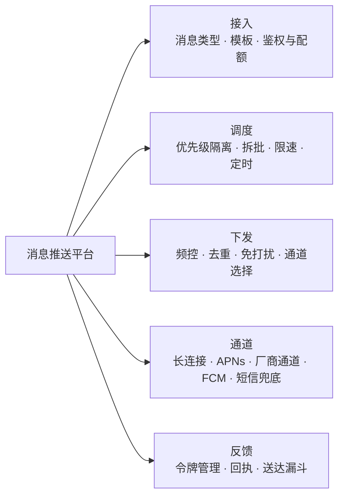
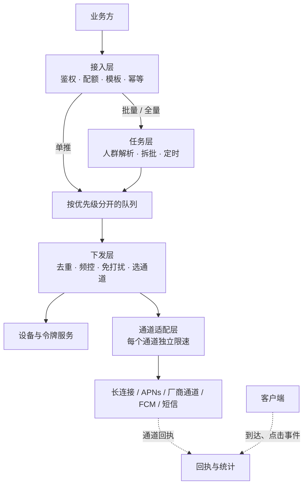
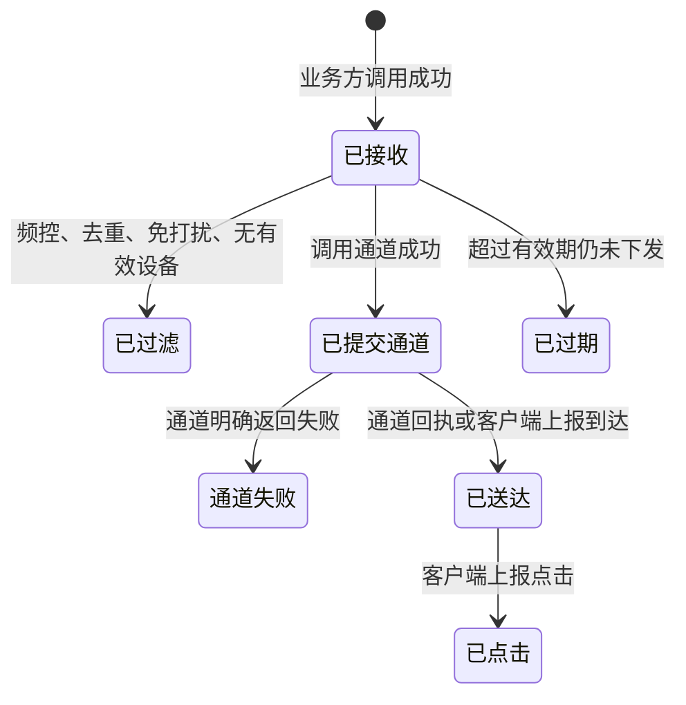
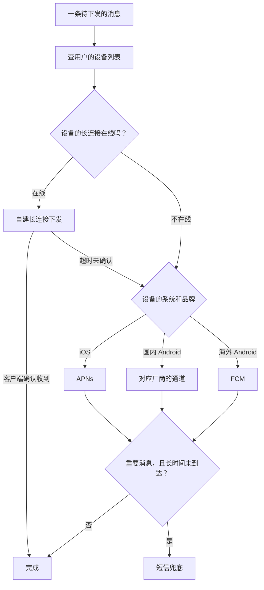
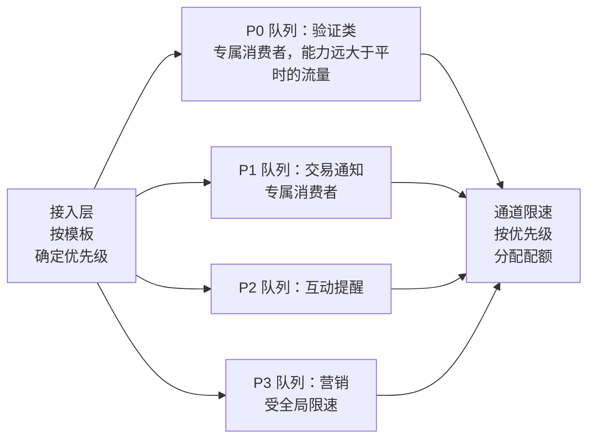
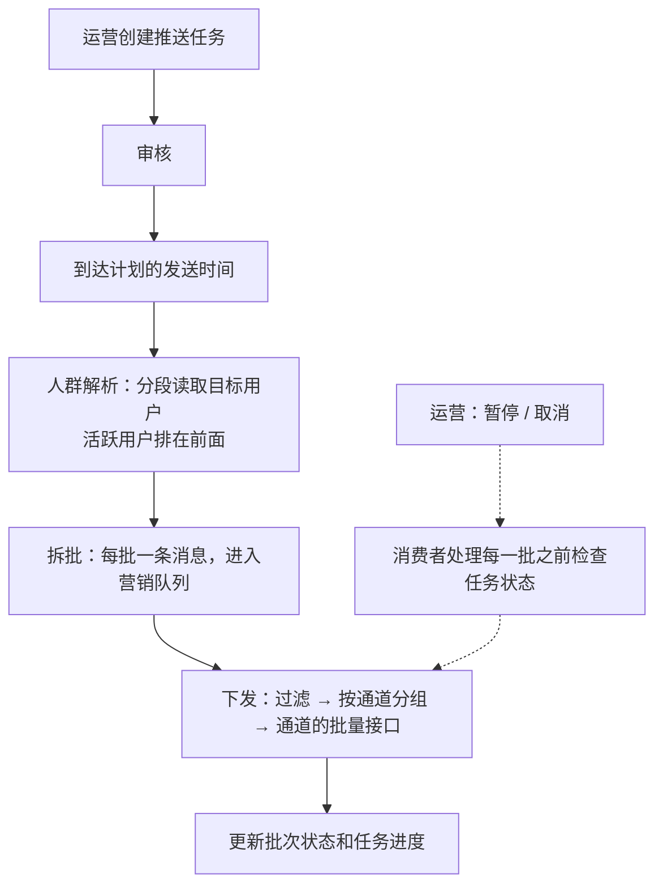
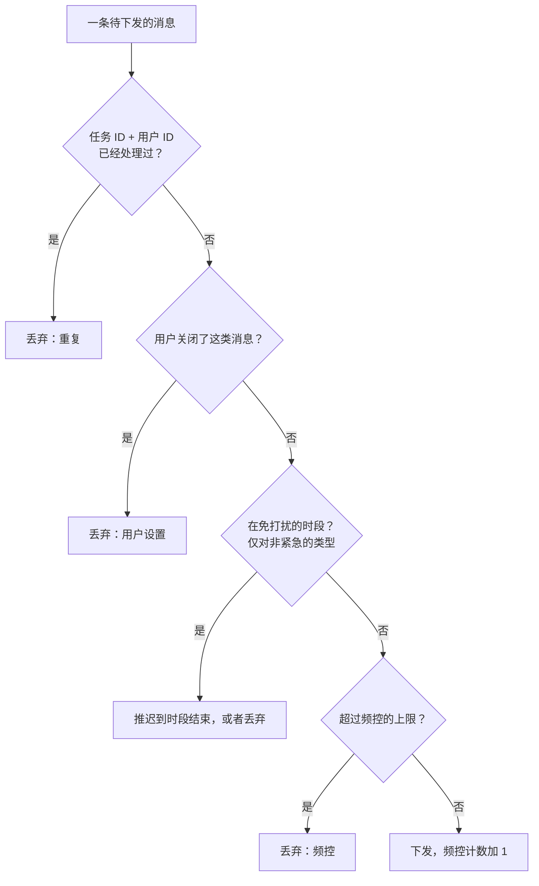
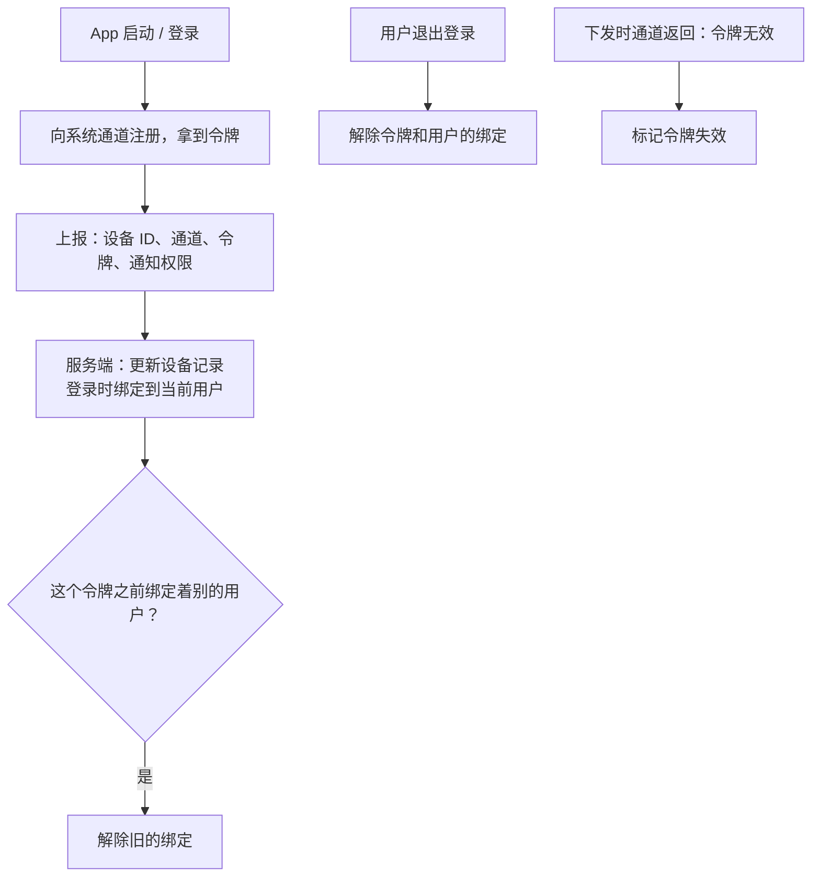
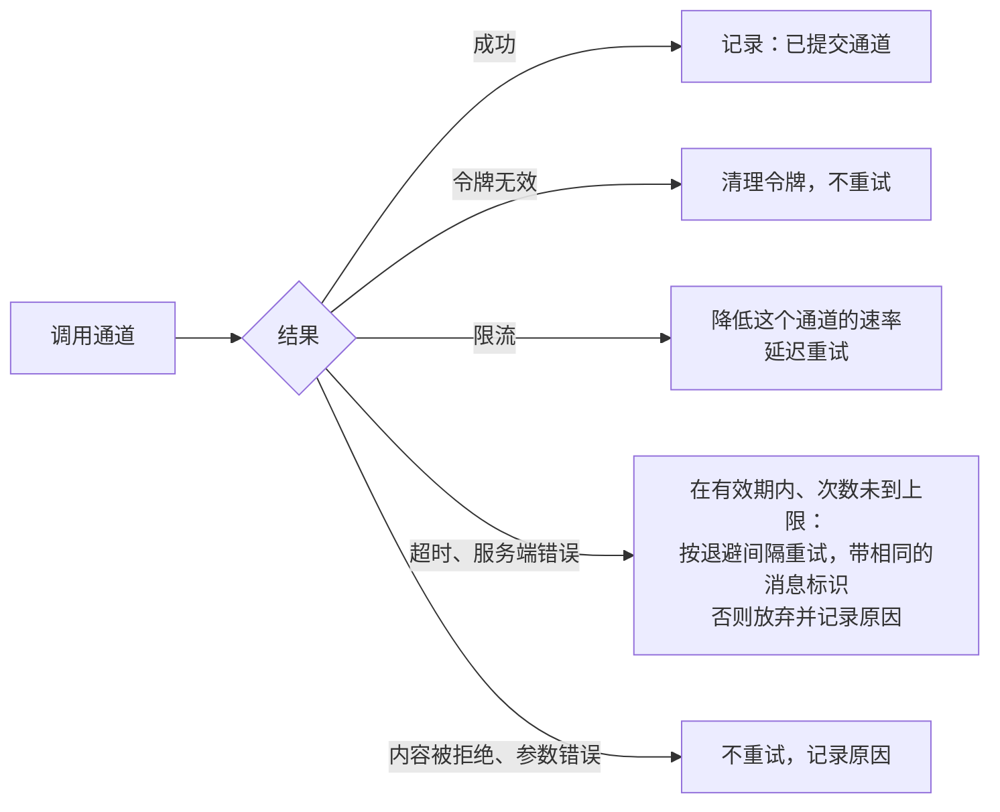
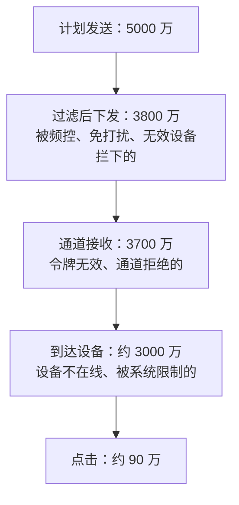

# S16 · 消息推送平台

> 适用岗位：Java 资深开发、Java 架构师。推送平台是一个典型的中台系统：各个业务把"要通知谁、通知什么"交给它，它负责选择通道、控制节奏、保证重要的消息不被不重要的消息拖累。速查版见[《29 场景题》](../06-三高与架构/29-场景题.md)的 29-14。
> 版本基线：JDK 21 / 25、Kafka 4.x 或 RocketMQ 5.x、Redis 7.x / 8.x、MySQL 8.4。
> 事实核对：
> - iOS 的远程通知只能通过苹果的 APNs 下发；海外 Android 主要使用 FCM；国内 Android 设备主要依赖各手机厂商的系统级推送通道。这些是公开的平台规则。各通道的配额、频率限制、消息分类和回执能力各不相同，而且会调整，文中只写了"有限制"，没有写具体的数字，接入时以各通道的官方文档为准。
> - 本机运行（macOS 27.2、Apple M1 Max、JDK 25）：1 段优先级隔离与下发过滤的代码只依赖 JDK，用虚拟时钟模拟，文中贴的是实际运行输出。
> 相关分类：[《20 MQ 通用与选型》](../05-消息队列/20-MQ通用与选型.md)（幂等、重试、积压）、[《26 高可用》](../06-三高与架构/26-高可用.md)（限流、隔离）、[《S13 IM 系统》](S13-IM系统.md)（长连接网关、离线推送）、[《S02 订单超时取消与延迟任务》](S02-订单超时取消与延迟任务.md)（定时下发）、[《S05 优惠券系统》](S05-优惠券系统.md)（批量任务）

## 45 分钟答题版

| 时间 | 做什么 | 要讲出的关键点 | 子题 |
| --- | --- | --- | --- |
| 0～5 分钟 | 澄清需求 | 消息的类型和优先级、推送的范围、送达和时效的要求 | S16-01 |
| 5～12 分钟 | 整体架构 | 接入、任务、队列、下发、通道适配、回执统计 | S16-02 |
| 12～20 分钟 | 通道 | 在线走长连接，离线走系统通道；通道的选择与降级 | S16-03 |
| 20～30 分钟 | 隔离与批量 | 按优先级隔离队列和资源；全量推送的拆批与限速 | S16-04、S16-05 |
| 30～38 分钟 | 用户体验 | 频率控制、去重、免打扰；设备令牌的管理 | S16-06、S16-07 |
| 38～45 分钟 | 可靠性与运营 | 重试与有效期；送达漏斗；模板与审核；高可用 | S16-08 ～ S16-10 |

## 知识地图



## 题目索引

| 编号 | 题目 | 难度 |
| --- | --- | --- |
| S16-01 | 推送平台要澄清哪些需求？ | ★★ |
| S16-02 | 整体架构怎么设计？ | ★★★ |
| S16-03 | 有哪些推送通道？一条消息走哪个通道？ | ★★★ |
| S16-04 | 怎么保证营销推送不影响验证码？ | ★★★ |
| S16-05 | 给几千万用户做一次全量推送，怎么做？ | ★★★ |
| S16-06 | 怎么避免打扰用户？频控、去重、免打扰怎么实现？ | ★★ |
| S16-07 | 设备令牌怎么管理？ | ★★ |
| S16-08 | 推送失败了怎么办？怎么保证不重复？ | ★★ |
| S16-09 | 送达率和点击率怎么统计？ | ★★ |
| S16-10 | 模板、审核和高可用要考虑什么？ | ★★ |

---

## 一、需求与架构

### S16-01 推送平台要澄清哪些需求？

> ★★ ｜ 资深 / 架构师 ｜ 中频

**考察意图**：推送平台服务的消息差别极大：验证码晚 10 秒就没用了，营销消息晚 10 分钟也无所谓。看你是否先把消息分类。

**30 秒版回答**：

- **消息的类型**决定了一切。按时效和重要性分成几类：

| 类型 | 例子 | 时效 | 能不能丢 | 量 |
| --- | --- | --- | --- | --- |
| 验证类 | 登录验证码 | 秒级，过期作废 | 不能 | 小 |
| 交易通知 | 支付成功、发货、到账 | 秒到分钟级 | 尽量不丢 | 中 |
| 互动提醒 | IM 离线消息、被点赞、被 @ | 秒到分钟级 | 可以少量丢 | 大 |
| 营销推广 | 活动、优惠券到账 | 不敏感，有活动的有效期 | 可以丢 | 极大，脉冲式 |

- **推送的范围**：单推（一个用户）、批量（一批用户）、按标签（某类人群）、全量。
- **通道**：App 通知是主要的；是否还包括短信、邮件、站内信。
- **约束**：重要的消息不能被不重要的拖慢；不能过度打扰用户；各个通道有自己的限制。
- **要问的**：日活和设备数、每天各类消息的量、全量推送要求多久发完、是否需要定时和撤回、要统计到什么程度。

**深入剖析**

本文的假设：

- 1 亿台注册设备，日活 3000 万；
- 每天的推送量：验证码和交易通知约 5000 万条，互动提醒约 3 亿条，营销约 2 亿条（集中在每天的几个时段）；
- 一次全量营销推送（面向 5000 万活跃设备）要求在 30 分钟内完成，约每秒 2.8 万条；
- 验证码从业务调用到通道接收，延迟在 1 秒以内。

推送平台和业务方的边界：

- **业务方决定**：发给谁、发什么内容、是什么类型的消息；
- **平台决定**：走哪个通道、什么时候发（限速、免打扰）、发不发（频控、去重）、失败后怎么办；
- **平台提供**：每一条消息的状态和整体的效果数据。

**追问链**

1. **为什么要做成统一的平台，而不是各个业务自己接通道？** 通道的接入很繁琐（每家的接口、鉴权、限制都不同）；通道的配额是按 App 计的，各个业务各发各的，会互相挤占而且没人能统筹；频率控制必须全局做（用户感受到的是"这个 App 一天给我推了多少条"，不是某个业务推了多少条）。这些都要求有一个统一的出口。
2. **站内信和推送是一回事吗？** 不是。站内信是 App 内部的消息列表，数据在自己的服务器上，用户打开 App 才能看到，属于一个普通的读写系统。推送是把消息送到手机的通知栏。两者常常配合：推送负责提醒，站内信负责留存。

---

### S16-02 整体架构怎么设计？

> ★★★ ｜ 架构师 ｜ 中频

**考察意图**：能否把一条推送从业务调用到用户手机的全过程拆成职责清楚的几个阶段。

**30 秒版回答**：

1. **接入层**：对业务方的 API。鉴权、配额、参数校验、模板渲染、幂等。同步返回一个消息 ID，后面全部异步。
2. **任务层**：处理批量和全量推送。解析目标人群，拆成批次，生成一条条的下发任务。支持定时、暂停、取消。
3. **队列**：按优先级分开。验证类、交易类、互动类、营销类各有自己的队列。
4. **下发层**：消费队列。对每条消息做频控、去重、免打扰的判断，查出用户的设备和令牌，选择通道，调用通道。
5. **通道适配层**：每个通道一个适配器，封装各自的接口、鉴权、限速、错误码。
6. **回执与统计**：接收通道的回执和客户端上报的事件，更新消息状态，汇总成送达漏斗。
7. **设备与令牌服务**：维护"用户 → 设备 → 各通道的令牌"。

**深入剖析**



一条消息的状态：



"已过滤"是一个重要的状态：业务方经常来问"我的消息为什么没发出去"，平台要能回答是被哪一条规则拦下的。

**追问链**

1. **接入层为什么只同步返回消息 ID？** 后面的处理涉及外部通道，耗时不可控。业务方只需要知道"平台已经收下了"。真正的结果通过状态查询或者回调得到。接入层收到请求后先持久化（写入 MQ 或者数据库），再返回成功，这样"收下了"就意味着不会丢。
2. **单推和全量推送为什么走不同的路径？** 单推是一条消息一个用户，直接进队列。全量推送是一条指令对应几千万个用户，需要先展开成几千万条下发任务，这个展开的过程本身就要拆批、限速、可暂停（S16-05）。
3. **下发层怎么扩容？** 它是无状态的消费者，增加实例即可。但下发的速度最终受通道的限制，不是加机器就能更快。所以每个通道的限速要在所有实例之间共享（集中式的令牌桶），而不是每个实例各限各的。

---

### S16-03 有哪些推送通道？一条消息走哪个通道？

> ★★★ ｜ 资深 / 架构师 ｜ 高频

**考察意图**：是否了解移动端推送的现实约束：App 在后台时，自己的长连接基本不可用，必须依赖系统的通道。

**30 秒版回答**：

- **自建长连接**：App 在前台时，自己的长连接是通的。实时性最好，没有配额限制，内容和展示完全可控。App 被切到后台或者被系统清理之后，连接很快就会断开。
- **系统级推送通道**：由手机的操作系统维持的一条公共的长连接，所有 App 的推送都通过它送达。App 没有运行也能收到。
  - **iOS**：只有苹果的 APNs；
  - **海外 Android**：主要是谷歌的 FCM；
  - **国内 Android**：各手机厂商有各自的系统推送通道，要按设备的品牌分别接入。
- **短信**：到达率高、有成本、有字数和内容的限制。用于验证码，或者作为重要通知在推送不可达时的兜底。
- **通道的选择**：
  1. App 在线（长连接可用）→ 走长连接；
  2. 不在线 → 根据设备的系统和品牌，走对应的系统通道；
  3. 重要的消息在一定时间内没有确认到达 → 降级到短信。
- **系统通道的限制**：有配额和频率的限制；消息通常要分类（通知类和运营类的限制不同）；内容要符合规范；回执的能力各不相同。这些限制决定了推送平台的很多设计。

**深入剖析**



各通道的对比：

| | 自建长连接 | 系统通道 | 短信 |
| --- | --- | --- | --- |
| App 没有运行时 | 收不到 | 能收到 | 能收到 |
| 实时性 | 最好 | 好，偶有延迟 | 秒到分钟级 |
| 成本 | 自己的服务器 | 通常免费，有配额 | 按条计费 |
| 限制 | 自己定 | 配额、频率、分类、内容规范 | 签名、模板、内容审核 |
| 回执 | 精确 | 各通道不同 | 有送达回执 |
| 展示 | 完全自定义 | 受系统通知样式的限制 | 纯文本 |

**追问链**

1. **为什么国内 Android 不能只靠自己的长连接？** 手机系统为了省电，会限制后台 App 的运行和网络。App 进入后台一段时间后，进程可能被冻结或者清理，自己的连接随之断开。系统级的通道由系统自己维持，不受这个限制。
2. **一个用户有多台设备，都推吗？** 取决于消息的类型和产品规则。验证码只推给发起操作的那台设备；交易通知推给所有登录了的设备；IM 的离线提醒在电脑端在线时可以不推手机。用户在一台设备上点开了通知，其他设备上的同一条通知最好能撤回或者标记已读。
3. **用户关闭了 App 的通知权限怎么办？** 系统通道会接收消息，但系统不展示。平台应该知道这个状态（客户端上报通知权限是否开启），对关闭了权限的设备不再下发营销类的消息，既节省配额，也让送达率的统计更真实。重要的通知可以改走短信或者站内信。

---

## 二、调度

### S16-04 怎么保证营销推送不影响验证码？

> ★★★ ｜ 架构师 ｜ 高频

**考察意图**：隔离是推送平台最重要的设计。看你是否把队列、处理资源、通道配额都考虑到了。

**30 秒版回答**：

- **问题**：一次全量营销推送瞬间产生几千万条消息。如果它和验证码在同一个队列里排队，验证码要等前面几千万条营销消息发完才能发出去，早就过期了。
- **隔离要做在三个层面**：
  1. **队列隔离**：不同优先级的消息进不同的队列（不同的 Topic）。营销消息堆积得再多，也不在验证码的队列里；
  2. **处理资源隔离**：每个队列有自己的消费者（或者独立的线程池）。高优先级的队列有**预留的处理能力**，营销消息不能占用；
  3. **通道配额隔离**：通道的限速也按优先级分配。营销推送只能使用一部分配额，剩下的留给重要的消息。
- **高优先级的队列要保持"随到随发"**：它的消费能力要远大于平时的流量，留出应对突发的余量。
- **业务方不能自己随意指定优先级**：消息的类型和优先级绑定在**模板**上，模板要审核。否则所有的业务都会把自己的消息标成最高优先级。

**深入剖析**

用虚拟时钟模拟：下发节点每秒能处理 100 条。第 0 秒来了 5000 条营销消息；同时，接下来的 60 秒里每秒到来 10 条验证码（本机 JDK 25 运行）：

```java
import java.util.ArrayDeque;
import java.util.Deque;
import java.util.HashMap;
import java.util.HashSet;
import java.util.Map;
import java.util.Random;
import java.util.Set;

/**
 * 推送平台的两个机制，用虚拟时钟模拟（一个循环代表一秒）：
 * 1. 优先级隔离：验证码和营销推送共用一个队列，与各用各的队列，验证码的等待时间差多少；
 * 2. 下发前的过滤：去重、每人每天的条数上限、夜间免打扰。
 */
public class PushPlatformDemo {

    private static final int CAPACITY_PER_SECOND = 100;      // 下发节点每秒能处理的条数
    private static final int HIGH_RESERVED_PER_SECOND = 30;  // 给高优先级预留的处理能力
    private static final int MARKETING_BATCH = 5_000;        // 第 0 秒到来的一批营销推送
    private static final int OTP_PER_SECOND = 10;            // 每秒到来的验证码
    private static final int OTP_SECONDS = 60;

    /** 消息只需要记录入队时间，用来计算等待了多久 */
    record Message(int enqueuedAt) { }

    private static void simulate(boolean isolated) {
        Deque<Message> high = new ArrayDeque<>();
        Deque<Message> low = new ArrayDeque<>();
        Deque<Message> shared = new ArrayDeque<>();
        long otpWaitTotal = 0;
        int otpWaitMax = 0;
        int otpSent = 0;
        int marketingSent = 0;
        int marketingDoneAt = -1;

        for (int now = 0; marketingSent < MARKETING_BATCH || otpSent < OTP_PER_SECOND * OTP_SECONDS; now++) {
            if (now == 0) {
                for (int i = 0; i < MARKETING_BATCH; i++) {
                    (isolated ? low : shared).add(new Message(-1));   // 入队时间为 -1，标记这是营销消息
                }
            }
            if (now < OTP_SECONDS) {
                for (int i = 0; i < OTP_PER_SECOND; i++) {
                    (isolated ? high : shared).add(new Message(now));
                }
            }
            int budget = CAPACITY_PER_SECOND;
            if (isolated) {
                // 高优先级先处理；用不完的能力让给低优先级，但低优先级永远不能占用预留的部分
                int highHandled = 0;
                while (!high.isEmpty() && budget > 0) {
                    int waited = now - high.poll().enqueuedAt();
                    otpWaitTotal += waited;
                    otpWaitMax = Math.max(otpWaitMax, waited);
                    otpSent++;
                    highHandled++;
                    budget--;
                }
                int lowBudget = Math.min(budget, CAPACITY_PER_SECOND - Math.max(highHandled, HIGH_RESERVED_PER_SECOND));
                while (!low.isEmpty() && lowBudget > 0) {
                    low.poll();
                    marketingSent++;
                    lowBudget--;
                }
            } else {
                while (!shared.isEmpty() && budget > 0) {
                    Message message = shared.poll();
                    if (message.enqueuedAt() < 0) {
                        marketingSent++;
                    } else {
                        int waited = now - message.enqueuedAt();
                        otpWaitTotal += waited;
                        otpWaitMax = Math.max(otpWaitMax, waited);
                        otpSent++;
                    }
                    budget--;
                }
            }
            if (marketingSent == MARKETING_BATCH && marketingDoneAt < 0) {
                marketingDoneAt = now;
            }
        }
        System.out.printf("%-17s: otp sent=%d, avg wait=%.1fs, max wait=%ds; marketing finished at t=%ds%n",
                isolated ? "separate queues" : "one shared queue", otpSent, otpWaitTotal / (double) otpSent,
                otpWaitMax, marketingDoneAt);
    }

    private static final int USER_COUNT = 1_000;
    private static final int DAILY_CAP = 3;
    private static final int QUIET_START_HOUR = 22;
    private static final int QUIET_END_HOUR = 8;
    private static final long RANDOM_SEED = 20261112L;

    private static boolean inQuietHours(int hour) {
        return hour >= QUIET_START_HOUR || hour < QUIET_END_HOUR;
    }

    private static void filterDemo() {
        Random random = new Random(RANDOM_SEED);
        Set<String> delivered = new HashSet<>();              // 已下发的"任务 ID + 用户 ID"，用来去重
        Map<Integer, Integer> sentToday = new HashMap<>();    // 每个用户今天已经收到的营销条数
        int sent = 0;
        int duplicate = 0;
        int overCap = 0;
        int deferred = 0;
        // 一天里有 6 个营销任务，分别在 9、12、15、18、21、23 点下发；每个任务覆盖随机的 60% 用户
        int[] taskHours = {9, 12, 15, 18, 21, 23};
        for (int task = 0; task < taskHours.length; task++) {
            for (int user = 0; user < USER_COUNT; user++) {
                if (random.nextInt(100) >= 60) {
                    continue;
                }
                // 同一条消息有 5% 的概率被重复投递（上游重试、消费者重启）
                int attempts = random.nextInt(100) < 5 ? 2 : 1;
                for (int attempt = 0; attempt < attempts; attempt++) {
                    if (!delivered.add(task + ":" + user)) {
                        duplicate++;
                    } else if (inQuietHours(taskHours[task])) {
                        deferred++;                           // 免打扰时段：推迟到早上，不计入今天的条数
                    } else if (sentToday.merge(user, 1, Integer::sum) > DAILY_CAP) {
                        overCap++;
                    } else {
                        sent++;
                    }
                }
            }
        }
        int maxPerUser = sentToday.values().stream().mapToInt(count -> Math.min(count, DAILY_CAP)).max().orElse(0);
        System.out.println("filter: sent=" + sent + ", dropped as duplicate=" + duplicate + ", dropped over daily cap=" + overCap
                + ", deferred by quiet hours=" + deferred + ", max marketing pushes per user=" + maxPerUser);
    }

    public static void main(String[] args) {
        simulate(false);
        simulate(true);
        filterDemo();
    }
}
```

```text
one shared queue : otp sent=600, avg wait=23.2s, max wait=50s; marketing finished at t=49s
separate queues  : otp sent=600, avg wait=0.0s, max wait=0s; marketing finished at t=71s
filter: sent=2580, dropped as duplicate=133, dropped over daily cap=424, deferred by quiet hours=614, max marketing pushes per user=3
```

前两行是隔离的效果：

| | 共用一个队列 | 各用各的队列 |
| --- | --- | --- |
| 验证码的平均等待 | 23.2 秒 | 0 秒 |
| 验证码的最长等待 | 50 秒 | 0 秒 |
| 营销推送完成的时间 | 第 49 秒 | 第 71 秒 |

- 共用队列时，验证码排在 5000 条营销消息的后面，最长等了 50 秒。验证码的有效期通常只有一两分钟，用户早就点了"重新发送"；
- 分开队列、并且给高优先级预留每秒 30 条的处理能力之后，验证码全部立即发出；
- 代价是营销推送从 49 秒延长到了 71 秒。这个交换完全值得：营销消息晚 20 秒没有任何影响。

演示里预留的能力（每秒 30 条）大于验证码实际的流量（每秒 10 条），多出来的 20 条在这段时间里是空闲的。这是有意为之：预留的部分是为了应对验证码的突发增长。如果允许营销消息"借用"这部分空闲的能力，就要保证高优先级的消息一来，借出去的能力能立刻收回。



**追问链**

1. **用一个支持优先级的队列行不行？** 有的 MQ 支持消息优先级，但在大量堆积的情况下效果有限，而且共用一个队列意味着共用同一组消费者和同一个存储。物理上分开的队列隔离得更彻底，也更容易分别监控和扩容。
2. **营销推送把通道的配额用完了怎么办？** 通道限速的令牌桶按优先级划分：比如营销最多使用 70% 的速率。有的通道对"通知类"和"运营类"的消息本来就分别计算配额，平台要把自己的消息类型和通道的分类对应起来。
3. **高优先级的队列也堆积了怎么办？** 这是严重的故障信号，要立即告警。常见的原因是某个通道变慢。应对：按通道隔离下发的线程（一个通道变慢不影响其他通道）；超时要短；验证码可以切换到备用的通道（比如另一家短信供应商）。

---

### S16-05 给几千万用户做一次全量推送，怎么做？

> ★★★ ｜ 资深 / 架构师 ｜ 高频

**考察意图**：大批量任务的拆分、限速、可控。这和批量发券是同一类问题，多了通道限制这个因素。

**30 秒版回答**：

- **不能在一个请求、一个循环里发完**。它是一个持续几十分钟的任务，要能看到进度、能暂停、能取消、失败了能续跑。
- **步骤**：
  1. **创建任务**：记录内容、目标人群、计划的发送时间、有效期；
  2. **人群解析**：得到目标用户的列表。全量就是所有的活跃设备；按标签就去查用户画像系统。结果不是一个巨大的列表，而是一个可以分段读取的数据集；
  3. **拆批**：每批几百到几千个用户，每批生成一条消息进入营销队列。记录每一批的状态；
  4. **下发**：消费者取出一批，逐个做过滤，按通道分组，调用通道的批量接口；
  5. **限速**：按每个通道的配额控制速度。整体的完成时间取决于最慢的那个通道。
- **发送的顺序**：活跃的用户优先。他们最可能点击，而且活动的效果有时间窗口。
- **幂等**：以"任务 ID + 用户 ID"去重。任务重跑、消息重复消费，都不会重复推送。
- **预估**：发送之前，先按各通道的设备数量和限速，算出预计要多久，判断能不能在活动开始之前发完。

**深入剖析**



完成时间的估算：5000 万台设备，分布在几个通道上。假设其中一个通道有 1500 万台设备，而它允许的速率是每秒 5000 条，那么仅这个通道就需要 3000 秒，也就是 50 分钟。**整体的完成时间由"设备数 ÷ 速率"最大的那个通道决定**，和推送平台自己有多少台机器无关。这个估算要在创建任务时就给出来。

拆批的粒度：

| 批的大小 | 好处 | 代价 |
| --- | --- | --- |
| 小（100） | 暂停和取消的响应快；一批失败重试的代价小 | 消息数量多，MQ 和状态记录的开销大 |
| 大（10000） | 消息数量少 | 一批处理的时间长；失败后重试的重复多；暂停不及时 |

通常取几百到一两千，并且让一批里的用户属于同一个通道，这样正好对应通道的一次批量调用。

**追问链**

1. **全量推送引发的点击高峰，会不会打垮后端？** 会，这是全量推送最常见的次生问题：几千万人在几分钟内收到推送，其中一部分同时打开 App，访问同一个活动页。所以推送要**有意地放慢、分散**（比如把 30 分钟的任务拉长到 1 小时），落地页要提前做好缓存和扩容。推送的速度不是越快越好。
2. **发到一半发现内容有错，怎么办？** 立即取消任务，没有下发的批次不再处理。已经送达的，部分通道支持撤回或者覆盖（用相同的通知标识再发一条修正的内容），但不能保证生效。所以上线前的审核和小范围的灰度（先发 1% 的用户）非常重要。
3. **按标签推送的人群是实时计算的吗？** 人群的规模大时，通常是提前计算好的（离线或者准实时的人群包）。推送任务引用一个人群包的 ID。要注意人群包的时效：三天前算好的"未下单用户"，到今天有些人已经下单了。对时效敏感的条件，下发时再实时校验一次。

---

## 三、下发

### S16-06 怎么避免打扰用户？频控、去重、免打扰怎么实现？

> ★★ ｜ 资深 ｜ 高频

**考察意图**：推送太多的后果是用户关闭通知权限甚至卸载，这是不可逆的损失。看你是否把克制做进了系统里。

**30 秒版回答**：

- **去重**：同一条消息不能推两次。
  - 任务内：以"任务 ID + 用户 ID"为键，下发前检查并登记；
  - 内容相同：不同的业务发了内容几乎一样的消息，按内容的指纹在一段时间内去重。
- **频率控制**：限制每个用户在一段时间内收到的消息条数。
  - 按类型分别限制：营销类每天最多 N 条，互动类每小时最多 M 条；验证码和交易通知**不受限制**；
  - 全局的上限：所有类型加起来每天不超过多少条；
  - 实现：Redis 里按"用户 + 类型 + 日期"计数，下发前自增并判断，Key 在第二天过期。
- **免打扰**：夜间（比如 22 点到 8 点）不推送营销类的消息。可以丢弃，也可以推迟到早上再发。按用户所在的时区计算。用户可以自己设置免打扰的时段和不想接收的类型。
- **合并**：短时间内的多条同类消息合并成一条（"你有 5 条新的点赞"）。
- **规则的顺序**：先去重，再判断免打扰，最后做频控。被免打扰拦下的消息不应该消耗当天的频控额度。

**深入剖析**

上面演示代码输出的第三行：

```text
filter: sent=2580, dropped as duplicate=133, dropped over daily cap=424, deferred by quiet hours=614, max marketing pushes per user=3
```

场景是 1000 个用户，一天里有 6 个营销任务（9、12、15、18、21、23 点），每个任务覆盖 60% 的用户，其中 5% 的消息被重复投递；规则是每人每天最多 3 条，22 点到 8 点免打扰：

- 133 条因为重复被丢弃；
- 614 条落在免打扰的时段（23 点的那个任务），被推迟；
- 424 条因为超过每天 3 条的上限被丢弃；
- 最终下发 2580 条，每个用户收到的营销推送**最多 3 条**。



频控的原子性：判断和计数要一起完成。`INCR` 之后判断返回值是否超过上限，超过了就不发（计数多加的那一次没有影响，或者再减回去）。不要"先 `GET` 判断，再 `INCR`"，并发时会多发。

每一条被拦下的消息都要记录原因。业务方问"为什么我的消息没到"，运营问"这次活动为什么只触达了一半的人"，答案都在这里。

**追问链**

1. **多个营销任务都想发给同一个用户，频控的额度给谁？** 先到先得是最简单的规则，但会让早上的低价值消息占掉额度，晚上的重要活动发不出去。更好的做法是给任务设置优先级，或者由一个统一的"触达策略"系统在前一天规划好每个用户今天收哪几条。
2. **免打扰时段的消息是丢弃还是推迟？** 看内容还有没有意义。"今晚 12 点结束的活动"推迟到明天早上就没用了，应该丢弃。"你的优惠券到账了"可以推迟。所以消息要带**有效期**，推迟之后过了有效期就不发了。推迟的实现用延迟任务，见[《S02 订单超时取消与延迟任务》](S02-订单超时取消与延迟任务.md)。
3. **用户的时区怎么知道？** 客户端上报设备的时区，或者根据最近活跃的时间段来推断。全球化的产品里，"早上 9 点推送"是指每个用户当地的 9 点，一个任务要按时区拆成多个时间点下发。

---

### S16-07 设备令牌怎么管理？

> ★★ ｜ 资深 ｜ 中频

**考察意图**：令牌是推送能送达的前提。看你是否把它当成一份需要持续维护的数据。

**30 秒版回答**：

- **设备令牌**：App 向系统通道注册后得到的一个标识，代表"这台设备上的这个 App"。推送时把令牌交给通道，通道据此找到设备。
- **数据模型**：用户 → 多台设备；每台设备 → 系统类型、品牌、所用的通道、令牌、通知权限是否开启、最后活跃时间。
- **令牌会变**：重装 App、系统升级、长时间未使用、通道侧的策略，都可能让令牌失效或者更换。
- **维护**：
  - **上报**：App 每次启动时，获取当前的令牌并上报给服务端。变了就更新；
  - **清理**：通道返回"令牌无效"时，立即把这个令牌标记为失效，不再向它推送；
  - **绑定关系**：用户登录时把令牌绑定到这个用户；**退出登录时解除绑定**；一个令牌同一时间只能绑定一个用户；
  - **不活跃的设备**：很久没有上报的设备，降低推送的优先级或者不再推送。
- **为什么要认真清理**：向无效的令牌推送浪费配额；有的通道会因为无效令牌的比例过高而限制推送；送达率的统计会失真。

**深入剖析**



"一个令牌同一时间只能绑定一个用户"为什么重要：一台手机上，用户 A 退出登录，用户 B 登录。如果令牌仍然绑定着 A，那么发给 A 的消息（订单通知、聊天消息）会出现在 B 正在使用的手机上。这是隐私泄露。所以登录时要检查并解除令牌原来的绑定，退出登录时要主动解绑。

设备表的规模和访问模式：1 亿台设备，按用户 ID 分片。下发时"按用户 ID 查设备"是最频繁的操作，结果适合缓存。全量推送时需要"遍历所有活跃的设备"，这要走专门的批量读取路径（按分片扫描，或者从数据仓库导出），不能走在线的查询接口。

**追问链**

1. **同一台设备会有多个令牌吗？** 会。国内的 Android 设备上，App 可能同时有厂商通道的令牌和自建长连接的标识。下发时按规则选择其中一个，避免同一条消息通过两个通道各到达一次。
2. **令牌失效了，但用户其实还在用，怎么办？** 令牌失效后，下一次 App 启动时会上报新的令牌，自然恢复。在这之间，这台设备收不到系统通道的推送。所以"App 每次启动都上报"很重要。
3. **怎么知道用户卸载了 App？** 没有直接的通知。间接的信号是通道返回令牌无效。有的通道在卸载后的一段时间内仍然接受推送而不报错，所以卸载的识别是滞后的。

---

## 四、可靠性与运营

### S16-08 推送失败了怎么办？怎么保证不重复？

> ★★ ｜ 资深 ｜ 中频

**考察意图**：推送是"尽力而为"还是"必须送达"，取决于消息的类型。看你是否按错误类型区别处理，并理解重试和重复之间的矛盾。

**30 秒版回答**：

- **按失败的原因处理**：

| 原因 | 例子 | 处理 |
| --- | --- | --- |
| 令牌无效 | 设备已卸载、令牌已更换 | 不重试，清理令牌 |
| 通道限流 | 超过了配额或者频率 | 降低速度，延迟后重试 |
| 通道暂时故障 | 超时、服务端错误 | 按退避间隔重试；持续失败则熔断这个通道 |
| 内容被拒绝 | 不符合通道的规范 | 不重试，通知业务方 |
| 参数错误 | 消息体过大 | 不重试 |

- **有效期**：每条消息都有有效期。验证码几分钟，营销消息到活动结束。**超过有效期就放弃**，不再重试。
- **重试会带来重复**：调用通道超时，不知道通道收没收到。重试的话，用户可能收到两条。
  - 有的通道支持传入一个消息的唯一标识，相同标识的消息只展示一条，或者后一条覆盖前一条。尽量使用这个能力；
  - 不支持的通道，按消息的类型决定：交易通知宁可重复也要送到；营销消息宁可不到也不要重复。
- **平台内部的重复**（MQ 重复消费、任务重跑）必须靠去重消除：以"消息 ID + 设备"为键。

**深入剖析**



"至少一次"和"至多一次"的选择：

| 消息类型 | 语义 | 原因 |
| --- | --- | --- |
| 验证码 | 至少一次，在有效期内 | 收不到就无法登录；重复了用户也只是多看到一条 |
| 交易通知 | 至少一次 | 重要；重复的影响小 |
| 互动提醒 | 尽量一次 | 重复让人厌烦，丢一条可以接受 |
| 营销 | 至多一次 | 重复是明显的打扰 |

**追问链**

1. **验证码的短信通道失败了怎么办？** 验证码是登录和交易的前提，必须有备用的通道：接入多家短信供应商，一家失败或者变慢时切换到另一家。切换的依据是各供应商实时的成功率和延迟，和支付渠道的路由是同一个思路，见[《S03 支付系统》](S03-支付系统.md)S03-10。
2. **下发节点处理到一半重启了，这一批会重复发吗？** MQ 会重新投递这一批。所以批内的每个用户在下发前都要查去重记录：已经发过的跳过，没发的继续。去重记录在调用通道**之前**写入的话，可能出现"记录了但没发出去"（少发）；在**之后**写入，可能出现"发出去了但没记录"（重复）。营销消息选前者，重要的消息选后者。
3. **通道整体不可用时怎么办？** 熔断这个通道，暂停向它下发，消息留在队列里等待恢复；有效期短的消息直接放弃或者改走其他的通道。恢复之后不要一次性把积压的全部发出去，按限速慢慢消化，并且丢弃已经过期的。

---

### S16-09 送达率和点击率怎么统计？

> ★★ ｜ 资深 ｜ 中频

**考察意图**：推送的效果是一个漏斗。看你是否清楚每一层的数据从哪里来，以及为什么"送达"很难统计准。

**30 秒版回答**：

- **漏斗**：计划发送 → 过滤后实际下发 → 通道接收 → 到达设备 → 展示 → 点击。
- **每一层的数据来源**：
  - **计划、过滤、下发**：平台自己的记录，准确；
  - **通道接收**：调用通道接口的返回，准确；
  - **到达设备**：来自通道的回执，或者客户端的上报。各通道的回执能力不同，有的没有；
  - **展示**：用户是否关闭了通知权限，通知是否被系统折叠。基本只能靠客户端上报，而 App 没有运行时上报不了；
  - **点击**：用户点击通知打开 App 时，客户端上报。相对准确。
- **统计的链路**：这些事件写入 MQ，由流处理按任务、通道、消息类型聚合，供看板和报表使用。事件量很大，不在下发的路径上同步写数据库。
- **核心指标**：送达率 = 到达 ÷ 下发；点击率 = 点击 ÷ 到达。要**按通道分别看**，因为各通道的口径不一样。

**深入剖析**



（图中的数字只是为了说明每一层会减少，不代表真实的比例。）

为什么送达率很难比较：

| 通道 | "到达"的数据怎么来 | 问题 |
| --- | --- | --- |
| 自建长连接 | 客户端收到后回确认 | 准确 |
| 有回执的系统通道 | 通道回调 | 各家对"到达"的定义不同 |
| 没有回执的系统通道 | 只能靠客户端在收到通知时上报 | App 被系统限制运行时上报不了，数据偏低 |

所以不同通道之间的送达率不能直接比较。更有意义的是看**同一个通道的趋势**：某个通道的送达率突然下降，说明令牌质量、配额或者通道本身出了问题。

**追问链**

1. **点击之后的转化（比如下单）怎么归因到这次推送？** 推送里带上任务 ID 和消息 ID。用户点击通知打开 App 时，这些参数随着打开的链接传入，之后的行为埋点里都带着它。数据分析时按这个 ID 关联。
2. **业务方怎么知道自己的某一条消息到了没有？** 平台提供按消息 ID 查询状态的接口，返回 S16-02 里的那些状态，以及被过滤或者失败的原因。重要的消息还可以配置状态回调。
3. **统计数据量很大，怎么存？** 明细事件进入数据仓库，保留有限的时间；看板用的是按任务、小时、通道聚合之后的结果，数据量小得多。单条消息的状态查询另有一份按消息 ID 索引的存储，保留期限较短。

---

### S16-10 模板、审核和高可用要考虑什么？

> ★★ ｜ 资深 / 架构师 ｜ 中频

**考察意图**：平台化的治理手段，以及推送平台自身故障时的影响范围。

**30 秒版回答**：

- **模板**：业务方不直接传完整的文案，而是使用预先定义的模板，只传变量。
  - 模板绑定了**消息类型、优先级、频控策略、可用的通道**。这是控制优先级不被滥用的关键；
  - 文案集中管理，可以统一修改和多语言；
  - 部分通道本来就要求内容使用备案过的模板。
- **审核**：营销类的模板和每一次全量推送要经过审核；内容自动检查（敏感词、链接的安全性）；大范围的推送先灰度。
- **配额**：每个业务方有调用速率和每日总量的限制，防止一个业务的问题拖垮整个平台。
- **安全**：接口鉴权；防止被用来给任意用户发送任意内容；验证码类的接口要防刷（按手机号、按 IP 限流）。
- **高可用**：
  - 接入层：收到请求先持久化再返回，下游故障不影响接收；
  - 队列：MQ 的高可用；
  - 下发层：无状态，多实例；**按通道隔离**线程池，一个通道变慢不影响其他通道；
  - 通道：重要的消息有备用通道；
  - **重点保护高优先级的链路**：故障时，优先保证验证码和交易通知，营销推送可以暂停。

**深入剖析**

| 故障 | 影响 | 应对 |
| --- | --- | --- |
| 某个系统通道变慢或不可用 | 这个通道的设备收不到推送 | 熔断；按通道隔离，不影响其他通道；重要的消息走短信 |
| 短信供应商故障 | 验证码发不出去，用户无法登录 | 多家供应商，自动切换 |
| MQ 积压 | 消息延迟 | 高优先级的队列独立，不受营销积压的影响；扩容消费者；丢弃已过期的 |
| Redis 不可用 | 频控、去重无法判断 | 重要的消息放行；营销消息暂停，宁可不发也不要失控地重复发 |
| 设备令牌服务不可用 | 查不到设备 | 缓存兜底；高优先级消息的依赖路径要最短 |
| 业务方的错误调用（死循环发消息） | 用户被轰炸 | 业务方的配额、针对单个用户的频控、异常流量的自动熔断 |

最后一行值得多说一句：推送平台的事故，很多不是"发不出去"，而是"**发多了**"或者"**发错了**"。一个循环的 bug 给同一批用户推了几十遍，或者把测试内容发给了全量用户。这类事故对用户的伤害比短暂的不可用大得多，而且无法撤回。所以平台的防线要更多地放在"限制发送"上：频控、去重、审核、灰度、紧急停止的开关。

**追问链**

1. **测试环境的推送怎么防止发到真实用户？** 测试环境使用独立的通道凭证和测试设备的白名单，只允许向白名单里的设备推送。生产环境的全量推送要有二次确认和审批。
2. **平台的监控重点是什么？** 高优先级队列的堆积和延迟（应该始终接近零）；各通道的成功率、耗时、限流次数；各层漏斗的比例；每个业务方的调用量；单个用户短时间内收到的消息数量的分布（发现轰炸）；无效令牌的比例。
3. **紧急停止怎么做？** 提供按任务、按业务方、按消息类型的开关。开关在下发层生效：消费者在调用通道之前检查，命中开关的消息直接丢弃或者保留在队列里。开关要能在几秒内对所有的实例生效（配置中心推送）。

**生产实践 / 踩坑**

- **验证码和营销共用队列**：一次大促的全量推送，让用户几分钟内收不到登录验证码。
- **重试没有带有效期**：通道恢复之后，把几小时前积压的营销消息一股脑推了出去，用户在半夜收到白天的活动通知。
- **退出登录没有解绑令牌**：上一个用户的订单通知出现在下一个用户的手机上。
- **频控的判断和计数不是原子的**：并发下发时，限制每天 3 条的用户收到了 5 条。
- **全量推送没有限速，也没有通知下游**：推送本身很顺利，点击带来的流量高峰打垮了活动页。
