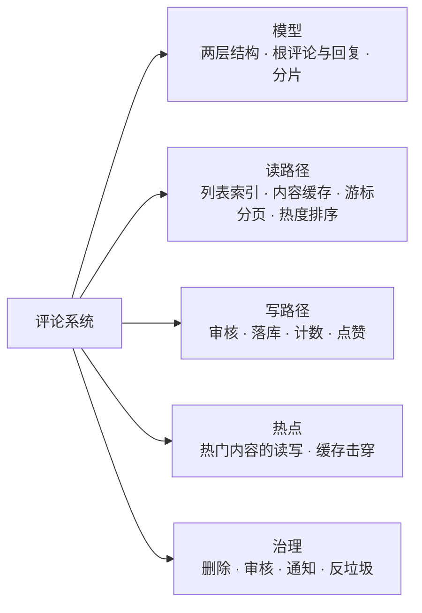
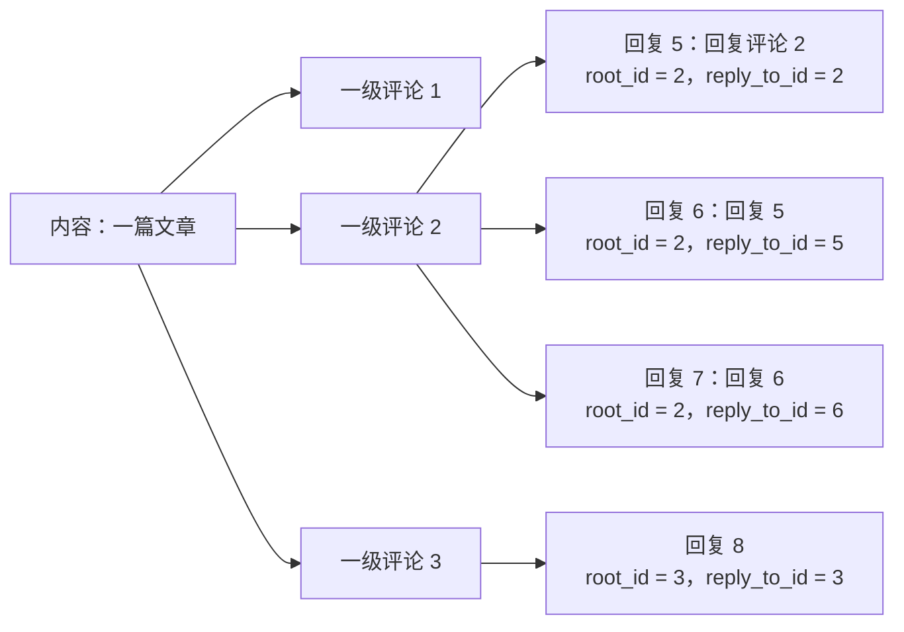
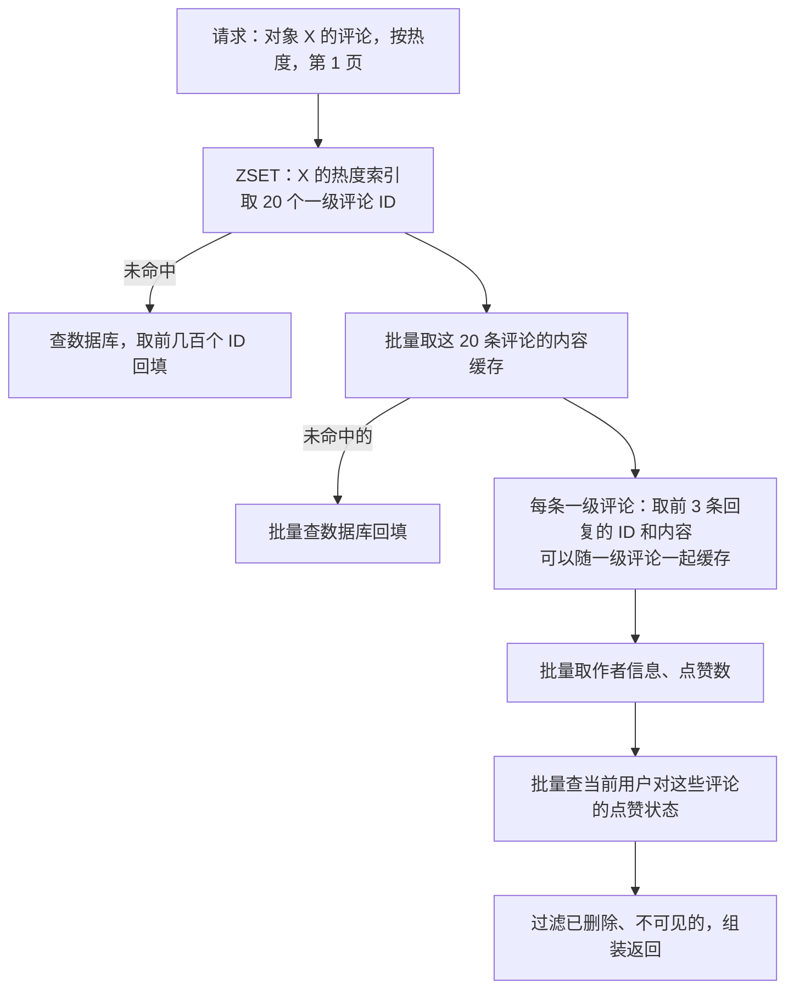
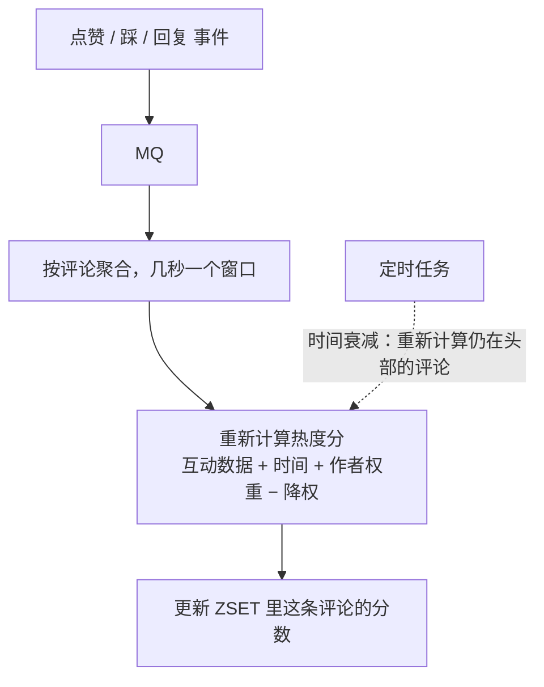
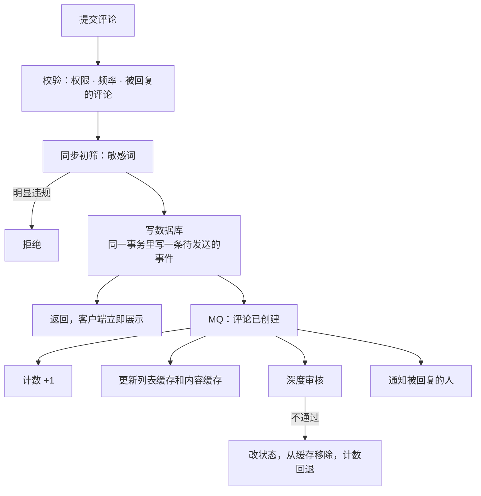
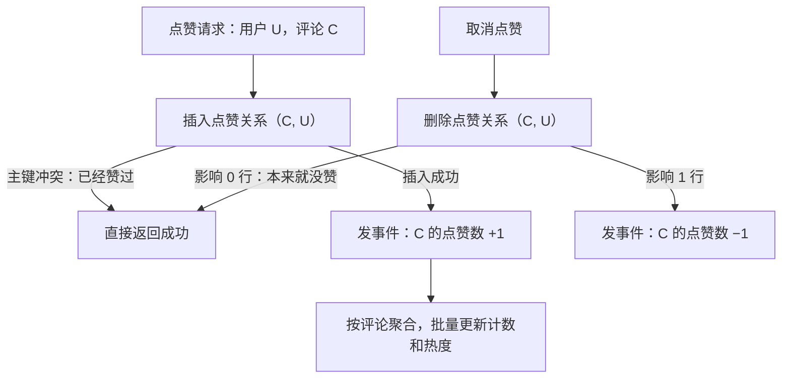
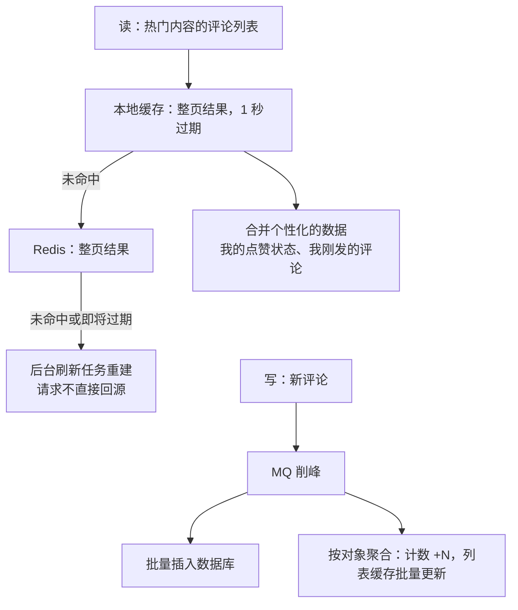
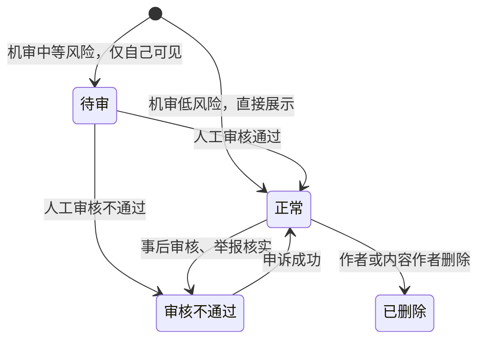
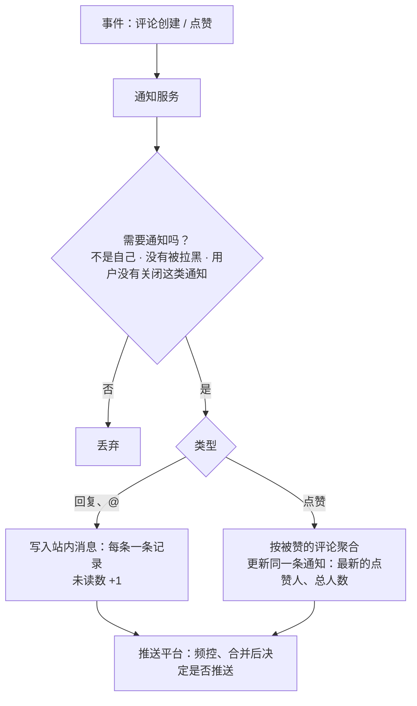

# S17 · 评论系统

> 适用岗位：Java 资深开发、Java 架构师。评论是几乎所有内容产品都有的功能：文章、视频、商品、动态下面都挂着它。这道题考察树形数据的建模、读多写少的列表缓存、热度排序，以及热点内容下的读写压力。
> 版本基线：JDK 21 / 25、MySQL 8.4、Redis 7.x / 8.x、Kafka 4.x 或 RocketMQ 5.x。
> 事实核对：
> - 威尔逊区间（Wilson score interval）下界的公式是统计学里的标准公式；用它给"赞同 / 反对"类的内容排序是一种公开的、被广泛采用的做法。文中的公式和代码一致，代码的结果做过手工验算。
> - 本机运行（macOS 27.2、Apple M1 Max、JDK 25）：1 段两层模型与热度排序的代码只依赖 JDK，文中贴的是实际运行输出。
> - 本机没有 MySQL 服务端，文中的 SQL 都没有实际执行。
> 相关分类：[《15 MySQL》](../04-数据存储/15-MySQL.md)、[《16 分库分表》](../04-数据存储/16-分库分表.md)、[《17 Redis》](../04-数据存储/17-Redis.md)（ZSET、缓存击穿、热 Key）、[《24 高并发》](../06-三高与架构/24-高并发.md)（计数、热点）、[《S12 Feed 流》](S12-Feed流.md)（游标翻页、读时过滤）、[《S16 消息推送平台》](S16-消息推送平台.md)

## 45 分钟答题版

| 时间 | 做什么 | 要讲出的关键点 | 子题 |
| --- | --- | --- | --- |
| 0～5 分钟 | 澄清需求 | 几层嵌套、怎么排序、要不要审核；读写比；热点内容 | S17-01 |
| 5～15 分钟 | 模型与存储 | 两层模型（根评论 + 平铺的回复）；按内容 ID 分片；内容和索引分开 | S17-02、S17-03 |
| 15～27 分钟 | 读路径 | 一级评论分页、每条带几条回复；列表索引用 ZSET，内容单独缓存；热度排序 | S17-04、S17-05 |
| 27～35 分钟 | 写路径 | 审核、落库、计数、通知；点赞去重和计数 | S17-06、S17-07 |
| 35～45 分钟 | 热点与治理 | 热门内容的读写压力；删除与审核；通知与反垃圾 | S17-08 ～ S17-10 |

## 知识地图



## 题目索引

| 编号 | 题目 | 难度 |
| --- | --- | --- |
| S17-01 | 评论系统要澄清哪些需求？ | ★★ |
| S17-02 | 回复的回复怎么存？要做成无限层级的树吗？ | ★★★ |
| S17-03 | 表怎么设计？怎么分库分表？ | ★★ |
| S17-04 | 评论列表怎么读？缓存怎么设计？ | ★★★ |
| S17-05 | 按热度排序怎么做？ | ★★★ |
| S17-06 | 发一条评论要经过哪些步骤？ | ★★ |
| S17-07 | 评论数、点赞数怎么计？点赞怎么去重？ | ★★ |
| S17-08 | 一个热门内容下有几十万条评论、每秒上千条新评论，怎么扛？ | ★★★ |
| S17-09 | 删除评论怎么处理？审核怎么做？ | ★★ |
| S17-10 | 被回复、被点赞的通知怎么做？怎么防刷评论？ | ★★ |

---

## 一、模型

### S17-01 评论系统要澄清哪些需求？

> ★★ ｜ 资深 ｜ 中频

**考察意图**：评论的产品形态差别很大。嵌套几层、怎么排序，直接决定了数据模型。

**30 秒版回答**：

- **嵌套**：只有一层（不能回复评论）、两层（评论 + 回复，回复都平铺在评论下面）、还是多层的树（论坛那种逐级缩进）？
- **排序**：按时间（最新或者最早）、按热度（点赞多的在前），还是两种都要？
- **审核**：先发后审，还是先审后发？
- **功能**：点赞、删除、举报、置顶、作者标记、@、图片。
- **规模**：有多少内容（文章、视频）可以被评论？每个内容下的评论数怎么分布？
- **两个特点**：
  1. **读远多于写**：看评论的人是写评论的人的几十上百倍；
  2. **分布极不均匀**：绝大多数内容只有几条评论，少数热门内容有几十万、上百万条，并且集中在很短的时间里产生。
- **评论是通用的能力**：做成一个独立的服务，文章、视频、商品都通过"业务类型 + 对象 ID"来使用它，而不是每个业务各建一套。

**深入剖析**

| 问题 | 为什么要问 | 本文的假设 |
| --- | --- | --- |
| 嵌套几层？ | 决定数据模型和查询方式 | 两层：一级评论，以及平铺在它下面的回复 |
| 怎么排序？ | 决定索引和缓存的结构 | 一级评论支持按热度和按时间；回复按时间正序 |
| 审核方式？ | 决定写路径和可见性 | 先发后审，高风险的内容先审后发 |
| 多少内容？ | 决定分片 | 10 亿个可评论的对象 |
| 评论量？ | 决定存储和写入 | 每天新增 1 亿条，约 1200 条/秒，峰值 1 万条/秒 |
| 读取量？ | 决定缓存 | 评论列表每秒 10 万次请求 |

估算：每条评论约 500 字节（含索引），每天 1 亿条约 50 GB，一年约 18 TB。必须分库分表，并且要考虑冷数据的处理：一个内容发布几天之后，就很少再有新评论，也很少有人看了。

**追问链**

1. **评论和 Feed 流、IM 消息有什么不同？** 三者都是"用户产生的短内容"，但组织方式不同：Feed 是按"我关注的人"聚合，IM 是按会话聚合，评论是按"被评论的对象"聚合。评论的读取入口只有一个（某个内容的评论列表），所以分片键很明确，就是被评论对象的 ID。
2. **为什么要做成通用的服务？** 评论的逻辑（嵌套、排序、计数、审核、反垃圾）在各个业务里是一样的，重复建设的成本很高，尤其是审核和反垃圾需要统一的能力。通用化之后，一个新的业务要支持评论，只需要申请一个业务类型。

---

### S17-02 回复的回复怎么存？要做成无限层级的树吗？

> ★★★ ｜ 资深 / 架构师 ｜ 高频

**考察意图**：树形结构的几种存储方式，以及为什么多数产品选择把树"压扁"成两层。

**30 秒版回答**：

- **不建议做无限层级的树**。在手机上，逐级缩进三四层之后就没有空间了；读取一棵深度不定的树，要么递归查询，要么一次取出全部再在内存里组装，都不适合大数据量的分页。
- **两层模型**（多数产品的选择）：
  - **一级评论**（根评论）：直接评论内容本身；
  - **回复**：所有的回复，不管回复的是一级评论还是另一条回复，都**平铺**在它所属的一级评论下面；
  - 每条回复记录两个 ID：`root_id`（它属于哪条一级评论）和 `reply_to_id`（它直接回复的是哪一条）。前者用来查询，后者用来显示"回复 某某"。
- **查询只有两种**，而且都是简单的索引查询：
  1. 某个内容下的一级评论列表：`WHERE 对象 = ? AND root_id = 0`；
  2. 某条一级评论下的回复列表：`WHERE root_id = ?`。
- 对话的上下文没有丢：通过 `reply_to_id`，仍然可以看出谁在回复谁，也可以支持"查看对话"。

**深入剖析**

用 JDK 演示两层模型的组装和下一题的热度排序（本机 JDK 25 运行）：

```java
import java.util.ArrayList;
import java.util.Comparator;
import java.util.HashMap;
import java.util.List;
import java.util.Map;

/**
 * 评论的两层模型和热度排序：
 * 1. 一级评论直接挂在内容下面；所有的回复（不管回复的是谁）都平铺在它所属的一级评论下面，用 rootId 关联；
 * 2. 热度用威尔逊区间的下界：赞同比例相同的时候，投票的人越多，分数越高。
 */
public class CommentDemo {

    /** 95% 置信度对应的 z 值 */
    private static final double Z = 1.96;

    record Comment(long id, long rootId, long replyToId, String author, String text, int likes, int dislikes) {
        boolean isRoot() {
            return rootId == 0;
        }
    }

    /** 威尔逊区间下界：对"真实的赞同比例"的一个保守估计 */
    static double wilson(int likes, int dislikes) {
        int n = likes + dislikes;
        if (n == 0) {
            return 0;
        }
        double p = (double) likes / n;
        double z2 = Z * Z;
        return (p + z2 / (2 * n) - Z * Math.sqrt((p * (1 - p) + z2 / (4 * n)) / n)) / (1 + z2 / n);
    }

    public static void main(String[] args) {
        List<Comment> comments = List.of(
                new Comment(1, 0, 0, "alice", "写得很清楚", 3, 0),
                new Comment(2, 0, 0, "bob", "第二段有个错别字", 480, 120),
                new Comment(3, 0, 0, "carol", "收藏了", 60, 2),
                new Comment(4, 0, 0, "dave", "不太同意这个结论", 9, 11),
                new Comment(5, 2, 2, "erin", "哪个字？", 12, 0),
                new Comment(6, 2, 5, "bob", "第三行的“在”应该是“再”", 30, 1),
                new Comment(7, 2, 6, "erin", "确实，谢谢", 4, 0),
                new Comment(8, 3, 3, "frank", "同收藏", 1, 0));

        // 一级评论的三种排序
        List<Comment> roots = comments.stream().filter(Comment::isRoot).toList();
        System.out.println("by likes       : " + ids(roots, Comparator.comparingInt(Comment::likes).reversed()));
        System.out.println("by like ratio  : " + ids(roots, Comparator.comparingDouble(
                (Comment c) -> (double) c.likes() / (c.likes() + c.dislikes())).reversed()));
        System.out.println("by wilson score: " + ids(roots, Comparator.comparingDouble(
                (Comment c) -> wilson(c.likes(), c.dislikes())).reversed()));
        for (Comment root : roots) {
            System.out.printf("  #%d likes=%d dislikes=%d ratio=%.2f wilson=%.3f%n", root.id(), root.likes(),
                    root.dislikes(), (double) root.likes() / (root.likes() + root.dislikes()),
                    wilson(root.likes(), root.dislikes()));
        }

        // 两层展示：按 rootId 把回复归到一级评论下面，回复按时间（这里用 ID）正序
        Map<Long, List<Comment>> repliesByRoot = new HashMap<>();
        Map<Long, Comment> byId = new HashMap<>();
        for (Comment comment : comments) {
            byId.put(comment.id(), comment);
            if (!comment.isRoot()) {
                repliesByRoot.computeIfAbsent(comment.rootId(), k -> new ArrayList<>()).add(comment);
            }
        }
        System.out.println("thread of #2:");
        Comment root = byId.get(2L);
        System.out.println("  " + root.author() + ": " + root.text());
        for (Comment reply : repliesByRoot.get(2L)) {
            // 回复的是一级评论本身就不显示"回复 xx"；回复的是另一条回复，显示被回复的人
            String target = reply.replyToId() == reply.rootId() ? "" : " 回复 " + byId.get(reply.replyToId()).author();
            System.out.println("    " + reply.author() + target + ": " + reply.text());
        }
    }

    private static List<Long> ids(List<Comment> comments, Comparator<Comment> order) {
        return comments.stream().sorted(order).map(Comment::id).toList();
    }
}
```

```text
by likes       : [2, 3, 4, 1]
by like ratio  : [1, 3, 2, 4]
by wilson score: [3, 2, 1, 4]
  #1 likes=3 dislikes=0 ratio=1.00 wilson=0.438
  #2 likes=480 dislikes=120 ratio=0.80 wilson=0.766
  #3 likes=60 dislikes=2 ratio=0.97 wilson=0.890
  #4 likes=9 dislikes=11 ratio=0.45 wilson=0.258
thread of #2:
  bob: 第二段有个错别字
    erin: 哪个字？
    bob 回复 erin: 第三行的“在”应该是“再”
    erin 回复 bob: 确实，谢谢
```

看最后五行：评论 2 下面有三条回复。其中 6 回复的是 5，7 回复的是 6，如果按树来存，它们是三层的嵌套。在两层模型里，它们的 `root_id` 都是 2，平铺在一起，按时间排列；`reply_to_id` 用来生成"bob 回复 erin""erin 回复 bob"这样的显示。



真要存一棵任意深度的树，有几种经典的做法：

| 方式 | 做法 | 查一棵子树 | 插入 | 适合 |
| --- | --- | --- | --- | --- |
| 邻接表 | 每行存 `parent_id` | 要递归查询 | 简单 | 层级浅，或者能一次全部取出 |
| 路径枚举 | 每行存从根到自己的路径，如 `1/5/6/` | `LIKE '1/5/%'`，一次查询 | 简单 | 读多写少，层级不太深 |
| 闭包表 | 另建一张表，存所有"祖先 → 后代"的关系 | 一次查询 | 要插入多行 | 需要频繁地查祖先和后代 |
| 嵌套集 | 每行存左右两个边界值 | 一次范围查询 | 要更新大量的行 | 几乎不变的树 |

两层模型可以看成"只保留根节点这一个祖先"的简化版闭包表：每条回复只记住自己的根，放弃了中间层级的结构，换来了极简的查询。

**追问链**

1. **用户想看"A 和 B 的完整对话"怎么办？** 从当前这条回复开始，沿着 `reply_to_id` 一路往上找，得到一条对话链。链上的评论都在同一个 `root_id` 下，可以先把这个根下面相关的回复取出来，在内存里串起来。
2. **被回复的那条评论删除了，下面的回复怎么显示？** `reply_to_id` 仍然保留。显示时发现被回复的评论已经删除，就显示"回复 某某（原评论已删除）"，或者不显示引用。见 S17-09。
3. **什么场景确实需要多层的树？** 讨论深度很重要的社区（技术论坛、问答），用户需要沿着某一个分支深入地看。它们通常的做法是：只加载前几层和每层的前几条，其余的折叠成"继续查看这个讨论"，点击后再以这条评论为根单独加载。数据上用邻接表加路径，读取时限制深度。

---

### S17-03 表怎么设计？怎么分库分表？

> ★★ ｜ 资深 ｜ 中频

**考察意图**：字段设计和分片键的选择。看你是否把"列表的索引"和"评论的内容"分开考虑。

**30 秒版回答**：

- **评论表**：评论 ID、业务类型、对象 ID、`root_id`、`reply_to_id`、作者、内容、状态、点赞数、回复数、创建时间。
- **分片键是"业务类型 + 对象 ID"**：一个内容下的所有评论（包括回复）在同一个分片里。评论列表的查询只落在一个分片上。
- **评论 ID 用按时间递增的全局 ID**（雪花算法）。按时间排序就是按 ID 排序；ID 里可以带上对象 ID 的分片基因，这样只有评论 ID 时也能定位到分片。
- **索引**：
  - `(对象, root_id, 评论 ID)`：一级评论按时间的列表、某个根下的回复列表，都用它；
  - `(对象, root_id, 热度分)`：一级评论按热度的列表。也可以不在数据库里建这个索引，热度的排序放在 Redis 里；
  - `(作者, 评论 ID)`：我发过的评论。这个查询和分片键的方向不同，通常另建一张按作者分片的索引表。
- **内容和索引分开**（数据量很大时）：索引表只有 ID、关系、状态、计数这些短字段，行很小，一个数据页能放很多行，列表查询很快；内容表存评论的正文，按评论 ID 查。
- **计数**不要每次 `COUNT(*)`：对象的评论总数、每条一级评论的回复数，都是冗余的计数字段。

**深入剖析**

```sql
CREATE TABLE t_comment (
    comment_id   BIGINT       NOT NULL PRIMARY KEY,
    biz_type     TINYINT      NOT NULL COMMENT '业务类型：文章、视频、商品……',
    object_id    BIGINT       NOT NULL COMMENT '被评论的对象',
    root_id      BIGINT       NOT NULL DEFAULT 0 COMMENT '所属的一级评论，0 表示自己是一级评论',
    reply_to_id  BIGINT       NOT NULL DEFAULT 0 COMMENT '直接回复的评论',
    reply_to_uid BIGINT       NOT NULL DEFAULT 0 COMMENT '被回复的用户，冗余，用于展示和通知',
    user_id      BIGINT       NOT NULL,
    content      VARCHAR(2000) NOT NULL,
    status       TINYINT      NOT NULL COMMENT '0 待审 1 正常 2 已删除 3 审核不通过 4 仅自己可见',
    like_count   INT          NOT NULL DEFAULT 0,
    reply_count  INT          NOT NULL DEFAULT 0 COMMENT '一级评论下的回复数',
    create_time  DATETIME(3)  NOT NULL,
    KEY idx_object_root (biz_type, object_id, root_id, comment_id)
);

-- 每个对象一行，保存评论的总数等汇总信息
CREATE TABLE t_comment_subject (
    biz_type      TINYINT     NOT NULL,
    object_id     BIGINT      NOT NULL,
    comment_count INT         NOT NULL DEFAULT 0 COMMENT '评论总数（含回复）',
    root_count    INT         NOT NULL DEFAULT 0 COMMENT '一级评论数',
    state         TINYINT     NOT NULL COMMENT '是否允许评论、是否精选模式',
    PRIMARY KEY (biz_type, object_id)
);
```

`idx_object_root` 一个索引支撑了两种查询：

```sql
-- 一级评论，按时间倒序，游标翻页
SELECT comment_id FROM t_comment
WHERE biz_type = ? AND object_id = ? AND root_id = 0 AND comment_id < #{cursor} AND status = 1
ORDER BY comment_id DESC LIMIT 20;

-- 某条一级评论下的回复，按时间正序
SELECT comment_id FROM t_comment
WHERE biz_type = ? AND object_id = ? AND root_id = #{rootId} AND comment_id > #{cursor} AND status = 1
ORDER BY comment_id ASC LIMIT 20;
```

**追问链**

1. **热门内容的评论全在一个分片上，会不会成为热点？** 会。一个有几百万条评论的对象，所有的读写都集中在一个分片。读的压力靠缓存挡住（S17-04）；写的压力要靠削峰（S17-08）。数据量上，几百万行在一个分片里不是问题。数据倾斜的通用处理见[《16 分库分表》](../04-数据存储/16-分库分表.md)16-12。
2. **`status` 放在查询条件里，索引里却没有它，有影响吗？** 查询先用索引定位到候选的行，再回表判断 `status`。绝大多数评论的状态是正常，被过滤掉的很少，影响不大。如果删除的比例很高，可以把 `status` 加进索引，利用索引下推在索引层过滤。
3. **老数据怎么处理？** 评论有很强的时效性：内容发布一段时间之后，几乎不再有新评论，查看的也很少。可以按对象的"最后评论时间"把冷的对象的评论迁移到成本更低的存储；缓存里只保留近期活跃的对象。

---

## 二、读路径

### S17-04 评论列表怎么读？缓存怎么设计？

> ★★★ ｜ 资深 / 架构师 ｜ 高频

**考察意图**：评论列表是读的主体。看你是否把"列表里有哪些评论"和"每条评论的内容"分开缓存，以及怎么处理翻页。

**30 秒版回答**：

- **一次请求返回什么**：一页一级评论（比如 20 条）；每条一级评论带上它的**前几条回复**（比如 2～3 条）和**回复总数**；每条评论带上作者的昵称头像、点赞数、当前用户是否点过赞。
- **更多的回复按需加载**：用户点"展开 N 条回复"时，再请求这条一级评论下的回复列表。
- **缓存分两层**：
  1. **列表索引**：某个对象下，一级评论的 ID 列表，按排序方式各存一份。用 Redis ZSET：成员是评论 ID，分数是时间（就是 ID）或者热度分；
  2. **评论内容**：按评论 ID 缓存每条评论的内容。批量读取。
- **好处**：一条评论的内容变了（被点赞、被删除），只更新它自己的缓存，不用动列表；新增一条评论，只往 ZSET 里加一个 ID。
- **只缓存头部**：ZSET 只保留前几百条。绝大多数用户只看前几页；翻得很深的请求直接查数据库。
- **翻页用游标**：按时间排序时用"上一页最后一条的 ID"，原因和 Feed 流一样（[《S12 Feed 流》](S12-Feed流.md)S12-06）。按热度排序时，顺序会变化，用偏移量加上去重，或者对这次浏览缓存一份快照。

**深入剖析**



一次请求要读的数据和各自的缓存方式：

| 数据 | 缓存方式 | 是否和用户有关 |
| --- | --- | --- |
| 一级评论的 ID 列表 | ZSET，按对象 + 排序方式 | 无关，所有人共享 |
| 评论的内容 | 按评论 ID 的 KV | 无关 |
| 每条一级评论的前几条回复 | 随一级评论缓存，或者单独一个小列表 | 无关 |
| 作者的昵称、头像 | 用户服务的缓存 | 无关 |
| 点赞数 | 计数缓存 | 无关 |
| **我是否点过赞** | 按"用户 + 评论"查 | **有关** |

前五项对所有用户都一样，可以缓存得很充分，热门内容的首屏评论甚至可以整体缓存成一份结果。只有最后一项是个性化的，要对每个登录用户单独查一次（批量）。把公共的部分和个性化的部分分开，是提高缓存命中率的关键。

**追问链**

1. **新评论发出来之后，自己能马上看到吗？** 按时间排序时，新评论的 ID 加进 ZSET，立刻在第一位。按热度排序时，新评论没有赞，排在很后面，作者自己会看不到。常见的处理是：把当前用户刚发的评论，在客户端或者服务端**插到列表的最前面**展示一次。
2. **先发后审的评论，审核通过之前别人能看到吗？** 取决于策略。常见的做法是待审的评论**只对作者自己可见**：读取列表时，公共的缓存里没有它；如果当前用户有待审的评论，单独查出来合并进去。这样作者以为发出去了，而其他人在审核通过后才看到。
3. **列表缓存和数据库怎么保持一致？** 写入时：先写数据库，再更新缓存（加 ID、更新内容）。缓存更新失败不影响主流程，靠过期时间和下一次回源修复。评论对一致性的要求不高，几秒的延迟可以接受。

---

### S17-05 按热度排序怎么做？

> ★★★ ｜ 资深 / 架构师 ｜ 中频

**考察意图**："按点赞数排序"是最容易想到的答案，也是有明显缺陷的答案。看你是否考虑了样本量和时间。

**30 秒版回答**：

- **只按点赞数**：先发的评论有更多的时间积累点赞，会一直占着前排；新的好评论永远上不来。
- **只按好评率**（赞 ÷（赞 + 踩））：一条只有 1 个赞的评论好评率是 100%，排在 1000 赞 50 踩的评论前面。样本太小，比例不可信。
- **威尔逊区间下界**：把"赞和踩"看成对"这条评论有多好"的抽样，求出真实好评率在一定置信度下的**下限**。样本越少，下限越保守（越低）；样本越多，下限越接近实际的比例。这样既考虑了比例，也考虑了有多少人投票。
- **加上时间因素**：给新评论一定的曝光机会。常见的做法是在分数里加上时间衰减，或者把最新的评论按一定比例混排进热度列表。
- **其他因素**：回复数、作者的权重（内容作者本人的回复、认证用户）、是否被作者点赞、反垃圾的降权。
- **实现**：热度分变化时更新 ZSET 的分数。点赞很频繁时不要每次点赞都算，按时间窗口合并后批量更新。

**深入剖析**

上一题代码的输出里，四条一级评论的三种排序：

| 评论 | 赞 | 踩 | 好评率 | 威尔逊下界 |
| --- | --- | --- | --- | --- |
| #1 | 3 | 0 | 1.00 | 0.438 |
| #2 | 480 | 120 | 0.80 | 0.766 |
| #3 | 60 | 2 | 0.97 | 0.890 |
| #4 | 9 | 11 | 0.45 | 0.258 |

- **按点赞数**：2、3、4、1。评论 2 靠绝对数量排第一，尽管它有 120 个踩；
- **按好评率**：1、3、2、4。评论 1 只有 3 个赞，却因为 100% 的好评率排到了第一；
- **按威尔逊下界**：3、2、1、4。评论 3（60 赞 2 踩）排第一：好评率高，而且有足够多的人投票。评论 1 的好评率虽然是 100%，但只有 3 票，下界只有 0.438，排到了后面。

公式（p 是好评率，n 是总票数，z 是置信度对应的常数，95% 时取 1.96）：

```text
下界 = ( p + z²/(2n) − z × sqrt( (p(1−p) + z²/(4n)) / n ) ) / ( 1 + z²/n )
```

n 很大时，带 n 的项都趋近于 0，下界趋近于 p；n 很小时，下界被明显地拉低。

没有"踩"的产品怎么办：很多产品只有点赞。可以把"看到了但没有点赞"当成隐含的反对，用**曝光次数**作为总数（赞 ÷ 曝光）；或者用点赞数配合时间衰减，比如 `分数 = 点赞数 ÷ (发布以来的小时数 + 2)^1.5` 这一类公式，让同样的点赞数下，新的评论分数更高。



**追问链**

1. **时间衰减意味着分数随时间自己变化，怎么更新？** 不可能每秒把所有评论的分数重算一遍。两种做法：只对还在头部（比如前几百条）的评论定时重算；或者把公式设计成"相对顺序不随时间变化"的形式（比如把发布时间作为加分项而不是除数），这样分数只在有互动时才需要更新。
2. **按热度翻页时，顺序变了，会看到重复的评论吗？** 会有少量。常见的处理：客户端记住已经展示过的评论 ID 并去重；或者第一次请求时把这次浏览的顺序固定下来（缓存一份 ID 列表的快照），翻页在快照上进行。
3. **热度排序会不会被刷？** 会，刷赞可以把一条评论顶到前面。热度的计算要接入反作弊：异常账号的点赞不计入或者降权；短时间内集中的点赞要识别。排序公式本身不需要公开。

---

## 三、写路径

### S17-06 发一条评论要经过哪些步骤？

> ★★ ｜ 资深 ｜ 中频

**考察意图**：写路径上哪些必须同步、哪些可以异步。看你是否把主流程保持得很短。

**30 秒版回答**：

- **同步的部分**（必须在返回之前完成）：
  1. 校验：登录态、是否被禁言、对象是否允许评论、被回复的评论是否存在；内容长度；频率限制；
  2. 内容安全的**同步初筛**：敏感词等很快的检查。明显违规的直接拒绝；
  3. 生成评论 ID，**写入数据库**（状态是"正常"或者"待审"）；
  4. 返回评论 ID 和内容，客户端立即展示。
- **异步的部分**（通过 MQ）：
  - 更新计数（对象的评论数、一级评论的回复数）；
  - 更新缓存（列表的 ZSET、内容缓存）；
  - 深度的内容审核（机器模型、人工）；
  - 发送通知（被回复的人、内容的作者）；
  - 同步到搜索、数据仓库。
- **幂等**：客户端为每次提交生成一个唯一的请求 ID，服务端按它去重，防止重复点击和超时重试产生两条一样的评论。
- **回复的 `root_id` 由服务端计算**：客户端只传"我回复的是哪一条"，服务端查出那一条的 `root_id`（它自己是一级评论的话，`root_id` 就是它的 ID）。

**深入剖析**



为什么计数和缓存的更新可以异步：它们都是派生数据，晚几百毫秒没有影响；而且它们是热点内容下竞争最激烈的地方（所有新评论都要更新同一个对象的计数、同一个 ZSET），异步之后可以合并更新（S17-08）。

写入时要校验的内容：

| 校验 | 说明 |
| --- | --- |
| 对象是否存在、是否允许评论 | 作者可能关闭了评论；对象可能已经删除 |
| 被回复的评论 | 是否存在、是否已经删除、是否属于同一个对象 |
| 用户的状态 | 是否被禁言、是否被这个内容的作者拉黑 |
| 频率 | 每个用户每分钟、每天的评论数上限；对同一个对象的上限 |
| 内容 | 长度、是否为空、是否和自己刚发的内容重复 |

**追问链**

1. **评论里的 @ 和表情、图片怎么存？** 正文里存结构化的标记，而不是最终展示的文本。@ 存用户 ID（昵称会变）；图片存地址。渲染由客户端完成。被 @ 的用户列表另外提取出来，用于发通知。
2. **数据库写成功了，MQ 消息没发出去怎么办？** 用本地消息表：评论和"待发送的事件"在同一个事务里写入，后台任务负责发送。或者基于 binlog 捕获评论表的变更来驱动下游。见[《20 MQ 通用与选型》](../05-消息队列/20-MQ通用与选型.md)20-09。
3. **用户可以编辑评论吗？** 多数产品不允许，或者只允许在很短的时间内编辑。允许编辑的话，要重新审核，并且要考虑"别人已经回复了旧的内容"带来的歧义，通常要标记"已编辑"。

---

### S17-07 评论数、点赞数怎么计？点赞怎么去重？

> ★★ ｜ 资深 ｜ 中频

**考察意图**：计数是高频的写操作，点赞还需要记住"谁点过"。两者的存储和一致性要求不同。

**30 秒版回答**：

- **评论数**：对象的评论总数、每条一级评论的回复数。冗余存储，评论创建和删除时增减。高并发时合并更新。
- **点赞有两份数据**：
  1. **点赞关系**：谁给哪条评论点了赞。用来去重（一人只能赞一次）、展示"我是否点过赞"、取消点赞；
  2. **点赞数**：一个计数，用来展示和排序。
- **点赞关系的存储**：表的主键是"评论 ID + 用户 ID"，唯一约束保证不重复。按评论 ID 分片（查某条评论的点赞状态），或者按用户 ID 分片（查我点过赞的评论）。
- **点赞的流程**：写点赞关系（主键冲突说明已经赞过，直接返回成功）→ 成功才给点赞数加 1。取消点赞同理：删除关系成功才减 1。**计数的增减以关系表的写入结果为准**，这样重复的请求不会重复计数。
- **"我是否点过赞"的查询**：评论列表一页 20 条，要查当前用户对这 20 条的点赞状态。一次批量查询；热门内容可以把用户最近的点赞放在 Redis 的 Set 里。
- **点赞数是可以重算的**：它等于关系表里的行数。发现不一致时可以校正。

**深入剖析**



计数的更新方式：

| 方式 | 做法 | 适合 |
| --- | --- | --- |
| 同步更新数据库 | `UPDATE ... SET like_count = like_count + 1` | 并发低 |
| Redis 计数，定期落库 | `INCR` 之后，后台任务把变化的计数批量写回数据库 | 并发高 |
| 事件聚合 | 点赞事件进 MQ，按评论聚合后批量更新 | 并发很高，热点明显 |

高频计数的通用做法见[《24 高并发》](../06-三高与架构/24-高并发.md)24-13。

点赞关系表的数据量：如果每天有 5 亿次点赞，一年就是 1800 亿行，比评论本身大得多。这是点赞系统的主要成本。对很久之前的内容，可以把点赞关系归档，只保留计数。

**追问链**

1. **点赞关系按评论分片，那"我赞过的评论"怎么查？** 两种方向的查询不能用同一张表都高效地支持。通常主表按一个方向分片，另一个方向用异步同步的副本，和订单的买家、卖家维度是同一个做法（[《S07 订单中心》](S07-订单中心.md)S07-07）。
2. **用 Redis 的 Set 存点赞关系行不行？** 可以作为缓存：每条热门评论一个 Set，存点赞的用户 ID。但一条评论有几十万个赞时是大 Key，而且 Redis 不能作为唯一的存储。常见的折中是只缓存"用户最近的点赞"，更早的查数据库或者用布隆过滤器判断。
3. **点赞数显示的和实际的差几个，要紧吗？** 展示上不要紧，用户看到的"1.2 万"本来就是概数。排序上也影响不大。所以点赞数可以用最终一致的方式维护，不必为它付出强一致的代价。

---

## 四、热点与治理

### S17-08 一个热门内容下有几十万条评论、每秒上千条新评论，怎么扛？

> ★★★ ｜ 架构师 ｜ 中频

**考察意图**：热点内容是评论系统最大的挑战。读和写都集中在一个对象上，前面的常规设计在这里会遇到瓶颈。

**30 秒版回答**：

- **读**：
  - **整页缓存**：热门内容的前几页评论，对所有用户几乎一样。把组装好的结果（除了"我是否点过赞"）整体缓存，过期时间一两秒。几十万人同时看，回源的只有极少数请求；
  - **本地缓存**：热点对象的列表缓存再放一层在应用进程内；
  - **防击穿**：缓存过期时只让一个请求去重建，其他请求返回旧的数据；或者用后台任务定时刷新，不依赖请求触发；
  - **深翻页限制**：只允许翻到一定的深度。
- **写**：
  - **评论本身的写入**：每秒上千条插入，落在同一个分片上。用 MQ 削峰，批量插入；
  - **计数和列表缓存**：所有的新评论都要更新同一个计数、同一个 ZSET。按对象聚合后批量更新；
  - **按时间排序的列表**：热门内容下新评论太多，"最新"列表每秒都在变。可以对列表做**抽样**：不是每条新评论都进入公共的列表缓存（但作者自己总能看到自己发的）。
- **隔离**：热点对象的读写放在独立的资源上，不影响其他普通的内容。热点可以是预先知道的（运营标记），也可以是实时探测出来的。

**深入剖析**



常规内容和热门内容的差别：

| | 普通内容 | 热门内容 |
| --- | --- | --- |
| 评论列表的缓存 | ID 列表 + 内容，按需回源 | 整页结果缓存 + 本地缓存，后台刷新 |
| 新评论写入 | 同步写库 | 可以先入队，批量写库，返回"已提交" |
| 计数更新 | 每条评论更新一次 | 聚合后每秒更新一次 |
| 最新列表 | 每条新评论都进入 | 抽样进入，或者延迟几秒 |
| 审核 | 先发后审 | 可以切换为先审后发，或者提高机审的严格程度 |

"先入队、批量写库"的代价：评论提交之后不是立刻落库的，客户端拿到的评论 ID 是预先生成的。这段时间内评论只存在于 MQ 里，客户端自己展示它。如果之后写库失败（或者审核不通过），用户会发现评论"消失"了。所以只在确实需要削峰的热点对象上使用这种方式。

**追问链**

1. **怎么知道一个内容成了热点？** 统计每个对象在短时间窗口内的读取次数和评论次数，超过阈值就标记为热点，切换到热点的处理方式；热度下降后恢复。热点探测的通用方法见[《24 高并发》](../06-三高与架构/24-高并发.md)24-11、[《18 本地缓存》](../04-数据存储/18-本地缓存.md)18-13。
2. **整页缓存里包含了点赞数，点赞数变了怎么办？** 一两秒的过期时间之内，点赞数是旧的，可以接受。也可以把计数从整页缓存里拆出来单独读取，整页缓存的时间就可以更长。
3. **评论区被刷屏（大量重复的垃圾评论）怎么办？** 这是写入的热点加上内容安全的问题。频率限制（每个用户、每个设备、每个 IP）、相似内容的去重（同样的文本在短时间内大量出现）、新注册账号的限制、对这个对象临时提高审核级别或者开启"精选评论"模式（只有通过筛选的评论才展示）。

---

### S17-09 删除评论怎么处理？审核怎么做？

> ★★ ｜ 资深 ｜ 中频

**考察意图**：删除不是 `DELETE`。看你是否考虑了下面的回复、计数、缓存，以及审核对可见性的影响。

**30 秒版回答**：

- **软删除**：把状态改为"已删除"，不物理删除。原因：下面的回复还引用着它；要支持申诉和恢复；审计和法务可能需要原始的内容。
- **一级评论被删除**：它下面的回复随之不可见（或者显示"该评论已删除"并保留回复，取决于产品）。回复不需要逐条改状态，读取时判断它的根评论是否被删除即可。
- **回复被删除**：这条回复不再显示。其他引用它（`reply_to_id` 指向它）的回复还在，显示时把被引用的部分处理成"原评论已删除"。
- **连带的更新**：计数减少；从列表缓存里移除；清掉内容缓存。和发评论一样，通过事件异步完成，读取时再过滤一次作为保证。
- **谁能删除**：评论的作者、被评论内容的作者、管理员。
- **审核**：
  - **先发后审**：评论先展示，审核发现问题再删除。体验好，有违规内容短暂曝光的风险；
  - **先审后发**：审核通过才展示。安全，有延迟；
  - **分级**：机器审核给每条评论一个风险分。低风险的直接通过；高风险的直接拒绝；中间的转人工，这期间仅自己可见。敏感的时期、敏感的内容下，整体提高审核的级别。

**深入剖析**



读取时的可见性判断（对每一条评论）：

| 状态 | 评论的作者本人 | 其他人 |
| --- | --- | --- |
| 正常 | 可见 | 可见 |
| 待审 | 可见 | 不可见 |
| 审核不通过 | 可见，并提示未通过；或者不可见 | 不可见 |
| 已删除 | 不可见 | 不可见 |

此外还有关系层面的规则：被我拉黑的人的评论我看不到；我被内容的作者拉黑后不能评论。这些都在读取和写入时判断，和 Feed 流的读时过滤是同一个思路（[《S12 Feed 流》](S12-Feed流.md)S12-08）。

**追问链**

1. **删除一级评论时，它下面有一万条回复，计数怎么减？** 对象的评论总数要减去"1 + 回复数"。回复数是一级评论上的冗余字段，直接读出来用，不需要去数。回复本身不改状态，读取时因为根评论已经删除而自然不可见。
2. **物理删除什么时候做？** 软删除的数据保留一段时间（比如按合规要求的期限）之后，由后台任务清理。用户注销账号时，要按规定处理他的评论（删除或者匿名化）。
3. **审核系统挂了怎么办？** 根据风险的偏好选择降级的方向：保守的做法是所有新评论进入待审（仅自己可见），审核恢复后再处理；宽松的做法是只用同步的敏感词初筛，其余的先放行，事后再审。敏感的内容或者时期应该选保守的方向。

---

### S17-10 被回复、被点赞的通知怎么做？怎么防刷评论？

> ★★ ｜ 资深 ｜ 中频

**考察意图**：评论带来的互动通知，量很大而且容易打扰用户。防刷是评论系统长期的对抗。

**30 秒版回答**：

- **通知的触发**：评论创建、点赞的事件，由通知服务订阅。评论服务不直接调用通知。
- **通知谁**：被回复的评论的作者；被 @ 的人；内容的作者（有人评论了他的内容）。自己回复自己不通知；被对方拉黑不通知。
- **两种形式**：
  - **站内的消息列表**（"回复我的""赞我的"）：每条都记录；
  - **手机推送**：要克制。交给推送平台，由它做频控和合并（[《S16 消息推送平台》](S16-消息推送平台.md)S16-06）。
- **点赞通知要合并**："张三等 128 人赞了你的评论"，而不是 128 条通知。合并的做法：按"被赞的评论"聚合，一段时间内只生成或者更新一条通知。
- **未读数**：每个用户的各类通知的未读数量。用户打开对应的列表时清零。
- **防刷**：
  - 频率限制：按用户、设备、IP，分钟级和天级；
  - 内容：重复的或者高度相似的内容、带联系方式和链接的、广告的常见模式；
  - 账号：新注册的、没有实名的、行为异常的账号，限制评论或者提高审核的级别；
  - 被举报多的评论自动折叠或者进入复审；
  - 垃圾评论的处理要让发送者"以为成功了"（仅自己可见），避免他们立刻换一种方式再试。

**深入剖析**



点赞通知的聚合：以"接收人 + 被赞的评论"为键，只保留一条通知记录，记录最近的几个点赞人和点赞的总数。新的点赞到来时更新这条记录、把它顶到列表的前面，并且只在它从"已读"变成"未读"时增加未读数。这样无论有多少人点赞，通知列表里只有一条。

反垃圾的几道防线：

| 环节 | 手段 |
| --- | --- |
| 提交之前 | 登录、实名、账号等级的门槛；验证码（对可疑的请求） |
| 提交时 | 频率限制；敏感词；重复内容检测 |
| 提交之后 | 机器模型的识别；相似内容的聚类（同一段广告被大量账号发出） |
| 展示时 | 低质量的评论降权、折叠 |
| 事后 | 举报、人工复审；对账号的处罚（禁言、封禁）；回溯清理同一批账号的历史评论 |

**追问链**

1. **通知的量很大，怎么存？** 按接收人分片，每个用户一个通知的时间线，只保留最近的一段时间或者一定的条数。模型和 IM 的时间线、Feed 的收件箱类似，是一种写扩散。
2. **大 V 发一条内容，收到几万条评论的通知，怎么办？** 对互动量很大的用户，通知要聚合得更狠（"你的内容收到了 3.2 万条新评论"），推送要关闭或者大幅地限频。产品上通常提供"只接收我关注的人的互动通知"这类设置。
3. **怎么发现一批账号在协同刷评论？** 单个账号的行为可能看起来正常，要看群体的特征：注册时间集中、设备或者 IP 聚集、发的内容相似、评论的对象相同、活跃的时间同步。这需要离线的关联分析，评论系统提供数据和处置的接口。

**生产实践 / 踩坑**

- **评论表用自增主键并且按它翻页**：分库分表之后各分片的自增 ID 互相重复，也不能跨分片排序。评论 ID 要用全局唯一并且按时间递增的 ID。
- **每次读列表都 `COUNT(*)` 评论数**：热门内容下每次都要数几十万行。计数必须冗余存储。
- **点赞数的增减不以关系表的写入结果为准**：重复的点赞请求每次都加 1，点赞数比实际的点赞人数多。
- **把"我是否点过赞"和公共的内容缓存在一起**：缓存的 Key 里带了用户 ID，命中率极低，等于没有缓存。
- **删除一级评论时同步地逐条删除它的回复**：回复多的时候接口超时。回复不需要改，读取时按根评论的状态过滤。
