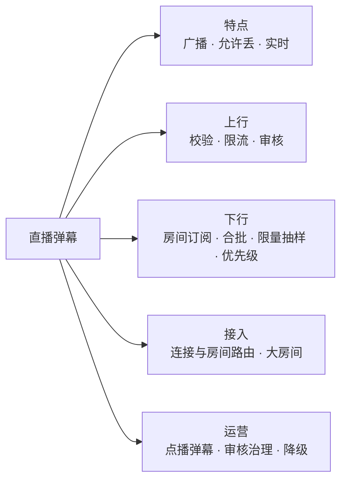
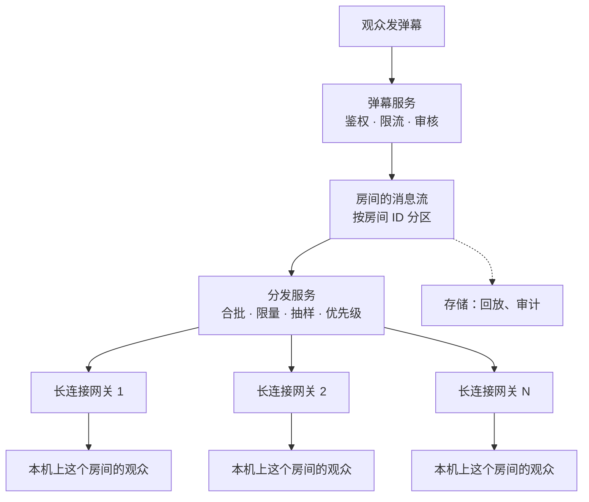
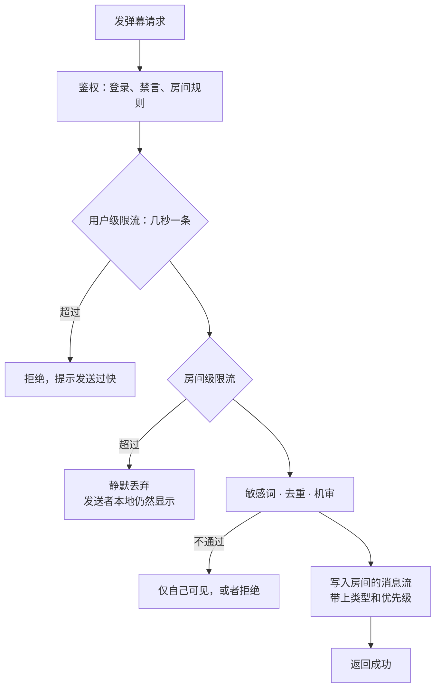
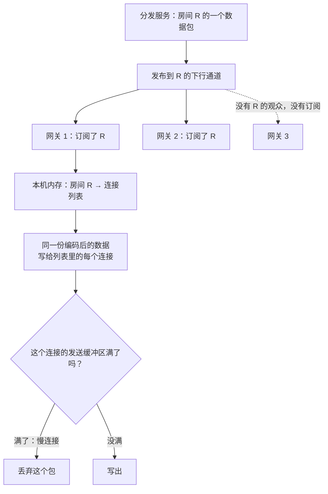
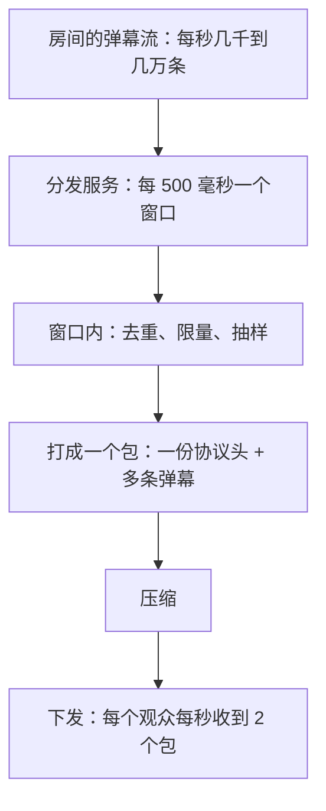
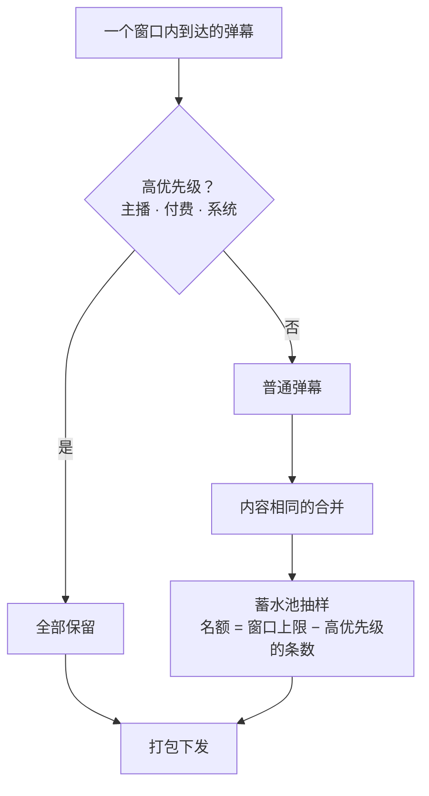
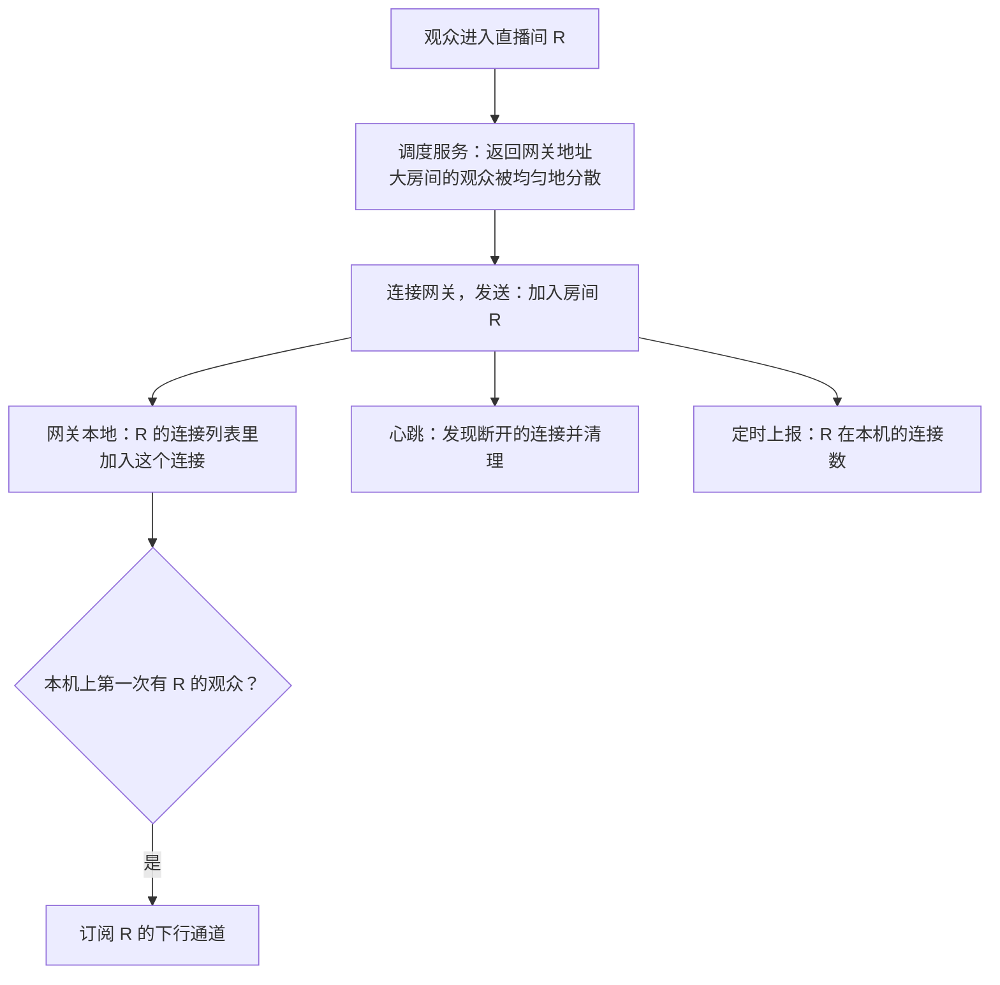
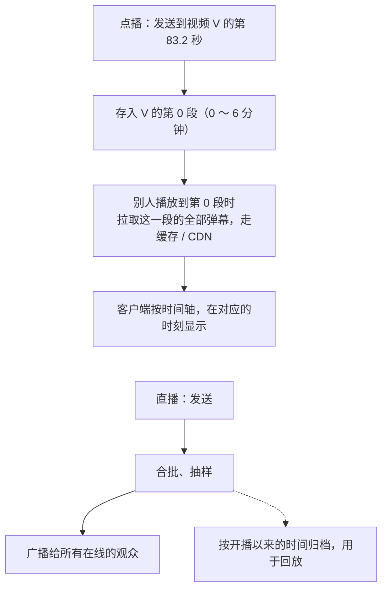
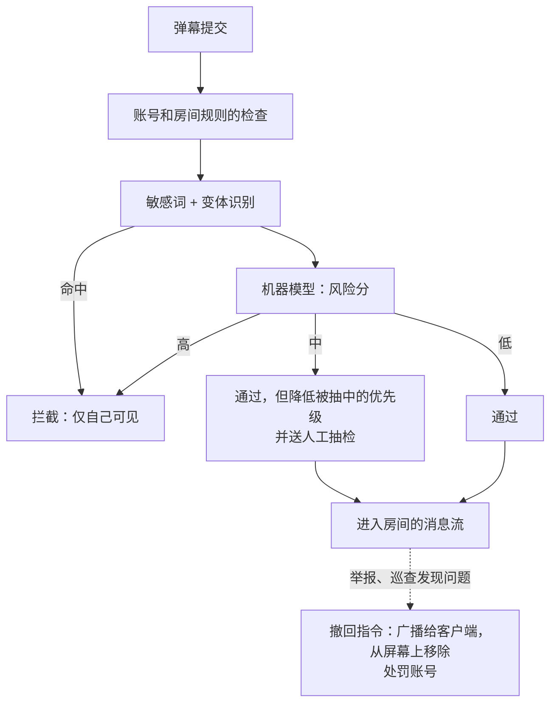
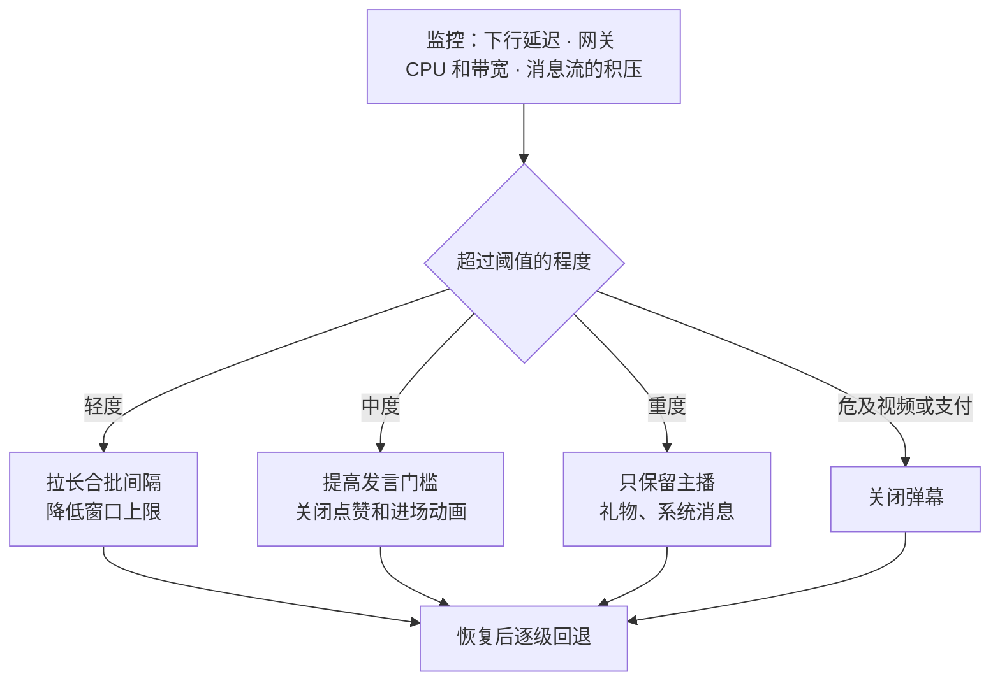

# S18 · 直播弹幕

> 适用岗位：Java 资深开发、Java 架构师。弹幕看起来像群聊，但规模和要求完全不同：一个直播间可以有上百万人同时在线，一条弹幕要广播给所有人；同时它允许丢消息。这道题考察的是大规模广播、合批、主动丢弃这些"和可靠消息相反"的设计。
> 版本基线：JDK 21 / 25、Netty 4.2、Kafka 4.x、Redis 7.x / 8.x。
> 事实核对：
> - 长连接网关的设计沿用[《S13 IM 系统》](S13-IM系统.md)和[《08 Netty》](../02-框架与容器/08-Netty.md)08-12、08-17 的结论；WebSocket 等推送方式的对比沿用[《37 计算机网络》](../08-计算机基础/37-计算机网络.md)37-19。
> - 蓄水池抽样（Reservoir Sampling）是标准算法，代码里做了等概率的验证。
> - 文中的在线人数、弹幕速率、带宽都是为了推导方案而做的假设，不是某个平台的真实数据。
> - 本机运行（macOS 27.2、Apple M1 Max、JDK 25）：1 段合批与限量抽样的代码只依赖 JDK，随机数种子固定，文中贴的是实际运行输出。
> 相关分类：[《S13 IM 系统》](S13-IM系统.md)（长连接、群聊）、[《08 Netty》](../02-框架与容器/08-Netty.md)、[《21 Kafka》](../05-消息队列/21-Kafka.md)、[《26 高可用》](../06-三高与架构/26-高可用.md)（限流、降级）、[《43 逻辑思维题》](../10-编码与思维/43-逻辑思维题.md)（概率）

## 45 分钟答题版

| 时间 | 做什么 | 要讲出的关键点 | 子题 |
| --- | --- | --- | --- |
| 0～5 分钟 | 澄清需求 | 和群聊的区别：**广播、允许丢、不需要离线和历史同步** | S18-01 |
| 5～12 分钟 | 整体架构 | 上行（发弹幕）和下行（广播）分开；房间维度的发布订阅 | S18-02 |
| 12～20 分钟 | 上行 | 校验、限流、审核，进入房间的消息流 | S18-03 |
| 20～35 分钟 | 下行 | 网关按房间订阅；**合批**；**限量和抽样**；优先级 | S18-04 ～ S18-06 |
| 35～45 分钟 | 其他 | 连接与房间的路由；点播弹幕；审核；大型活动的降级 | S18-07 ～ S18-10 |

## 知识地图



## 题目索引

| 编号 | 题目 | 难度 |
| --- | --- | --- |
| S18-01 | 弹幕和 IM 群聊有什么不同？要澄清哪些需求？ | ★★ |
| S18-02 | 整体架构怎么设计？ | ★★★ |
| S18-03 | 发一条弹幕要经过哪些处理？ | ★★ |
| S18-04 | 一条弹幕怎么送到一百万个观众？ | ★★★ |
| S18-05 | 为什么要合批下发？ | ★★★ |
| S18-06 | 弹幕太多、屏幕放不下，怎么办？ | ★★★ |
| S18-07 | 观众的连接怎么管理？大房间怎么拆？ | ★★★ |
| S18-08 | 点播视频的弹幕和直播弹幕有什么不同？历史弹幕怎么存？ | ★★ |
| S18-09 | 弹幕的审核和治理怎么做？ | ★★ |
| S18-10 | 大型直播活动怎么保障？礼物、点赞、在线人数怎么做？ | ★★★ |

---

## 一、特点与架构

### S18-01 弹幕和 IM 群聊有什么不同？要澄清哪些需求？

> ★★ ｜ 资深 / 架构师 ｜ 中频

**考察意图**：如果把弹幕当成"一个一百万人的群"来设计，方案从一开始就是错的。看你能否说出两者在要求上的根本差别。

**30 秒版回答**：

| | IM 群聊 | 直播弹幕 |
| --- | --- | --- |
| 人数 | 几百到几千 | 几万到上百万 |
| 可靠性 | 不丢、不重、有序 | **允许丢**。少看到几条弹幕没有人会察觉 |
| 离线消息 | 需要，上线后补齐 | **不需要**。进入直播间只看之后的弹幕 |
| 多端同步、已读 | 需要 | 不需要 |
| 顺序 | 严格按序号 | 大致按时间即可 |
| 时效 | 晚几秒可以接受 | 要和画面同步，晚几秒就没有意义了 |
| 历史 | 永久漫游 | 直播结束后可以不保留，或者只用于回放 |
| 压力的来源 | 连接数和存储 | **广播的扇出**：一条消息 × 在线人数 |

- **一句话**：弹幕追求的是**实时和气氛**，不是每一条都送达。所以设计的方向和 IM 相反：IM 想尽办法不丢，弹幕要**主动地、有选择地丢**。
- **要问的**：单个直播间的最高在线人数、弹幕的峰值速率、是否有付费弹幕和礼物（这些不能丢）、是否需要回放、审核的要求。

**深入剖析**

本文的假设（一场大型直播）：

- 单个直播间同时在线 100 万人；全平台同时在线 1000 万人，分布在几十万个直播间里，其中绝大多数直播间只有几十上百人；
- 热门直播间的弹幕峰值：每秒 2 万条（进球、抽奖的瞬间）；
- 一块手机屏幕，每秒能看清的弹幕也就十几二十条。

扇出的规模：

- 每秒 2 万条弹幕 × 100 万人 = 每秒 **200 亿次**投递。逐条推送是不可能的；
- 即使每秒只下发 30 条，每条 100 字节，每个观众每秒 3 KB，100 万人就是每秒 3 GB，约 24 Gbit/s 的下行带宽（压缩之前）。

这两个数字说明：**下行是整个系统的瓶颈**，要解决的是"怎么少发"。

**追问链**

1. **既然允许丢，那丢多少都可以吗？** 不是。要分清哪些可以丢：普通观众的普通弹幕可以丢；**主播的发言、付费的礼物和醒目弹幕、系统公告、自己发的弹幕**不能丢（自己发的弹幕要保证自己能看到）。丢弃是有优先级的（S18-06）。
2. **小直播间也需要这么复杂吗？** 不需要。几十个人的直播间，每条弹幕直接广播就行。难点在于同一套系统要同时服务几十人的小房间和上百万人的大房间，并且大房间的流量不能影响到小房间。

---

### S18-02 整体架构怎么设计？

> ★★★ ｜ 架构师 ｜ 中频

**考察意图**：上行和下行的流量模型完全不同。看你是否把它们分开，并用发布订阅把两者连接起来。

**30 秒版回答**：

- **上行**（发弹幕）：观众 → 弹幕服务。请求量等于弹幕的条数，每秒几万次。是普通的写请求，可以用 HTTP，也可以走长连接。
- **下行**（收弹幕）：弹幕服务 → 所有观众。必须走**长连接**，由服务端主动推送。
- **中间用"房间的消息流"连接**：
  1. 弹幕服务对上行的弹幕做校验、审核、限流，然后发布到这个房间的消息流里（MQ 的 Topic，或者按房间的发布订阅通道）；
  2. **分发服务**消费消息流，做**合批、限量、抽样**，生成一个个下行的数据包；
  3. **长连接网关**维持观众的连接。每台网关知道自己上面有哪些房间的观众，收到某个房间的数据包后，写给本机上这个房间的所有连接。
- **关键的职责划分**：消息的"瘦身"（合批、丢弃）在分发服务里做一次；网关只负责把同一个包复制给很多连接。这样无论房间里有多少人，瘦身的计算量都只和弹幕的条数有关。

**深入剖析**



一个房间的一百万观众分布在很多台网关上。分发服务把一个数据包发给"有这个房间观众的所有网关"，每台网关再在本机做最后一步的扇出。两级扇出：

| 层级 | 扇出的数量 | 谁来做 |
| --- | --- | --- |
| 分发服务 → 网关 | 几十到几百台网关 | 分发服务（或者网关各自订阅） |
| 网关 → 连接 | 每台几千到几万个连接 | 网关，在本机内存里完成 |

**追问链**

1. **发弹幕为什么可以用 HTTP？** 上行是低频的（一个观众几秒才发一条），用 HTTP 的好处是无状态、容易做负载均衡和限流，和长连接网关解耦。走长连接也可以，少一次建连，但会让网关多承担一种职责。两种做法都常见。
2. **分发服务和网关之间怎么通信？** 两种方式。推：分发服务维护"房间 → 网关列表"，把数据包逐台发给网关。拉（订阅）：每台网关根据自己上面有哪些房间，去订阅对应房间的下行通道（比如 Redis 的发布订阅、MQ 的广播消费）。房间非常多时，订阅的方式更自然：网关只关心自己有观众的房间。
3. **为什么不让网关直接消费原始的弹幕流，自己做合批和丢弃？** 可以，这样分发是去中心化的。问题是每台网关各自抽样，同一个房间的不同观众看到的弹幕就不一样了；而且原始的弹幕流量很大，每台网关都要消费全量。集中处理一次，网关拿到的已经是瘦身后的包，流量小得多，所有观众看到的内容也一致。

---

## 二、上行与下行

### S18-03 发一条弹幕要经过哪些处理？

> ★★ ｜ 资深 ｜ 中频

**考察意图**：上行链路是控制流量和内容的入口。看你是否在最前面就把无效的流量挡掉。

**30 秒版回答**：

1. **鉴权**：登录态；是否有权在这个直播间发言（被禁言、被拉黑、直播间设置了"仅粉丝可发言"）。
2. **限流**（多个维度）：
   - 每个用户：几秒一条，防止刷屏；
   - 每个房间：每秒进入处理流程的弹幕有上限。超过的直接丢弃，发送者自己仍然看得到自己的弹幕（客户端本地显示）；
   - 全局：保护系统。
3. **内容处理**：长度限制；敏感词过滤；相同内容的去重（短时间内大量相同的弹幕只保留一部分，或者合并成"×N"）。
4. **审核**：机器审核。弹幕的时效要求高，不可能等人工审核，以机审加事后处理为主。
5. **发布**：写入房间的消息流。带上弹幕的类型和优先级（普通、主播、付费、系统）。
6. **返回**：立即返回成功。客户端在收到响应之前就已经把自己的弹幕显示在屏幕上了。

**深入剖析**



房间级限流为什么是"静默丢弃"：这条弹幕即使进入了后面的流程，也很可能在限量的环节被丢掉。在入口就丢弃，节省了审核和消息流的资源。对发送者来说，他在自己的屏幕上看到了这条弹幕，体验没有区别；其他观众本来也看不完所有的弹幕。

客户端的"本地回显"：发送弹幕时，客户端不等服务端的响应，直接把弹幕画在屏幕上。服务端广播的弹幕里如果包含自己刚发的那一条，客户端要去重（按客户端生成的弹幕 ID），避免显示两次。

**追问链**

1. **弹幕要不要落库？** 不在上行的同步路径上落库。消息流（MQ）本身就是一份持久化的记录，另有消费者把它异步地写入存储，用于回放、审计和数据分析。直播弹幕的"权威记录"可以就是这份消息流的归档。
2. **限流的阈值怎么定？** 用户级的阈值是产品规则。房间级的阈值取决于下游能处理多少：既然最终每秒只下发几十条，进入处理流程的弹幕保留几百到几千条就足够用来抽样了，更多的没有意义。
3. **礼物和付费弹幕走同一条链路吗？** 不完全是。它们涉及扣费，必须可靠：先完成支付和记账（[《S09 账务与钱包》](S09-账务与钱包.md)），成功后再作为高优先级的消息进入房间的消息流。展示可以丢，钱不能错。

---

### S18-04 一条弹幕怎么送到一百万个观众？

> ★★★ ｜ 架构师 ｜ 高频

**考察意图**：大规模广播的核心。看你是否避开了"为每个观众查一次路由"这种 IM 式的做法。

**30 秒版回答**：

- **不能照搬 IM 的做法**：IM 的群消息是"取出成员列表 → 查每个人在哪台网关 → 逐个投递"。一百万人的房间，每条消息做一遍这个过程，光是查路由就做不完。
- **按房间组织，而不是按用户组织**：
  - 观众进入直播间时，客户端告诉网关"我加入了房间 R"；
  - 网关在**本机内存**里维护"房间 → 这个房间在本机的连接列表"；
  - 广播时，消息只需要标明"发给房间 R"。每台网关查自己的本地表，把数据写给对应的连接。**不需要全局的"用户 → 网关"路由表**。
- **哪些网关需要收到这个房间的消息**：
  - 网关订阅的方式：某台网关上第一次有房间 R 的观众时，它就订阅 R 的下行通道；最后一个观众离开时退订；
  - 或者维护一张"房间 → 有观众的网关集合"的表，分发服务按它投递。
- **网关内的扇出要高效**：一个数据包只**编码一次**，同一份字节数据写给所有的连接，不为每个连接重新序列化。
- **慢连接不能拖累别人**：某个观众的网络很差，发送缓冲区积压。对这种连接直接丢弃新的包（弹幕允许丢），不要等待，也不要无限地缓存。

**深入剖析**



两种"路由"的对比：

| | IM：按用户路由 | 弹幕：按房间广播 |
| --- | --- | --- |
| 路由数据 | 全局的"用户 → 网关"表 | 每台网关本地的"房间 → 连接"表 |
| 一条消息的处理 | 查出每个接收者的网关，逐个投递 | 发布到房间的通道，网关各自在本机扇出 |
| 复杂度 | 和接收人数成正比的路由查询 | 和网关数量成正比的发布 |
| 适合 | 接收者是明确的少数人 | 接收者是"所有正在看的人" |

网关内扇出的性能要点：

- **一次编码**：数据包序列化、压缩之后得到一份字节数据，所有的连接共享它。Netty 里用引用计数的缓冲区，写给多个 Channel 时共享底层的内存，不复制；
- **不阻塞**：遍历几万个连接逐个写入，要在事件循环线程里以非阻塞的方式进行；连接很多时把遍历切分成小段，避免长时间占住线程；
- **水位线**：每个连接有发送缓冲区的高水位线。超过高水位线的连接是慢连接，这一个包对它直接跳过。背压的机制见[《08 Netty》](../02-框架与容器/08-Netty.md)08-12。

**追问链**

1. **用 Redis 的发布订阅做下行通道行不行？** 可以，它天然是"按频道广播"的模型，网关订阅自己关心的房间频道。它的特点是不持久化、不保证送达：订阅者断开的那一小段时间里的消息就没了。弹幕恰好可以接受这一点。规模很大时，单个 Redis 实例的发布订阅有吞吐上限，要按房间分散到多个实例上。也可以用 MQ 的广播消费模式。
2. **观众切换直播间时怎么处理？** 客户端发"离开房间 A""加入房间 B"。网关更新本地的映射，必要时调整订阅。连接本身不需要断开。
3. **一台网关上某个大房间有十万个连接，扇出会不会太慢？** 一个包写给十万个连接，即使每次写入只要几微秒，也要几百毫秒，会影响下一个包。所以单台网关承载的连接数要按广播的负载来规划（而不是按 IM 那样的空闲连接来规划），大房间的观众要分散到更多的网关上；网关内部用多个事件循环线程并行地扇出。

---

### S18-05 为什么要合批下发？

> ★★★ ｜ 资深 / 架构师 ｜ 高频

**考察意图**：合批是把下行压力从"和弹幕数成正比"变成"和时间成正比"的关键一步。看你是否能把这个道理讲透。

**30 秒版回答**：

- **不合批**：每条弹幕一次推送。下行的推送次数 = 每秒的弹幕数 × 在线人数。弹幕越多，压力越大，而且是在最热闹的时候压力最大。
- **合批**：分发服务每隔一个固定的时间（比如 500 毫秒），把这段时间内的弹幕打成**一个包**下发。下行的推送次数 = 每秒的包数 × 在线人数，**和弹幕的数量无关**。
- **代价**：弹幕最多晚一个合批的间隔才被看到。500 毫秒的延迟对弹幕来说感知不到。
- **额外的好处**：
  - 一个包里有多条弹幕，**压缩的效果更好**（弹幕的文本有很多重复的内容）；
  - 每个包只有一份协议头，省去了逐条发送时重复的头部开销；
  - 网络上的小包变少，系统调用变少。
- 合批之后，每个包里的弹幕条数还要有上限，这就是下一题的限量。

**深入剖析**

```java
import java.util.ArrayList;
import java.util.List;
import java.util.Random;

/**
 * 直播弹幕的两个关键处理：
 * 1. 合批：把一小段时间内的弹幕打成一个包下发，下行的推送次数只和"在线人数 × 每秒的包数"有关；
 * 2. 限量：每个时间窗口最多下发 K 条。高优先级的全部保留，其余的用蓄水池抽样随机保留。
 */
public class DanmakuDemo {

    private static final int ONLINE = 1_000_000;
    private static final int BATCH_INTERVAL_MS = 500;
    private static final int WINDOW_LIMIT = 30;          // 每个窗口最多下发的条数
    private static final long RANDOM_SEED = 20261113L;

    record Danmaku(int id, boolean highPriority) { }

    /** 蓄水池抽样：不知道总数的情况下，从一个流里等概率地选出 k 个 */
    static final class Reservoir {
        private final int capacity;
        private final Random random;
        private final List<Danmaku> items = new ArrayList<>();
        private int seen;

        Reservoir(int capacity, Random random) {
            this.capacity = capacity;
            this.random = random;
        }

        void offer(Danmaku item) {
            seen++;
            if (items.size() < capacity) {
                items.add(item);
                return;
            }
            // 第 n 个元素以 capacity / n 的概率进入，随机替换掉一个已有的
            int slot = random.nextInt(seen);
            if (slot < capacity) {
                items.set(slot, item);
            }
        }

        List<Danmaku> items() {
            return items;
        }
    }

    /** 一个窗口的处理：高优先级全部保留；剩下的名额给普通弹幕做抽样 */
    static List<Danmaku> selectForWindow(List<Danmaku> arrived, Random random) {
        List<Danmaku> selected = new ArrayList<>();
        for (Danmaku danmaku : arrived) {
            if (danmaku.highPriority()) {
                selected.add(danmaku);
            }
        }
        int quota = Math.max(0, WINDOW_LIMIT - selected.size());
        if (quota > 0) {
            Reservoir reservoir = new Reservoir(quota, random);
            for (Danmaku danmaku : arrived) {
                if (!danmaku.highPriority()) {
                    reservoir.offer(danmaku);
                }
            }
            selected.addAll(reservoir.items());
        }
        return selected;
    }

    public static void main(String[] args) {
        Random random = new Random(RANDOM_SEED);

        // 1. 合批前后的下行推送次数（每秒）
        int[] ratesPerSecond = {50, 500, 5_000, 20_000};
        int batchesPerSecond = 1000 / BATCH_INTERVAL_MS;
        System.out.println("online=" + ONLINE + ", batch interval=" + BATCH_INTERVAL_MS + "ms, window limit=" + WINDOW_LIMIT);
        System.out.println("danmaku/s   pushes/s without batching   pushes/s with batching");
        for (int rate : ratesPerSecond) {
            System.out.printf("%-11d %-27d %d%n", rate, (long) rate * ONLINE, (long) batchesPerSecond * ONLINE);
        }

        // 2. 每个窗口限量下发：普通弹幕抽样，高优先级（主播、礼物）全部保留
        System.out.println("window   arrived   high priority   sent   high priority sent   dropped");
        int[] arrivals = {20, 200, 2_500, 10_000};
        int id = 0;
        for (int window = 0; window < arrivals.length; window++) {
            List<Danmaku> arrived = new ArrayList<>();
            int high = 0;
            for (int i = 0; i < arrivals[window]; i++) {
                boolean highPriority = random.nextInt(1000) < 2;    // 约 0.2% 是高优先级
                high += highPriority ? 1 : 0;
                arrived.add(new Danmaku(id++, highPriority));
            }
            List<Danmaku> sent = selectForWindow(arrived, random);
            long highSent = sent.stream().filter(Danmaku::highPriority).count();
            System.out.printf("%-8d %-9d %-15d %-6d %-20d %d%n", window, arrived.size(), high, sent.size(), highSent,
                    arrived.size() - sent.size());
        }

        // 3. 验证蓄水池抽样是等概率的：1000 条里选 30 条，重复 20000 次，统计几个位置被选中的比例
        int streamSize = 1_000;
        int rounds = 20_000;
        int[] hits = new int[streamSize];
        for (int round = 0; round < rounds; round++) {
            Reservoir reservoir = new Reservoir(WINDOW_LIMIT, random);
            for (int i = 0; i < streamSize; i++) {
                reservoir.offer(new Danmaku(i, false));
            }
            for (Danmaku danmaku : reservoir.items()) {
                hits[danmaku.id()]++;
            }
        }
        System.out.printf("reservoir sampling: expected %.2f%%, position 0 = %.2f%%, 500 = %.2f%%, 999 = %.2f%%%n",
                WINDOW_LIMIT * 100.0 / streamSize, hits[0] * 100.0 / rounds, hits[500] * 100.0 / rounds,
                hits[999] * 100.0 / rounds);
    }
}
```

本机运行输出（JDK 25，随机数种子固定）：

```text
online=1000000, batch interval=500ms, window limit=30
danmaku/s   pushes/s without batching   pushes/s with batching
50          50000000                    2000000
500         500000000                   2000000
5000        5000000000                  2000000
20000       20000000000                 2000000
window   arrived   high priority   sent   high priority sent   dropped
0        20        0               20     0                    0
1        200       0               30     0                    170
2        2500      3               30     3                    2470
3        10000     20              30     20                   9970
reservoir sampling: expected 3.00%, position 0 = 3.15%, 500 = 3.01%, 999 = 2.94%
```

前半部分是合批前后的对比（100 万人在线，500 毫秒一个包）：

| 每秒的弹幕数 | 不合批：每秒的推送次数 | 合批：每秒的推送次数 |
| --- | --- | --- |
| 50 | 5000 万 | 200 万 |
| 500 | 5 亿 | 200 万 |
| 5000 | 50 亿 | 200 万 |
| 20000 | 200 亿 | 200 万 |

合批之后，无论弹幕是每秒 50 条还是 2 万条，推送的次数始终是 200 万次（每个观众每秒 2 个包）。系统的负载从"随着热度暴涨"变成了"只和在线人数有关的一个固定值"，容量规划也因此变得简单。



合批的间隔怎么选：

| 间隔 | 延迟 | 每秒的包数 | 说明 |
| --- | --- | --- | --- |
| 100 毫秒 | 几乎无感 | 10 | 推送次数多，适合人数少的房间 |
| 500 毫秒 | 基本无感 | 2 | 常用的折中 |
| 1～2 秒 | 能感觉到弹幕和画面不同步 | 0.5～1 | 人数极多、需要进一步降低负载时 |

间隔可以按房间的规模动态调整：小房间用短间隔（甚至不合批），大房间用长间隔。高峰期还可以临时拉长间隔来降级。

**追问链**

1. **客户端收到一个包里的 30 条弹幕，一下子全显示出来吗？** 不是。客户端把它们放进本地的队列，在接下来的一个间隔里均匀地、错开地释放到屏幕上，并且避开已经被占用的弹幕轨道。服务端控制"发什么"，客户端控制"怎么显示"。
2. **弹幕和视频画面怎么同步？** 直播的视频流本身有几秒到十几秒的延迟（编码、分发、播放器缓冲），而弹幕走的是另一条更快的通道。结果可能是弹幕先到、画面后到（观众在进球之前先看到了"进了"的弹幕）。处理办法是给弹幕加一个和视频延迟相当的延时，或者按视频流里的时间戳对齐。这是产品体验上的细节，面试时提到会加分。
3. **合批是在分发服务做还是在网关做？** 分发服务。同一个房间合批一次，所有的网关拿到的都是同一个包。如果在网关做，每台网关都要各自缓冲和打包，重复劳动，而且各台网关的包边界不一致。

---

### S18-06 弹幕太多、屏幕放不下，怎么办？

> ★★★ ｜ 资深 / 架构师 ｜ 高频

**考察意图**：主动丢弃是弹幕系统区别于 IM 的地方。看你是否能做到"丢得公平、丢得有选择"。

**30 秒版回答**：

- **事实**：屏幕每秒能展示的弹幕有限（十几到几十条），观众也看不过来。每秒 2 万条弹幕，全部下发既没有意义，也发不动。
- **限量**：每个时间窗口最多下发 K 条。超过的丢弃。
- **丢哪些**：
  - **高优先级的不丢**：主播的发言、付费的礼物和醒目弹幕、系统公告、房管的消息；
  - **普通弹幕随机抽样**：在所有普通弹幕里等概率地选出剩余的名额。不能简单地"只保留前 K 条"，那样网络快的人的弹幕永远被选中，后到的永远被丢。
- **蓄水池抽样**：窗口内的弹幕是陆续到达的，事先不知道总数。蓄水池抽样可以在只遍历一遍、只用 K 个位置的情况下，保证每一条被选中的概率相同。
- **自己发的弹幕自己一定能看到**：靠客户端的本地回显，不占服务端的名额。
- **其他减量的手段**：内容相同的弹幕合并（"666 ×358"）；按观众的设置在客户端过滤（屏蔽词、只看某类弹幕）。

**深入剖析**

演示代码输出的中间部分（每个窗口最多下发 30 条，约 0.2% 的弹幕是高优先级的）：

| 窗口 | 到达 | 其中高优先级 | 下发 | 下发的高优先级 | 丢弃 |
| --- | --- | --- | --- | --- | --- |
| 0 | 20 | 0 | 20 | 0 | 0 |
| 1 | 200 | 0 | 30 | 0 | 170 |
| 2 | 2500 | 3 | 30 | 3 | 2470 |
| 3 | 10000 | 20 | 30 | 20 | 9970 |

- 弹幕少的时候（窗口 0）全部下发，没有丢弃；
- 弹幕多的时候，下发的数量被限制在 30 条，其余的丢弃；
- **高优先级的全部保留**：窗口 3 里的 20 条高优先级弹幕都在下发的 30 条里，普通弹幕只分到了剩下的 10 个名额，从 9980 条里抽出 10 条。

最后一行验证了抽样的公平性：从 1000 条里抽 30 条，重复 2 万次，第 1 条、第 501 条、第 1000 条被选中的比例分别是 3.15%、3.01%、2.94%，都在理论值 3% 附近。**先到的和后到的被选中的机会相同**。

蓄水池抽样的过程（容量是 K）：

1. 前 K 条直接放入；
2. 第 n 条（n > K）到来时，以 K ÷ n 的概率选中它；选中的话，随机替换掉蓄水池里的一条；
3. 流结束时，蓄水池里的 K 条就是结果。可以证明每一条最终留在池子里的概率都是 K ÷ 总数。



**追问链**

1. **高优先级的弹幕本身就超过上限了怎么办？** 一场大型活动里礼物可能刷屏。高优先级内部再分级：金额大的礼物单独展示，小额的礼物合并成"某某等 N 人送出了礼物"。礼物的展示通常走独立的通道和独立的展示区域，不和普通弹幕争名额。
2. **不同的观众看到的弹幕一样吗？** 抽样在分发服务集中做的话，所有观众看到的是同一批。也可以有意做成不一样：比如优先展示观众关注的人、同城的人发的弹幕，这需要在网关或者客户端做个性化的筛选，成本更高。
3. **被丢弃的弹幕，发送者知道吗？** 不知道，也不需要知道。他在自己的屏幕上看到了自己的弹幕。从系统的角度，这条弹幕仍然被记录在了消息流里（用于审核和统计），只是没有广播给别人。
4. **抽样会不会让审核变得没有意义：违规的弹幕可能恰好被抽中？** 抽样在审核之后进行。进入抽样的弹幕都已经通过了机审。

---

## 三、接入与存储

### S18-07 观众的连接怎么管理？大房间怎么拆？

> ★★★ ｜ 架构师 ｜ 中频

**考察意图**：直播的连接模型和 IM 的差别，以及超大房间带来的集中问题。

**30 秒版回答**：

- **连接**：观众进入直播间时建立长连接（网页用 WebSocket，App 用 TCP 或者 WebSocket），发送"加入房间"；离开时发送"离开房间"或者直接断开。同样需要心跳来发现断开的连接。
- **连接可以是匿名的**：未登录的游客也能看弹幕（不能发）。所以连接不一定绑定用户，网关管理的是"连接 → 房间"的关系。
- **网关的本地状态**：房间 → 连接列表。连接断开时从列表里移除。
- **在线人数**：每台网关定时上报各个房间在本机的连接数，汇总得到房间的在线人数。它是一个近似值，不需要精确。
- **大房间的问题**：一个房间一百万人，如果连接集中在少数几台网关上，这些网关的广播负载会非常高。
  - **分散**：调度服务在分配网关时，把大房间的观众均匀地分到很多台网关上；
  - **专用的网关池**：预先知道的大型活动，使用独立的一组网关，和其他直播间隔离；
  - **逻辑分区**：把一个大房间在逻辑上拆成多个子房间（分片），每个子房间有自己的下行通道，分别由不同的分发实例处理。观众按某种规则（比如连接 ID 取模）落到某个子房间。对观众来说仍然是同一个直播间。

**深入剖析**



把大房间拆成子房间的好处：

| 问题 | 不拆 | 拆成 N 个子房间 |
| --- | --- | --- |
| 分发服务 | 一个实例处理这个房间的全部下行 | N 个实例各处理一个子房间 |
| 下行通道 | 一个通道，所有相关的网关都订阅 | N 个通道，流量分散 |
| 故障的影响 | 这个通道或者实例出问题，全房间收不到弹幕 | 只影响一个子房间的观众 |
| 灰度和实验 | 难 | 可以对某个子房间用不同的策略 |

子房间之间的内容：上行的弹幕进入的是整个房间的消息流，每个子房间的分发实例都从它消费，各自独立地抽样。所以不同子房间的观众看到的弹幕可能不完全相同，但高优先级的内容（主播、礼物、公告）每个子房间都会全部下发。

**追问链**

1. **直播间里几十万人同时进入（开播的瞬间），连接建得过来吗？** 这是建连的洪峰：TLS 握手非常消耗 CPU。应对：大型活动提前预约、提前建连（进入等待页时就把长连接建好）；网关限制新建连接的速率，客户端失败后随机退避再重试；网关按峰值预留容量。和 IM 的重连风暴是同一类问题（[《S13 IM 系统》](S13-IM系统.md)S13-11）。
2. **在线人数为什么是近似的？** 精确的在线人数需要对连接去重（同一个用户开了多个页面）、实时汇总，成本高而意义不大。展示的在线人数或者"热度"本来也常常经过了运营上的加工。统计的独立观众数用 HyperLogLog 这类近似算法，见[《40 数据结构》](../08-计算机基础/40-数据结构.md)40-07。
3. **观众的网络从 Wi-Fi 切到移动网络，连接断了怎么办？** 客户端自动重连并重新加入房间。断开期间的弹幕不需要补（弹幕没有"离线消息"）。这比 IM 简单得多：重连之后不需要同步任何东西。

---

### S18-08 点播视频的弹幕和直播弹幕有什么不同？历史弹幕怎么存？

> ★★ ｜ 资深 ｜ 中频

**考察意图**："弹幕"其实有两种形态。看你是否能分清，并为点播弹幕设计出按时间轴读取的存储。

**30 秒版回答**：

- **直播弹幕**：实时产生、实时广播。所有观众在同一个时刻看到同一批弹幕。核心是广播。
- **点播弹幕**（视频网站）：弹幕绑定在**视频的时间轴**上。你在视频的第 83 秒发了一条弹幕，之后任何人看到第 83 秒时都会看到它。它不是实时广播，而是**存下来、按播放进度拉取**。
- **点播弹幕的存储**：
  - 每条弹幕记录：视频 ID、**出现在视频的第几毫秒**、内容、样式、发送者、发送时间；
  - 读取：按"视频 ID + 时间段"拉取。把视频切成固定长度的段（比如每 6 分钟一段），客户端播放到哪一段就拉哪一段的弹幕；
  - 每一段的弹幕是相对稳定的数据，非常适合缓存，热门视频的弹幕段可以直接放到 CDN 上。
- **点播弹幕的限量**：一个热门视频的某一秒可能累积了几万条弹幕。同样要限量：每一段只保留一定数量的弹幕（"弹幕池"有容量上限），超出时按规则淘汰（保留新的、质量高的、被点赞多的）。
- **直播的历史弹幕**（回放）：直播结束后，把直播期间的弹幕按"相对于开播的时间"保存下来，回放时就变成了点播弹幕的模型。

**深入剖析**



| | 直播弹幕 | 点播弹幕 |
| --- | --- | --- |
| 时间的含义 | 现实的时间 | 视频里的时间 |
| 传输 | 长连接推送 | 按段拉取，可以走 HTTP 和 CDN |
| 是否持久化 | 可选，为了回放和审计 | 必须，这是它的本质 |
| 读写比 | 一条弹幕广播给当时在线的人 | 一条弹幕被之后所有的观看者读取，读远多于写 |
| 新弹幕的实时性 | 核心要求 | 别人晚一些看到没有关系；自己发的靠本地回显 |
| 限量 | 每个时间窗口抽样 | 每段的弹幕池有容量上限 |

点播弹幕的表结构：

```sql
CREATE TABLE t_video_danmaku (
    id          BIGINT       NOT NULL PRIMARY KEY,
    video_id    BIGINT       NOT NULL,
    segment     INT          NOT NULL COMMENT '第几段，每段 6 分钟',
    offset_ms   INT          NOT NULL COMMENT '出现在视频的第几毫秒',
    user_id     BIGINT       NOT NULL,
    content     VARCHAR(100) NOT NULL,
    style       INT          NOT NULL COMMENT '颜色、位置、字号的编码',
    status      TINYINT      NOT NULL,
    create_time DATETIME(3)  NOT NULL,
    KEY idx_video_segment (video_id, segment, offset_ms)
);
```

**追问链**

1. **点播视频有新弹幕时，缓存的那一段怎么更新？** 新弹幕写入数据库，同时让这一段的缓存失效或者异步重建。热门视频的弹幕段可以设置较短的缓存时间（比如一两分钟）；冷门视频可以更长。正在观看的人看不到刚发的别人的弹幕，下次进入或者缓存刷新后才能看到，这是可以接受的。有的平台对正在观看的人会通过长连接补充推送最新的弹幕。
2. **弹幕池满了，淘汰哪些？** 按产品规则：通常保留较新的；被举报的、低质量的优先淘汰；高级弹幕、UP 主的弹幕保护。这是一个带优先级的定长集合。
3. **弹幕的数据量有多大？** 一条弹幕很小（几十到一百多字节）。热门的平台每天几千万到几亿条。直播弹幕的归档可以用成本较低的存储（按直播场次打包、压缩后放到对象存储），因为它只在回放时被整段地读取。

---

## 四、治理与保障

### S18-09 弹幕的审核和治理怎么做？

> ★★ ｜ 资深 ｜ 中频

**考察意图**：弹幕是公开的实时内容，量大、时效高，又在直播这种容易出问题的场景里。看你是否有分层的治理手段。

**30 秒版回答**：

- **难点**：弹幕要求实时，不能等人工审核；量非常大；违规内容一旦广播出去就被几十万人看到了，无法撤回。
- **事前**：
  - 账号门槛：登录、实名、账号等级、是否绑定手机；新注册的账号限制发言；
  - 直播间的规则：仅粉丝、仅关注超过一定时间的用户可以发言；
- **事中**（同步，毫秒级）：
  - 敏感词库；变体的识别（谐音、拆字、夹杂符号）；
  - 机器模型给出风险分：低风险的通过；高风险的拦截（仅自己可见）；
  - 频率和重复内容的限制；
- **事后**：
  - 举报和人工复审；
  - 房管和主播可以禁言、踢出、撤回；
  - 对违规的账号处罚，并回溯它的历史弹幕；
- **应急**：一键关闭某个直播间的弹幕；全站切换到更严格的审核级别；"仅主播和房管可发言"。这些开关要能在几秒内生效。
- **用户侧的控制**：屏蔽词、屏蔽某个用户、关闭弹幕、只看某类弹幕。在客户端过滤，不增加服务端的负担。

**深入剖析**



"仅自己可见"是内容治理里常用的手法：被拦截的弹幕，发送者在自己的屏幕上照常看到，以为发出去了，实际上没有广播。这样可以避免刷屏者发现被拦截后立刻换一种写法再试。

撤回：已经广播出去的弹幕，可以再广播一条"撤回某条弹幕"的指令，客户端收到后把它从屏幕和本地的列表里移除。直播弹幕在屏幕上只停留几秒，撤回往往来不及；它更主要的作用是在回放和记录里去掉这条弹幕。

**追问链**

1. **机审的延迟会不会影响弹幕的实时性？** 敏感词匹配是微秒级的（用 AC 自动机这类多模式匹配算法，见[《40 数据结构》](../08-计算机基础/40-数据结构.md)40-12）。机器模型的推理通常在几十毫秒内。这部分延迟加上合批的间隔，总的延迟仍然在一秒以内。模型服务超时的话，按预设的策略降级（放行或者拦截）。
2. **审核服务不可用时怎么办？** 取决于风险的偏好。保守的做法：只保留敏感词过滤，并且临时提高发言的门槛（只允许高等级的账号）；最保守的做法是暂时关闭弹幕。大型活动期间应该选保守的方向。
3. **怎么对付有组织的刷屏？** 单条弹幕可能看起来正常，要看整体：短时间内大量内容相同或者相似的弹幕、来自新注册账号的集中发言。对这类模式做实时的聚类检测，命中后对这批账号限流或者禁言，对相似的内容整体降权。

---

### S18-10 大型直播活动怎么保障？礼物、点赞、在线人数怎么做？

> ★★★ ｜ 架构师 ｜ 中频

**考察意图**：是否有大型活动的保障意识，以及是否清楚弹幕之外的几种实时互动各自的可靠性要求。

**30 秒版回答**：

- **弹幕不是核心链路**。直播的核心是视频能看、礼物能送（收入）。弹幕出问题时，应该降级甚至关闭，而不是拖累视频和支付。所以它和核心链路要在资源上隔离。
- **事前**：
  - 容量预估：预计的在线人数 → 需要的网关数、带宽、分发服务的规模；
  - 压测：用模拟的连接和弹幕流量，验证在目标人数下的延迟和资源占用；
  - 预留和隔离：大型活动使用专用的网关池和消息通道；
  - 预案和开关：准备好每一级降级的开关，并且演练过。
- **降级的手段**（由轻到重）：
  1. 拉长合批的间隔（500 毫秒 → 1 秒 → 2 秒）；
  2. 降低每个窗口下发的上限；
  3. 提高发言的门槛，减少上行；
  4. 关闭非核心的互动（进场提示、点赞动画）；
  5. 只保留主播、礼物、系统消息，关闭普通弹幕；
  6. 完全关闭弹幕。
- **其他的实时互动**，按可靠性分成三类：
  - **礼物**：涉及钱，**必须可靠**。先扣费记账，再广播特效。走独立的、高优先级的通道；
  - **点赞、进场、关注提示**：量极大、**完全可以丢**。客户端合并上报（"这 2 秒我点了 37 次赞"），服务端只广播聚合后的数字；
  - **在线人数、热度**：定时刷新的**状态**，不是事件。每隔几秒广播一次最新的值，丢了一次也没关系。

**深入剖析**

| 互动类型 | 量 | 能不能丢 | 上行的处理 | 下行的处理 |
| --- | --- | --- | --- | --- |
| 普通弹幕 | 大 | 能 | 限流、审核 | 合批、抽样 |
| 礼物、付费弹幕 | 中 | 不能（钱不能错；展示尽量不丢） | 先支付记账，成功后才进入广播 | 高优先级，全部下发；小额的合并 |
| 点赞 | 极大 | 能 | 客户端合并，几秒上报一次累计的次数 | 只广播总数的增量 |
| 进场提示 | 大 | 能 | — | 抽样，或者只展示高等级用户的进场 |
| 在线人数、热度 | 定时 | 能 | 网关上报连接数 | 每几秒广播一次当前的值 |
| 主播的状态、公告、连麦信令 | 小 | 不能 | — | 高优先级；关键的状态在加入房间时主动拉取一次 |



礼物为什么"展示可以丢，钱不能错"：礼物的流程是先调用支付和账务完成扣费（幂等、可靠），成功之后才产生一条"礼物消息"进入广播。即使这条广播因为某种原因没有送达所有的观众，账已经记对了，主播的收益不受影响。反过来绝对不行：不能先广播特效、后扣费。

**追问链**

1. **要监控哪些指标？** 端到端的延迟（从发送到观众收到）；每个房间的上行速率和被限流、被丢弃的比例；分发服务的处理延迟和消息流的积压；每台网关的连接数、出口带宽、CPU、慢连接的比例；新建连接的速率；各级降级开关的状态。
2. **某个网关宕机了，上面的观众怎么办？** 连接断开，客户端重连到其他的网关并重新加入房间。期间错过的弹幕不补。对观众来说是弹幕空了一两秒。要防的是重连的洪峰，客户端要随机退避。
3. **状态类的信息（比如当前是否在连麦、当前的投票结果）丢了怎么办？** 状态和事件要区别对待。事件丢了就丢了；状态必须能恢复。做法是：观众加入房间时，主动拉取一次房间的当前状态；状态变化时广播；并且周期性地重新广播完整的状态。这样即使错过了某一次变化，下一个周期也会被纠正。

**架构师加分点**

- 这道题最有价值的一句话是：**不是所有的消息都需要可靠送达**。先把互动的内容按"能不能丢"分类，再为每一类选择合适的手段：能丢的用合批、抽样、聚合，把成本降到和在线人数成正比的一个固定值；不能丢的（钱、关键状态）走独立的可靠链路。把 IM 的可靠消息机制套在弹幕上，是一种"过度设计"，而且在这个规模下根本跑不动。

**生产实践 / 踩坑**

- **把直播间当成一个大群，逐个查路由、逐个投递**：人数一多就完全发不动。要按房间广播。
- **每条弹幕单独推送**：热点时刻的推送量是平时的几百倍，网关瞬间被打满。必须合批。
- **限量时只保留每个窗口的前 K 条**：网络好的用户的弹幕总被选中。要用随机抽样。
- **慢连接上无限地缓存待发送的数据**：几万个弱网的连接各积压了几 MB，网关内存耗尽。慢连接直接丢包。
- **弹幕和礼物共用一条通道、同一套限量逻辑**：高峰期礼物的特效被抽样丢掉了，付费的用户投诉。
