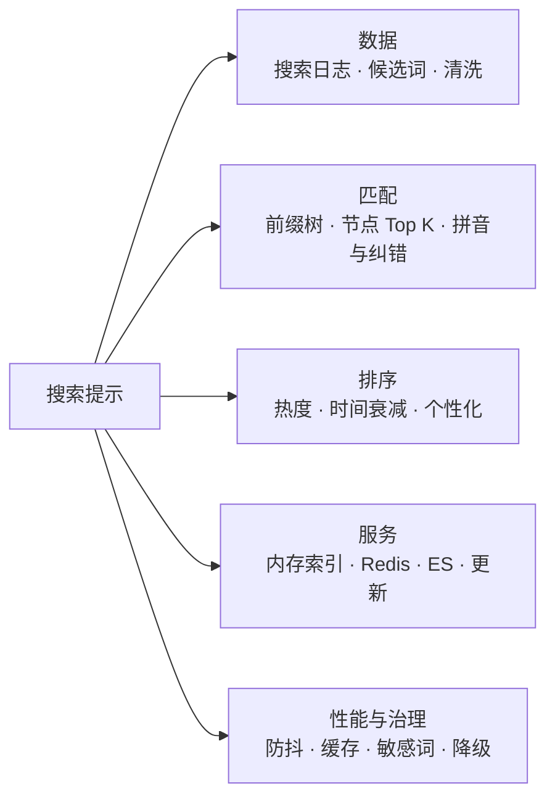
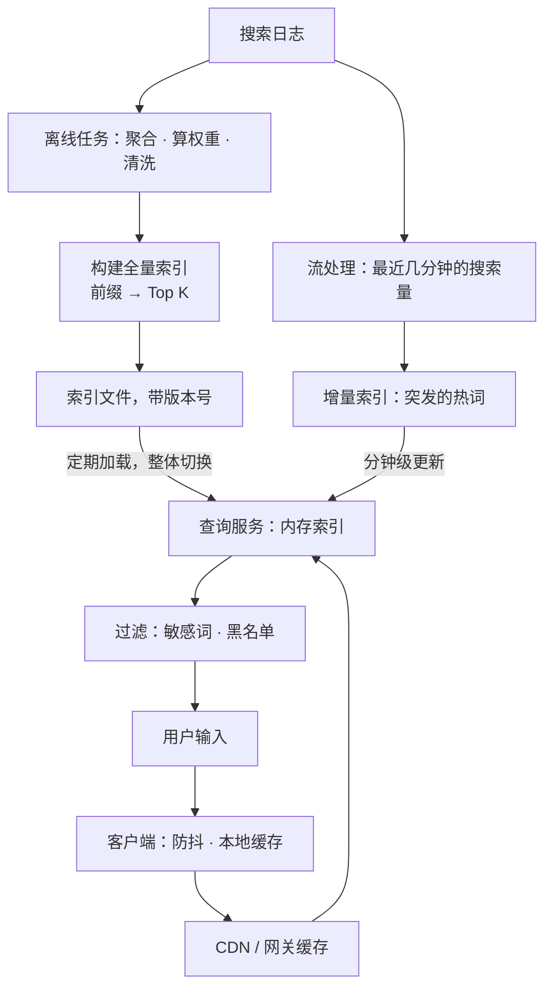
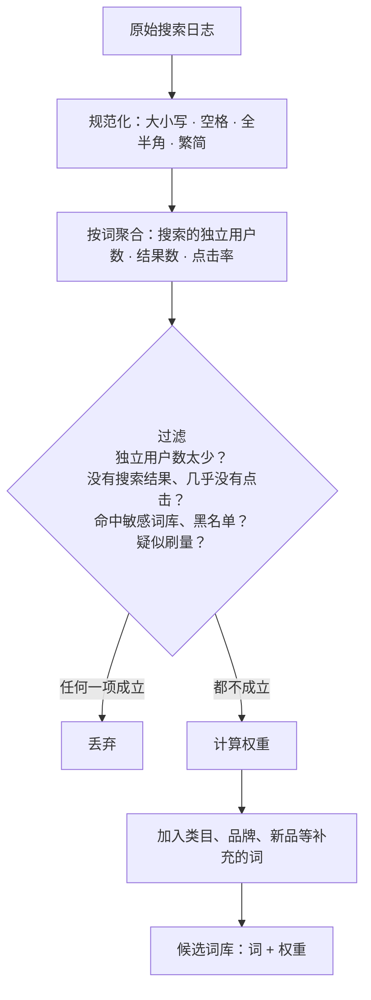
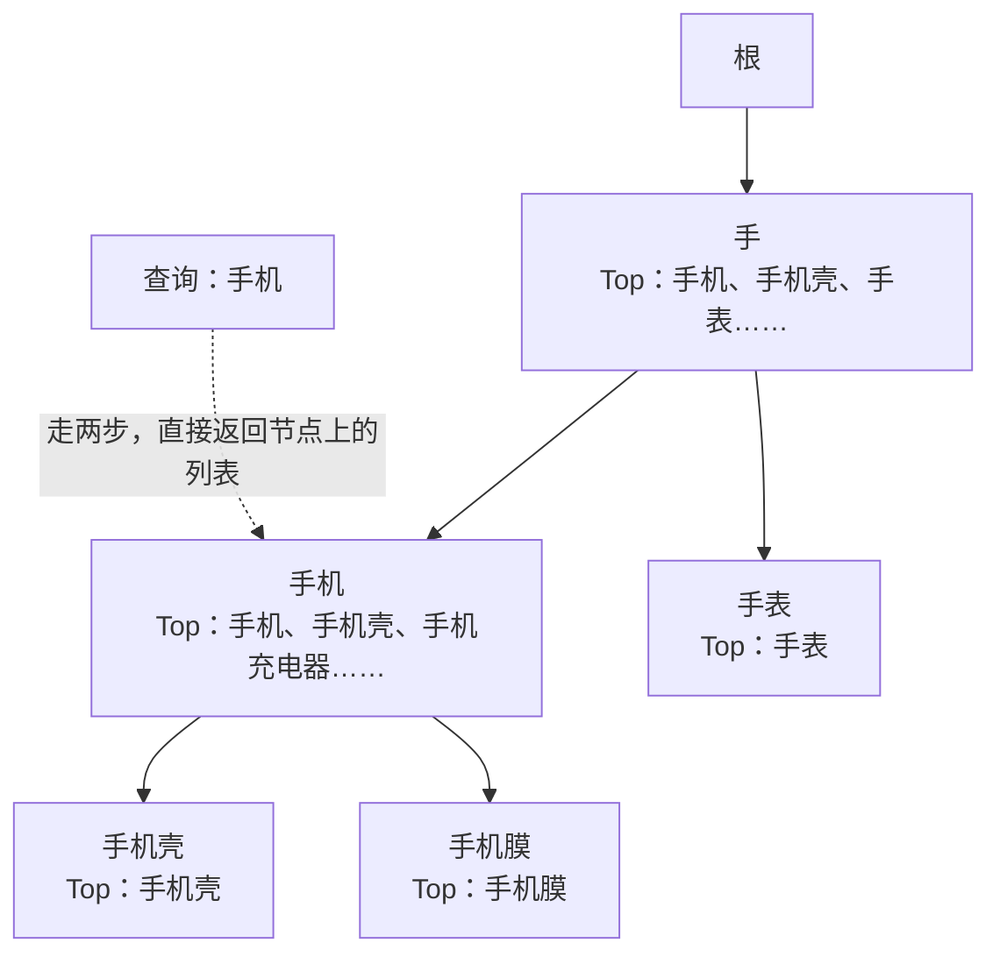
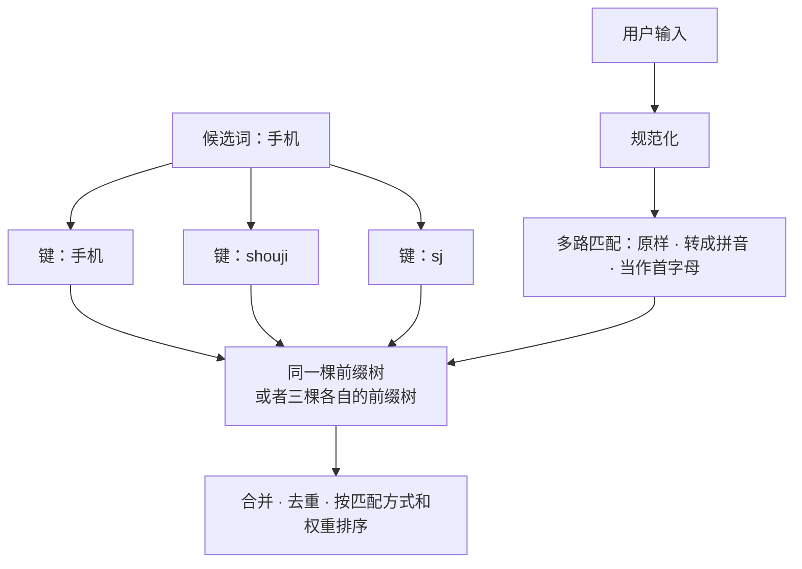
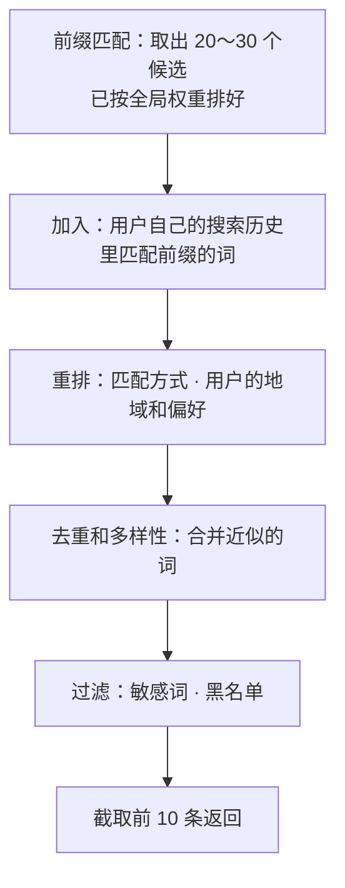
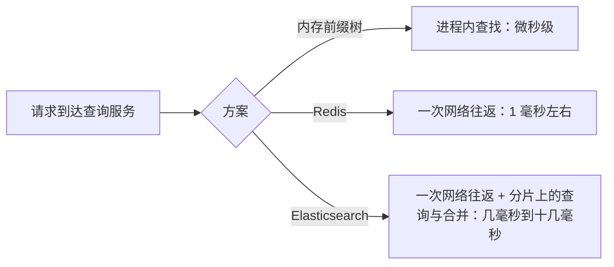
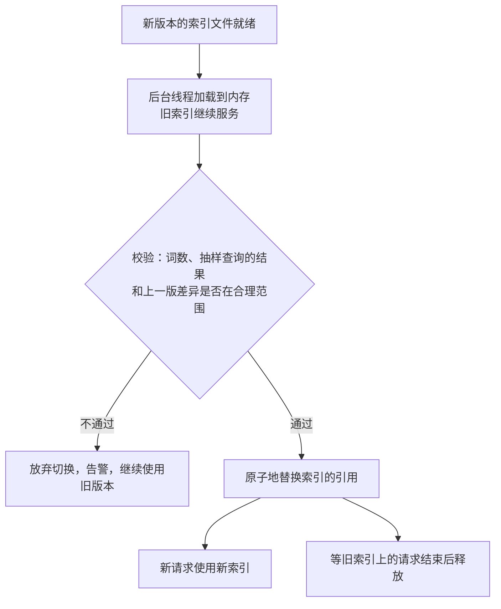
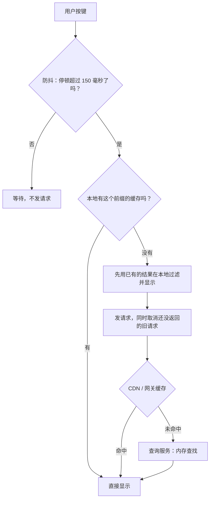
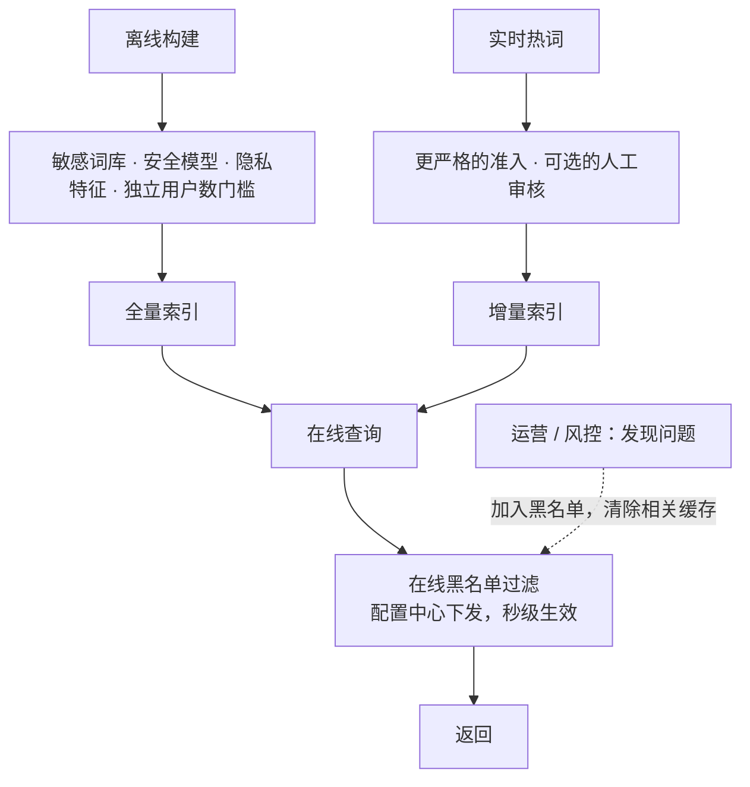

# S19 · 搜索提示

> 适用岗位：Java 资深开发、Java 架构师。搜索提示（也叫搜索联想、自动补全）是用户在搜索框里每敲一个字就触发一次的功能：请求量是搜索本身的好几倍，延迟要求又比搜索更高。这道题考察前缀匹配的数据结构、离线构建与实时更新的配合，以及读路径的极致优化。
> 版本基线：JDK 21 / 25、Redis 7.x / 8.x、Elasticsearch 9.x、Kafka 4.x。
> 事实核对：
> - 前缀树、基数树的原理，沿用[《40 数据结构》](../08-计算机基础/40-数据结构.md)40-12 的结论。
> - Elasticsearch 的 completion suggester 基于 Lucene 的 FST（有限状态转换器）、数据放在内存里，是官方文档对它的说明；倒排索引和 FST 的介绍见[《19 Elasticsearch》](../04-数据存储/19-Elasticsearch.md)19-01。
> - 本机运行（macOS 27.2、Apple M1 Max、JDK 25）：1 段前缀树的代码只依赖 JDK，随机数种子固定，文中贴的是实际运行输出。其中的耗时和机器、JVM 的状态有关，只用来说明量级。演示里的拼音是手工写在词表里的，没有使用拼音转换库。
> 相关分类：[《40 数据结构》](../08-计算机基础/40-数据结构.md)（前缀树）、[《19 Elasticsearch》](../04-数据存储/19-Elasticsearch.md)、[《17 Redis》](../04-数据存储/17-Redis.md)、[《24 高并发》](../06-三高与架构/24-高并发.md)（多级缓存）、[《42 编程题》](../10-编码与思维/42-编程题.md)（Top K）

## 45 分钟答题版

| 时间 | 做什么 | 要讲出的关键点 | 子题 |
| --- | --- | --- | --- |
| 0～5 分钟 | 需求与估算 | 每次按键一次请求；延迟要求极高；候选来自搜索日志 | S19-01 |
| 5～12 分钟 | 整体架构 | 离线构建词库 → 在线前缀查询 → 实时热词补充 | S19-02、S19-03 |
| 12～25 分钟 | 数据结构 | 前缀树；**每个节点缓存 Top K**；拼音和首字母作为额外的索引键 | S19-04、S19-05 |
| 25～32 分钟 | 排序 | 热度、时间衰减、个性化 | S19-06 |
| 32～45 分钟 | 工程 | 存储选型；全量加增量的更新；客户端防抖和各级缓存；内容安全 | S19-07 ～ S19-10 |

## 知识地图



## 题目索引

| 编号 | 题目 | 难度 |
| --- | --- | --- |
| S19-01 | 搜索提示要澄清哪些需求？规模怎么估算？ | ★★ |
| S19-02 | 整体架构怎么设计？ | ★★★ |
| S19-03 | 候选词从哪里来？ | ★★ |
| S19-04 | 用什么数据结构做前缀匹配？怎么快速取出最热的几个？ | ★★★ |
| S19-05 | 用户输入拼音、首字母或者打错了字，怎么办？ | ★★★ |
| S19-06 | 候选词怎么排序？ | ★★ |
| S19-07 | 索引放在哪？内存前缀树、Redis、Elasticsearch 怎么选？ | ★★★ |
| S19-08 | 词库怎么更新？突发的热词怎么快速出现？ | ★★★ |
| S19-09 | 每敲一个字就请求一次，怎么扛住？ | ★★ |
| S19-10 | 不该出现的提示怎么防？服务挂了怎么办？ | ★★ |

---

## 一、需求与数据

### S19-01 搜索提示要澄清哪些需求？规模怎么估算？

> ★★ ｜ 资深 ｜ 中频

**考察意图**：搜索提示的请求量和延迟要求都很特殊。看你是否意识到它比搜索本身更"吃性能"。

**30 秒版回答**：

- **功能**：用户在搜索框里输入几个字，下拉列表里实时显示若干条（通常 5～10 条）以这些字开头的、最可能想搜的词。
- **特点**：
  - **请求量大**：用户每输入一个字（或者每停顿一下）就请求一次。一次搜索平均会触发好几次提示请求；
  - **延迟要求高**：提示要跟上打字的速度。从按键到显示，整体要在 100 毫秒以内，留给服务端的只有十几到几十毫秒；
  - **只读**：线上的查询路径完全没有写入；
  - **结果高度重复**：所有人输入"手"得到的提示几乎一样，非常适合缓存；
  - **允许不精确**：数据晚几分钟、偶尔少一条，都没关系。
- **要问的**：按什么匹配（只有前缀，还是也要支持中间匹配）；要不要支持拼音和纠错；按什么排序；要不要个性化；候选词的规模；新的热词要多快出现。

**深入剖析**

| 项目 | 假设 | 推算 |
| --- | --- | --- |
| 搜索量 | 每天 5 亿次 | 平均约 5800 QPS，峰值约 3 万 QPS |
| 提示请求 | 每次搜索触发 5 次 | 平均约 2.9 万 QPS，峰值约 15 万 QPS |
| 候选词 | 去重、清洗之后 | 约 1000 万个 |
| 每个候选词 | 词本身 + 权重 | 约 50 字节，原始数据约 500 MB |
| 服务端的延迟 | P99 | 20 毫秒以内 |

三个结论：

1. 候选词的原始数据只有几百 MB，**可以全部放进内存**。这决定了可以用内存里的数据结构，而不必每次去查磁盘上的索引；
2. 峰值 15 万 QPS、20 毫秒的延迟，意味着查询路径上不能有昂贵的计算：结果要**预先算好**；
3. 前缀的种类是有限的，而且短前缀（一两个字）的请求占了大部分，缓存的命中率会很高。

**追问链**

1. **只做前缀匹配够吗？** 多数产品的搜索提示以前缀匹配为主，因为它符合"我正在往下打"的直觉，而且能做得很快。中间匹配（输入"壳"提示"手机壳"）更像是搜索，候选的数量会多得多，通常作为前缀匹配结果不足时的补充。
2. **搜索提示和搜索结果是一个系统吗？** 不是。搜索提示的索引对象是**查询词**（用户搜过什么），搜索的索引对象是**内容**（商品、文档）。两者的数据、结构、更新方式都不同，通常是独立的服务，用户点击某条提示之后才进入搜索。

---

### S19-02 整体架构怎么设计？

> ★★★ ｜ 架构师 ｜ 中频

**考察意图**：能否把"重的计算"放到离线，让在线的路径只做查表。

**30 秒版回答**：

- **离线：构建词库**（每天或者每小时）
  1. 收集搜索日志；
  2. 统计每个查询词的搜索次数，结合点击、转化等信号算出权重；
  3. 清洗：去掉太长的、太少见的、违规的、没有搜索结果的词；
  4. 构建索引（前缀 → 最热的 K 个词），生成索引文件。
- **近实时：热词补充**（分钟级）
  - 流处理实时统计最近一小段时间的搜索量，发现突然变热的词，生成一份小的增量词库。
- **在线：查询服务**
  - 加载离线的全量索引和近实时的增量索引到内存；
  - 一次查询：规范化输入 → 查全量索引 → 查增量索引 → 合并、去重、过滤 →（可选）个性化重排 → 返回。
- **前面还有多级缓存**：客户端缓存、CDN 或者网关缓存、服务内的结果缓存。
- **原则**：在线路径上只有内存查找。所有的统计、排序、清洗都在离线或者近实时的环节完成。

**深入剖析**



三条数据链路各自的特点：

| 链路 | 数据量 | 更新频率 | 作用 |
| --- | --- | --- | --- |
| 离线全量 | 全部的候选词，千万级 | 天级或者小时级 | 提供稳定的、高质量的主体 |
| 近实时增量 | 最近变热的词，几千到几万 | 分钟级 | 让突发的热点尽快出现 |
| 人工干预 | 几十到几百 | 随时 | 运营置顶某些词、紧急屏蔽某些词 |

**追问链**

1. **为什么不直接在线统计、实时更新一个大的索引？** 在线索引的读取是极高频的。让它同时承担高频的写入（每一次搜索都要更新某个词的计数，并且可能改变很多前缀的排序），读写会互相干扰，而且一次搜索量的抖动就会让排序不停地变化。把"统计"和"服务"分开，在线的索引是只读的、不可变的，可以做到无锁、极快。
2. **查询服务是有状态的吗？** 每个实例的内存里都有一份完整的索引，从这个意义上说它有状态；但所有实例的数据相同、都是只读的，所以任何一个实例可以处理任何请求，扩容就是多加载几份。索引很大时，按前缀的首字符分片，每个实例只加载一部分。
3. **输入的规范化包括什么？** 去掉首尾的空格、全角转半角、大写转小写、繁体转简体、去掉连续的空白。规范化的规则在构建索引和在线查询时必须完全一致，否则会查不到。

---

### S19-03 候选词从哪里来？

> ★★ ｜ 资深 ｜ 中频

**考察意图**：提示的质量取决于词库的质量。看你是否知道原始的搜索日志不能直接用。

**30 秒版回答**：

- **主要来源：用户的搜索日志**。大家搜得多的词，就是最可能被下一个人搜的词。
- **其他来源**：商品或者内容的标题、类目和品牌的名称（解决新品、冷门词没有搜索历史的问题）；运营配置的词。
- **原始日志不能直接用**，要清洗：
  - **去噪**：太长的、乱码的、只出现过一两次的；
  - **去重和归一**：大小写、空格、全半角不同的同一个词合并；
  - **质量**：搜了之后没有结果的词、搜了之后没有人点击的词，降低权重或者去掉。提示一个搜不到东西的词是很差的体验；
  - **安全**：违法违规的、低俗的、涉及个人隐私的；
  - **反作弊**：有人会用机器刷某个词的搜索量，把它刷进提示里（用于推广或者恶搞）。按用户或者设备去重计数，而不是按搜索的次数。
- **权重**：不只是搜索次数。常见的是综合：搜索的独立用户数、点击率、转化率、时间的新鲜度。

**深入剖析**



为什么要按**独立用户数**而不是搜索次数来统计：

| 统计口径 | 被刷的难度 | 说明 |
| --- | --- | --- |
| 搜索次数 | 很低 | 一个脚本循环搜索就能刷上去 |
| 独立用户数 | 较高 | 需要大量的账号 |
| 独立用户数 + 设备和 IP 的去重 + 行为的校验 | 高 | 还要求这些账号有正常的行为 |

**隐私**是一个容易被忽略的点：有人在搜索框里输入过自己的手机号、身份证号、别人的姓名加上某些描述。如果这样的词进入了公共的提示词库，其他人输入前几位数字就会看到它。只出现在极少数用户搜索记录里的词，不应该进入公共词库；带有个人信息特征的词（一长串数字、邮箱的格式）要直接过滤。

**追问链**

1. **新上架的商品没有人搜过，怎么出现在提示里？** 从商品的标题、品牌、型号里抽取候选词，给一个基础的权重。有了真实的搜索行为之后，再由行为数据接管。这是冷启动的常见做法。
2. **权重里的"时间新鲜度"怎么算？** 最近的搜索比很久之前的搜索更有参考价值。做法是按时间衰减：比如每过一天，旧的计数乘以一个小于 1 的系数；或者只统计最近 N 天，并对近几天加权。见 S19-06。
3. **词库有多大合适？** 不是越大越好。长尾的词（只有几个人搜过）数量极多，质量低，占了大部分的空间，却很少被提示到。按权重截断，保留头部的几百万到一千万个，通常能覆盖绝大部分的请求。

---

## 二、匹配与排序

### S19-04 用什么数据结构做前缀匹配？怎么快速取出最热的几个？

> ★★★ ｜ 资深 / 架构师 ｜ 高频

**考察意图**：这道题的核心。说出前缀树只是开始，关键是"前缀下面有几十万个词时，怎么不遍历就拿到最热的几个"。

**30 秒版回答**：

- **前缀树（Trie）**：每个节点代表一个字符，从根到某个节点的路径就是一个前缀。查一个前缀，只需要沿着它的字符往下走，走的步数等于前缀的长度，和词库的大小无关。
- **只有前缀树还不够**：走到"手"这个节点之后，它的下面可能有几十万个词。要找出其中最热的 5 个，就得遍历整棵子树。短前缀的子树非常大，而短前缀恰恰是请求最多的。
- **关键的优化：每个节点上直接存好"以这个前缀开头的、最热的 K 个词"**。
  - 查询变成：走到前缀对应的节点，直接返回它存的列表。耗时只和前缀的长度有关；
  - 这份列表是在**构建时**算好的：插入一个词时，把它尝试放进它路径上每一个节点的列表里；
  - 代价是空间：每个节点多存 K 个引用。
- 这是典型的**空间换时间**，也是把计算从"查询时"挪到"构建时"。
- **节省空间**：把只有一个孩子的节点链合并成一个节点（基数树）；节点上只存词的编号而不是词本身；长前缀（比如超过 10 个字符）不再建节点。

**深入剖析**

```java
import java.util.ArrayList;
import java.util.Comparator;
import java.util.HashMap;
import java.util.LinkedHashMap;
import java.util.List;
import java.util.Map;
import java.util.Random;

/**
 * 搜索提示：前缀树（Trie），每个节点预先存好"以这个前缀开头的、最热的 K 个词"。
 * 查询时只需要沿着前缀走到对应的节点，直接返回它缓存的列表。
 */
public class SuggestDemo {

    private static final int TOP_K = 5;
    private static final long RANDOM_SEED = 20261113L;

    record Entry(String word, long weight) { }

    /** 权重高的在前；权重相同按字典序，保证结果确定 */
    private static final Comparator<Entry> ORDER =
            Comparator.comparingLong(Entry::weight).reversed().thenComparing(Entry::word);

    static final class Node {
        final Map<Character, Node> children = new HashMap<>();
        /** 以当前前缀开头的词里，最热的 K 个 */
        final List<Entry> top = new ArrayList<>();
    }

    static final class Trie {
        final Node root = new Node();
        int nodeCount = 1;

        /** key 是用来匹配前缀的字符串（原词、全拼或者首字母），entry 是要返回给用户的词 */
        void insert(String key, Entry entry) {
            Node node = root;
            offer(node, entry);
            for (char c : key.toCharArray()) {
                Node next = node.children.get(c);
                if (next == null) {
                    next = new Node();
                    node.children.put(c, next);
                    nodeCount++;
                }
                node = next;
                offer(node, entry);
            }
        }

        /** 把一个词放进节点的 Top K 列表：已经存在就更新权重，然后重新排序并截断 */
        private static void offer(Node node, Entry entry) {
            node.top.removeIf(existing -> existing.word().equals(entry.word()));
            node.top.add(entry);
            node.top.sort(ORDER);
            if (node.top.size() > TOP_K) {
                node.top.remove(node.top.size() - 1);
            }
        }

        List<Entry> suggest(String prefix) {
            Node node = root;
            for (char c : prefix.toCharArray()) {
                node = node.children.get(c);
                if (node == null) {
                    return List.of();
                }
            }
            return node.top;
        }
    }

    private static String words(List<Entry> entries) {
        return entries.stream().map(e -> e.word() + "(" + e.weight() + ")").toList().toString();
    }

    public static void main(String[] args) {
        // 1. 一份小词表：词 → 搜索次数，以及它的全拼和首字母
        Map<String, Long> counts = new LinkedHashMap<>();
        Map<String, String[]> pinyin = new HashMap<>();
        Object[][] data = {
                {"手机", 9800L, "shouji", "sj"}, {"手机壳", 5200L, "shoujike", "sjk"},
                {"手机支架", 1800L, "shoujizhijia", "sjzj"}, {"手表", 4100L, "shoubiao", "sb"},
                {"手套", 900L, "shoutao", "st"}, {"手机膜", 2600L, "shoujimo", "sjm"},
                {"手机充电器", 3300L, "shoujichongdianqi", "sjcdq"}, {"收纳盒", 2100L, "shounahe", "snh"},
                {"书架", 1500L, "shujia", "sj"}, {"数据线", 4700L, "shujuxian", "sjx"}};
        Trie trie = new Trie();
        for (Object[] row : data) {
            String word = (String) row[0];
            Entry entry = new Entry(word, (Long) row[1]);
            counts.put(word, entry.weight());
            pinyin.put(word, new String[] {(String) row[2], (String) row[3]});
            trie.insert(word, entry);                 // 按汉字匹配
            trie.insert((String) row[2], entry);      // 按全拼匹配
            trie.insert((String) row[3], entry);      // 按拼音首字母匹配
        }
        for (String prefix : new String[] {"手", "手机", "shou", "sj", "shuj"}) {
            System.out.printf("%-5s -> %s%n", prefix, words(trie.suggest(prefix)));
        }

        // 2. 热度变化："手套" 的搜索量突然上涨，只需要更新它所在路径上的节点
        Entry hot = new Entry("手套", 12_000L);
        trie.insert("手套", hot);
        trie.insert(pinyin.get("手套")[0], hot);
        trie.insert(pinyin.get("手套")[1], hot);
        System.out.println("after 手套 becomes hot:");
        System.out.printf("%-5s -> %s%n", "手", words(trie.suggest("手")));
        System.out.println("nodes in small trie = " + trie.nodeCount);

        // 3. 正确性和性能：10 万个随机词，对 2000 个前缀，比较"节点缓存的 Top K"和"遍历全部词"的结果
        Random random = new Random(RANDOM_SEED);
        List<Entry> corpus = new ArrayList<>();
        Trie big = new Trie();
        for (int i = 0; i < 100_000; i++) {
            StringBuilder word = new StringBuilder();
            int length = 3 + random.nextInt(8);
            for (int j = 0; j < length; j++) {
                word.append((char) ('a' + random.nextInt(6)));        // 只用 6 个字母，让前缀有大量重叠
            }
            // 权重里混入序号，避免不同的词权重相同时因为重复词产生歧义
            Entry entry = new Entry(word + "#" + i, 1 + (long) (1_000_000 / (1.0 + random.nextInt(100_000))));
            corpus.add(entry);
            big.insert(entry.word(), entry);
        }
        List<String> prefixes = new ArrayList<>();
        for (int i = 0; i < 2_000; i++) {
            String word = corpus.get(random.nextInt(corpus.size())).word();
            prefixes.add(word.substring(0, 1 + random.nextInt(4)));
        }
        long start = System.nanoTime();
        List<List<Entry>> fast = new ArrayList<>();
        for (String prefix : prefixes) {
            fast.add(big.suggest(prefix));
        }
        long trieNanos = System.nanoTime() - start;
        start = System.nanoTime();
        boolean same = true;
        for (int i = 0; i < prefixes.size(); i++) {
            String prefix = prefixes.get(i);
            List<Entry> brute = corpus.stream().filter(e -> e.word().startsWith(prefix)).sorted(ORDER).limit(TOP_K).toList();
            same &= brute.equals(fast.get(i));
        }
        long bruteNanos = System.nanoTime() - start;
        System.out.println("corpus=100000 words, trie nodes=" + big.nodeCount + ", prefixes=" + prefixes.size()
                + ", cached top-k equals brute force = " + same);
        System.out.printf("per query: trie %.2f microseconds, full scan %.0f microseconds%n",
                trieNanos / 1000.0 / prefixes.size(), bruteNanos / 1000.0 / prefixes.size());
    }
}
```

本机运行输出（JDK 25）：

```text
手     -> [手机(9800), 手机壳(5200), 手表(4100), 手机充电器(3300), 手机膜(2600)]
手机    -> [手机(9800), 手机壳(5200), 手机充电器(3300), 手机膜(2600), 手机支架(1800)]
shou  -> [手机(9800), 手机壳(5200), 手表(4100), 手机充电器(3300), 手机膜(2600)]
sj    -> [手机(9800), 手机壳(5200), 数据线(4700), 手机充电器(3300), 手机膜(2600)]
shuj  -> [数据线(4700), 书架(1500)]
after 手套 becomes hot:
手     -> [手套(12000), 手机(9800), 手机壳(5200), 手表(4100), 手机充电器(3300)]
nodes in small trie = 80
corpus=100000 words, trie nodes=700014, prefixes=2000, cached top-k equals brute force = true
per query: trie 0.40 microseconds, full scan 8155 microseconds
```

- 输入"手"，直接得到最热的 5 个以"手"开头的词；输入"手机"，范围缩小到以"手机"开头的词；
- 第 3～5 行是拼音和首字母（下一题）；
- "手套"的热度从 900 涨到 12000 之后，重新插入一次，它出现在了"手"这个前缀的第一位。更新只涉及"手套"路径上的几个节点；
- 最后两行是一个更大的测试：10 万个随机的词，2000 个随机的前缀。节点上缓存的 Top K 和"遍历全部的词、过滤、排序"得到的结果**完全一致**；耗时上，前缀树每次查询不到 1 微秒，全量扫描每次约 8 毫秒，相差四个数量级。（耗时和机器有关，这里只看量级。）



空间的代价：10 万个词（平均长度约 10 个字符）建出了 70 万个节点，每个节点最多存 5 个引用。真实的词库有上千万个词，节点数会到上亿。所以实际的实现要压缩：

| 手段 | 做法 | 效果 |
| --- | --- | --- |
| 基数树（压缩前缀树） | 把没有分叉的一串节点合并成一个 | 节点数大幅减少 |
| 限制深度 | 只为前 N 个字符建节点，更长的前缀回到父节点的子树里现查 | 长尾的节点不再建 |
| 存编号 | 节点里的 Top K 只存词的整数编号，词的内容放在一个单独的数组里 | 每个节点的开销变小 |
| 数组代替哈希表 | 孩子按字符排序放在数组里，二分查找 | 省掉哈希表的开销 |
| FST | 同时共享前缀和后缀的自动机，Lucene 用它 | 最省空间，构建之后不可修改 |

**追问链**

1. **K 取多少？** 比要展示的条数多一些。要展示 10 条，存 20～30 条，因为后面还有过滤（敏感词、去重）和重排，会去掉一些。
2. **节点上的 Top K 在词的权重下降时会出什么问题？** 权重上升没问题：重新插入时它会被排到前面。权重**下降**时，它可能应该被挤出某个节点的 Top K，而原本排在第 K+1 名的词应该补进来，可是节点并没有存第 K+1 名。所以增量的更新只适合"新增"和"变热"；"变冷"要靠周期性的全量重建来修正（S19-08）。
3. **为什么不用哈希表，直接存"前缀 → Top K"？** 可以，而且查询是 O(1)。它相当于把前缀树"拍平"：每个出现过的前缀作为一个键。缺点是所有的前缀都要完整地存一遍，不能共享公共的部分，空间更大；优点是结构极其简单，放进 Redis 也很自然（S19-07）。数据量不大时这是很实用的做法。
4. **前缀树的其他用途？** 见[《40 数据结构》](../08-计算机基础/40-数据结构.md)40-12。

---

### S19-05 用户输入拼音、首字母或者打错了字，怎么办？

> ★★★ ｜ 资深 / 架构师 ｜ 中频

**考察意图**：中文输入的特殊性。看你是否把"多种输入方式"转化成了"多个索引键指向同一个词"。

**30 秒版回答**：

- **现象**：用户想搜"手机"，输入法还没有上屏时，搜索框里是"shou"或者"sj"；或者用户直接用拼音、首字母搜索；或者打了错别字。
- **思路：同一个候选词，用多种"键"去索引**。
  - **汉字**："手机" → 键 `手机`；
  - **全拼**："手机" → 键 `shouji`；
  - **首字母**："手机" → 键 `sj`；
  - 这三个键都插入前缀树，都指向同一个候选词"手机"。用户无论输入"手""shou"还是"sj"，都能走到包含"手机"的节点。
- **中英文混合**："手j""shou机"这类输入：把输入里已经是汉字的部分也转成拼音，统一用拼音的键去匹配。
- **多音字**：一个字有多个读音时，每一种读音的组合都生成一个键。
- **纠错**（拼写错误、同音字、形近字）：
  - 前缀匹配的结果足够时，不需要纠错；
  - 结果很少或者没有时，再尝试：编辑距离为 1 的候选、同音词、常见的错误映射表。
- **多路的结果要合并排序**：精确的汉字前缀匹配优先，其次是全拼，再次是首字母，最后是纠错的结果。

**深入剖析**

上一题输出里的第 3～5 行：

```text
shou  -> [手机(9800), 手机壳(5200), 手表(4100), 手机充电器(3300), 手机膜(2600)]
sj    -> [手机(9800), 手机壳(5200), 数据线(4700), 手机充电器(3300), 手机膜(2600)]
shuj  -> [数据线(4700), 书架(1500)]
```

- 输入 `shou`：匹配到全拼以 shou 开头的词；
- 输入 `sj`：匹配到首字母以 sj 开头的词。注意"数据线"（sjx）也出现了，因为它的首字母也以 sj 开头；
- 输入 `shuj`：匹配到"数据线"（shujuxian）和"书架"（shujia）。

演示里的拼音是手工写在词表里的。实际的系统用拼音转换的词典，在**构建索引时**为每个候选词生成它的全拼和首字母。在线查询时不需要做任何转换，输入什么就拿什么去查。



多路匹配带来的问题和处理：

| 问题 | 例子 | 处理 |
| --- | --- | --- |
| 首字母太短，匹配到的词太杂 | 输入 `s`，首字母以 s 开头的词有几十万个 | 首字母匹配只在输入达到 2 个字符以上时启用 |
| 拼音的歧义 | `xian` 可以是"先"，也可以是"西安" | 两种切分都生成键 |
| 英文单词被当成拼音 | 输入 `she`，既是英文词也是拼音 | 两路都查，按权重合并 |
| 索引膨胀 | 每个词多了几个键，多音字的组合更多 | 首字母和多音字的组合只对头部的热词生成 |

**追问链**

1. **纠错怎么做才不慢？** 不要对每个请求都做纠错。先做精确的匹配，结果足够就直接返回；结果不足时再触发纠错。纠错的方法：对输入生成编辑距离为 1 的变体再去查（代价较高，只对短的输入做）；或者离线挖掘"用户先搜了 A，没有点击，马上改搜 B"的日志，得到一张"A → B"的纠错表，在线直接查表。
2. **模糊匹配（编辑距离）可以用前缀树直接做吗？** 可以：在前缀树上做带"容错预算"的遍历，允许有限次的字符替换、插入、删除。代价比精确查找高很多。Elasticsearch 的 completion suggester 支持这种模糊的前缀匹配。
3. **方言、口语的说法怎么办？** 这是同义词的问题，属于搜索的"查询改写"。搜索提示里通常只做到字面上的匹配，更深的语义理解交给搜索本身。

---

### S19-06 候选词怎么排序？

> ★★ ｜ 资深 ｜ 中频

**考察意图**：排序决定了前几条是不是用户想要的。看你是否考虑了热度之外的因素，以及个性化的成本。

**30 秒版回答**：

- **基础：全局的热度**。搜的人越多，排得越前。
- **时间衰减**：去年的热词不应该一直排在前面。让权重随时间下降：`权重 = Σ 每天的搜索量 × 衰减系数^(距今的天数)`。
- **质量信号**：这个词被选中（点击提示）的比例；用它搜索之后的点击率和转化率。提示了没人点的词，降权。
- **匹配的方式**：精确的汉字前缀 > 全拼 > 首字母 > 纠错。
- **个性化**（可选）：
  - 用户自己最近搜过的词，优先展示（通常放在最前面，并且有单独的标识）；
  - 用户所在的城市、偏好的类目，对相关的词加权；
  - 个性化是在全局的候选上做**重排**，而不是为每个用户建一棵前缀树。
- **多样性**：前几条不要全是同一个词的各种变体（"手机壳""手机壳 透明""手机壳 防摔"……），要覆盖不同的意图。
- **排序放在哪**：全局的权重在离线算好，体现在节点的 Top K 里；个性化和多样性在在线阶段对取出的二三十个候选做轻量的重排。

**深入剖析**



时间衰减的效果（衰减系数 0.9，即每过一天，那一天的搜索量的权重变成原来的 90%）：

| 词 | 30 天前的日搜索量 | 最近的日搜索量 | 累计搜索量（30 天） | 衰减后的权重排名 |
| --- | --- | --- | --- | --- |
| 一个常年稳定的词 | 1 万 | 1 万 | 30 万 | 中 |
| 一个过气的词 | 5 万 | 1000 | 很大 | 低：大部分的搜索量在很久以前，被衰减掉了 |
| 一个刚刚变热的词 | 0 | 8 万 | 较小 | 高：搜索量集中在最近 |

只看累计的搜索量，过气的词会排在最前面；加上时间衰减之后，排序反映的是"现在"的热度。

个性化的成本和折中：

| 做法 | 成本 | 缓存 |
| --- | --- | --- |
| 完全不做个性化 | 最低 | 所有人的结果相同，可以整体缓存 |
| 只把用户自己的搜索历史放在最前面 | 低：历史可以在客户端本地保存和匹配 | 公共的部分仍然可以缓存 |
| 按用户的画像重排 | 高：每个请求都要读画像、做计算 | 结果因人而异，无法共享缓存 |

多数产品选第二种：公共的提示走缓存，用户自己的历史由客户端在本地拼接。这样既有个性化的效果，又不破坏缓存。

**追问链**

1. **搜索历史放在客户端还是服务端？** 客户端本地保存最简单，匹配也在本地做，不增加服务端的压力，但换一台设备就没有了。需要跨设备同步的话，服务端保存每个用户最近的若干条搜索词，这是一份很小的、按用户读取的数据。
2. **怎么知道排序好不好？** 看用户的行为：提示的点击率（展示了提示，用户有多大的比例点了其中一条）、点击的位置（点的是第 1 条还是第 8 条）、用户输入了几个字符才找到想要的词。用 A/B 实验比较不同的排序策略。
3. **运营想把某个词固定在第一位怎么办？** 提供干预的配置：某个前缀下，指定的词置顶或者屏蔽。在线阶段在重排时应用。干预的数据量很小，放在配置中心里，可以实时生效。

---

## 三、服务与更新

### S19-07 索引放在哪？内存前缀树、Redis、Elasticsearch 怎么选？

> ★★★ ｜ 架构师 ｜ 中频

**考察意图**：三种常见的实现各有适用的规模。看你能否根据团队和数据量给出合理的选择。

**30 秒版回答**：

| 方案 | 做法 | 优点 | 不足 | 适合 |
| --- | --- | --- | --- | --- |
| **应用内存里的前缀树** | 查询服务自己加载索引文件，在进程内查找 | 最快，没有网络开销；结构可以完全定制 | 要自己实现构建、加载、切换、分片；占用每个实例的内存 | 量大、延迟要求最高、有专门的团队 |
| **Redis：前缀 → Top K** | 每个前缀一个键，值是排好序的候选列表（ZSET 或者一个序列化的字符串） | 实现简单；所有实例共享；更新方便 | 每次查询多一次网络往返；前缀的数量多时占内存 | 中小规模，或者作为快速落地的方案 |
| **Elasticsearch 的 completion suggester** | 专门为自动补全设计的字段类型，底层是 FST，放在内存里 | 现成的功能：前缀、模糊匹配、权重、上下文过滤 | 比专用的实现慢；资源占用大；更新后要等刷新 | 已经在用 ES、需要模糊匹配和按上下文过滤 |

- **选择的顺序**：先看规模和延迟的要求。几十万到几百万个候选词、延迟几十毫秒可以接受：Redis 或者 ES 足够，不要自己造。上千万的候选词、峰值十几万 QPS、延迟十毫秒以内：自己实现内存索引。
- 无论选哪种，**前面的多级缓存都是必须的**。

**深入剖析**

Redis 方案的两种存法：

```text
# 方式一：每个前缀一个 ZSET，成员是候选词，分数是权重
ZADD sug:手  9800 手机  5200 手机壳  4100 手表 ...
ZRANGE sug:手 0 9 REV

# 方式二：每个前缀一个字符串，值是已经排好序、序列化好的候选列表
SET sug:手 '["手机","手机壳","手表","手机充电器","手机膜"]'
GET sug:手
```

方式二更省内存、读取更快（一次 `GET`，不需要 Redis 再排序），因为排序在离线阶段已经完成了。更新时整个值替换。

前缀的数量：一个长度为 L 的词有 L 个前缀。1000 万个词，平均 6 个字，就是最多 6000 万个前缀（很多是重复的，实际会少得多）。要控制：只为长度不超过 N 的前缀建键；只为头部的词建键。

三种方案的延迟构成：



**追问链**

1. **内存索引很大，一个实例放不下怎么办？** 按前缀的首字符（或者首字符的哈希）分片，每组实例加载一部分。请求根据输入的首字符路由到对应的分片。首字符的分布不均匀（某些字开头的词特别多），分片时要按数据量来划分，而不是简单地按字符的范围均分。
2. **ES 的 completion suggester 有什么要注意的？** 它的数据结构要加载进内存，候选词多时内存占用可观；它只支持前缀匹配，不支持中间匹配；新写入的候选要等索引刷新之后才能被提示到；按权重返回，但复杂的排序做不了。它适合"够用就好"的场景。具体的行为和版本有关，使用前以对应版本的官方文档为准。
3. **能不能用数据库的 `LIKE '手%'`？** 数据量很小（几万条）时可以，`LIKE` 的前缀匹配能用上索引。但还要 `ORDER BY 权重 LIMIT 10`，以"手"开头的词很多时，要把它们全部取出来排序，短前缀会很慢。除非把"前缀 → Top K"预先算好存成一张表，那就和 Redis 的方式二是一个思路了。

---

### S19-08 词库怎么更新？突发的热词怎么快速出现？

> ★★★ ｜ 架构师 ｜ 中频

**考察意图**：只读的索引怎么更新，以及全量和增量怎么配合。这是这类"离线构建、在线服务"的系统共有的问题。

**30 秒版回答**：

- **全量更新**（天级或者小时级）：
  1. 离线任务构建出新版本的完整索引文件；
  2. 查询服务在后台把新的索引加载到内存里（此时新旧两份同时存在）；
  3. 加载完成并校验通过后，把指向索引的引用**原子地切换**到新的那一份；
  4. 等旧索引上的请求处理完，释放它。
  - 这叫**双缓冲切换**。切换的瞬间没有锁，请求要么用旧的，要么用新的，不会看到一半的数据。
- **增量更新**（分钟级）：
  - 流处理发现突然变热的词，生成一份很小的增量索引；
  - 查询时同时查全量和增量，合并结果；
  - 增量只负责"新出现的"和"突然变热的"。下一次全量构建时，它们被合并进全量，增量清空。
- **热词的发现**：比较一个词"最近 10 分钟的搜索量"和它"平时同一时段的搜索量"。不是看绝对值（"手机"永远搜得多），而是看**增长的倍数**。
- **紧急的屏蔽**：发现了不该出现的词，通过配置中心下发黑名单，在线过滤，秒级生效。不等下一次索引构建。

**深入剖析**



校验这一步很重要：离线任务可能因为上游数据的问题产出一个残缺的索引（比如日志只收集到了一半，词数只有平时的一半）。如果不校验就切换，线上的提示会突然变得很差。常见的校验：词的总数和上一版相比的变化不超过某个比例；一批固定的"金标准"前缀的结果基本稳定。

全量和增量的分工：

| | 全量索引 | 增量索引 |
| --- | --- | --- |
| 内容 | 全部的候选词 | 新词、突然变热的词 |
| 大小 | 大，GB 级 | 小，MB 级 |
| 更新方式 | 整体替换 | 可以原地更新，或者也整体替换 |
| 能处理"变冷" | 能：重新构建时排名自然下降 | 不能（见 S19-04 追问 2） |
| 数据质量 | 高：经过完整的清洗和反作弊 | 较低：时间短，清洗有限，要有更严格的准入门槛 |

增量的准入要严格：实时的数据没有经过完整的反作弊，最容易被人为地刷上来。常见的限制：必须有足够多的独立用户在搜；必须通过敏感词的检查；新词进入提示之前可以经过自动的或者人工的审核。

**追问链**

1. **加载新索引时内存翻倍，怎么办？** 双缓冲意味着切换期间内存里有两份索引。实例的内存要按"两份"来规划；或者分批滚动：一部分实例先摘掉流量、加载、切换、恢复流量，再轮到下一批，这样每个实例同一时间只有一份。
2. **所有实例同时切换吗？** 不要。先让少量的实例切换到新版本，观察指标（点击率、空结果的比例、延迟），正常之后再全量切换。索引也是一种"发布"，同样需要灰度和回滚的能力：保留上一个版本的索引文件，有问题时切回去。
3. **热词的检测会不会误报？** 会。凌晨的搜索量本来就低，一个词从 1 次变成 10 次是 10 倍的增长，但没有意义。所以除了增长的倍数，还要有绝对数量的门槛，并且和"上周的同一时段"比较，而不是和"刚才"比较。

---

### S19-09 每敲一个字就请求一次，怎么扛住？

> ★★ ｜ 资深 ｜ 高频

**考察意图**：读路径的优化要从客户端做起。看你是否知道最有效的手段是"让请求不发出来"。

**30 秒版回答**：

- **客户端**（最有效，直接减少请求的数量）：
  - **防抖**：用户停止输入一小段时间（比如 100～200 毫秒）之后才发请求。快速连续输入时，中间的状态不发请求；
  - **取消过时的请求**：新的请求发出时，取消还没有返回的旧请求；或者给请求编号，丢弃晚到的旧响应。否则会出现"先输入的前缀的结果后到，覆盖了新的结果"；
  - **本地缓存**：用户删掉一个字退回上一个前缀时，直接用刚才的结果；
  - **本地过滤**：已经拿到了"手"的结果，用户接着输入"机"，可以先在本地用"手机"过滤一遍，立刻显示，同时发请求拿更准确的结果；
  - 输入法正在组字（拼音还没有上屏）时，可以不发或者降低频率。
- **接入层**：提示的结果对所有用户（几乎）相同，而且 URL 就是前缀。可以在 **CDN 或者网关**上按前缀缓存几十秒到几分钟。短前缀的请求量最大，缓存的效果也最好。
- **服务端**：内存查找本身已经很快；热门前缀的结果在服务内再缓存一层，省掉合并、过滤的计算；单个字符的前缀只有几千种，可以全部预先计算好。
- **协议**：接口尽量小，只返回必要的字段；启用连接复用和压缩。

**深入剖析**



各层挡住的请求（示意）：

| 层 | 手段 | 大致的效果 |
| --- | --- | --- |
| 客户端 | 防抖 | 快速输入时，请求数减少一半以上 |
| 客户端 | 本地缓存和过滤 | 回退、重复的输入不再发请求 |
| CDN / 网关 | 按前缀缓存 | 热门的前缀几乎全部命中 |
| 查询服务 | 结果缓存 | 省掉重复的合并和过滤 |
| 查询服务 | 内存索引 | 最终到达这里的请求，微秒级完成 |

乱序的问题：用户输入"手"，请求 A 发出；又输入"机"，请求 B 发出。B 先返回，显示了"手机"的结果；然后 A 才返回，如果直接显示，下拉框里又变回了"手"的结果，和输入框里的内容对不上。解决：每个请求带上它对应的输入内容（或者一个递增的序号），响应回来时检查它是否还和当前输入框里的内容一致，不一致就丢弃。

**追问链**

1. **有个性化的话，还能用 CDN 缓存吗？** 公共的部分可以。把请求拆成两部分：公共的提示（可缓存）和个性化的部分（用户的历史，在客户端本地或者单独的轻量接口）。客户端把两者合并显示。
2. **防抖的时间设多长？** 太短起不到作用，太长用户会觉得提示反应慢。通常在 100～300 毫秒之间。可以根据网络状况调整：弱网下延长。
3. **缓存的过期时间怎么定？** 提示的内容变化很慢，全量的索引一天才更新一次，缓存几分钟完全没有问题。要快速生效的只有紧急的屏蔽：屏蔽的词在缓存的下游（客户端收到响应之后，或者网关上）不容易处理，所以紧急屏蔽时要同时清除相关前缀的缓存，或者把缓存的时间控制在可接受的范围内。

---

### S19-10 不该出现的提示怎么防？服务挂了怎么办？

> ★★ ｜ 资深 / 架构师 ｜ 中频

**考察意图**：搜索提示是平台"主动说出来的话"，出了问题比搜索结果更敏感。看你是否有内容安全的意识和降级的方案。

**30 秒版回答**：

- **为什么更敏感**：搜索结果是用户主动找的；搜索提示是用户只输入了一两个字，平台**主动推荐**的。一条不当的提示（违法的、侮辱性的、对某个人或者品牌的负面联想）会被当成平台的态度。
- **防线**：
  1. **构建时**：候选词过敏感词库和内容安全的模型；带有个人信息特征的词过滤；只有足够多的独立用户搜过的词才能进入；
  2. **在线时**：返回之前再过一遍黑名单。黑名单可以实时更新，用来应对刚发现的问题；
  3. **针对特定对象的保护**：人名、品牌名加上负面词的组合，要有专门的规则；
  4. **反作弊**：防止有人刷量把某个词刷进提示；
  5. **应急**：一键屏蔽某个词、某个前缀下的所有提示，甚至整体关闭提示功能。
- **高可用与降级**：
  - 搜索提示是**辅助功能**，不是核心链路。它失败时，搜索框应该照常可用，只是没有下拉提示；
  - 客户端：请求超时（比如 300 毫秒）就放弃，不显示提示，不能卡住输入；
  - 服务端：增量索引、个性化不可用时，只返回全量索引的结果；查询服务不可用时，网关返回缓存里的旧结果或者空列表；
  - 新索引加载失败，继续用旧的。

**深入剖析**



降级的层次：

| 故障 | 用户看到的 | 处理 |
| --- | --- | --- |
| 个性化服务超时 | 没有个性化的提示 | 跳过重排，返回公共结果 |
| 增量索引不可用 | 没有最新的热词 | 只查全量索引 |
| 部分查询实例故障 | 无感知 | 负载均衡摘除 |
| 查询服务整体不可用 | 提示是几分钟前的，或者没有提示 | 网关返回缓存；没有缓存则返回空 |
| 响应变慢 | 没有提示 | 客户端超时后放弃 |

**追问链**

1. **在线的黑名单过滤会不会影响延迟？** 黑名单是一个不大的集合（几千到几万条），加载在内存里，对返回的十几个候选逐个检查，耗时可以忽略。如果要做包含匹配（候选词里含有某个敏感词），用多模式匹配的算法，同样很快。
2. **被屏蔽之后，某个前缀下的提示不够 10 条了怎么办？** 所以节点上存的 Top K 要比展示的条数多。还是不够，就少显示几条。宁可少，不要错。
3. **搜索提示要监控什么？** 请求量和延迟（P99）；空结果的比例（突然升高说明索引有问题）；各级缓存的命中率；提示的点击率（突然下降说明质量变差了）；索引的版本和加载的时间；黑名单的命中次数（突然升高可能意味着有人在刷词）。

**生产实践 / 踩坑**

- **查询时才去遍历子树、排序**：短前缀的子树有几十万个词，延迟从微秒变成几十毫秒，高峰期直接超时。Top K 必须预先算好。
- **没有处理响应的乱序**：下拉框里的内容和输入框里的字对不上，用户点错。
- **直接用原始搜索日志里的次数做权重**：被人用脚本把一个推广的词刷到了第一位。
- **新索引不校验就切换**：上游的日志缺了一天，构建出来的索引只有平时的一半，线上的提示质量骤降。
- **把提示请求放在输入框的主线程里同步等待**：网络一慢，用户打字都卡顿。提示必须是异步的，并且有很短的超时。
- **个人信息进入了公共的词库**：有人搜过自己的手机号，别人输入前几位就被提示出来了。
