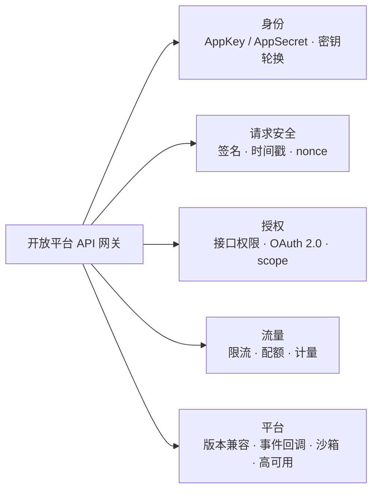
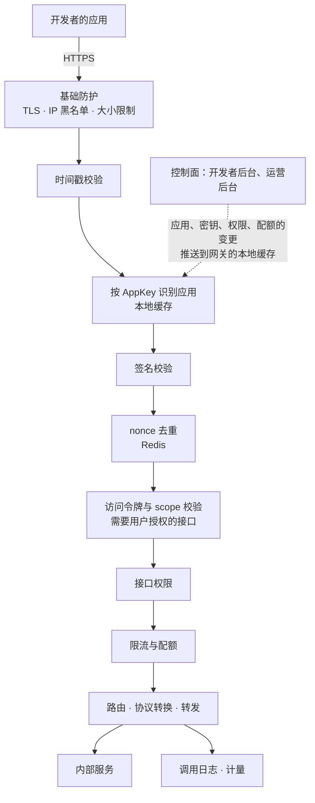
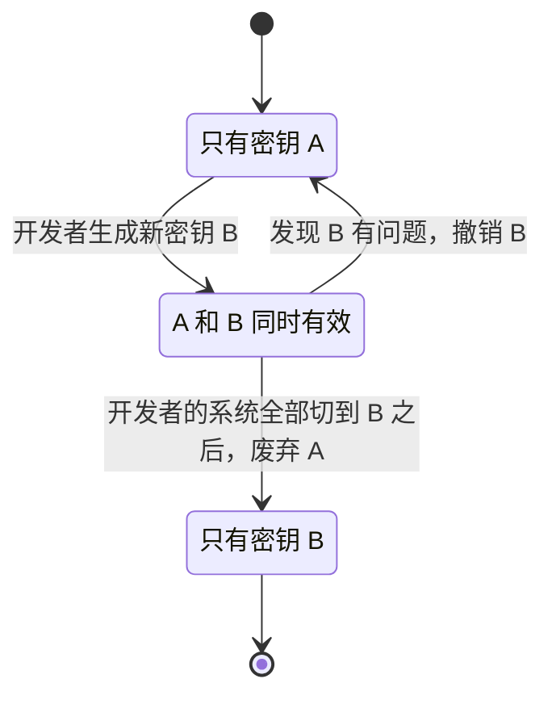
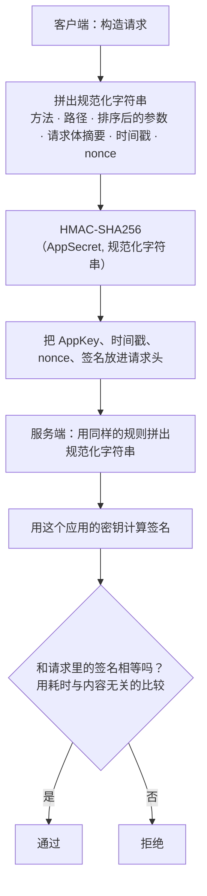
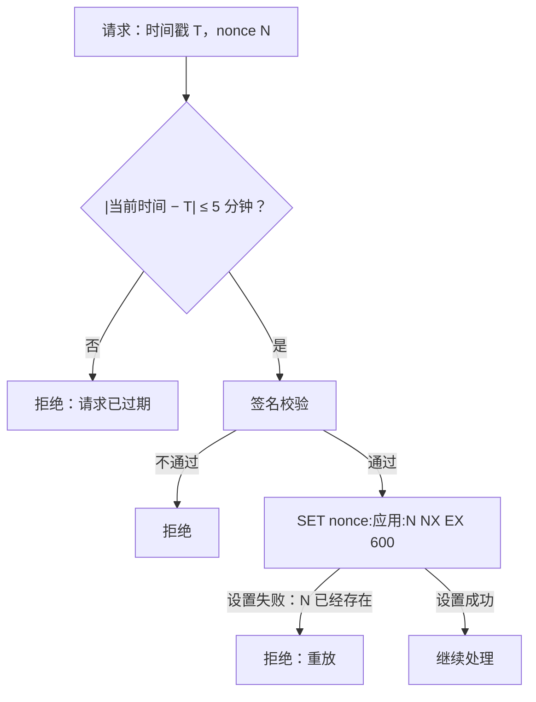
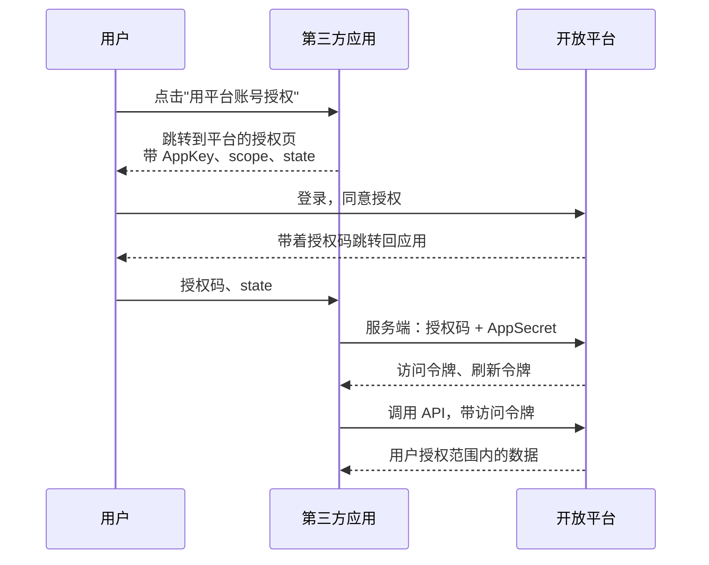
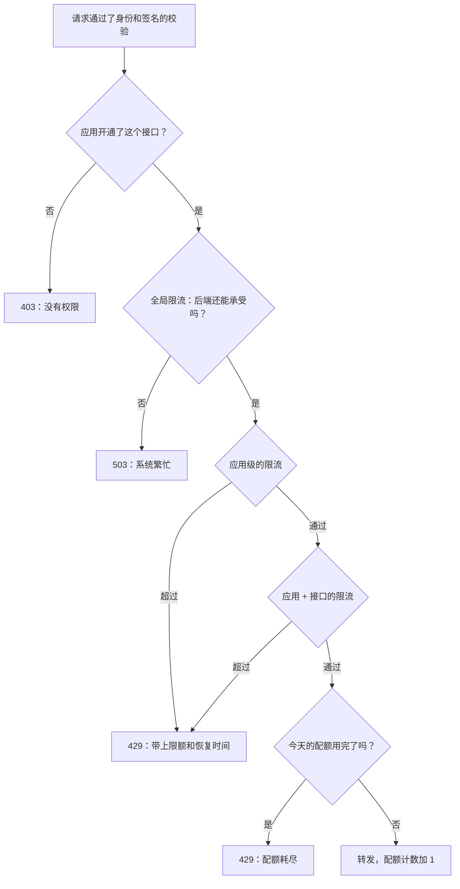
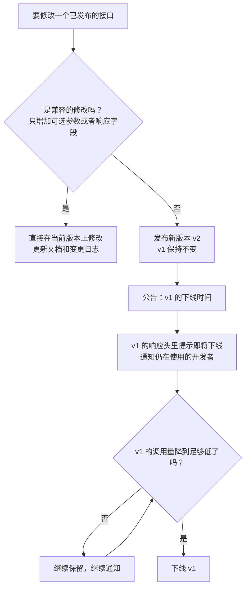
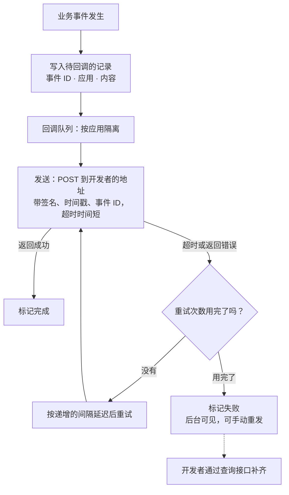
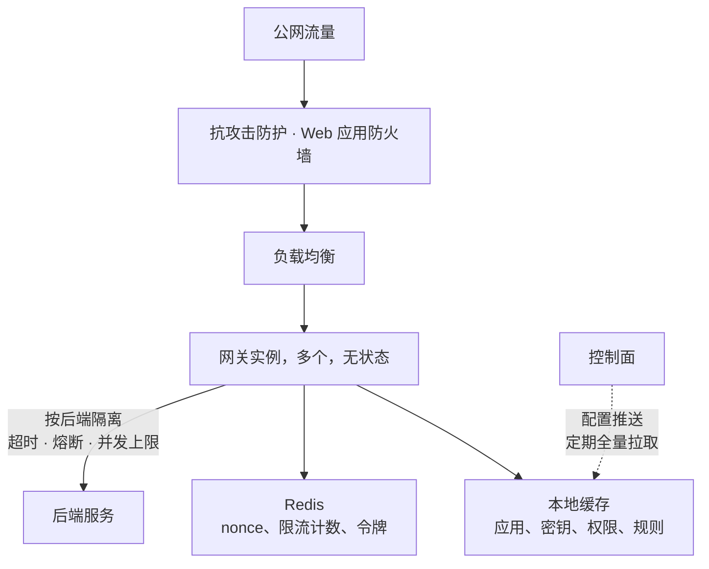

# S20 · 开放平台 API 网关

> 适用岗位：Java 资深开发、Java 架构师。开放平台把内部的能力以 API 的形式提供给外部的开发者。调用方不受你控制、网络是公网、接口发布之后很难修改，所以它在安全、配额、兼容性上的要求比内部的微服务网关高得多。速查版见[《29 场景题》](../06-三高与架构/29-场景题.md)的 29-15。
> 版本基线：JDK 21 / 25、Spring Cloud Gateway 5.x、Redis 7.x / 8.x。
> 事实核对：
> - HMAC、数字签名各自解决什么问题，沿用[《39 网络安全》](../08-计算机基础/39-网络安全.md)39-13 的结论；OAuth 2.0 授权码模式与 PKCE 沿用 39-10 的结论；限流算法沿用[《26 高可用》](../06-三高与架构/26-高可用.md)26-03 的结论。
> - `MessageDigest.isEqual` 的比较耗时与内容无关、`HexFormat` 是 JDK 17 引入的，沿用 29-15 的说明。
> - 本机运行（macOS 27.2、Apple M1 Max、JDK 25）：1 段网关入口校验链的代码只依赖 JDK，时间用可以手动推进的时钟模拟，文中贴的是实际运行输出。代码里的密钥是演示用的字符串。
> 相关分类：[《39 网络安全》](../08-计算机基础/39-网络安全.md)（签名、OAuth 2.0、重放）、[《26 高可用》](../06-三高与架构/26-高可用.md)（限流、熔断）、[《12 Spring Cloud》](../03-分布式与微服务/12-SpringCloud.md)（网关）、[《S16 消息推送平台》](S16-消息推送平台.md)（重试与回执）、[《S21 SSO 与扫码登录》](S21-SSO与扫码登录.md)

## 45 分钟答题版

| 时间 | 做什么 | 要讲出的关键点 | 子题 |
| --- | --- | --- | --- |
| 0～5 分钟 | 澄清定位 | 和内部网关的区别：调用方不可信、公网、接口难以修改 | S20-01 |
| 5～12 分钟 | 整体架构 | 网关的处理链；控制面（开发者后台）和数据面（网关）分开 | S20-02 |
| 12～27 分钟 | 安全 | AppKey 与 AppSecret；签名防篡改；时间戳加 nonce 防重放；用户授权用 OAuth 2.0 | S20-03 ～ S20-06 |
| 27～35 分钟 | 流量治理 | 接口权限；按应用、接口、用户的限流和配额 | S20-07 |
| 35～45 分钟 | 平台能力 | 版本与兼容；事件回调；沙箱和开发者体验；网关的高可用 | S20-08 ～ S20-11 |

## 知识地图



## 题目索引

| 编号 | 题目 | 难度 |
| --- | --- | --- |
| S20-01 | 开放平台网关和内部的微服务网关有什么不同？ | ★★ |
| S20-02 | 整体架构怎么设计？一个请求在网关里经过哪些环节？ | ★★★ |
| S20-03 | 怎么识别调用方？AppSecret 怎么保存和轮换？ | ★★★ |
| S20-04 | 请求签名怎么设计？已经有 HTTPS 了为什么还要签名？ | ★★★ |
| S20-05 | 怎么防止请求被重放？ | ★★★ |
| S20-06 | 第三方应用要访问用户的数据，怎么授权？ | ★★★ |
| S20-07 | 接口权限、限流和配额怎么做？ | ★★★ |
| S20-08 | API 的版本怎么管理？怎么做到向后兼容？ | ★★ |
| S20-09 | 平台要主动通知开发者（事件回调）怎么设计？ | ★★★ |
| S20-10 | 沙箱、文档、错误码这些开发者体验要做什么？ | ★★ |
| S20-11 | 网关自身的高可用和安全怎么保证？ | ★★★ |

---

## 一、定位与架构

### S20-01 开放平台网关和内部的微服务网关有什么不同？

> ★★ ｜ 资深 / 架构师 ｜ 中频

**考察意图**：同样叫"网关"，面对的问题不一样。看你是否抓住了"调用方不受控"这个根本的差别。

**30 秒版回答**：

| | 内部的微服务网关 | 开放平台网关 |
| --- | --- | --- |
| 调用方 | 自己的前端、自己的服务 | 外部的开发者，数量多，水平不一，其中可能有恶意的 |
| 网络 | 内网，或者自己的 App | 公网 |
| 身份 | 用户的登录态 | **应用的身份**（哪个开发者的哪个应用），有时再加上用户的授权 |
| 安全 | 鉴权、基本的防刷 | 签名、防重放、细粒度的权限、防滥用 |
| 流量 | 整体的限流 | **按应用**的限流、配额、计量，可能还要计费 |
| 接口的变更 | 前后端一起发版，可以随时改 | 发布之后几乎不能改，要长期保持兼容 |
| 反向的调用 | 少 | 事件回调（Webhook）是标配 |
| 配套 | — | 开发者后台、文档、SDK、沙箱、调用日志 |

- **根本的差别**：内部网关面对的是"自己人"，出了问题可以一起改；开放平台面对的是不受控的第三方，任何一个接口的行为都是一份对外的**契约**。
- **要问的**：开放给谁（合作伙伴，还是任何人都可以注册）；应用以自己的身份调用，还是代表用户调用；要不要计费；调用量有多大。

**深入剖析**

两种调用的身份：

| 场景 | 例子 | 身份 | 机制 |
| --- | --- | --- | --- |
| 应用以**自己的身份**调用 | 商家的 ERP 系统调用接口查询自己店铺的订单 | 应用 | AppKey + 签名 |
| 应用**代表某个用户**调用 | 第三方的工具读取某个用户授权给它的数据 | 应用 + 用户 | OAuth 2.0 的访问令牌 |

这两种情况在一个开放平台里常常同时存在，网关要都支持。

本文的假设：平台有 10 万个注册的应用，其中 1 万个活跃；日调用量 10 亿次，峰值 5 万 QPS；少数头部应用占了大部分的调用量。

**追问链**

1. **能不能直接复用内部的网关？** 底层的能力（路由、负载均衡、熔断）可以复用同一套技术。但开放平台的网关应该**独立部署**：它暴露在公网上，面对的攻击更多；它的流量模式不同；它的故障不应该影响自己的 App 和内部的调用。
2. **开放平台最怕什么？** 一是安全事件：密钥泄露、越权访问到别的商家或者用户的数据。二是被滥用：一个应用的失控调用拖垮了后端。三是不兼容的变更：一次升级让一批开发者的系统同时出故障。这三件事分别对应着安全、限流、版本管理三块设计。

---

### S20-02 整体架构怎么设计？一个请求在网关里经过哪些环节？

> ★★★ ｜ 架构师 ｜ 中频

**考察意图**：能否把网关的职责排成一条有先后顺序的处理链，并说清楚为什么是这个顺序。

**30 秒版回答**：

- **两个平面**：
  - **控制面**：开发者后台。注册应用、申请接口权限、查看密钥和调用统计、配置回调地址；平台的运营后台审核应用、设置配额。数据存在数据库里；
  - **数据面**：网关本身。处理每一个 API 请求。它需要的数据（应用的信息、密钥、权限、配额）从控制面同步过来，**缓存在本地**，不在请求的路径上查数据库。
- **处理链**（按顺序）：
  1. 基础防护：TLS、IP 黑名单、请求大小的限制；
  2. **时间戳校验**：过期的请求直接拒绝，最便宜；
  3. **识别应用**：按 AppKey 查应用的状态和密钥；
  4. **签名校验**；
  5. **nonce 去重**（防重放）；
  6. **用户授权的校验**（如果接口需要）：校验访问令牌和它的权限范围；
  7. **接口权限**：这个应用开通了这个接口吗；
  8. **限流和配额**；
  9. **路由和转发**：协议转换、参数映射，带上应用和用户的身份转发给内部的服务；
  10. 响应的处理：脱敏、统一的错误格式；
  11. 记录调用日志和计量。
- **顺序的原则**：**便宜的检查在前，昂贵的在后；不需要外部存储的在前，需要的在后**。让无效的请求尽早被拒绝。

**深入剖析**



下面的代码实现了其中的第 2、3、4、5、7、8 步（本机 JDK 25 运行）：

```java
import java.nio.charset.StandardCharsets;
import java.security.GeneralSecurityException;
import java.security.MessageDigest;
import java.util.HashMap;
import java.util.HashSet;
import java.util.HexFormat;
import java.util.List;
import java.util.Map;
import java.util.Set;
import java.util.TreeMap;
import javax.crypto.Mac;
import javax.crypto.spec.SecretKeySpec;

/**
 * 开放平台网关的入口校验链：时间戳 → 应用与密钥 → 签名 → nonce 去重 → 接口权限 → 限流。
 * 时间用一个可以手动推进的时钟，结果可以复现。
 */
public class OpenApiGatewayDemo {

    private static final long MAX_CLOCK_SKEW_MILLIS = 5 * 60 * 1000L;
    private static final String HMAC_ALGORITHM = "HmacSHA256";
    private static final int BUCKET_CAPACITY = 5;            // 令牌桶容量：允许的突发
    private static final double REFILL_PER_SECOND = 2.0;     // 每秒补充的令牌数

    record Request(String appKey, String method, String path, TreeMap<String, String> query, String body,
                   long timestamp, String nonce, String signature) {

        /** 规范化字符串：客户端和服务端必须按完全相同的规则拼接 */
        String canonical() {
            StringBuilder queryString = new StringBuilder();
            query.forEach((k, v) -> queryString.append(queryString.isEmpty() ? "" : "&").append(k).append('=').append(v));
            return String.join("\n", method, path, queryString, sha256Hex(body), String.valueOf(timestamp), nonce);
        }
    }

    /** 一个应用：可以同时有多个有效的密钥（轮换期间新旧并存），以及它开通的接口 */
    record App(List<String> secrets, Set<String> allowedPaths) { }

    static final class TokenBucket {
        private double tokens = BUCKET_CAPACITY;
        private long lastRefillMillis;

        boolean tryAcquire(long now) {
            tokens = Math.min(BUCKET_CAPACITY, tokens + (now - lastRefillMillis) / 1000.0 * REFILL_PER_SECOND);
            lastRefillMillis = now;
            if (tokens < 1) {
                return false;
            }
            tokens -= 1;
            return true;
        }
    }

    static final class Gateway {
        private final Map<String, App> apps = new HashMap<>();
        private final Set<String> seenNonces = new HashSet<>();     // 生产环境是 Redis 的 SET NX EX
        private final Map<String, TokenBucket> buckets = new HashMap<>();
        long now;

        String handle(Request request) {
            if (Math.abs(now - request.timestamp()) > MAX_CLOCK_SKEW_MILLIS) {
                return "REJECT  request expired";
            }
            App app = apps.get(request.appKey());
            if (app == null) {
                return "REJECT  unknown app";
            }
            boolean signatureValid = false;
            for (String secret : app.secrets()) {
                // 比较耗时与内容无关，防止通过响应时间逐字节猜出签名
                signatureValid |= MessageDigest.isEqual(hmacHex(secret, request.canonical()).getBytes(StandardCharsets.UTF_8),
                        request.signature().getBytes(StandardCharsets.UTF_8));
            }
            if (!signatureValid) {
                return "REJECT  invalid signature";
            }
            // nonce 去重放在签名校验之后：伪造的请求过不了签名，也就占不了 nonce 的存储
            if (!seenNonces.add(request.appKey() + ":" + request.nonce())) {
                return "REJECT  replayed request";
            }
            if (!app.allowedPaths().contains(request.path())) {
                return "REJECT  api not authorized";
            }
            if (!buckets.computeIfAbsent(request.appKey(), k -> new TokenBucket()).tryAcquire(now)) {
                return "REJECT  rate limited";
            }
            return "PASS";
        }
    }

    static Request sign(String appKey, String secret, String path, String body, long timestamp, String nonce) {
        TreeMap<String, String> query = new TreeMap<>(Map.of("page", "1", "size", "20"));
        Request unsigned = new Request(appKey, "POST", path, query, body, timestamp, nonce, "");
        return new Request(appKey, "POST", path, query, body, timestamp, nonce, hmacHex(secret, unsigned.canonical()));
    }

    static String hmacHex(String secret, String data) {
        try {
            Mac mac = Mac.getInstance(HMAC_ALGORITHM);
            mac.init(new SecretKeySpec(secret.getBytes(StandardCharsets.UTF_8), HMAC_ALGORITHM));
            return HexFormat.of().formatHex(mac.doFinal(data.getBytes(StandardCharsets.UTF_8)));
        } catch (GeneralSecurityException e) {
            throw new IllegalStateException("hmac failed", e);
        }
    }

    static String sha256Hex(String data) {
        try {
            return HexFormat.of().formatHex(MessageDigest.getInstance("SHA-256").digest(data.getBytes(StandardCharsets.UTF_8)));
        } catch (GeneralSecurityException e) {
            throw new IllegalStateException("sha-256 unavailable", e);
        }
    }

    public static void main(String[] args) {
        Gateway gateway = new Gateway();
        gateway.now = 1_800_000_000_000L;
        // 测试用的密钥，仅用于演示
        gateway.apps.put("app-1", new App(List.of("demo-secret-old", "demo-secret-new"), Set.of("/orders/query")));
        long now = gateway.now;

        Request normal = sign("app-1", "demo-secret-new", "/orders/query", "{\"status\":\"PAID\"}", now, "n-1");
        System.out.println("1 normal request            : " + gateway.handle(normal));
        System.out.println("2 same request replayed     : " + gateway.handle(normal));
        Request tampered = new Request(normal.appKey(), normal.method(), normal.path(), normal.query(),
                "{\"status\":\"ALL\"}", now, "n-2", normal.signature());
        System.out.println("3 body tampered             : " + gateway.handle(tampered));
        System.out.println("4 timestamp 6 minutes old   : " + gateway.handle(
                sign("app-1", "demo-secret-new", "/orders/query", "{}", now - 6 * 60 * 1000L, "n-3")));
        System.out.println("5 unknown app               : " + gateway.handle(
                sign("app-x", "whatever", "/orders/query", "{}", now, "n-4")));
        System.out.println("6 signed with old secret    : " + gateway.handle(
                sign("app-1", "demo-secret-old", "/orders/query", "{}", now, "n-5")));
        System.out.println("7 api not authorized        : " + gateway.handle(
                sign("app-1", "demo-secret-new", "/refunds/create", "{}", now, "n-6")));

        // 限流：桶容量 5，每秒补充 2 个。同一毫秒内连续发 8 个请求，前面已经用掉了 2 个令牌
        StringBuilder burst = new StringBuilder();
        for (int i = 0; i < 8; i++) {
            burst.append(gateway.handle(sign("app-1", "demo-secret-new", "/orders/query", "{}", now, "b-" + i))
                    .startsWith("PASS") ? "P" : "x");
        }
        System.out.println("8 burst of 8 requests       : " + burst + "  (P = pass, x = rate limited)");
        gateway.now += 2_000;
        StringBuilder later = new StringBuilder();
        for (int i = 0; i < 6; i++) {
            later.append(gateway.handle(sign("app-1", "demo-secret-new", "/orders/query", "{}", gateway.now, "c-" + i))
                    .startsWith("PASS") ? "P" : "x");
        }
        System.out.println("9 two seconds later, 6 more : " + later);
    }
}
```

```text
1 normal request            : PASS
2 same request replayed     : REJECT  replayed request
3 body tampered             : REJECT  invalid signature
4 timestamp 6 minutes old   : REJECT  request expired
5 unknown app               : REJECT  unknown app
6 signed with old secret    : PASS
7 api not authorized        : REJECT  api not authorized
8 burst of 8 requests       : PPPxxxxx  (P = pass, x = rate limited)
9 two seconds later, 6 more : PPPPxx
```

九种情况：

| 序号 | 情况 | 结果 | 被哪一步拦下 |
| --- | --- | --- | --- |
| 1 | 正常的请求 | 通过 | — |
| 2 | 完全相同的请求再发一次 | 拒绝 | nonce 去重 |
| 3 | 请求体被改了，签名没变 | 拒绝 | 签名校验 |
| 4 | 时间戳是 6 分钟之前的 | 拒绝 | 时间戳校验 |
| 5 | 不存在的 AppKey | 拒绝 | 识别应用 |
| 6 | 用旧的密钥签名（轮换期间） | 通过 | — |
| 7 | 调用没有开通的接口 | 拒绝 | 接口权限 |
| 8 | 同一时刻连续 8 个请求 | 前 3 个通过，后 5 个被限流 | 限流（令牌桶里只剩 3 个令牌） |
| 9 | 2 秒之后再发 6 个 | 前 4 个通过 | 限流（2 秒补充了 4 个令牌） |

**追问链**

1. **为什么签名校验要放在 nonce 去重之前？** nonce 去重要写 Redis。如果先去重再验签，攻击者可以发送大量伪造的请求（签名是错的），每一个都会往 Redis 里写一条 nonce 记录，把存储撑满。先验签，伪造的请求在这一步就被拒绝了，不会碰到 Redis。
2. **网关怎么把调用方的身份告诉内部的服务？** 校验通过之后，网关在转发的请求头里加上应用的 ID、用户的 ID（如果有）、授权的范围。内部的服务信任这些头。前提是内部的服务只接受来自网关的请求：网络上隔离，并且网关在转发时要**清除客户端自己带来的同名请求头**，防止伪造。
3. **控制面的变更怎么同步到网关？** 变更写入数据库后，通过配置中心或者消息通知所有的网关实例更新本地缓存；网关也定期全量拉取作为兜底。像"禁用某个应用""吊销某个密钥"这类安全相关的变更，要保证在几秒内对所有的实例生效。

---

## 二、安全

### S20-03 怎么识别调用方？AppSecret 怎么保存和轮换？

> ★★★ ｜ 资深 / 架构师 ｜ 高频

**考察意图**：应用身份的基础。看你是否清楚密钥"不在网络上传输"的含义，以及泄露之后怎么办。

**30 秒版回答**：

- **AppKey**：应用的标识，公开的，每个请求都带着它。作用是"你是谁"。
- **AppSecret**：应用的密钥，只有开发者和平台知道。**它从不在请求里传输**，只用来计算签名。作用是"证明你是你"。
- **为什么不直接把 AppSecret 放在请求里**：那样它就成了一个密码，任何记录了请求的地方（代理、日志、抓包）都能拿到它，然后冒充这个应用发任意的请求。用它计算签名，网络上传输的只是签名的结果，无法从中反推出密钥。
- **平台侧的保存**：
  - 签名校验需要用到密钥的原文，所以不能像用户密码那样只存哈希。要**加密存储**，加密用的主密钥放在密钥管理系统里；
  - 只在创建时向开发者展示一次，之后后台里不能再查看，只能重置；
  - 网关的本地缓存里是解密后的密钥，只在内存里。
- **轮换**：一个应用可以**同时有两个有效的密钥**。开发者生成新密钥 → 把自己的系统切换到新密钥 → 确认没有问题之后废弃旧密钥。网关校验签名时，两个密钥都试。这样轮换的过程不需要停机。
- **泄露的处理**：立即吊销泄露的密钥并生成新的；排查泄露期间的调用日志。

**深入剖析**

演示输出的第 6 行：应用有新旧两个密钥，用旧密钥签名的请求仍然通过。这就是轮换期间的状态。



对称密钥和非对称密钥：

| | AppSecret（对称，HMAC） | 公私钥（非对称，数字签名） |
| --- | --- | --- |
| 平台保存什么 | 密钥的原文（加密存储） | 只保存开发者的公钥 |
| 平台被攻破的后果 | 攻击者拿到密钥，可以冒充所有的应用 | 攻击者只拿到公钥，无法伪造签名 |
| 开发者一侧 | 保管 AppSecret | 保管私钥 |
| 性能 | 快 | 签名和验签都慢一些 |
| 不可否认 | 没有：平台也有密钥，理论上平台也能生成签名 | 有：只有开发者的私钥能生成 |
| 常见于 | 大多数开放平台 | 支付、金融类的开放平台 |

涉及资金的接口，倾向于用非对称的签名：平台不持有能伪造请求的东西，出了纠纷也能证明请求确实是对方发的。HMAC 和数字签名的区别见[《39 网络安全》](../08-计算机基础/39-网络安全.md)39-13。

**追问链**

1. **开发者把 AppSecret 写进了手机 App 或者网页的前端代码里，怎么办？** 这是很常见的错误：客户端里的任何东西都可以被提取出来。AppSecret 只能放在开发者的**服务端**。没有服务端的客户端应用，不能用"AppSecret 签名"这种方式，要用 OAuth 2.0 配合 PKCE（S20-06）。平台在文档里要明确说明，并且可以扫描公开的代码仓库、应用商店里的安装包，发现泄露的密钥后主动通知或者吊销。
2. **一个开发者有多个应用、多个环境，密钥怎么管理？** 每个应用、每个环境（沙箱、生产）有各自独立的 AppKey 和 AppSecret。沙箱的密钥在生产环境无效。这样一处泄露不会影响其他的应用和环境。
3. **除了密钥，还能用什么限制调用方？** IP 白名单：应用登记自己服务器的出口 IP，网关只接受来自这些 IP 的请求。即使密钥泄露，攻击者从别的地方也调用不了。它适合服务端对服务端的调用，对 IP 不固定的调用方不适用。

---

### S20-04 请求签名怎么设计？已经有 HTTPS 了为什么还要签名？

> ★★★ ｜ 资深 / 架构师 ｜ 高频

**考察意图**：签名的细节决定了它是否真的安全。看你是否知道"签什么"和"怎么拼"同样重要。

**30 秒版回答**：

- **签名的计算**：`签名 = HMAC-SHA256(AppSecret, 规范化字符串)`。
- **规范化字符串要包含请求里所有"不能被改"的部分**：HTTP 方法、路径、查询参数（按名称排序）、请求体的摘要、时间戳、nonce。漏掉任何一项，那一项就可以被篡改而签名仍然有效。
- **规范化的规则必须是确定的**：参数的排序、编码的方式、空值的处理、换行符，客户端和服务端要完全一致。差一个字符，签名就对不上。这是开发者接入时最容易出错的地方，所以平台要提供 **SDK** 和**签名调试工具**。
- **比较签名要用"耗时与内容无关"的方法**（`MessageDigest.isEqual`），不能用普通的字符串比较，否则可以通过响应时间的细微差别逐字节地猜出正确的签名。
- **HTTPS 和签名解决的是不同的问题**：
  - HTTPS 保护的是**传输的过程**：防止中间人窃听和篡改；
  - 签名证明的是**请求的来源和完整性**：这个请求确实来自持有密钥的应用，而且内容没有被改过。它在 TLS 终止之后（负载均衡、网关、日志）仍然有效；
  - 签名里包含时间戳和 nonce，让一个请求不能被重复使用。

**深入剖析**

演示代码里的规范化字符串：

```text
POST
/orders/query
page=1&size=20
<请求体的 SHA-256>
1800000000000
n-1
```

每一行是一个字段，用换行符分隔。第 3 种情况里，攻击者把请求体从 `{"status":"PAID"}` 改成了 `{"status":"ALL"}`，请求体的摘要随之变化，服务端算出的签名和请求里带的签名不同，被拒绝。

为什么签的是"请求体的摘要"而不是请求体本身：请求体可能很大（上传文件），先算摘要，签名的计算量就是固定的。摘要也可以单独放在一个请求头里，网关在读取请求体时校验它。



规范化里常见的坑：

| 坑 | 说明 |
| --- | --- |
| 参数的顺序 | 必须排序，否则同一组参数有多种拼法 |
| URL 编码 | 空格编码成 `+` 还是 `%20`、哪些字符要编码，要有明确的规定 |
| 同名的多个参数 | 怎么排序、怎么拼接 |
| 空值的参数 | 参与签名还是忽略 |
| 请求体 | 签的是原始的字节。JSON 被中间层重新格式化（改了空格、字段顺序）之后，摘要就变了 |
| 字符集 | 统一用 UTF-8 |
| 大小写 | 方法、请求头的名字、十六进制的摘要，统一大小写 |

**追问链**

1. **哪些请求头要参与签名？** 影响请求语义的头：比如内容类型、指定版本的头、平台自定义的业务头。不参与签名的头可以被改。通常的做法是在请求里声明"哪些头参与了签名"，服务端按这个列表取值，并且要求某几个关键的头必须在列表里。
2. **响应要不要签名？** 一般的开放平台不对响应签名，依靠 HTTPS。支付类的平台会：平台用自己的私钥对响应签名，开发者用平台的公钥验证，确保响应确实来自平台。回调通知同理（S20-09）。
3. **签名校验的性能怎么样？** HMAC-SHA256 很快，一次计算是微秒级的，不会成为瓶颈。相对耗时的是对大的请求体计算摘要，以及查 Redis 做 nonce 的去重。

---

### S20-05 怎么防止请求被重放？

> ★★★ ｜ 资深 ｜ 高频

**考察意图**：签名保证了请求没有被改，但一个合法的请求可以被原样再发一次。看你是否清楚时间戳和 nonce 各自的作用，以及为什么两个都需要。

**30 秒版回答**：

- **重放攻击**：攻击者截获了一个合法的请求（比如"转账 100 元"），不做任何修改，原样再发一遍。签名是对的，服务端无法从请求本身看出它是重放的。
- **时间戳**：请求里带上发送的时间，参与签名。服务端只接受和当前时间相差不超过一定范围（比如 ±5 分钟）的请求。作用是让截获的请求**只在很短的时间内有效**。
- **nonce**（一次性的随机数）：每个请求带一个随机的、不重复的字符串，参与签名。服务端记录见过的 nonce，同一个 nonce 再次出现就拒绝。作用是让请求**在有效期内也只能用一次**。
- **为什么两个都要**：
  - 只有时间戳：5 分钟之内可以重放任意多次；
  - 只有 nonce：服务端要**永久**记住所有见过的 nonce，存储会无限增长；
  - 两个一起：nonce 只需要保存到"时间戳的有效期"过去为止。过了这个时间，重放的请求会被时间戳校验拒绝，nonce 的记录就可以删掉了。
- **nonce 的保存时间**：至少是时间窗口的 **2 倍**。允许时间戳前后各偏差 5 分钟的话，一个请求在 10 分钟的范围内都可能通过时间戳的校验。
- **实现**：Redis 的 `SET key value NX EX 秒数`。设置成功说明是第一次见到；失败说明重复。Key 里包含 AppKey，不同应用的 nonce 互不干扰。

**深入剖析**



时间线上看两者的配合（时间窗口 5 分钟）：

| 时间 | 事件 | 结果 |
| --- | --- | --- |
| 10:00:00 | 合法的请求，时间戳 10:00:00，nonce = abc | 通过，记录 abc，保存 10 分钟 |
| 10:00:30 | 攻击者重放这个请求 | 时间戳有效；nonce abc 已存在 → 拒绝 |
| 10:04:59 | 再次重放 | 同上 → 拒绝 |
| 10:05:01 | 再次重放 | 时间戳已超过 5 分钟 → 在时间戳这一步就被拒绝 |
| 10:10:00 | nonce abc 的记录过期删除 | 此后重放仍然被时间戳挡住 |

**追问链**

1. **客户端的时钟不准怎么办？** 时间窗口本身就是为了容忍时钟的偏差。偏差超过窗口时，服务端在错误响应里返回自己的当前时间，客户端据此校正；SDK 可以自动完成这个校正。也可以提供一个获取服务器时间的接口。
2. **nonce 去重和业务的幂等是一回事吗？** 不是。nonce 防的是**同一个请求报文**被重复提交，是安全层面的。业务幂等防的是**同一笔业务**被执行两次：开发者因为超时而重试时，会生成一个新的请求（新的时间戳、新的 nonce），nonce 去重拦不住它，要靠业务的幂等键（比如开发者传入的外部订单号）来保证。两者都需要。
3. **Redis 不可用时，nonce 校验怎么办？** 两种选择。拒绝所有的请求：安全，但开放平台整体不可用。放行并只依靠时间戳：可用，但在窗口期内有重放的风险。通常按接口的敏感程度区分：写操作和资金类的接口选择拒绝，只读的接口可以放行。
4. **高并发时 nonce 的存储量有多大？** 每秒 5 万个请求，保存 10 分钟，就是 3000 万条记录，每条几十字节，约几 GB。可以接受。也可以只对写操作做 nonce 去重。

---

### S20-06 第三方应用要访问用户的数据，怎么授权？

> ★★★ ｜ 架构师 ｜ 高频

**考察意图**：应用的身份和用户的授权是两件事。看你是否知道不能让用户把密码交给第三方，以及 OAuth 2.0 在开放平台里的位置。

**30 秒版回答**：

- **问题**：一个第三方的工具想读取某个用户在平台上的数据。它不能要求用户提供账号和密码：那样第三方就拿到了用户的全部权限，而且用户无法单独撤销它。
- **OAuth 2.0 授权码模式**：
  1. 第三方应用把用户引导到**平台的授权页面**；
  2. 用户在平台的页面上登录，看到"某某应用申请访问你的以下信息"，点击同意；
  3. 平台带着一个**授权码**跳转回第三方应用；
  4. 第三方应用的**服务端**用授权码加上自己的 AppSecret，向平台换取**访问令牌**；
  5. 之后调用 API 时带上访问令牌，平台据此知道"这是哪个应用、代表哪个用户、被允许做什么"。
- **权限范围（scope）**：授权时列出应用申请的具体权限（读取基本信息、读取订单、发布内容……）。访问令牌只在这些范围内有效。应用只应该申请它需要的最小范围。
- **令牌的生命周期**：访问令牌的有效期短（几十分钟到几小时）；配一个长期的**刷新令牌**，用来换新的访问令牌。用户可以随时在平台上撤销对某个应用的授权。
- **没有服务端的应用**（纯前端、移动 App）：保管不了 AppSecret，要使用 **PKCE**。
- 原理的详细说明见[《39 网络安全》](../08-计算机基础/39-网络安全.md)39-10。

**深入剖析**



网关对带有访问令牌的请求要校验什么：

| 校验 | 说明 |
| --- | --- |
| 令牌是否有效 | 没有过期、没有被撤销 |
| 令牌属于哪个应用 | 必须和请求里的 AppKey 一致，防止 A 应用的令牌被 B 应用使用 |
| 令牌代表哪个用户 | 之后的数据访问都限定在这个用户的范围内 |
| 令牌的 scope | 是否包含这个接口要求的权限 |

访问令牌的两种形式：

| | 不透明的令牌（一个随机字符串） | 自包含的令牌（JWT） |
| --- | --- | --- |
| 校验 | 网关去查存储（Redis） | 网关本地验签，不需要查存储 |
| 撤销 | 删除存储里的记录，立即生效 | 签发之后无法收回，只能等它过期，或者再维护一份黑名单 |
| 适合 | 需要随时撤销的场景 | 追求网关的性能、令牌有效期很短的场景 |

开放平台的访问令牌常用不透明的令牌：用户取消授权、应用被封禁时，要能立即生效。JWT 的取舍见 39-09。

**追问链**

1. **授权码为什么不直接换成令牌返回给浏览器？** 授权码是通过浏览器的跳转传递的，会出现在地址栏、浏览器历史、日志里，不够安全。所以它只是一个一次性的、短时间有效的凭据，真正的令牌由第三方的服务端用授权码加上 AppSecret 去换。令牌不经过浏览器。
2. **`state` 参数是干什么的？** 防止跨站请求伪造：应用在发起授权时生成一个随机值，回跳时校验它是否一致，确保这次回跳对应的是自己发起的那次授权。
3. **越权怎么防？** 网关校验的是"有没有这个接口的权限"。"能不能访问**这一条**数据"（比如订单 123 是不是属于令牌所代表的用户）必须由后端的服务根据网关传来的用户身份去判断。只在网关做粗粒度的鉴权，后端不再校验数据的归属，是开放平台最常见的越权漏洞。

---

## 三、流量治理

### S20-07 接口权限、限流和配额怎么做？

> ★★★ ｜ 资深 / 架构师 ｜ 高频

**考察意图**：开放平台的限流是多维度的。看你是否区分了"保护系统"和"分配资源"两种目的。

**30 秒版回答**：

- **接口权限**：每个应用只能调用它申请并且被批准的接口。网关根据"应用 → 接口列表"判断。敏感的接口（涉及用户隐私、资金）需要单独审核。
- **限流的三个维度**：
  1. **应用**：每个应用每秒最多调用多少次。防止一个应用占用过多的资源；
  2. **应用 + 接口**：某个应用对某个接口的频率。重的接口限得更严；
  3. **应用 + 用户**：某个应用代表某个用户的调用频率。防止应用对单个用户的数据过度地抓取。
  此外还有**全局**的限流：保护后端，和是哪个应用无关。
- **限流和配额的区别**：
  - **限流**（rate limit）：短时间内的速率，比如每秒 100 次。目的是**保护系统**，平滑流量；
  - **配额**（quota）：较长周期内的总量，比如每天 100 万次。目的是**分配资源**，也是计费的依据。
- **算法**：限流用令牌桶（允许一定的突发）；配额用计数器（按天、按月清零）。
- **分布式**：网关有多个实例，计数要共享。用 Redis 加 Lua 脚本实现原子的判断和扣减；为了降低对 Redis 的压力，每个实例可以从 Redis 批量预取一部分额度在本地使用。
- **被限流时**：返回明确的状态码（429）和错误信息，并在响应头里告诉开发者限额是多少、还剩多少、什么时候恢复。

**深入剖析**

演示输出的最后两行就是令牌桶的效果：桶的容量是 5，每秒补充 2 个。

- 前面的测试已经用掉了 2 个令牌，桶里剩 3 个。连续的 8 个请求里，前 3 个通过，后 5 个被拒绝；
- 2 秒之后，桶里补充了 4 个令牌。6 个请求里，前 4 个通过。

令牌桶的两个参数分别控制两件事：**补充的速率**决定了长期的平均速率，**桶的容量**决定了能容忍多大的突发。限流算法的对比见[《26 高可用》](../06-三高与架构/26-高可用.md)26-03。



分布式限流的两种做法：

| | 每次请求都访问 Redis | 本地预取额度 |
| --- | --- | --- |
| 做法 | Lua 脚本原子地判断并扣减 | 每个网关实例一次从 Redis 领取一批额度（比如 100 个），在本地扣减，用完再领 |
| 准确度 | 高 | 略有误差：各实例手里可能有没用完的额度 |
| 对 Redis 的压力 | 每个请求一次 | 每 100 个请求一次 |
| Redis 故障时 | 需要降级策略 | 本地的额度还能撑一会儿 |
| 适合 | 额度小、要求精确 | 调用量大的应用 |

**追问链**

1. **限流的阈值怎么定？** 按应用的等级：普通的开发者一个默认值；审核过的合作伙伴更高；可以按需申请提升。全局的阈值由后端服务的容量决定。所有应用的限额加起来可以大于后端的容量（因为它们不会同时达到峰值），但要靠全局限流兜底。
2. **限流的计数用应用 ID 还是 IP？** 应用 ID。同一个应用的服务器可能有多个出口 IP，多个应用也可能共用一个出口 IP。IP 维度的限制只用于最前面的基础防护（对未通过身份校验的请求）。
3. **调用量要计费的话，计量怎么保证准确？** 限流的计数器是近似的，不能直接用来计费。计费用的是调用日志：每一次调用记录一条（应用、接口、时间、结果），由离线任务按规则汇总，并且可以对账和重算。只对成功的调用计费，还是失败的也算，要在规则里写清楚。

---

## 四、平台能力

### S20-08 API 的版本怎么管理？怎么做到向后兼容？

> ★★ ｜ 资深 / 架构师 ｜ 中频

**考察意图**：开放的接口是契约。看你是否知道哪些改动是兼容的、哪些不是，以及不兼容时怎么过渡。

**30 秒版回答**：

- **原则**：已经发布的接口，**不能做不兼容的修改**。调用方的代码不受你控制，你的一次修改可能让成千上万个系统同时出错。
- **兼容的修改**（可以直接做）：增加新的接口；增加**可选的**请求参数；在响应里增加新的字段；增加新的错误码（需要谨慎）。
- **不兼容的修改**（必须发布新版本）：删除或者重命名字段；修改字段的类型或者含义；把可选的参数改成必填；修改默认的行为；修改已有错误码的含义。
- **版本的标识**：放在路径里（`/v2/orders`）、请求头里，或者用日期作为版本号。重要的是每个请求都能明确地对应到一个版本。
- **新旧版本并存**：新版本发布之后，旧版本继续提供服务一段时间（通常以月甚至年计）。
- **下线旧版本的流程**：提前公告下线的时间 → 在响应头里加上"此版本将于某日下线"的提示 → 通过后台和邮件通知仍在使用的开发者 → 观察旧版本的调用量降到足够低 → 下线。
- **要求调用方也"宽容"**：文档里明确说明，调用方必须忽略响应里不认识的字段，不能因为多了一个字段就报错。

**深入剖析**



一些"看起来兼容、其实不兼容"的修改：

| 修改 | 为什么可能出问题 |
| --- | --- |
| 响应里增加一个枚举值（订单状态多了一种） | 调用方的代码里可能用了穷举的判断，遇到不认识的值就抛异常 |
| 把数字类型的 ID 变长（超过了 32 位） | 调用方用 32 位的整数接收，溢出 |
| 调整列表的默认排序 | 调用方依赖了原来的顺序 |
| 修改分页的默认大小 | 调用方没有传分页参数，依赖默认值 |
| 字段从"一定有值"变成"可能为空" | 调用方没有做判空 |
| 错误时的 HTTP 状态码从 200 改成 400 | 调用方只按 200 处理 |

所以一开始的设计就要留有余地：ID 用字符串；枚举值在文档里说明"将来可能增加"；所有的列表接口都强制分页。

**追问链**

1. **多个版本并存，后端要维护多套代码吗？** 尽量不要。常见的做法是后端只保留最新的实现，在网关或者一个适配层里做**版本的转换**：把旧版本的请求转换成新版本的格式，调用新的实现，再把响应转换回旧版本的格式。这样旧版本的维护成本集中在转换层。
2. **怎么知道还有谁在用旧版本？** 调用日志里记录了每个应用使用的版本。按应用统计，就能精确地找到需要通知的开发者。这也是开放平台必须有完整调用日志的原因之一。
3. **新接口上线要不要灰度？** 要。先对少数的应用开放（白名单），观察调用的情况，再逐步开放给所有人。对已有接口的修改（即使是兼容的）同样要灰度发布。

---

### S20-09 平台要主动通知开发者（事件回调）怎么设计？

> ★★★ ｜ 资深 / 架构师 ｜ 中频

**考察意图**：回调是方向相反的调用：平台变成了客户端，开发者的服务变成了不可靠的被调用方。看你是否把可靠性和安全性都考虑到了。

**30 秒版回答**：

- **场景**：订单状态变化、支付成功、用户取消授权。开发者不想不停地轮询，希望平台在事件发生时主动通知他。
- **流程**：开发者在后台登记回调地址，并订阅关心的事件类型 → 事件发生时，平台向这个地址发一个 HTTP 请求 → 开发者处理后返回成功。
- **可靠性**：
  - 平台把待发送的回调**持久化**，由发送任务异步地发出；
  - 开发者没有返回成功（超时、返回了错误），按**递增的间隔重试**；
  - 重试到一定的次数或者时长之后停止，标记为失败，在后台里可以查看和手动重发；
  - 语义是**至少一次**：开发者的接口必须**幂等**。每个事件有唯一的 ID 供去重。
- **安全**：
  - 平台对回调的内容**签名**，开发者验签之后才能相信它确实来自平台；
  - 带上时间戳，开发者拒绝过期的回调；
  - 回调地址必须是 HTTPS；
  - **防止被用来攻击内网**：平台要校验回调地址，不能指向平台自己的内网。
- **隔离**：一个开发者的回调地址很慢或者不通，不能影响给其他开发者的回调。
- **兜底**：提供**主动查询**的接口。回调是"推"，查询是"拉"，开发者可以通过查询补齐漏掉的事件。

**深入剖析**



回调的发送方要做的防护：

| 风险 | 说明 | 对策 |
| --- | --- | --- |
| 慢的接收方占满发送线程 | 某个开发者的服务器响应很慢 | 很短的超时；按应用隔离队列和并发数；连续失败的应用熔断一段时间 |
| 服务端请求伪造 | 开发者把回调地址填成平台内网的地址，让平台的服务器去访问内部系统 | 解析域名后校验 IP 不是内网地址；禁止跳转；回调从专门的、隔离的出口发出 |
| 回调内容泄露 | 回调里有敏感数据，发到了错误的或者不安全的地址 | 只允许 HTTPS；回调里只放事件的类型和对象的 ID，详细的数据让开发者用 API 来取 |
| 重试风暴 | 开发者的服务恢复时，积压的回调一起涌过去 | 恢复后限速发送 |

回调里"只放 ID，不放完整数据"是一个值得采用的设计：回调只是一个通知，开发者收到之后调用查询接口获取最新的数据。这样回调的内容很小，不涉及敏感信息；而且即使回调乱序或者重复，开发者拿到的总是当前的最新状态。

**追问链**

1. **事件的顺序能保证吗？** 很难保证。重试会让后发生的事件先送达。平台可以对同一个对象的事件按顺序发送（前一个没成功就不发后一个），代价是一个失败会堵住后面的。更实际的做法是在事件里带上版本号或者发生的时间，让开发者自己判断新旧；或者像上面说的，回调只是通知，状态以查询为准。
2. **开发者怎么验证回调来自平台？** 平台用和开发者共享的密钥（或者平台的私钥）对"回调的内容 + 时间戳"签名，放在请求头里。开发者用同样的方法计算并比较。只检查来源 IP 是不够的，IP 可以变化，也可能被伪造。
3. **回调和消息队列的订阅相比怎么样？** 有的开放平台提供消息队列式的订阅：开发者主动来拉取自己的事件流，有位点，可以回溯。它比回调更可靠，开发者也不需要暴露一个公网的地址；缺点是开发者的接入成本更高。两种方式可以并存。可靠通知的通用设计见[《S03 支付系统》](S03-支付系统.md)S03-09。

---

### S20-10 沙箱、文档、错误码这些开发者体验要做什么？

> ★★ ｜ 资深 ｜ 低频

**考察意图**：开放平台是一个面向开发者的产品。看你是否有产品的视角，而不只是把接口暴露出去。

**30 秒版回答**：

- **沙箱环境**：一套和生产隔离的环境，有独立的域名、独立的密钥、模拟的数据。开发者在这里联调，不会影响真实的业务和数据。要能模拟各种情况：成功、失败、超时、回调。
- **文档**：每个接口的说明、参数、示例、错误码；签名的算法要有一步一步的例子，包括中间的结果；变更日志。文档最好由接口的定义自动生成，保证和实际一致。
- **SDK**：主流语言的 SDK，封装签名、重试、时钟校正、令牌的刷新。绝大多数的接入问题出在签名上，SDK 能消除大部分。
- **调试工具**：在线的 API 调试台；**签名的校验工具**（输入请求的各个部分，展示规范化字符串和签名的每一步）。
- **错误信息**：
  - 统一的结构：错误码、可读的描述、**请求 ID**；
  - 错误码要稳定、有分类（认证、权限、限流、参数、业务）；
  - 签名错误时，在沙箱环境里可以返回服务端拼出的规范化字符串，方便开发者对比（生产环境不返回）。
- **调用日志和统计**：开发者在后台能查到自己最近的调用记录（请求、响应、耗时、错误）、调用量的趋势、限流和配额的使用情况。
- **请求 ID**：每个请求分配一个唯一的 ID，在响应头里返回。开发者报问题时提供它，平台据此定位到完整的调用链。

**深入剖析**

统一的错误响应：

```json
{
  "code": "SIGNATURE_INVALID",
  "message": "签名校验失败，请检查规范化字符串的拼接和使用的密钥",
  "requestId": "req-20261113-8f3a2c",
  "docUrl": "https://open.example.com/docs/errors#SIGNATURE_INVALID"
}
```

错误码的分类：

| 类别 | HTTP 状态码 | 例子 | 开发者该怎么做 |
| --- | --- | --- | --- |
| 认证 | 401 | AppKey 不存在、签名错误、请求过期、令牌失效 | 检查密钥、签名、时钟 |
| 权限 | 403 | 没有开通接口、scope 不足、应用被禁用 | 申请权限 |
| 限流 | 429 | 超过频率、配额耗尽 | 按响应头里的时间等待后重试 |
| 参数 | 400 | 缺少必填的参数、格式错误 | 修改请求，不要重试 |
| 业务 | 400 或 409 等 | 订单不存在、状态不允许 | 按业务处理 |
| 平台内部 | 500、503 | 系统错误、过载 | 可以按退避间隔重试 |

明确地告诉开发者"哪些错误可以重试、哪些不可以"，能减少大量无意义的重试流量。

**追问链**

1. **沙箱的数据怎么来？** 预置的测试数据，加上开发者自己通过沙箱的接口创建的数据。涉及第三方的环节（支付、物流）在沙箱里用模拟器代替，并且可以由开发者控制模拟的结果（让这笔支付成功或者失败）。
2. **应用上线前要审核什么？** 应用的用途和它申请的权限是否匹配；回调地址是否可用；是否完成了必要的接口调用测试；涉及用户数据的，隐私政策是否合规。审核是防止滥用的第一道关口。
3. **开发者的调用日志保留多久？** 明细的日志量很大，在线可查的保留几天到几十天；汇总的统计保留更久。日志里的敏感字段（用户的个人信息、令牌）要脱敏。

---

### S20-11 网关自身的高可用和安全怎么保证？

> ★★★ ｜ 架构师 ｜ 中频

**考察意图**：网关是所有外部流量的入口，是单点，也是攻击的首要目标。看你是否考虑了它的依赖和它的故障对后端的影响。

**30 秒版回答**：

- **无状态、多实例**：网关不保存会话。应用的信息、密钥、权限、配额的规则缓存在每个实例的本地，从控制面同步。任何一个实例都能处理任何请求。
- **减少请求路径上的依赖**：
  - 应用和密钥：本地缓存，不查数据库；
  - nonce 和限流：依赖 Redis。Redis 故障时要有预先定好的降级策略（S20-05 追问 3）；
  - 访问令牌的校验：依赖令牌的存储，同样要缓存。
- **保护后端**：
  - 每个后端服务有独立的超时、熔断、并发数的限制。一个后端变慢，不能占满网关的线程，影响其他的接口；
  - 全局的限流在后端过载之前就拒绝多余的流量。
- **保护自己**：
  - 网关前面有抗攻击的防护（流量清洗、Web 应用防火墙）；
  - 对没有通过身份校验的请求，按 IP 限流；
  - 限制请求体的大小、请求头的大小、连接的数量；
  - 校验失败的请求要尽量快地返回，不要为它们消耗资源。
- **变更的安全**：路由、限流、权限的配置变更要灰度，要能快速回滚。配置错误是网关故障最常见的原因。
- **可观测**：按应用、按接口的调用量、错误率、延迟；各类拒绝的原因的统计；异常模式的告警（某个应用的签名失败突然增多、某个 IP 在探测大量的 AppKey）。

**深入剖析**

| 依赖 | 故障时的影响 | 应对 |
| --- | --- | --- |
| 控制面（开发者后台的数据库） | 不能注册应用、修改配置 | 网关用本地缓存继续工作，不受影响 |
| 配置的同步通道 | 配置的变更不能及时生效 | 定期的全量拉取作为兜底；监控每个实例的配置版本 |
| Redis（nonce、限流、令牌） | 无法去重和计数 | 限流降级为本地的单机限流；nonce 按接口的敏感程度选择放行或者拒绝 |
| 某个后端服务 | 这个服务的接口不可用 | 熔断，快速返回错误；其他接口不受影响 |
| 网关的一个机房 | 流量损失一部分 | 多机房部署，DNS 或者接入层切换 |



安全监控要关注的异常：

| 现象 | 可能的原因 |
| --- | --- |
| 某个应用的签名失败突然增多 | 开发者改了代码；或者有人在用泄露的 AppKey 尝试 |
| 一个 IP 尝试了大量不同的 AppKey | 在枚举有效的 AppKey |
| 某个应用的调用来自异常的地区或者新的 IP | 密钥可能泄露了 |
| 某个应用突然开始调用它平时不用的接口，并且遍历 ID | 在抓取数据 |
| nonce 重复的拒绝增多 | 有人在重放请求；或者开发者的 nonce 生成有问题 |
| 某个应用在访问大量不同用户的数据 | 超出了正常的业务模式，可能在滥用用户的授权 |

**追问链**

1. **网关用什么技术实现？** 基于非阻塞的网络框架的网关（Spring Cloud Gateway、基于 Nginx 的网关等），用过滤器链组织上面的处理环节。选择时看：能否方便地扩展自定义的过滤器、配置能否动态更新、性能和团队的熟悉程度。见[《12 Spring Cloud》](../03-分布式与微服务/12-SpringCloud.md)。
2. **数据的越权和泄露怎么防？** 网关一侧：细粒度的 scope；响应的脱敏（按应用的权限等级过滤掉敏感的字段）；对批量拉取数据的接口限制单次的数量和频率。后端一侧：每个请求都校验数据的归属。运营一侧：监控异常的数据访问模式。
3. **开放平台出了安全事件，怎么快速处置？** 预先准备好开关：禁用某个应用、吊销某个密钥或者某一批令牌、下线某个接口、封禁某些 IP。这些操作要能在几秒内对所有的网关实例生效，并且有完整的操作记录。

**架构师加分点**

- 开放平台网关的设计可以归纳为一句话：**对外，每一个接口都是一份不能随意更改的契约；对内，每一个调用方都是不可信的**。前一句决定了版本管理、兼容性、错误码这些"慢而稳"的设计；后一句决定了签名、防重放、权限、限流这些"层层设防"的设计。面试时从这两句话出发来组织回答，比罗列网关的功能点更有条理。

**生产实践 / 踩坑**

- **签名里没有包含请求体**：攻击者保持签名不变，替换了请求体里的金额。所有不允许被修改的内容都必须参与签名。
- **nonce 的保存时间等于时间窗口**：时间戳允许前后各 5 分钟的偏差，nonce 只保存 5 分钟，一个请求在第 6 到第 10 分钟之间可以被重放。保存时间要是窗口的两倍。
- **用普通的字符串比较来校验签名**：比较在第一个不同的字符处就返回，响应时间泄露了前面有多少个字符是对的。
- **网关没有清除客户端带来的内部请求头**：调用方自己加上一个"用户 ID"的请求头，后端信以为真。
- **只在网关校验接口的权限，后端不校验数据的归属**：应用 A 用自己的合法身份，把参数里的商家 ID 换成别人的，拿到了别人的数据。
- **回调地址没有校验**：开发者把回调地址填成内网的地址，利用平台的服务器探测内部的系统。
