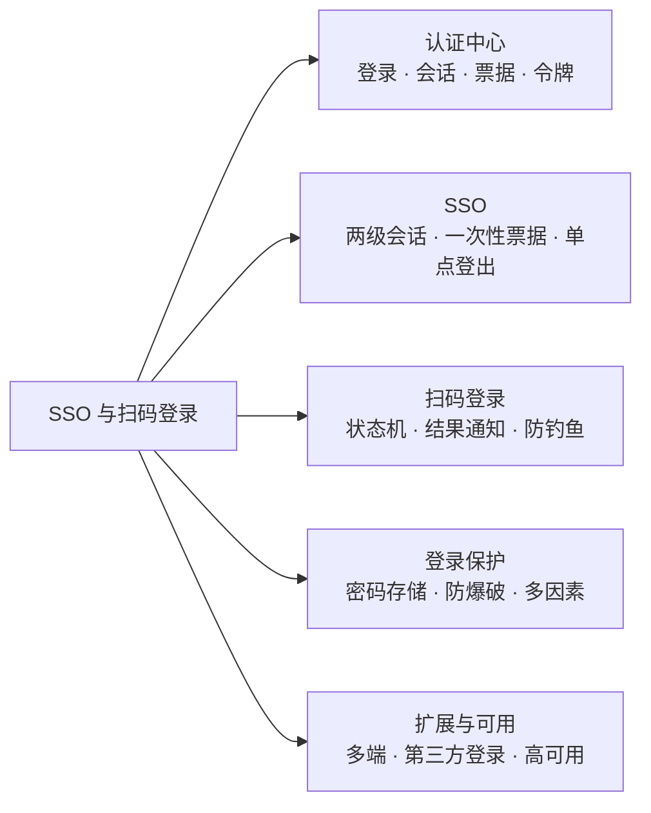
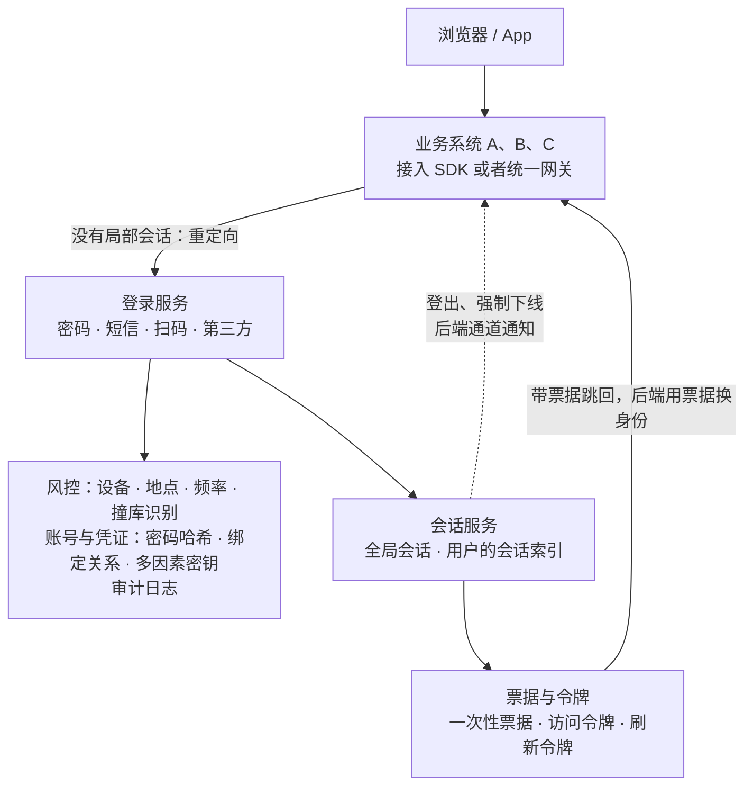
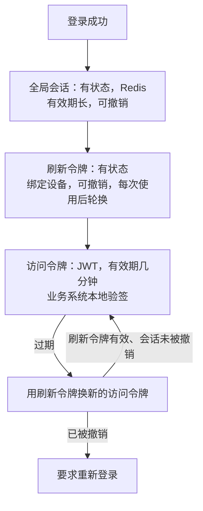
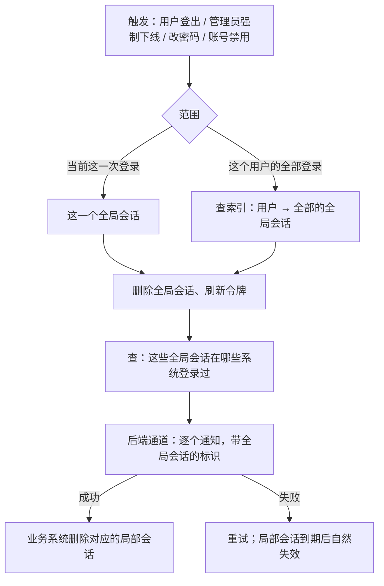
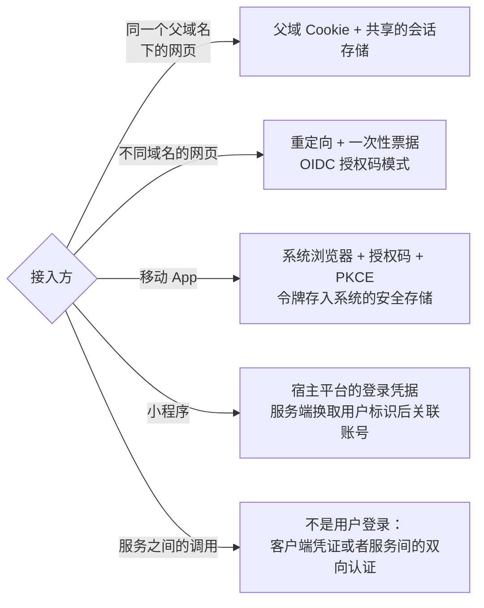
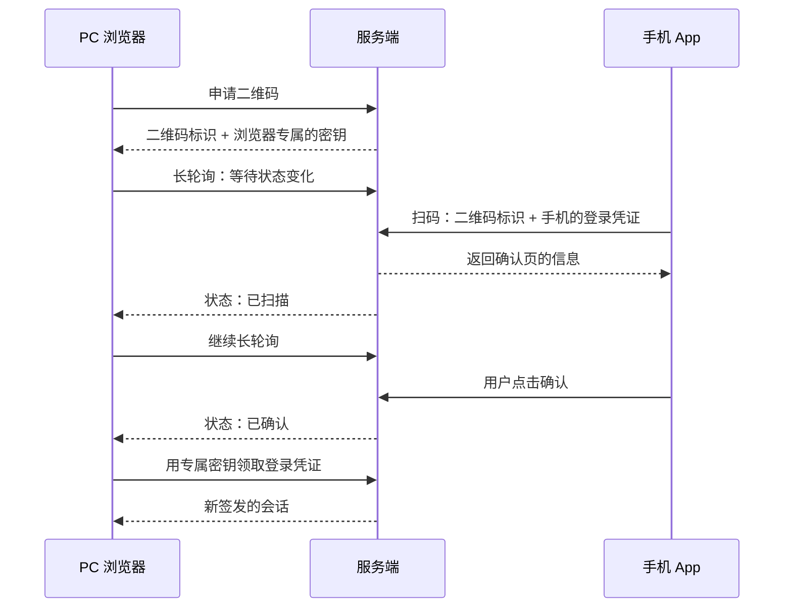
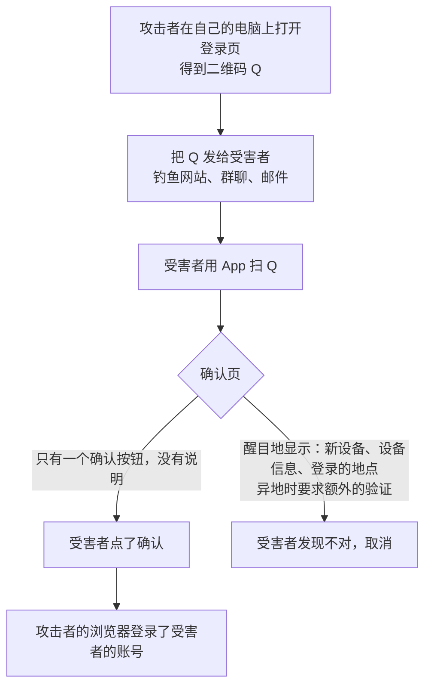
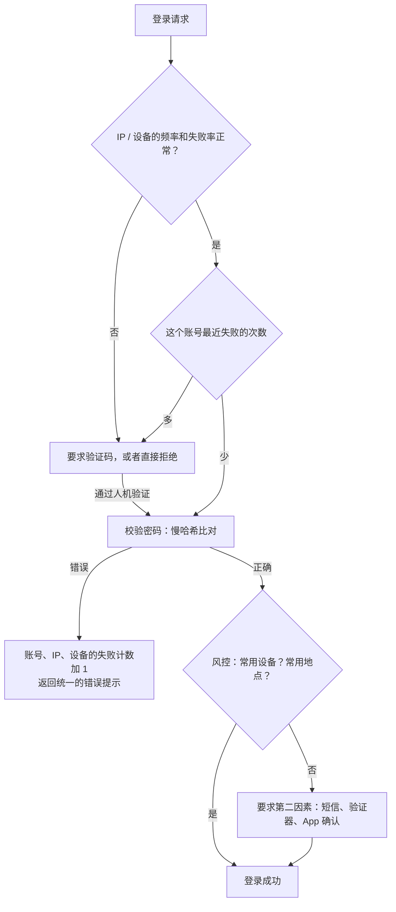
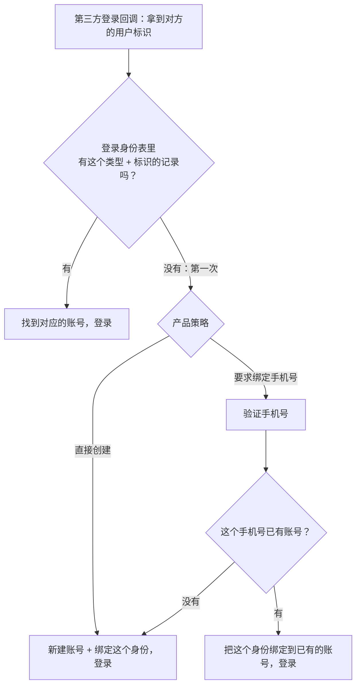
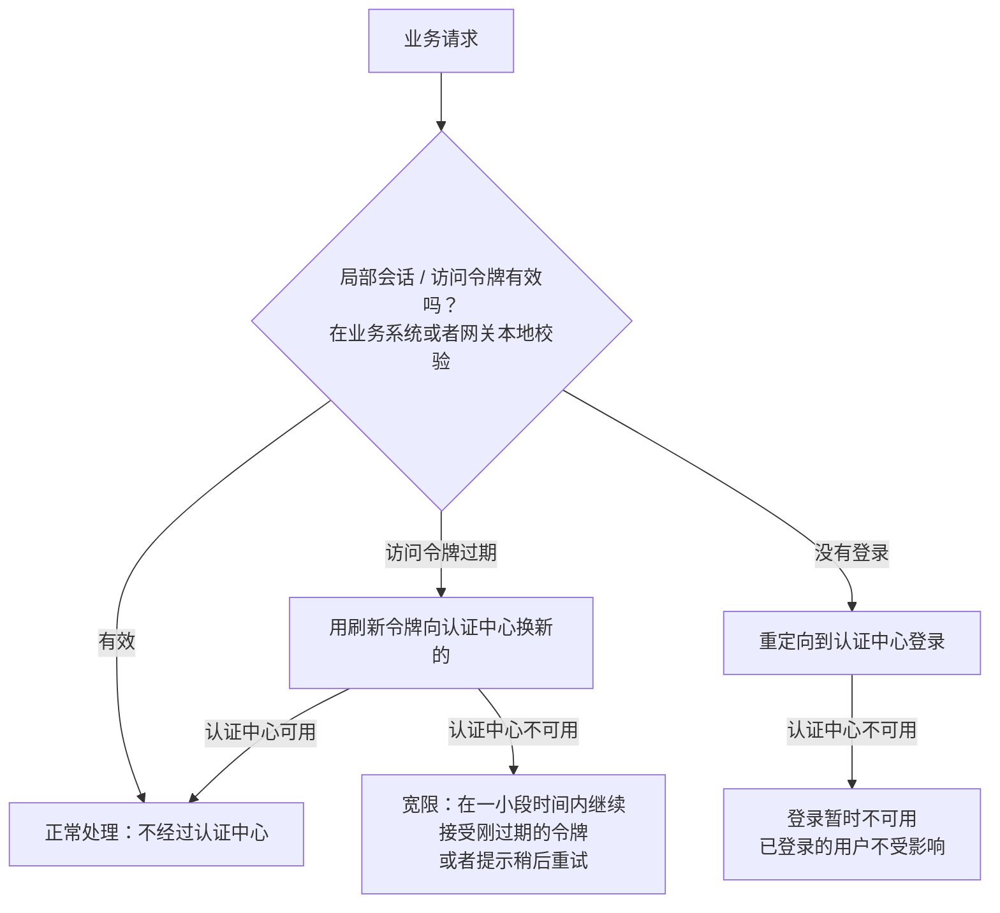

# S21 · SSO 与扫码登录

> 适用岗位：Java 资深开发、Java 架构师。这道题常以"设计一个统一登录系统"的形式出现：公司有多个系统、多个域名、多个端，用户登录一次就能访问全部。[《39 网络安全》](../08-计算机基础/39-网络安全.md)的 39-20、39-21 已经讲了 SSO 和扫码登录的流程与状态机，本文不重复，站在"认证中心这个系统怎么设计"的角度展开：会话与令牌、票据、单点登出、登录保护和高可用。
> 版本基线：JDK 21 / 25、Spring Security 7.x、Redis 7.x / 8.x。
> 事实核对：
> - SSO 的两级会话与一次性票据、单点登出的前端通道与后端通道、`SameSite` 的影响、扫码登录的状态机和三条安全底线，沿用 39-20、39-21 的结论；密码存储沿用 39-08；Session 与 JWT 的取舍沿用 39-09；OAuth 2.0、PKCE、OIDC 沿用 39-10。
> - 本机运行（macOS 27.2、Apple M1 Max、JDK 25）：1 段认证中心与业务系统交互的代码只依赖 JDK，时间用可以手动推进的时钟模拟，文中贴的是实际运行输出。会话 ID 和票据由 `SecureRandom` 生成，每次运行都不同，输出里只展示了长度。
> 相关分类：[《39 网络安全》](../08-计算机基础/39-网络安全.md)（密码存储、Session 与 JWT、OAuth 2.0、SSO、扫码登录）、[《37 计算机网络》](../08-计算机基础/37-计算机网络.md)（轮询、长轮询、WebSocket）、[《17 Redis》](../04-数据存储/17-Redis.md)、[《26 高可用》](../06-三高与架构/26-高可用.md)、[《S20 开放平台 API 网关》](S20-开放平台API网关.md)

## 45 分钟答题版

| 时间 | 做什么 | 要讲出的关键点 | 子题 |
| --- | --- | --- | --- |
| 0～5 分钟 | 澄清需求 | 多少个系统、是否跨域名、有哪些端、有哪些登录方式 | S21-01 |
| 5～12 分钟 | 整体架构 | 认证中心：登录、会话、票据与令牌、凭证、风控、审计 | S21-02 |
| 12～25 分钟 | SSO | 两级会话；一次性票据的三个限制；会话与令牌的设计；单点登出 | S21-03 ～ S21-05 |
| 25～33 分钟 | 扫码登录 | 三方的交互与状态机；PC 怎么知道结果；钓鱼二维码的防护 | S21-07、S21-08 |
| 33～45 分钟 | 安全与可用 | 密码与登录保护；多端与第三方登录；认证中心的高可用 | S21-06、S21-09 ～ S21-11 |

## 知识地图



## 题目索引

| 编号 | 题目 | 难度 |
| --- | --- | --- |
| S21-01 | 统一登录要解决什么问题？要澄清哪些需求？ | ★★ |
| S21-02 | 认证中心的整体架构怎么设计？ | ★★★ |
| S21-03 | 跨域名的 SSO 是怎么传递登录状态的？票据要满足哪些要求？ | ★★★ |
| S21-04 | 会话和令牌怎么设计？有状态的会话还是 JWT？ | ★★★ |
| S21-05 | 单点登出和强制下线怎么做？ | ★★★ |
| S21-06 | 同一个父域名、移动 App、小程序，分别怎么接入？ | ★★ |
| S21-07 | 扫码登录的流程怎么设计？PC 怎么知道手机已经确认了？ | ★★★ |
| S21-08 | 扫码登录有哪些安全风险？ | ★★★ |
| S21-09 | 登录接口怎么防暴力破解和撞库？ | ★★★ |
| S21-10 | 接入微信、Apple 这类第三方登录，账号怎么关联？ | ★★ |
| S21-11 | 认证中心是全公司的单点，高可用怎么做？ | ★★★ |

---

## 一、需求与架构

### S21-01 统一登录要解决什么问题？要澄清哪些需求？

> ★★ ｜ 资深 / 架构师 ｜ 高频

**考察意图**：统一登录的范围很容易被低估。看你是否把"认证"从各个业务系统里抽出来当成一个独立的平台来对待。

**30 秒版回答**：

- **没有统一登录时**：每个系统各有一套账号和密码，各自实现登录、会话、密码找回。用户要记多套密码、反复登录；每个系统的安全水平参差不齐，最弱的那个决定了整体的安全；员工离职要到每个系统里分别禁用。
- **统一登录的目标**：
  1. **一个账号**：身份只在一个地方管理；
  2. **登录一次**：访问其他系统不用再输密码（SSO）；
  3. **登出一次**：从所有系统退出；管理员能强制某个人下线；
  4. **统一的安全能力**：密码策略、多因素认证、风控、审计，只做一遍。
- **要问的**：
  - 面向谁：员工（对内，系统多、安全要求高），还是用户（对外，量大、体验优先）；
  - 多少个系统，是否跨域名，有没有外采的系统（它们支持什么协议）；
  - 有哪些端：网页、App、小程序、桌面客户端；
  - 有哪些登录方式：密码、短信验证码、扫码、第三方账号、企业的身份系统；
  - 会话多长，是否允许多设备同时在线；
  - 规模：用户数、每秒的登录次数和会话校验次数。

**深入剖析**

| 问题 | 为什么要问 | 本文的假设 |
| --- | --- | --- |
| 对内还是对外？ | 安全强度和体验的侧重不同 | 对外的用户体系，同时讲到对内的差别 |
| 系统是否跨域名？ | 决定能不能共享 Cookie | 多个不同的顶级域名 |
| 用户量？ | 决定会话存储的规模 | 1 亿注册用户，同时有效的会话 5000 万个 |
| 登录的频率？ | 决定登录接口的容量 | 平时每秒几百次；活动或者被攻击时每秒上万次 |
| 会话校验的频率？ | 这是最高频的操作 | 每个业务请求都要校验，每秒几十万次 |

两个数量级的差别值得注意：**登录**是低频的（一个用户几天到几周才登录一次），**会话校验**是极高频的（每个请求一次）。所以认证中心要把这两条路径分开设计：登录可以重一些（多几道安全检查），会话校验必须极快，而且尽量不依赖认证中心本身（S21-04、S21-11）。

**追问链**

1. **认证和授权是一回事吗？** 不是。认证（Authentication）回答"你是谁"；授权（Authorization）回答"你能做什么"。统一登录解决的是认证。每个业务系统里用户有什么权限，通常还是由各个系统自己管理，或者交给一个独立的权限系统。权限模型见[《39 网络安全》](../08-计算机基础/39-网络安全.md)39-11。
2. **对内的员工登录和对外的用户登录有什么不同？** 对内：用户数少，系统多，要对接企业的身份系统和组织架构，强制多因素认证，离职要能立即切断所有的访问。对外：用户量大，登录方式多样（手机号、第三方账号），体验优先，要应对大规模的撞库和薅羊毛。两者的协议和流程是相通的，侧重点不同。

---

### S21-02 认证中心的整体架构怎么设计？

> ★★★ ｜ 架构师 ｜ 中频

**考察意图**：认证中心不只是一个登录页。看你能否列出它的组成部分，并把高频和低频的路径分开。

**30 秒版回答**：

- **登录服务**：登录页和登录接口。支持多种登录方式，每种方式是一个可插拔的"认证器"（密码、短信、扫码、第三方）。认证成功之后的流程是统一的。
- **会话服务**：管理全局会话。创建、查询、续期、销毁；维护"用户 → 他的所有会话"的索引，用于多设备管理和强制下线。
- **票据与令牌服务**：签发和校验 SSO 的一次性票据；签发访问令牌和刷新令牌。
- **账号与凭证服务**：账号的基本信息；密码的哈希；绑定的手机号、邮箱、第三方账号；多因素认证的密钥。这是最敏感的数据。
- **风控**：登录前后的风险判断。异常的设备、地点、频率；撞库和暴力破解的识别；决定是否要求额外的验证。
- **审计**：每一次登录、登出、修改密码、绑定和解绑，都记录下来，可以查询。
- **接入的一侧**：业务系统通过统一的 **SDK** 或者**网关**完成对接和会话的校验，不各自实现。
- **两条路径**：
  - 登录（低频、重）：经过完整的认证和风控；
  - 会话校验（高频、轻）：在业务系统或者网关本地完成，或者只读一次缓存。

**深入剖析**



各部分的数据和存储：

| 数据 | 特点 | 存储 |
| --- | --- | --- |
| 账号、凭证 | 量大、读多写少、最敏感 | 数据库，分库分表；敏感字段加密；密码只存哈希 |
| 全局会话 | 量大、有过期时间、读写都频繁 | Redis，带过期时间；需要持久化和多副本 |
| 用户的会话索引 | 一个用户对应多个会话 | Redis 的 Set 或者 Hash |
| 一次性票据 | 生命周期几十秒 | Redis，取出即删除 |
| 刷新令牌 | 有效期长（几天到几个月），要能撤销 | 数据库或者 Redis，按用户可查 |
| 审计日志 | 只追加，量大 | 日志系统 / 数据仓库 |

**追问链**

1. **多种登录方式怎么组织代码？** 每种登录方式实现同一个接口：输入是这种方式特有的凭据，输出是"认证出的用户"或者失败的原因。认证成功之后的步骤（风控、创建会话、签发票据、审计）是公共的，只写一遍。新增一种登录方式只需要新增一个认证器。Spring Security 的认证管理器加多个认证提供者就是这个结构，见[《39 网络安全》](../08-计算机基础/39-网络安全.md)39-12。
2. **业务系统自己还要保存用户表吗？** 业务系统通常需要自己的用户扩展信息（在这个系统里的角色、偏好），用认证中心的用户 ID 关联。但**凭证**（密码、绑定的手机号）只在认证中心。业务系统不接触密码，这是统一登录在安全上最大的价值。
3. **认证中心要对外提供哪些接口？** 面向浏览器：登录页、授权端点、登出。面向业务系统的后端：票据或者授权码换令牌、令牌的校验（或者提供公钥）、用户信息、登出的通知。面向管理：会话的查询和强制下线、审计的查询。标准化的做法是按 OIDC 的规范来实现，这样外采的系统也能直接对接。

---

## 二、SSO

### S21-03 跨域名的 SSO 是怎么传递登录状态的？票据要满足哪些要求？

> ★★★ ｜ 资深 / 架构师 ｜ 高频

**考察意图**：SSO 的核心机制。看你是否理解"浏览器重定向 + 后端换票"这两步各自的作用，以及票据为什么要有那么多限制。

**30 秒版回答**：

- **难点**：Cookie 不能跨域名共享。`a.com` 的页面读不到 `sso.com` 的 Cookie。
- **两级会话**：认证中心有一个**全局会话**（Cookie 在认证中心的域名下）；每个业务系统有自己的**局部会话**（Cookie 在各自的域名下）。
- **状态靠"重定向 + 一次性票据"传递**：
  1. 用户访问系统 A，A 没有局部会话，把浏览器重定向到认证中心；
  2. 浏览器访问认证中心时，自动带上认证中心域名下的 Cookie。认证中心据此知道有没有全局会话；
  3. 没有就登录；有了全局会话之后，认证中心生成一张**票据**，带着它把浏览器重定向回 A；
  4. A 的**后端**拿票据去认证中心换取用户的身份，然后建立局部会话。
- **票据的四个要求**：
  1. **随机、不可猜测**；
  2. **一次性**：用过就失效；
  3. **短时效**：几十秒；
  4. **绑定**：只能由它被签发给的那个系统使用。
- 完整的流程图和"为什么不把用户信息直接放在 URL 里"的解释见[《39 网络安全》](../08-计算机基础/39-网络安全.md)39-20。

**深入剖析**

用 JDK 模拟认证中心和两个业务系统（本机 JDK 25 运行）：

```java
import java.security.SecureRandom;
import java.util.ArrayList;
import java.util.HashMap;
import java.util.HexFormat;
import java.util.List;
import java.util.Map;

/**
 * 单点登录的核心数据：全局会话、一次性票据、局部会话，以及后端通道的单点登出。
 * 认证中心和两个业务系统都在同一个进程里模拟，时间用可以手动推进的时钟。
 */
public class SsoDemo {

    private static final long TICKET_TTL_MILLIS = 30_000L;
    private static final int RANDOM_BYTES = 24;
    private static final SecureRandom RANDOM = new SecureRandom();

    static String randomId() {
        byte[] bytes = new byte[RANDOM_BYTES];
        RANDOM.nextBytes(bytes);
        return HexFormat.of().formatHex(bytes);
    }

    /** 一次性票据：绑定了它要交给哪个系统，以及属于哪个全局会话 */
    record Ticket(String clientId, String globalSessionId, long expireAt) { }

    /** 认证中心 */
    static final class AuthCenter {
        /** 全局会话 ID → 用户 */
        private final Map<String, String> globalSessions = new HashMap<>();
        private final Map<String, Ticket> tickets = new HashMap<>();
        /** 全局会话 ID → 已经用它登录过的系统，单点登出时逐个通知 */
        private final Map<String, List<BizSystem>> loggedInSystems = new HashMap<>();
        long now;

        String login(String userId) {
            String globalSessionId = randomId();
            globalSessions.put(globalSessionId, userId);
            return globalSessionId;
        }

        /** 浏览器带着全局会话来，要去 clientId 这个系统：签发一张票据 */
        String issueTicket(String globalSessionId, String clientId) {
            if (!globalSessions.containsKey(globalSessionId)) {
                return null;                          // 没有全局会话：应该展示登录页
            }
            String ticketId = randomId();
            tickets.put(ticketId, new Ticket(clientId, globalSessionId, now + TICKET_TTL_MILLIS));
            return ticketId;
        }

        /** 业务系统的后端拿票据换身份。票据取出即删除，所以只能用一次 */
        String[] validate(String ticketId, BizSystem caller) {
            Ticket ticket = tickets.remove(ticketId);
            if (ticket == null) {
                return fail("ticket not found or already used");
            }
            if (now > ticket.expireAt()) {
                return fail("ticket expired");
            }
            if (!ticket.clientId().equals(caller.clientId)) {
                return fail("ticket was issued for " + ticket.clientId());
            }
            String userId = globalSessions.get(ticket.globalSessionId());
            if (userId == null) {
                return fail("global session ended");
            }
            loggedInSystems.computeIfAbsent(ticket.globalSessionId(), k -> new ArrayList<>()).add(caller);
            return new String[] {userId, ticket.globalSessionId(), "ok"};
        }

        /** 单点登出：删除全局会话，并通过后端通道通知每个系统 */
        int logout(String globalSessionId) {
            globalSessions.remove(globalSessionId);
            int notified = 0;
            for (BizSystem system : loggedInSystems.getOrDefault(globalSessionId, List.of())) {
                system.backChannelLogout(globalSessionId);
                notified++;
            }
            loggedInSystems.remove(globalSessionId);
            return notified;
        }

        private static String[] fail(String reason) {
            return new String[] {null, null, reason};
        }
    }

    /** 业务系统 */
    static final class BizSystem {
        final String clientId;
        private final AuthCenter authCenter;
        /** 局部会话 ID → 用户 */
        private final Map<String, String> localSessions = new HashMap<>();
        /** 全局会话 ID → 局部会话 ID，用来在收到登出通知时找到要删除的局部会话 */
        private final Map<String, List<String>> localByGlobal = new HashMap<>();

        BizSystem(String clientId, AuthCenter authCenter) {
            this.clientId = clientId;
            this.authCenter = authCenter;
        }

        /** 浏览器带着票据回来：后端去认证中心换身份，成功则建立局部会话 */
        String callback(String ticketId) {
            String[] result = authCenter.validate(ticketId, this);
            if (result[0] == null) {
                return "REJECT (" + result[2] + ")";
            }
            String localSessionId = randomId();
            localSessions.put(localSessionId, result[0]);
            localByGlobal.computeIfAbsent(result[1], k -> new ArrayList<>()).add(localSessionId);
            return localSessionId;
        }

        String whoAmI(String localSessionId) {
            return localSessions.getOrDefault(localSessionId, "not logged in");
        }

        void backChannelLogout(String globalSessionId) {
            for (String localSessionId : localByGlobal.getOrDefault(globalSessionId, List.of())) {
                localSessions.remove(localSessionId);
            }
            localByGlobal.remove(globalSessionId);
        }
    }

    public static void main(String[] args) {
        AuthCenter authCenter = new AuthCenter();
        BizSystem systemA = new BizSystem("system-a", authCenter);
        BizSystem systemB = new BizSystem("system-b", authCenter);

        // 1. 第一次访问系统 A：没有全局会话，登录后拿到票据，换成 A 的局部会话
        System.out.println("1 ticket without global session : " + authCenter.issueTicket("no-such-session", "system-a"));
        String global = authCenter.login("u1001");
        String ticketA = authCenter.issueTicket(global, "system-a");
        String localA = systemA.callback(ticketA);
        System.out.println("2 system A, ticket length " + ticketA.length() + "       : " + systemA.whoAmI(localA));

        // 2. 票据的三个限制
        System.out.println("3 same ticket used again        : " + systemA.callback(ticketA));
        String ticketForB = authCenter.issueTicket(global, "system-b");
        System.out.println("4 ticket for B presented to A   : " + systemA.callback(ticketForB));
        String slowTicket = authCenter.issueTicket(global, "system-a");
        authCenter.now += TICKET_TTL_MILLIS + 1;
        System.out.println("5 ticket used after 30 seconds  : " + systemA.callback(slowTicket));

        // 3. 访问系统 B：已有全局会话，不需要再输入密码
        String localB = systemB.callback(authCenter.issueTicket(global, "system-b"));
        System.out.println("6 system B without password     : " + systemB.whoAmI(localB));

        // 4. 单点登出：认证中心通过后端通道通知两个系统
        System.out.println("7 logout, systems notified      : " + authCenter.logout(global));
        System.out.println("8 after logout, A / B           : " + systemA.whoAmI(localA) + " / " + systemB.whoAmI(localB));
        System.out.println("9 ticket after logout           : " + authCenter.issueTicket(global, "system-a"));
    }
}
```

```text
1 ticket without global session : null
2 system A, ticket length 48       : u1001
3 same ticket used again        : REJECT (ticket not found or already used)
4 ticket for B presented to A   : REJECT (ticket was issued for system-b)
5 ticket used after 30 seconds  : REJECT (ticket expired)
6 system B without password     : u1001
7 logout, systems notified      : 2
8 after logout, A / B           : not logged in / not logged in
9 ticket after logout           : null
```

- 第 1 行：没有全局会话时拿不到票据，要先登录；
- 第 2 行：登录后，系统 A 用票据换到了用户身份，建立了局部会话。票据是 48 个十六进制字符（192 位的随机数）；
- 第 3～5 行是票据的三个限制：同一张票据再用一次，被拒绝（**一次性**）；签发给系统 B 的票据拿到系统 A 去用，被拒绝（**绑定**）；超过 30 秒才使用，被拒绝（**短时效**）；
- 第 6 行：访问系统 B 时，认证中心已经有全局会话，直接签发票据，用户不需要再输入密码。这就是"登录一次"；
- 第 7～9 行是单点登出，下一题讲。

每个限制防的是什么：

| 限制 | 没有它会怎样 |
| --- | --- |
| 随机、足够长 | 攻击者可以猜出或者枚举出有效的票据 |
| 一次性 | 票据出现在浏览器历史、日志、Referer 里，别人拿到后可以再用一次 |
| 短时效 | 泄露的票据在很长的时间里都有效 |
| 绑定系统 | 一个安全性差的系统拿到的票据，可以被用来登录另一个重要的系统 |
| 后端换取，并且系统要证明自己的身份 | 任何拿到票据的人都能换到用户的身份 |

**追问链**

1. **票据和 OAuth 2.0 的授权码是什么关系？** 是同一个东西。用 OIDC 实现 SSO 时，票据就是授权码，"后端换身份"就是用授权码加上客户端的密钥换取令牌。CAS 里叫 Service Ticket。名字不同，作用和要求完全一样。
2. **重定向回业务系统的地址能随便填吗？** 不能。每个系统要事先在认证中心登记自己的回调地址，认证中心只把票据送到登记过的地址，并且要**精确匹配**。否则攻击者可以构造一个登录链接，让认证中心把票据送到他的服务器。前缀匹配或者通配符都可能被绕过。
3. **系统 A 发起登录时带的 `state` 有什么用？** 防止"登录的跨站请求伪造"：攻击者用自己的账号走完流程，拿到一张属于他自己的票据，然后诱导受害者的浏览器带着这张票据访问 A 的回调地址，受害者就以攻击者的身份登录了，之后的操作都记在攻击者的账号下。`state` 是 A 在发起登录时生成的随机值，和当前的浏览器会话绑定，回调时校验，就能发现这次回调不是自己发起的。

---

### S21-04 会话和令牌怎么设计？有状态的会话还是 JWT？

> ★★★ ｜ 架构师 ｜ 高频

**考察意图**：认证系统里最重要的取舍：能不能立即撤销，和校验要不要访问存储。看你是否能根据场景组合使用。

**30 秒版回答**：

- **有状态的会话**：令牌只是一个随机的 ID，真正的内容（用户、过期时间、设备）存在服务端（Redis）。校验要查存储。
  - 优点：可以**立即撤销**（删除记录即可）；内容可以随时更新；令牌很短；
  - 缺点：每次校验都要访问存储。
- **自包含的令牌（JWT）**：内容和签名都在令牌里。校验只需要验签，不查存储。
  - 优点：校验快，不依赖认证中心和存储；
  - 缺点：**签发之后收不回来**，只能等它过期；内容不能更新；令牌比较长。
- **常见的组合**：
  - **全局会话**：有状态的，放在 Redis 里。它是一切的根，必须能撤销；
  - **访问令牌**：短有效期（几分钟到几十分钟）的 JWT，业务系统或者网关在本地验签；
  - **刷新令牌**：有状态的、长有效期的。访问令牌过期后，用它换新的。撤销用户的登录就是删除刷新令牌（和全局会话），访问令牌最多再活几分钟。
- **撤销的延迟 = 访问令牌的有效期**。对撤销的及时性要求越高，访问令牌就要越短，或者干脆用有状态的会话。
- **续期**：用户持续活跃时，会话不应该过期。滑动过期：每次使用时把过期时间往后推。同时设一个绝对的上限（比如 30 天必须重新登录）。

**深入剖析**



三种方案的对比：

| | 纯有状态的会话 | 纯 JWT | 短期 JWT + 有状态的刷新令牌 |
| --- | --- | --- | --- |
| 校验的开销 | 每次查 Redis | 本地验签 | 本地验签 |
| 撤销 | 立即 | 做不到，或者要维护黑名单 | 延迟最多是访问令牌的有效期 |
| 对认证中心的依赖 | 每次校验都依赖会话存储 | 不依赖 | 只在刷新时依赖 |
| 实现的复杂度 | 低 | 低 | 较高：要处理刷新、并发刷新、轮换 |
| 适合 | 单体或者少量的系统；对撤销要求高 | 很少单独使用 | 系统多、调用量大的微服务和开放平台 |

刷新令牌的**轮换**：每次用刷新令牌换新的访问令牌时，同时发一个新的刷新令牌，旧的作废。如果一个已经作废的刷新令牌又被使用了，说明它被泄露了（合法的客户端已经换过新的了），这时把这个用户这条登录链上的所有令牌都撤销。这是检测刷新令牌被盗的一种办法。

JWT 的安全细节（算法的选择、密钥的轮换、不要在里面放敏感信息）见[《39 网络安全》](../08-计算机基础/39-网络安全.md)39-09。

**追问链**

1. **令牌放在浏览器的哪里？** 放在 Cookie 里，并设置 `HttpOnly`（脚本读不到，防 XSS 窃取）、`Secure`（只在 HTTPS 下发送）、合适的 `SameSite`（防 CSRF）。放在 localStorage 里的令牌可以被页面上任何的脚本读取，一个 XSS 漏洞就能把它偷走。前后端分离的应用如果必须在脚本里使用令牌，至少把长期有效的刷新令牌放在 `HttpOnly` 的 Cookie 里。
2. **用户权限变了（比如被取消了管理员），已经签发的 JWT 里还是旧的权限怎么办？** 这就是自包含令牌的问题。办法：令牌里不放易变的权限，只放用户 ID，权限在每次请求时从缓存里读；或者接受最多一个访问令牌有效期的延迟；或者权限变更时主动撤销这个用户的会话，强制重新获取。
3. **会话的数据量有多大？** 5000 万个有效的会话，每个几百字节，约十几 GB，Redis 集群可以承载。要给会话设置合理的过期时间，并且限制单个用户同时有效的会话数。

---

### S21-05 单点登出和强制下线怎么做？

> ★★★ ｜ 资深 / 架构师 ｜ 中频

**考察意图**：登出比登录难。看你是否知道需要哪些数据才能找到并销毁所有相关的会话。

**30 秒版回答**：

- **单点登出**（用户主动退出）：销毁全局会话，并且让所有用这个全局会话建立的局部会话失效。
- **认证中心要记住**："这个全局会话在哪些系统登录过"。签发票据并被成功换取时登记。
- **后端通道**：登出时，认证中心在服务端逐个调用这些系统的登出接口，带上全局会话的标识。
- **业务系统要记住**："全局会话 → 我这里的局部会话"。收到登出通知时，据此删除自己的局部会话。
- **强制下线**（管理员操作，或者系统自动触发）：
  - 踢掉某个用户的某一台设备：销毁那个会话；
  - 踢掉某个用户的全部登录：通过"用户 → 会话列表"的索引找到他所有的全局会话，逐个执行登出；
  - **改密码、账号被盗、账号被禁用**之后，自动执行"踢掉全部"。
- **前提**：局部会话是服务端可以删除的。如果业务系统只认一个长有效期的 JWT，登出就做不到（S21-04）。
- **兜底**：后端通道的通知可能失败（某个系统宕机了）。重试；同时局部会话的有效期不要太长，或者让业务系统定期向认证中心确认全局会话是否还在。

**深入剖析**

上一题演示输出的最后三行：

```text
7 logout, systems notified      : 2
8 after logout, A / B           : not logged in / not logged in
9 ticket after logout           : null
```

- 登出时认证中心通知了 2 个系统（A 和 B）；
- 之后用原来的局部会话访问 A 和 B，都显示未登录；
- 全局会话已经销毁，再想拿票据也拿不到了。

代码里的两个索引是登出能工作的关键：认证中心的 `loggedInSystems`（全局会话 → 登录过的系统），以及每个业务系统的 `localByGlobal`（全局会话 → 局部会话）。



需要维护的索引：

| 索引 | 位置 | 用途 |
| --- | --- | --- |
| 用户 → 全局会话列表 | 认证中心 | 多设备管理（"我的登录设备"）、踢掉全部 |
| 全局会话 → 登录过的系统 | 认证中心 | 登出时知道要通知谁 |
| 全局会话 → 局部会话 | 每个业务系统 | 收到通知时知道要删哪个 |

**追问链**

1. **前端通道的登出为什么不可靠？** 它依赖浏览器去逐个访问各个系统的登出地址（用隐藏的 iframe 或者连续的重定向）。用户中途关掉页面就登不干净；浏览器对第三方 Cookie 的限制会让 iframe 里的请求带不上 Cookie。它不需要业务系统维护索引，实现简单，但只能作为补充。
2. **"修改密码后其他设备全部下线"怎么实现？** 修改密码成功后，用"用户 → 全局会话列表"找到所有的会话，保留当前操作的这一个，其余的全部执行登出。另一种做法是给用户记录一个"凭证版本号"，每个会话记录它创建时的版本号；改密码时版本号加 1，校验会话时发现版本号落后就拒绝。后者不需要遍历，但要求每次校验都读一下用户的当前版本号（可以缓存）。
3. **访问令牌是 JWT 的话，强制下线怎么立即生效？** 做不到完全立即。可以维护一份很小的**吊销列表**（被强制下线的会话 ID，保存到这些令牌自然过期为止），网关校验 JWT 时顺便查一下这份列表。列表很小，可以推送到每个网关实例的内存里。这是在"无状态"和"可撤销"之间的折中。

---

### S21-06 同一个父域名、移动 App、小程序，分别怎么接入？

> ★★ ｜ 资深 ｜ 中频

**考察意图**：不同的端有不同的约束。看你是否知道哪些场景可以简化、哪些场景有特殊的安全要求。

**30 秒版回答**：

- **同一个父域名下的多个子系统**（`a.example.com`、`b.example.com`）：最简单。把会话 Cookie 的作用域设成父域名 `.example.com`，所有的子系统都能读到同一个 Cookie；会话数据放在共享的存储里。不需要重定向和票据。
  - 代价：所有的子域名共享同一个凭证，其中一个子系统有漏洞（比如 XSS），就影响到全部。安全级别差别大的系统不适合这样做。
- **不同的顶级域名**：只能用重定向加票据的方式（S21-03）。
- **移动 App**：
  - App 不应该自己画一个输入框收集认证中心的密码再转发；
  - 标准的做法：打开**系统浏览器**（或者系统提供的安全浏览器组件），在认证中心的页面上登录，完成后通过应用链接跳回 App，用**授权码加 PKCE** 换取令牌；
  - 同一台设备上的多个 App 共享系统浏览器里认证中心的会话，于是实现了 App 之间的 SSO；
  - 令牌保存在系统提供的安全存储里。
- **同一家公司的多个 App**：除了上面的方式，还可以通过系统提供的应用间共享存储（同一个开发者签名的应用可以共享一块安全的存储区域）共享登录状态。
- **小程序**：运行在宿主 App 里，用宿主提供的登录能力拿到一个临时的凭据，自己的服务端用它向宿主的平台换取用户的标识，再和自己的账号体系关联（S21-10）。

**深入剖析**



为什么 App 要用 PKCE：App 是"公开的客户端"，安装包可以被反编译，里面放不住密钥。没有密钥，"授权码换令牌"这一步就无法证明换令牌的是发起登录的那个 App：另一个恶意的 App 可以注册相同的回跳链接，截获授权码。PKCE 的做法是：App 在发起登录时生成一个随机值，只把它的哈希发给认证中心；换令牌时再出示这个随机值本身。截获了授权码的人没有这个随机值，换不到令牌。原理见[《39 网络安全》](../08-计算机基础/39-网络安全.md)39-10。

**追问链**

1. **App 里内嵌一个网页视图打开登录页行不行？** 不推荐。内嵌的网页视图由 App 控制，App 可以读取用户在里面输入的密码、注入脚本、拿到 Cookie。对第三方的 App 来说这不可接受。即使是自家的 App，内嵌的网页视图也不和系统浏览器共享 Cookie，无法实现 App 之间的 SSO。
2. **App 的令牌有效期应该多长？** 用户不希望 App 每隔几天就要求重新登录。常见的做法是访问令牌短（几十分钟），刷新令牌很长（几十天到几个月）并且滑动续期：只要用户在用，就一直有效。同时配合设备绑定和风控：换了设备、长时间未使用、出现异常的行为时，要求重新认证。
3. **父域 Cookie 的方案里，会话存储挂了会怎样？** 所有的子系统同时无法识别登录状态。它没有"局部会话"这一层缓冲。所以会话存储要做高可用，子系统可以对最近校验过的会话做很短时间的本地缓存。

---

## 三、扫码登录

### S21-07 扫码登录的流程怎么设计？PC 怎么知道手机已经确认了？

> ★★★ ｜ 资深 ｜ 高频

**考察意图**：三方交互的状态机，以及服务端怎么把结果"告诉"一个没有登录的浏览器。

**30 秒版回答**：

- **本质**：让一个**已经登录**的设备（手机 App），替一个**没有登录**的设备（PC 浏览器）做一次授权。
- **三个参与方**：PC 浏览器、手机 App、服务端。
- **流程**：
  1. PC 向服务端申请一个**二维码标识**。服务端创建一条记录，状态是"待扫描"，有效期一两分钟；同时返回一个**只有这个浏览器知道的密钥**；
  2. PC 把标识画成二维码显示出来，然后开始**等待结果**；
  3. 手机扫码，带着**手机自己的登录凭证**和二维码标识请求服务端。状态变成"已扫描"，记录是哪个用户扫的。PC 显示"请在手机上确认"；
  4. 手机显示确认页，用户点确认。状态变成"已确认"；
  5. PC 得知状态变成了"已确认"，用自己的密钥向服务端领取**一个新签发的登录凭证**，完成登录。
- **PC 怎么等待结果**：
  - **短轮询**：每隔一两秒问一次。简单，有延迟，空请求多；
  - **长轮询**：请求挂起，状态变化或者超时才返回。实时性好，实现也不复杂，是最常见的选择；
  - **WebSocket / SSE**：服务端主动推送。实时性最好，但为一个一两分钟的操作建立长连接，成本偏高。
- **状态存在 Redis 里**，带过期时间。状态的流转用 Lua 脚本或者 CAS 保证原子。
- 状态机和代码见[《39 网络安全》](../08-计算机基础/39-网络安全.md)39-21。

**深入剖析**



二维码里的内容：一个指向服务端的 URL，里面带着二维码标识。它不包含任何的凭证。用系统相机扫这个码，会打开一个引导下载 App 的网页；用自己的 App 扫，App 识别出这是登录的二维码，走授权的流程。

三种等待方式的对比：

| | 短轮询 | 长轮询 | WebSocket |
| --- | --- | --- | --- |
| 实时性 | 取决于间隔 | 好 | 最好 |
| 服务端的开销 | 请求多，但都很轻 | 同时挂起的请求数 = 正在显示二维码的页面数 | 同样数量的长连接 |
| 实现 | 最简单 | 较简单 | 需要长连接的基础设施 |
| 多实例部署 | 无状态，随便哪个实例都能处理 | 挂起请求的实例要能感知到状态的变化 | 同左 |

长轮询在多实例下的处理：手机的"确认"请求可能落在实例 B，而 PC 的长轮询挂在实例 A 上。实例 A 怎么知道状态变了？两种办法：实例 A 在挂起期间每隔几百毫秒查一次 Redis（简单，够用）；或者状态变化时通过 Redis 的发布订阅通知所有的实例，持有这个二维码的长轮询的实例立即返回。几种推送方式的原理见[《37 计算机网络》](../08-计算机基础/37-计算机网络.md)37-19。

**追问链**

1. **二维码过期了怎么办？** PC 轮询得到"已过期"的状态，显示"二维码已失效，点击刷新"。刷新就是重新申请一个新的标识。二维码的有效期要短：它一直显示在屏幕上，时间越长，被别人拍下来利用的风险越大。
2. **有很多人打开登录页但不扫码，会不会占用大量的资源？** 每打开一次就产生一条 Redis 记录和一个挂起的长轮询。记录有过期时间，会自动清理。长轮询的数量可以通过限制单个 IP 的并发数、页面不可见时暂停轮询来控制。
3. **扫码登录和"用手机上的 App 确认登录"（推送确认）有什么区别？** 后者是：在 PC 上输入账号后，服务端给这个账号绑定的手机 App 发一条推送，用户在手机上点确认。它不需要扫码，但 PC 要先输入账号。安全上的考虑类似，都要让用户看清楚"是哪台设备、在哪里请求登录"。

---

### S21-08 扫码登录有哪些安全风险？

> ★★★ ｜ 资深 / 架构师 ｜ 中频

**考察意图**：扫码登录把"输入密码"换成了"扫一下、点一下"，攻击的方式也跟着变了。看你是否知道最主要的风险是钓鱼。

**30 秒版回答**：

- **二维码钓鱼**（最主要的风险）：攻击者在自己的电脑上打开登录页，得到一个二维码，把它发给受害者（放在钓鱼网站上、群里，说"扫码领红包"）。受害者用 App 扫了并且点了确认，登录成功的是**攻击者的浏览器**。
  - 对策：**确认页要把话说清楚**：明确显示"你正在授权一台新的设备登录你的账号"，以及那台设备的信息（浏览器、系统、大概的地点）；确认按钮不能默认选中；对陌生的设备、异地的登录，增加额外的验证或者更醒目的警告。
- **登录凭证被别人领走**：如果"谁拿着二维码标识来问，就把登录结果给谁"，那么任何看到这个二维码的人（屏幕被拍、标识被泄露）都可以抢先领走登录凭证。
  - 对策：申请二维码时，服务端同时返回一个**只有这个浏览器知道的密钥**（放在 `HttpOnly` 的 Cookie 里，或者只在这个页面的内存里）。领取登录结果时必须带上它。二维码里只有标识，没有这个密钥。
- **标识被猜测或者遍历**：对策是标识用足够长的随机数，一次有效，很快过期。
- **手机的凭证泄露给 PC**：对策是手机的凭证只用来向服务端证明"我是谁"，PC 拿到的是**单独签发的、权限可以更小**的新会话。
- **扫码和确认的不是同一个人**：对策是确认时校验确认的用户就是扫码的用户。
- **重放**：对策是状态机的每一步只能从合法的前置状态流转，并且只成功一次。

**深入剖析**



确认页应该展示的信息：

| 信息 | 作用 |
| --- | --- |
| "你正在授权另一台设备登录你的账号" | 让用户明白这个操作的后果 |
| 请求登录的设备：浏览器、操作系统 | 用户能判断这是不是自己的电脑 |
| 请求登录的大致位置（根据 IP） | 自己在北京，请求来自外地，明显不对 |
| 是否是常用的设备 | 陌生的设备要更醒目地警告 |
| 明确的"取消"选项 | 用户有拒绝的途径 |

风控可以做得更主动：PC 的 IP 和手机的 IP 所在的地区差得很远；这个二维码是在一个从未见过的设备上生成的；这个账号短时间内在多台新的设备上登录。出现这些情况时，除了确认，再要求一次密码或者短信验证。

通过扫码登录的 PC 会话，可以被赋予**较低的信任级别**：能浏览、能做普通的操作，但涉及修改密码、支付、解绑手机这类敏感操作时，要求再次验证。这样即使被钓鱼，损失也有限。

**追问链**

1. **"浏览器专属的密钥"具体怎么实现？** 申请二维码时，服务端生成两个随机值：一个是二维码标识（画进二维码里），另一个是密钥（通过 `HttpOnly` 的 Cookie 下发，或者在响应体里返回、由页面保存在内存中）。轮询和领取的请求都必须带上这个密钥，服务端校验它和标识是否匹配。攻击者拍到了二维码，只有标识，没有密钥。
2. **这个密钥能防住钓鱼吗？** 不能。钓鱼的场景里，二维码是攻击者自己的浏览器申请的，密钥就在攻击者那里。密钥防的是"第三者抢领"。钓鱼只能靠确认页的提示和风控。两种风险要分清。
3. **登录成功之后要做什么？** 给用户的手机发一条通知："你的账号刚刚在一台新的设备上登录"，并提供"不是我，立即下线"的入口。在"我的登录设备"里能看到所有的会话并且可以踢掉。

---

## 四、安全与可用

### S21-09 登录接口怎么防暴力破解和撞库？

> ★★★ ｜ 资深 / 架构师 ｜ 高频

**考察意图**：登录接口是全站被攻击最多的接口。看你是否有分层的防护，并且理解"撞库"为什么难防。

**30 秒版回答**：

- **两种攻击**：
  - **暴力破解**：对**一个账号**尝试大量的密码；
  - **撞库**：用从别的网站泄露出来的"账号 + 密码"对，在你的网站上逐个尝试。每个账号只试一两次，来源的 IP 很分散。它利用的是用户在多个网站用同一个密码。
- **密码的存储**：只存慢哈希（Argon2id、bcrypt、scrypt）的结果，每个密码有独立的盐。这是数据库泄露之后的最后一道防线，见[《39 网络安全》](../08-计算机基础/39-网络安全.md)39-08。
- **针对暴力破解**：
  - 按**账号**限制失败的次数：连续失败 N 次后，要求验证码，再失败则临时锁定并且逐步延长锁定的时间；
  - 按 **IP、设备**限制尝试的频率。
- **针对撞库**（按账号的限制对它无效，因为每个账号只试一次）：
  - 看**整体的失败率**：一个 IP、一个设备指纹、一个 IP 段，短时间内尝试了很多**不同的账号**并且大部分失败；
  - 人机识别：验证码、行为分析；
  - 比对已知的泄露密码库：用户设置或者使用的密码出现在泄露库里时，要求修改；
  - 登录成功之后的风控：新设备、异地登录时，要求**第二因素**。
- **多因素认证**是对付撞库最有效的手段：密码对了，没有第二个因素也登录不了。
- **不要泄露信息**：错误提示统一为"账号或密码错误"，不区分"账号不存在"和"密码错误"；响应的时间也不应该有差别。

**深入剖析**



两种攻击的特征和对应的手段：

| | 暴力破解 | 撞库 |
| --- | --- | --- |
| 目标 | 一个或者少数几个账号 | 大量的账号 |
| 每个账号的尝试次数 | 很多 | 一两次 |
| 按账号限制次数 | 有效 | **无效** |
| 按 IP 限制 | 有效（除非用大量的代理） | 攻击者通常有大量的代理 IP，效果有限 |
| 有效的手段 | 账号锁定、验证码 | 整体的失败率监控、设备指纹、人机识别、多因素认证、泄露密码检测 |

账号锁定的副作用：攻击者可以故意输错别人的密码，把别人的账号锁住。所以锁定应该是**临时的、逐步延长的**，并且优先用"要求验证码"而不是"完全拒绝"；也可以只锁定"这个 IP 或者设备对这个账号"的尝试，而不是锁定整个账号。

慢哈希对登录接口的影响：一次密码校验故意设计成需要几十到上百毫秒的 CPU 时间。每秒几千次登录，就需要可观的计算资源，而且攻击者可以用大量的登录请求耗尽 CPU。所以频率限制和人机验证要放在密码校验**之前**。

**追问链**

1. **短信验证码登录有哪些要防的？** 验证码接口本身会被滥用：给任意的手机号发短信（短信轰炸）、消耗短信的费用。要限制每个手机号、每个 IP、每个设备的发送频率，发送前先过人机验证。验证码要短时效、限制尝试的次数（6 位数字只有 100 万种可能，不限制次数就能被枚举）、一次有效、和手机号以及用途绑定。
2. **怎么判断"是不是常用的设备"？** 登录成功之后，给这个设备种一个长期的标识（Cookie 或者 App 里的设备 ID），并且记录在这个用户的可信设备列表里。配合设备指纹（浏览器和系统的各种特征）。这些都可以被伪造，所以它只是风险评估的一个输入，不是唯一的依据。
3. **密码规则应该怎么定？** 长度比复杂度重要：鼓励长的口令。不强制定期修改（会导致用户用有规律的弱密码），而是在发现泄露时要求修改。检查用户设置的密码是否在常见的弱密码和已泄露的密码列表里。有条件的话，提供不需要密码的登录方式（通行密钥），从根本上消除撞库。

---

### S21-10 接入微信、Apple 这类第三方登录，账号怎么关联？

> ★★ ｜ 资深 ｜ 中频

**考察意图**：第三方登录的协议是标准的，难点在自己的账号体系怎么和外部的身份对应。看你是否把"身份"和"账号"分开建模。

**30 秒版回答**：

- **流程**：本质是 OAuth 2.0 / OIDC，这次自己是"第三方应用"：把用户引导到对方的授权页 → 用户同意 → 拿到授权码 → 服务端换取对方平台上的**用户标识**。
- **数据模型：一个账号，多种登录身份**。
  - **账号表**：自己系统里的用户，有自己的用户 ID。业务数据都挂在这个 ID 上；
  - **登录身份表**：身份的类型（密码、手机号、微信、Apple……）、这种身份下的唯一标识、对应的账号 ID；
  - 一个账号可以绑定多种身份，用其中任何一种都能登录到同一个账号。
- **第一次用第三方账号登录时**：身份表里查不到。几种处理：
  - 自动创建一个新的账号并绑定；
  - 要求用户绑定手机号。如果这个手机号已经有账号了，就把这个第三方身份绑定到已有的账号上（合并）；没有就新建；
- **用对方提供的稳定的唯一标识来关联**，不要用昵称、头像、邮箱这类会变的或者不保证唯一的信息。
- **绑定和解绑**是敏感的操作，要验证当前的登录状态并再次确认身份；一个账号至少要保留一种可用的登录方式，不能把最后一种解绑掉。

**深入剖析**



```sql
CREATE TABLE t_account (
    account_id  BIGINT      NOT NULL PRIMARY KEY,
    status      TINYINT     NOT NULL,
    create_time DATETIME(3) NOT NULL
);

CREATE TABLE t_login_identity (
    id            BIGINT       NOT NULL PRIMARY KEY,
    account_id    BIGINT       NOT NULL,
    identity_type VARCHAR(16)  NOT NULL COMMENT 'PASSWORD / PHONE / WECHAT / APPLE……',
    identifier    VARCHAR(128) NOT NULL COMMENT '这种身份下的唯一标识：用户名、手机号、对方平台的用户标识',
    credential    VARCHAR(255) NULL COMMENT '密码的慢哈希；第三方身份不需要',
    create_time   DATETIME(3)  NOT NULL,
    UNIQUE KEY uk_identity (identity_type, identifier),
    KEY idx_account (account_id)
);
```

`uk_identity` 保证一个外部的身份只能绑定到一个账号上。

容易出问题的地方：

| 问题 | 说明 |
| --- | --- |
| 同一个用户产生了两个账号 | 先用手机号注册了一个，后来又用微信登录自动创建了另一个。解决：第一次第三方登录时引导绑定手机号 |
| 账号合并 | 两个都有数据的账号要合并成一个，涉及所有的业务数据。非常复杂，尽量从流程上避免出现 |
| 对方平台的标识不是全局唯一的 | 有的平台对不同的应用返回不同的用户标识，同一家公司的多个应用要用平台提供的"跨应用统一标识" |
| 用邮箱自动关联 | 对方返回的邮箱可能没有验证过。攻击者在对方平台上填一个受害者的邮箱，就接管了受害者的账号。只有对方明确声明邮箱已经验证过，才可以用它来关联 |
| 回调里的 `state` 没有校验 | 可以被用来把攻击者的第三方账号绑定到受害者的账号上 |

**追问链**

1. **用户想换绑微信，怎么做？** 先解绑旧的，再绑定新的。解绑之前要验证身份（密码或者短信），并且检查账号是否还有其他可用的登录方式。绑定新的微信时，要检查这个微信是否已经绑定了别的账号。
2. **对方平台不可用时，用户登录不了怎么办？** 只绑定了这一种登录方式的用户确实登录不了。所以要引导用户绑定手机号，多一种途径。已经登录的用户不受影响，因为他们有自己系统的会话。
3. **企业的身份系统（员工用公司的账号登录第三方的系统）是一样的吗？** 思路一样：外部的身份提供方负责认证，自己的系统把外部的身份映射到本地的账号。协议上常见的是 OIDC 和 SAML。还会多一项：账号的自动开通和回收，员工入职时自动创建、离职时自动禁用。

---

### S21-11 认证中心是全公司的单点，高可用怎么做？

> ★★★ ｜ 架构师 ｜ 中频

**考察意图**：认证中心挂了，所有的系统都无法登录。看你是否通过架构设计，把"认证中心的故障"和"已登录用户的使用"隔离开。

**30 秒版回答**：

- **最重要的一条：已经登录的用户，不能因为认证中心故障而受影响**。
  - 业务系统校验的是**自己的局部会话**，或者在本地验签的访问令牌。这条高频的路径不经过认证中心；
  - 认证中心故障时，受影响的只是"新的登录"和"令牌的刷新"；
  - 所以局部会话和访问令牌的有效期不能太短，要给认证中心的故障留出缓冲的时间。这和"撤销要及时"是一对矛盾，要按系统的安全级别来权衡。
- **认证中心自身**：
  - 无状态的服务，多实例、多机房；
  - 会话存储（Redis）要多副本、能持久化。会话丢失意味着所有人被迫重新登录；
  - 账号和凭证的数据库：主从、读写分离。登录主要是读操作，可以在主库故障时用从库继续提供登录；
  - 依赖的降级：风控超时就按默认的策略放行或者提高验证的强度；短信通道有备用。
- **验签的公钥**要能被业务系统缓存：认证中心暂时不可用时，业务系统仍然能用缓存的公钥校验令牌。
- **防止登录洪峰**：故障恢复之后，大量过期的会话同时来刷新、重新登录。客户端要随机退避；刷新令牌的时间点要打散，不要让大家的令牌在同一时刻过期。
- **变更要格外谨慎**：认证中心的一次错误发布会影响所有的系统。灰度、快速回滚、对登录成功率的实时监控，是必需的。

**深入剖析**



各个依赖故障时的影响：

| 故障 | 已登录的用户 | 新的登录 | 应对 |
| --- | --- | --- | --- |
| 认证中心的服务不可用 | 不受影响，直到局部会话或者令牌过期 | 失败 | 多实例、多机房；令牌过期的宽限 |
| 会话存储不可用 | 用有状态会话的系统全部受影响；用 JWT 的不受影响 | 无法创建会话 | Redis 的高可用；业务系统对会话做短时间的本地缓存 |
| 会话存储丢数据 | 被迫重新登录 | 正常 | 持久化、多副本；恢复后提示用户重新登录 |
| 凭证数据库的主库不可用 | 不受影响 | 密码登录可以读从库；注册、改密码失败 | 主从切换 |
| 风控服务不可用 | 不受影响 | 按降级的策略处理 | 超时要短；降级的方向按安全的要求选择 |
| 短信通道不可用 | 不受影响 | 短信登录、第二因素失败 | 备用的通道；提供其他的验证方式 |

"有效期"上的权衡：

| 局部会话 / 访问令牌的有效期 | 认证中心故障时的缓冲 | 撤销的延迟 |
| --- | --- | --- |
| 短（5 分钟） | 小：5 分钟之后用户陆续受到影响 | 小 |
| 长（数小时） | 大 | 大：被禁用的账号还能用很久 |

对内的管理系统（安全优先）选短的，并配合吊销列表；对外的普通业务（体验优先）可以长一些。

**追问链**

1. **多机房部署时，会话怎么同步？** 会话写入一个机房后，异步复制到其他的机房。用户的请求被路由到另一个机房时，可能会话还没有同步过来。办法：让同一个用户的请求尽量落在同一个机房；会话查不到时回源到其他的机房查一次。会话的写入不频繁（登录、续期），跨机房同步的压力不大。多活的设计见[《26 高可用》](../06-三高与架构/26-高可用.md)26-11。
2. **要监控什么？** 登录的成功率（按登录方式分别看）和耗时；失败原因的分布；会话校验的耗时；令牌刷新的成功率；有效会话的数量；各种风控规则的命中数；被锁定的账号数；短信的发送量和到达率。登录成功率的突然下降是最重要的告警。
3. **认证中心的数据被攻破了，最坏的后果是什么，怎么降低？** 凭证库泄露：密码是慢哈希，短时间内难以还原，但要立即强制所有的用户重置密码，并使所有的会话失效。令牌的签名私钥泄露：攻击者可以伪造任意用户的令牌，要立即轮换密钥，这要求系统事先支持密钥的轮换（多个密钥同时有效、带密钥标识）。所以私钥要放在密钥管理系统或者硬件安全模块里，应用只调用签名的接口，接触不到私钥本身，见[《39 网络安全》](../08-计算机基础/39-网络安全.md)39-17。

**架构师加分点**

- 认证系统的设计围绕着一对矛盾：**撤销要快**和**校验不依赖中心**。有状态的会话撤销快，但每次校验都依赖中心的存储；自包含的令牌校验不依赖中心，但撤销慢。成熟的方案都是在两者之间找一个位置：短期的自包含令牌承担高频的校验，有状态的会话和刷新令牌承担撤销的能力，中间用"访问令牌的有效期"这个参数来调节。能把这个取舍讲清楚，并且按不同安全级别的系统给出不同的参数，就超出了"背流程"的层次。

**生产实践 / 踩坑**

- **每个业务系统各自实现对接的逻辑**：总有一个系统漏掉了 `state` 的校验，或者没有校验票据是不是签发给自己的。对接的逻辑要收敛到统一的 SDK 或者网关里。
- **登出只清除了当前系统的 Cookie**：全局会话还在，用户点一下登录又直接进来了；其他的系统也没有退出。
- **局部会话比全局会话活得长**：员工已经离职、账号已经禁用，某个系统的局部会话还有好几天才过期。
- **回调地址用前缀匹配**：`https://app.example.com` 被 `https://app.example.com.evil.com` 绕过，票据被送到了攻击者的服务器。
- **扫码的确认页只有一个"确认"按钮**：用户分不清自己是在登录还是在领红包，被钓鱼。
- **登录失败时提示"账号不存在"**：攻击者据此枚举出了哪些手机号注册过。
