# S22 · 派单系统

> 适用岗位：Java 资深开发、Java 架构师。派单系统把"需求"（乘客的订单、用户的外卖单）和"供给"（司机、骑手）实时地匹配起来。这道题考察移动对象的位置索引、匹配算法的取舍、一个资源不能被重复分配的并发控制，以及按城市拆分的架构。本文以网约车为例。
> 版本基线：JDK 21 / 25、Redis 7.x / 8.x、Kafka 4.x。
> 事实核对：
> - 本文讲的是派单这类问题的通用设计方法，不是对某一家平台内部实现的还原。文中的司机数、上报间隔、派单窗口、等待时间都是为了推导方案而做的假设。
> - 位置索引（GeoHash、网格、四叉树）的原理沿用[《S15 附近的人》](S15-附近的人.md)的结论。
> - "指派问题"（把 n 个任务分给 m 个执行者，使总代价最小）是经典的组合优化问题，匈牙利算法可以在多项式时间内求出最优解。演示代码规模很小，用的是状态压缩的动态规划，结果同样是最优的。
> - 本机运行（macOS 27.2、Apple M1 Max、JDK 25）：1 段贪心与批量匹配的对比、并发派单的代码只依赖 JDK，随机数种子固定，文中贴的是实际运行输出。距离用的是平面上的直线距离，不代表真实的路网。
> 相关分类：[《S15 附近的人》](S15-附近的人.md)（空间索引）、[《S13 IM 系统》](S13-IM系统.md)（长连接推送）、[《S02 订单超时取消与延迟任务》](S02-订单超时取消与延迟任务.md)（超时处理）、[《26 高可用》](../06-三高与架构/26-高可用.md)、[《42 编程题》](../10-编码与思维/42-编程题.md)（动态规划）

## 45 分钟答题版

| 时间 | 做什么 | 要讲出的关键点 | 子题 |
| --- | --- | --- | --- |
| 0～5 分钟 | 澄清需求 | 派单还是抢单；优化的目标；实时性；规模 | S22-01 |
| 5～12 分钟 | 整体架构 | 位置服务、司机状态、派单引擎、订单、推送；按城市拆分 | S22-02 |
| 12～20 分钟 | 找司机 | 位置上报；内存里的网格索引；先圈范围再过滤状态 | S22-03 |
| 20～32 分钟 | 匹配 | 抢单与派单；贪心与批量匹配；直线距离与预计到达时间 | S22-04 ～ S22-06 |
| 32～40 分钟 | 正确性 | 一个司机只能有一单：状态机加 CAS；拒单、超时后的重派 | S22-07、S22-08 |
| 40～45 分钟 | 运营与可用 | 供需不平衡；引擎的故障恢复与降级 | S22-09、S22-10 |

## 知识地图

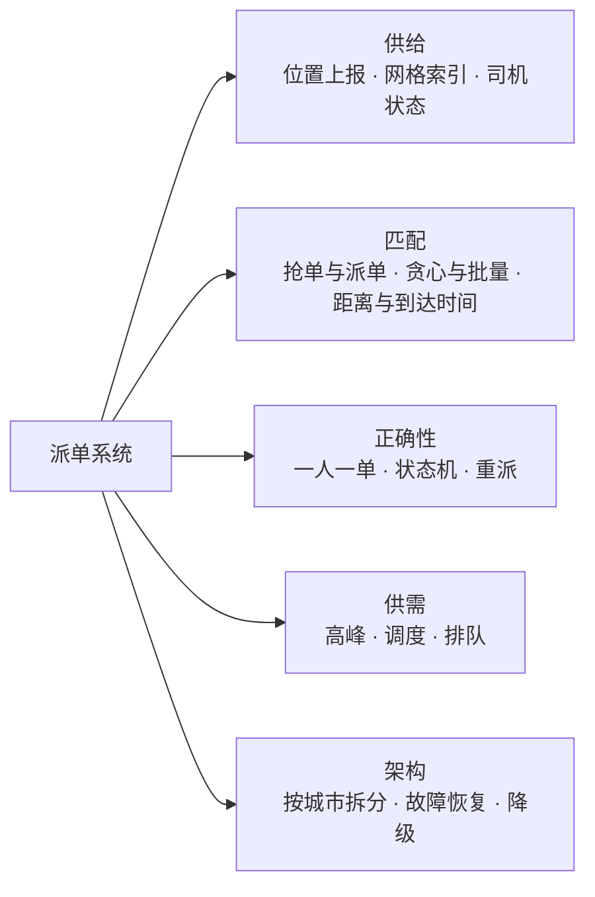

## 题目索引

| 编号 | 题目 | 难度 |
| --- | --- | --- |
| S22-01 | 派单系统要澄清哪些需求？优化的目标是什么？ | ★★ |
| S22-02 | 整体架构怎么设计？ | ★★★ |
| S22-03 | 司机的位置怎么存？怎么快速找到附近的空闲司机？ | ★★★ |
| S22-04 | 抢单和派单有什么区别？怎么选？ | ★★ |
| S22-05 | 来一单派一单，和攒一批一起派，哪个好？ | ★★★ |
| S22-06 | 最近的司机一定最快到吗？距离怎么算？ | ★★ |
| S22-07 | 怎么保证一个司机不会同时被派两个单？ | ★★★ |
| S22-08 | 司机拒单、不响应、接单后取消，怎么处理？ | ★★★ |
| S22-09 | 高峰期车不够，或者某个区域车太多，怎么办？ | ★★ |
| S22-10 | 派单引擎怎么拆分？挂了怎么恢复？ | ★★★ |

---

## 一、需求与架构

### S22-01 派单系统要澄清哪些需求？优化的目标是什么？

> ★★ ｜ 资深 / 架构师 ｜ 中频

**考察意图**：派单不是"找最近的司机"那么简单。看你是否先问清楚要优化什么，以及有哪些约束。

**30 秒版回答**：

- **业务**：乘客发出订单（起点、终点、车型），系统在几秒到几十秒内为它找到一个司机。
- **三方的诉求互相有冲突**：
  - 乘客：尽快有人接单，司机尽快到；
  - 司机：接驾的距离短，不空跑，收入稳定；
  - 平台：成交的订单多，整体的效率高。
- **常见的优化目标**：
  - **应答率**：发出的订单里，有多少被接了；
  - **接驾时长**：从接单到司机到达上车点的时间；
  - **成交率**：最终完成的订单比例（接了又取消的不算）；
  - 全局的效率：所有司机的空驶距离之和最小。
- **约束**：司机的状态（空闲、在途）、车型匹配、司机的服务范围、司机和乘客的偏好和拉黑关系、合规的要求。
- **要问的**：
  - 是系统指派，还是司机抢单；
  - 要多快给出结果；
  - 规模：一个城市同时在线多少司机、高峰期每秒多少订单；
  - 订单的类型：实时单、预约单、拼车（拼车的匹配复杂得多，先不展开）。

**深入剖析**

本文的假设：

| 项目 | 假设 |
| --- | --- |
| 城市 | 一个大城市，同时在线的司机 10 万人，其中空闲的 3 万人 |
| 订单 | 高峰期每秒 500 个新订单 |
| 位置上报 | 司机端每 3 秒上报一次，10 万司机约 3.3 万次/秒 |
| 派单的时限 | 乘客下单后 2～3 秒内给出第一次派单的结果 |
| 司机的响应 | 派单后司机有 10～15 秒确认（或者系统直接指派，不需要确认） |
| 全国 | 几百个城市，各自独立 |

两个结论：

1. **位置上报是最高频的写入**（每秒几万次），而且数据只在很短的时间内有用（几秒之前的位置已经过时了）。它适合放在内存里，不适合每次都写数据库；
2. **匹配是有全局性的**：把司机 A 派给了订单 1，就不能再派给订单 2。它不能像普通的请求那样完全并行地、互不相干地处理。这决定了派单引擎是一个**有状态的、按区域串行或者批量决策**的组件。

**追问链**

1. **派单和"附近的人"有什么不同？** "附近的人"是一次只读的查询，查完就结束了。派单在查询之后还有**分配**：司机是独占的资源，分配要保证互斥；而且分配的好坏有全局的影响。查询的部分可以复用"附近的人"的技术（[《S15 附近的人》](S15-附近的人.md)），分配的部分是派单特有的。
2. **外卖的派单和网约车有什么不同？** 外卖骑手可以同时带多个订单，每个订单有取餐和送餐两个点，还有餐厅出餐时间的不确定性。它是一个路径规划的问题，复杂得多。网约车（不拼车时）是一对一的匹配，相对简单，适合作为面试题的主体。

---

### S22-02 整体架构怎么设计？

> ★★★ ｜ 架构师 ｜ 中频

**考察意图**：能否把"位置""状态""匹配"三件事分开，并说清楚数据在它们之间怎么流动。

**30 秒版回答**：

- **司机端长连接网关**：司机的 App 和服务端保持长连接。上行：位置上报、接单、拒单；下行：派单的推送。
- **位置服务**：接收位置上报，维护"哪个司机在哪里"的空间索引。数据在内存里，高频更新。
- **司机状态服务**：每个司机当前的状态：离线、空闲、已派单待确认、去接驾、服务中。状态的流转是派单正确性的核心。
- **订单服务**：订单的创建和生命周期。
- **派单引擎**：核心。收到待派的订单 → 向位置服务查询附近的候选司机 → 按状态和规则过滤 → 用匹配算法决定派给谁 → 修改司机的状态并通知司机 → 等待司机响应 → 没有成功则重派。
- **路径和预计到达时间服务**：根据路网和实时的路况，计算从司机当前位置到上车点要多久。
- **按城市拆分**：不同城市的司机和订单之间没有任何关系。位置索引、司机状态、派单引擎都按城市（或者更小的区域）分片，各自独立。

**深入剖析**

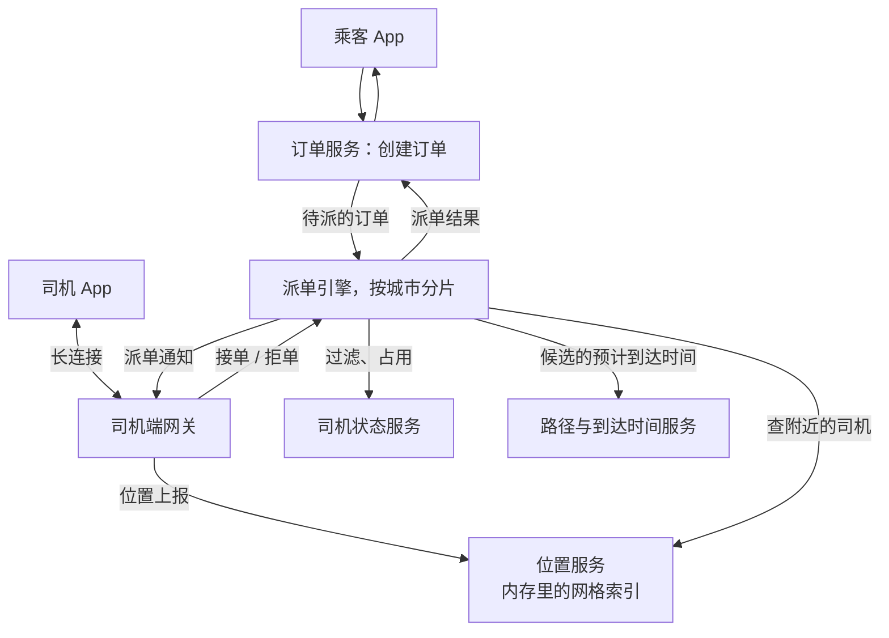

一次派单的时序：

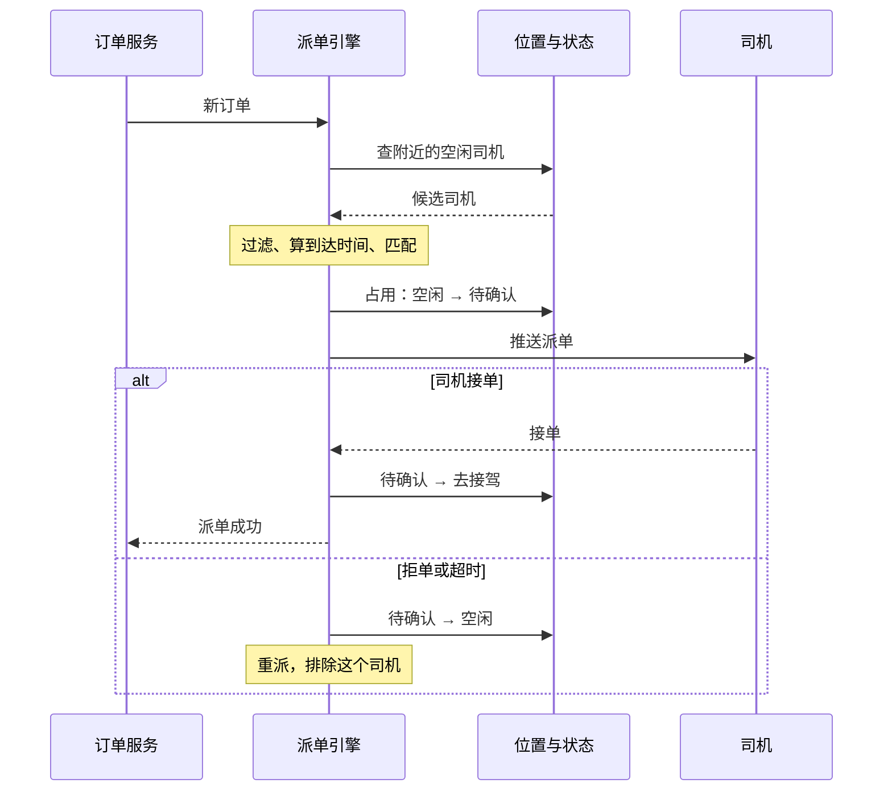

各部分的数据特点：

| 数据 | 更新频率 | 存储 | 丢了会怎样 |
| --- | --- | --- | --- |
| 司机的位置 | 每个司机每 3 秒 | 内存索引（或者 Redis） | 几秒后下一次上报就恢复了 |
| 司机的状态 | 每次接单、完成订单时 | Redis 加数据库 | 不能丢，要能恢复 |
| 订单 | 创建、状态变化时 | 数据库 | 不能丢 |
| 派单的中间状态（正在等哪个司机确认） | 每次派单 | 引擎的内存加持久化的记录 | 引擎重启后要能继续 |

**追问链**

1. **为什么位置服务和状态服务要分开？** 更新的频率和可靠性的要求差得太多。位置每秒几万次更新、允许丢；状态的变更频率低得多、绝对不能错。放在一起，要么位置的写入被可靠性的要求拖慢，要么状态的正确性被高频的写入拖累。
2. **司机端为什么要用长连接？** 派单需要服务端主动、及时地推给司机，必须是长连接；位置上报也走同一条连接，省去反复建连的开销。长连接网关的设计见[《S13 IM 系统》](S13-IM系统.md)S13-03。
3. **乘客端怎么知道派单的结果？** 乘客 App 轮询订单的状态，或者也通过长连接推送。派单一般在几秒到十几秒内完成，轮询就可以；行程中的司机位置更新需要更高的频率，通常用长连接。

---

## 二、找司机

### S22-03 司机的位置怎么存？怎么快速找到附近的空闲司机？

> ★★★ ｜ 资深 / 架构师 ｜ 高频

**考察意图**：高频更新的移动对象，和"附近的人"的侧重点不同。看你是否选择了适合高频写入的索引。

**30 秒版回答**：

- **写入的特点**：10 万个司机每 3 秒上报一次，每秒 3.3 万次更新。每次更新都是"从旧的位置移到新的位置"。
- **网格索引**：把城市划分成固定大小的格子（比如 500 米见方）。维护两张表：
  - 格子 → 这个格子里的司机集合；
  - 司机 → 他当前所在的格子、精确坐标、上报时间。
- **更新**：算出新坐标所在的格子。和原来的格子相同：只更新坐标（绝大多数情况，车在 3 秒内很少跨格子）；不同：从旧格子的集合里移除，加入新格子的集合。都是 O(1)。
- **查询**：根据订单的起点和搜索半径，算出覆盖的格子（起点所在的格子加上周围的一圈或者几圈），取出这些格子里的司机，再精确地计算距离、过滤状态。
- **放在哪**：
  - 派单引擎**进程的内存里**：最快，没有网络开销。引擎按城市分片，每个分片持有这个城市全部司机的位置，10 万个司机只占几十 MB；
  - 或者 Redis 的 GEO：简单，多个服务可以共享，但每次查询和更新都有网络往返，写入量很大时成本高。
- **过期**：司机的位置超过一定时间（比如 30 秒）没有更新，就认为他已经离线，不再参与派单。
- 网格是 GeoHash 的简化版：直接用"行号和列号"当作格子的编号，在一个城市的范围内足够用，而且求相邻的格子非常直接。

**深入剖析**

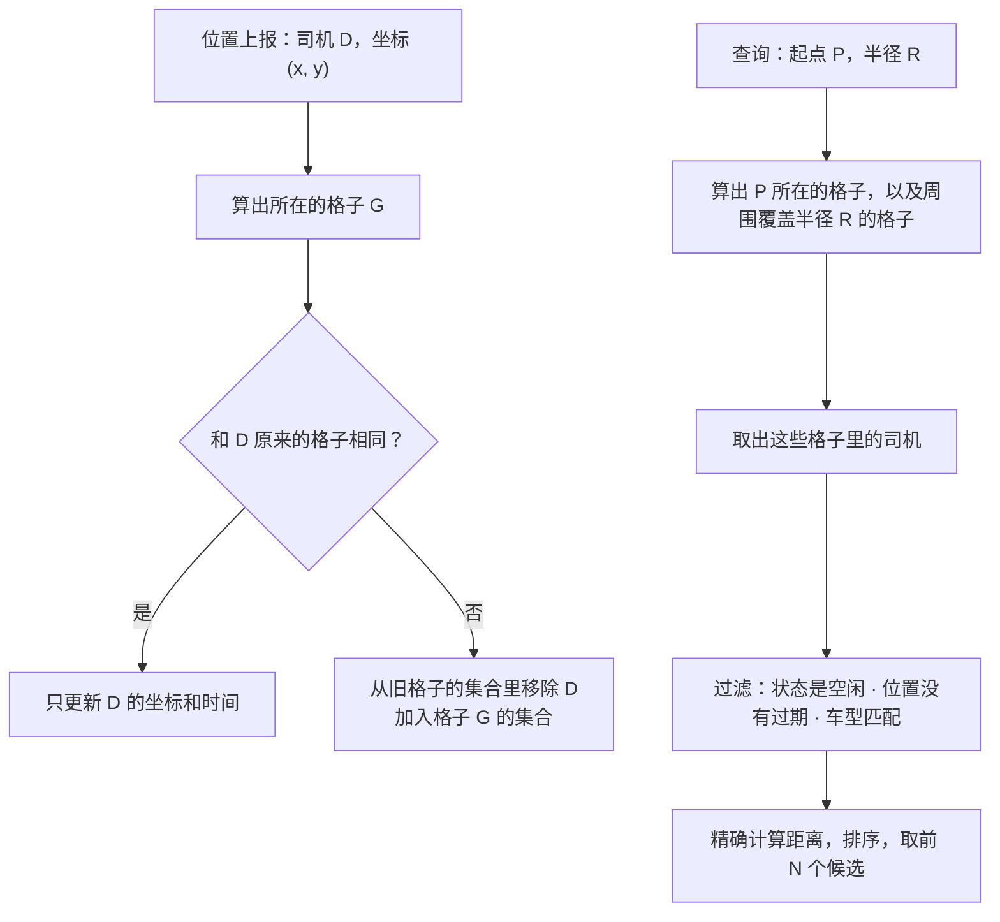

格子大小的取舍：

| 格子 | 更新时跨格子的概率 | 查询要访问的格子数 | 每个格子里的司机数 |
| --- | --- | --- | --- |
| 小（100 米） | 高 | 多 | 少 |
| 中（500 米） | 较低 | 适中 | 适中 |
| 大（2 公里） | 很低 | 少 | 多，取出后要过滤的也多 |

通常让格子的边长和常用的搜索半径在同一个量级。

和 Redis GEO、四叉树的对比：

| | 内存网格 | Redis GEO | 四叉树 |
| --- | --- | --- | --- |
| 更新 | O(1)，没有网络开销 | O(log N)，一次网络往返 | 可能触发节点的分裂和合并 |
| 查询 | 取若干个格子 | 一次命令 | 按密度自适应，访问的节点数稳定 |
| 适应密度的差异 | 不能：市中心的格子很满，郊区的很空 | 不能 | 能 |
| 多个服务共享 | 不能，数据在一个进程里 | 能 | 不能 |
| 适合 | 派单引擎自己用 | 多个服务都要查附近的司机 | 密度差别极大的区域 |

**追问链**

1. **位置数据要不要持久化？** 用于派单的"当前位置"不需要，丢了几秒钟后就由新的上报恢复。但位置的**轨迹**要另外保存：行程中的轨迹用于计费、安全、纠纷的处理。轨迹是另一条数据流：位置上报同时写入 MQ，由轨迹服务按订单保存。
2. **司机的上报频率能不能更低？** 可以按状态调整：空闲并且静止的司机，上报的间隔可以拉长；正在接驾或者行程中的，要更密。位置变化小于一定距离时可以不上报。上报的频率直接影响耗电和流量。
3. **车在高架上，订单在高架下面，直线距离很近但其实绕路很远，怎么办？** 网格和直线距离只是粗筛，用来把候选从 3 万个缩小到几十个。真正决定派给谁，要用路网上的预计到达时间（S22-06）。

---

## 三、匹配

### S22-04 抢单和派单有什么区别？怎么选？

> ★★ ｜ 资深 / 架构师 ｜ 中频

**考察意图**：两种模式是产品和技术上的根本选择。看你是否能说出各自的问题。

**30 秒版回答**：

| | 抢单 | 派单 |
| --- | --- | --- |
| 做法 | 把订单广播给附近的多个司机，谁先点"抢"就归谁 | 系统选出一个最合适的司机，直接指派给他 |
| 决策者 | 司机 | 系统 |
| 司机可以挑单 | 可以：短途的、不顺路的单没人抢 | 不可以（或者拒单有代价） |
| 匹配的质量 | 手快的司机抢到，不一定是最近的 | 系统可以做全局最优 |
| 司机的体验 | 要一直盯着手机抢单，分散驾驶的注意力，有安全问题 | 不需要抢 |
| 乘客的体验 | 好单很快被抢走，差单没人接 | 应答率更稳定 |
| 技术的难点 | 并发：很多司机同时抢一个单 | 算法：选谁；以及司机不接时怎么办 |

- **趋势是派单**：它能保证应答率、能做全局优化、对驾驶更安全。
- **抢单仍然有用**：供大于求的时候；预约单、长途单这类需要司机自己判断的订单；作为派单失败之后的补充。
- **抢单的并发**：就是一个小型的秒杀。订单的状态用条件更新从"待接"改为"已接"，只有一个司机能成功。

**深入剖析**

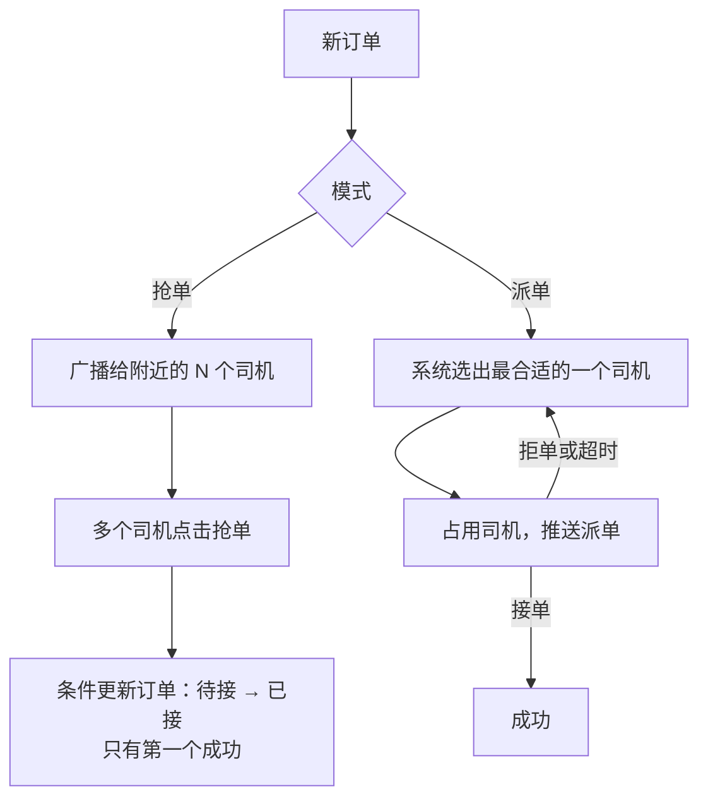

派单模式下，"司机要不要确认"也有两种：

- **需要确认**：派单后司机有十几秒决定接不接。司机有选择权，但会有拒单和超时，拉长了乘客等待的时间；
- **直接指派**：派给谁就是谁，司机不需要点确认。效率最高，但要求平台对司机有足够的约束和补偿机制（比如保证收入、对接驾距离远的单给补贴）。

**追问链**

1. **抢单时怎么选择广播给哪些司机？** 不是所有附近的司机都广播：按距离、服务分排序，分批地推送。先推给最合适的几个，几秒内没人抢，再扩大范围。这样既照顾了匹配的质量，又不至于一下子打扰太多的司机。
2. **派单模式下司机总是拒掉不喜欢的单怎么办？** 这是运营规则的问题：拒单率影响司机的服务分和之后的派单优先级；对"差单"给额外的补贴；有的平台在派单时不展示目的地。技术上要做的是准确地记录每次派单和响应，供规则使用。
3. **两种模式可以同时存在吗？** 可以。常见的组合：先派单，若干轮派单都失败之后，转为向更大的范围广播、由司机来抢。

---

### S22-05 来一单派一单，和攒一批一起派，哪个好？

> ★★★ ｜ 架构师 ｜ 中频

**考察意图**：这是派单算法的核心取舍。看你是否理解局部最优不等于全局最优，并能用数据说明差别。

**30 秒版回答**：

- **贪心（即时派单）**：每来一个订单，立刻把它派给当前最近的空闲司机。
  - 优点：简单，乘客等待的时间最短；
  - 缺点：只顾眼前。先来的订单拿走了某个司机，而这个司机对后来的订单可能重要得多。
- **批量匹配**：把一小段时间（比如 2 秒）内的订单和可用的司机放在一起，求一个**整体最优**的分配，比如让所有订单的接驾距离之和最小。
  - 这是一个经典的**指派问题**（二分图的最小权匹配），可以用匈牙利算法求出最优解；
  - 优点：全局更优，平均的接驾距离更短，极端长的接驾也更少；
  - 缺点：乘客要多等一个窗口的时间；实现和计算更复杂。
- **实测**（见下）：随机的场景下，批量匹配比贪心少约 11% 的总接驾距离，每批里最长的那次接驾也明显缩短。
- **窗口的长度是关键的参数**：窗口越长，一起考虑的订单和司机越多，优化的空间越大；但乘客等得越久。通常是一两秒到几秒。
- **目标函数可以更丰富**：不只是距离。可以是预计到达时间、司机的收入均衡、乘客的等待时间、成交的概率的加权组合。

**深入剖析**

```java
import java.util.ArrayList;
import java.util.Arrays;
import java.util.List;
import java.util.Random;
import java.util.concurrent.CountDownLatch;
import java.util.concurrent.ExecutorService;
import java.util.concurrent.Executors;
import java.util.concurrent.atomic.AtomicInteger;
import java.util.concurrent.atomic.AtomicIntegerArray;

/**
 * 派单的三个要点：
 * 1. 贪心（来一单派一单，选最近的司机）和批量匹配（攒一小段时间的订单，整体求最优）的差别；
 * 2. 批量匹配用状态压缩的动态规划求"总接驾距离最小"的分配；
 * 3. 一个司机同一时刻只能被派一单：用 CAS 修改司机的状态。
 * 坐标是平面上的千米数，距离用直线距离，只为说明算法。
 */
public class DispatchDemo {

    private static final int ORDERS_PER_BATCH = 8;
    private static final int DRIVERS_PER_BATCH = 10;
    private static final int ROUNDS = 2_000;
    private static final double AREA_KM = 5.0;
    private static final long RANDOM_SEED = 20261113L;

    record Point(double x, double y) {
        double distanceTo(Point other) {
            return Math.hypot(x - other.x, y - other.y);
        }
    }

    /** 贪心：按订单到达的顺序，每个订单选当前空闲的、最近的司机。返回每个订单分到的司机下标 */
    static int[] greedy(List<Point> orders, List<Point> drivers) {
        int[] assigned = new int[orders.size()];
        boolean[] used = new boolean[drivers.size()];
        for (int o = 0; o < orders.size(); o++) {
            int best = -1;
            for (int d = 0; d < drivers.size(); d++) {
                if (!used[d] && (best < 0
                        || orders.get(o).distanceTo(drivers.get(d)) < orders.get(o).distanceTo(drivers.get(best)))) {
                    best = d;
                }
            }
            used[best] = true;
            assigned[o] = best;
        }
        return assigned;
    }

    /**
     * 批量最优：dp[mask] 表示"前 k 个订单已经分配，占用的司机集合是 mask"时的最小总距离，k = mask 里 1 的个数。
     * 司机数不超过十几个时可以直接算；规模更大时用匈牙利算法这类多项式时间的算法。
     */
    static int[] optimal(List<Point> orders, List<Point> drivers) {
        int n = orders.size();
        int m = drivers.size();
        double[] dp = new double[1 << m];
        int[] choice = new int[1 << m];
        Arrays.fill(dp, Double.MAX_VALUE);
        dp[0] = 0;
        for (int mask = 0; mask < (1 << m); mask++) {
            int k = Integer.bitCount(mask);
            if (dp[mask] == Double.MAX_VALUE || k >= n) {
                continue;
            }
            for (int d = 0; d < m; d++) {
                if ((mask & (1 << d)) != 0) {
                    continue;
                }
                int next = mask | (1 << d);
                double cost = dp[mask] + orders.get(k).distanceTo(drivers.get(d));
                if (cost < dp[next]) {
                    dp[next] = cost;
                    choice[next] = d;
                }
            }
        }
        int bestMask = -1;
        for (int mask = 0; mask < (1 << m); mask++) {
            if (Integer.bitCount(mask) == n && (bestMask < 0 || dp[mask] < dp[bestMask])) {
                bestMask = mask;
            }
        }
        int[] assigned = new int[n];
        for (int k = n - 1, mask = bestMask; k >= 0; k--) {
            assigned[k] = choice[mask];
            mask ^= 1 << choice[mask];
        }
        return assigned;
    }

    static double[] totalAndMax(List<Point> orders, List<Point> drivers, int[] assigned) {
        double total = 0;
        double max = 0;
        for (int o = 0; o < orders.size(); o++) {
            double distance = orders.get(o).distanceTo(drivers.get(assigned[o]));
            total += distance;
            max = Math.max(max, distance);
        }
        return new double[] {total, max};
    }

    public static void main(String[] args) throws InterruptedException {
        // 1. 一个能看清楚差别的小例子：两个订单、两个司机，都在一条路上
        List<Point> orders = List.of(new Point(0, 0), new Point(3, 0));
        List<Point> drivers = List.of(new Point(1, 0), new Point(-4, 0));
        double[] g = totalAndMax(orders, drivers, greedy(orders, drivers));
        double[] b = totalAndMax(orders, drivers, optimal(orders, drivers));
        System.out.printf("small case  greedy : assign %s, total %.1f km, longest %.1f km%n",
                Arrays.toString(greedy(orders, drivers)), g[0], g[1]);
        System.out.printf("small case  batch  : assign %s, total %.1f km, longest %.1f km%n",
                Arrays.toString(optimal(orders, drivers)), b[0], b[1]);

        // 2. 随机场景：5 km 见方的区域，每批 8 个订单、10 个司机，重复 2000 批
        Random random = new Random(RANDOM_SEED);
        double greedyTotal = 0, greedyMax = 0, batchTotal = 0, batchMax = 0;
        int batchBetter = 0;
        for (int round = 0; round < ROUNDS; round++) {
            List<Point> os = new ArrayList<>();
            List<Point> ds = new ArrayList<>();
            for (int i = 0; i < ORDERS_PER_BATCH; i++) {
                os.add(new Point(random.nextDouble() * AREA_KM, random.nextDouble() * AREA_KM));
            }
            for (int i = 0; i < DRIVERS_PER_BATCH; i++) {
                ds.add(new Point(random.nextDouble() * AREA_KM, random.nextDouble() * AREA_KM));
            }
            double[] gr = totalAndMax(os, ds, greedy(os, ds));
            double[] ba = totalAndMax(os, ds, optimal(os, ds));
            greedyTotal += gr[0];
            greedyMax += gr[1];
            batchTotal += ba[0];
            batchMax += ba[1];
            if (ba[0] < gr[0] - 1e-9) {
                batchBetter++;
            }
        }
        System.out.printf("random  greedy : avg pickup %.3f km per order, avg longest pickup in a batch %.3f km%n",
                greedyTotal / ROUNDS / ORDERS_PER_BATCH, greedyMax / ROUNDS);
        System.out.printf("random  batch  : avg pickup %.3f km per order, avg longest pickup in a batch %.3f km%n",
                batchTotal / ROUNDS / ORDERS_PER_BATCH, batchMax / ROUNDS);
        System.out.printf("batch saves %.1f%% of total pickup distance; strictly better in %d of %d batches%n",
                (greedyTotal - batchTotal) * 100 / greedyTotal, batchBetter, ROUNDS);

        // 3. 并发：500 个订单同时争抢 100 个司机，每个司机只能被派一次
        int driverCount = 100;
        int orderCount = 500;
        AtomicIntegerArray driverState = new AtomicIntegerArray(driverCount);   // 0 空闲，1 已派单
        AtomicInteger matched = new AtomicInteger();
        CountDownLatch done = new CountDownLatch(orderCount);
        try (ExecutorService pool = Executors.newFixedThreadPool(16)) {
            for (int i = 0; i < orderCount; i++) {
                int start = i % driverCount;
                pool.execute(() -> {
                    // 每个订单从自己的候选司机开始依次尝试，CAS 成功才算派单成功
                    for (int k = 0; k < driverCount; k++) {
                        if (driverState.compareAndSet((start + k) % driverCount, 0, 1)) {
                            matched.incrementAndGet();
                            break;
                        }
                    }
                    done.countDown();
                });
            }
            done.await();
        }
        int assignedDrivers = 0;
        for (int i = 0; i < driverCount; i++) {
            assignedDrivers += driverState.get(i);
        }
        System.out.println("concurrent: orders=" + orderCount + ", drivers=" + driverCount + ", matched orders=" + matched.get()
                + ", assigned drivers=" + assignedDrivers);
    }
}
```

本机运行输出（JDK 25，随机数种子固定）：

```text
small case  greedy : assign [0, 1], total 8.0 km, longest 7.0 km
small case  batch  : assign [1, 0], total 6.0 km, longest 4.0 km
random  greedy : avg pickup 1.267 km per order, avg longest pickup in a batch 2.617 km
random  batch  : avg pickup 1.122 km per order, avg longest pickup in a batch 2.246 km
batch saves 11.4% of total pickup distance; strictly better in 1835 of 2000 batches
concurrent: orders=500, drivers=100, matched orders=100, assigned drivers=100
```

**先看前两行的小例子**。一条路上，订单 1 在 0 公里处，订单 2 在 3 公里处；司机 A 在 1 公里处，司机 B 在 −4 公里处。

- 贪心：订单 1 先到，选最近的司机 A（距离 1）；订单 2 只剩司机 B（距离 7）。总共 8 公里，最远的一次接驾 7 公里；
- 批量：订单 1 配司机 B（距离 4），订单 2 配司机 A（距离 2）。总共 6 公里，最远的一次 4 公里。

订单 1 "吃了一点亏"（从 1 公里变成 4 公里），换来订单 2 的大幅改善（从 7 公里变成 2 公里），整体更好。贪心做不出这个决定，因为它处理订单 1 的时候还不知道订单 2 的存在。

**中间三行是随机场景的统计**：5 公里见方的区域里，每批 8 个订单、10 个司机，位置随机，重复 2000 批。

| | 贪心 | 批量匹配 |
| --- | --- | --- |
| 平均每单的接驾距离 | 1.267 公里 | 1.122 公里 |
| 每批里最长的一次接驾（平均） | 2.617 公里 | 2.246 公里 |

- 批量匹配的总接驾距离少 **11.4%**；
- 2000 批里有 1835 批，批量匹配的结果严格优于贪心；其余的批次里两者相同；
- 最长的接驾距离也缩短了。贪心的问题正是"最后一个订单只能拿剩下的司机"，常常是很远的那个。

这组数字的适用范围：位置是均匀随机的，距离是直线距离，供给略大于需求。真实的场景里，供需的比例、空间的分布、路网都会影响提升的幅度。它能说明"批量匹配优于贪心"这个方向，不能当作真实系统的收益数字。

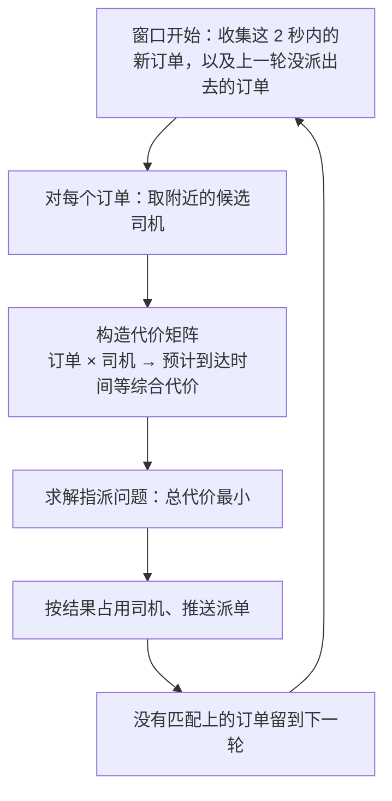

**追问链**

1. **指派问题的规模很大时怎么算？** 一个城市在一个窗口里可能有上千个订单、几千个候选司机。直接对整个城市求解既慢也没有必要：远处的司机不可能被派来。做法是**稀疏化**（每个订单只和它附近的几十个司机之间有边）和**分区**（按地理区域把问题拆成多个互相独立或者弱相关的小问题，并行求解）。
2. **批量匹配让乘客多等了 2 秒，值得吗？** 多等 2 秒换来平均接驾时间缩短十几秒甚至更多，对乘客的总等待时间是划算的。而且"应答"的那一刻可以更早地给乘客反馈（"正在为你匹配"）。窗口的长度可以根据供需动态调整：供给充足时缩短窗口（反正附近有很多车），供给紧张时拉长窗口。
3. **只看当前这一批，是不是还是"近视"的？** 是。更进一步的做法会考虑未来：这个司机现在派出去，会不会让接下来几分钟某个区域没有车？把一个司机派到郊区，他返程很可能空驶。这需要对未来的需求做预测，把"对未来的影响"也算进代价里。面试时提到这个方向即可。

**架构师加分点**

- 这道题再次说明了一个通用的道理：**逐个地做局部最优的决定，和把一批决定放在一起求全局最优，结果可以有明显的差别；而后者的代价是延迟**。同样的取舍出现在很多地方：数据库的组提交、消息的批量发送、合并扣减库存。区别在于那些场景攒批是为了**吞吐**，这里攒批是为了**决策的质量**。

---

### S22-06 最近的司机一定最快到吗？距离怎么算？

> ★★ ｜ 资深 ｜ 中频

**考察意图**：直线距离只是近似。看你是否知道真实的系统用什么来衡量"近"，以及怎么控制计算的成本。

**30 秒版回答**：

- **不一定**。直线距离近，实际可能很远：隔着一条河、在高架的上下层、在单行道的反方向、要掉头、前方拥堵。
- **应该用预计到达时间**（ETA）：司机从当前的位置，沿着实际的道路，在当前的路况下，到达上车点需要多久。它由路径规划和实时的路况算出来。
- **ETA 的计算是昂贵的**：每一次都要在路网上做最短路径的搜索。不可能对 3 万个空闲的司机都算一遍。
- **两阶段**：
  1. **粗筛**：用网格索引和直线距离，快速地从几万个司机里选出几十个候选；
  2. **精排**：只对这几十个候选计算 ETA，用 ETA 作为匹配的代价。
- **降低 ETA 的成本**：批量计算（一个起点到多个终点一次算完）；对相近的起点和终点缓存结果；预先计算好路网上关键节点之间的时间。
- **车头的方向也有影响**：司机正背对着乘客行驶，要先找地方掉头。位置上报里带上方向和速度，有助于更准确地估算。

**深入剖析**

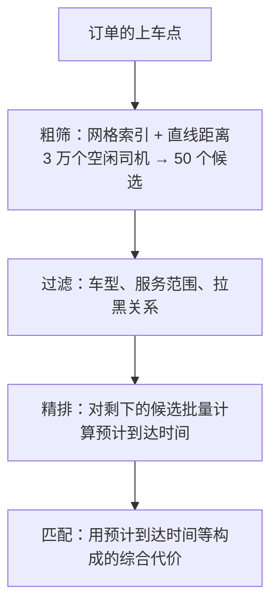

直线距离和预计到达时间的差别从哪来：

| 因素 | 影响 |
| --- | --- |
| 路网的形状 | 道路不是直线；河流、铁路、高架形成阻隔 |
| 单行道、禁止左转、禁止掉头 | 明明在马路对面，要绕一大圈 |
| 实时的路况 | 同样的距离，拥堵时要多花几倍的时间 |
| 车辆行驶的方向 | 背向行驶要先掉头 |
| 上车点的具体位置 | 在小区里面、在商场的地下停车场 |

匹配的代价也不只有 ETA。常见的组成：

| 因素 | 方向 |
| --- | --- |
| 预计到达时间 | 越短越好 |
| 乘客已经等待的时间 | 等得越久的订单优先级越高 |
| 司机的空闲时长 | 等得久的司机优先，保证公平 |
| 司机的服务分 | 服务好的司机优先 |
| 订单取消的概率 | 接驾太远的订单，乘客更可能取消 |
| 顺路程度 | 司机设置了回家的方向时，优先派顺路的单 |

这些因素加权成一个综合的分数。权重的调整属于策略，要通过实验来验证。

**追问链**

1. **ETA 服务不可用或者超时怎么办？** 降级为直线距离乘以一个经验系数。派单的质量下降，但不会中断。ETA 的调用要有很短的超时。
2. **候选选多少个合适？** 太少可能漏掉真正最优的那个（直线距离排第 30 名的司机，ETA 可能是最短的）；太多则 ETA 的计算量大。通常几十个。也可以按直线距离的范围动态调整：附近的车少就扩大范围。
3. **ETA 估得不准会有什么后果？** 派来了一个实际上更慢的司机；告诉乘客"3 分钟到"，结果 8 分钟才到，乘客取消订单。ETA 的准确度是需要持续监控的指标：把预估的时间和实际到达的时间做对比。

---

## 四、正确性

### S22-07 怎么保证一个司机不会同时被派两个单？

> ★★★ ｜ 资深 / 架构师 ｜ 高频

**考察意图**：司机是独占的资源。看你是否用状态机和原子操作来保证互斥，并且考虑了订单这一侧的互斥。

**30 秒版回答**：

- **两个方向的互斥**：
  - 一个司机同一时刻只能有一个订单；
  - 一个订单同一时刻只能派给一个司机。
- **司机的状态机**：离线 → 空闲 → 待确认（已派单，等司机确认）→ 去接驾 → 服务中 → 空闲。
- **占用司机是一次原子的状态流转**：把司机从"空闲"改成"待确认"，并记下是哪个订单。用 CAS 或者条件更新，只有当前状态是"空闲"才能成功。
  - Redis：Lua 脚本检查状态并修改；
  - 数据库：`UPDATE ... SET status = '待确认', order_id = ? WHERE driver_id = ? AND status = '空闲'`；
  - 内存：`compareAndSet`。
- **派单引擎的内部也要避免自己和自己冲突**：按区域把订单交给同一个线程（或者同一批）来决策，同一批内部的分配本身就是不重复的。
- **即使如此，最终的占用仍然要用原子操作**：因为可能有多个引擎实例、多种派单的来源（实时单、预约单、改派）同时在争抢同一个司机。
- **订单一侧**：订单的状态从"待派"改为"已派给司机 X"也用条件更新。司机的接单请求到达时，校验这个订单当前确实是派给他的。

**深入剖析**

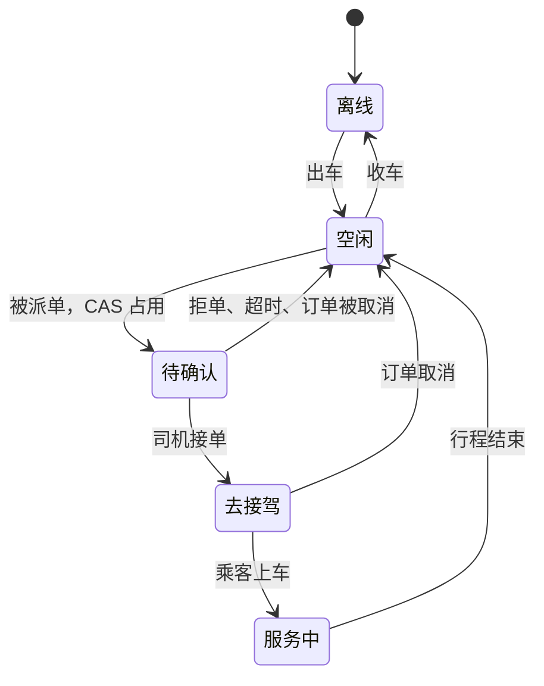

演示代码的最后一行是并发的验证：500 个订单同时争抢 100 个司机，每个订单用 CAS 把司机的状态从 0（空闲）改成 1（已派单）。结果是**匹配成功的订单正好 100 个，被占用的司机正好 100 个**，没有一个司机被派了两单。

占用司机和修改订单是两个系统里的两步操作，中间可能失败：

| 情况 | 结果 | 处理 |
| --- | --- | --- |
| 占用司机成功，推送派单失败（司机的连接断了） | 司机被占着，却不知道有单 | 待确认状态有超时时间，超时后自动回到空闲；订单重派 |
| 占用司机成功，引擎崩溃 | 同上 | 同上：靠超时释放 |
| 司机接单了，更新订单失败 | 司机以为接到了，订单还是待派 | 司机的接单请求要等订单更新成功才返回；失败则告诉司机接单失败，并释放司机 |
| 订单被乘客取消，同时司机点了接单 | 两个操作并发 | 订单的状态用条件更新：谁先成功谁生效。接单失败的话释放司机 |

"待确认状态带超时"是关键的兜底：任何原因导致流程中断，司机最多被占用十几秒，就会自动回到可派的状态，不会"丢失"一个司机。超时的实现可以是 Redis Key 的过期，或者延迟任务（[《S02 订单超时取消与延迟任务》](S02-订单超时取消与延迟任务.md)）。

**追问链**

1. **司机状态放在 Redis 里，Redis 主从切换丢了数据怎么办？** 可能出现：司机实际上正在服务中，状态却回退成了空闲，于是又被派了一单。防线：司机端自己知道当前有没有订单，收到新的派单时发现自己正在服务中，直接拒绝；订单服务里有"司机当前进行中的订单"的记录，可以用来校正状态；状态的关键流转同时写数据库，Redis 的数据可以由数据库恢复。
2. **用分布式锁锁住司机再派单行不行？** 可以，但没有必要。状态的条件更新本身就是原子的互斥操作，不需要再套一层锁。能用一次原子的状态流转解决，就不引入分布式锁。
3. **一个订单同时派给多个司机（提高应答率）可以吗？** 有的平台会这样做：同时推给两三个司机，谁先接归谁。这时这几个司机都要被占用（否则他们可能同时被派别的单），其中一个接单之后，其余的立即释放并收到"订单已被接走"的通知。它用更多的司机占用换更高的应答率，供给紧张时不适合。

---

### S22-08 司机拒单、不响应、接单后取消，怎么处理？

> ★★★ ｜ 资深 / 架构师 ｜ 中频

**考察意图**：派出去只是开始。看你是否把"派单"设计成一个可以多轮进行、有上限的过程。

**30 秒版回答**：

- **派单是一个多轮的过程**：一轮没有成功，就进入下一轮，直到成功或者达到上限。
- **每一轮**：选司机 → 占用 → 推送 → 等待响应（有超时）。
- **失败的情况和处理**：
  - **司机拒单**：释放司机；把他加入这个订单的**排除名单**；重派；
  - **司机超时不响应**：同上。可能是没看到，也可能是连接断了；
  - **推送失败**（司机不在线）：立即释放并重派，不必等到超时；
  - **司机接单后取消**：订单回到待派的状态，重派；这种情况对乘客的影响大，重派的优先级要提高，并且记入司机的取消率；
  - **乘客取消**：释放司机，通知司机订单已取消；按规则判断是否产生取消费。
- **每一轮可以逐步放宽条件**：扩大搜索的半径；放宽车型（征得乘客的同意）；从"派单"转为"向更多的司机广播"。
- **有上限**：达到最大的轮数或者最长的等待时间，告诉乘客"附近暂时没有车"，让乘客选择继续等待、加价或者取消。不能无限地派下去。
- **派单的每一步都要有记录**：这个订单在什么时候派给了谁、对方怎么响应的。它既是引擎崩溃后恢复的依据，也是规则和算法优化的数据。

**深入剖析**

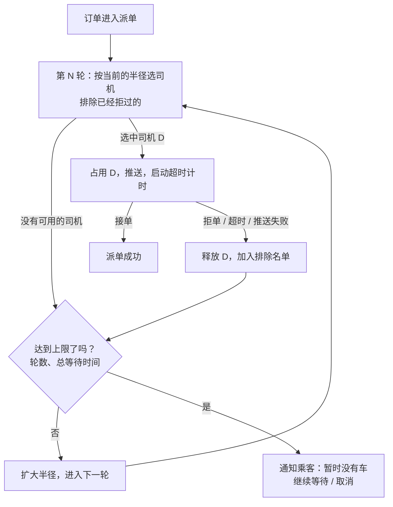

订单在派单阶段的状态：

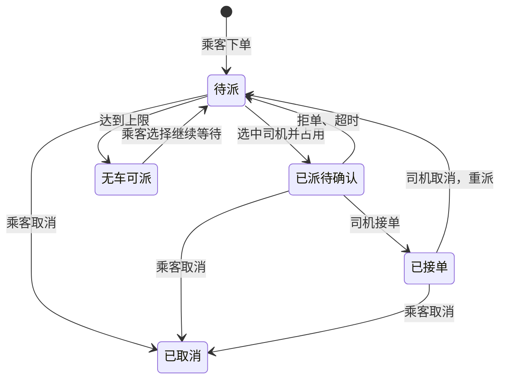

**追问链**

1. **排除名单要保留多久？** 在这个订单的整个派单过程里都有效。但如果派单持续了很久、范围内的司机都拒过了，可以清空名单重新来一遍，因为司机的位置和意愿可能已经变了。
2. **司机的响应超时设多长？** 太短，司机来不及看清就超时了；太长，乘客等得久，而且司机被白白占着。通常十几秒。直接指派（不需要确认）的模式没有这个问题。
3. **怎么防止司机恶意地接单再取消？** 记录每个司机的取消次数和原因。超过阈值的降低派单的优先级、暂停派单。取消之后的一小段时间内不给他派单。乘客的恶意取消同理。这是策略层面的事，技术上保证数据准确。
4. **预约单怎么派？** 预约单不需要立刻派。可以提前一段时间进入派单：太早派了，司机到时候可能来不了；太晚派，可能派不到。常见的做法是先让司机自己认领（类似抢单），临近出发的时间还没有人认领的，转入实时派单并提高优先级。

---

## 五、运营与可用

### S22-09 高峰期车不够，或者某个区域车太多，怎么办？

> ★★ ｜ 架构师 ｜ 中频

**考察意图**：派单算法只能在现有的供需下做最好的匹配，解决不了供需本身的不平衡。看你是否了解更上一层的手段。

**30 秒版回答**：

- **现象**：早晚高峰、下雨天、演唱会散场，订单远多于司机；同一时刻，另一些区域的司机在空等。供需在时间和空间上都不均衡。
- **需求一侧**：
  - **排队**：没有车时，订单进入队列，告诉乘客"前面还有 N 人，预计等待 M 分钟"。有车释放出来时，按顺序派单；
  - **动态调价**：供不应求时提高价格。一方面抑制一部分不那么紧急的需求，另一方面吸引更多的司机过来；
  - 引导：建议乘客步行到更容易上车的地点、选择其他的车型、拼车。
- **供给一侧**：
  - **调度**：告诉空闲的司机哪里的订单多（热力图），或者给去需求旺盛区域的司机奖励，把车提前引导过去；
  - **预测**：根据历史的数据和实时的信号（天气、活动、航班），预测接下来各个区域的需求，提前调度；
  - **即将完成订单的司机**也是供给：一个司机还有两分钟结束行程，目的地就在附近，可以提前把下一个订单派给他。
- **匹配一侧**：高峰期拉长派单的窗口，攒更多的订单一起优化；优先保证等待时间长的订单。
- **公平**：排队要有明确的顺序规则，不能让后来的人因为位置的偶然而插队太多。

**深入剖析**

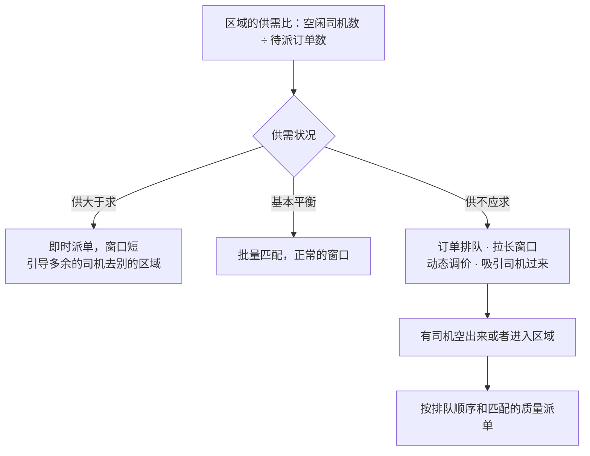

排队的实现：

- 每个区域一个等待队列，订单按进入的时间排序；
- 有司机可用时，不是简单地把队首的订单派给他：要在队列靠前的若干个订单里，选一个和这个司机匹配得最好的（这仍然是一个小规模的匹配问题），同时保证排在最前面的订单不会被一直跳过；
- 给乘客展示的"预计等待时间"，由队列的长度和这个区域司机释放的速率估算；
- 乘客在排队期间随时可以取消。

"即将完成订单的司机"的使用（也叫连环派单）：

| | 不使用 | 使用 |
| --- | --- | --- |
| 可派的司机 | 只有空闲的 | 空闲的，加上"几分钟内将在附近结束行程"的 |
| 司机的空驶 | 行程结束后才开始找下一单，有空等的时间 | 上一单结束就直接去接下一单 |
| 风险 | — | 当前的行程可能延误，后面的乘客等更久。要保守地估计 |

**追问链**

1. **动态调价在技术上怎么实现？** 按区域（比如六边形的网格）实时地统计供需比，按规则或者模型算出每个区域的价格系数。乘客下单前看到的预估价里已经包含了它。系数的变化要平滑（不能每秒都跳），相邻的区域之间不能差得太大，并且有上限。这是一个需要谨慎对待的功能，面试时说清楚机制，并指出它涉及的公平和合规的问题。
2. **热力图的数据从哪来？** 实时的：各区域当前待派的订单数、空闲的司机数、最近几分钟的下单量。预测的：历史同期的数据加上天气、活动等特征。由流处理按区域聚合，每隔几十秒更新一次。
3. **调度司机会不会造成"所有人都涌向同一个地方"？** 会。如果给所有的司机都展示同一个热点，他们一起过去，那里又变成了供大于求。调度要控制数量：只引导需要的那么多司机，并且随着司机的到达动态更新。

---

### S22-10 派单引擎怎么拆分？挂了怎么恢复？

> ★★★ ｜ 架构师 ｜ 中频

**考察意图**：派单引擎是有状态的核心组件。看你是否利用了"城市之间相互独立"这个特点，并且设计了故障时的恢复和降级。

**30 秒版回答**：

- **按城市拆分**：一个城市的司机只接这个城市的订单。位置索引、司机状态、派单引擎，都按城市分片。大城市再按区域细分。
  - 每个分片是一个独立的单元：有自己的内存索引、自己的决策线程；
  - 一个城市的故障不影响其他的城市；
  - 分片的边界上（区域的交界处）的订单，要能看到相邻分片的司机。
- **引擎是有状态的**：内存里有位置索引、待派的订单、正在等待司机确认的派单。
- **故障恢复**：
  - **位置索引**：不需要恢复。新的实例启动后，几秒钟之内司机的下一次上报就把索引重建起来了；
  - **司机的状态**：在 Redis 和数据库里，不随引擎丢失；
  - **待派的订单**：订单服务里有记录。新的实例启动时，加载这个城市所有处于"待派"状态的订单，重新进入派单；
  - **正在等待确认的派单**：司机的"待确认"状态有超时，到期自动释放；订单回到待派。
- **主备**：每个分片有一个主实例在工作，备用的实例随时准备接管。用租约保证同一时刻只有一个实例在为这个分片做决策。
- **降级**：
  - 路径和到达时间服务不可用：用直线距离；
  - 批量匹配的计算超时：降级为贪心；
  - 派单引擎不可用：降级为抢单（把订单广播给附近的司机）；
  - 高峰期的保护：限制新订单进入的速率，让乘客排队。

**深入剖析**

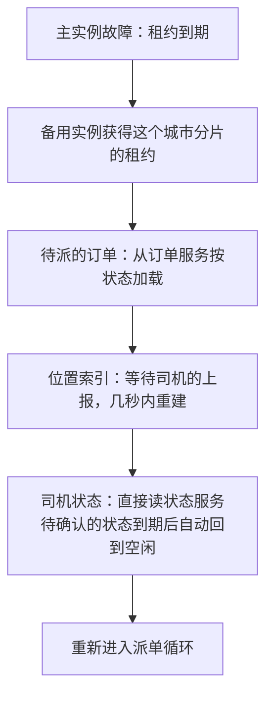

引擎故障的这段时间（租约到期加上恢复，约十几秒到几十秒）里，这个城市的新订单派不出去。乘客看到的是"正在为你寻找车辆"的时间变长。只要订单没有丢，恢复后都能继续。

各类状态的恢复方式：

| 状态 | 存在哪 | 丢失后怎么恢复 |
| --- | --- | --- |
| 司机的位置 | 引擎的内存 | 司机的下一次上报 |
| 司机的状态 | Redis 加数据库 | 不随引擎丢失；Redis 丢了从数据库和订单恢复 |
| 待派的订单队列 | 引擎的内存，源头在订单服务 | 从订单服务按状态加载 |
| 派单的轮次、排除名单 | 引擎的内存，同时写派单记录 | 从派单记录恢复；恢复不了就从第一轮重新开始 |
| 等待司机确认的定时器 | 引擎的内存 | 依靠司机状态的超时自动释放 |

设计的原则：**引擎内存里的东西，要么可以很快地重建，要么在别处有一份权威的记录**。引擎本身不是任何数据的唯一持有者。

**追问链**

1. **分片的边界怎么处理？** 上车点在两个区域交界处的订单，最近的司机可能在相邻的分片里。两种办法：分片之间有重叠的缓冲区，边界附近的司机同时出现在两个分片的索引里，占用时靠状态的原子操作保证只有一方成功；或者这类订单由一个上层的协调者处理。城市之间的边界通常不处理（跨城的订单走单独的流程）。
2. **大促或者极端天气，订单量是平时的好几倍，引擎算不过来怎么办？** 批量匹配的计算量随着订单数和司机数增长。保护措施：每一轮的计算有时间的上限，超时就用当前已经得到的结果或者降级为贪心；限制每一轮参与匹配的订单数，其余的排队；候选司机的数量上限调小。
3. **怎么验证一个新的派单策略更好？** 不能只靠离线的模拟。线上按城市或者按时间片做对照实验（同一个城市里随机地把订单分给两种策略，会互相干扰，因为它们在争抢同一批司机；所以常常按城市或者按时间交替地切换策略），比较应答率、接驾时长、取消率、司机的收入等指标。派单策略的评估本身就是一个难题。

**生产实践 / 踩坑**

- **用直线距离最近的司机**：派来的车在河对岸或者高架上，实际要绕十几分钟，乘客取消。要用预计到达时间。
- **占用司机和派单不是原子的**：先查到司机是空闲的，再去派单，中间这个司机被另一个订单派走了。两个乘客同时看到同一个司机接了自己的单。
- **待确认的状态没有超时**：推送丢了，司机不知道有单，状态却一直是"待确认"，这个司机再也接不到单，直到他重新上线。
- **位置上报每次都写数据库**：每秒几万次的更新把数据库打满，而这些数据几秒之后就没用了。
- **全国共用一个派单引擎和一份位置索引**：一个城市的高峰拖慢了所有的城市；一次故障全国都派不了单。
- **重派时没有排除已经拒单的司机**：同一个订单反复地派给同一个司机，司机反复地拒。
