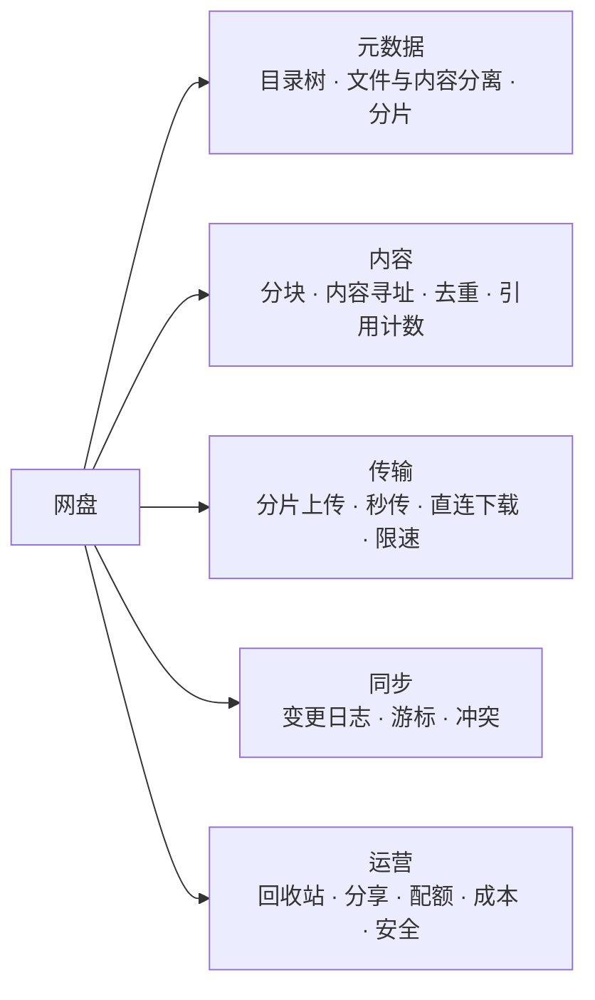
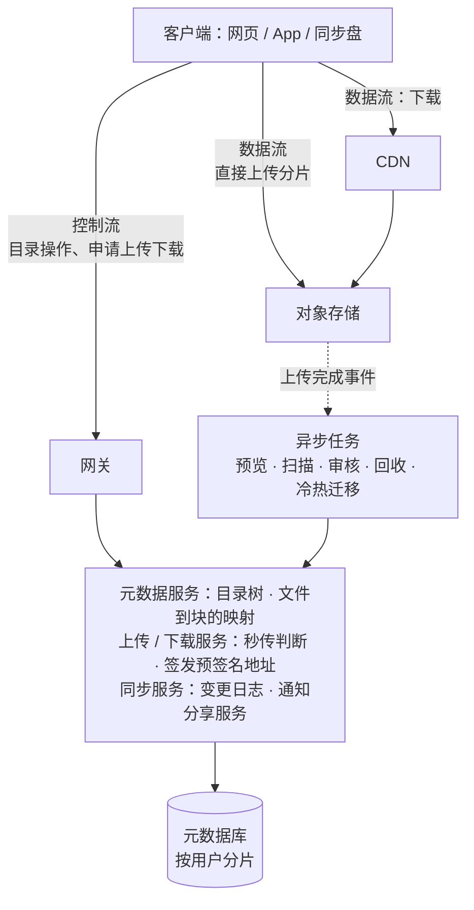
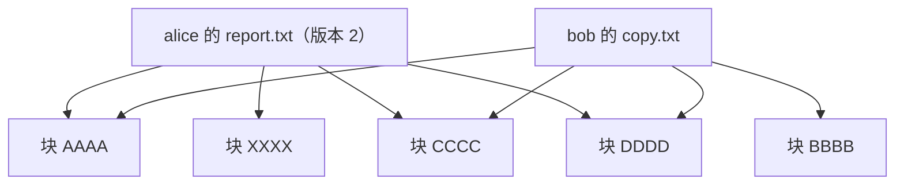
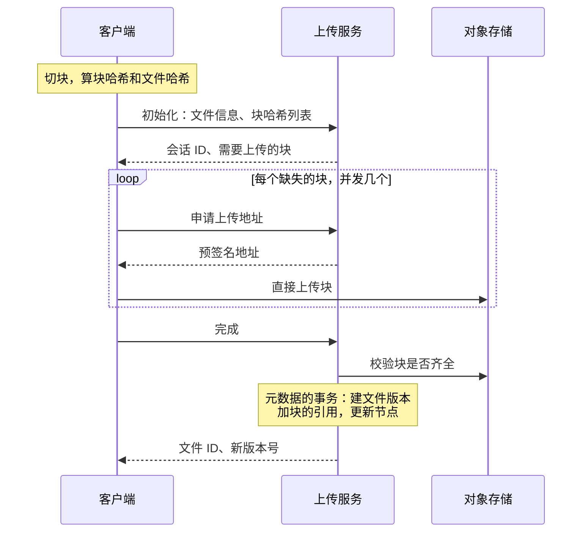
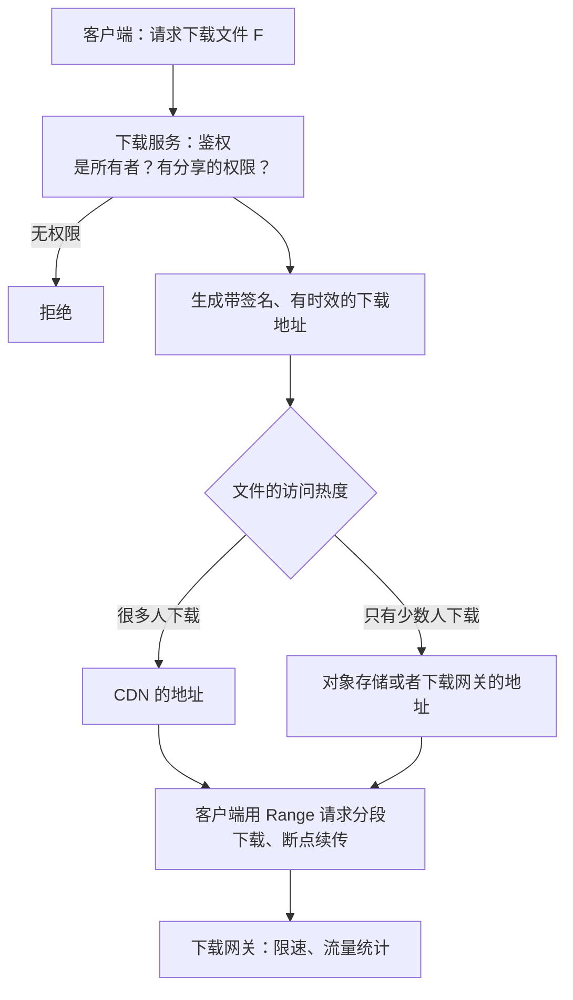
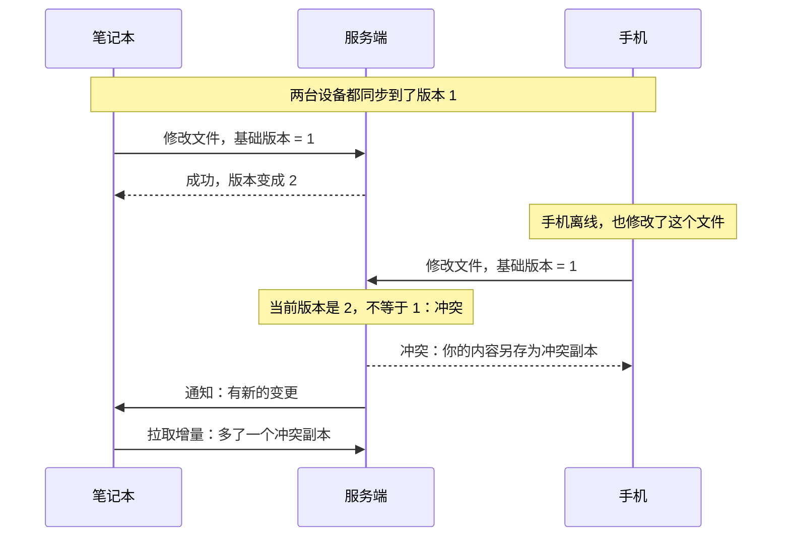
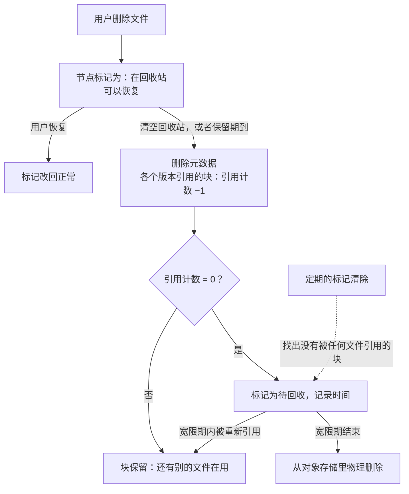
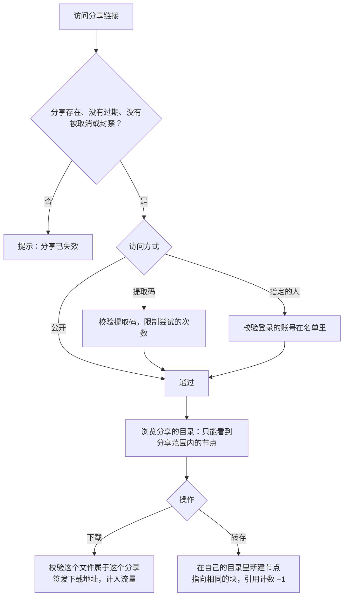
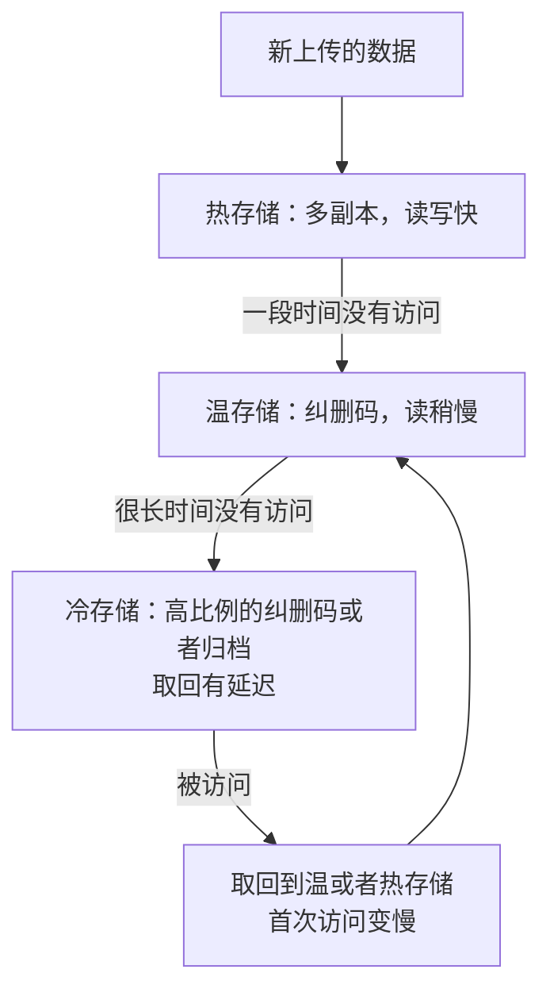
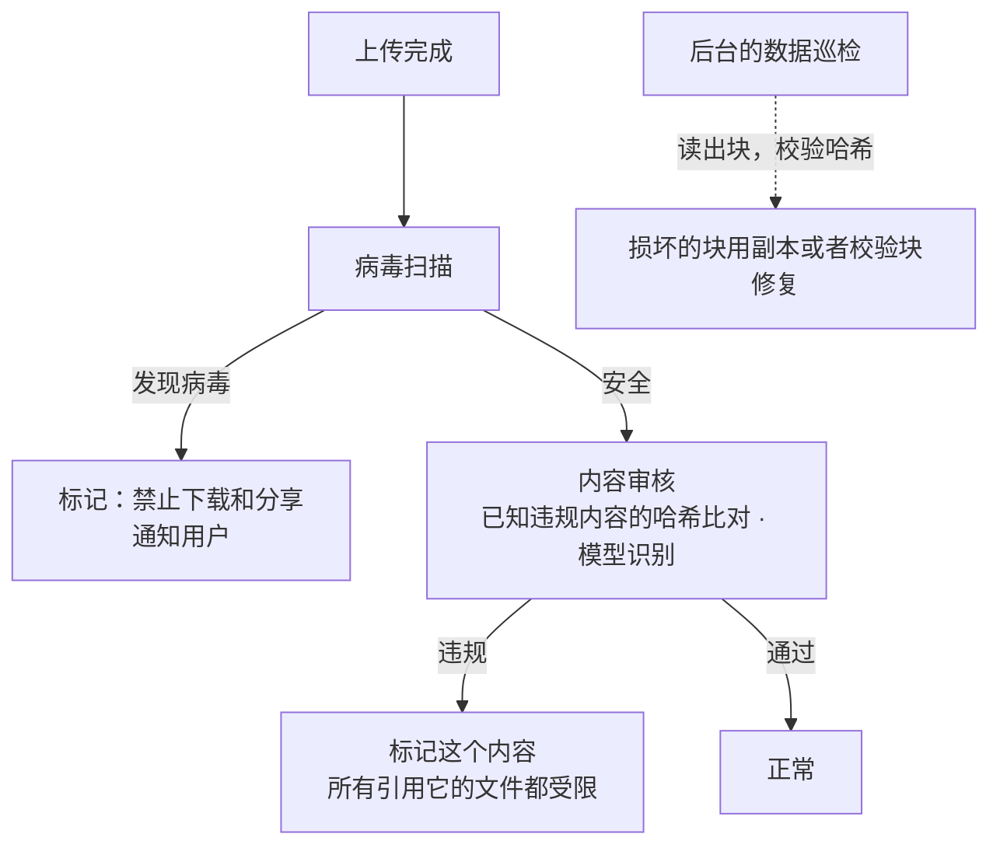

# S23 · 网盘

> 适用岗位：Java 资深开发、Java 架构师。网盘（云存储）的特点是数据量极大、单个文件可以很大、同一份数据要在多台设备之间保持同步。这道题考察元数据和文件内容的分离、分块与去重、多端同步与冲突，以及海量存储的成本控制。
> 版本基线：JDK 21 / 25、MySQL 8.4 或分布式数据库、兼容 S3 接口的对象存储。
> 事实核对：
> - 分片上传、断点续传、秒传及其安全问题，S3 分片上传的限制，未完成的分片上传需要清理，沿用[《35 文件处理》](../07-工程实践与稳定性/35-文件处理.md)35-02 中对照 AWS 文档核对的结论；客户端直传与下载沿用 35-03、35-04。
> - 文中的用户数、人均容量、去重比例都是为了推导方案而做的假设，不是某个产品的真实数据。
> - 本机运行（macOS 27.2、Apple M1 Max、JDK 25）：1 段分块去重、目录树、增量同步与冲突处理的代码只依赖 JDK，文中贴的是实际运行输出。演示里一个块只有 4 个字节，是为了让输出能看清；真实系统的块是几 MB。
> 相关分类：[《35 文件处理》](../07-工程实践与稳定性/35-文件处理.md)（分片上传、直传、下载）、[《16 分库分表》](../04-数据存储/16-分库分表.md)、[《41 容器与云计算》](../09-云原生/41-容器与云计算.md)、[《39 网络安全》](../08-计算机基础/39-网络安全.md)（加密、越权）、[《S13 IM 系统》](S13-IM系统.md)（时间线同步）

## 45 分钟答题版

| 时间 | 做什么 | 要讲出的关键点 | 子题 |
| --- | --- | --- | --- |
| 0～5 分钟 | 需求与估算 | 上传、下载、同步、分享；存储总量和元数据的条数 | S23-01 |
| 5～15 分钟 | 架构与元数据 | **元数据和内容分离**；目录树用 parent_id；按用户分片 | S23-02、S23-03 |
| 15～25 分钟 | 内容存储 | 分块、按内容寻址、去重、引用计数 | S23-04 |
| 25～32 分钟 | 上传下载 | 分片上传与秒传；直连对象存储；CDN 与限速 | S23-05、S23-06 |
| 32～40 分钟 | 同步 | 变更日志加游标；变更的通知；冲突的处理 | S23-07 |
| 40～45 分钟 | 其他 | 回收站与垃圾回收；分享；配额与成本；安全与可用 | S23-08 ～ S23-11 |

## 知识地图



## 题目索引

| 编号 | 题目 | 难度 |
| --- | --- | --- |
| S23-01 | 网盘要澄清哪些需求？规模怎么估算？ | ★★ |
| S23-02 | 整体架构怎么设计？ | ★★★ |
| S23-03 | 目录和文件的元数据怎么建模？ | ★★★ |
| S23-04 | 文件的内容怎么存？怎么去重？ | ★★★ |
| S23-05 | 大文件怎么上传？秒传怎么做？ | ★★★ |
| S23-06 | 下载怎么设计？ | ★★ |
| S23-07 | 多台设备之间怎么同步？冲突了怎么办？ | ★★★ |
| S23-08 | 删除、回收站、历史版本怎么做？不再使用的数据怎么回收？ | ★★★ |
| S23-09 | 文件分享怎么设计？ | ★★ |
| S23-10 | 配额怎么算？海量存储的成本怎么降？ | ★★★ |
| S23-11 | 数据的安全和可靠性怎么保证？ | ★★★ |

---

## 一、需求与架构

### S23-01 网盘要澄清哪些需求？规模怎么估算？

> ★★ ｜ 资深 / 架构师 ｜ 中频

**考察意图**：网盘有两类差别很大的数据：很小但数量极多的元数据，和很大的文件内容。看你是否在估算时就把它们分开。

**30 秒版回答**：

- **功能**：上传、下载、目录管理（新建、移动、重命名、删除）、多端同步、分享、回收站、历史版本、搜索。
- **非功能**：
  - **数据不能丢**：这是网盘的底线；
  - **数据不能被别人看到**：访问控制必须严格；
  - 大文件的上传下载要稳定，支持断点续传；
  - 多台设备上看到的内容最终一致。
- **要问的**：面向个人还是企业（企业有共享空间和细粒度的权限）；是否要做自动同步的客户端（像本地文件夹一样），还是只有网页和 App 里的手动上传下载；单个文件的大小上限；是否保留历史版本。
- **估算要分开两类数据**：
  - **内容**：总容量，决定存储的成本；
  - **元数据**：文件和目录的条数，决定数据库的规模。

**深入剖析**

| 项目 | 假设 | 推算 |
| --- | --- | --- |
| 用户 | 1 亿注册，日活 1000 万 | — |
| 人均已用容量 | 10 GB | 逻辑容量 1 EB（100 万 TB） |
| 人均文件数 | 2000 个 | 元数据 2000 亿条 |
| 每条元数据 | 约 300 字节 | 元数据约 60 TB |
| 每天上传 | 日活用户每人 10 个文件 | 1 亿个文件/天，约 1200 个/秒 |
| 上传的数据量 | 平均每个文件 5 MB | 每天 500 TB，约 46 Gbit/s 的平均入流量 |
| 读写比 | 浏览目录远多于上传下载 | 元数据的读是最高频的操作 |

三个结论：

1. **内容的体量是 EB 级**，只能放在专门的大规模存储（对象存储、分布式文件系统）里，而且成本是头等大事（S23-10）；
2. **元数据只有几十 TB，但条数是千亿级**，而且访问频繁（每次打开一个目录都要查）。它要放在数据库里，按用户分片；
3. **上传下载的流量很大**，不能经过业务服务器中转，客户端要直接和存储交互（S23-05、S23-06）。

**追问链**

1. **1 EB 的逻辑容量，实际要多少物理存储？** 取决于去重和冗余。很多用户存的是相同的文件（热门的视频、安装包），去重后物理数据远小于逻辑容量；另一方面，为了不丢数据，每份数据要有冗余（多副本或者纠删码），又要乘以一个系数。两者相抵之后的实际占用，是成本模型的核心。
2. **面向企业的网盘有什么不同？** 多了"团队空间"：文件不属于某一个人，而属于一个组织；权限更细（谁能看、谁能改、谁能分享）；要有操作的审计日志、管理员的管控、和企业的账号体系对接。数据模型上，文件的归属从"用户"变成了"空间"，权限从"所有者"变成了访问控制列表。

---

### S23-02 整体架构怎么设计？

> ★★★ ｜ 架构师 ｜ 中频

**考察意图**：网盘架构的核心只有一句话：元数据和内容分离。看你是否围绕这一点来组织各个部分。

**30 秒版回答**：

- **核心原则：元数据和内容分开存储、分开服务**。
  - **元数据**（文件名、目录结构、大小、时间、权限、指向内容的引用）：小、结构化、要支持事务和各种查询 → 数据库；
  - **内容**（文件的字节）：大、不可变、只需要按标识读写 → 对象存储。
- **各个服务**：
  - **元数据服务**：目录树的增删改查；文件和内容块之间的映射；
  - **上传服务**：协调分片上传、秒传的判断；签发直传的地址。它不经手文件的内容；
  - **下载服务**：鉴权，签发下载的地址；
  - **块服务 / 对象存储**：真正存放内容；
  - **同步服务**：记录每个用户的变更日志，向各个设备提供增量；通知设备"有新的变更"；
  - **分享服务**：分享链接的生成和访问控制；
  - **异步任务**：缩略图和预览的生成、病毒扫描、内容审核、垃圾回收、冷热数据的迁移。
- **数据流和控制流分开**：客户端的文件内容**直接**上传到对象存储、从对象存储或者 CDN 下载。业务服务只处理控制信息（元数据、鉴权、签名）。

**深入剖析**



为什么内容不可变是一个好的设计：文件被修改时，不是在原来的内容上改，而是写入新的内容（新的块），再把元数据指向新的内容。旧的内容保留到没有任何引用为止。这带来几个好处：

- 历史版本几乎是免费的：旧版本的元数据还指着旧的块；
- 不存在"写到一半"的中间状态：元数据的切换是一次原子的更新；
- 相同的内容可以放心地被多个文件共享（去重）；
- 缓存和 CDN 可以永久缓存一个内容的标识对应的数据。

**追问链**

1. **为什么上传不经过业务服务器？** 文件的字节经过业务服务器转发，等于把几十 Gbit/s 的流量全部压在业务服务器的带宽和内存上，而且多了一跳。客户端拿到一个带签名的、有时效的上传地址之后，直接把数据传给对象存储，业务服务器只需要处理很小的控制请求。见[《35 文件处理》](../07-工程实践与稳定性/35-文件处理.md)35-03。
2. **元数据服务和对象存储之间的一致性怎么保证？** 顺序是"先内容、后元数据"：内容先完整地写入对象存储并且校验通过，再在元数据库里创建或者更新文件的记录。中间失败的话，对象存储里多了一份没有人引用的数据（由垃圾回收清理），而不会出现"元数据指向一个不存在的内容"。
3. **搜索怎么做？** 按文件名搜索：元数据同步到搜索引擎，按用户过滤。按内容搜索（文档里的文字、图片里的物体）：异步任务抽取文本和特征后建索引。搜索是一个独立的、最终一致的派生视图。

---

### S23-03 目录和文件的元数据怎么建模？

> ★★★ ｜ 资深 / 架构师 ｜ 高频

**考察意图**：目录树怎么存，决定了重命名、移动这些操作的代价。看你是否避开了"存完整路径"这个直觉的陷阱。

**30 秒版回答**：

- **每个文件和目录是一个节点**，有自己的 ID。节点记录它的**父节点 ID** 和**名字**，而不是完整的路径。
- **列出一个目录的内容**：`WHERE parent_id = ?`。这是最高频的查询。
- **重命名**：只改这一个节点的名字。**移动**：只改这一个节点的父节点 ID。不管它下面有多少文件，都是 O(1)。
- **如果存的是完整路径**（`/a/b/c.txt`）：把目录 `/a` 重命名成 `/x`，它下面的几十万个文件的路径全部要改。这是存路径方案的致命问题。
- **同一个目录下名字不能重复**：唯一索引 `(用户, parent_id, 名字)`。
- **文件节点另有**：大小、内容的标识（指向一个文件版本，再指向一组块）、版本号、修改时间。
- **按用户 ID 分片**：一个用户的整棵目录树在同一个分片里。目录操作是本地事务，不需要跨分片。
- **由路径找节点**：从根开始，逐级按名字查找。路径有几层就查几次；常用的路径可以缓存。

**深入剖析**

```sql
CREATE TABLE t_node (
    node_id     BIGINT        NOT NULL PRIMARY KEY,
    user_id     BIGINT        NOT NULL COMMENT '所属的用户（或者空间）',
    parent_id   BIGINT        NOT NULL COMMENT '父目录，根目录为 0',
    name        VARCHAR(255)  NOT NULL,
    node_type   TINYINT       NOT NULL COMMENT '1 目录 2 文件',
    size        BIGINT        NOT NULL DEFAULT 0,
    version     BIGINT        NOT NULL DEFAULT 1 COMMENT '每次修改内容加 1',
    file_ver_id BIGINT        NULL COMMENT '当前内容对应的文件版本',
    status      TINYINT       NOT NULL COMMENT '1 正常 2 在回收站',
    create_time DATETIME(3)   NOT NULL,
    update_time DATETIME(3)   NOT NULL,
    UNIQUE KEY uk_parent_name (user_id, parent_id, name, status),
    KEY idx_user_update (user_id, update_time)
) COLLATE = utf8mb4_bin;

-- 一个文件版本由哪些块组成
CREATE TABLE t_file_version (
    file_ver_id BIGINT       NOT NULL PRIMARY KEY,
    node_id     BIGINT       NOT NULL,
    version     BIGINT       NOT NULL,
    size        BIGINT       NOT NULL,
    content_hash VARCHAR(64) NOT NULL COMMENT '整个文件的哈希',
    block_list  MEDIUMTEXT   NOT NULL COMMENT '按顺序的块哈希列表；很大的文件拆到单独的表里',
    create_time DATETIME(3)  NOT NULL,
    KEY idx_node (node_id, version)
);
```

演示代码输出的第 3 行（完整代码见 S23-04）：

```text
3 move and rename     : /archive/report-2026.txt, physical=20 bytes
```

把 `/docs/report.txt` 移动到 `/archive` 并改名，只修改了这个节点的 `parentId` 和 `name` 两个字段，物理存储没有任何变化。

两种建模方式的对比：

| 操作 | 存父节点 ID（邻接表） | 存完整路径 |
| --- | --- | --- |
| 列出目录的内容 | 一次索引查询 | 前缀匹配，还要排除更深层的 |
| 重命名、移动一个目录 | 改 1 行 | 改它下面所有的节点 |
| 由路径找到节点 | 逐级查找，层数次查询 | 一次查询 |
| 删除一个目录 | 要递归找出所有的后代 | 前缀匹配 |
| 计算目录的大小 | 要递归 | 前缀匹配后求和 |

网盘里移动和重命名很频繁，而目录的层级通常不深，所以选邻接表。"由路径找节点"的代价用缓存弥补；递归类的操作放到异步任务里。树形结构的几种存法在[《S17 评论系统》](S17-评论系统.md)S17-02 里也讨论过。

**追问链**

1. **移动目录时，怎么防止把一个目录移到它自己的子目录里？** 那样会形成环，这棵子树就从根上"断开"了。移动之前，从目标目录开始沿着 `parent_id` 往上走到根，如果途中遇到了被移动的目录，就拒绝。
2. **删除一个有十万个文件的目录怎么办？** 不要同步地逐个处理。把这个目录节点标记为"在回收站"（改 1 行），用户立刻看不到它了；它下面的节点不动。真正的清理（释放内容的引用、删除元数据）由后台任务在回收站到期之后分批完成。列出目录时只看直接子节点的状态，所以不需要把后代都标记一遍。
3. **文件名区分大小写吗？** 这是一个要明确的产品决定，而且要考虑各个操作系统的差异：有的系统的文件系统不区分大小写。同步盘要处理"服务端有 `a.txt` 和 `A.txt`，同步到不区分大小写的系统上会冲突"的情况。上面的表用了区分大小写的排序规则。
4. **目录的大小（包含所有子文件）怎么显示？** 实时地递归计算太慢。可以在每个目录节点上冗余一个"子树大小"，文件变化时沿着祖先链逐级更新；或者异步地计算，允许显示的数字有延迟。很多产品干脆不显示目录的大小。

---

## 二、内容与传输

### S23-04 文件的内容怎么存？怎么去重？

> ★★★ ｜ 资深 / 架构师 ｜ 高频

**考察意图**：分块和按内容寻址是网盘节省存储和流量的基础。看你是否理解它带来的好处，以及引用计数为什么必不可少。

**30 秒版回答**：

- **分块**：把文件切成固定大小的块（比如 4 MB）。一个文件 = 一个有序的块列表。
- **按内容寻址**：每个块的标识就是它内容的哈希（比如 SHA-256）。内容相同，标识就相同。
- **去重**：写入一个块之前，先看这个哈希是否已经存在。存在就不再写，只增加引用。
  - 两个用户上传了同一个文件：物理上只存一份；
  - 一个大文件只改了中间的一小部分：只有变化的块需要上传和存储，其他的块复用；
  - 这同时省了**存储**和**上传的流量**。
- **引用计数**：每个块记录"有多少个文件版本在引用我"。文件被删除时，只是把它的块的引用计数减 1；减到 0 的块才可以真正删除。
- **写入的顺序**：修改文件时，**先写入新的块、增加引用，再释放旧的块**。顺序反了的话，新旧版本共用的块可能被短暂地减到 0 而被误删。
- **文件级的去重**是块级去重的特例：整个文件的哈希相同，就直接复用它的整个块列表（秒传）。

**深入剖析**

```java
import java.nio.charset.StandardCharsets;
import java.security.MessageDigest;
import java.security.NoSuchAlgorithmException;
import java.util.ArrayList;
import java.util.Arrays;
import java.util.HashMap;
import java.util.HexFormat;
import java.util.List;
import java.util.Map;

/**
 * 网盘的三个核心机制：
 * 1. 内容和元数据分离：文件内容切成块，按内容的哈希寻址，相同的块只存一份，用引用计数管理；
 * 2. 目录树只是元数据：移动、重命名只改一行，不动内容；
 * 3. 多端同步：每个用户有一个递增的变更序号，客户端按序号拉取增量；修改时带上基础版本号，发现冲突就另存一份。
 */
public class DriveDemo {

    private static final int BLOCK_SIZE = 4;       // 演示用 4 字节一块；真实系统是几 MB

    /** 块存储：哈希 → 内容，以及每个块被多少个文件版本引用 */
    static final class BlockStore {
        private final Map<String, byte[]> blocks = new HashMap<>();
        private final Map<String, Integer> refCount = new HashMap<>();

        /** 把内容切块写入，返回块哈希的列表。已经存在的块只增加引用计数 */
        List<String> put(byte[] content) {
            List<String> hashes = new ArrayList<>();
            for (int offset = 0; offset < content.length; offset += BLOCK_SIZE) {
                byte[] block = Arrays.copyOfRange(content, offset, Math.min(content.length, offset + BLOCK_SIZE));
                String hash = sha256(block);
                blocks.putIfAbsent(hash, block);
                refCount.merge(hash, 1, Integer::sum);
                hashes.add(hash);
            }
            return hashes;
        }

        /** 释放一个文件版本对块的引用；引用计数到 0 的块才真正删除 */
        void release(List<String> hashes) {
            for (String hash : hashes) {
                if (refCount.merge(hash, -1, Integer::sum) == 0) {
                    refCount.remove(hash);
                    blocks.remove(hash);
                }
            }
        }

        int physicalBytes() {
            return blocks.values().stream().mapToInt(block -> block.length).sum();
        }
    }

    /** 元数据：目录树里的一个节点 */
    static final class Node {
        final long id;
        long parentId;
        String name;
        final boolean directory;
        long version;
        int size;
        List<String> blockHashes = List.of();

        Node(long id, long parentId, String name, boolean directory) {
            this.id = id;
            this.parentId = parentId;
            this.name = name;
            this.directory = directory;
        }
    }

    record Change(long seq, String type, long nodeId, String detail) { }

    /** 一个用户的网盘 */
    static final class Drive {
        private final BlockStore store;
        private final Map<Long, Node> nodes = new HashMap<>();
        private final List<Change> changes = new ArrayList<>();
        private long nextId = 1;
        private int logicalBytes;

        Drive(BlockStore store) {
            this.store = store;
            nodes.put(0L, new Node(0, -1, "", true));
        }

        long mkdir(long parentId, String name) {
            Node node = new Node(nextId++, parentId, name, true);
            nodes.put(node.id, node);
            record("CREATE", node.id, path(node.id));
            return node.id;
        }

        long upload(long parentId, String name, String content) {
            Node node = new Node(nextId++, parentId, name, false);
            nodes.put(node.id, node);
            write(node, content);
            record("CREATE", node.id, path(node.id));
            return node.id;
        }

        /** 修改文件：必须带上"我是基于哪个版本改的"。版本对不上说明别的设备先改了，另存为冲突副本 */
        String update(long nodeId, long baseVersion, String content, String device) {
            Node node = nodes.get(nodeId);
            if (node.version != baseVersion) {
                long copy = upload(node.parentId, node.name + " (conflict from " + device + ")", content);
                return "CONFLICT -> saved as " + path(copy);
            }
            List<String> old = node.blockHashes;
            logicalBytes -= node.size;
            write(node, content);
            store.release(old);                    // 新的块先写入、再释放旧的，共用的块不会被误删
            record("UPDATE", nodeId, "version " + node.version);
            return "OK -> version " + node.version;
        }

        void move(long nodeId, long newParentId, String newName) {
            Node node = nodes.get(nodeId);
            node.parentId = newParentId;
            node.name = newName;
            record("MOVE", nodeId, path(nodeId));
        }

        void delete(long nodeId) {
            Node node = nodes.remove(nodeId);
            logicalBytes -= node.size;
            store.release(node.blockHashes);
            record("DELETE", nodeId, node.name);
        }

        /** 增量同步：返回序号大于 cursor 的全部变更 */
        List<Change> changesSince(long cursor) {
            return changes.stream().filter(change -> change.seq() > cursor).toList();
        }

        String path(long nodeId) {
            Node node = nodes.get(nodeId);
            return node.parentId < 0 ? "" : path(node.parentId) + "/" + node.name;
        }

        private void write(Node node, String content) {
            byte[] bytes = content.getBytes(StandardCharsets.UTF_8);
            node.blockHashes = store.put(bytes);
            node.size = bytes.length;
            node.version++;
            logicalBytes += bytes.length;
        }

        private void record(String type, long nodeId, String detail) {
            changes.add(new Change(changes.size() + 1, type, nodeId, detail));
        }
    }

    static String sha256(byte[] data) {
        try {
            return HexFormat.of().formatHex(MessageDigest.getInstance("SHA-256").digest(data)).substring(0, 12);
        } catch (NoSuchAlgorithmException e) {
            throw new IllegalStateException("sha-256 unavailable", e);
        }
    }

    public static void main(String[] args) {
        BlockStore store = new BlockStore();
        Drive alice = new Drive(store);
        Drive bob = new Drive(store);

        // 1. 去重：两个用户上传内容相同的文件，物理上只存一份
        long docs = alice.mkdir(0, "docs");
        long report = alice.upload(docs, "report.txt", "AAAABBBBCCCCDDDD");
        long bobCopy = bob.upload(0, "copy.txt", "AAAABBBBCCCCDDDD");
        System.out.println("1 two identical files : logical=" + (alice.logicalBytes + bob.logicalBytes)
                + " bytes, physical=" + store.physicalBytes() + " bytes, blocks=" + store.blocks.size());

        // 2. 只改了中间的一块：只新增一个块，其余的块复用
        System.out.println("2 alice edits 1 block : " + alice.update(report, 1, "AAAAXXXXCCCCDDDD", "laptop")
                + ", physical=" + store.physicalBytes() + " bytes, blocks=" + store.blocks.size());

        // 3. 移动和重命名：只改元数据，物理存储不变
        long archive = alice.mkdir(0, "archive");
        alice.move(report, archive, "report-2026.txt");
        System.out.println("3 move and rename     : " + alice.path(report) + ", physical=" + store.physicalBytes() + " bytes");

        // 4. 冲突：手机基于版本 1 修改，但文件已经是版本 2 了
        System.out.println("4 phone edits stale v1: " + alice.update(report, 1, "AAAABBBBCCCCZZZZ", "phone"));

        // 5. 增量同步：平板上次同步到序号 3，拉取之后的变更
        System.out.println("5 changes since seq 3 :");
        alice.changesSince(3).forEach(change ->
                System.out.println("    #" + change.seq() + " " + change.type() + " node " + change.nodeId() + "  " + change.detail()));

        // 6. 删除：块还被别的文件引用时，不会被回收
        bob.delete(bobCopy);
        System.out.println("6 bob deletes his copy: physical=" + store.physicalBytes() + " bytes, blocks=" + store.blocks.size()
                + ", ref of block BBBB=" + store.refCount.getOrDefault(sha256("BBBB".getBytes(StandardCharsets.UTF_8)), 0));

        // 7. 再删除冲突副本：BBBB 和 ZZZZ 的引用计数归零，这两个块才真正被回收
        long conflictCopy = alice.changesSince(5).get(0).nodeId();
        alice.delete(conflictCopy);
        System.out.println("7 delete conflict copy: physical=" + store.physicalBytes() + " bytes, blocks=" + store.blocks.size()
                + ", ref of block BBBB=" + store.refCount.getOrDefault(sha256("BBBB".getBytes(StandardCharsets.UTF_8)), 0));
    }
}
```

本机运行输出（JDK 25）：

```text
1 two identical files : logical=32 bytes, physical=16 bytes, blocks=4
2 alice edits 1 block : OK -> version 2, physical=20 bytes, blocks=5
3 move and rename     : /archive/report-2026.txt, physical=20 bytes
4 phone edits stale v1: CONFLICT -> saved as /archive/report-2026.txt (conflict from phone)
5 changes since seq 3 :
    #4 CREATE node 3  /archive
    #5 MOVE node 2  /archive/report-2026.txt
    #6 CREATE node 4  /archive/report-2026.txt (conflict from phone)
6 bob deletes his copy: physical=24 bytes, blocks=6, ref of block BBBB=1
7 delete conflict copy: physical=16 bytes, blocks=4, ref of block BBBB=0
```

逐行看（每个块 4 个字节）：

| 步骤 | 发生了什么 | 物理存储 |
| --- | --- | --- |
| 1 | alice 和 bob 各上传了一个 16 字节、内容相同的文件 | 逻辑 32 字节，物理只有 16 字节、4 个块 |
| 2 | alice 把第 2 个块从 `BBBB` 改成 `XXXX` | 只新增了 1 个块：20 字节、5 个块。`BBBB` 还被 bob 的文件引用着，没有删 |
| 3 | 移动并重命名 | 不变 |
| 4 | 手机基于旧的版本 1 提交修改，被判定为冲突，另存为一个新文件 | （S23-07 讲） |
| 5 | 平板从序号 3 之后拉取变更 | （S23-07 讲） |
| 6 | bob 删除了他的文件 | 没有任何块被回收：这 4 个块都还被 alice 的文件或者冲突副本引用着。`BBBB` 的引用计数是 1 |
| 7 | 删除冲突副本 | `BBBB` 和 `ZZZZ` 的引用计数归零，被回收：16 字节、4 个块 |

第 6 步说明了引用计数的意义：bob 删掉了自己的文件，但他的块还被别人用着，不能删。如果没有引用计数、直接删除块，alice 的文件就坏了。



**固定大小分块的弱点**：在文件的开头插入一个字节，后面所有块的边界都错开了一位，每一个块的哈希都变了，去重完全失效。**内容定义的分块**解决这个问题：不按固定的偏移切，而是用一个滑动窗口对内容计算滚动哈希，当哈希值满足某个条件时就在这里切一刀。块的边界由内容本身决定，前面插入了数据，只影响插入点附近的一两个块，后面的边界会重新"对齐"。代价是分块的计算更重，块的大小不固定。

| | 固定大小分块 | 内容定义的分块 |
| --- | --- | --- |
| 计算 | 简单 | 要计算滚动哈希 |
| 文件末尾追加 | 去重效果好 | 好 |
| 文件中间修改，长度不变 | 好 | 好 |
| 文件中间插入或者删除 | **差**：后面的块全部变化 | 好 |
| 适合 | 视频、压缩包等不太会局部修改的大文件 | 文档、代码、虚拟机镜像等会局部修改的文件 |

**追问链**

1. **块的大小怎么选？** 块越小，去重越细，但元数据越多（一个 10 GB 的文件，4 MB 的块是 2560 个，64 KB 的块是 16 万个），请求的次数也越多。块越大则相反。几 MB 是常见的选择。
2. **哈希冲突了怎么办（两个不同的块哈希相同）？** 对 SHA-256 这样的密码学哈希，偶然冲突的概率低到可以忽略。真正要防的是有人**构造**冲突，所以不能用已经被攻破的算法（MD5、SHA-1）做内容寻址。更谨慎的做法是在判定"块已存在"时，再比较一下长度，甚至抽样比较内容。
3. **引用计数的更新和元数据的更新怎么保持一致？** 它们要在同一个事务里，或者通过可靠的事件驱动。引用计数错了有两种后果：多了，块永远删不掉（浪费空间，可以接受）；少了，还在用的块被删除（**数据丢失，不可接受**）。所以设计上要让它"宁可多、不可少"，并且真正的删除要延迟执行、可以恢复（S23-08）。
4. **跨用户去重有隐私问题吗？** 有。如果客户端可以探测"某个块或者某个文件服务端是否已经有了"，就能判断别人是否存过某个特定的文件。见 S23-05。

---

### S23-05 大文件怎么上传？秒传怎么做？

> ★★★ ｜ 资深 ｜ 高频

**考察意图**：上传是网盘最核心的写路径。分片、续传、秒传的细节在[《35 文件处理》](../07-工程实践与稳定性/35-文件处理.md)35-02 里已经讲过，这里看你能否把它和上面的块模型结合起来。

**30 秒版回答**：

- **流程**（和块模型结合）：
  1. 客户端把文件切成块，计算每个块的哈希和整个文件的哈希；
  2. **初始化上传**：把文件的信息和块的哈希列表发给服务端；
  3. 服务端判断：
     - 整个文件的内容已经存在（在允许的范围内）→ **秒传**，直接创建元数据；
     - 否则返回"哪些块需要上传"：已经存在的块不用传；
  4. 客户端只上传缺失的块：每个块申请一个预签名的地址，**直接传到对象存储**，可以并发；
  5. 全部完成后通知服务端。服务端校验（块都在、大小和哈希对得上），然后**在一个事务里创建或者更新元数据**。
- **断点续传**：上传会话记录了哪些块已经完成。中断之后，客户端带着会话的标识查询进度，继续上传剩下的。因为块是按内容寻址的，已经上传的块永远有效。
- **秒传的安全**：不能让"知道哈希"等同于"拥有文件"。
  - 跨用户的秒传，要求客户端证明自己确实持有这个文件：服务端随机挑几段字节区间，让客户端返回这些区间的哈希；
  - 或者只在同一个用户的范围内对客户端暴露秒传，跨用户的去重只在存储层内部进行。
- **上传完成不等于马上可见**：病毒扫描、内容审核可以异步进行，期间文件可以先对自己可见。

**深入剖析**



为什么"哈希就是取件凭证"是危险的：如果服务端的规则是"你告诉我一个文件哈希，我有的话就直接给你建一个文件"，那么任何人只要从别处知道了某个文件的哈希，不需要拥有这个文件，就能把它"秒传"进自己的网盘再下载出来。同时，"秒传成功与否"本身泄露了"系统里是否有人存过这个文件"。详细的分析见 35-02 的追问 1。

上传过程中的失败和处理：

| 失败的位置 | 状态 | 处理 |
| --- | --- | --- |
| 上传了一部分块，客户端放弃了 | 对象存储里有一些没有被任何文件引用的块 | 上传会话有过期时间；过期后由垃圾回收清理 |
| 所有的块都传完了，"完成"的请求失败 | 块都在，元数据没有创建 | 客户端重试"完成"，这个操作是幂等的（按上传会话 ID） |
| 元数据的事务失败 | 同上 | 同上 |
| 客户端传上来的块，内容和声明的哈希不一致 | 块的内容不对 | 服务端或者对象存储校验块的哈希，不一致则拒绝这个块 |

**追问链**

1. **客户端计算哈希很慢怎么办？** 大文件的哈希计算是 CPU 和磁盘 IO 密集的。边读边算、和上传并行进行；在后台线程里算，不阻塞界面。可以先用一个便宜的指纹（文件大小加上头、中、尾几段的哈希）做预判，但它只能用来"排除"（指纹不同则一定不同），不能用来判定秒传。
2. **上传的并发数怎么定？** 并发太少，带宽用不满；太多，会挤占用户其他应用的网络，移动网络下还容易失败。通常是 3～6 个，并且根据失败率和速度动态调整。同步盘还要提供限速的设置。
3. **同名的文件已经存在，怎么处理？** 上传时指定策略：覆盖（创建新版本）、自动改名（"文件 (1).txt"）、或者报错让用户选择。同步盘里的覆盖要带上基础版本号，用来检测冲突（S23-07）。

---

### S23-06 下载怎么设计？

> ★★ ｜ 资深 ｜ 中频

**考察意图**：下载的流量比上传还大。看你是否让数据绕开业务服务器，并且控制住成本和滥用。

**30 秒版回答**：

- **流程**：客户端请求下载 → 服务端鉴权（这个用户有没有权限读这个文件）→ 返回一个**有时效的、带签名的下载地址** → 客户端直接从对象存储或者 CDN 下载。业务服务器不转发文件的内容。
- **断点续传和分段并发下载**：用 HTTP 的 Range 请求，指定要下载的字节范围。中断之后从断点继续；也可以把一个大文件分成几段同时下载。见[《35 文件处理》](../07-工程实践与稳定性/35-文件处理.md)35-04。
- **文件由多个块组成时**：服务端返回块的列表和每个块的地址，客户端按顺序（或者并发）下载后在本地拼接；或者由一个下载的网关把多个块拼成一个连续的流，对客户端表现为一个普通的文件。
- **CDN**：被很多人下载的文件（公开的分享、热门的资源）通过 CDN 分发。私有的文件一般不值得进 CDN：每个文件只有它的主人下载。
- **限速**：带宽是下载最主要的成本。按用户的等级限制下载的速度和并发数。限速在下载的网关或者 CDN 上做。
- **防盗链和滥用**：下载地址有时效、和用户或者 IP 绑定；限制单个文件、单个用户的流量；对分享链接的下载次数做限制。
- **预览**：图片的缩略图、视频的转码、文档的预览，是上传之后异步生成的另一份数据。浏览时加载的是预览，不是原文件。

**深入剖析**



下载地址的安全属性：

| 属性 | 作用 |
| --- | --- |
| 有效期短（几分钟到几小时） | 地址泄露之后很快失效 |
| 带签名 | 不能被篡改成别的文件 |
| 绑定用户或者会话 | 别人拿到地址也用不了（按需启用，会影响下载工具的使用） |
| 限制可下载的字节范围或者次数 | 防止被当成公开的直链大量分发 |

网盘的带宽成本：存储的成本是一次性的投入加上长期的保管，而下载的带宽成本是按使用量持续发生的。一个被广泛传播的大文件，可以在短时间内消耗大量的带宽。所以网盘产品普遍对下载做限速，对分享的流量做限制，这背后是成本的考虑。

**追问链**

1. **在线播放视频和下载有什么不同？** 在线播放需要支持拖动（Range 请求）、码率自适应（预先转码成多种清晰度、切成小片）。它实际上是一个视频点播系统，网盘把视频转码之后交给播放的链路。
2. **打包下载整个目录怎么做？** 服务端流式地生成一个压缩包：边读取各个文件的内容边写入压缩流，边输出给客户端，不在服务器上落盘，也不把内容全部读进内存。文件很多很大时，改为异步任务：后台打包好之后通知用户来下载。
3. **下载到一半文件被修改了怎么办？** 内容是不可变的。下载地址指向的是某一个具体的文件版本（一组确定的块），之后文件被修改只是元数据指向了新的版本，正在进行的下载不受影响，得到的是开始下载时的那个版本。

---

## 三、同步

### S23-07 多台设备之间怎么同步？冲突了怎么办？

> ★★★ ｜ 架构师 ｜ 高频

**考察意图**：同步是网盘区别于"文件上传下载站"的关键能力。看你是否用"变更日志加游标"的模型，并且正视冲突而不是假装它不存在。

**30 秒版回答**：

- **变更日志**：服务端为每个用户维护一个**只追加的变更列表**，每条变更有一个单调递增的序号。任何对目录树的修改（创建、修改、移动、删除）都追加一条。
- **游标**：每个设备记住自己已经同步到的序号。同步时问服务端："给我序号 N 之后的变更"。服务端返回增量，设备依次应用，然后更新自己的游标。
- **通知**：设备怎么知道有新的变更？长轮询或者长连接：设备挂起一个请求，服务端在这个用户有新的变更时立即返回。收到通知后再去拉取增量。
- **本地的修改**：同步盘的客户端监听本地文件夹的变化，把修改上传。上传时带上"我是基于哪个版本修改的"。
- **冲突**：两台设备在离线的状态下修改了同一个文件。后提交的那个，它的基础版本已经不是最新的了。
  - **不要静默地覆盖**（后写的覆盖先写的，会丢失别人的修改）；
  - 常用的处理：**保留两份**。先提交的成为正式的版本，后提交的另存为一个"冲突副本"，让用户自己决定；
  - 文本类的文件可以尝试自动合并；二进制文件做不到。
- 这个模型和 IM 的时间线同步是一回事（[《S13 IM 系统》](S13-IM系统.md)S13-08）：一条有序的日志，每个设备一个位置。

**深入剖析**

演示输出的第 4、5 行：

```text
4 phone edits stale v1: CONFLICT -> saved as /archive/report-2026.txt (conflict from phone)
5 changes since seq 3 :
    #4 CREATE node 3  /archive
    #5 MOVE node 2  /archive/report-2026.txt
    #6 CREATE node 4  /archive/report-2026.txt (conflict from phone)
```

- **冲突**：这个文件在笔记本上已经被改成了版本 2。手机离线时基于版本 1 做了修改，上线后提交。服务端发现它的基础版本（1）不等于当前的版本（2），没有覆盖，而是把手机的内容另存为一个带"conflict"标记的新文件；
- **增量同步**：平板上次同步到序号 3。它拉取序号 3 之后的变更，得到三条：新建了 archive 目录、report 被移动并改名、多了一个冲突副本。平板依次应用这三条，本地就和服务端一致了。



变更日志的几个设计点：

| 问题 | 处理 |
| --- | --- |
| 日志无限增长 | 只保留最近的一段。设备的游标太旧（超出了保留的范围）时，做一次全量同步：拉取完整的目录树，和本地比较 |
| 同一个文件被连续修改了很多次 | 返回增量时可以合并：只需要告诉设备最终的状态 |
| 变更很多（比如一次移动了几万个文件） | 分页返回；移动一个目录只是一条变更（因为目录树是按 `parent_id` 组织的） |
| 设备应用变更到一半崩溃了 | 游标在全部应用成功之后才更新；变更的应用要幂等，重来一遍没有副作用 |
| 顺序 | 序号在一个用户的范围内单调递增，在更新元数据的同一个事务里分配 |

**追问链**

1. **客户端怎么知道本地的哪些文件变了？** 监听文件系统的变更通知（各个操作系统都有相应的机制），加上定期的全量扫描兜底（通知可能丢失）。判断文件是否真的变了：先比较大小和修改时间，变了再计算哈希。
2. **本地的修改和服务端的变更同时发生，先处理哪个？** 通常先拉取服务端的变更并应用，再上传本地的修改。应用服务端的变更时，如果本地对应的文件也有未上传的修改，就是冲突，按冲突的规则处理（本地的那份另存为冲突副本）。
3. **删除和修改冲突了怎么办？** 一台设备删除了文件，另一台修改了它。常见的原则是**修改优先于删除**：保留被修改的版本（把文件"复活"），因为误删的后果比多留一个文件严重。回收站也是这类问题的兜底。
4. **能不能做到多人同时编辑同一个文档不冲突？** 那是协同编辑，不是文件同步。它要把文档的修改表示成细粒度的操作，用操作转换或者 CRDT 这类算法合并，见[《09 分布式理论》](../03-分布式与微服务/09-分布式理论.md)09-22。网盘的文件同步以整个文件为单位，处理不了这种粒度。

---

## 四、运营

### S23-08 删除、回收站、历史版本怎么做？不再使用的数据怎么回收？

> ★★★ ｜ 资深 / 架构师 ｜ 中频

**考察意图**：删除在网盘里是分好几个层次的。看你是否把"用户看不到了"和"数据真的没了"分开，以及怎么安全地做后者。

**30 秒版回答**：

- **三个层次的"删除"**：
  1. **移入回收站**：把节点标记为"在回收站"。用户在正常的目录里看不到它，但可以恢复。内容和引用都不动；
  2. **彻底删除**（用户清空回收站，或者保留期到了）：删除元数据，把它引用的块的引用计数减 1；
  3. **物理回收**：引用计数为 0 的块，从对象存储里真正删除。
- **历史版本**：因为内容不可变，旧版本的元数据还指着旧的块。保留历史版本只需要不删除旧的文件版本记录。保留多少个、多久，是产品的规则；超出的版本按"彻底删除"处理。
- **物理回收要延迟、要谨慎**：
  - 引用计数归零之后不立即删除，而是打上"待回收"的标记和时间，过了一个宽限期（比如几天）才真正删除。宽限期内如果有新的引用（有人又上传了相同的内容），就把它"救回来"；
  - 这是为了防止并发的问题（一边在删，一边有新的上传要引用它），也给误操作和程序的 bug 留出挽回的时间。
- **引用计数之外的兜底：标记清除**。定期全量扫描：从所有的文件版本出发，标记出所有被引用的块；对象存储里存在而没有被标记的块，就是垃圾。它能发现引用计数出错导致的泄漏，也能清理上传到一半被放弃的块。

**深入剖析**



引用计数和标记清除的对比：

| | 引用计数 | 标记清除 |
| --- | --- | --- |
| 回收的时机 | 引用归零时就知道可以回收 | 定期的全量扫描之后 |
| 代价 | 每次引用变化都要更新计数 | 扫描全部的元数据和块，很重 |
| 计数出错时 | 多了：泄漏；少了：误删 | 不依赖计数，能纠正泄漏 |
| 并发的问题 | 增加引用和减少引用要正确地并发 | 扫描期间的新上传要保护（只回收早于扫描开始时间的块） |
| 实际的用法 | 日常的主要机制 | 低频的兜底和校验 |

**为什么误删块是最严重的事故**：一个被误删的块可能被成千上万个文件引用，而且用户通常要到下载时才发现文件坏了。所以块的删除要有多重保护：延迟删除；删除之前再核实一遍确实没有引用；对象存储开启版本管理或者"软删除"，删除的对象在一段时间内可以恢复；对删除的数量和速率设置上限和告警。

**追问链**

1. **回收站里的文件占不占配额？** 这是产品规则。占的话，用户有动力清理，但会出现"我删了文件，空间怎么没有变大"的困惑；不占的话，回收站可能被当成免费的额外空间。常见的是占配额，但回收站有自动清理的期限。
2. **删除一个大目录，后台任务处理到一半失败了怎么办？** 任务要可以重入：记录处理的进度，每个节点的处理是幂等的（节点已经不存在就跳过；引用计数的减少要有幂等的保护，比如先删除"文件版本到块"的引用记录，以这条记录的删除成功为准去减计数）。
3. **用户注销账号，数据怎么处理？** 按合规的要求，在规定的时间内删除他的全部元数据，并释放块的引用。被别人引用着的块不受影响；只有他自己有的块随之被回收。

---

### S23-09 文件分享怎么设计？

> ★★ ｜ 资深 ｜ 中频

**考察意图**：分享是把私有的数据有控制地暴露出去。看你是否理解它是一种"授权"，以及"转存"为什么几乎没有成本。

**30 秒版回答**：

- **分享链接**：创建分享时，生成一个随机的、不可猜测的标识，对应一条分享记录：分享的是哪些文件或者目录、谁创建的、访问方式、有效期。
- **访问控制的几种方式**：
  - 公开的链接：知道链接就能访问；
  - 链接加提取码：还需要一个短的密码；
  - 指定的人：只有被指定的账号登录后才能访问；
  - 加上：有效期、访问次数或者下载次数的上限、是否允许下载（或者只能预览）。
- **分享的是引用，不是副本**：访问者看到的是原文件的当前内容（或者创建分享时的快照，取决于产品）。原主人可以随时取消分享。
- **转存**：把别人分享的文件"保存到我的网盘"。不需要复制任何内容：在我的目录树里新建节点，指向**同样的块**，块的引用计数加 1。所以转存一个 10 GB 的文件也是瞬间完成的。转存之后两份文件各自独立，原主人删除不影响我。
- **鉴权**：访问分享里的任何一个文件，都要校验"这个文件确实在这个分享的范围之内"。不能只验证分享的标识，然后让客户端传任意的文件 ID 来下载。
- **治理**：分享是内容对外传播的出口，要有内容安全的检查、举报、对违规分享的封禁；热门的分享会带来很大的下载流量，要有限制。

**深入剖析**



分享的是一个目录时，"范围内"的判断：访问者请求目录里的某个文件，服务端要确认这个文件是被分享的那个目录的后代。做法是从这个文件沿着 `parent_id` 往上走，看能不能走到被分享的根节点。这是防止越权的关键检查：攻击者拿到一个合法的分享，把请求里的文件 ID 换成原主人的其他文件的 ID，如果不做这个检查，就能下载到没有分享出来的文件。越权的系统性防范见[《39 网络安全》](../08-计算机基础/39-网络安全.md)39-06。

转存的实现：

| | 转存一个文件 | 转存一个大目录 |
| --- | --- | --- |
| 元数据 | 新建 1 个节点和 1 条文件版本的记录 | 要复制整棵子树的节点，可能有几万个 |
| 内容 | 不复制，块的引用计数加 1 | 同左 |
| 耗时 | 瞬间 | 元数据的复制需要时间，做成异步任务，展示进度 |
| 配额 | 按文件的大小计入转存者的配额 | 同左 |

**追问链**

1. **提取码只有 4 位，会不会被暴力破解？** 4 位的字母数字有一百多万种可能，不限制的话可以被枚举。要限制每个分享、每个 IP 的尝试次数和频率，多次错误之后要求验证码或者临时锁定。
2. **分享之后原文件被修改了，访问者看到的是新的还是旧的？** 两种设计都有。"活的"分享：始终指向原节点，看到的是最新的内容，适合协作。"快照"分享：创建时记录了当时的文件版本，之后的修改不影响它，适合分发。产品要明确选择一种，或者让用户选。
3. **转存的文件是违规内容怎么办？** 内容的检查是按块或者文件的哈希进行的：一个内容被判定为违规之后，所有引用它的文件（包括原始的和转存的）都要处理。因为内容只有一份，这个处理可以一次完成：把这个内容标记为禁止访问。

---

### S23-10 配额怎么算？海量存储的成本怎么降？

> ★★★ ｜ 架构师 ｜ 中频

**考察意图**：网盘是一门成本驱动的生意。看你是否了解降低存储成本的主要手段，以及它们各自的代价。

**30 秒版回答**：

- **配额**：每个用户有容量的上限。已用的容量是他所有文件的**逻辑大小**之和，和去重无关：两个人存了同一个文件，各算各的。
  - 已用容量是一个冗余的计数，在上传、删除时增减；上传之前先检查配额；
  - 并发上传时要防止超出：用条件更新预占额度。
- **成本的三个主要来源**：存储的硬件、带宽、计算（转码、预览）。存储占最大的头。
- **降低存储成本的手段**：
  1. **去重**：相同的内容只存一份（S23-04）。在有大量重复内容的场景下效果显著；
  2. **冗余方式**：用**纠删码**代替多副本。三副本的存储开销是 3 倍；纠删码（比如把数据切成 10 份，再算出 4 份校验）的开销只有 1.4 倍，而且同样能容忍多块盘的损坏。代价是读取和修复更慢，所以适合不常访问的数据；
  3. **冷热分层**：刚上传的、经常访问的数据放在性能好的存储上；很久没人访问的数据迁移到便宜的存储上（大容量的机械硬盘、更高比例的纠删码、取回有延迟的归档存储）。网盘里绝大多数数据是"存了就很少再看"的；
  4. **压缩**：对可压缩的内容（文档、日志）压缩后存储。已经压缩过的格式（视频、图片、压缩包）基本没有效果；
  5. **清理**：回收站的自动清理、过期的历史版本、长期不活跃的免费账号的数据。
- **带宽的成本**：靠限速、CDN 的合理使用、高峰期的调度来控制。

**深入剖析**



多副本和纠删码的对比：

| | 三副本 | 纠删码（10 份数据 + 4 份校验） |
| --- | --- | --- |
| 存储的开销 | 3 倍 | 1.4 倍 |
| 能容忍损坏的份数 | 2 | 4 |
| 写入 | 写三份，简单 | 要计算校验 |
| 读取 | 读任意一份 | 正常时读数据块；有损坏时要用其余的块计算恢复，慢 |
| 修复一块损坏的盘 | 复制一份 | 要读取 10 份来重算，占用更多的网络和 IO |
| 适合 | 热数据、小对象 | 温、冷数据，大对象 |

配额的并发控制：

```sql
-- 上传之前预占额度：只有剩余空间足够时才成功
UPDATE t_user_quota
SET used = used + #{fileSize}
WHERE user_id = #{userId} AND used + #{fileSize} <= total;
```

影响 0 行说明空间不足。上传失败或者被放弃时，要把预占的额度释放回去（上传会话过期时由清理任务处理）。这和库存的预占、退款额度的预占是同一个模式。

**追问链**

1. **去重之后，配额为什么还按逻辑大小算？** 配额是面向用户的规则，要简单、可预期：我存了 1 GB 的文件，就用了 1 GB 的空间。如果按物理占用算，用户的可用空间会因为"别人是否也存了同样的文件"而变化，无法解释，而且会泄露别人存了什么。去重是平台内部的优化，收益归平台。
2. **冷数据被访问时要等很久，用户能接受吗？** 分层的策略要保守：只有很长时间（比如几个月、一年）没有被访问的数据才进入取回有延迟的归档层；并且在产品上给出提示。温存储的读取只是稍慢，用户基本感知不到。也可以根据用户的等级决定：付费用户的数据不进归档层。
3. **怎么估算去重的效果？** 取决于内容的类型和用户的行为。个人的照片几乎不重复；热门的影视、软件安装包重复率很高。上线之前可以对样本数据统计：计算所有块的哈希，看去重前后的总大小之比。

---

### S23-11 数据的安全和可靠性怎么保证？

> ★★★ ｜ 架构师 ｜ 中频

**考察意图**：网盘的底线是"不丢、不泄露"。看你是否清楚这两件事分别要靠什么保证，以及元数据的重要性不亚于内容。

**30 秒版回答**：

- **不丢（持久性）**：
  - **内容**：对象存储靠多副本或者纠删码，跨机架、跨机房存放；后台持续地校验数据（读出来比对校验和），发现损坏就用冗余修复；
  - **元数据同样重要**：内容再完整，如果"哪个文件由哪些块组成"的元数据丢了，数据也就找不回来了。元数据库要有主从、跨机房的副本、定期的备份和可以按时间点恢复的能力；
  - **端到端的校验**：每个块有哈希，上传时校验、下载时校验，能发现传输和存储中的任何损坏；
  - **防误删**：延迟删除、软删除、操作有审计（S23-08）。
- **不泄露（保密性）**：
  - **传输加密**：全程 HTTPS；
  - **存储加密**：数据在磁盘上是加密的，密钥由密钥管理系统保管；
  - **访问控制**：每一次元数据和内容的访问都校验权限；下载地址有时效和签名；
  - **端到端加密**（可选）：数据在客户端加密，服务端只有密文。最安全，但服务端无法去重、无法预览、无法搜索、无法做内容审核，用户丢了密钥就永远找不回数据。
- **内容安全**：上传之后异步地做病毒扫描和内容审核；对已知的违规内容按哈希拦截。
- **高可用**：元数据服务是核心，它不可用，整个网盘就不能用；内容的读写可以按存储的集群隔离，一个集群的故障只影响部分的文件。

**深入剖析**

| 数据 | 丢失的后果 | 保护的手段 |
| --- | --- | --- |
| 块的内容 | 引用它的所有文件都损坏 | 多副本或者纠删码、跨机房、后台的数据校验和修复、延迟删除 |
| 文件版本到块的映射 | 文件的内容找不回来，尽管块都还在 | 数据库的主从、备份、按时间点恢复 |
| 目录树 | 文件还在，但组织结构丢了 | 同上 |
| 引用计数 | 偏大则空间泄漏，偏小则误删 | 可以由"文件版本到块的映射"重新计算出来 |
| 变更日志 | 设备要做一次全量同步 | 可以重建，重要性较低 |

"可以由别的数据重建"的数据（引用计数、变更日志、搜索索引、已用配额），重要性低于"无法重建"的数据（块的内容、文件到块的映射、目录树）。备份和保护的资源要优先投入到后者。

端到端加密和服务端加密的取舍：

| | 服务端加密 | 端到端加密 |
| --- | --- | --- |
| 密钥在谁手里 | 平台 | 用户 |
| 平台的员工、被攻破后能否看到内容 | 理论上能 | 不能 |
| 跨用户去重 | 可以 | 基本做不到（相同的内容被不同的密钥加密之后不一样） |
| 预览、搜索、转码 | 可以 | 只能在客户端做 |
| 内容审核 | 可以 | 做不到 |
| 忘记密码 | 可以找回 | 数据永久丢失 |
| 适合 | 大众的网盘 | 对隐私要求极高的场景，或者作为一个可选的"保险箱"功能 |



**追问链**

1. **对象存储自己保证了数据的可靠性，网盘还需要额外做什么？** 对象存储保证的是"写进去的对象不丢"。它不能防止的是：你的程序误删了对象、元数据指错了对象、引用计数的 bug 导致还在用的块被回收。这些是应用层的错误，要靠应用层的保护：延迟删除、对象存储的版本管理、删除操作的限速和告警、元数据的备份。
2. **元数据库损坏了，怎么恢复？** 用最近的备份加上之后的增量日志，恢复到故障前的时间点。备份要定期做恢复的演练，否则不能确定它真的可用。此外，可以在每个块或者每个文件版本的对象上附带一些冗余的元数据（它属于哪个用户、哪个文件），在最坏的情况下，可以从对象存储反向重建一部分的元数据。
3. **要监控哪些指标？** 数据的持久性相关：巡检发现的损坏的块数、修复的成功率、副本数不足的块数。元数据相关：数据库的延迟、主从的延迟、备份的状态。业务相关：上传和下载的成功率和速度、同步的延迟、存储的使用率和增长的速度、去重率、垃圾回收的进度。安全相关：异常的下载量、被封禁的分享数、扫描出的病毒数。

**架构师加分点**

- 网盘的设计可以归结为三个"分离"：**元数据和内容分离**（各自用最合适的存储）、**控制流和数据流分离**（业务服务不经手文件的字节）、**逻辑上的文件和物理上的块分离**（于是有了去重、增量上传、秒传、瞬间转存、几乎免费的历史版本）。而这一切的前提是**内容不可变、按哈希寻址**。把这个前提和它带来的各种能力讲清楚，比逐个罗列功能更能体现对系统的理解。

**生产实践 / 踩坑**

- **元数据里存完整路径**：重命名一个大目录要更新几十万行，操作超时，中途失败还会留下一半新一半旧的路径。
- **文件内容经过业务服务器中转**：上传的流量把业务服务器的带宽和内存占满，普通的接口也跟着变慢。
- **修改文件时先释放旧块、再写新块**：新旧版本共用的块的引用计数短暂地归零，被垃圾回收删掉，文件损坏。
- **引用计数归零就立即物理删除**：恰好有另一个上传正要引用这个块，上传完成后发现块没了。要延迟删除。
- **秒传只校验文件的哈希**：知道哈希的人不需要拥有文件就能把它存进自己的网盘。
- **访问分享时只校验分享的标识，不校验文件是否在分享的范围内**：换一个文件 ID 就能下载到主人没有分享的文件。
- **同步时后提交的直接覆盖**：用户在两台设备上的修改，有一份被静默地丢掉了。
- **只备份了对象存储，没有备份元数据库**：数据库损坏之后，几百 PB 的块都还在，却不知道哪个文件由哪些块组成。
