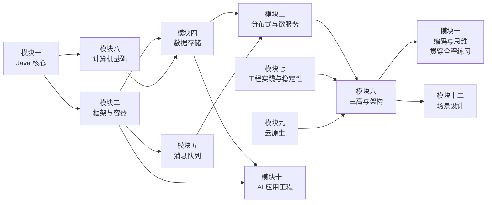

# Java 资深开发 / 架构师面试题库

> 面向岗位：Java 资深开发、Java 架构师
> 版本基线：按当前最新主流版本编写（见下方「版本基线」），JDK 8 时代已过时的说法会单独标注
> 文件格式：Markdown + Mermaid，Mermaid 画不好的空间结构图使用 SVG（放在各模块的 `assets/` 目录）
> 推荐阅读器：Typora、Obsidian、VS Code（安装 Mermaid 预览插件）、IntelliJ IDEA（Markdown 插件里开启 Mermaid）
> 除面试题之外，[最佳实践](#最佳实践实战手册)目录收录了工程开发、AI 项目与 Agent、RAG 知识库三份实战手册

---

## 一、怎么用这套题

1. **先盖住答案自测**：只看题目，自己用 1 分钟口述，再对照「30 秒版回答」，检查骨架有没有缺漏。
2. **再读深入剖析**：搞清楚"为什么是这样"。看图时先看箭头方向和分组边界，它们对应真实的调用方向和职责边界。
3. **最后过追问链**：面试官很少只问一层，追问链是按真实面试的深挖顺序排的。
4. **标记薄弱题**：在题目标题后面自己加 `#复习`，方便 Obsidian/Typora 里全局搜索。

## 二、每道题的结构

| 区块 | 作用 | 说明 |
| --- | --- | --- |
| 考察意图 | 面试官想验证什么 | 帮你判断该往哪个方向答 |
| 30 秒版回答 | 结论先行的骨架 | 面试时先说这一段，再根据面试官反应展开 |
| 深入剖析 | 原理、源码、图解 | 关键节点和复杂机制配图 |
| 追问链 | 面试官最可能的下一问 | 按深挖顺序排列 |
| 生产实践 / 踩坑 | 真实线上问题 | 资深岗区分度最高的部分 |
| 架构师加分点 | 从系统、权衡、演进的角度回答 | 面架构师时优先展开 |

不是每道题都有全部区块，没有实质内容的区块会直接省略。

## 三、难度与层级标识

| 标识 | 含义 |
| --- | --- |
| ★ | 基础必会：答不上来基本不过 |
| ★★ | 资深常问：需要讲清原理和取舍 |
| ★★★ | 深挖区：源码细节、生产事故、架构权衡 |
| 【资深】 | 资深开发岗位的重点 |
| 【架构师】 | 架构师岗位的重点，偏系统设计与技术决策 |

## 四、版本基线

| 领域 | 基线版本 | 说明 |
| --- | --- | --- |
| Java | JDK 21 / JDK 25（LTS） | JDK 8 的差异单独标注；预览特性会明确标出 |
| Spring | Spring Boot 3.x / 4.x，Spring Framework 6.x / 7.x | Boot 4.0 已于 2025 年 11 月发布 |
| 数据库 | MySQL 8.4 LTS | MySQL 8.0 已于 2026 年 4 月停止支持 |
| 缓存 | Redis 7.x / 8.x | |
| 消息队列 | Kafka 4.x、RocketMQ 5.x、RabbitMQ 4.x | Kafka 4.0 起只支持 KRaft，已彻底移除 ZooKeeper |
| 搜索 | Elasticsearch 8.x / 9.x | |
| Web 容器 | Tomcat 10.1 / 11、Netty 4.2 | |
| 云原生 | Kubernetes 当前稳定版 | |
| AI 应用 | Spring AI 2.0.x、LangChain4j 1.x、MCP 规范 2026-07-28、pgvector 0.8.x | 模块十一的代码核心逻辑只依赖 JDK，大模型和 Embedding 用模拟实现，不调用真实模型服务 |

版本敏感的结论都会写明适用版本。凡是标注「已核对」的源码或默认参数，均来自本机 OpenJDK 的 `src.zip` 或实际运行结果。

## 五、总目录

状态说明：✅ 已完成　⏳ 待生成

### 模块一：Java 核心

| 编号 | 分类 | 重点范围 | 状态 |
| --- | --- | --- | --- |
| 01 | [Java 基础](01-Java核心/01-Java基础.md) | 语言特性、初始化顺序、内部类、泛型、反射、序列化、新版本特性（record / sealed / 模式匹配） | ✅ |
| 02 | [集合类](01-Java核心/02-集合类.md) | HashMap、List、Set、Queue 的实现与选型 | ✅ |
| 03 | [Java 并发](01-Java核心/03-Java并发.md) | JMM、锁、AQS、线程协作（wait / notify、park）、线程池、并发容器、FutureTask、虚拟线程、结构化并发 | ✅ |
| 04 | [JVM](01-Java核心/04-JVM.md) | 内存结构、类加载、GC（G1 / ZGC）、调优 | ✅ |

### 模块二：框架与容器

| 编号 | 分类 | 重点范围 | 状态 |
| --- | --- | --- | --- |
| 05 | [Spring](02-框架与容器/05-Spring.md) | IoC、AOP、事务、Web（MVC、全局异常、参数校验、WebFlux）、Spring Boot 自动配置、Boot 3/4 变化 | ✅ |
| 06 | [MyBatis](02-框架与容器/06-MyBatis.md) | 执行流程、缓存、插件、动态 SQL、连接池（HikariCP） | ✅ |
| 07 | [Tomcat](02-框架与容器/07-Tomcat.md) | 架构、请求处理、线程模型、调优 | ✅ |
| 08 | [Netty](02-框架与容器/08-Netty.md) | Reactor、ByteBuf、零拷贝、粘包拆包 | ✅ |

### 模块三：分布式与微服务

| 编号 | 分类 | 重点范围 | 状态 |
| --- | --- | --- | --- |
| 09 | [分布式理论](03-分布式与微服务/09-分布式理论.md) | CAP / BASE、Paxos 与 Raft、FLP 与拜占庭、复制模型、分布式事务、分布式锁、分布式 ID | ✅ |
| 10 | [RPC 与 Dubbo](03-分布式与微服务/10-RPC与Dubbo.md) | RPC 原理、序列化、Dubbo 3 架构与 Triple 协议 | ✅ |
| 11 | [微服务](03-分布式与微服务/11-微服务.md) | 服务拆分、服务治理、演进路径 | ✅ |
| 12 | [Spring Cloud](03-分布式与微服务/12-SpringCloud.md) | 注册发现、网关、负载均衡、熔断限流、Seata | ✅ |
| 13 | [配置中心](03-分布式与微服务/13-配置中心.md) | Nacos / Apollo 原理、动态刷新、灰度发布 | ✅ |
| 14 | [ZooKeeper](03-分布式与微服务/14-ZooKeeper.md) | ZAB、Watcher、典型应用 | ✅ |

### 模块四：数据存储

| 编号 | 分类 | 重点范围 | 状态 |
| --- | --- | --- | --- |
| 15 | [MySQL](04-数据存储/15-MySQL.md) | 索引、表设计、事务与 MVCC、锁、日志、复制、备份恢复、查询执行（优化器、JOIN、排序分组）、调优 | ✅ |
| 16 | [分库分表](04-数据存储/16-分库分表.md) | 拆分策略、ShardingSphere、分布式主键、数据迁移 | ✅ |
| 17 | [Redis](04-数据存储/17-Redis.md) | 数据结构、渐进式 rehash、持久化、集群、缓存一致性、热点与大 Key | ✅ |
| 18 | [本地缓存](04-数据存储/18-本地缓存.md) | Caffeine、多级缓存、一致性 | ✅ |
| 19 | [Elasticsearch](04-数据存储/19-Elasticsearch.md) | 倒排索引、写入与查询流程、集群、调优 | ✅ |

### 模块五：消息队列

| 编号 | 分类 | 重点范围 | 状态 |
| --- | --- | --- | --- |
| 20 | [MQ 通用与选型](05-消息队列/20-MQ通用与选型.md) | 可靠投递、幂等、顺序、积压、选型对比 | ✅ |
| 21 | [Kafka](05-消息队列/21-Kafka.md) | 存储设计、副本与 ISR、KRaft、消费组再平衡 | ✅ |
| 22 | [RocketMQ](05-消息队列/22-RocketMQ.md) | 架构、存储、事务消息、延时消息、5.x 变化 | ✅ |
| 23 | [RabbitMQ](05-消息队列/23-RabbitMQ.md) | 交换机模型、Quorum Queue、可靠性 | ✅ |

### 模块六：三高与架构

| 编号 | 分类 | 重点范围 | 状态 |
| --- | --- | --- | --- |
| 24 | [高并发](06-三高与架构/24-高并发.md) | 流量削峰、缓存、异步、池化、读写分离 | ✅ |
| 25 | [高性能](06-三高与架构/25-高性能.md) | 性能指标、瓶颈定位、各层优化手段 | ✅ |
| 26 | [高可用](06-三高与架构/26-高可用.md) | 冗余、限流、熔断、降级、多活、容灾 | ✅ |
| 27 | [DDD](06-三高与架构/27-DDD.md) | 战略设计、战术设计、落地分层 | ✅ |
| 28 | [架构设计](06-三高与架构/28-架构设计.md) | 架构原则、技术选型、演进、评审 | ✅ |
| 29 | [场景题](06-三高与架构/29-场景题.md) | 秒杀、短链、Feed 流、对账、IM 等系统设计 | ✅ |

### 模块七：工程实践与稳定性

| 编号 | 分类 | 重点范围 | 状态 |
| --- | --- | --- | --- |
| 30 | [设计模式](07-工程实践与稳定性/30-设计模式.md) | 常用模式及其在 JDK / Spring 中的应用 | ✅ |
| 31 | [单元测试](07-工程实践与稳定性/31-单元测试.md) | JUnit 6、Mockito、测试分层、覆盖率 | ✅ |
| 32 | [日志与可观测性](07-工程实践与稳定性/32-日志与可观测性.md) | 日志框架、Metrics、Trace、OpenTelemetry | ✅ |
| 33 | [线上问题排查](07-工程实践与稳定性/33-线上问题排查.md) | CPU、内存、线程、GC、慢接口排查方法论 | ✅ |
| 34 | [定时任务](07-工程实践与稳定性/34-定时任务.md) | 单机调度、分布式调度、时间轮 | ✅ |
| 35 | [文件处理](07-工程实践与稳定性/35-文件处理.md) | 大文件上传下载、Excel 导入导出、对象存储 | ✅ |
| 36 | [Maven · Git · IDEA](07-工程实践与稳定性/36-Maven·Git·IDEA.md) | 依赖管理与冲突、分支模型、调试技巧 | ✅ |

### 模块八：计算机基础

| 编号 | 分类 | 重点范围 | 状态 |
| --- | --- | --- | --- |
| 37 | [计算机网络](08-计算机基础/37-计算机网络.md) | 分层模型、TCP / UDP、HTTP/1.1 ~ HTTP/3、实时推送（SSE、WebSocket）、DNS、CDN、负载均衡 | ✅ |
| 38 | [操作系统](08-计算机基础/38-操作系统.md) | 进程线程、内存管理、IO 模型、零拷贝 | ✅ |
| 39 | [网络安全](08-计算机基础/39-网络安全.md) | 常见攻击与防护（含 DDoS）、认证授权（含 SSO、扫码登录）、加密 | ✅ |
| 40 | [数据结构](08-计算机基础/40-数据结构.md) | B+ 树、跳表、红黑树、布隆过滤器等工程化数据结构 | ✅ |

### 模块九：云原生

| 编号 | 分类 | 重点范围 | 状态 |
| --- | --- | --- | --- |
| 41 | [容器与云计算](09-云原生/41-容器与云计算.md) | Docker、Kubernetes、云服务模型、Serverless | ✅ |

### 模块十：编码与思维

| 编号 | 分类 | 重点范围 | 状态 |
| --- | --- | --- | --- |
| 42 | [编程题](10-编码与思维/42-编程题.md) | 高频手写代码题（并发、数据结构、算法、SQL） | ✅ |
| 43 | [逻辑思维题](10-编码与思维/43-逻辑思维题.md) | 原「智商题」，少量高频题 | ✅ |

### 模块十一：AI 应用工程

| 编号 | 分类 | 重点范围 | 状态 |
| --- | --- | --- | --- |
| 44 | [AI Agent](11-AI应用工程/44-AI-Agent.md) | 工具调用、MCP、Skills、记忆与上下文、编排（含状态图框架）、推理与 effort、模型网关、安全、评估、推理部署基础 | ✅ |
| 45 | [RAG](11-AI应用工程/45-RAG.md) | 分块、向量索引、混合检索、重排序、评估、权限、Text2SQL | ✅ |

### 模块十二：场景设计

每个文件讲透一道系统设计题：按面试的推进顺序拆成子题，开头附「45 分钟答题版」。本模块在目录内单独编号（S01、S02……），不占用 01～45 的分类编号；[《29 场景题》](06-三高与架构/29-场景题.md)继续保留各个场景的速查版。

| 编号 | 分类 | 重点范围 | 状态 |
| --- | --- | --- | --- |
| S01 | [秒杀系统](12-场景设计/S01-秒杀系统.md) | 分层过滤、原子扣减与限购、热点 Key、可靠下单与对账、防刷、隔离与故障预案 | ✅ |
| S02 | [订单超时取消与延迟任务](12-场景设计/S02-订单超时取消与延迟任务.md) | 五种延迟方案的取舍、扫表与延迟消息、Redis ZSET 可靠领取、取消与支付并发、延迟任务平台（预读 + 时间轮、分片与故障转移） | ✅ |
| S03 | [支付系统](12-场景设计/S03-支付系统.md) | 四种单据、状态机与条件更新、三处幂等、回调 + 查询 + 对账、掉单与重复支付、退款、渠道路由、复式记账 | ✅ |
| S04 | [对账系统](12-场景设计/S04-对账系统.md) | 三类对账、先总后分与分桶核对、四类差错、跨日与挂账、准实时对账、自动处理的边界 | ✅ |
| S05 | [优惠券系统](12-场景设计/S05-优惠券系统.md) | 原子领券与可靠落库、锁定—核销—释放、最优券组合、优惠分摊与部分退款、批量发券、预算与对账 | ✅ |
| S06 | [抢红包](12-场景设计/S06-抢红包.md) | 二倍均值法与公平性、预拆与实时计算、原子抢、发红包扣款、入账幂等、到期退回的并发、总额守恒对账 | ✅ |
| S07 | [订单中心](12-场景设计/S07-订单中心.md) | 职责边界、父子单与快照、状态机、防重复下单、下单链路的顺序与撤销、订单号基因法、多维查询、冷热分离、订单事件 | ✅ |
| S08 | [库存中心](12-场景设计/S08-库存中心.md) | 可售 / 预占 / 已售、预占模型、流水与幂等（空回滚、防悬挂）、多 SKU 扣减与死锁、多仓寻源、热点 SKU、仓库同步与对账 | ✅ |
| S09 | [账务与钱包](12-场景设计/S09-账务与钱包.md) | 账户与流水、复式记账与试算平衡、防透支、冻结、转账与在途账户、提现、热点账户、日切与快照、冲正与审计 | ✅ |
| S10 | [火车票余票与出票（12306）](12-场景设计/S10-火车票余票与出票.md) | 座位 × 区间段的位图模型、余票计算、原子出票、选座策略实测、长短途配额、余票缓存、排队、候补、回收 | ✅ |
| S11 | [短链系统](12-场景设计/S11-短链系统.md) | 发号器 + Base62、可逆混淆、301 与 302、多级缓存与布隆过滤器、点击统计、防滥用 | ✅ |
| S12 | [Feed 流](12-场景设计/S12-Feed流.md) | 推、拉、推拉结合，收件箱与发件箱，异步扇出，多路归并，游标翻页，读时过滤，不活跃用户与重建 | ✅ |
| S13 | [IM 系统](12-场景设计/S13-IM系统.md) | 长连接网关与路由表、确认与重发、去重与会话内序号、拉取兜底、群聊扩散模型、时间线同步、未读数、重连风暴 | ✅ |
| S14 | [实时排行榜](12-场景设计/S14-实时排行榜.md) | ZSET、同分排序的复合分数、周期榜单、分片合并、名次估算、合并写入、结算与防刷 | ✅ |
| S15 | [附近的人](12-场景设计/S15-附近的人.md) | 二维范围查询的降维、GeoHash 原理与边界问题、Redis GEO、四叉树与 S2 / H3、位置上报与清理、位置隐私 | ✅ |
| S16 | [消息推送平台](12-场景设计/S16-消息推送平台.md) | 通道选择、优先级隔离、全量推送的拆批与限速、频控去重免打扰、令牌管理、送达漏斗 | ✅ |

### 最佳实践（实战手册）

这个目录不是面试题，不占用模块编号和 01～45 的分类编号。它按"实战手册"的写法组织：每条实践依次写结论、为什么、怎么做、踩坑、检查清单，每份文档末尾附「踩坑速查表」和「上线前总检查清单」。原理层面的内容不重复，统一链接到对应的分类。条目在各自文档内单独编号（E-01、A-01、R-01……）。

| 文档 | 重点范围 | 条目 | 状态 |
| --- | --- | --- | --- |
| [项目工程开发最佳实践](最佳实践/01-项目工程开发最佳实践.md) | 编码与设计（分层、充血模型、校验、异常、日志、接口、幂等、并发、事务）、数据与中间件（MySQL、数据库变更、Redis、缓存一致性、分布式锁、MQ、外部调用）、质量与交付（测试、评审、Git、依赖、配置、发布）、稳定性与排障（自我保护、可观测、排障、容量、批处理、方案评审、复盘） | E-01 ~ E-30 | ✅ |
| [AI 项目与 Agent 开发最佳实践](最佳实践/02-AI项目与Agent开发最佳实践.md) | 立项与选型、评测驱动、提示词与上下文工程、结构化输出、工具设计与写操作安全、MCP、防跑飞与断点恢复、多 Agent、记忆、提示词注入、可观测、成本、上线迭代、测试 | A-01 ~ A-23 | ✅ |
| [RAG 知识库最佳实践](最佳实践/03-RAG知识库最佳实践.md) | 是否需要 RAG、评测、解析、分块、元数据、增量同步、Embedding 与向量库、混合检索、重排序与阈值、查询理解、引用与拒答、权限、投毒防护、坏例子归因、知识运营、入库管线 | R-01 ~ R-23 | ✅ |

代码说明：标注「已运行」的示例只依赖 JDK 或 Python 标准库，在本机 JDK 17 / JDK 25、Python 3.13 上实际跑过，大模型用模拟实现，不调用真实模型服务；依赖 Spring、Lombok 的片段标注「示意代码，未编译」。文中的踩坑点是业内反复出现的典型问题模式，数字阈值是经验起点，需要用自己的压测和评测校准。

## 六、建议学习路线

面资深开发：模块一、二、四、五是主战场，模块七里的线上问题排查必须准备。
面架构师：在上面的基础上，模块三和模块六占比明显升高，场景题要能画出架构图并讲清取舍。先用《29 场景题》过一遍各个场景的骨架，再用模块十二按 45 分钟的面试节奏逐个深挖。
面 AI 应用工程方向：在资深开发的基础上重点准备模块十一，前置知识是 Spring（05）、Elasticsearch（19）和网络安全（39）。
准备"项目经验"和"你们是怎么做的"这类问题，以及平时做方案、写代码、上线前自查：读[最佳实践](#最佳实践实战手册)目录。题库各分类讲原理和面试问答，最佳实践讲落地做法和踩坑点，两边互相有链接。
