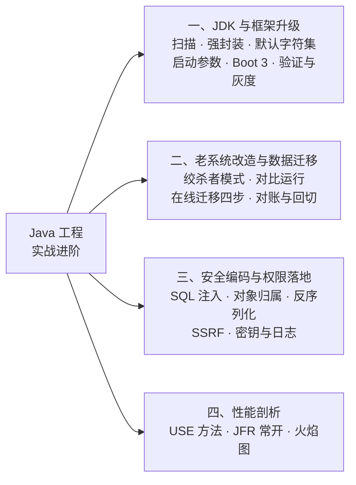
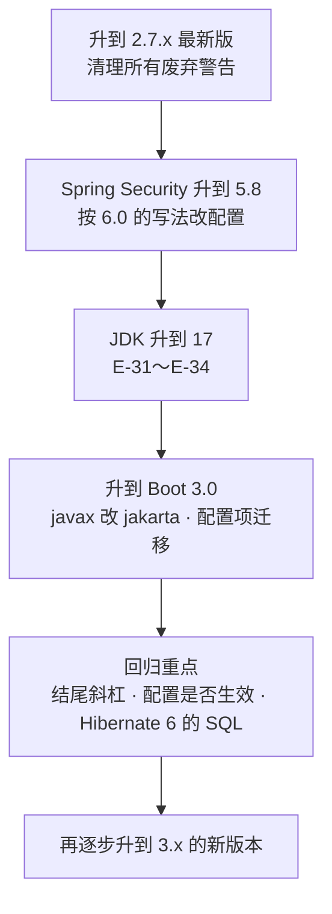
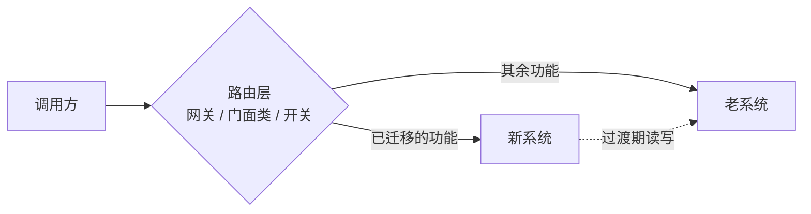
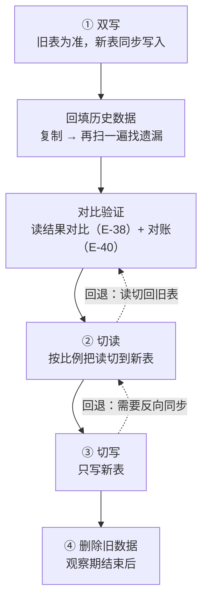

# Java 工程实战进阶

> 适用对象：负责 Java 后端系统、要主导升级、改造或者性能治理的开发和架构师。[《项目工程开发最佳实践》](../最佳实践/01-项目工程开发最佳实践.md)（E-01～E-30）讲日常开发怎么把代码写对，这一份讲四类更"重"的工程任务：JDK 和框架升级、老系统改造与数据迁移、安全编码与权限落地、性能剖析。条目编号接着 E-30 往下排。
> 资料来源：每条末尾的「依据」列出引用的公开一手资料，包括 OpenJDK 的 JEP、Oracle 的 JDK 迁移指南和工具文档、Spring Boot 迁移指南、OpenRewrite 文档、MyBatis 和 MySQL 的官方文档、Linux 内核文档、async-profiler 文档、OWASP 的备忘单，以及 GitHub、Stripe、Netflix、Google、阿里巴巴、Martin Fowler、Brendan Gregg 公开的工程文章和资料，均在 2026 年 11 月核对。正文里写"某某文档说明"的地方是对原文的概括；没有标出处的做法，是综合这些资料和通用工程经验得出的业内常见做法，不代表哪家公司的内部规定。
> 代码说明：标注「已运行」的代码只依赖 JDK，或者只依赖本机已有的 MyBatis 3.5.19 和 H2 2.3.232；在本机 macOS 上用 JDK 8（8u341）、11、17、21、25 运行过，个别实验在 Docker 容器里的 Linux JDK 17（Temurin 17.0.20.1）上运行，输出原样贴出，只把本机的绝对路径换成了 `/path/to/...`。依赖 Spring 的片段标注「示意代码，未编译」。
> 相关文档：[《01 Java 基础》](../01-Java核心/01-Java基础.md)（01-22 讲 Java 8 到 25 的演进）、[《04 JVM》](../01-Java核心/04-JVM.md)、[《05 Spring》](../02-框架与容器/05-Spring.md)、[《33 线上问题排查》](../07-工程实践与稳定性/33-线上问题排查.md)、[《25 高性能》](../06-三高与架构/25-高性能.md)、[《39 网络安全》](../08-计算机基础/39-网络安全.md)、[《大厂公开实践索引》](04-大厂公开实践索引.md)。

## 怎么用这份手册

每条实践按 **结论 → 为什么 → 怎么做 → 踩坑 → 检查清单 → 依据** 的顺序写，没有实质内容的区块直接省略。面试题库里已经讲过的原理，这里只给链接，篇幅留给操作步骤、实测结果和踩坑。

- 准备做一次升级、迁移或者安全治理：先读对应章节，再按文末的[落地检查清单](#落地检查清单)逐项准备。
- 线上出了问题：先查文末的[踩坑速查表](#踩坑速查表)，按症状找到条目。
- 想看原文：每条的「依据」里有链接，文末的[参考资料](#参考资料)按来源汇总。

## 总览



## 条目索引

| 编号 | 实践 | 一句话结论 |
| --- | --- | --- |
| E-31 | 升级前先扫描依赖 | 用 jdeps、jdeprscan 找内部 API 和被移除的模块；编译改用 `--release` |
| E-32 | 反射访问被强封装 | JDK 17 起禁止反射访问 JDK 内部成员；先升级库，临时用 `--add-opens` 精确放行 |
| E-33 | 默认字符集变成 UTF-8 | JDK 18 起默认 UTF-8；所有读写显式指定字符集，容器设置 `LANG` |
| E-34 | JVM 启动参数逐个核对 | JDK 8 的 GC 参数在 17 上会导致无法启动；GC 和堆大小显式指定 |
| E-35 | Spring Boot 2 升到 3 | 先到 2.7 清理废弃项，再升 JDK 17，再升 Boot 3；重点查包名、配置项和结尾斜杠 |
| E-36 | 升级的验证与灰度 | 新旧 JDK 同时跑 CI；字节码类库先升；灰度对比 GC、内存、延迟，随时能切回 |
| E-37 | 用绞杀者模式逐步替换 | 不一次性重写；找到切分点，按功能逐个迁移，每一步都能交付价值 |
| E-38 | 新旧实现对比运行 | 旧实现的结果照常返回，新实现在旁边跑并记录差异；只用于读操作 |
| E-39 | 在线数据迁移分四步 | 双写、切读、切写、删旧数据，每一步都可以单独回退 |
| E-40 | 迁移要能对账、能回切 | 按主键区间算校验和，只对不一致的区间逐行比较；切换后保留回切能力 |
| E-41 | SQL 只用参数绑定，结构部分走白名单 | `#{}` 绑定参数；表名、列名、排序方向只能来自代码里的固定值 |
| E-42 | 每次按 ID 取数据都校验归属 | 每个接收对象 ID 的接口都检查当前用户有没有权限访问这条记录 |
| E-43 | 反序列化只接受白名单类型 | 用反序列化过滤器限定类和大小；JSON 不开多态类型 |
| E-44 | 服务端发起的请求防 SSRF | 解析出 IP 再检查，所有 IP 都不能是内网地址；不跟随重定向；连接校验过的 IP |
| E-45 | 密钥和敏感数据不进代码和日志 | 密钥集中管理、定期轮换；日志里不出现密码、令牌、证件号这类数据 |
| E-46 | 先用 USE 方法看资源 | 每种资源看使用率、饱和度、错误数；CPU 不忙却慢，就去看等待 |
| E-47 | JFR 常开，出问题先看录制 | 生产环境持续录制，出事时导出最近一段；`jfr view` 直接看热点和锁竞争 |
| E-48 | 用火焰图定位热点 | 按问题选 CPU、墙钟、分配、锁模式；优化前后各采一次对比 |

---

## 一、JDK 与框架升级

### E-31 升级前先扫描依赖

**结论**：升级 JDK 之前，先用 JDK 自带的工具扫一遍：`jdeps` 找出对 JDK 内部 API 的依赖和已经找不到的类，`jdeprscan` 找出用到的、即将被删除的 API。编译参数从 `-source`/`-target` 改成 `--release`。扫描只能发现代码里直接写出来的引用，通过反射的调用要靠在新 JDK 上跑测试来发现（E-32）。

**为什么**：从 JDK 9 到 25，JDK 删掉了不少东西。JDK 11 移除了 Java EE 和 CORBA 相关的模块（JEP 320），JAXB（`javax.xml.bind`）、JAX-WS、JAF、JTA 这些包都不在 JDK 里了；`sun.misc.BASE64Encoder` 这类内部 API 也被删除。老代码在 JDK 8 上编译、运行都正常，换到新 JDK 上，要么编译不过，要么编译通过了、运行到那一行才抛 `NoClassDefFoundError`。后一种最危险：如果这段代码只在月底对账、年度结算这类冷门路径上执行，测试和灰度都可能发现不了。

**怎么做**：

1. **扫描**。下面这个类在 JDK 8 上编译和运行都正常，用了 `sun.misc.BASE64Encoder`、JAXB 的 `DatatypeConverter`，还有已经标记为删除的 `new Integer(int)`（已运行，JDK 8 编译，JDK 17 扫描）：

```java
package com.demo.legacy;

import javax.xml.bind.DatatypeConverter;

/** 一个在 JDK 8 上写成的老工具类：用了 JDK 内部 API 和已经移出 JDK 的 JAXB */
public class LegacyCodec {

    public static String base64(byte[] data) {
        return new sun.misc.BASE64Encoder().encode(data);
    }

    public static String hex(byte[] data) {
        return DatatypeConverter.printHexBinary(data);
    }

    @SuppressWarnings("deprecation")
    public static Integer boxed(int v) {
        return new Integer(v);
    }
}
```

   直接放到 JDK 17 上运行，执行到 `base64` 时抛出 `java.lang.NoClassDefFoundError: sun/misc/BASE64Encoder`。用 JDK 17 的工具扫描编译好的 class 目录，三个问题都能提前发现：

```text
$ jdeps -jdkinternals out
out -> JDK removed internal API
   com.demo.legacy.LegacyCodec                        -> sun.misc.BASE64Encoder                             JDK removed internal API
...
JDK Internal API                         Suggested Replacement
----------------                         ---------------------
sun.misc.BASE64Encoder                   Use java.util.Base64 @since 1.8

$ jdeps --missing-deps -cp out out
out -> JDK removed internal API
out -> not found
   com.demo.legacy.LegacyCodec                        -> javax.xml.bind.DatatypeConverter                   not found
   com.demo.legacy.LegacyCodec                        -> sun.misc.BASE64Encoder                             JDK removed internal API

$ jdeprscan --release 17 out
Directory out:
error: cannot find class sun/misc/BASE64Encoder
error: cannot find class javax/xml/bind/DatatypeConverter
class com/demo/legacy/LegacyCodec uses deprecated method java/lang/Integer::<init>(I)V (forRemoval=true)
```

   实际项目里，对应用自己的 jar 和 `lib` 目录下的所有依赖 jar 都扫一遍，第三方库里的问题同样会在运行时爆出来。

2. **按扫描结果处理**：

| 扫描发现 | 处理 |
| --- | --- |
| `sun.misc.BASE64Encoder` / `BASE64Decoder` | 换成 `java.util.Base64`（JDK 8 就有） |
| `javax.xml.bind`（JAXB）、`javax.xml.ws`（JAX-WS）、`javax.activation` 等 | 引入独立发布的依赖。还在用 `javax` 包名的项目选 2.x 版本的 API 和实现；已经迁到 Jakarta 的项目选 3.x 及以上（包名是 `jakarta.xml.bind`） |
| `forRemoval=true` 的 API | 按 JDK 文档换成替代写法，例如 `new Integer(v)` 换成 `Integer.valueOf(v)` |
| 第三方库里的内部 API | 升级到支持新 JDK 的版本；没有新版本的库要尽早替换 |

3. **编译改用 `--release`**。Oracle 的迁移指南建议用 `--release` 代替 `-source`/`-target`：它不只控制生成的字节码版本，还会按目标版本的 API 检查代码。Maven 里设置 `maven.compiler.release` 属性即可。这一点在新旧 JDK 混用的过渡期尤其重要（已运行）：

```text
$ javac (JDK 25) && java (JDK 17)
java.lang.UnsupportedClassVersionError: Hello has been compiled by a more recent version of the Java Runtime (class file version 69.0), this version of the Java Runtime only recognizes class file versions up to 61.0

$ javac --release 17 (JDK 25) && java (JDK 17)
hello
```

4. **先在新 JDK 上跑起来**。Oracle 迁移指南建议在重新编译之前，先把现有的应用直接放到新 JDK 上运行，同时升级第三方库、按需重新编译、运行 jdeps，反复几轮。运行时留意 JVM 打印的过时参数警告（E-34）。

**踩坑**：

| 现象 | 根因 | 做法 |
| --- | --- | --- |
| 测试和灰度都通过了，月底对账时报 `NoClassDefFoundError` | 冷门代码路径用到了被移除的类，平时没执行到 | 升级前用 jdeps 扫描所有 jar，不依赖"跑起来没报错" |
| jdeps 没报问题，运行时还是报 `InaccessibleObjectException` | jdeps 是静态分析，看不到反射调用 | 在新 JDK 上跑完整的测试（E-32） |
| 本地用 JDK 21 编译，部署到 JDK 17 上起不来 | 字节码版本高于运行环境 | 统一用 `--release` 指定目标版本 |

**检查清单**：

- [ ] 应用和所有依赖 jar 都用 `jdeps -jdkinternals`、`jdeps --missing-deps`、`jdeprscan` 扫过吗？
- [ ] 编译参数改成 `--release` 了吗？

**依据**：

- Oracle [JDK 17 Migration Guide](https://docs.oracle.com/en/java/javase/17/migrate/getting-started.html) 及其中的 [Preparing for Migration](https://docs.oracle.com/en/java/javase/17/migrate/preparing-migration.html)：用 jdeps 的 `-jdkinternals` 查找内部 API，jdeps 是静态分析、看不到反射调用；先在新 JDK 上运行再重新编译，迁移是反复迭代的过程；留意 JVM 关于过时参数的警告；建议用 `--release`。
- OpenJDK [JEP 320: Remove the Java EE and CORBA Modules](https://openjdk.org/jeps/320)（JDK 11）：被移除的模块列表。
- 演示代码，本机实测。

### E-32 反射访问被强封装

**结论**：JDK 16 起默认、JDK 17 起强制禁止通过反射访问 JDK 内部的非公开成员，`sun.misc.Unsafe` 这类关键的内部 API 除外；JDK 9～16 用来放宽限制的 `--illegal-access` 参数在 17 上被直接忽略。遇到 `InaccessibleObjectException`，先升级出问题的库；临时方案是用 `--add-opens` 精确地打开某个包，登记在案，限期去掉。

**为什么**：老版本的序列化库、Bean 拷贝工具、动态代理和 Mock 框架，经常用反射读写 JDK 类的私有字段。JDK 9 引入模块系统以后，这类访问在 9～15 只打印警告，16 默认禁止（JEP 396），17 不再提供放宽的开关（JEP 403）。同一段代码在不同 JDK 上的表现（已运行）：

```java
import java.lang.reflect.Field;
import java.util.ArrayList;
import java.util.List;

/** 很多老框架、序列化库、Bean 拷贝工具，都靠反射读写 JDK 类的私有字段 */
public class ReflectDemo {
    public static void main(String[] args) throws Exception {
        List<String> list = new ArrayList<>();
        list.add("SO20261111001");
        Field f = ArrayList.class.getDeclaredField("elementData");
        f.setAccessible(true);
        Object[] data = (Object[]) f.get(list);
        System.out.println("capacity=" + data.length);
    }
}
```

```text
== JDK 8
capacity=10
== JDK 11
WARNING: An illegal reflective access operation has occurred
WARNING: Illegal reflective access by ReflectDemo (file:/path/to/classes/) to field java.util.ArrayList.elementData
WARNING: Please consider reporting this to the maintainers of ReflectDemo
WARNING: Use --illegal-access=warn to enable warnings of further illegal reflective access operations
capacity=10
== JDK 17
Exception in thread "main" java.lang.reflect.InaccessibleObjectException: Unable to make field transient java.lang.Object[] java.util.ArrayList.elementData accessible: module java.base does not "opens java.util" to unnamed module @64de43fc
== JDK 17 --illegal-access=permit
OpenJDK 64-Bit Server VM warning: Ignoring option --illegal-access=permit; support was removed in 17.0
Exception in thread "main" java.lang.reflect.InaccessibleObjectException: Unable to make field transient java.lang.Object[] java.util.ArrayList.elementData accessible: module java.base does not "opens java.util" to unnamed module @64de43fc
== JDK 17 --add-opens java.base/java.util=ALL-UNNAMED
capacity=10
```

**怎么做**：

1. **先在 JDK 11 上把问题找全**。JDK 9～16 默认只在第一次非法访问时打印警告（上面输出的最后一行也提示了这一点），加上 `--illegal-access=warn` 会打印每一次。在 JDK 11 上带着这个参数跑完整的测试，从日志里收集所有 `Illegal reflective access by ...`，就得到了需要升级的库的清单。直接上 17 的话，每次只能看到第一个异常，修一个、再跑一次，效率很低。
2. **升级库**。主流的框架和工具库早已支持 JDK 17，大多数问题升级版本就能解决。
3. **临时放行要精确**。确实暂时升级不了的，用 `--add-opens 模块/包=ALL-UNNAMED` 只打开需要的那个包，写在启动脚本里并注明原因和计划去掉的时间。不要一次性打开一长串包"以防万一"。
4. **提前准备 JDK 24 以后的变化**。`sun.misc.Unsafe` 的内存访问方法在 JDK 23 被标记为将要删除（JEP 471），JDK 24 起第一次调用时会打印警告（JEP 498）。JEP 498 提供了 `--sun-misc-unsafe-memory-access={allow|warn|debug|deny}` 参数，可以在测试环境里用它评估依赖库受到的影响。

**踩坑**：

| 现象 | 根因 | 做法 |
| --- | --- | --- |
| 照着旧文章加了 `--illegal-access=permit`，JDK 17 上照样报错 | 这个参数在 17 上被忽略，只打印一行警告 | 改用 `--add-opens`，或者升级库 |
| 本地 IDE 里能跑，部署后报 `InaccessibleObjectException` | `--add-opens` 只加在了 IDE 的运行配置里 | 参数写进启动脚本或镜像的 `JAVA_OPTS`，和代码一起评审 |
| 修了一个反射问题，下一次启动又冒出另一个 | JDK 17 上每次只暴露第一个 | 先在 JDK 11 上用 `--illegal-access=warn` 一次性收集 |

**检查清单**：

- [ ] 在 JDK 11 上用 `--illegal-access=warn` 跑过完整测试，收集了所有非法反射访问吗？
- [ ] 每个 `--add-opens` 都有原因和计划去掉的时间吗？

**依据**：

- OpenJDK [JEP 396: Strongly Encapsulate JDK Internals by Default](https://openjdk.org/jeps/396)（JDK 16）、[JEP 403: Strongly Encapsulate JDK Internals](https://openjdk.org/jeps/403)（JDK 17）：除 `sun.misc.Unsafe` 等关键内部 API 外全部强封装，17 起不能再用单个参数放宽，仍然可以用 `--add-opens`。
- OpenJDK [JEP 471](https://openjdk.org/jeps/471)（JDK 23）、[JEP 498](https://openjdk.org/jeps/498)（JDK 24）：`Unsafe` 内存访问方法的弃用和运行时警告，`--sun-misc-unsafe-memory-access` 的取值。
- 演示代码，本机实测（JDK 8u341、11.0.13、Corretto 17.0.16、25）。

### E-33 默认字符集变成 UTF-8

**结论**：JDK 18 起，Java 标准 API 的默认字符集固定为 UTF-8（JEP 400），不再取决于操作系统和语言环境。这个变化影响的是 17 升 21 或 25 这一步，不是 8 升 17。凡是不指定字符集的读写，在 Windows、在语言环境是 GBK 的服务器、或者在没有设置 `LANG` 的 Linux 容器里，升级前后的行为都可能不同。升级前把这些调用都改成显式指定字符集。

**为什么**：JDK 17 及以前，默认字符集按操作系统和语言环境决定：macOS 上除了 POSIX C 语言环境之外都是 UTF-8；Windows 上是代码页对应的字符集（JEP 举的例子是 windows-1252 和 windows-31j，中文 Windows 上一般是 GBK）；Linux 上取决于 `LANG`、`LC_ALL` 这些环境变量。`FileReader`、`FileWriter`、不传字符集的 `InputStreamReader`、`new String(bytes)`、`getBytes()` 都用这个默认字符集。同一份 UTF-8 文件，用 `FileReader` 不指定字符集去读（已运行）：

```java
String expected = "退款单号SO20261111001";
Files.write(file, expected.getBytes(StandardCharsets.UTF_8));
// 老代码里很常见的写法：FileReader 不传字符集，用的是"默认字符集"
try (BufferedReader reader = new BufferedReader(new FileReader(file.toFile()))) {
    viaReader = reader.readLine();
}
String viaNewString = new String(Files.readAllBytes(file));
```

```text
== JDK 8, LANG=C (e.g. a minimal container image)
defaultCharset=US-ASCII file.encoding=US-ASCII native.encoding=null
FileReader ok=false prefix=����
new String ok=false
== JDK 17, LANG=C (e.g. a minimal container image)
defaultCharset=US-ASCII file.encoding=US-ASCII native.encoding=US-ASCII
FileReader ok=false prefix=����
new String ok=false
== JDK 25, LANG=C (e.g. a minimal container image)
defaultCharset=UTF-8 file.encoding=UTF-8 native.encoding=US-ASCII
FileReader ok=true prefix=退款单号
new String ok=true
== JDK 25, LANG=C, -Dfile.encoding=COMPAT
defaultCharset=US-ASCII file.encoding=US-ASCII native.encoding=US-ASCII
FileReader ok=false prefix=����
new String ok=false
```

   在 `LANG=zh_CN.UTF-8` 下，三个版本的结果都正确。同样的程序放进 Linux 容器（Temurin JDK 17），清空 `LANG` 以后：

```text
LANG=<unset>
defaultCharset=US-ASCII file.encoding=ANSI_X3.4-1968 native.encoding=ANSI_X3.4-1968
FileReader ok=false prefix=����
new String ok=false
```

   这个镜像本身设置了 `LANG=en_US.UTF-8`，所以默认是正常的；自己裁剪的基础镜像如果没有设置 `LANG`，就会出现上面的情况。

   反方向的风险更隐蔽：在 Windows 或者语言环境为 GBK 的 Linux 上，JDK 17 及以前的默认字符集是 GBK，用 `FileReader` 读合作方提供的 GBK 对账文件一直是正常的；升级到 JDK 18 以后默认变成 UTF-8，同一段代码读出来就是乱码。JEP 400 里举的就是这类例子：一个在 macOS 上用 UTF-8 保存的日文文件，在 Windows 上读出来变成了乱码。本机是 macOS，按 JEP 400 的说明，macOS 上除 C 语言环境外默认一直是 UTF-8，所以这个方向没有在本机复现。

**怎么做**：

1. **找出所有依赖默认字符集的调用**。在代码里搜索 `new FileReader(`、`new FileWriter(`、只有一个参数的 `new InputStreamReader(`、`new OutputStreamWriter(`、`new String(` 加字节数组、不带参数的 `.getBytes()`、`new Scanner(` 加文件或流、`new PrintStream(`。`Files.newBufferedReader(path)`、`Files.readAllLines(path)` 这类不传字符集的 `Files` 方法，从 JDK 8 起就固定用 UTF-8，不受影响。
2. **一律显式指定字符集**。项目自己的文件用 `StandardCharsets.UTF_8`；外部给的文件按约定写明，例如 `Charset.forName("GBK")`。可以用静态检查工具禁止不带字符集的构造方法。
3. **容器镜像设置 `LANG`**，例如 `LANG=C.UTF-8`。启动脚本里统一写 `-Dfile.encoding=UTF-8` 的团队，升级前后行为一致，但第 1、2 步仍然要做，否则换一个环境、少了这个参数就会出问题。
4. **过渡期可以用 `-Dfile.encoding=COMPAT`** 恢复 JDK 17 的行为，只作为临时手段。JDK 17 起还可以用 `native.encoding` 系统属性拿到按旧规则算出来的字符集。
5. **`System.out` 不受这个变化影响**。JEP 400 明确把 `System.out` 和 `System.err` 排除在外，控制台输出乱码要另外排查。

**踩坑**：

| 现象 | 根因 | 做法 |
| --- | --- | --- |
| 升级到 JDK 21 后，读合作方的对账文件出现乱码 | 文件是 GBK 编码，代码没指定字符集，默认字符集从 GBK 变成了 UTF-8 | 读外部文件时按约定显式指定字符集 |
| 本地 Mac 上测试通过，CI 的 Linux 容器里中文断言失败 | 容器没有设置 `LANG`，JDK 17 的默认字符集是 ASCII | 镜像设置 `LANG`；代码显式指定字符集 |
| `-Dfile.encoding=COMPAT` 一直留在生产参数里 | 当作永久方案了 | 显式指定字符集以后去掉 |

**检查清单**：

- [ ] 依赖默认字符集的调用都改成显式指定了吗？
- [ ] 外部文件的编码有约定并写在代码里吗？
- [ ] 镜像里设置了 `LANG` 吗？

**依据**：

- OpenJDK [JEP 400: UTF-8 by Default](https://openjdk.org/jeps/400)（JDK 18）：默认字符集固定为 UTF-8；之前 macOS 上除 POSIX C 语言环境外是 UTF-8，Windows 上是代码页字符集；日文文件在 Windows 上乱码的例子；`COMPAT` 恢复旧行为；JDK 17 引入 `native.encoding`；`System.out` 和 `System.err` 不在影响范围内。
- 演示代码，本机实测（macOS 上的 JDK 8、17、25；Docker 中的 Temurin JDK 17）。

### E-34 JVM 启动参数逐个核对

**结论**：JDK 8 时代常见的一批 GC 参数，原样放到 JDK 17 上会导致 JVM 直接无法启动。默认 GC 从 Parallel 变成了 G1；容器里 CPU 少于 2 核、或者内存不足 2G 左右时，JVM 会自动退回 SerialGC；不设置堆大小时，最大堆只有容器内存的四分之一。升级时把所有启动参数逐个过一遍，GC 和堆大小显式指定。

**为什么**：GC 相关的参数在 JDK 9 改成了统一日志（JEP 158、JEP 271），CMS 在 JDK 14 被移除（JEP 363）。部分旧参数在过渡期只打印警告，过了几个版本就变成无法识别，JVM 拒绝启动。本机把 JDK 8 的常见参数原样放到 JDK 17 上（已运行，Corretto 17.0.16）：

```text
-- JDK 17 -XX:+UseConcMarkSweepGC
Unrecognized VM option 'UseConcMarkSweepGC'
Error: Could not create the Java Virtual Machine.
-- JDK 17 -XX:+PrintGCDetails
[0.001s][warning][gc] -XX:+PrintGCDetails is deprecated. Will use -Xlog:gc* instead.
-- JDK 17 -Xloggc:gc.log
[0.002s][warning][gc] -Xloggc is deprecated. Will use -Xlog:gc:gc.log instead.
-- JDK 17 -XX:+PrintGCDateStamps
Unrecognized VM option 'PrintGCDateStamps'
Error: Could not create the Java Virtual Machine.
-- JDK 17 -XX:+UseParNewGC
Unrecognized VM option 'UseParNewGC'
Error: Could not create the Java Virtual Machine.
-- JDK 17 -XX:MaxPermSize=256m
Unrecognized VM option 'MaxPermSize=256m'
Error: Could not create the Java Virtual Machine.
```

   JEP 363 写的是 JDK 14 遇到 `-XX:+UseConcMarkSweepGC` 时打印警告并忽略，到了 17 已经变成无法启动。默认 GC 和容器里的自动选择（已运行，前三行在 macOS 上用 `-XX:MaxRAM=4g` 模拟，后三行在 Docker 里用 Temurin JDK 17 限制 CPU 和内存）：

```text
-- JDK 8   MaxHeapSize=1073741824 MaxRAMPercentage=25.000000 UseParallelGC=true
-- JDK 17  MaxHeapSize=1073741824 MaxRAMPercentage=25.000000 UseG1GC=true
-- JDK 25  MaxHeapSize=1073741824 MaxRAMPercentage=25.000000 UseG1GC=true
-- --cpus=2 --memory=4g   MaxHeapSize=1024M UseG1GC=true
-- --cpus=1 --memory=4g   MaxHeapSize=1024M UseSerialGC=true
-- --cpus=2 --memory=1g   MaxHeapSize=256M UseSerialGC=true
```

   JDK 24 以后又有两项变化（已运行，JDK 25）：非分代 ZGC 被移除（JEP 490），Security Manager 被永久禁用（JEP 486）：

```text
-- -XX:+UseZGC -XX:-ZGenerational
OpenJDK 64-Bit Server VM warning: Ignoring option ZGenerational; support was removed in 24.0
-- -Djava.security.manager
Error occurred during initialization of VM
java.lang.Error: A command line option has attempted to allow or enable the Security Manager. Enabling a Security Manager is not supported.
```

**怎么做**：

1. **参数对照**：

| JDK 8 的写法 | 在 JDK 17 上 | 换成 |
| --- | --- | --- |
| `-XX:+UseConcMarkSweepGC`、`-XX:+UseParNewGC` | 无法启动 | 默认的 G1；对停顿时间要求很高的再评估 ZGC |
| `-XX:MaxPermSize` | 无法启动（JDK 8 已经没有永久代，当时只是警告） | 需要限制时用 `-XX:MaxMetaspaceSize` |
| `-XX:+PrintGCDateStamps` | 无法启动 | 统一日志的 `time` 装饰 |
| `-XX:+PrintGCDetails`、`-Xloggc:` | 警告，自动换成统一日志 | 显式写 `-Xlog` |
| `-Djava.security.manager`（JDK 24+） | 无法启动 | 去掉，用容器、进程隔离等手段代替 |
| `-XX:-ZGenerational`（JDK 24+） | 警告并忽略 | 去掉 |

2. **GC 日志改用统一日志**，带上时间、按大小滚动（已运行，JDK 17）：

```text
-Xlog:gc*:file=gc-%p.log:time,uptime,level,tags:filecount=10,filesize=50m
```

   输出的每行带着时间戳和进程启动后的秒数，例如 `[2026-11-20T13:56:08.995+0800][0.005s][info][gc] Using G1`。注意日志格式和 JDK 8 完全不同，JEP 271 明确说明不保证现有的 GC 日志解析工具不用修改就能用，依赖 GC 日志的监控和分析脚本要一起改。

3. **显式指定 GC 和堆大小**。容器里不要依赖自动选择：写明 `-XX:+UseG1GC`，用 `-XX:MaxRAMPercentage`（本机的 JDK 8u341 也支持这个参数）按容器内存设置最大堆，留出元空间、线程栈、直接内存和 JVM 自身的空间。具体比例要压测确定，堆外内存多的应用（Netty、大量线程）比例要更低。进程内存超过容器限制被杀的排查见[《33 线上问题排查》](../07-工程实践与稳定性/33-线上问题排查.md)的 33-08。
4. **GC 的选择**。G1 是 JDK 9 起的默认 GC（JEP 248）。分代 ZGC 在 JDK 23 成为 ZGC 的默认模式（JEP 474），JDK 24 移除了非分代模式（JEP 490）；在 JDK 21 上用 ZGC 时，要加 `-XX:+ZGenerational` 才是分代模式。Netflix 的工程师在 InfoQ 的演讲中提到，他们大部分服务用 G1，从 Java 8 升到 17 以后，在没有改代码的情况下 CPU 使用率改善了大约 20%，演讲者把这个改善归因于 G1 的改进。
5. **启动时看警告**。Oracle 迁移指南建议留意 JVM 关于过时参数的警告。把启动日志里的 `warning` 行当作升级的待办，不要等到下一个版本变成无法启动。

**踩坑**：

| 现象 | 根因 | 做法 |
| --- | --- | --- |
| 升级后某个环境起不来，报 `Unrecognized VM option` | 启动参数散落在 Dockerfile、K8s 配置、启动脚本、发布平台里，漏改了一处 | 升级前把所有环境的启动参数收集到一起逐个核对 |
| 容器给了 4G 内存，应用频繁 Full GC，监控显示容器内存还很空 | 没设堆大小，默认最大堆只有 1G | 用 `MaxRAMPercentage` 或 `-Xmx` 显式设置 |
| 1 核的小规格容器里，接口的长尾延迟明显变差 | CPU 少于 2 核时 JVM 自动选择了 SerialGC | 显式指定 GC，并评估规格是否合理 |
| 升级后 GC 监控面板没有数据了 | 日志格式变了，解析脚本不认识 | 解析脚本和升级一起改，或者改用 JMX/JFR 采集 GC 指标 |

**检查清单**：

- [ ] 所有环境的启动参数都收集并核对过吗？启动日志里还有 `warning` 吗？
- [ ] GC 和最大堆都显式指定了吗？
- [ ] GC 日志的解析和监控适配新格式了吗？

**依据**：

- OpenJDK [JEP 363](https://openjdk.org/jeps/363)（JDK 14，移除 CMS，当时遇到参数打印警告并忽略）、[JEP 271](https://openjdk.org/jeps/271)（JDK 9，统一 GC 日志，不保证现有解析工具可用）、[JEP 248](https://openjdk.org/jeps/248)（JDK 9，G1 成为服务器配置下的默认 GC）、[JEP 474](https://openjdk.org/jeps/474)（JDK 23，分代成为 ZGC 默认模式）、[JEP 490](https://openjdk.org/jeps/490)（JDK 24，移除非分代 ZGC）、[JEP 486](https://openjdk.org/jeps/486)（JDK 24，永久禁用 Security Manager）。
- Oracle [JDK 17 Migration Guide](https://docs.oracle.com/en/java/javase/17/migrate/getting-started.html)：留意 JVM 打印的过时参数警告。
- InfoQ [How Netflix Really Uses Java](https://www.infoq.com/presentations/netflix-java/)（Netflix 工程师 Paul Bakker 的演讲）：大部分服务用 G1，从 Java 8 到 17 在不改代码的情况下 CPU 使用率改善约 20%。
- 演示代码，本机实测（macOS 上的 JDK 8、17、25；Docker 中的 Temurin JDK 17）。

### E-35 Spring Boot 2 升到 3

**结论**：按"先升到 2.7 的最新版本并清理废弃警告 → 升级 JDK 到 17 → 升级到 Boot 3"的顺序走，Spring Security 先在 2.7 上升到 5.8。工作量最大的是 `javax` 到 `jakarta` 的包名替换；最容易漏的是配置项改名和 URL 结尾斜杠不再匹配，这两类问题编译不报错，只在运行时表现为"配置没生效""接口 404"。

**为什么**：Spring Boot 3.0 要求 Java 17，改用 Jakarta EE 的 `jakarta` 包名，默认使用 Hibernate 6.1 和 Spring Security 6.0；一批配置项换了名字；Spring MVC 默认不再把 `/orders/` 当成 `/orders` 处理。一步跨过去，问题会混在一起，很难分清是哪一项变化引起的。

**怎么做**：



1. **配置项迁移**。临时引入 `spring-boot-properties-migrator`（`runtime` 作用域）：启动时它会分析当前环境里的配置，打印出改了名或者已经删除的配置项，并在运行时临时按新名字生效。迁移完成后删掉这个依赖（示意代码，未编译）：

```xml
<dependency>
    <groupId>org.springframework.boot</groupId>
    <artifactId>spring-boot-properties-migrator</artifactId>
    <scope>runtime</scope>
</dependency>
```

   迁移指南里点名的改动包括：Redis 的配置从 `spring.redis.*` 移到了 `spring.data.redis.*`；指标导出的配置从 `management.metrics.export.<产品>` 移到了 `management.<产品>.metrics.export`；`server.max-http-header-size` 换成了 `server.max-http-request-header-size`。配置中心里的配置也要一起改，不只是仓库里的 `application.yml`。

2. **`javax` 改 `jakarta`**。迁移指南提到了几种自动化工具：OpenRewrite 的配方、Spring Boot Migrator 项目、IntelliJ IDEA 的迁移功能。以 OpenRewrite 为例，升级到 Java 17 的配方是 `org.openrewrite.java.migrate.UpgradeToJava17`，升级到 Spring Boot 3 的配方当前文档里是 `org.openrewrite.java.spring.boot3.UpgradeSpringBoot_3_5`。文档给出的 Maven 命令：

```bash
mvn -U org.openrewrite.maven:rewrite-maven-plugin:6.69.0:run \
  --define rewrite.recipeArtifactCoordinates=org.openrewrite.recipe:rewrite-migrate-java:RELEASE \
  --define rewrite.activeRecipes=org.openrewrite.java.migrate.UpgradeToJava17
```

   要注意，这两个配方所在的模块（`rewrite-migrate-java`、`rewrite-spring`）现在是 Moderne 的 source-available 模块：文档说明编译好的二进制只提供给 Moderne 的客户，需要登录对应的制品库下载，非商业用途可以自己编译。公司项目使用前先确认许可证和获取方式。不管用哪种工具，自动改完都要人工过一遍 diff，并跑完整测试。

3. **第三方依赖要有 Jakarta 版本**。Servlet 过滤器、JAX-RS、JPA 相关的第三方库，必须换成支持 `jakarta` 包名的版本。还停留在 `javax` 的老库，编译可能照样通过，但它提供的过滤器、监听器不会被 Tomcat 10 识别。
4. **回归的重点**：
   - **结尾斜杠**：结尾斜杠匹配的配置被标记为废弃，默认值改成了 `false`，`GET /some/greeting/` 会返回 404。先排查调用方（尤其是第三方回调地址、移动端写死的地址）有没有带结尾斜杠的，必要时临时用 `setUseTrailingSlashMatch(true)` 兼容，再推动调用方修改。
   - **Spring Security**：Boot 3.0 使用 Security 6.0，迁移指南建议先在 2.7 上升级到 5.8，按新写法改好配置。
   - **Hibernate 6.1**：依赖的 groupId 改成了 `org.hibernate.orm`；生成的 SQL 和主键生成方式有变化，有 JPA 的模块要对比关键查询的 SQL。

升级路径和各版本的主要变化也可以参考[《05 Spring》](../02-框架与容器/05-Spring.md)里关于升级的问答。

**踩坑**：

| 现象 | 根因 | 做法 |
| --- | --- | --- |
| 升级后部分接口 404，本地测试没发现 | 调用方的地址带结尾斜杠，Boot 3 默认不再匹配 | 回归时覆盖带斜杠的地址；排查调用方 |
| 升级后 Redis 连到了 localhost | 配置还写在 `spring.redis.*` 下，新版本不认，用了默认地址 | 用 properties migrator 找出所有改名的配置，包括配置中心里的 |
| 编译通过，某个过滤器不生效 | 第三方库还是 `javax.servlet` 的实现 | 换成支持 Jakarta 的版本 |
| `spring-boot-properties-migrator` 一直留在生产依赖里 | 迁移完成后忘了删除 | 迁移完成的检查清单里列上这一项 |

**检查清单**：

- [ ] 2.7 上的废弃警告清理完了吗？Security 先升到 5.8 了吗？
- [ ] 配置中心里的配置项也迁移了吗？properties migrator 删了吗？
- [ ] 带结尾斜杠的请求、过滤器、JPA 的关键查询都回归过吗？
- [ ] 自动迁移工具的许可证确认过吗？

**依据**：

- Spring Boot [Spring Boot 3.0 Migration Guide](https://github.com/spring-projects/spring-boot/wiki/Spring-Boot-3.0-Migration-Guide)：要求 Java 17，先升到 2.7.x 最新版，`spring-boot-properties-migrator` 的作用，`jakarta` 包名，Redis、指标导出等配置项的改名，Security 先升 5.8，结尾斜杠匹配默认改为 `false`，Hibernate 6.1，提到的迁移工具。
- OpenRewrite [Migrate to Java 17](https://docs.openrewrite.org/running-recipes/popular-recipe-guides/migrate-to-java-17)、[Migrate to Spring Boot 3](https://docs.openrewrite.org/running-recipes/popular-recipe-guides/migrate-to-spring-3)：配方名、Maven 命令，以及配方模块是 Moderne 的 source-available 模块。

### E-36 升级的验证与灰度

**结论**：把 JDK 升级当成一次高风险发布来做：处理字节码的类库先升级；过渡期 CI 里新旧两个 JDK 同时跑测试；灰度时用同一个版本的代码，对比新旧 JDK 上的 GC、CPU、内存、延迟和错误率；旧 JDK 的镜像保留到灰度结束，随时能切回。

**为什么**：前面几条的问题（反射、字符集、启动参数）大多只在运行时暴露，性能变化更是只有真实流量才能验证。升级还有组织层面的阻力：Netflix 的工程师在 InfoQ 的演讲中提到，那一年年初他们大部分服务还在 Java 8 上（演讲时大部分已经升到 17），大约一半的服务跑在一套基于 Guice 和老 Java EE API 的老自研框架上，很多老库不兼容 Java 11，开发者也感受不到升级带来的直接好处。升级要有人统一推动，而且要让收益看得见，比如上面提到的 CPU 改善。

**怎么做**：

1. **处理字节码的类库先升级**。Lombok、Mockito 和它依赖的 Byte Buddy、ASM、JaCoCo、AspectJ 这类读写字节码的库，要认识新的 class 文件版本，版本太老会在编译、测试或者运行时报错。先把它们升到支持目标 JDK 的版本（业内常见做法）。
2. **CI 双跑**。过渡期同一份代码在新旧两个 JDK 上都跑完整测试，产物用 `--release` 编译成旧版本的字节码（E-31），保证同一个包能在两边运行。
3. **灰度对比**。代码版本不变，只换 JDK，按实例比例逐步放量，对比这些指标：

| 指标 | 关注什么 |
| --- | --- |
| GC 停顿时间（P99、最大值）、GC 的 CPU 占用 | 换了 GC 或 GC 参数后是否变好 |
| 每次 GC 后的堆占用 | 有没有内存泄漏的迹象 |
| 进程 RSS、容器内存 | 堆外内存是否变化，会不会被容器杀掉 |
| CPU 使用率 | 同样流量下是否下降 |
| 接口延迟 P99、错误率 | 用户能感知到的变化 |
| 线程数、启动时间 | 启动参数和类加载是否有异常 |

4. **准备回退**。JDK 版本写进镜像的标签，旧 JDK 的镜像保留到灰度结束；回退只换镜像，不改代码。
5. **先边缘、后核心**。先升级流量小、依赖少的服务，积累问题清单和处理方法，再升级核心链路。

**踩坑**：

| 现象 | 根因 | 做法 |
| --- | --- | --- |
| 编译通过，单元测试报 `Unsupported class file major version` | Mockito、JaCoCo 这类字节码库的版本太老 | 先升级字节码相关的库 |
| 压测只看了吞吐和延迟，上线后容器被 OOMKilled | 新 JDK 和新 GC 的堆外内存占用不同，没看 RSS | 灰度时对比 RSS 和容器内存 |
| 升级后某个指标变差，说不清是代码改动还是 JDK 引起的 | 升级和业务需求一起发布 | 升级单独发布，代码版本保持不变 |

**检查清单**：

- [ ] 字节码相关的库都升级了吗？
- [ ] CI 在新旧 JDK 上都跑了完整测试吗？
- [ ] 灰度对比了 GC、RSS、CPU、延迟、错误率吗？旧镜像还能随时切回吗？

**依据**：

- InfoQ [How Netflix Really Uses Java](https://www.infoq.com/presentations/netflix-java/)：Netflix 从 Java 8 升到 17 时遇到的阻力（基于 Guice 和老 Java EE API 的自研框架、不兼容 Java 11 的老库、开发者感受不到直接好处），以及升级后的 CPU 改善。
- 其余做法是业内常见做法。

---

## 二、老系统改造与数据迁移

### E-37 用绞杀者模式逐步替换

**结论**：老系统改造不要一次性重写再整体切换。先在调用入口找到可以切分的地方，把新功能和要改造的功能一块一块地放到新系统里，老系统逐步缩小，直到可以下线。每一步都要能单独上线、单独回退，并且尽早给业务带来价值。

**为什么**：Martin Fowler 在《Strangler Fig》一文中给出的理由是，替换一个重要的系统要花很长时间，用户等不了那么久的新功能。一次性重写的项目，往往在新系统追上老系统的功能之前，老系统又加了新需求，两边永远对不齐；切换那天所有风险集中爆发，出了问题也很难回退。逐步替换把一次大切换拆成很多次小切换，每一次的影响范围都可控。

**怎么做**：



1. **找切分点**。Fowler 的文章把这称为找"接缝"（seam）：能把系统拆开的位置。常见的位置有三类：HTTP 接口按路径在网关上分流；进程内的调用通过一个门面类（Facade）转发，门面类后面可以换实现；消息按 topic 或消息类型分流。切分点选在业务边界清楚、上下游依赖少的功能上，比如先迁"查询退款进度"，不要先迁"下单"。
2. **按功能逐个迁移**。每次迁一个功能，上线时用开关按比例放量，出问题把开关切回去。读功能可以先用对比运行验证（E-38），数据要搬家的按 E-39 分步做。
3. **允许过渡期代码存在**。新系统在过渡期可能要回调老系统、读老系统的表，或者老系统要转发到新系统。Fowler 把这类代码称为过渡架构（transitional architecture）：现代化完成以后就会删掉的代码。它不是技术债，是迁移成本的一部分；但每一处都要登记，迁移完成时逐个删除。
4. **尽早交付价值**。Fowler 强调新组件上线以后业务就能从中受益，投资回报来得更早。优先迁移那些在老系统里改起来最痛、业务最想要新能力的功能，而不是最容易迁的功能，否则项目做了半年，业务看不到任何变化，很容易被叫停。
5. **老系统冻结新需求**。迁移开始后，老系统里已经计划迁出的模块原则上不再加新功能，新需求直接做在新系统里（业内常见做法）。

**踩坑**：

| 现象 | 根因 | 做法 |
| --- | --- | --- |
| 新系统做了一年还没上线，老系统又加了几十个需求 | 一次性重写，追赶一个移动的目标 | 按功能逐步迁移，老系统对应模块冻结新需求 |
| 迁移"完成"了，老系统还是关不掉 | 过渡期代码和遗漏的调用方没清理 | 登记所有过渡代码和调用方，按清单下线 |
| 切换以后出问题只能整体回退 | 没有按功能拆开放量 | 每个功能单独用开关控制 |

**检查清单**：

- [ ] 迁移的切分点、顺序、每一步的回退方式写进方案了吗？
- [ ] 过渡期代码和所有调用方都登记了吗？

**依据**：

- Martin Fowler [Strangler Fig](https://martinfowler.com/bliki/StranglerFigApplication.html)（2024 年 8 月更新）：逐步替换的理由、找接缝、尽早交付价值、过渡架构。
- 冻结老系统新需求是业内常见做法。架构层面的拆分原则见[《28 架构设计》](../06-三高与架构/28-架构设计.md)。

### E-38 新旧实现对比运行

**结论**：重写一段读逻辑时，让新旧两个实现在线上同时运行：旧实现的结果照常返回给调用方，新实现在旁边跑一遍，结果不一致或者抛了异常只做记录，不影响调用方。等不一致的数量降到可以接受，再把流量切到新实现。这个方法只能用在没有副作用的读操作上。

**为什么**：测试环境的数据覆盖不了线上的各种历史数据。GitHub 重写权限相关的代码时用的就是这个办法，并把它做成了开源库 Scientist。他们的博客说明了几个要点：`use` 块是旧实现（control），`try` 块是新实现（candidate）；不管两边结果如何，返回的都是旧实现的结果；新实现抛出的异常不会抛给调用方；两个块的执行顺序是随机的；可以控制只对一部分请求做实验；不一致的结果会被记录下来分析。博客也明确说只在读操作上使用 Scientist。Stripe 在做数据迁移时，同样用 Scientist 对比新旧两张表读出来的数据（E-39）。

**怎么做**：

1. **实现一个对比运行的工具类**。Scientist 是 Ruby 库，Java 项目可以自己写一个，核心逻辑不复杂（已运行，Java 8 语法，JDK 8 和 25 输出一致）：

```java
/**
 * 新旧实现对比运行（思路来自 GitHub 的 Scientist）：
 * 旧实现（control）的结果照常返回给调用方；新实现（candidate）按采样比例在旁边跑一遍，
 * 结果不一致或者抛异常，只记录下来，不影响调用方。只能用在没有副作用的读操作上。
 */
public final class Experiment<T> {

    // 字段和构造方法省略：实验名、采样比例、结果比较器、随机数、计数器、差异样本

    public T run(String key, Supplier<T> control, Supplier<T> candidate) {
        if (random.nextDouble() >= sampleRate) {
            return control.get();
        }
        runs.incrementAndGet();
        // 随机决定先跑哪一个，避免执行顺序（缓存预热、共享状态）影响比较结果
        boolean candidateFirst = random.nextBoolean();
        Outcome<T> c = null;
        if (candidateFirst) {
            c = Outcome.of(candidate);
        }
        T controlValue = control.get(); // 旧实现的异常照常抛给调用方
        if (!candidateFirst) {
            c = Outcome.of(candidate);
        }
        if (c.error != null) {
            candidateErrors.incrementAndGet();
            record(key + " candidate threw " + c.error);
        } else if (sameResult.test(controlValue, c.value)) {
            matched.incrementAndGet();
        } else {
            mismatched.incrementAndGet();
            record(key + " control=" + controlValue + " candidate=" + c.value);
        }
        return controlValue;
    }
    // Outcome.of 捕获新实现的 RuntimeException；record 只保留前几条样本
}
```

2. **在调用处接入**。下面模拟把"可退金额"的计算从老系统迁到新服务：老系统用"实付减已退"，新服务按退款明细重新累加。故意制造两类问题：千分之三的老订单没有迁移退款明细，千分之二的订单明细里多了一笔 0.01 元。对 10 万笔订单按 10% 采样对比：

```java
// 调用方拿到的永远是老系统的结果
BigDecimal refundable = exp.run(o.orderNo, () -> legacyRefundable(o), () -> newRefundable(o));
```

```text
experiment=refundable-amount runs=9947 matched=9908 mismatched=13 candidateErrors=26
  sample: SO00001627 control=33.40 candidate=33.39
  sample: SO00002339 control=491.24 candidate=491.23
  sample: SO00004586 candidate threw java.lang.IllegalStateException: refund items not migrated, orderNo=SO00004586
```

   两类问题都被发现了，而调用方全程拿到的都是老系统的正确结果。每一条差异样本都要逐个查清原因：是新实现的逻辑错了、迁移的数据错了，还是老实现本身就有错。最后一种情况也不少见，要和业务确认以哪边为准。

3. **结果比较器按业务语义写**。示例里金额用 `compareTo` 比较，因为 `BigDecimal.equals` 会比较精度（scale），`2.0` 和 `2.00` 用 `equals` 比较不相等。列表要不要考虑顺序、时间戳允许多大误差、浮点数怎么比，都要在比较器里明确。
4. **控制对线上的影响**。Scientist 的 README 提醒，它不能防止新实现超时。上面的示例是同步执行的，新实现会增加接口的耗时。线上可以：用较低的采样比例起步；或者把新实现放到独立的、有界的线程池里异步执行并设置超时，超时也记为一次失败（业内常见做法）。
5. **只用于读操作**。会写数据、发消息、调外部接口的逻辑，跑两遍就会产生两次副作用。写操作的迁移用 E-39 的双写加对账来验证。
6. **差异记录脱敏**。差异日志里会带上业务数据，记录前按 E-45 去掉敏感字段。

**踩坑**：

| 现象 | 根因 | 做法 |
| --- | --- | --- |
| 开启对比以后接口 P99 明显上升 | 新实现同步执行，或者新实现本身很慢 | 降低采样比例；新实现放到独立线程池，设置超时 |
| 差异很多，查下来大部分是"假差异" | 比较器没按业务语义写（精度、顺序、时间） | 比较器先在测试里覆盖这些情况 |
| 对一个会扣库存的方法做对比，库存被扣了两次 | 对有副作用的操作做了对比运行 | 只对读操作使用 |

**检查清单**：

- [ ] 实验的逻辑确认没有副作用吗？
- [ ] 比较器考虑了精度、顺序、时间这类语义差异吗？
- [ ] 采样比例、超时和差异样本的脱敏都设置了吗？

**依据**：

- GitHub [Scientist：用于重构关键路径的工具](https://github.blog/2016-02-03-scientist/)（2016 年发布）：用于重写权限代码，`use` 和 `try` 的含义，返回旧实现的结果，新实现的异常不抛出，随机执行顺序，按比例启用，只用于读操作。
- GitHub [github/scientist](https://github.com/github/scientist) README：不能防止超时，只适用于不修改数据的方法。
- Stripe [Online migrations at scale](https://stripe.com/blog/online-migrations)：迁移时用 Scientist 对比新旧表的读结果。
- 演示代码，本机实测（JDK 8u341、25）。

### E-39 在线数据迁移分四步

**结论**：线上不停服地把数据从旧模型迁到新模型（换表、拆库、换存储），按"双写 → 切读 → 切写 → 删除旧数据"四步走，中间穿插历史数据回填和对比验证。每一步单独上线、单独放量，在旧数据删除之前，任何一步都能退回去。

**为什么**：Stripe 在《Online migrations at scale》中介绍了他们把订阅数据迁到新数据模型的过程，用的就是这四步：先同时写新旧两张表保持同步，然后把所有读路径改成读新表，再把所有写路径改成只写新表，最后删除依赖旧数据模型的旧数据。他们特别提到，改造所有修改订阅数据的代码路径是整个迁移中最难的部分，而且每次改动从不超过几百行代码。分步的意义在于：每一步只改变一件事，出了问题能立刻知道是哪一步引起的。

**怎么做**：



1. **双写**。所有写路径同时写新旧两边，旧表仍然是准确数据的来源，新表写失败不影响主流程，但要记录下来补偿（业内常见做法）。按比例逐步扩大双写覆盖的对象，Stripe 就是这样逐步放量的。
   - 新旧两张表在同一个数据库里时，两次写入放在同一个本地事务中。
   - 跨库、跨存储时没有本地事务可用，两次写入之间可能有一边失败。常见的办法是把"变更"可靠地记下来再异步同步，例如订阅旧库的 binlog，或者在同一个事务里写一条待发送的消息（业内常见做法），不要在业务代码里写两遍然后指望都成功。相关机制见[《09 分布式理论》](../03-分布式与微服务/09-分布式理论.md)和[《20 MQ 通用与选型》](../05-消息队列/20-MQ通用与选型.md)。
   - 最难的是找全所有写路径：除了业务接口，还有定时任务、运营后台、数据修复脚本、直接改库的 SQL。漏掉的写路径会让新旧数据悄悄地不一致，这类问题要靠 E-40 的对账发现。
2. **回填历史数据**。双写只覆盖新产生的写入，存量数据要单独复制。Stripe 的做法是先用离线任务列出需要复制的 ID，再用多线程的程序逐个复制，最后再跑一遍离线任务，找出还没复制的数据。回填要限速，按主键分批，并且能从断点继续。
3. **对比验证**。读路径用对比运行（E-38）比较新旧两边读出来的结果，全量数据用 E-40 的方法对账。不一致的问题都修完、补完，再进入下一步。
4. **切读**。按用户、按比例把读请求切到新表，旧表仍然在双写。出问题时把读切回旧表即可，数据没有任何损失。
5. **切写**。所有写路径改成只写新表。从这一步开始旧表不再更新，回退就不再是"切个开关"那么简单：要么在观察期内把新表的变更反向同步回旧表，要么接受回退时需要把这段时间的数据补回去（业内常见做法）。所以这一步之前要确认前面的验证已经充分。
6. **删除旧数据**。观察期结束、确认没有任何地方再读写旧表以后，再删除旧表和过渡期代码。删除之前先改名或者收回权限观察一段时间，确认没有遗漏的访问（业内常见做法）。

   如果只是在同一张表上加列、改类型、拆字段，用"扩展 → 迁移 → 收缩"的方式和在线 DDL 工具，见[《项目工程开发最佳实践》](../最佳实践/01-项目工程开发最佳实践.md)的 E-12。

**踩坑**：

| 现象 | 根因 | 做法 |
| --- | --- | --- |
| 切读以后部分订单状态不对 | 运营后台有一条写路径没加双写 | 切读前先对账；写路径要逐个登记 |
| 回填把数据库打满，影响了线上交易 | 回填没有限速 | 按主键分批、限速，低峰期执行 |
| 切写后发现问题，想回退时旧表已经落后了几天 | 切写之后没有反向同步 | 切写前充分验证；观察期内保留反向同步 |
| 一次上线同时改了读和写，出问题说不清原因 | 没有分步 | 每一步单独上线、单独放量 |

**检查清单**：

- [ ] 所有写路径（接口、定时任务、后台、脚本）都登记并改成双写了吗？
- [ ] 回填有限速、断点续跑和补漏的机制吗？
- [ ] 每一步的回退方式明确吗？切写以后的回退方案准备好了吗？

**依据**：

- Stripe [Online migrations at scale](https://stripe.com/blog/online-migrations)（2017 年发布）：四个步骤，回填的做法，用 Scientist 验证读路径，按比例逐步扩大双写，改造写路径最难、每次改动不超过几百行。
- 双写的一致性处理、切写后的反向同步、删除前先改名观察是业内常见做法。

### E-40 迁移要能对账、能回切

**结论**：新旧两边的数据是否一致，要用对账来回答，不能靠"双写代码看起来没问题"。数据量大时按主键区间分桶，先比较每个桶的校验和，只对校验和不一致的桶逐行比较。切换以后保留一段时间的回切能力，回切的操作要提前演练过。

**为什么**：E-39 里说过，漏掉的写路径、部分失败的双写、回填期间的并发修改，都会造成新旧数据不一致，而且这些问题不会报错。全量逐行比较在数据量大时代价太高，分桶校验和可以先用很低的代价定位出有问题的区间。

**怎么做**：

1. **分桶对账**。下面的例子模拟 20 万行数据：回填以后，有两条退款和关单只写了老表（双写漏了这两条路径），一条老表删除了而新表没删，一条新表写成功而老表的事务回滚了（已运行）：

```java
static final int BUCKET_SIZE = 1000;

// 按主键区间分桶，先比较每个桶的校验和
for (long start = 1; start <= maxId; start += BUCKET_SIZE) {
    long end = start + BUCKET_SIZE;
    if (checksum(legacy.subMap(start, end)) != checksum(target.subMap(start, end))) {
        badBuckets.add(start);
    }
}
// 只对校验和不一致的桶逐行比较，输出 DIFFERENT / MISSING_IN_LEGACY / MISSING_IN_TARGET

/** 桶内按主键顺序把每一行拼进 CRC32。主键和内容任何一处不同，校验和都会变 */
static long checksum(Map<Long, String> rows) {
    CRC32 crc = new CRC32();
    for (Map.Entry<Long, String> e : rows.entrySet()) {
        crc.update((e.getKey() + "|" + e.getValue() + "\n").getBytes(StandardCharsets.UTF_8));
    }
    return crc.getValue();
}
```

```text
rows legacy=199999 target=200001 buckets=201 badBuckets=4 comparedRows=3001
  id=12345 DIFFERENT legacy=[user=621,status=REFUNDED,amount=123.45] target=[user=621,status=PAID,amount=123.45]
  id=98765 DIFFERENT legacy=[user=88,status=CLOSED,amount=487.65] target=[user=88,status=PAID,amount=487.65]
  id=150001 MISSING_IN_LEGACY target=[user=520,status=PAID,amount=0.01]
  id=200001 MISSING_IN_LEGACY target=[user=713,status=PAID,amount=0.01]
```

   201 个桶里只有 4 个不一致，逐行比较了 3001 行而不是 20 万行，四处差异全部找到。注意 `MISSING_IN_LEGACY` 的两条原因不同：150001 是老表删除没有同步，200001 是新表多写了一条。对账只负责找出差异，原因要逐条查。

2. **校验和放在数据库里算**。真实场景中，每个桶的校验和应该由数据库按主键区间计算后返回，大部分数据不用拉回应用。以 MySQL 为例，大致思路如下（示意 SQL，字段和函数按实际表结构和数据库调整）：

```sql
-- 每 1000 个主键一个桶，桶内每行算一个 CRC32，再用 BIT_XOR 聚合成桶的校验和
SELECT FLOOR((id - 1) / 1000)                                   AS bucket,
       COUNT(*)                                                 AS cnt,
       BIT_XOR(CRC32(CONCAT_WS('|', id, status, amount,
                               COALESCE(remark, '#NULL#'))))    AS crc
FROM t_order
WHERE id BETWEEN ? AND ?
GROUP BY bucket;
```

   两个要注意的地方。一是 MySQL 的 `CONCAT_WS` 会跳过值为 `NULL` 的参数，`NULL` 和空字符串、或者字段错位都可能得到相同的拼接结果，可以为空的字段要用 `COALESCE` 换成一个不会出现的标记。二是新旧两边的类型和格式要先统一，比如金额的小数位、时间的精度和时区、字符集，否则会产生大量假差异。

3. **处理"正在变化"的数据**。对账时业务还在写，刚好在两次读之间被修改的行会被误报。常见做法是对报出差异的行，过一段时间再比较一次，两次都不一致才算真正的差异；或者只对账更新时间早于某个时间点的数据（业内常见做法）。
4. **对账要持续做**。双写期间、切读之前、切写之前、切写之后都要对账，最好做成定时任务，差异数作为监控指标，超过阈值告警。业务对账系统的设计可以参考[《S04 对账系统》](../12-场景设计/S04-对账系统.md)。
5. **回切要演练**。切读阶段的回切是切回旧表的读；切写之后的回切依赖反向同步（E-39）。回切的开关、步骤、预计耗时写进上线方案，并在预发环境实际操作一遍。旧数据在观察期结束前不删除。

**踩坑**：

| 现象 | 根因 | 做法 |
| --- | --- | --- |
| 对账报出大量差异，查下来是金额 `10.0` 和 `10.00` | 新旧两边的类型和格式不一致 | 拼接前统一格式 |
| 对账全部通过，上线后还是发现数据不对 | 校验时没有包含某些字段，或者 `NULL` 处理不当 | 所有业务字段都参与校验，可空字段用标记替换 |
| 每次对账都有几十条差异，复查又对上了 | 对账期间数据在变化 | 对差异行延迟复查 |
| 需要回切时才发现开关已经被删了 | 过渡期代码删早了 | 观察期结束前保留开关和旧数据 |

**检查清单**：

- [ ] 对账覆盖了所有业务字段吗？`NULL`、精度、时区处理一致了吗？
- [ ] 对账是定时执行并有告警的吗？
- [ ] 回切的步骤演练过吗？旧数据保留到观察期结束吗？

**依据**：

- 分桶校验和对账、延迟复查、回切演练是业内常见做法。
- MySQL 8.4 参考手册 [String Functions and Operators](https://dev.mysql.com/doc/refman/8.4/en/string-functions.html)：`CONCAT_WS()` 不跳过空字符串，但会跳过分隔符之后值为 `NULL` 的参数。
- 演示代码，本机实测。
---

## 三、安全编码与权限落地

### E-41 SQL 只用参数绑定，结构部分走白名单

**结论**：MyBatis 里所有来自外部的值都用 `#{}` 绑定，模糊查询把 `%` 写在 SQL 里拼接。表名、列名、排序字段和排序方向这类没法绑定的部分，前端只能传一个枚举名，真正拼进 SQL 的字符串写死在代码里。

**为什么**：`#{}` 会生成 JDBC 的 `?` 占位符，值和 SQL 结构是分开传给数据库的；`${}` 是把字符串原样拼进 SQL。MyBatis 文档明确说明 `${}` 不会修改或转义字符串，把用户输入原样放进语句是不安全的。实际项目里 `${}` 最常出现在两个地方：模糊查询图省事写成 `'%${keyword}%'`，以及排序字段。OWASP 的 SQL 注入防护备忘单对排序这类场景的建议是：表名、列名、排序方向只能从应用自己定义的固定选项里选。

**怎么做**：

1. **值一律用 `#{}`**。下面的 mapper 分别给出错误和正确的写法（已运行，MyBatis 3.5.19，演示数据库用 H2 2.3.232，JDK 17 和 25 输出一致）：

```xml
<!-- 错误写法：关键字用 ${} 直接拼进 SQL -->
<select id="searchUnsafe" resultType="string">
    SELECT order_no FROM t_order
    WHERE user_id = #{userId} AND order_no LIKE '%${keyword}%'
    ORDER BY id
</select>

<!-- 正确写法：关键字用 #{} 绑定，模糊匹配的 % 在 SQL 里拼 -->
<select id="searchSafe" resultType="string">
    SELECT order_no FROM t_order
    WHERE user_id = #{userId} AND order_no LIKE CONCAT('%', #{keyword}, '%')
    ORDER BY id
</select>
```

   用户 1001 搜索订单号，关键字传入 `%' OR 1=1 OR order_no LIKE '`：

```text
searchUnsafe SQL: SELECT order_no FROM t_order WHERE user_id = ? AND order_no LIKE '%%' OR 1=1 OR order_no LIKE '%' ORDER BY id
searchUnsafe rows: [SO1001A, SO1001B, SO2002A, SO2002B]
searchSafe SQL: SELECT order_no FROM t_order WHERE user_id = ? AND order_no LIKE CONCAT('%', ?, '%') ORDER BY id
searchSafe rows: []
```

   注入以后 `user_id = ?` 的条件被 `OR 1=1` 绕过，用户 1001 看到了用户 2002 的订单。

2. **排序字段走枚举白名单**。`ORDER BY ${sort}` 看起来只影响排序，实际上可以用来读取任意数据。攻击者在排序表达式里放一个子查询：如果管理员密码的第一个字符是某个值，就按金额排序，否则按 ID 排序。通过观察返回顺序，就能逐个字符地猜出密码：

```text
-- guess first char = 'a'
listSortedUnsafe SQL: SELECT order_no FROM t_order WHERE user_id = ? ORDER BY CASE WHEN (SELECT SUBSTRING(password,1,1) FROM t_admin WHERE name='root')='a' THEN amount ELSE id END DESC
listSortedUnsafe rows: [SO1001B, SO1001A]
-- guess first char = 's'
listSortedUnsafe SQL: SELECT order_no FROM t_order WHERE user_id = ? ORDER BY CASE WHEN (SELECT SUBSTRING(password,1,1) FROM t_admin WHERE name='root')='s' THEN amount ELSE id END DESC
listSortedUnsafe rows: [SO1001A, SO1001B]
```

   猜 `s` 时顺序变了，说明第一个字符是 `s`。改成枚举白名单以后，前端只能传 `CREATED` 或 `AMOUNT`：

```java
/** 排序字段白名单：前端只能传枚举名，真正拼进 SQL 的列名写死在代码里 */
enum OrderSort {
    CREATED("id"), AMOUNT("amount DESC");

    final String column;

    OrderSort(String column) {
        this.column = column;
    }

    static OrderSort parse(String name) {
        for (OrderSort s : values()) {
            if (s.name().equals(name)) {
                return s;
            }
        }
        throw new IllegalArgumentException("unsupported sort: " + name);
    }
}
```

```text
listSortedSafe SQL: SELECT order_no FROM t_order WHERE user_id = ? ORDER BY amount DESC
listSortedSafe rows: [SO1001A, SO1001B]
rejected: unsupported sort: CASE WHEN ...
```

   枚举的解析放在接口入口，非法值直接返回参数错误；mapper 里的 `${}` 只会收到枚举里写死的字符串。

3. **其他常见场景**：
   - `IN` 查询用 `<foreach>` 生成多个 `#{}`，不要把逗号拼接的字符串放进 `${}`。
   - 分库分表按规则算出来的表名，同样只能由代码根据枚举或数字计算得出，不能直接用请求里的参数。
   - 分页插件、通用查询组件如果支持"前端传排序字段"，确认它内部有白名单，或者在入口统一转换。
4. **在 CI 里检查 `${`**。对 mapper XML 和注解里的 `${` 做静态扫描，每一处要么改成 `#{}`，要么在评审中确认来源是枚举或常量，并加注释说明（业内常见做法）。

MyBatis 的 `#{}` 与 `${}` 的原理见[《06 MyBatis》](../02-框架与容器/06-MyBatis.md)，SQL 注入的通用防护见[《39 网络安全》](../08-计算机基础/39-网络安全.md)。

**踩坑**：

| 现象 | 根因 | 做法 |
| --- | --- | --- |
| 模糊查询写成 `'%${keyword}%'` | 用 `#{}` 时不知道 `%` 怎么拼 | 用 `CONCAT('%', #{keyword}, '%')`，或者在 Java 里拼好 `%` 再绑定 |
| 排序参数被注入，安全扫描报了高危 | 认为"排序不涉及数据，注入不了" | 排序字段走枚举白名单 |
| 改成白名单以后，前端传的字段名大小写不一致导致报错 | 白名单的匹配规则没约定 | 接口文档写明可选值，入口统一转换 |

**检查清单**：

- [ ] mapper 里每一个 `${` 的来源都是枚举或常量吗？
- [ ] 排序、表名、列名的参数在入口就转换成了枚举吗？

**依据**：

- MyBatis [Mapper XML Files](https://mybatis.org/mybatis-3/sqlmap-xml.html)（String Substitution 一节）：`${}` 不会修改或转义字符串，用户输入原样放进语句是不安全的。
- OWASP [SQL Injection Prevention Cheat Sheet](https://cheatsheetseries.owasp.org/cheatsheets/SQL_Injection_Prevention_Cheat_Sheet.html)：首选参数化查询；表名、列名、排序方向这类不能绑定的部分，用应用定义的固定选项映射。
- 演示代码，本机实测。

### E-42 每次按 ID 取数据都校验归属

**结论**：凡是接口参数里带着对象 ID（订单号、地址 ID、文件 ID）的地方，都要检查当前登录用户有没有权限访问这个对象。这个检查放在一个统一的位置，例如数据访问层按"ID 加归属条件"查询，而不是在每个接口里各写一遍。ID 难以猜测可以降低风险，但不能代替检查。

**为什么**：OWASP API 安全 Top 10（2023）把"对象级授权失效"（BOLA）排在第一位。典型的情况是：接口只校验了用户已登录，没有校验这个订单是不是他的，于是把请求里的订单号换成别人的，就能看到、修改甚至取消别人的订单。这类漏洞不需要任何攻击技巧，改一个数字就够了，而且功能测试一般发现不了，因为测试用户访问的都是自己的数据。

**怎么做**：

1. **归属条件放进查询本身**。数据访问层提供带归属条件的方法，业务代码默认只用这一类方法（示意代码，未编译）：

```java
public interface OrderRepository {

    /**
     * 按订单号查询当前用户自己的订单。查不到时返回空，调用方统一按"订单不存在"处理，
     * 不区分"不存在"和"不是你的"，避免泄露订单号是否存在。
     */
    Optional<Order> findByOrderNoAndUserId(String orderNo, long userId);
}

@Service
@RequiredArgsConstructor
public class OrderQueryService {

    private final OrderRepository orderRepository;

    public OrderDetail getDetail(String orderNo, LoginUser user) {
        // userId 只能来自登录态，不能来自请求参数
        Order order = orderRepository.findByOrderNoAndUserId(orderNo, user.getUserId())
                .orElseThrow(() -> new BizException(ErrorCode.ORDER_NOT_FOUND));
        return OrderDetail.from(order);
    }
}
```

   要点有三个：归属条件（用户 ID、租户 ID、商户 ID）只取自登录态，不能信任请求里传来的值；查不到时返回"不存在"，不提示"无权访问"；没有归属条件的查询方法（比如给内部任务用的 `findByOrderNo`）命名上要区分开，评审时重点看谁在调用。

2. **覆盖容易遗漏的地方**。OWASP 的建议是在每一个使用客户端传来的 ID 访问数据的功能里都做授权检查。除了"查看详情"，还要逐个检查：
   - 修改、删除、取消、退款这类写操作；
   - 批量接口（一次传多个 ID，只校验了第一个）；
   - 导出、下载、打印；
   - 子资源（通过订单号查退款明细、物流信息时，校验的应该是订单的归属）；
   - 运营后台和客服系统（按角色和数据范围校验，不是"能登录后台就能看所有数据"）。
3. **写越权测试**。为每个带 ID 的接口准备两个用户：用户 A 创建数据，用户 B 用 A 的 ID 访问，断言返回"不存在"。这类测试可以按接口清单批量生成（业内常见做法）。
4. **ID 不要可预测**。OWASP 建议对象 ID 优先使用随机、不可预测的值（例如 GUID），而不是自增序号。这能提高攻击的门槛，但只是辅助手段，第 1 步的检查不能省。

**踩坑**：

| 现象 | 根因 | 做法 |
| --- | --- | --- |
| 改请求里的订单号就能看到别人的订单 | 只校验了登录，没校验归属 | 查询带归属条件 |
| 用户 ID 从请求参数里取，被改成了别人的 | 信任了客户端传来的身份信息 | 身份只取自登录态 |
| 详情接口加了校验，导出接口忘了加 | 校验分散在各个接口里 | 归属检查统一放在数据访问层 |

**检查清单**：

- [ ] 每个带对象 ID 的接口（包括批量、导出、子资源、后台）都检查了归属吗？
- [ ] 用户、租户、商户的 ID 只取自登录态吗？
- [ ] 有自动化的越权测试吗？

**依据**：

- OWASP [API1:2023 Broken Object Level Authorization](https://owasp.org/API-Security/editions/2023/en/0xa1-broken-object-level-authorization/)：在每个使用客户端传入 ID 访问数据的功能里检查授权，优先使用随机、不可预测的 ID，编写测试验证授权机制。
- 统一放在数据访问层、查不到时不区分原因、越权测试批量生成是业内常见做法。

### E-43 反序列化只接受白名单类型

**结论**：不要对外部传来的数据使用 Java 原生反序列化。老系统里确实绕不开的（老的 RMI、Session 复制、缓存落盘），用 `jdk.serialFilter` 配置白名单，只允许业务需要的类，并限制深度和大小。JSON 不开启多态类型；还在用 fastjson 1.x 的，开启 safeMode 并计划迁移。

**为什么**：Java 原生反序列化在恢复对象的过程中会执行类里的 `readObject` 等方法。只要类路径上存在某个可以被利用的类（攻击者把它称为"利用链"，常见于各种第三方库），攻击者构造一段字节流，就能在反序列化的过程中执行代码，业务代码根本来不及检查结果。下面用一个只打印一行的 `Gadget` 类模拟这个过程（已运行）：

```java
/** 模拟类路径上某个第三方库里的"利用链"类：反序列化时就会执行代码（这里只打印一行） */
public class Gadget implements Serializable {
    private static final long serialVersionUID = 1L;

    private void readObject(ObjectInputStream in) throws IOException, ClassNotFoundException {
        in.defaultReadObject();
        System.out.println("  !!! Gadget.readObject executed during deserialization");
    }
}
```

   业务代码期望读到的是购物车商品的列表，攻击者在列表里夹带了一个 `Gadget`：

```text
== JDK 17, no filter
-- normal payload
  result=[SKU-1x2]
-- payload with gadget
  !!! Gadget.readObject executed during deserialization
  result=[SKU-1x2, com.demo.gadget.Gadget@85ede7b]
== JDK 17, -Djdk.serialFilter
jdk.serialFilter=maxdepth=10;maxbytes=65536;java.util.ArrayList;java.lang.*;com.demo.order.*;!*
-- normal payload
  result=[SKU-1x2]
-- payload with gadget
  rejected: java.io.InvalidClassException: filter status: REJECTED
```

   JDK 8（8u341）上结果相同，被拒绝时还会多打印一行日志：`INFO: ObjectInputFilter REJECTED: class com.demo.gadget.Gadget, array length: -1, nRefs: 6, depth: 2, bytes: 184, ex: n/a`。

**怎么做**：

1. **能不用就不用**。服务之间传数据用 JSON、Protobuf 这类只描述数据的格式。OWASP 的反序列化备忘单也提醒，过滤并不能让任意的不可信反序列化变得安全，它只是在无法避免时降低风险。
2. **必须用时配置白名单过滤器**。`jdk.serialFilter` 可以作为系统属性或者安全属性设置（JEP 290）。上面的例子里：`maxdepth`、`maxbytes` 限制对象图的深度和字节数，防止构造超大或超深的对象耗尽资源；中间列出允许的类和包；最后的 `!*` 拒绝其他所有类。白名单要从实际业务需要的类出发逐个列出，上线前在测试环境用真实数据验证，被拒绝的类会抛出 `InvalidClassException`。
3. **按场景设置不同的过滤器**。全局过滤器对所有反序列化生效，不同场景需要的类不同时，JDK 9 起可以给单个 `ObjectInputStream` 设置过滤器；JDK 17 起还可以通过过滤器工厂为不同的上下文选择过滤器（JEP 415）。
4. **JSON 不开多态类型**。OWASP 备忘单指出，jackson-databind 在不使用多态类型处理的前提下可以安全使用。不要为了"方便"开启全局的默认类型信息，也不要在接口参数的类型上用类名标识子类型；需要多态时，用固定的类型名到类的映射。
5. **fastjson 1.x 开启 safeMode**。OWASP 备忘单说明 fastjson 1.2.68 及以上版本只有开启 safeMode 才能安全使用，更早的版本都不安全。fastjson 的 wiki 说明 safeMode 会完全禁用 autoType，可以用代码 `ParserConfig.getGlobalInstance().setSafeMode(true)`、JVM 参数 `-Dfastjson.parser.safeMode=true` 或者配置文件开启。fastjson 1.x 的 GitHub 仓库已经归档、只读，长期看应当迁移到仍在维护的 JSON 库（业内常见做法）。

**踩坑**：

| 现象 | 根因 | 做法 |
| --- | --- | --- |
| 白名单上线后部分 Session 反序列化失败 | 白名单漏了业务实际用到的类（比如某个集合实现） | 用真实数据在测试环境验证，按拒绝日志补充 |
| 为了兼容子类，开启了 JSON 的全局默认类型 | 不了解多态类型带来的风险 | 用固定的类型名映射 |
| 安全扫描报 fastjson 高危，升级了版本还是报 | 版本升了但 safeMode 没开 | 开启 safeMode，并安排迁移 |

**检查清单**：

- [ ] 有没有对外部数据使用 Java 原生反序列化？必须用的地方配置了白名单过滤器吗？
- [ ] JSON 库没有开启多态类型吧？fastjson 1.x 开启 safeMode 了吗？

**依据**：

- OpenJDK [JEP 290: Filter Incoming Serialization Data](https://openjdk.org/jeps/290)：`jdk.serialFilter` 作为系统属性或安全属性配置，`maxdepth` 等限制，`!` 表示拒绝。
- OpenJDK [JEP 415: Context-Specific Deserialization Filters](https://openjdk.org/jeps/415)（JDK 17）：过滤器工厂。
- OWASP [Deserialization Cheat Sheet](https://cheatsheetseries.owasp.org/cheatsheets/Deserialization_Cheat_Sheet.html)：使用白名单过滤，过滤不能让任意不可信反序列化变得安全；jackson-databind 不用多态时可以安全使用；fastjson 1.2.68 及以上需要开启 safeMode。
- 阿里巴巴 fastjson wiki [fastjson_safemode](https://github.com/alibaba/fastjson/wiki/fastjson_safemode)：safeMode 完全禁用 autoType，三种开启方式；仓库页面显示已归档。
- 演示代码，本机实测（JDK 8u341、Corretto 17.0.16）。

### E-44 服务端发起的请求防 SSRF

**结论**：服务端按用户提供的地址发请求（回调通知、抓取图片、导入链接、Webhook）之前，先把主机名解析成 IP，检查所有 IP 都不在内网、回环、链路本地这类网段，再用检查过的 IP 去连接，并且不自动跟随重定向。能用域名白名单的场景（例如只回调签约的合作方），优先用白名单。

**为什么**：服务端发出的请求来自内网，能访问到外网用户访问不到的东西：管理端点、内部服务、数据库的 HTTP 接口，以及云服务器上的元数据服务（`169.254.169.254`，可能返回临时凭证）。OWASP 的 SSRF 备忘单指出，基于黑名单的过滤很容易被绕过。下面对比一个常见的"字符串黑名单"写法和一个先解析再检查的写法（已运行，JDK 8、17、25 输出一致）：

```text
https://api.partner.example.com/v1/notify    naive=ALLOW guard=ALLOW [203.0.113.10]
http://127.0.0.1:8080/actuator/env           naive=BLOCK guard=BLOCK internal address: 127.0.0.1
http://2130706433:8080/actuator/env          naive=ALLOW guard=BLOCK internal address: 127.0.0.1
http://[::ffff:a9fe:a9fe]/latest/meta-data/  naive=ALLOW guard=BLOCK internal address: 169.254.169.254
http://172.16.3.7:9200/_cat/indices          naive=ALLOW guard=BLOCK internal address: 172.16.3.7
http://img.attacker.example/a.png            naive=ALLOW guard=BLOCK internal address: 127.0.0.1
file:///etc/passwd                           naive=ALLOW guard=BLOCK scheme not allowed: file
```

   字符串黑名单漏掉了：整数形式的 IP（`2130706433` 就是 `127.0.0.1`）、IPv4 映射的 IPv6 地址（`::ffff:a9fe:a9fe` 就是 `169.254.169.254`）、黑名单里没写全的私有网段（`172.16.0.0/12`）、解析结果指向内网的域名，以及 `file:` 这类非 HTTP 协议。

**怎么做**：

1. **先解析，再按 IP 检查**。核心逻辑如下（已运行；示例中用一个假的解析器代替真实 DNS）：

```java
InetAddress[] check(String url) throws Exception {
    URI uri = URI.create(url);
    String scheme = uri.getScheme();
    if (!"http".equalsIgnoreCase(scheme) && !"https".equalsIgnoreCase(scheme)) {
        throw new SecurityException("scheme not allowed: " + scheme);
    }
    String host = uri.getHost();
    if (host == null) {
        throw new SecurityException("cannot parse host");
    }
    if (host.startsWith("[") && host.endsWith("]")) {
        host = host.substring(1, host.length() - 1);
    }
    InetAddress[] addresses = resolver.resolve(host);
    for (InetAddress a : addresses) {
        if (isInternal(a)) {
            throw new SecurityException("internal address: " + a.getHostAddress());
        }
    }
    // 返回校验过的 IP，后续连接必须用这些 IP，防止校验和连接之间 DNS 结果变化
    return addresses;
}

static boolean isInternal(InetAddress a) {
    if (a.isAnyLocalAddress() || a.isLoopbackAddress() || a.isLinkLocalAddress()
            || a.isSiteLocalAddress() || a.isMulticastAddress()) {
        return true;
    }
    byte[] b = a.getAddress();
    if (b.length == 4) {
        int first = b[0] & 0xff;
        int second = b[1] & 0xff;
        // 0.0.0.0/8，以及 100.64.0.0/10（运营商级 NAT，也有云厂商把内部服务放在这个段）
        return first == 0 || (first == 100 && second >= 64 && second <= 127);
    }
    // fc00::/7 唯一本地地址
    return (b[0] & 0xfe) == 0xfc;
}
```

   注意检查的是解析出来的**所有** IP。攻击者控制的域名可以同时返回一个公网 IP 和一个内网 IP（示例里的 `img.attacker.example`），只检查第一个是不够的。

2. **校验和连接用同一个结果**。如果先解析一次做检查，发请求时 HTTP 客户端又解析一次，攻击者可以让两次解析返回不同的结果（DNS 重绑定）。OWASP 建议校验之后固定使用校验过的 IP。比较稳妥的做法是把上面的检查放进 HTTP 客户端的 DNS 解析扩展点里，让"解析、检查、连接"在同一个地方完成，具体的扩展接口按所用客户端的文档实现（业内常见做法）。
3. **不跟随重定向**。攻击者可以先返回一个合法的公网地址，再用 302 把请求重定向到内网。JDK 自带的 `java.net.http.HttpClient` 默认的重定向策略是 `NEVER`；其他 HTTP 客户端的默认值各不相同，要查文档显式关闭。确实需要跟随时，对每一跳的地址重新做第 1 步的检查。
4. **用同一个解析器**。同一个字符串，不同的解析器可能得到不同的结果（已运行，JDK 8、17、25 一致）：

```text
InetAddress.getByName("0177.0.0.1") -> 177.0.0.1 (Inet4Address)
InetAddress.getByName("127.1") -> 127.0.0.1 (Inet4Address)
InetAddress.getByName("::ffff:a9fe:a9fe") -> 169.254.169.254 (Inet4Address)
URI.create("http://127.1/").getHost() -> null
new URL("http://127.1/").getHost() -> 127.1
```

   Java 把 `0177.0.0.1` 当成十进制，解析成 `177.0.0.1`；而 C 库的 `inet_aton` 和 curl 按八进制解析成 `127.0.0.1`（本机用 Python 的 `socket.inet_aton` 和 curl 验证过）。同样在 Java 里，`URI` 和 `URL` 对 `127.1` 的解析结果也不一样。所以检查用的解析逻辑必须和真正发请求的逻辑一致，不能"用 A 解析做检查，用 B 发请求"。示例中 IPv4 映射的 IPv6 地址能被正确拦住，是因为 Java 在解析时会把它转换成 IPv4 地址，OWASP 也建议在检查网段之前先做这一步规范化。
5. **网络层再加一道**。应用层的检查之外，发起外部请求的服务最好通过统一的出口代理访问外网，在代理上禁止访问内网网段；云上的元数据服务按云厂商的建议加固（业内常见做法）。管理端点（例如 Spring Boot Actuator）不要暴露在业务端口上。

**踩坑**：

| 现象 | 根因 | 做法 |
| --- | --- | --- |
| 黑名单写了 `127.` 和 `10.`，还是被打到了内网 | 整数 IP、IPv6 映射、域名解析都能绕过字符串匹配 | 解析成 IP 后按网段检查 |
| 检查时是公网 IP，请求实际发到了内网 | DNS 重绑定，或者跟随了重定向 | 固定使用检查过的 IP；不跟随重定向 |
| 只检查了 DNS 返回的第一个 IP | 一个域名可以返回多个 IP | 所有 IP 都要检查 |

**检查清单**：

- [ ] 所有按用户提供的地址发请求的功能都登记了吗？能用白名单的用白名单了吗？
- [ ] 检查的是解析后的所有 IP 吗？连接用的是检查过的 IP 吗？
- [ ] 关闭自动重定向了吗？

**依据**：

- OWASP [Server-Side Request Forgery Prevention Cheat Sheet](https://cheatsheetseries.owasp.org/cheatsheets/Server_Side_Request_Forgery_Prevention_Cheat_Sheet.html)：优先用白名单，校验解析后的 IP，防 DNS 重绑定，关闭重定向，拦截元数据服务地址，规范化 IPv4 映射的 IPv6 地址，黑名单容易被绕过。
- JDK API 文档 `java.net.http.HttpClient`：默认重定向策略为 `NEVER`。
- 演示代码，本机实测（JDK 8u341、Corretto 17.0.16、25；八进制写法的对比用 Python 3 和 curl）。

### E-45 密钥和敏感数据不进代码和日志

**结论**：数据库密码、接口密钥、证书私钥集中存放在密钥管理服务里，应用运行时获取，不写进代码仓库和镜像，并且定期轮换。日志里不出现密码、令牌、会话 ID、密钥、连接串、银行卡号、身份证号这类数据；确实需要定位问题时，记录脱敏后的值或者哈希值。

**为什么**：代码仓库的历史会被很多人看到、被复制到很多地方，密钥一旦提交，即使后来删掉，历史记录里也还在。日志会被采集到日志平台、被转发、被长期保存，查看日志的人远多于能访问生产数据库的人。这两处是敏感数据最常见的泄露途径。

**怎么做**：

1. **密钥集中管理**。OWASP 的密钥管理备忘单建议：密钥集中存储和管理；按最小权限分配，每个应用只能读取自己的密钥；支持轮换，最好能自动轮换；条件允许时使用动态密钥（例如按需生成、有有效期的数据库账号）。落到 Java 项目里：
   - 配置文件里只写引用（密钥名），由配置中心或密钥管理服务在运行时注入；
   - 本地开发用单独的开发环境密钥，不和生产共用；
   - 轮换不需要重启，或者至少有标准的轮换流程。
2. **提交前和 CI 里扫描密钥**。在提交钩子和 CI 里运行密钥扫描工具，发现疑似密钥阻止合入（业内常见做法）。已经泄露的密钥，第一件事是吊销和轮换，而不是改写 Git 历史。
3. **日志里不出现敏感数据**。OWASP 的日志备忘单列出了通常不应直接记录的数据，包括访问令牌、认证密码、加密密钥、会话 ID、数据库连接串、银行卡持卡人数据和敏感的个人信息，这些数据应该去掉、掩码、哈希或加密。几个具体的做法：
   - 实体类的 `toString` 排除敏感字段，例如 Lombok 的 `@ToString.Exclude`；
   - 不要直接打印完整的请求体、响应体和 HTTP 请求头（`Authorization`、`Cookie`）；
   - 异常信息里可能带着 SQL 参数、连接串，记录前检查；
   - 日志框架层面再加一道按规则掩码的处理，作为兜底，而不是唯一手段（业内常见做法）。
   日志规范的其他内容见[《项目工程开发最佳实践》](../最佳实践/01-项目工程开发最佳实践.md)的 E-05 和[《32 日志与可观测性》](../07-工程实践与稳定性/32-日志与可观测性.md)。
4. **其他泄露渠道**。堆转储文件、线程转储、错误页面、监控和链路追踪里的参数、Actuator 这类管理端点，都可能包含密钥和敏感数据，它们的访问权限和日志一样要控制（业内常见做法）。

**踩坑**：

| 现象 | 根因 | 做法 |
| --- | --- | --- |
| 测试环境的配置文件连同生产密码一起提交了 | 环境配置混在一起，没有提交前扫描 | 密钥只放在密钥管理服务；提交前扫描 |
| 日志平台里能搜到用户的身份证号 | 打印了整个请求对象 | `toString` 排除敏感字段；不打印完整请求体 |
| 密钥泄露后，删了 Git 历史就认为没事了 | 泄露的密钥可能已经被复制 | 先吊销和轮换 |

**检查清单**：

- [ ] 仓库、镜像、配置文件里还有明文密钥吗？有提交前和 CI 的扫描吗？
- [ ] 密钥能轮换吗？轮换流程演练过吗？
- [ ] 日志、堆转储、管理端点里会出现敏感数据吗？

**依据**：

- OWASP [Secrets Management Cheat Sheet](https://cheatsheetseries.owasp.org/cheatsheets/Secrets_Management_Cheat_Sheet.html)：集中管理、最小权限、轮换、动态密钥。
- OWASP [Logging Cheat Sheet](https://cheatsheetseries.owasp.org/cheatsheets/Logging_Cheat_Sheet.html)：不应直接记录的数据类型，以及去除、掩码、哈希、加密等处理方式。
- 提交前扫描、`toString` 排除、日志框架兜底掩码是业内常见做法。
---

## 四、性能剖析

### E-46 先用 USE 方法看资源

**结论**：接口变慢时，不要一上来就猜代码哪里慢。先按 USE 方法把每一种资源过一遍：使用率（Utilization）、饱和度（Saturation）、错误（Errors）。CPU 很忙，就去看 CPU 花在哪里（E-48 的 CPU 火焰图）；CPU 不忙但请求慢，问题通常在"等待"上，比如线程池排队、连接池等待、锁竞争、IO、容器的 CPU 限流，要看饱和度指标和墙钟时间。

**为什么**：USE 方法由 Brendan Gregg 提出，一句话概括就是：对每一种资源，检查使用率、饱和度和错误。它的价值在于给排查一个完整的清单，避免只盯着自己熟悉的那一两个指标。Java 服务里，使用率正常、饱和度很高的情况非常常见：线程池的线程都在忙、队列在堆积，CPU 却只有 30%；或者容器的 CPU 配额已经用满、正在被限流，宿主机上看 CPU 并不高。

**怎么做**：

1. **按资源逐个检查**。Java 服务常见资源的对照表（业内常见做法，具体指标名按所用的监控系统）：

| 资源 | 使用率 | 饱和度 | 错误 |
| --- | --- | --- | --- |
| CPU | 进程和容器的 CPU 使用率 | 运行队列长度；容器被限流的次数和时间 | — |
| 堆内存 | 每次 GC 后的堆占用 | GC 频率和 GC 耗时占比 | `OutOfMemoryError` |
| 进程内存 | RSS 与容器内存上限的比例 | 内存回收、换页 | 容器被 OOMKilled |
| 业务线程池 | 活跃线程数 / 最大线程数 | 队列长度、任务排队时间 | 拒绝次数 |
| 数据库连接池 | 活跃连接数 / 最大连接数 | 等待获取连接的线程数和等待时间 | 获取连接超时 |
| 锁 | 持有时间 | 等待锁的线程数和等待时间（E-47 的 JFR 锁事件） | 死锁 |
| 网络 | 带宽 | TCP 重传、连接队列溢出 | 连接错误、超时 |
| 下游服务 | 调用量 / 下游容量 | 调用排队、限流 | 错误率、超时率 |

2. **容器里看 CPU 限流**。容器设置了 CPU 上限时，配额用完的那段时间里进程会被暂停，表现为请求延迟出现毛刺，而 CPU 使用率看起来并没有到 100%。cgroup v2 的 `cpu.stat` 文件里，`nr_periods` 是经过的调度周期数，`nr_throttled` 是其中被限流的周期数，`throttled_usec` 是被限流的总时间。在限制 1 核的容器里用 4 个线程空转 5 秒（已运行，Docker 中的 Temurin JDK 17）：

```text
$ cat /sys/fs/cgroup/cpu.max
100000 100000
-- before
usage_usec 24177
nr_periods 1
nr_throttled 0
throttled_usec 0
availableProcessors=1
-- after
usage_usec 5595247
nr_periods 59
nr_throttled 54
throttled_usec 16336067
```

   59 个调度周期里有 54 个被限流。线上把 `nr_throttled` 的增长率作为监控指标，限流频繁时，要么减少并发线程数（GC 线程、业务线程池），要么调整 CPU 配额。另外要注意 JVM 按 CPU 配额计算 `availableProcessors`，它会影响 GC 线程数、`ForkJoinPool` 的默认并行度，以及很多框架按 CPU 数计算的默认线程数（E-34 也提到了配额对 GC 选择的影响）。

3. **CPU 不忙时看线程在等什么**。连续抓几次线程转储（`jcmd <pid> Thread.print`），看大部分线程停在哪里：都在等数据库连接、都在等同一把锁、都在等下游响应。再结合 E-47 的 JFR 锁事件和 E-48 的墙钟模式定位到代码。

完整的排查步骤见[《33 线上问题排查》](../07-工程实践与稳定性/33-线上问题排查.md)和[《项目工程开发最佳实践》](../最佳实践/01-项目工程开发最佳实践.md)的 E-26、E-27。

**踩坑**：

| 现象 | 根因 | 做法 |
| --- | --- | --- |
| CPU 只有 30%，接口却很慢，加机器也没用 | 瓶颈在连接池或线程池的排队上 | 看饱和度指标：队列长度、等待时间 |
| 延迟周期性出现毛刺，CPU 曲线看不出问题 | 容器 CPU 配额用满被限流 | 监控 `nr_throttled`；调整线程数或配额 |
| 只看平均值，指标都正常 | 饱和度问题体现在长尾 | 看 P99 和最大值 |

**检查清单**：

- [ ] 监控里每种资源都有使用率、饱和度、错误三类指标吗？
- [ ] 线程池、连接池的排队和拒绝有监控吗？容器的 CPU 限流有监控吗？

**依据**：

- Brendan Gregg [The USE Method](https://www.brendangregg.com/usemethod.html)：对每一种资源检查使用率、饱和度和错误。
- Linux 内核文档 [Control Group v2](https://docs.kernel.org/admin-guide/cgroup-v2.html)：`cpu.stat` 中 `nr_periods`、`nr_throttled`、`throttled_usec` 的含义。
- 演示代码，本机实测。

### E-47 JFR 常开，出问题先看录制

**结论**：生产环境的 JVM 启动时就打开 JFR（JDK Flight Recorder）持续录制，在磁盘上保留最近几个小时的数据。出了问题先用 `jcmd` 导出最近一段录制，用 `jfr view` 直接看热点方法、内存分配、锁竞争和 GC，而不是等问题复现时再临时挂工具。

**为什么**：线上的性能问题往往是偶发的，等到登录上去挂工具，现场已经没了。JFR 内置在 JDK 里，JDK 自带的 `default` 配置的描述是"可以安全地在生产环境持续使用，开销通常低于 1%"；用于剖析的 `profile` 配置开销通常在 2% 左右。持续剖析在大规模系统里早有实践：Google 2010 年发表的 Google-Wide Profiling 论文，介绍了他们在整个数据中心持续采集剖析数据的基础设施，并强调开销可以忽略不计。

**怎么做**：

1. **启动参数打开持续录制**（已运行，JDK 25；JDK 17 上同样可用）：

```text
-XX:StartFlightRecording:disk=true,maxage=6h,maxsize=512m,dumponexit=true,filename=/path/to/app-exit.jfr
```

   `disk=true` 把数据写到磁盘上的环形缓冲；`maxage` 和 `maxsize` 控制保留多长时间、多大的数据，先到为准；`dumponexit=true` 让 JVM 正常退出时把录制写到 `filename` 指定的文件。不指定 `settings` 时用的就是 `default` 配置。

2. **出问题时导出最近一段**：

```text
$ jcmd <pid> JFR.check
<pid>:
Recording 1: name=1 maxsize=512.0MB maxage=6h (running)

$ jcmd <pid> JFR.dump name=1 filename=/path/to/incident.jfr
<pid>:
Dumped recording "1", 809.4 kB written to:

/path/to/incident.jfr
```

3. **用 `jfr view` 直接看结论**。JDK 21 起，`jfr` 工具提供了 `view` 子命令，可以直接在终端里看汇总视图，例如 `hot-methods`、`allocation-by-site`、`contention-by-site`、`gc`、`cpu-load`、`pinned-threads`、`memory-leaks-by-site` 等。JDK 17 的 `jfr` 没有这个子命令（会提示 `unknown command 'view'`），但 JDK 17 录制的文件可以用 JDK 21 及以上的 `jfr` 工具查看，本机验证过。

   下面是一个"导出订单很慢"的模拟程序，有两个问题：循环里用 `String.matches` 校验订单号，每次调用都会重新编译正则；8 个线程抢同一把锁写审计日志，而且在锁里做了耗时的字符串格式化。用 `profile` 配置录制 6 秒（已运行，JDK 25）：

```text
$ jfr view hot-methods export.jfr
Method                                                                      Samples Percent
--------------------------------------------------------------------------- ------- -------
java.util.Formatter.parse(String)                                               162  17.70%
OrderExportDemo.audit(String)                                                   140  15.30%
java.util.Formatter.format(Locale, String, Object[])                             71   7.76%
...
java.util.regex.Pattern.sequence(Pattern$Node)                                   41   4.48%
java.util.regex.Pattern.atom()                                                   30   3.28%

$ jfr view allocation-by-site export.jfr
Method                                                             Allocation Pressure
------------------------------------------------------------------ -------------------
java.util.regex.Pattern$BitClass.<init>()                                       13.76%
java.util.regex.Pattern.compile()                                               13.16%
java.util.Formatter.parse(String)                                                8.69%
...

$ jfr view contention-by-site export.jfr
StackTrace                                                Count    Avg.    Max.
--------------------------------------------------------- ----- ------- -------
OrderExportDemo.audit(String)                             4,338 1.61 ms 4.94 ms
```

   热点和分配都指向正则编译和字符串格式化，锁竞争指向 `audit` 方法。

4. **锁事件有阈值**。JFR 只记录等待时间超过阈值的锁事件：JDK 自带的 `default` 配置是 20 ms，`profile` 配置是 10 ms。上面的程序每次锁等待只有一两毫秒，用默认阈值录制时 `contention-by-site` 显示 `No events found for 'Contention by Site'.`，上面的结果是录制时加了 `jdk.JavaMonitorEnter#threshold=1ms` 才得到的：

```text
-XX:StartFlightRecording:filename=export.jfr,settings=profile,jdk.JavaMonitorEnter#threshold=1ms
```

   所以"JFR 里没有锁事件"不等于"没有锁竞争"。降低阈值会增加事件数量和开销，适合在排查期间临时使用。

5. **录制文件当作敏感数据**。录制里包含系统属性、环境变量、线程名、类名等信息，按 E-45 控制访问权限（业内常见做法）。

**踩坑**：

| 现象 | 根因 | 做法 |
| --- | --- | --- |
| 问题过去了才去挂工具，什么都没抓到 | 没有持续录制 | 启动参数打开 JFR，保留最近几小时 |
| JFR 里没有锁事件，就排除了锁的问题 | 锁等待短于阈值的事件不记录 | 排查时临时降低阈值 |
| JDK 17 上执行 `jfr view` 报错 | `view` 是 JDK 21 起才有的子命令 | 用 21 及以上的 `jfr` 工具查看 |

**检查清单**：

- [ ] 生产 JVM 打开持续录制了吗？保留时长和磁盘空间评估过吗？
- [ ] 值班手册里写了 `JFR.dump` 和 `jfr view` 的用法吗？

**依据**：

- OpenJDK [JEP 328: Flight Recorder](https://openjdk.org/jeps/328)（JDK 11）：目标之一是默认配置下的性能开销不超过 1%（以 SPECjbb2015 衡量）。
- JDK 自带的 `lib/jfr/default.jfc` 和 `profile.jfc`：两种配置的开销说明，锁事件阈值分别为 20 ms 和 10 ms（本机 JDK 17 和 25 一致）。
- Oracle JDK 21 工具文档 [The jfr Command](https://docs.oracle.com/en/java/javase/21/docs/specs/man/jfr.html)、[The java Command](https://docs.oracle.com/en/java/javase/21/docs/specs/man/java.html)：`jfr view` 的用法，`StartFlightRecording` 的 `disk`、`maxage`、`maxsize`、`dumponexit`、`filename`、`settings` 选项。
- Google Research [Google-Wide Profiling: A Continuous Profiling Infrastructure for Data Centers](https://research.google/pubs/google-wide-profiling-a-continuous-profiling-infrastructure-for-data-centers/)（IEEE Micro，2010）：数据中心范围的持续剖析，开销可以忽略。
- 演示代码，本机实测（JDK 25 录制；JDK 17 的录制用 JDK 21 的 `jfr` 查看）。

### E-48 用火焰图定位热点

**结论**：CPU 高或者某段逻辑慢，用火焰图定位具体的代码路径。按问题选择模式：CPU 高用 CPU 模式，CPU 不高但慢用墙钟模式，GC 频繁看分配，线程互相等待看锁。优化前后用同样的方式各采一次，用数据确认优化有效，并找到下一个热点。

**为什么**：线程转储只是某一瞬间的快照，监控只能告诉你"慢"，火焰图把一段时间内大量采样的调用栈合并起来，一眼就能看出时间花在哪条路径上。

**怎么做**：

1. **读懂火焰图**。Brendan Gregg 的说明里有几点最容易误解：
   - 横轴不是时间，同一层的函数按字母顺序排列，方便合并相同的调用栈；
   - 每个方框的宽度表示它在采样中出现的频率，越宽说明在这条路径上花的时间越多；
   - 纵轴是调用栈的深度，顶部的方框是采样时正在 CPU 上执行的函数；
   - 除了 CPU 火焰图，还有内存、off-CPU（线程不在 CPU 上的时间）和差分火焰图（对比两次采样）。
   看图时先找顶部又宽又平的方框，那是直接消耗 CPU 的地方；再往下看是哪条业务路径调用了它。
2. **用 async-profiler 采集**。它的 README 说明：它是一个低开销的采样剖析器，没有"安全点偏差"问题（很多 Java 剖析器只能在安全点采样，结果会偏）；能看到 GC、JIT 编译这类非 Java 线程，调用栈里包含本地代码和内核的帧；它的 CPU 模式不需要 `-XX:+PreserveFramePointer`，文档提到这个参数的开销有时高达 10%。常用命令（示意命令，本机未安装 async-profiler）：

```bash
# CPU 模式：采集 30 秒，输出可以在浏览器里交互查看的火焰图
asprof -d 30 -f cpu.html <PID>

# 墙钟模式：不管线程是在运行、睡眠还是阻塞都同样采样，按线程分开显示，适合"CPU 不高但慢"
asprof -e wall -t -i 50ms -f wall.html <PID>

# 锁模式：只记录等待超过 5ms 的锁竞争
asprof -e lock -t --lock 5ms -f lock.html <PID>

# 同时采集 CPU、分配和锁，输出 JFR 格式
asprof -e cpu,alloc,lock -f profile.jfr <PID>
```

   在容器里使用时，Docker 默认限制了 `perf_event_open` 系统调用，文档给出的办法是：调整 seccomp 配置（可能还需要 `SYS_ADMIN` 权限），或者使用 `--fdtransfer`，或者退回到 `-e ctimer` 模式。这些权限要和运维、安全团队提前确认，不要等到出事时才发现采集不了。E-47 的 JFR 录制文件也可以用 JDK Mission Control 等图形工具打开分析。

3. **优化前后对比**。对 E-47 里的模拟程序做两处修改：正则预编译成 `static final Pattern`；把字符串格式化移到锁外面，锁里只保留必须互斥的操作：

```java
private static final Pattern ORDER_NO = Pattern.compile("SO\\d{8}[A-Z]?");

static boolean validAfter(String orderNo) {
    return ORDER_NO.matcher(orderNo).matches();
}

static void auditAfter(String line) {
    // 耗时的格式化放到锁外，锁里只做必须互斥的操作
    int h = String.format("%s|%d|%s", line, System.nanoTime(), Thread.currentThread().getName()).hashCode();
    synchronized (AUDIT) {
        AUDIT.add(line);
        if (AUDIT.size() > 10_000) {
            AUDIT.clear();
        }
    }
}
```

   同样 8 个线程跑 6 秒，各跑两次（已运行，JDK 25，本机 10 核）：

```text
mode=before processed=14,287,584 in 6s
mode=after processed=22,659,890 in 6s
mode=before processed=14,840,072 in 6s
mode=after processed=23,739,377 in 6s
```

   再分别用 JFR 录制（锁阈值 1 ms）对比：

```text
$ jfr view contention-by-site before.jfr
StackTrace                                                Count    Avg.    Max.
--------------------------------------------------------- ----- ------- -------
OrderExportCompare.auditBefore(String)                    4,688 1.52 ms 22.0 ms

$ jfr view contention-by-site after.jfr
StackTrace                                                Count    Avg.    Max.
--------------------------------------------------------- ----- ------- -------
OrderExportCompare.auditAfter(String)                       906 2.33 ms 14.1 ms

$ jfr view hot-methods after.jfr
Method                                                                      Samples Percent
--------------------------------------------------------------------------- ------- -------
OrderExportCompare.lambda$main$0(long, boolean, LongAdder)                      267  17.58%
java.util.Formatter.format(Locale, String, Object[])                            220  14.48%
java.util.Formatter$FormatSpecifierParser.parseArgument()                       218  14.35%
...
```

   处理量提升了五成以上，超过 1 ms 的锁等待从 4,688 次降到 906 次，正则编译从热点里消失了。新的热点是 `String.format`，这就是下一步的优化目标：日志、审计这类高频路径上，用简单的字符串拼接代替 `String.format`。注意录制本身也有开销，开着 JFR 时的处理量比不开时低，对比时两边的条件要一致。

4. **用 JMH 验证局部优化**。单个方法的优化（比如正则预编译）用 JMH 做基准测试，避免 JIT 预热和死代码消除带来的误差，见[《25 高性能》](../06-三高与架构/25-高性能.md)的 25-14。

**踩坑**：

| 现象 | 根因 | 做法 |
| --- | --- | --- |
| CPU 火焰图很平，找不到热点，接口还是慢 | 时间花在等待上，CPU 模式看不到 | 用墙钟模式或锁模式 |
| 把横轴当成时间顺序来读 | 火焰图的横轴按字母排序 | 只看宽度，不看左右位置 |
| 容器里 async-profiler 启动报权限错误 | Docker 默认限制了 `perf_event_open` | 提前申请权限，或用 `--fdtransfer`、`-e ctimer` |
| 优化上线后说不清效果 | 优化前没有采样 | 前后用同样的方式各采一次 |

**检查清单**：

- [ ] 生产环境的剖析工具和权限提前准备好了吗？
- [ ] 每次优化都有前后对比的数据吗？

**依据**：

- Brendan Gregg [Flame Graphs](https://www.brendangregg.com/flamegraphs.html)：横轴按字母排序而非时间，宽度表示频率，顶部是正在 CPU 上执行的函数；CPU、内存、off-CPU、差分等类型。
- async-profiler [README](https://github.com/async-profiler/async-profiler) 及其文档 Profiling Modes、Profiling In Container：没有安全点偏差，能看到非 Java 线程和本地、内核帧；CPU 模式不需要 `PreserveFramePointer`；墙钟、锁、多事件模式的命令；容器中的权限要求。
- 演示代码，本机实测（JDK 25）。

---

## 踩坑速查表

| 症状 | 优先怀疑 | 条目 |
| --- | --- | --- |
| 升级 JDK 后某个冷门功能报 `NoClassDefFoundError` | 用了被移除的 JDK 内部 API 或 Java EE 模块 | E-31 |
| 升级后报 `UnsupportedClassVersionError` | 编译用的 JDK 版本高于运行环境 | E-31 |
| JDK 17 上报 `InaccessibleObjectException` | 反射访问 JDK 内部成员被强封装 | E-32 |
| 加了 `--illegal-access=permit` 也没用 | 这个参数在 17 上被忽略 | E-32 |
| 升级到 JDK 18 以上，读外部文件出现乱码 | 默认字符集变成了 UTF-8 | E-33 |
| 容器里中文变成问号或乱码 | 镜像没设 `LANG`，默认字符集是 ASCII | E-33 |
| JVM 启动报 `Unrecognized VM option` | JDK 8 的 GC 参数在新版本已移除 | E-34 |
| 容器内存很大，堆却很小，频繁 GC | 没设堆大小，默认只用四分之一 | E-34 |
| 小规格容器里长尾延迟变差 | CPU 少于 2 核时自动选了 SerialGC | E-34 |
| 升级 Boot 3 后部分接口 404 | 结尾斜杠不再匹配 | E-35 |
| 升级 Boot 3 后配置不生效 | 配置项改名了 | E-35 |
| 单元测试报 `Unsupported class file major version` | 字节码相关的库太老 | E-36 |
| 重写项目迟迟上不了线 | 一次性重写，没有逐步替换 | E-37 |
| 开启对比运行后接口变慢 | 新实现同步执行或太慢 | E-38 |
| 迁移切读后数据不对 | 有写路径没有双写 | E-39、E-40 |
| 对账总有零星差异，复查又对上了 | 对账期间数据在变化 | E-40 |
| 改请求参数就能看到别人的数据 | 没有校验对象归属 | E-42 |
| 安全扫描报 SQL 注入，位置在排序参数 | `ORDER BY ${}` 拼接了前端参数 | E-41 |
| 安全扫描报反序列化或 fastjson 高危 | 原生反序列化没过滤；fastjson 没开 safeMode | E-43 |
| 服务端回调或抓取功能访问到了内网 | 字符串黑名单被绕过；跟随了重定向 | E-44 |
| 日志平台里能搜到密码、证件号 | 打印了完整的请求或对象 | E-45 |
| CPU 不高但接口慢 | 线程池、连接池、锁、IO 的等待 | E-46、E-48 |
| 延迟周期性毛刺，CPU 看不出问题 | 容器 CPU 被限流 | E-46 |
| 问题过去了才想起来抓数据 | 没有持续录制 | E-47 |
| JFR 里没有锁事件 | 锁等待短于记录阈值 | E-47 |

## 落地检查清单

**升级前**

- [ ] 应用和所有依赖都用 jdeps、jdeprscan 扫描过；编译改成 `--release`。（E-31）
- [ ] 在 JDK 11 上用 `--illegal-access=warn` 收集过所有非法反射访问。（E-32）
- [ ] 依赖默认字符集的调用都改成显式指定；镜像设置了 `LANG`。（E-33）
- [ ] 所有环境的启动参数都收集并逐个核对；GC 和堆大小显式指定。（E-34）
- [ ] Spring Boot 先升到 2.7 最新版并清理废弃警告；迁移工具的许可证确认过。（E-35）

**升级中**

- [ ] 字节码相关的库先升级；CI 在新旧 JDK 上双跑。（E-36）
- [ ] 灰度时对比 GC、RSS、CPU、延迟、错误率；旧镜像随时可以切回。（E-36）

**改造与迁移**

- [ ] 迁移方案写明切分点、顺序和每一步的回退方式；过渡代码都登记了。（E-37）
- [ ] 读逻辑的重写先对比运行；比较器按业务语义写。（E-38）
- [ ] 所有写路径都登记并双写；回填有限速和补漏。（E-39）
- [ ] 对账定时执行并有告警；回切演练过。（E-40）

**安全**

- [ ] mapper 里每个 `${` 的来源都是枚举或常量。（E-41）
- [ ] 每个带对象 ID 的接口都校验归属，并有越权测试。（E-42）
- [ ] 没有对外部数据做原生反序列化，或者配置了白名单；JSON 没开多态。（E-43）
- [ ] 按用户地址发请求的功能都做了解析后检查，并关闭了重定向。（E-44）
- [ ] 仓库和镜像里没有明文密钥；日志里没有敏感数据。（E-45）

**性能**

- [ ] 监控覆盖每种资源的使用率、饱和度、错误，包括容器 CPU 限流。（E-46）
- [ ] 生产 JVM 打开 JFR 持续录制，值班手册写了导出和查看方法。（E-47）
- [ ] 剖析工具和权限提前准备好；每次优化都有前后对比。（E-48）

## 参考资料

按来源汇总本文引用的公开资料，均在 2026 年 11 月核对。按公司整理的更完整的索引见[《大厂公开实践索引》](04-大厂公开实践索引.md)。

| 来源 | 资料 | 用在 |
| --- | --- | --- |
| OpenJDK | [JEP 320 移除 Java EE 和 CORBA 模块](https://openjdk.org/jeps/320) | E-31 |
| OpenJDK | [JEP 396 默认强封装 JDK 内部](https://openjdk.org/jeps/396)、[JEP 403 强封装 JDK 内部](https://openjdk.org/jeps/403) | E-32 |
| OpenJDK | [JEP 471 弃用 Unsafe 内存访问方法](https://openjdk.org/jeps/471)、[JEP 498 使用时发出警告](https://openjdk.org/jeps/498) | E-32 |
| OpenJDK | [JEP 400 默认 UTF-8](https://openjdk.org/jeps/400) | E-33 |
| OpenJDK | [JEP 363 移除 CMS](https://openjdk.org/jeps/363)、[JEP 271 统一 GC 日志](https://openjdk.org/jeps/271)、[JEP 248 G1 成为默认](https://openjdk.org/jeps/248) | E-34 |
| OpenJDK | [JEP 474 分代 ZGC 成为默认](https://openjdk.org/jeps/474)、[JEP 490 移除非分代 ZGC](https://openjdk.org/jeps/490)、[JEP 486 永久禁用 Security Manager](https://openjdk.org/jeps/486) | E-34 |
| OpenJDK | [JEP 290 反序列化过滤](https://openjdk.org/jeps/290)、[JEP 415 按上下文的反序列化过滤](https://openjdk.org/jeps/415) | E-43 |
| OpenJDK | [JEP 328 Flight Recorder](https://openjdk.org/jeps/328) | E-47 |
| Oracle | [JDK 17 Migration Guide](https://docs.oracle.com/en/java/javase/17/migrate/getting-started.html)、[Preparing for Migration](https://docs.oracle.com/en/java/javase/17/migrate/preparing-migration.html) | E-31、E-34 |
| Oracle | [The jfr Command](https://docs.oracle.com/en/java/javase/21/docs/specs/man/jfr.html)、[The java Command](https://docs.oracle.com/en/java/javase/21/docs/specs/man/java.html) | E-47 |
| Spring | [Spring Boot 3.0 Migration Guide](https://github.com/spring-projects/spring-boot/wiki/Spring-Boot-3.0-Migration-Guide) | E-35 |
| OpenRewrite（Moderne） | [Migrate to Java 17](https://docs.openrewrite.org/running-recipes/popular-recipe-guides/migrate-to-java-17)、[Migrate to Spring Boot 3](https://docs.openrewrite.org/running-recipes/popular-recipe-guides/migrate-to-spring-3) | E-35 |
| Netflix（InfoQ 演讲） | [How Netflix Really Uses Java](https://www.infoq.com/presentations/netflix-java/) | E-34、E-36 |
| Martin Fowler | [Strangler Fig](https://martinfowler.com/bliki/StranglerFigApplication.html) | E-37 |
| GitHub | [Scientist 发布博客](https://github.blog/2016-02-03-scientist/)、[github/scientist](https://github.com/github/scientist) | E-38 |
| Stripe | [Online migrations at scale](https://stripe.com/blog/online-migrations) | E-38、E-39 |
| MySQL | [String Functions and Operators](https://dev.mysql.com/doc/refman/8.4/en/string-functions.html) | E-40 |
| MyBatis | [Mapper XML Files](https://mybatis.org/mybatis-3/sqlmap-xml.html) | E-41 |
| OWASP | [SQL Injection Prevention Cheat Sheet](https://cheatsheetseries.owasp.org/cheatsheets/SQL_Injection_Prevention_Cheat_Sheet.html) | E-41 |
| OWASP | [API1:2023 Broken Object Level Authorization](https://owasp.org/API-Security/editions/2023/en/0xa1-broken-object-level-authorization/) | E-42 |
| OWASP | [Deserialization Cheat Sheet](https://cheatsheetseries.owasp.org/cheatsheets/Deserialization_Cheat_Sheet.html) | E-43 |
| 阿里巴巴 | [fastjson safeMode 说明](https://github.com/alibaba/fastjson/wiki/fastjson_safemode) | E-43 |
| OWASP | [SSRF Prevention Cheat Sheet](https://cheatsheetseries.owasp.org/cheatsheets/Server_Side_Request_Forgery_Prevention_Cheat_Sheet.html) | E-44 |
| OWASP | [Secrets Management Cheat Sheet](https://cheatsheetseries.owasp.org/cheatsheets/Secrets_Management_Cheat_Sheet.html)、[Logging Cheat Sheet](https://cheatsheetseries.owasp.org/cheatsheets/Logging_Cheat_Sheet.html) | E-45 |
| Brendan Gregg | [The USE Method](https://www.brendangregg.com/usemethod.html)、[Flame Graphs](https://www.brendangregg.com/flamegraphs.html) | E-46、E-48 |
| Linux 内核 | [Control Group v2](https://docs.kernel.org/admin-guide/cgroup-v2.html) | E-46 |
| Google | [Google-Wide Profiling（IEEE Micro，2010）](https://research.google/pubs/google-wide-profiling-a-continuous-profiling-infrastructure-for-data-centers/) | E-47 |
| async-profiler | [async-profiler](https://github.com/async-profiler/async-profiler) | E-48 |
