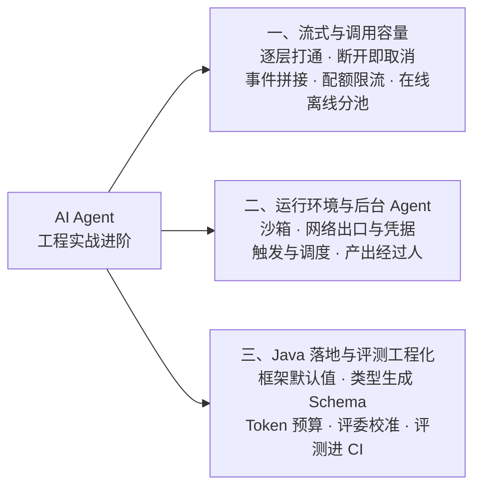
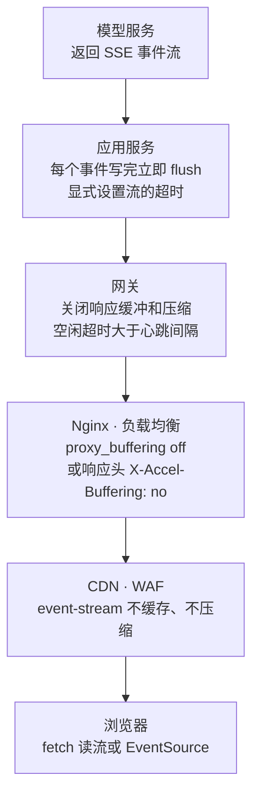
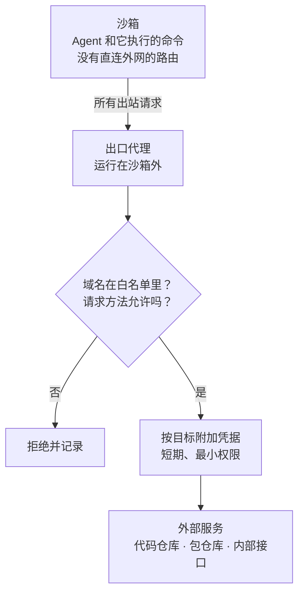
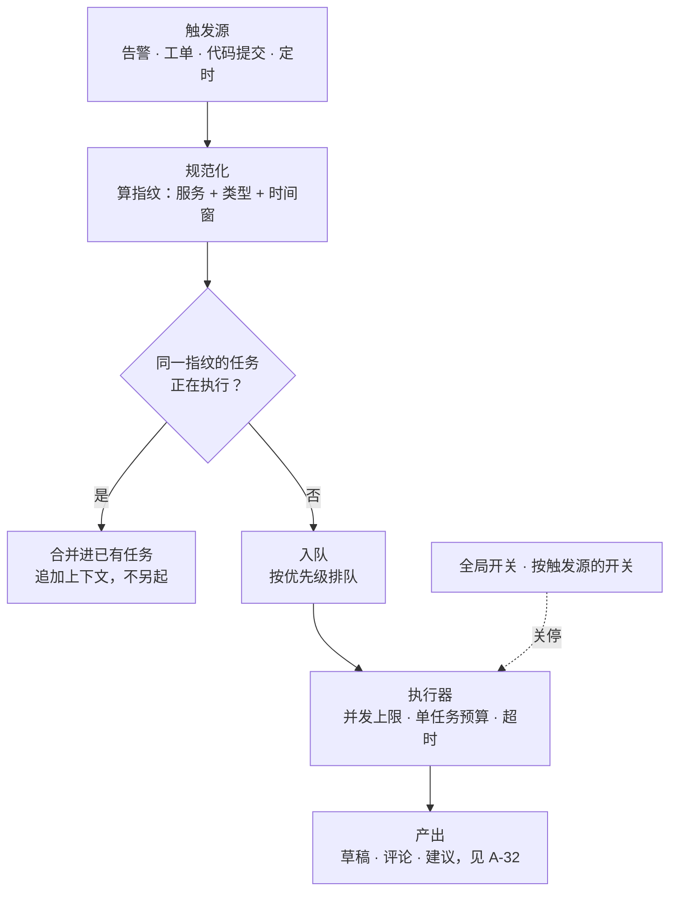
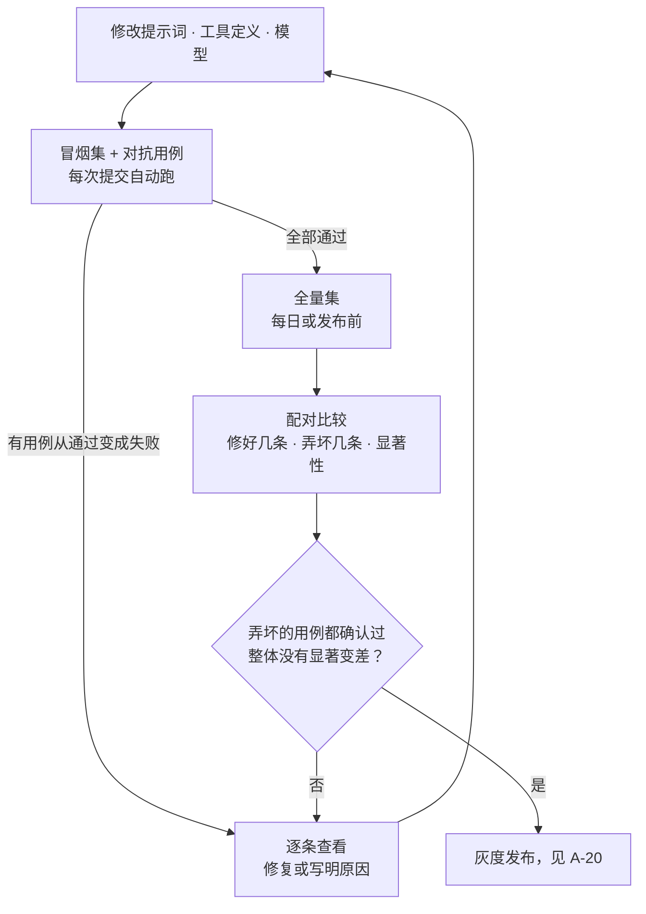

# AI Agent 工程实战进阶

> 适用对象：已经按[《AI 项目与 Agent 开发最佳实践》](../最佳实践/02-AI项目与Agent开发最佳实践.md)把 Agent 做出来、准备接真实流量的后端开发和架构师。那一份（A-01～A-23）讲怎么把 Agent 做对，这一份讲接上真实流量以后才会碰到的工程问题：流式输出怎么一路打通，供应商的配额怎么用，Agent 执行代码、访问网络时怎么隔离，后台 Agent 怎么调度，Java 框架的默认行为怎么核对，评测怎么接进研发流程。条目编号接着 A-23 往下排。
> 资料来源：每条末尾的「依据」列出引用的公开一手资料，包括 Anthropic、OpenAI、AWS、Google 的官方文档和工程文章，Spring、LangChain4j、nginx 的官方文档，以及 WHATWG 规范，均在 2026 年 11 月核对。正文里写"某某文档说明"的地方是对原文的概括；没有标出处的做法，是综合这些资料和通用工程经验得出的业内常见做法，不代表哪家公司的内部规定。供应商的配额、价格、默认值变化很快，落地之前以当时的文档为准。
> 代码说明：标注「已运行」的代码只依赖 JDK 或 Python 标准库，在本机 JDK 25 上运行并在 JDK 21 上复核过，Python 为 3.13。模型和供应商接口都用模拟实现，没有调用任何真实的模型服务。依赖 Spring 的片段标注「示意代码，未编译」。
> 相关文档：[《44 AI Agent》](../11-AI应用工程/44-AI-Agent.md)（原理与面试问答）、[《AI 项目与 Agent 开发最佳实践》](../最佳实践/02-AI项目与Agent开发最佳实践.md)、[《项目工程开发最佳实践》](../最佳实践/01-项目工程开发最佳实践.md)（超时、重试、幂等这些通用做法在那一份里）、[《AI 编码 Agent 研发实践》](03-AI编码Agent研发实践.md)、[《大厂公开实践索引》](04-大厂公开实践索引.md)。

## 怎么用这份手册

每条实践按 **结论 → 为什么 → 怎么做 → 踩坑 → 检查清单 → 依据** 的顺序写，没有实质内容的区块直接省略。

- 准备上线之前：过一遍各条的「检查清单」和文末的[上线前总检查清单](#上线前总检查清单)。
- 线上出了问题：先查文末的[踩坑速查表](#踩坑速查表)，按症状找到条目。
- 想看原文：每条的「依据」里有链接，文末的[参考资料](#参考资料)按来源汇总。

## 总览



## 条目索引

| 编号 | 实践 | 一句话结论 |
| --- | --- | --- |
| A-24 | 流式输出要逐层打通 | 从模型到浏览器，每一层的缓冲、压缩、超时都要检查；长时间没有输出时发心跳 |
| A-25 | 用户断开后取消上游生成 | 断开只能在写的时候发现；用心跳尽早发现，发现后立即关闭上游连接 |
| A-26 | 流式事件的拼接与收尾 | 工具参数按块累积，块结束后再解析；停止原因、用量和错误都在流里 |
| A-27 | 按供应商的配额规则限流 | 先弄清配额按什么计、怎么补充，客户端用并发闸和 token 桶主动限流 |
| A-28 | 在线和离线分开配额 | 批量任务不和在线请求抢同一份配额；不需要实时返回的走批处理接口 |
| A-29 | 执行代码的 Agent 放进沙箱 | 一个任务一个隔离环境，文件和网络都隔离，超时后清理整棵进程树 |
| A-30 | 网络出口与凭据 | 默认不联网，按域名放行；密钥留在沙箱外，由代理在出站时附加 |
| A-31 | 后台 Agent 的触发与调度 | 触发要去重合并，执行要限并发、可暂停，全局有一键关停 |
| A-32 | 后台 Agent 的产出经过人 | 产出是草稿、PR 或建议，由人确认后生效；用采纳率衡量效果 |
| A-33 | 框架默认行为逐项核对 | 记忆、隔离、重试、工具异常、日志、结构化输出，默认值逐项确认并显式配置 |
| A-34 | 工具参数用 Java 类型定义 | 发给模型的 Schema 和服务端校验从同一个类型生成 |
| A-35 | Token 预算与估算 | 本地只能估算，用实际用量校准；按区块分配预算，给输出留足空间 |
| A-36 | 先校准 LLM 评委 | 和人工标注对比时看 kappa 和坏样本检出率，不只看一致率 |
| A-37 | 评测接进 CI | 分冒烟集和全量集；门禁看配对比较和显著性，不只比两次分数 |

---

## 一、流式与调用容量

### A-24 流式输出要逐层打通

**结论**：流式输出要求链路上的每一层都"收到一点就转发一点"。模型和浏览器之间通常隔着应用服务、网关、Nginx 或负载均衡，有时还有 CDN，任何一层开着响应缓冲或压缩，用户看到的都是"等很久，然后一下子全出来"。另外，模型思考或执行工具时可能几十秒没有任何输出，按空闲时间计算的超时会在这时把连接切断。

**为什么**：代理和网关的默认配置是为普通请求优化的。攒满一个缓冲区再发，可以减少系统调用和网络包；连接上一段时间没有数据，就当作对方出了问题。这两个默认行为放在流式输出上都是问题。

**怎么做**：



- **格式**：响应头带 `Content-Type: text/event-stream` 和 `Cache-Control: no-cache`。每个事件由 `event`、`data`、`id` 等字段组成，以一个空行结束。以冒号开头的行是注释，客户端会直接忽略，适合用来发心跳。
- **Nginx**：`proxy_buffering` 默认是开启的。可以在对应的 `location` 里关掉，也可以由应用在响应头里带上 `X-Accel-Buffering: no`，只对这一个响应关闭缓冲。后一种做法不用改 Nginx 配置，流式接口和普通接口可以共用同一个 `location`。
- **压缩**：压缩要攒够一批数据才能压，开着 gzip 的网关或中间件会把事件攒起来再发。`text/event-stream` 的响应不要压缩。
- **超时**：Nginx 的 `proxy_read_timeout` 默认 60 秒，算的是两次读操作之间的间隔，不是整个响应的时长。网关、负载均衡、CDN 也都有类似的空闲超时。只要心跳间隔小于链路上最短的那个空闲超时，长时间的流就不会被切断。WHATWG 的 SSE 规范建议大约每 15 秒发一条注释行保活。
- **Spring MVC**：`SseEmitter` 不显式设置超时时，超时取决于 Servlet 容器的默认值。按业务显式设置（例如 Agent 任务允许的最长时间），不要依赖容器。MVC 的写操作是阻塞的，每条流在写的时候都占着一个线程，并发的流一多，就要用虚拟线程（JDK 21+）执行，或者改用 WebFlux。
- **浏览器**：原生的 `EventSource` 只能发 GET，也不能加自定义请求头，构造参数只有 `withCredentials` 一项。需要 POST 一段长对话、或者要带 `Authorization` 头时，前端一般改用 `fetch` 读取响应流，自己解析事件。HTTP/1.1 下，同一个浏览器对同一个域名最多只能开 6 条 SSE 连接，用户开多个标签页时会互相挤占，升级到 HTTP/2 可以避免。
- **断线续传**：每个事件带上 `id`。浏览器重连时会在 `Last-Event-ID` 请求头里带上最后收到的 id，服务端从这个位置之后接着发。要支持续传，服务端需要把已经生成的内容按会话暂存一段时间。服务端想让浏览器不要再重连时，返回 204。

**踩坑**：

| 现象 | 根因 | 做法 |
| --- | --- | --- |
| 本地直连应用一切正常，部署到测试环境后变成等十几秒一次性出现 | 中间某一层开着响应缓冲 | 逐层检查；流式响应带 `X-Accel-Buffering: no` |
| 关掉了 Nginx 的缓冲，还是一次性出现 | 网关或某个中间件对响应做了 gzip | 对 `text/event-stream` 关闭压缩 |
| 思考时间长的请求，总在 60 秒左右断开 | 代理的读超时按空闲时间算，思考阶段没有任何输出 | 发心跳注释；或者调大空闲超时 |
| 代码里调用了 `write`，前端还是收不到 | 数据只写进了输出缓冲区，没有 flush | 每个事件写完立即 flush |
| 用户开了好几个标签页，新开的页面一直连不上 | HTTP/1.1 下每个域名的 SSE 连接数有上限 | 升级到 HTTP/2；或者同一用户的多个页面共用一条连接 |
| 压测流式接口时线程池被占满，其他接口也开始超时 | 每条流长时间占着一个平台线程，又和普通接口共用线程池 | 流式接口用独立的执行器，用虚拟线程或 WebFlux |

**检查清单**：

- [ ] 在和生产一致的链路上（经过网关、Nginx、CDN）测过第一个事件的到达时间吗？
- [ ] 链路上每一层的缓冲和压缩都确认关掉了吗？
- [ ] 心跳间隔小于链路上最短的空闲超时吗？
- [ ] 流的超时是显式设置的吗？
- [ ] 需要续传的场景，事件带了 id，服务端能从 `Last-Event-ID` 接着发吗？

**依据**：

- nginx 官方文档 [ngx_http_proxy_module](https://nginx.org/en/docs/http/ngx_http_proxy_module.html)：`proxy_buffering` 默认开启；`X-Accel-Buffering` 响应头可以按响应开关缓冲；`proxy_read_timeout` 的含义。
- WHATWG HTML 规范 [Server-sent events](https://html.spec.whatwg.org/multipage/server-sent-events.html)：事件字段、注释行保活（约 15 秒一次）、`Last-Event-ID`、返回 204 让客户端停止重连。
- Spring Framework 参考文档 [Asynchronous Requests](https://docs.spring.io/spring-framework/reference/web/webmvc/mvc-ann-async.html)：异步请求的默认超时取决于 Servlet 容器。
- MDN [EventSource](https://developer.mozilla.org/en-US/docs/Web/API/EventSource)：不走 HTTP/2 时，每个浏览器对每个域名最多 6 条连接；构造参数只有 `withCredentials`。

### A-25 用户断开后取消上游生成

**结论**：用户关掉页面之后，如果服务端没有察觉，模型会继续把整段回答生成完。这部分 token 照样计费，生成它的连接和线程也一直占着。服务端要尽早发现断开，发现后主动关闭到模型服务的连接。

**为什么**：Spring 的文档写得很明确：Servlet API 不会在客户端断开时通知应用，只有往连接里写数据失败时才知道。流式转发的代码一般是"读一段上游，写一段下游"，于是有两种情况会发现不了或者发现了也没用：

- 写失败之后只是吞掉异常、继续读上游，模型就会一直生成到结束；
- 模型处在思考阶段，几秒到几十秒没有输出，这段时间没有任何写操作，断开也就发现不了。

**怎么做**：

- **写失败就关闭上游**：用 JDK `HttpClient` 读流时，`BodySubscribers.ofInputStream()` 的 API 说明里写了，没读完就调用 `close` 可能会关闭底层的 HTTP 连接。用 Reactor 时取消订阅（`Disposable.dispose()`）。WebFlux 里客户端断开会变成取消信号往上游传，但 `cache()` 这类自动连接、不随订阅者取消而断开的操作符会让取消传不到上游。
- **心跳兼做断开检测**：思考和执行工具的阶段，定时写一条注释，写失败就说明用户已经走了。
- **在安全点停下**：关闭上游之前，确认 Agent 不在写操作的中间。正在执行的写操作工具让它执行完、把结果记下来（A-12），不要停在"已发起、未完成"的状态。
- **断开后要不要继续生成，是产品决策**：对话类产品可以让后台继续生成并保存，用户回来时直接看到完整回答；搜索框、一次性问答这类场景，断开就停。两种都可以，但应该是有意选择的结果，而不是代码碰巧这样。
- 连接关闭之后，供应商什么时候停止生成、已经生成的部分怎么计费，以各家文档为准。你能控制的是尽早关闭连接。

下面的演示在一个进程里起两个服务：一个模拟模型，每 100ms 输出一个 token，一共 30 个；另一个是中转服务，把模型的流转发给客户端。客户端读到 3 个 token 就断开；有思考阶段的用例里，客户端等 500ms 没看到内容就断开。中转服务有三种写法（已运行，节选了中转部分）：

```java
// 心跳：思考和执行工具期间也定时写一条注释，写失败就说明客户端已经走了
heartbeat.scheduleAtFixedRate(() -> {
    try {
        synchronized (out) {
            out.write(": ping\n\n".getBytes(StandardCharsets.UTF_8));
            out.flush();
        }
    } catch (IOException e) {
        log("relay: heartbeat write failed -> client is gone, close upstream");
        closeQuietly(upstream);           // 立即关闭上游
        throw new RuntimeException(e);    // 结束心跳任务
    }
}, 300, 300, TimeUnit.MILLISECONDS);

String line;
while ((line = reader.readLine()) != null) {
    if (clientGone) {
        continue;                         // ignore 写法：客户端已经走了，仍然把上游读完
    }
    try {
        synchronized (out) {
            out.write((line + "\n").getBytes(StandardCharsets.UTF_8));
            out.flush();
        }
    } catch (IOException e) {
        log("relay: write to client failed -> client is gone");
        if ("ignore".equals(mode)) {
            clientGone = true;
        } else {
            closeQuietly(upstream);       // cancel 写法：关闭上游流，底层 HTTP 连接随之关闭
            return;
        }
    }
}
```

实际输出（JDK 25；JDK 21 上各项数字略有差异，结论相同）：

```text
=== mode=ignore, thinkMs=0 ===
  360 ms  client: got 3 events, closing connection
  566 ms  relay: write to client failed -> client is gone
 3343 ms  model: produced 30 of 30 tokens

=== mode=cancel, thinkMs=0 ===
 3566 ms  client: got 3 events, closing connection
 3778 ms  relay: write to client failed -> client is gone
 3994 ms  model: downstream closed, stop generating (IOException)
 3994 ms  model: produced 6 of 30 tokens

=== mode=cancel, thinkMs=2000 ===
 4496 ms  client: got 0 events, closing connection
 6113 ms  relay: write to client failed -> client is gone
 6323 ms  model: downstream closed, stop generating (IOException)
 6323 ms  model: produced 3 of 30 tokens

=== mode=heartbeat, thinkMs=2000 ===
 6828 ms  client: got 0 events, closing connection
 7240 ms  relay: heartbeat write failed -> client is gone, close upstream
 7242 ms  relay: upstream read ended (IOException)
 8457 ms  model: downstream closed, stop generating (IOException)
 8459 ms  model: produced 1 of 30 tokens
```

逐个看：

1. **ignore**：中转服务发现了写失败，但继续读上游，模型把 30 个 token 全部生成完。用户只看到了 3 个。
2. **cancel**：发现写失败后立即关闭上游，模型生成到第 6 个就停了。发现断开比实际断开晚了大约 200ms：断开之后的第一次写入通常还能成功写进本机的发送缓冲区，要再写一两次才会报错。
3. **cancel，有思考阶段**：用户在 4496ms 离开，模型还在思考，中转服务没有东西可写，直到 6113ms 第一个 token 到达才发现，晚了 1.6 秒。思考时间越长，浪费越多。
4. **heartbeat**：同样的场景，心跳在用户离开约 400ms 后就发现了断开并关闭了上游。模拟的模型要到下一次写入时才知道连接已经关了，所以还多生成了 1 个 token；真实的模型服务在连接关闭后多快停止，取决于供应商的实现。

**踩坑**：

| 现象 | 根因 | 做法 |
| --- | --- | --- |
| 用户关掉页面之后，后台日志显示模型仍在持续输出，账单比访问量高 | 写失败的异常被吞掉，循环继续读上游 | 写失败立即关闭上游 |
| 思考时间长的请求，用户早就走了，系统几十秒后才发现 | 思考阶段没有写操作，发现不了断开 | 心跳兼做断开检测 |
| 用户断开后中止了 Agent，订单状态停在了中间 | 在写操作执行过程中强行中断 | 写操作执行完并记录结果后再停；恢复见 A-12 |
| WebFlux 里客户端断开了，上游请求还在继续 | 链路里有不传播取消的操作符 | 检查操作符；用日志确认上游收到了取消 |

**检查清单**：

- [ ] 用户中途关闭页面后，到模型服务的连接会被关闭吗？用日志或抓包确认过吗？
- [ ] 思考和工具执行阶段有心跳吗？
- [ ] 中止 Agent 之前，会等正在执行的写操作完成吗？
- [ ] 断开后继续生成还是停止，是明确的产品决定吗？

**依据**：

- Spring Framework 参考文档 [Asynchronous Requests](https://docs.spring.io/spring-framework/reference/web/webmvc/mvc-ann-async.html)：Servlet API 在客户端断开时不发通知，写入失败时才能发现，建议定期发送数据。
- JDK 25 源码中 `java.net.http.HttpResponse.BodySubscribers#ofInputStream` 的 API 说明（本机 `src.zip`）：没有读完时调用 `close` 可能关闭底层 HTTP 连接。
- 演示代码，本机实测。

### A-26 流式事件的拼接与收尾

**结论**：流式响应里，工具调用的参数是一段一段到达的 JSON 片段，要按内容块分别累积，块结束之后再解析。停止原因、最终用量、甚至错误都在事件流里，不在 HTTP 状态码里，处理流的代码要把它们都接住。

**怎么做**：

- **事件顺序**：以 Anthropic Messages API 为例，顺序是 `message_start` → 若干内容块（每块依次是 `content_block_start`、若干 `content_block_delta`、`content_block_stop`）→ `message_delta` → `message_stop`，中间随时可能夹着 `ping`。
- **工具参数**：工具调用的参数以 `input_json_delta` 里的 `partial_json` 字符串分段到达。Anthropic 文档建议把这些字符串累积起来，等 `content_block_stop` 之后再解析，或者使用支持部分 JSON 的解析器。OpenAI Responses API 也是同样的模式：参数片段在 `response.function_call_arguments.delta` 事件里，按 `output_index` 归到对应的调用上，`.done` 事件给出完整的参数。
- **停止原因和用量**：都在 `message_delta` 里。文档特别说明其中的用量是累计值，不要再自己加一遍。
- **流里的错误**：流中途可能出现 `error` 事件（例如服务过载），这时 HTTP 状态码早已是 200。错误事件要和 HTTP 错误走同一个处理分支（A-14）。
- **未知事件**：供应商会新增事件类型。Anthropic 文档要求客户端能够处理未知的事件类型：记录日志后忽略，不要抛异常。
- **什么时候执行工具**：文本部分可以边到边显示。工具调用在参数完整之前既不能执行，也不能拿去给用户确认，确认的内容要来自完整的参数（A-09）。

累积和解析的时机（已运行，Python 标准库）：

```python
"""流式工具调用：参数以 JSON 片段到达，按内容块的 index 累积，收到结束事件后才解析"""
import json

# 模拟一次流式响应里的事件（字段做了简化，事件名参照 Anthropic Messages API 的流式格式）
EVENTS = [
    {"type": "content_block_start", "index": 0, "block": {"type": "text"}},
    {"type": "content_block_delta", "index": 0, "delta": {"type": "text_delta", "text": "我先查一下这笔订单。"}},
    {"type": "content_block_stop", "index": 0},
    {"type": "content_block_start", "index": 1, "block": {"type": "tool_use", "name": "check_refund"}},
    {"type": "content_block_delta", "index": 1, "delta": {"type": "input_json_delta", "partial_json": '{"order_id": "SO2026'}},
    {"type": "content_block_delta", "index": 1, "delta": {"type": "input_json_delta", "partial_json": '1111001", "amo'}},
    {"type": "content_block_delta", "index": 1, "delta": {"type": "input_json_delta", "partial_json": 'unt": "99.50"}'}},
    {"type": "content_block_stop", "index": 1},
    {"type": "message_delta", "delta": {"stop_reason": "tool_use"}},
]


def main() -> None:
    blocks: dict[int, dict] = {}
    for event in EVENTS:
        kind = event["type"]
        if kind == "content_block_start":
            blocks[event["index"]] = {"meta": event["block"], "buf": []}
        elif kind == "content_block_delta":
            delta = event["delta"]
            block = blocks[event["index"]]
            if delta["type"] == "text_delta":
                print("show to user:", delta["text"])
            elif delta["type"] == "input_json_delta":
                block["buf"].append(delta["partial_json"])
                so_far = "".join(block["buf"])
                try:
                    json.loads(so_far)
                    print(f"  partial parse OK: {so_far}")
                except json.JSONDecodeError as e:
                    print(f"  partial parse FAILED ({e.msg}): {so_far}")
        elif kind == "content_block_stop":
            block = blocks[event["index"]]
            if block["meta"]["type"] == "tool_use":
                args = json.loads("".join(block["buf"]))
                print(f"block {event['index']} done -> call {block['meta']['name']}({args})")
        elif kind == "message_delta":
            print("stop_reason =", event["delta"]["stop_reason"])


if __name__ == "__main__":
    main()
```

实际输出：

```text
show to user: 我先查一下这笔订单。
  partial parse FAILED (Unterminated string starting at): {"order_id": "SO2026
  partial parse FAILED (Unterminated string starting at): {"order_id": "SO20261111001", "amo
  partial parse OK: {"order_id": "SO20261111001", "amount": "99.50"}
block 1 done -> call check_refund({'order_id': 'SO20261111001', 'amount': '99.50'})
stop_reason = tool_use
```

前两个片段到达时，拼出来的都不是合法的 JSON。如果代码"每来一段就解析，失败就报错"，流式模式下几乎每次都会报错；如果"解析失败就当作空参数"，就会拿残缺的参数去调用工具。片段在哪里断开是不确定的，演示里第三段到达后恰好完整，真实的流里也可能要等到块结束，所以唯一可靠的时机是块结束事件。

**踩坑**：

| 现象 | 根因 | 做法 |
| --- | --- | --- |
| 流式模式下工具调用偶发"参数解析失败" | 片段还没到齐就解析 | 块结束之后再解析 |
| 两个工具调用的参数串到了一起 | 没有按块的 index（或 `output_index`）分别累积 | 按 index 分开累积 |
| 流正常结束了，回答只有半截，程序当成完整结果保存 | 没有检查 `message_delta` 里的停止原因，实际是达到 `max_tokens` 被截断 | 检查停止原因（A-14） |
| 用量统计比账单多出好几倍 | 把每个事件里的累计用量又加了一遍 | 只取最后一次的累计值 |
| 供应商升级后，流式解析代码抛出"未知事件类型" | 解析器对事件类型做了穷举，遇到新类型就失败 | 未知类型记日志后忽略 |
| 前端把流中途的错误当成正文显示了出来 | 只按 HTTP 状态码判断成败 | `error` 事件按失败处理 |

**依据**：

- Anthropic [Streaming Messages](https://platform.claude.com/docs/en/build-with-claude/streaming)：事件顺序、`input_json_delta` 的累积和解析时机、`message_delta` 中的累计用量、流中的错误事件、需要容忍未知事件类型。
- OpenAI [Function calling](https://developers.openai.com/api/docs/guides/function-calling) 的 Streaming 一节：`response.function_call_arguments.delta` / `.done` 事件，按 `output_index` 累积参数。

### A-27 按供应商的配额规则限流

**结论**：供应商的配额不只是"每分钟多少次请求"，还分别按输入 token、输出 token 计算，有的还会限制流量突增。先弄清楚配额按什么计、怎么补充、哪些算哪些不算，再在客户端做三件事：用信号量限制并发，用按 token 计的令牌桶限制速率，被限流时遵守 `retry-after`。

**为什么**：429 往往不是因为平均流量大，而是某一刻并发太高，或者几个长上下文的请求一下子用掉了大量 token。JDK 21 的虚拟线程让并发请求几乎没有成本，一个循环就能同时发出几百个请求，供应商的配额却没有因此变大。

两家的规则对比（按 2026 年 11 月的官方文档整理）：

| 规则 | Anthropic | OpenAI |
| --- | --- | --- |
| 计量维度 | 每分钟请求数（RPM）、每分钟输入 token（ITPM）、每分钟输出 token（OTPM），按模型分别计算 | RPM、RPD、TPM、TPD 等，任何一个维度先到上限都会被限 |
| 补充方式 | 令牌桶，容量持续补充，不是每到整分钟清零 | 文档没有具体说明 |
| 输出 token 怎么计 | OTPM 只按实际生成的 token 实时计算，`max_tokens` 不计入 | 请求进入时，按 `max_tokens` 和按字符数估算的 token 数两者中较大的一个计入 |
| 缓存 | 缓存读取的 token 不计入 ITPM | 文档没有单独说明 |
| 失败的请求 | 文档没有单独说明 | 失败的请求也计入每分钟配额，不停地重发没有用 |
| 流量突增 | 用量陡增也会返回 429（`ramp_limit_exceeded`）；批处理接口不受这条限制 | 文档没有单独说明 |
| 响应头 | `retry-after`；`anthropic-ratelimit-requests-*`、`anthropic-ratelimit-input-tokens-*`、`anthropic-ratelimit-output-tokens-*` 等（limit、remaining、reset） | `Retry-After`；`x-ratelimit-remaining-requests`、`x-ratelimit-remaining-tokens`、`x-ratelimit-reset-*` 等 |
| 特别情况 | 达到消费上限时也返回 429，但不带 `retry-after` | 没有 `Retry-After` 时，用指数退避加随机抖动 |

**怎么做**：

- **并发闸**：每个模型、每个 API key 一个信号量，许可数低于供应商允许的并发，留出余量。虚拟线程负责"等"，信号量负责"限"。
- **token 桶**：按"输入 token 估算值 + 输出预留"扣减，完成后按响应里的实际用量多退少补。多个实例共用一份配额时，计数放在 Redis 这类共享存储里，做法见[《44 AI Agent》](../11-AI应用工程/44-AI-Agent.md)的 44-29。
- **`max_tokens` 按任务设置**：在按 `max_tokens` 预占配额的平台上，随手设成模型上限会白白占掉大量 TPM；在不预占的平台上，过大的上限也会让失控的输出跑得更久。按任务类型分别设置。
- **读响应头**：剩余额度和重置时间都在响应头里，客户端可以据此提前减速，不必等到 429。
- **处理 429**：有 `retry-after` 就按它等；没有就指数退避加抖动。消费上限触发的 429 没有 `retry-after`，重试没有意义，直接告警。
- **用缓存扩容**：Anthropic 的缓存读取不计入 ITPM，提高缓存命中率（A-19）除了省钱，还直接提高了能承受的输入流量。
- **新功能逐步放量**：一下子把全部流量切过来，可能触发突增限制。按比例逐步放量。

信号量的作用（已运行，节选；模拟的供应商同时在途超过 10 个请求就返回 429）：

```java
static final int PROVIDER_MAX_CONCURRENCY = 10; // 模拟供应商允许的并发上限，超过返回 429
static final int CLIENT_PERMITS = 8;            // 客户端自己限制的并发数，留出余量

try (ExecutorService executor = Executors.newVirtualThreadPerTaskExecutor()) {
    for (int i = 0; i < TASKS; i++) {
        executor.submit(() -> {
            if (permits == null) {
                callModel();
                return null;
            }
            permits.acquire();
            try {
                callModel();
            } finally {
                permits.release();
            }
            return null;
        });
    }
}
```

100 个任务的实际输出：

```text
no limit       max in-flight= 15, rejected(429)= 90, elapsed=60 ms
semaphore(8)   max in-flight=  8, rejected(429)=  0, elapsed=730 ms
```

不加限制时 100 个请求里有 90 个被拒，"耗时 60ms"只是失败得快。加上信号量之后一个都没有被拒。被拒的请求如果立即重试，只会让情况更糟，OpenAI 的文档也提醒失败的请求同样计入配额。

**踩坑**：

| 现象 | 根因 | 做法 |
| --- | --- | --- |
| 平均 QPS 不高，却频繁收到 429 | 突发的并发超过配额；或者几个长上下文请求集中消耗了 token | 并发闸加 token 桶；长上下文请求单独限流 |
| 改用虚拟线程之后 429 激增 | 原来的线程池"顺便"限制了并发，换成虚拟线程后限制没了 | 用信号量显式限制并发 |
| 收到 429 后立即重试，被限得更久 | 失败的请求同样计入配额 | 遵守 `retry-after`；退避加抖动 |
| 请求量没变，TPM 却总是不够用 | `max_tokens` 设成了模型上限，在按它预占配额的平台上被大量占用 | 按任务设置合理的上限 |
| 一直在重试 429，情况没有任何好转 | 触发的是消费上限，不是速率限制 | 区分 429 的类型；消费上限直接告警 |
| 多实例部署后，各实例的限流器都没超，总量还是超了 | 限流计数在各实例本地 | 共享计数，或者按实例数平分配额 |

**检查清单**：

- [ ] 清楚所用模型的 RPM、输入、输出配额分别是多少吗？
- [ ] 客户端有并发上限和按 token 的限流吗？多实例时计数是共享的吗？
- [ ] `max_tokens` 是按任务设置的吗？
- [ ] 429 的处理区分了速率限制和消费上限吗？遵守了 `retry-after` 吗？
- [ ] 新功能上线有逐步放量的计划吗？

**依据**：

- Anthropic [Rate limits](https://platform.claude.com/docs/en/api/rate-limits)：RPM、ITPM、OTPM，令牌桶持续补充，缓存读取不计入 ITPM，OTPM 只计实际输出，突增限制，响应头，消费上限的 429。
- OpenAI [Rate limits](https://developers.openai.com/api/docs/guides/rate-limits)：计量维度，按 `max_tokens` 与估算值中的较大者计入，失败请求计入配额，响应头，指数退避加抖动。
- 演示代码，本机实测。

### A-28 在线和离线分开配额

**结论**：离线任务（批量打标、数据回填、离线评测）不要和在线请求抢同一份配额。不需要实时返回的任务，用供应商的批处理接口。

**为什么**：离线任务量大、能排队，而且一直在等令牌。和在线请求共用一份配额时，令牌一补充就被它们拿走，在线请求反而拿不到。

**怎么做**：

- **物理分池**：在线和离线用不同的 API key 或项目（workspace），各自的配额互不影响。这是最可靠的做法。
- **逻辑分池**：同一份配额里给在线请求留一条水位线，离线任务只能用水位线以上的部分。
- **批处理接口**：两家都提供批处理接口，价格是同步接口的一半。
  - Anthropic：大多数批次在 1 小时内完成，24 小时内没完成的请求会过期；一批最多 10 万个请求或 256 MB；结果保留 29 天；不受突增限制。
  - OpenAI：完成窗口目前只能设为 24 小时；有单独的排队配额，不占用普通的每分钟配额。
- **结果按 ID 对回**：OpenAI 的文档明确说明，输出的顺序可能和输入不一致。不管用哪一家，都不要依赖返回顺序：每个请求带一个自定义 ID（`custom_id`），按 ID 对回原始数据。失败和过期的部分单独重新提交，做法和[《项目工程开发最佳实践》](../最佳实践/01-项目工程开发最佳实践.md)的 E-28 一样。

逻辑分池的效果（已运行，节选；令牌桶每秒补充 1000 token，用模拟时钟逐秒推进 60 秒）：

```java
for (int second = 0; second < SECONDS; second++) {
    tokens = Math.min(CAPACITY, tokens + REFILL_PER_SECOND);
    // 批量任务一直在排队，令牌一补充就来抢
    for (int i = 0; i < BATCH_ATTEMPTS_PER_SECOND; i++) {
        if (tokens - BATCH_ESTIMATE >= reservedForOnline) {
            tokens -= BATCH_ESTIMATE;                 // 预扣
            tokens += BATCH_ESTIMATE - BATCH_ACTUAL;  // 完成后按实际用量结算，退回差额
            batchOk++;
        }
    }
    if (second % ONLINE_EVERY_SECONDS == 0) {        // 每 3 秒来一个在线请求
        if (tokens >= ONLINE_ESTIMATE) {
            tokens -= ONLINE_ESTIMATE;
            tokens += ONLINE_ESTIMATE - ONLINE_ACTUAL;
            onlineOk++;
        } else {
            onlineRejected++;
        }
    }
}
```

实际输出（`reservedForOnline` 分别为 0 和 24000）：

```text
shared bucket            online ok= 1 rejected=19 | batch ok= 77
reserve 40% for online   online ok=20 rejected= 0 | batch ok= 36
```

共用一个桶时，一分钟里的 20 个在线请求只成功了 1 个。给在线请求留出 40% 之后，在线请求全部成功，离线任务仍然完成了 36 个，只是慢了一些。水位线设多高，取决于在线流量的峰值。

**踩坑**：

| 现象 | 根因 | 做法 |
| --- | --- | --- |
| 跑批量任务的那段时间，在线接口大量报 429 | 批量任务和在线请求共用一份配额 | 物理分池或逻辑分池 |
| 批处理提交后，有一部分结果一直没回来 | 超过完成窗口，请求过期了 | 检查每个请求的状态，过期和失败的重新提交 |
| 批处理结果和原始数据对不上 | 依赖结果的返回顺序 | 每个请求带自定义 ID，按 ID 对回 |

**检查清单**：

- [ ] 在线和离线是分开的配额吗？
- [ ] 不需要实时返回的任务走批处理接口了吗？
- [ ] 批处理有按 ID 对回、失败重提的逻辑吗？

**依据**：

- Anthropic [Batch processing](https://platform.claude.com/docs/en/build-with-claude/batch-processing)：五折价格、完成时间、单批上限、结果保留期；[Rate limits](https://platform.claude.com/docs/en/api/rate-limits)：批处理不受突增限制。
- OpenAI [Batch API](https://developers.openai.com/api/docs/guides/batch)：五折价格、24 小时完成窗口、独立的排队配额、输出顺序可能和输入不一致。
- 演示代码，本机实测。

---

## 二、运行环境与后台 Agent

### A-29 执行代码的 Agent 放进沙箱

**结论**：Agent 执行的命令和代码是模型根据上下文生成的，而上下文里可能混进了被注入的内容（A-16）。这类 Agent 必须运行在隔离环境里：一个任务一个环境，用完就销毁；文件系统和网络都要隔离；时间、内存、输出大小都有上限；超时之后，连同它派生出来的子进程一起清理掉。

**为什么**：Anthropic 介绍 Claude Code 沙箱的文章解释了为什么文件和网络必须同时隔离：只隔离网络，被诱导的 Agent 可以改写沙箱外的文件，借此逃出沙箱再联网；只隔离文件，它可以把读得到的密钥（例如 SSH 私钥）发出去。文章还提到，在 Anthropic 内部的使用中，沙箱让需要用户确认的权限请求减少了 84%：边界由沙箱守住之后，边界内的操作就不必逐个确认。

**隔离的强度**：

| 方式 | 隔离边界 | 典型实现 | 适合的场景 |
| --- | --- | --- | --- |
| 进程级沙箱 | 操作系统限制单个进程能访问的文件和网络 | Linux 的 bubblewrap、macOS 的 Seatbelt，Claude Code 的本地沙箱用的就是这两个 | 开发者本机运行的编码 Agent |
| 容器 | 命名空间和 cgroup，和宿主机共用内核 | Docker、Kubernetes Pod | 团队内部使用，执行的代码风险可控 |
| 用户态内核 | 应用的系统调用由一个用户态的内核接管，不直接到达宿主机内核 | gVisor（Google 开源，现为 CNCF 沙箱项目） | 多租户，需要比容器更强的隔离，又希望比虚拟机轻 |
| 微虚拟机 | 每个环境一个轻量虚拟机，有独立的内核 | Firecracker（AWS 开源，用在 Lambda 和 Fargate 上）；AWS Bedrock AgentCore Runtime 给每个会话分配独立的 microVM | 面向外部用户，执行完全不可信的代码 |

**怎么做**：

- **一个任务一个环境，用完销毁**：可以参考 AgentCore Runtime 的做法：每个会话一个独立的 microVM，会话结束后整个 microVM 被终止、内存被清理；默认空闲 15 分钟停止，单个会话最长 8 小时。需要跨会话保留的数据，显式存到外部。
- **文件系统**：只挂载任务需要的工作目录。宿主机的家目录、密钥文件、别的项目都不可见。依赖目录用只读方式挂载。
- **资源上限**：CPU、内存、磁盘、进程数、执行时长都要限制，用非 root 用户运行。
- **输出上限**：命令的输出最终会进入模型的上下文，要截断，并告诉模型被截断了、一共有多少（A-08）。
- **超时后清理整棵进程树**：模型生成的命令经常在后台启动子进程（起服务、跑测试）。只杀主进程的话，子进程会被系统收养后继续运行，资源越积越多。
- **输出在单独的线程里读**：如果先同步读输出、再等待超时，命令不结束读就不会结束，超时逻辑根本执行不到。

下面的演示模拟一条模型生成的命令：在后台启动两个长时间运行的子进程，再输出 10 万字节（已运行，节选）：

```java
static final long TIMEOUT_MS = 1_000;
static final int MAX_OUTPUT_BYTES = 200;

String cmd = "sleep 60 & sleep 60 & yes 'line of output' | head -c 100000; wait";

static void run(String cmd, boolean killTree) throws Exception {
    Process p = new ProcessBuilder("bash", "-c", cmd).redirectErrorStream(true).start();
    // 输出必须在单独的线程里读：子进程继承了输出管道，读到 EOF 可能要等它们全部退出
    StringBuilder output = new StringBuilder();
    Thread reader = Thread.ofVirtual().start(() -> output.append(readCapped(p.getInputStream(), MAX_OUTPUT_BYTES)));

    boolean finished = p.waitFor(TIMEOUT_MS, TimeUnit.MILLISECONDS);
    // 进程还在跑时，先把整棵进程树记下来
    List<ProcessHandle> tree = p.descendants().toList();
    System.out.printf("finished in %d ms: %s, descendants=%d%n", TIMEOUT_MS, finished, tree.size());
    if (!finished) {
        if (killTree) {
            tree.forEach(ProcessHandle::destroyForcibly);
        }
        p.destroyForcibly();
        p.waitFor();
    }
    // ……省略：等待片刻后统计还活着的子进程，打印截断后的输出
}
```

`readCapped` 最多保留 200 字节，其余的读出来丢掉（不读的话子进程会因为管道写满而阻塞），最后附上总字节数。实际输出：

```text
--- kill parent only ---
finished in 1000 ms: false, descendants=2
after kill: parent alive=false, descendants alive=2
output: line of output|line of output| ... [truncated: 100000 bytes total]
--- kill whole tree ---
finished in 1000 ms: false, descendants=2
after kill: parent alive=false, descendants alive=0
output: line of output|line of output| ... [truncated: 100000 bytes total]
```

只杀主进程时，两个后台子进程仍然活着；先清理整棵树再杀主进程，子进程全部退出。10 万字节的输出只保留了 200 字节，并注明了总量。在容器或 microVM 里，销毁整个环境是更彻底的清理方式，进程树清理是没有这一层隔离时的兜底。

**踩坑**：

| 现象 | 根因 | 做法 |
| --- | --- | --- |
| 机器上残留了大量 Agent 启动的进程，内存被慢慢占满 | 超时只杀了主进程 | 清理整棵进程树；最好一个任务一个容器或 microVM，结束时整体销毁 |
| 设置了超时，命令卡住时超时却没有生效 | 先同步读输出再等超时，读操作一直阻塞 | 输出在单独的线程里读 |
| 一条命令把几十 MB 的日志打进了上下文 | 输出没有上限 | 截断，并告诉模型总量 |
| Agent 读到了宿主机上的 SSH 私钥 | 沙箱挂载了整个家目录 | 只挂载工作目录 |
| 上一个任务留下的文件影响了下一个任务的结果 | 多个任务复用同一个环境 | 一个任务一个环境 |

**检查清单**：

- [ ] 每个任务都有独立的环境吗？结束后会销毁吗？
- [ ] 文件系统只挂载了必要的目录吗？
- [ ] CPU、内存、时长、输出大小都有上限吗？
- [ ] 超时后会清理整棵进程树吗？

**依据**：

- Anthropic 工程文章 [Claude Code sandboxing](https://www.anthropic.com/engineering/claude-code-sandboxing)（2025-10-20）：文件和网络必须同时隔离，bubblewrap 与 Seatbelt，权限确认减少 84%，沙箱运行时已开源（[sandbox-runtime](https://github.com/anthropic-experimental/sandbox-runtime)）。
- AWS 文档 [AgentCore Runtime sessions](https://docs.aws.amazon.com/bedrock-agentcore/latest/devguide/runtime-sessions.html)：每个会话独立的 microVM、会话结束后终止并清理内存、空闲超时和最长时长。
- AWS 论文 [Firecracker: Lightweight Virtualization for Serverless Applications](https://www.usenix.org/conference/nsdi20/presentation/agache)（NSDI 2020）：面向无服务器负载的虚拟机监视器，用于 Lambda 和 Fargate。
- [gVisor 文档](https://gvisor.dev/docs/)：拦截应用的系统调用、在用户态充当内核；由 Google 创建。
- 演示代码，本机实测。

### A-30 网络出口与凭据

**结论**：Agent 的运行环境默认不联网，需要访问的域名逐个放行。密钥不放进沙箱，也不放进上下文，由沙箱外的代理在请求出站时附加。

**为什么**：A-16 讲过，"能访问私有数据、会读取不可信内容、能向外发送信息"三个条件同时成立时，数据就可能被带走。执行代码的 Agent 很容易三条全占：它读得到代码和配置，它会读网页、依赖包里的文档，它能用 `curl` 往任何地方发请求。三条里最容易切断的是网络出口。

**怎么做**：



- **默认断网，按域名放行**：OpenAI Codex 云端环境的做法是，准备阶段（安装依赖）可以联网，Agent 执行阶段默认断网；需要时按环境开启，可以选空白名单、"常用依赖"预设（GitHub、PyPI、npm 这类包和源码站点）或者不限制，还可以只允许 GET、HEAD、OPTIONS 三种方法。文档列出的风险包括：网页内容里的提示词注入、代码或密钥外泄、下载到恶意或有漏洞的依赖、引入有许可证限制的内容。
- **出站走代理**：Claude Code 的沙箱让所有网络流量经过沙箱外的代理，由代理检查域名，遇到新域名时请用户确认。
- **凭据在沙箱外附加**：Claude Code 的云端版本里，git 凭据和签名密钥从来不进沙箱。沙箱里的 git 客户端只拿着一个受限的凭证，请求经过代理时，由代理附加真正的令牌后再发给 GitHub。
- **令牌短期、最小权限**：按任务签发，只能访问这个任务需要的仓库或接口，任务结束就失效。
- **只读优先**：只需要拉依赖、读文档的任务，只放行读方法；允许写方法的目标单独审核。
- **记录被拒绝的请求**：被拒绝的出站请求要记下来，它们经常就是注入攻击留下的痕迹。

**踩坑**：

| 现象 | 根因 | 做法 |
| --- | --- | --- |
| 沙箱限制了联网，Agent 还是把代码发了出去 | 白名单里有一个允许任意上传内容的站点（代码托管、粘贴板、对象存储） | 白名单只放必需的域名；能写入内容的站点只允许读方法 |
| 令牌出现在了模型的输出里 | 令牌以环境变量的形式放进了沙箱，Agent 执行 `env` 就能看到 | 令牌留在代理上 |
| 给 Agent 用的 GitHub 令牌能访问公司所有仓库 | 用了某个人的长期令牌 | 按任务签发，限定仓库，短期有效 |
| 依赖安装正常，执行阶段测试却失败 | 测试里有访问外网的步骤，而执行阶段默认断网 | 依赖在准备阶段装好；测试用到的外部服务用本地替身 |

**检查清单**：

- [ ] 运行环境默认断网吗？白名单里的每个域名都有理由吗？
- [ ] 能写入内容的外部站点限制成只读了吗？
- [ ] 沙箱里能看到任何长期有效的密钥吗？
- [ ] 被拒绝的出站请求有记录和告警吗？

**依据**：

- OpenAI Codex 文档 [Internet access](https://learn.chatgpt.com/docs/cloud/internet-access)（页面标注为旧版 Codex Cloud）：执行阶段默认断网、白名单预设、限制请求方法、列出的风险。
- Anthropic 工程文章 [Claude Code sandboxing](https://www.anthropic.com/engineering/claude-code-sandboxing)：网络经沙箱外代理按域名放行；云端版本的 git 凭据由代理附加，敏感凭据不进沙箱。

### A-31 后台 Agent 的触发与调度

**结论**：由告警、工单、代码提交、定时任务触发的后台 Agent，没有人在屏幕前盯着，要靠代码管住它：触发要去重合并，执行要限并发、有超时和预算、可以暂停，全局还要有一键关停的开关。

**为什么**：触发源本身常常是成批出现的。一次故障可能在几分钟内产生几百条告警，每条都启动一个分析 Agent，结果是几百个 Agent 在分析同一个问题，花掉大量费用，还会往同一个工单、同一个群里发出好几份不一样的结论。

**怎么做**：



- **去重和合并**：触发事件先算指纹（例如服务名 + 告警类型 + 时间窗口）。同一指纹已经有任务在执行时，把新事件追加给它，不另起新任务。
- **触发要幂等**：同一个事件可能被重复投递，事件带唯一 ID，消费端去重（[《项目工程开发最佳实践》](../最佳实践/01-项目工程开发最佳实践.md)的 E-16）。
- **并发和预算**：执行器有全局并发上限，以及按租户、按触发源的上限；每个任务有步数、token、时长的上限（A-11）。
- **持久化执行**：后台任务往往跑几分钟到几小时，按 A-12 每一步落检查点，执行器重启后能接着跑。
- **可暂停、可关停**：每个触发源一个开关，另有一个全局开关。出现异常（成本突增、产出被大量拒绝）时先关掉再排查。
- **记住处理结果**：已经处理过、已经被人拒绝的结论记下来，一段时间内不再重复提出。
- **触发内容也是输入**：工单正文、提交说明、告警描述都可能被人写进恶意指令，按不可信内容对待（A-16）。

**踩坑**：

| 现象 | 根因 | 做法 |
| --- | --- | --- |
| 一次故障产生了几百个分析任务 | 每条告警直接触发一个 Agent | 按指纹去重合并 |
| 同一个工单收到了好几条内容不同的回复 | 同一事件被重复投递，触发不幂等 | 事件带唯一 ID，消费端去重 |
| 定时任务每天在同一个问题上给出同样的建议 | 没有记住哪些结论已被处理或拒绝 | 记录处理结果，被拒的结论一段时间内不再提 |
| 夜间费用突然升高，第二天上班才发现 | 后台任务没有费用告警，也没有关停开关 | 按触发源统计费用并告警；开关一键生效 |

**检查清单**：

- [ ] 触发事件有去重和合并吗？
- [ ] 有全局和按触发源的并发上限、费用告警吗？
- [ ] 有能一键生效的全局开关和按触发源的开关吗？
- [ ] 任务中断后能从检查点恢复吗？

**依据**：本条是综合做法，没有引用某家公司的具体规定；涉及的通用机制见 A-11、A-12、A-16 和 E-16。

### A-32 后台 Agent 的产出经过人

**结论**：后台 Agent 的产出默认是"提议"：代码修改以 PR 的形式提交，工单回复存成草稿，处置建议写成评论，由人确认后才生效。用采纳率和修改幅度衡量它到底有没有用。

**怎么做**：

- **产出要能审**：PR 附上改动的原因和验证结果（跑了哪些测试、结果如何）；处置建议附上依据（查了哪些指标、看了哪些日志）。
- **权限分离**：Agent 能提交 PR，但不能批准、合并自己的 PR；能起草回复，但不能直接发给客户。分支保护和审批规则对 Agent 同样生效。编码 Agent 的具体做法见[《AI 编码 Agent 研发实践》](03-AI编码Agent研发实践.md)。
- **逐步放权**：某一类产出的采纳率长期很高、出错的后果又可控，才考虑让它自动生效，并且保留撤销的手段。
- **度量**：采纳率（被直接接受的比例）、修改率（被人改了多少）、拒绝原因的分布。拒绝原因回流成评测用例（A-20）。

**踩坑**：

| 现象 | 根因 | 做法 |
| --- | --- | --- |
| Agent 提交的 PR 被直接合并，上线后出了问题 | 评审默认"机器写的应该没问题"，审查流于形式 | Agent 的 PR 和人写的同样审查；关键路径要求额外的评审人 |
| 后台 Agent 一个月提了几百条建议，几乎没有被采纳 | 没有跟踪采纳率，也没有分析拒绝原因 | 跟踪采纳率；持续偏低就暂停这个触发源 |
| Agent 批准了自己提交的 PR | 给 Agent 的账号权限过大 | Agent 的账号不具备审批权限 |

**检查清单**：

- [ ] 后台 Agent 的产出都需要人确认后才生效吗？
- [ ] Agent 的账号能批准或合并自己的改动吗？
- [ ] 有采纳率和拒绝原因的统计吗？

**依据**：本条是综合做法；编码 Agent 场景下各家产品的具体约束和出处见[《AI 编码 Agent 研发实践》](03-AI编码Agent研发实践.md)。

---

## 三、Java 落地与评测工程化

### A-33 框架默认行为逐项核对

**结论**：Spring AI 和 LangChain4j 帮你省了很多代码，也替你做了很多决定：记忆保留多少条、存在哪里、不同用户之间隔不隔离、失败重试几次、工具抛异常时把什么发给模型、日志里记不记提示词。这些默认值适合跑通演示，不一定适合生产。接入时逐项核对，然后显式配置。

**怎么做**：下表是 2026 年 11 月按官方文档和源码核对的默认行为。Spring AI 以参考文档为准（页面标注为 2.1.0），LangChain4j 以官方文档和 GitHub main 分支的源码为准。"未核对"表示这次没有在官方资料里找到明确说明。升级版本时重新核对一遍。

| 关注点 | Spring AI | LangChain4j | 生产上怎么做 |
| --- | --- | --- | --- |
| 记忆窗口 | 默认 `MessageWindowChatMemory`，保留最近 20 条消息；淘汰时保留系统消息，按整轮移除 | `MessageWindowChatMemory` 按条数，文档说它主要适合快速原型；`TokenWindowChatMemory` 按 token 数 | 按 token 预算管理（A-35） |
| 记忆存在哪里 | 没有配置其他存储时，用内存实现 `InMemoryChatMemoryRepository` | 由 `ChatMemoryStore` 决定，文档示例多为内存 | 换成持久化存储，否则重启就丢、多实例之间不共享 |
| 用户之间的隔离 | 会话 ID 每次请求显式传入；文档要求多用户应用里每个用户的会话 ID 唯一，建议在服务端生成 | 方法参数没有 `@MemoryId` 时，记忆 ID 默认是字符串 `"default"`；只配置一个 `ChatMemory` 实例时，文档明确说多用户场景不可用 | 会话 ID 由服务端根据登录态生成，不接受前端传来的值 |
| 同一会话的并发 | 未核对 | 文档提醒不要对同一个 `@MemoryId` 并发调用，否则记忆可能被破坏 | 同一会话的请求串行处理 |
| 拦截器顺序 | Advisor 的 `getOrder()` 越小越先处理请求、越后处理响应；值相同时顺序不保证 | 未核对 | 显式设置顺序，用测试固定下来 |
| 失败重试 | Anthropic 接入基于官方 Java SDK，`spring.ai.anthropic.max-retries` 默认 2 | OpenAI 接入的 `maxRetries` 默认 2，连接超时 15 秒、读超时 60 秒（源码） | 只保留一层重试（A-14）；流式和非流式分开设超时 |
| 工具抛异常 | 运行时异常的消息默认发回给模型；`spring.ai.tools.throw-exception-on-error` 默认 `false` | 默认把 `e.getMessage()` 作为工具结果发给模型；文档提醒这会把原始异常消息交给模型，并计划修改默认值 | 工具内部把异常转换成写给模型看的错误信息（A-08），不透出原始异常 |
| 模型调用了不存在的工具、参数解析失败 | 未核对 | 默认抛异常；可以用 `hallucinatedToolNameStrategy`、`toolArgumentsErrorHandler` 改为把错误返回给模型 | 把错误返回给模型修正，同时计数（A-11） |
| 提示词和输出进日志 | `log-prompt`、`log-completion` 等观测开关默认都是 `false`，工具的参数和结果默认也不导出；文档提示开启有泄露敏感信息的风险 | 由各模型的 `logRequests`、`logResponses` 控制 | 生产保持关闭；完整轨迹按 A-17、A-18 单独存储、按权限查看 |
| 结构化输出 | `BeanOutputConverter` 是在提示词里附加格式说明，属于尽力而为；供应商原生的结构化输出默认不开启，要显式启用 | 未核对 | 显式启用原生结构化输出，代码仍然校验（A-06） |
| API 稳定性 | 2.1 起 `ChatMemory` 及相关 Advisor 标为弃用，计划在 3.0 移除，改用 Session Memory | 工具异常处理的默认值计划调整 | 用适配层隔离框架（A-22），升级前读变更说明 |

显式配置的写法（示意代码，未编译）：

```java
// 显式指定顺序和会话 ID，而不是依赖默认值
ChatClient client = ChatClient.builder(chatModel)
        .defaultAdvisors(
                MessageChatMemoryAdvisor.builder(chatMemory).order(10).build(), // 2.1 起已弃用，新项目用 Session Memory
                retrievalAdvisor)                                                // 假设其 order 为 20
        .build();

String answer = client.prompt()
        .user(question)
        // 会话 ID 由服务端根据登录用户生成，不用前端传来的值
        .advisors(a -> a.param(ChatMemory.CONVERSATION_ID, conversationIdOf(currentUser, sessionId)))
        .call()
        .content();
```

```yaml
spring:
  ai:
    anthropic:
      max-retries: 0              # 重试统一放在自己的适配层里做，只保留一层
    chat:
      observations:
        log-prompt: false         # 生产保持关闭
        log-completion: false
```

**踩坑**：

| 现象 | 根因 | 做法 |
| --- | --- | --- |
| 用户 A 在对话里看到了用户 B 说过的内容 | 没传会话 ID，回落到了共享的默认值；或者会话 ID 由前端传入、可以被篡改 | 服务端生成会话 ID |
| 服务重启之后，所有用户的对话上下文都没了 | 记忆用的是默认的内存实现 | 换成持久化存储 |
| 一次失败实际发出了好几个请求 | 框架的默认重试叠加了自己写的重试 | 只保留一层 |
| 模型的回复里出现了数据库报错信息 | 工具异常的原始消息默认发回给了模型，模型又转述给了用户 | 工具内部捕获异常，返回写给模型的错误信息 |
| 排查问题时打开了提示词日志，忘了关，日志平台里全是用户对话 | 开启了观测里的内容记录 | 生产关闭；排障用轨迹系统，按权限查看 |

**检查清单**：

- [ ] 记忆的窗口、存储、会话 ID 来源都显式配置了吗？
- [ ] 框架的重试和自己的重试只保留了一层吗？
- [ ] 工具异常会不会把内部信息透给模型？
- [ ] 生产环境的提示词和输出日志是关闭的吗？
- [ ] 框架升级时，有没有重新核对这张表？

**依据**：

- Spring AI 参考文档：[Chat Memory](https://docs.spring.io/spring-ai/reference/api/chat-memory.html)、[Advisors](https://docs.spring.io/spring-ai/reference/api/advisors.html)、[Tools](https://docs.spring.io/spring-ai/reference/api/tools.html)、[Observability](https://docs.spring.io/spring-ai/reference/observability/index.html)、[Anthropic Chat](https://docs.spring.io/spring-ai/reference/api/chat/anthropic-chat.html)、[Structured Output](https://docs.spring.io/spring-ai/reference/api/structured-output/converters.html)。
- LangChain4j 文档：[AI Services](https://docs.langchain4j.dev/tutorials/ai-services)、[Chat Memory](https://docs.langchain4j.dev/tutorials/chat-memory)、[Tools](https://docs.langchain4j.dev/tutorials/tools)；源码 [OpenAiChatModel.java](https://github.com/langchain4j/langchain4j/blob/main/langchain4j-open-ai/src/main/java/dev/langchain4j/model/openai/OpenAiChatModel.java)（`maxRetries` 与超时的默认值）。

### A-34 工具参数用 Java 类型定义

**结论**：工具的参数定义（发给模型的 JSON Schema）和服务端的参数校验，从同一个 Java 类型生成。两边各写一份，迟早会改了一边忘了另一边：模型按旧格式传参，校验按新规则拒绝。

**怎么做**：

- 用 record 定义参数，字段的描述、是否必填、格式（正则）、可选值（枚举）都写在这个类型上。
- 金额用字符串传，服务端转成 `BigDecimal`；有限取值用枚举；Schema 里加上 `additionalProperties: false`。
- 不该由模型决定的字段（用户 ID、租户 ID）不出现在参数里，由服务端从登录态取（A-06、A-09）。
- 校验失败时一次返回全部错误，每条都写清楚哪个字段、错在哪、正确的格式是什么。
- 用框架时：Spring AI 的 `@Tool` 加 `@ToolParam`、LangChain4j 的 `@Tool` 加 `@P`，都能从方法签名生成 Schema。生成的 Schema 只约束模型，不等于服务端校验，工具内部仍然要校验一次。

参数类型的定义和校验结果（已运行，节选；生成 Schema 和校验的两个方法都是遍历 record 的字段读取注解，这里省略）：

```java
@Retention(RetentionPolicy.RUNTIME)
@Target(ElementType.RECORD_COMPONENT)
@interface Param {
    String value();

    boolean required() default true;

    String pattern() default "";
}

enum RefundReason { DAMAGED, WRONG_ITEM, NOT_NEEDED }

/** 退款申请工具的参数。用户 ID 不在这里：它由服务端从登录态取，不让模型填 */
record RefundArgs(
        @Param(value = "订单号，以 SO 开头共 13 位，必须来自 listRecentOrders 的结果", pattern = "SO\\d{11}")
        String orderId,
        @Param(value = "退款金额，单位元，最多两位小数，用字符串表示", pattern = "\\d{1,7}(\\.\\d{1,2})?")
        BigDecimal amount,
        @Param("退款原因")
        RefundReason reason,
        @Param(value = "用户补充说明，可以为空", required = false)
        String note) {
}

public static void main(String[] args) {
    System.out.println(schemaOf(RefundArgs.class));
    // 下面三个 Map 相当于模型给出的参数解析成 JSON 对象之后的样子
    check(Map.of("orderId", "SO20261111001", "amount", "99.50", "reason", "DAMAGED"));
    check(Map.of("orderId", "20261111001", "amount", "99.5", "reason", "BROKEN"));
    check(Map.of("orderId", "SO20261111001", "amount", 99.5));
}
```

实际输出：

```text
{
  "type": "object",
  "properties": {
    "orderId": {"type": "string", "pattern": "^SO\\d{11}$", "description": "订单号，以 SO 开头共 13 位，必须来自 listRecentOrders 的结果"},
    "amount": {"type": "string", "pattern": "^\\d{1,7}(\\.\\d{1,2})?$", "description": "退款金额，单位元，最多两位小数，用字符串表示"},
    "reason": {"type": "string", "enum": ["DAMAGED", "WRONG_ITEM", "NOT_NEEDED"], "description": "退款原因"},
    "note": {"type": "string", "description": "用户补充说明，可以为空"}
  },
  "required": ["orderId", "amount", "reason"],
  "additionalProperties": false
}
OK {amount=99.50, orderId=SO20261111001, reason=DAMAGED}
ERROR orderId=20261111001 格式不对，订单号，以 SO 开头共 13 位，必须来自 listRecentOrders 的结果; reason=BROKEN 不是可选值，只能是 [DAMAGED, WRONG_ITEM, NOT_NEEDED]
ERROR amount 必须是字符串，收到的是 Double; reason 缺失，退款原因
```

Schema 里的描述、正则、枚举和校验时用的是同一份注解，改一处两边同时生效。第二个输入的两处错误一次全部列出来，模型可以一次改对。第三个输入把金额传成了数字：JSON 里的 `99.5` 是浮点数，统一用字符串既能避免精度问题，也让"最多两位小数"这条规则可以校验。

**踩坑**：

| 现象 | 根因 | 做法 |
| --- | --- | --- |
| 改了工具的参数格式，模型还按旧格式传 | Schema 是手写的，没有跟着改 | Schema 由类型生成 |
| 金额出现 0.30000000000000004 这样的值 | 金额按浮点数传递 | 用字符串传，服务端转 `BigDecimal` |
| 模型给的枚举值大小写不对，或者是个同义词 | Schema 里只写了 string | 用枚举，并在描述里说明每个值的含义 |
| 每次只报一个错，模型来回改了好几轮 | 校验遇到第一个错误就返回 | 一次返回全部错误 |

**检查清单**：

- [ ] 工具的 Schema 和服务端校验来自同一个类型吗？
- [ ] 用户 ID、租户 ID 这类字段是服务端填的吗？
- [ ] 校验错误能一次列全，并说明正确格式吗？

**依据**：

- Spring AI 参考文档 [Tools](https://docs.spring.io/spring-ai/reference/api/tools.html)；LangChain4j 文档 [Tools](https://docs.langchain4j.dev/tutorials/tools)。
- 演示代码，本机实测。

### A-35 Token 预算与估算

**结论**：上下文有多少 token，本地只能估算，算不准。用估算值做预算和截断，用响应里的实际用量持续校准；预算按区块分配，并给输出留足空间。

**为什么**：

- Java 生态里没有和每家模型都完全一致的分词器。即使是供应商自己的计数接口，Anthropic 文档也说明它返回的是估计值。
- 分词器会随着模型换代改变。Anthropic 文档提到，Claude 4.7 及之后的模型使用新的分词器，同样的文本大约多出 30% 的 token。按旧模型校准的估算系数，换了模型就要重新校准，成本和延迟也要重新评估。

**怎么做**：

- **估算**：按字符类别（中文、英文、代码）分别乘系数做粗估，系数用线上的实际用量回归出来。需要准确数字的场景（例如判断会不会超过上下文窗口），调用供应商的计数接口。Anthropic 的 `/v1/messages/count_tokens` 免费，但有单独的速率限制。
- **校准**：每次调用之后，拿响应里的实际输入 token 数和本地估算值对比，持续更新系数，按模型分别维护。
- **按区块分配**：

| 区块 | 预算思路 |
| --- | --- |
| 系统提示词、工具定义 | 固定，放最前面以便命中缓存（A-19）；工具多时按场景裁剪（A-08） |
| 检索结果、参考资料 | 按相关性截取，设上限 |
| 对话历史 | 用剩下的部分；超出时按"调用 + 结果"成对压缩（A-05） |
| 输出预留 | 按任务类型设置 `max_tokens`，单独算，不和输入抢 |

- **留余量**：估算误差、工具结果长度的波动都需要余量。预算按上下文窗口的一个比例来定，不要贴着上限。

**踩坑**：

| 现象 | 根因 | 做法 |
| --- | --- | --- |
| 偶发"上下文超长"错误，本地估算明明没超 | 估算系数偏低，或者换了模型、分词器变了 | 用实际用量校准；留余量；临界时调用计数接口 |
| 换了新模型，同样的输入成本和延迟都上去了 | 新分词器下同样的文本 token 更多 | 换模型时重新评估成本和预算 |
| 输出总在中途被截断 | 输入占满了窗口，留给输出的太少 | 输出预留单独计算 |

**检查清单**：

- [ ] 本地的 token 估算有用实际用量校准吗？按模型分别维护吗？
- [ ] 上下文预算按区块分配了吗？给输出单独留了空间吗？
- [ ] 换模型时重新评估过 token 数、成本和延迟吗？

**依据**：Anthropic [Token counting](https://platform.claude.com/docs/en/build-with-claude/token-counting)：计数接口免费、有单独的速率限制、返回的是估计值；Claude 4.7 及之后的模型使用新分词器，同样文本约多 30% 的 token。

### A-36 先校准 LLM 评委

**结论**：用模型给模型的输出打分之前，先拿一批人工标注过的样本检验它。只看"和人工判断的一致率"不够：合格的样本占多数时，一个什么都判合格的评委，一致率也很高。要同时看 Cohen's kappa（扣掉偶然一致之后的一致程度）和它对不合格样本的检出率。

**为什么**：评委存在的意义是发现坏回答，而坏回答在线上通常是少数。

下面的例子说明为什么一致率会骗人（已运行，Python 标准库）：

```python
"""校准 LLM 评委：只看一致率会被"全判通过"骗过，要同时看 Cohen's kappa 和对失败样本的检出率"""

# 100 条人工标注：85 条合格（1），15 条不合格（0）。线上大多数回答是合格的，这个比例很常见
HUMAN = [1] * 85 + [0] * 15

# 评委 A：几乎什么都判合格
JUDGE_A = [1] * 100
# 评委 B：在 85 条合格里误判 6 条，在 15 条不合格里抓到 12 条
JUDGE_B = [1] * 79 + [0] * 6 + [0] * 12 + [1] * 3


def report(name: str, judge: list[int]) -> None:
    n = len(HUMAN)
    agree = sum(h == j for h, j in zip(HUMAN, judge)) / n
    # 偶然一致的期望：双方各自判"合格"的比例相乘，加上各自判"不合格"的比例相乘
    p_h1 = sum(HUMAN) / n
    p_j1 = sum(judge) / n
    expected = p_h1 * p_j1 + (1 - p_h1) * (1 - p_j1)
    kappa = (agree - expected) / (1 - expected) if expected < 1 else 0.0
    fails = [j for h, j in zip(HUMAN, judge) if h == 0]
    fail_recall = sum(1 for j in fails if j == 0) / len(fails)
    print(f"{name}: agreement={agree:.0%}  kappa={kappa:.2f}  caught {fail_recall:.0%} of human-labeled failures")


if __name__ == "__main__":
    report("judge A (always pass)", JUDGE_A)
    report("judge B (calibrated) ", JUDGE_B)
```

实际输出：

```text
judge A (always pass): agreement=85%  kappa=0.00  caught 0% of human-labeled failures
judge B (calibrated) : agreement=91%  kappa=0.67  caught 80% of human-labeled failures
```

只看一致率，两个评委只差 6 个百分点；看能不能发现问题，一个一条坏回答都没抓到，一个抓到了八成。

**怎么做**：

- **标注集**：从真实输出里抽样，请业务专家标注。坏样本要有足够的数量，可以有意多抽一些可疑的样本。
- **把评判拆成是非题**：OpenAI 的评测建议里提到，模型做区分比做生成可靠，成对比较、通过/不通过、按具体标准判断，比开放式打分稳定。Anthropic 的评测文章建议每个维度用一个单独的评委，并且给评委留一个"无法判断"的选项。
- **先写理由再下结论**：让评委先写出判断依据，再给结论。
- **已知的偏差**：MT-Bench 论文指出 LLM 评委存在位置偏差（偏向某个位置的答案）、冗长偏差（偏向更长的回答）、自我偏好（偏向自己生成的回答），推理能力也有限。成对比较时交换顺序各评一次，两次结论不一致的算平局或者交给人工；评分标准里写明"长度不加分"。
- **定期复核**：评委的提示词或模型变了要重新校准；平时每周抽一批由人复核。
- **读记录**：Anthropic 的文章强调，不去读大量试验的完整记录和评分，就无从知道评分器是否在正常工作。

**踩坑**：

| 现象 | 根因 | 做法 |
| --- | --- | --- |
| 评委打分一直很高，线上投诉却在增加 | 评委几乎什么都判通过，校准时只看了一致率 | 看 kappa 和坏样本检出率 |
| 同一份回答，换个位置比较结论就变了 | 位置偏差 | 交换顺序评两次 |
| 新版本的回答更长，评分就更高 | 冗长偏差 | 标准里写明长度不加分；控制长度后再比较 |
| 评委和被评的是同一个模型，分数偏高 | 自我偏好 | 评委换一个模型，或者用人工校准来抵消 |

**检查清单**：

- [ ] 评委上线前和人工标注对比过吗？看了 kappa 和坏样本检出率吗？
- [ ] 评判标准是具体的是非题吗？每个维度一个评委吗？
- [ ] 成对比较做了顺序交换吗？
- [ ] 有定期的人工复核吗？

**依据**：

- Anthropic 工程文章 [Demystifying evals for AI agents](https://www.anthropic.com/engineering/demystifying-evals-for-ai-agents)（2026-01-09）：代码评分优先、模型评分要和人类专家校准、每个维度单独评、留"Unknown"出口、读记录。
- OpenAI [Evaluation best practices](https://developers.openai.com/api/docs/guides/evaluation-best-practices)：用成对比较或通过/不通过、注意长度偏差、先推理再打分、用人工反馈校准自动评分。
- Zheng 等 [Judging LLM-as-a-Judge with MT-Bench and Chatbot Arena](https://arxiv.org/abs/2306.05685)：位置、冗长、自我偏好和推理能力有限四类问题。
- 演示代码，本机实测。

### A-37 评测接进 CI

**结论**：评测和单元测试一样接进研发流程：每次修改提示词、工具定义、模型时自动运行。门禁不能只比较两次分数谁高，要做配对比较、看差异是否显著；几十条用例上几个百分点的差距，很可能只是噪声。

**怎么做**：



- **两类评测**：Anthropic 的文章把评测分成能力评测和回归评测。能力评测衡量还做不好的事，起始通过率低，用来看进步；回归评测衡量已经做好的事，通过率应该接近 100%，用来防退步。能力评测稳定通过之后可以"毕业"进入回归集。通过率已经到 100% 的评测只能防退步，看不出改进。
- **分层运行**：冒烟集（几十条，覆盖主要场景和历史上出过事的用例）每次提交都跑；全量集每天跑或者发布前跑；对抗用例在改提示词、工具、权限时跑（A-23）。
- **起步**：Anthropic 的文章建议从 20～50 个来自真实失败的简单任务开始。
- **试验隔离**：每次试验都从干净的环境开始，避免上一次留下的文件、缓存、记忆影响下一次。
- **门禁看配对差异**：同一批用例，新旧版本各跑一遍，只看结果不同的那些：新版修好了几条、弄坏了几条，用精确二项检验判断差异是不是噪声。被新版弄坏的用例，即使总分上升也要逐条看。
- **评测资产放在自己手里**：用例、评分器、历史结果、完整记录都放进自己的仓库或存储。托管的评测平台会变，OpenAI 的评测文档里就提到它的 Evals 平台正在下线，计划在 2026 年 11 月 30 日关闭。
- **成本**：全量评测量大、不需要实时返回，适合走批处理接口（A-28）。

显著性判断（已运行，Python 标准库）：

```python
"""评测门禁：新版本比旧版本高了 4 个百分点，是真的变好了还是抽样噪声？"""
import math


def wilson(passed: int, n: int, z: float = 1.96) -> tuple[float, float]:
    """通过率的 95% Wilson 置信区间，小样本时比"正态近似"可靠"""
    p = passed / n
    denom = 1 + z * z / n
    center = (p + z * z / (2 * n)) / denom
    half = z * math.sqrt(p * (1 - p) / n + z * z / (4 * n * n)) / denom
    return center - half, center + half


def sign_test_p(better: int, worse: int) -> float:
    """配对比较：只看两个版本结果不同的用例，双侧精确二项检验"""
    n = better + worse
    k = min(better, worse)
    tail = sum(math.comb(n, i) for i in range(k + 1)) / 2 ** n
    return min(1.0, 2 * tail)


def compare(n: int, base_pass: int, cand_pass: int, cand_only: int, base_only: int) -> None:
    lo_b, hi_b = wilson(base_pass, n)
    lo_c, hi_c = wilson(cand_pass, n)
    p = sign_test_p(cand_only, base_only)
    verdict = "significant" if p < 0.05 else "NOT significant"
    print(f"n={n}: base {base_pass / n:.0%} [{lo_b:.0%}, {hi_b:.0%}]  "
          f"cand {cand_pass / n:.0%} [{lo_c:.0%}, {hi_c:.0%}]  "
          f"flipped +{cand_only}/-{base_only}  p={p:.3f} -> {verdict}")


if __name__ == "__main__":
    # 50 条用例：旧版 42 条通过，新版 44 条；新版修好了 5 条，又弄坏了 3 条
    compare(50, 42, 44, cand_only=5, base_only=3)
    # 400 条用例，通过率一样是 84% 和 88%；新版修好了 28 条，弄坏了 12 条
    compare(400, 336, 352, cand_only=28, base_only=12)
```

实际输出：

```text
n=50: base 84% [71%, 92%]  cand 88% [76%, 94%]  flipped +5/-3  p=0.727 -> NOT significant
n=400: base 84% [80%, 87%]  cand 88% [84%, 91%]  flipped +28/-12  p=0.017 -> significant
```

50 条用例时，84% 和 88% 的置信区间大部分重叠，配对比较是"修好 5 条、弄坏 3 条"，p 值 0.727，说明不了任何问题。同样的通过率放到 400 条用例上，修好 28 条、弄坏 12 条，p 值 0.017，才能认为新版本确实更好。小评测集的用处是发现明显的退步、逐条查看被弄坏的用例，不适合用来判断几个百分点的提升。

**踩坑**：

| 现象 | 根因 | 做法 |
| --- | --- | --- |
| 评测分数升了 4 个点就上线了，线上没有任何改善 | 小样本上的差距是噪声 | 配对比较加显著性判断；扩充用例 |
| 总分上升了，但几个关键场景被改坏了 | 只看总分 | 逐条查看从通过变成失败的用例 |
| 同一个版本评测两次，分数差了好几个点 | 试验之间共享了环境或缓存；每条只跑了一次 | 每次试验从干净环境开始；每条用例跑多次（A-02） |
| 回归集长期 100% 通过，大家觉得效果到顶了 | 评测已经饱和，只能防退步 | 补充能力评测 |
| 托管的评测平台下线，历史结果和评分器都留在上面 | 评测资产没有自己保存 | 用例、评分器、结果进自己的仓库 |

**检查清单**：

- [ ] 修改提示词、工具定义、模型时会自动跑评测吗？
- [ ] 有冒烟集和全量集之分吗？有能力评测和回归评测之分吗？
- [ ] 门禁看的是配对比较和显著性，而不只是总分吗？
- [ ] 每次试验都从干净的环境开始吗？
- [ ] 评测资产都在自己的仓库里吗？

**依据**：

- Anthropic 工程文章 [Demystifying evals for AI agents](https://www.anthropic.com/engineering/demystifying-evals-for-ai-agents)：能力评测与回归评测、饱和、从 20～50 个真实失败的任务起步、试验隔离。
- OpenAI [Evaluation best practices](https://developers.openai.com/api/docs/guides/evaluation-best-practices)：评测驱动开发、记录一切、尽量自动化；Evals 平台的下线计划。
- 演示代码，本机实测。

---

## 踩坑速查表

| 症状 | 优先怀疑 | 条目 |
| --- | --- | --- |
| 本地流式正常，部署后一次性出现 | 链路上某一层开着缓冲或压缩 | A-24 |
| 长时间思考的请求在 60 秒左右断开 | 空闲超时，没有心跳 | A-24 |
| 用户走了，模型还在生成，账单偏高 | 写失败后没有关闭上游；思考阶段没有心跳 | A-25 |
| 流式模式下工具参数偶发解析失败 | 片段没到齐就解析 | A-26 |
| 流正常结束，回答只有半截 | 没检查 `message_delta` 里的停止原因 | A-26 |
| 平均流量不高却频繁 429 | 突发并发；长上下文请求集中消耗 token | A-27 |
| 改用虚拟线程后 429 激增 | 线程池原来顺便限了并发，现在没了 | A-27 |
| 一直重试 429 也不好转 | 触发的是消费上限 | A-27 |
| 跑批量任务时在线接口报 429 | 在线和离线共用配额 | A-28 |
| 机器上残留大量 Agent 启动的进程 | 超时只杀了主进程 | A-29 |
| 设了超时，命令卡住时超时却没生效 | 同步读输出阻塞了超时逻辑 | A-29 |
| 密钥或代码被发到了外部 | 沙箱能联网；白名单过宽；密钥在沙箱里 | A-30 |
| 一次故障触发了几百个 Agent 任务 | 触发没有去重合并 | A-31 |
| Agent 的改动没经过有效审查就生效了 | 产出直接生效；Agent 账号权限过大 | A-32 |
| 用户之间的对话内容串了 | 会话 ID 缺失或由前端传入 | A-33 |
| 重启后对话上下文丢失 | 记忆用的是默认的内存实现 | A-33 |
| 模型回复里出现内部报错信息 | 工具异常的原始消息默认发给了模型 | A-33 |
| 改了工具参数，模型还按旧格式传 | Schema 手写，没有和类型同步 | A-34 |
| 偶发"上下文超长" | 估算系数没校准；换了模型分词器变了 | A-35 |
| 评委分数高，线上投诉多 | 评委只用一致率校准 | A-36 |
| 评测涨了几个点，线上没变化 | 小样本差距是噪声 | A-37 |

## 上线前总检查清单

**流式与容量**

- [ ] 在生产一致的链路上验证过流式的首个事件到达时间吗？缓冲、压缩、空闲超时都检查过吗？
- [ ] 用户断开后会关闭到模型服务的连接吗？思考阶段有心跳吗？
- [ ] 工具参数在块结束后才解析吗？流里的错误事件和停止原因都处理了吗？
- [ ] 客户端有并发上限和按 token 的限流吗？429 区分了速率限制和消费上限吗？
- [ ] 在线和离线的配额分开了吗？离线任务走批处理接口了吗？

**运行环境与后台 Agent**

- [ ] 执行代码的 Agent 每个任务有独立的隔离环境吗？超时后清理整棵进程树吗？
- [ ] 运行环境默认断网吗？沙箱里看得到长期有效的密钥吗？
- [ ] 后台 Agent 的触发有去重合并、并发上限、费用告警和一键关停吗？
- [ ] 后台 Agent 的产出需要人确认后才生效吗？有采纳率统计吗？

**Java 落地与评测**

- [ ] 框架的记忆、会话 ID、重试、工具异常、日志、结构化输出都显式配置了吗？
- [ ] 工具的 Schema 和服务端校验来自同一个类型吗？
- [ ] 上下文预算按区块分配，并用实际用量校准估算了吗？
- [ ] LLM 评委和人工标注对比过 kappa 和坏样本检出率吗？
- [ ] 评测接进 CI 了吗？门禁看的是配对比较和显著性吗？

## 参考资料

按来源汇总本文引用的公开资料，均在 2026 年 11 月核对。按公司整理的更完整的索引见[《大厂公开实践索引》](04-大厂公开实践索引.md)。

| 来源 | 资料 | 用在 |
| --- | --- | --- |
| Anthropic | [Streaming Messages](https://platform.claude.com/docs/en/build-with-claude/streaming) | A-26 |
| Anthropic | [Rate limits](https://platform.claude.com/docs/en/api/rate-limits) | A-27、A-28 |
| Anthropic | [Batch processing](https://platform.claude.com/docs/en/build-with-claude/batch-processing) | A-28 |
| Anthropic | [Token counting](https://platform.claude.com/docs/en/build-with-claude/token-counting) | A-35 |
| Anthropic | [Claude Code sandboxing](https://www.anthropic.com/engineering/claude-code-sandboxing)（2025-10-20） | A-29、A-30 |
| Anthropic | [Demystifying evals for AI agents](https://www.anthropic.com/engineering/demystifying-evals-for-ai-agents)（2026-01-09） | A-36、A-37 |
| OpenAI | [Rate limits](https://developers.openai.com/api/docs/guides/rate-limits) | A-27 |
| OpenAI | [Batch API](https://developers.openai.com/api/docs/guides/batch) | A-28 |
| OpenAI | [Function calling](https://developers.openai.com/api/docs/guides/function-calling) | A-26 |
| OpenAI | [Codex：Internet access](https://learn.chatgpt.com/docs/cloud/internet-access) | A-30 |
| OpenAI | [Evaluation best practices](https://developers.openai.com/api/docs/guides/evaluation-best-practices) | A-36、A-37 |
| AWS | [AgentCore Runtime sessions](https://docs.aws.amazon.com/bedrock-agentcore/latest/devguide/runtime-sessions.html) | A-29 |
| AWS | [Firecracker（NSDI 2020）](https://www.usenix.org/conference/nsdi20/presentation/agache) | A-29 |
| Google | [gVisor](https://gvisor.dev/docs/) | A-29 |
| Spring | [Spring Framework：Asynchronous Requests](https://docs.spring.io/spring-framework/reference/web/webmvc/mvc-ann-async.html) | A-24、A-25 |
| Spring | [Spring AI 参考文档](https://docs.spring.io/spring-ai/reference/)（Chat Memory、Advisors、Tools、Observability、Anthropic Chat、Structured Output） | A-33、A-34 |
| LangChain4j | [文档](https://docs.langchain4j.dev/tutorials/ai-services)（AI Services、Chat Memory、Tools）与 [OpenAiChatModel 源码](https://github.com/langchain4j/langchain4j/blob/main/langchain4j-open-ai/src/main/java/dev/langchain4j/model/openai/OpenAiChatModel.java) | A-33、A-34 |
| nginx | [ngx_http_proxy_module](https://nginx.org/en/docs/http/ngx_http_proxy_module.html) | A-24 |
| WHATWG | [HTML 规范：Server-sent events](https://html.spec.whatwg.org/multipage/server-sent-events.html) | A-24 |
| MDN | [EventSource](https://developer.mozilla.org/en-US/docs/Web/API/EventSource) | A-24 |
| OpenJDK | JDK 25 `java.net.http.HttpResponse` 源码中的 API 说明（本机 `src.zip`） | A-25 |
| 论文 | [Judging LLM-as-a-Judge with MT-Bench and Chatbot Arena](https://arxiv.org/abs/2306.05685) | A-36 |
