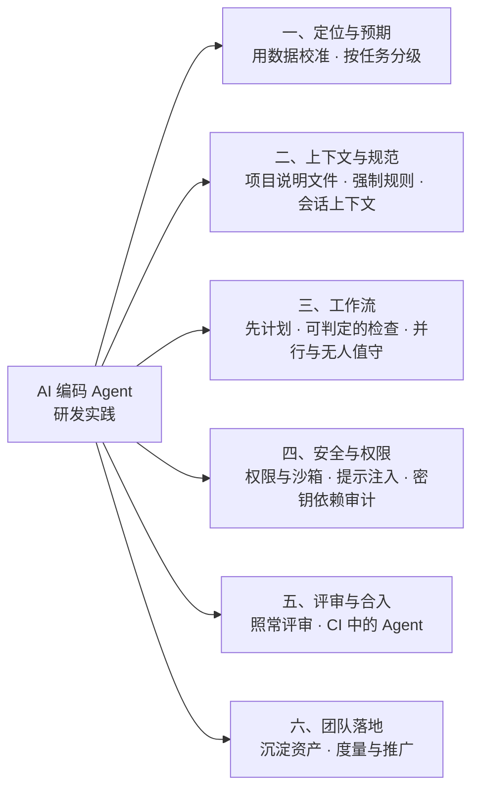
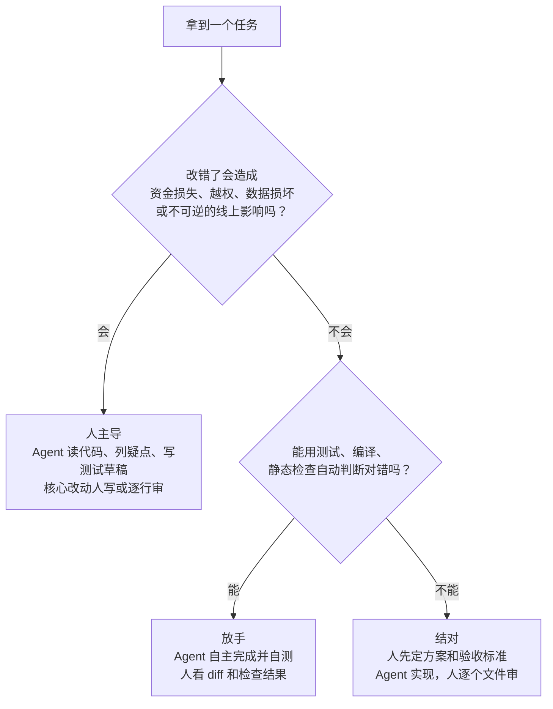
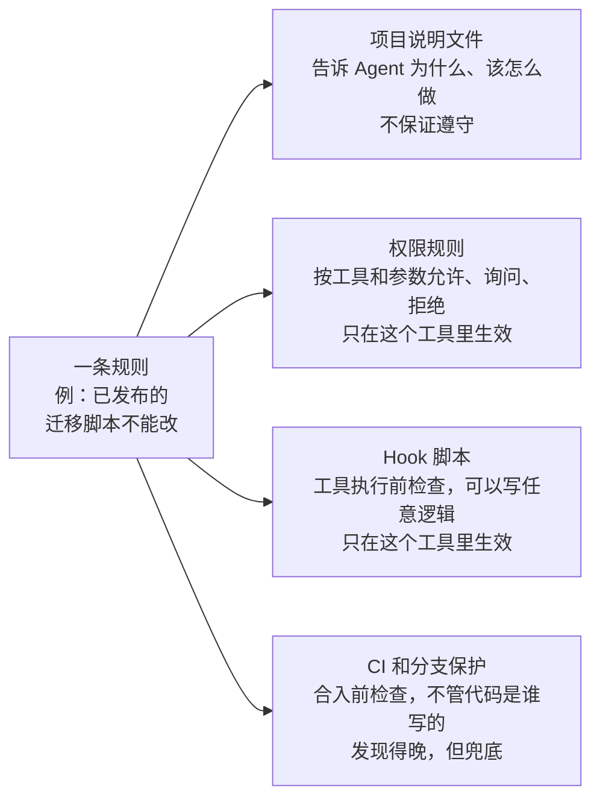
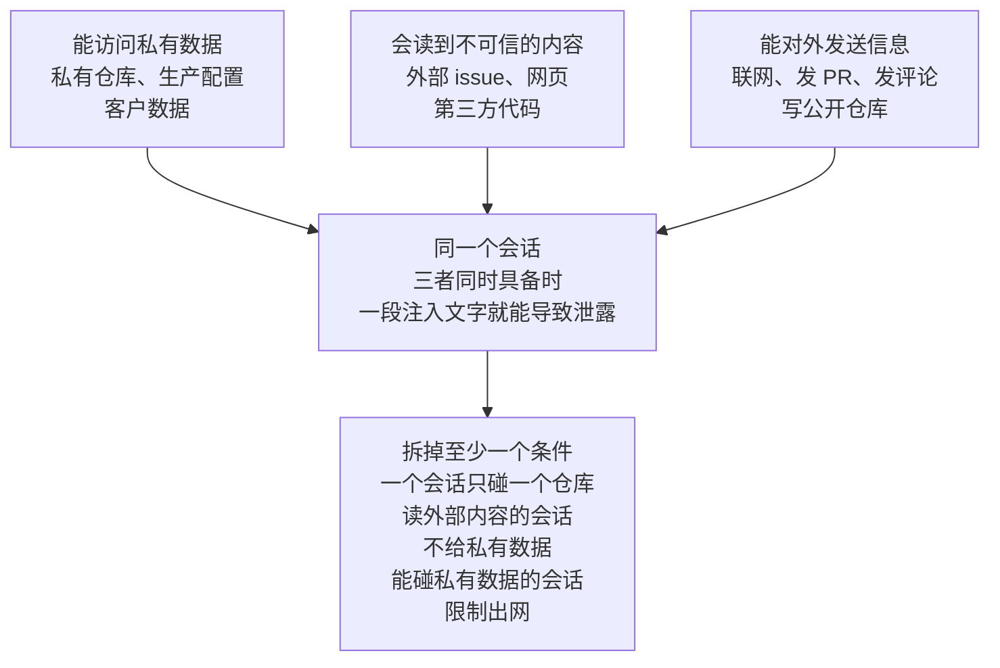
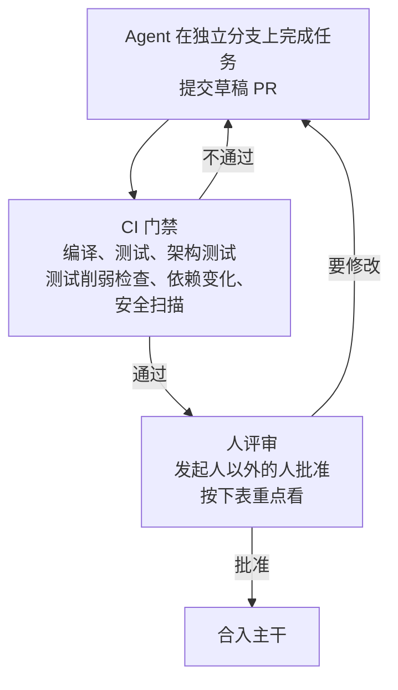

# AI 编码 Agent 研发实践

> 适用对象：已经在用、或者准备在团队里推广 AI 编码 Agent（Claude Code、Codex、GitHub Copilot 编码 Agent 这类能读代码、改文件、跑命令的工具）的 Java 后端开发和技术负责人。[《AI Agent 工程实战进阶》](02-AI-Agent工程实战进阶.md)讲的是怎么开发 Agent，这一份讲怎么用 Agent 写代码：先校准预期，再把项目规范交代清楚、把必须遵守的规则变成强制检查，然后是日常工作流、权限与安全、评审与合入，最后是团队怎么沉淀经验、怎么衡量效果。条目编号从 C-01 开始（C 取 Coding）。
> 资料来源：每条末尾的「依据」列出引用的公开一手资料，包括 Anthropic、OpenAI、GitHub、Google、METR、DORA、OWASP 的官方文档、研究报告和工程文章，均在 2026 年 11 月核对。正文里写"某某文档说明"的地方是对原文的概括；没有标出处的做法，是综合这些资料和通用工程经验得出的业内常见做法，不代表哪家公司的内部规定。各家工具更新很快，配置项和默认行为以当时的文档为准。
> 代码说明：标注「已运行」的脚本只用 Python 标准库，在本机 Python 3.13 上运行过，输出原样贴出。`settings.json`、`AGENTS.md`、子代理定义、GitHub Actions 工作流等配置标注「示意配置」，只检查过 JSON 或 YAML 语法，没有在对应工具里加载验证。
> 相关文档：[《AI Agent 工程实战进阶》](02-AI-Agent工程实战进阶.md)（沙箱和网络出口的实现细节在 A-29、A-30）、[《AI 项目与 Agent 开发最佳实践》](../最佳实践/02-AI项目与Agent开发最佳实践.md)、[《项目工程开发最佳实践》](../最佳实践/01-项目工程开发最佳实践.md)（Code Review 的通用做法在 E-19）、[《大厂公开实践索引》](04-大厂公开实践索引.md)。

## 怎么用这份手册

每条实践按 **结论 → 为什么 → 怎么做 → 踩坑 → 检查清单 → 依据** 的顺序写，没有实质内容的区块直接省略。

- 准备在团队里推广之前：先读 C-01、C-02，再按文末的[落地检查清单](#落地检查清单)逐项准备。
- 已经在用、但效果不稳定：先查文末的[踩坑速查表](#踩坑速查表)，按症状找到条目。
- 想看原文：每条的「依据」里有链接，文末的[参考资料](#参考资料)按来源汇总。

文中的例子以 Claude Code 为主，因为它的配置项（权限规则、Hook、子代理、技能）公开文档最完整。Codex 和 Copilot 有对应机制的地方会一并说明；没有说明的，以各自文档为准。

## 总览



## 条目索引

| 编号 | 实践 | 一句话结论 |
| --- | --- | --- |
| C-01 | 先用数据校准预期 | 公开研究里有提速 55%，也有变慢 19%；收益取决于任务和用法，用自己团队的数据衡量 |
| C-02 | 按任务分级使用 | 按出错代价和验证成本分级：能自动验证的放手，资金、权限、迁移类人来主导 |
| C-03 | 写好项目说明文件 | 只写 Agent 读代码得不到的信息；以 AGENTS.md 为准，各工具共用一份 |
| C-04 | 必须遵守的规则交给 Hook 和权限 | 说明文件只是上下文，模型可能不照做；必须遵守的规则用 Hook、权限和 CI 强制执行 |
| C-05 | 管好会话上下文 | 一个会话做一件事；纠正两次还不对就清空重来；探索交给子代理 |
| C-06 | 先计划再动手 | 先让 Agent 读代码、出方案，人确认后再改；需求写清文件、现象和验收标准 |
| C-07 | 给 Agent 能判断对错的检查 | 给它能跑、结果只有通过和不通过的检查；检查本身要可靠 |
| C-08 | 并行与无人值守运行 | 每个任务一个独立工作区；无人值守时收紧工具和轮数；评审能力决定并行上限 |
| C-09 | 权限分级与沙箱 | 拒绝优先于询问，询问优先于允许；跳过确认只在一次性环境里用 |
| C-10 | 防范提示注入 | 私有数据、不可信内容、对外通信三者不同时给同一个会话 |
| C-11 | 密钥、依赖与审计 | 密钥不进 Agent 能读到的地方；新依赖由人确认；Agent 的改动可追溯 |
| C-12 | AI 写的代码照常评审 | 同一套评审标准，提交人不能自己批准；门禁检查测试有没有被削弱 |
| C-13 | 在 CI 里运行 Agent | 只有可信的人能触发，权限按需给；自动评审意见宁少勿滥 |
| C-14 | 把经验沉淀成团队资产 | 说明文件、权限配置、技能、子代理放进仓库，跟代码一起评审 |
| C-15 | 度量与推广 | 不看生成了多少行代码，看交付速度和稳定性；不靠主观感受下结论 |

---

## 一、定位与预期

### C-01 先用数据校准预期

**结论**：AI 编码 Agent 能不能提效，取决于任务类型、代码库和使用方式。公开的对照研究里，既有"快了 55%"，也有"慢了 19%"；团队层面的调查显示，AI 的采用率上去了，交付稳定性反而可能下降。推广之前不要拿宣传里的数字做预期，也不要拿开发者的主观感受做结论，要用自己团队的数据衡量（做法见 C-15）。

**为什么**：几项常被引用的研究，结论差别很大，但放在一起看，规律是清楚的。

| 研究 | 设计 | 结果 | 要注意的地方 |
| --- | --- | --- | --- |
| GitHub，2022 | 95 名专业开发者随机分两组，用 JavaScript 写一个 HTTP 服务 | 用 Copilot 的一组快了 55%（95% 置信区间 21%～89%），完成率 78% 对 70% | 任务小而边界清楚，从零开始写；没有报告代码质量 |
| METR，2025 年 7 月 | 16 名资深开源开发者，在自己熟悉的大型仓库（2.2 万星以上、百万行以上）里完成 246 个真实任务，每个任务随机决定能不能用 AI | 能用 AI 的任务，完成时间多了 19% | 开发者事前预期快 24%，做完之后仍然认为快了 20% |
| METR，2026 年 2 月更新 | 57 名开发者、800 多个任务，用 2025 年下半年的工具重做 | 老参与者快了 18%（区间从快 38% 到慢 9%），新参与者快了 4%（区间从快 15% 到慢 9%） | METR 自己说这是"很弱的证据"：有 30%～50% 的开发者不愿意把某些任务放进"不能用 AI"的那一组，样本有偏 |
| DORA，2024 | 大规模问卷调查 | AI 采用率每提高 25%，文档质量 +7.5%、代码质量 +3.4%、代码评审速度 +3.1%；交付吞吐 −1.5%、交付稳定性 −7.2% | 39% 的受访者对 AI 生成的代码几乎不信任或完全不信任 |
| DORA，2025 | 约 5000 名受访者，90% 在工作中使用 AI | 吞吐转为正相关，稳定性仍然是负相关 | 报告的判断是：AI 不会修好一个团队，它会放大团队已有的长处和短处 |
| Google，2024 | 公司内部工具的生产数据 | 代码补全的采纳率 37%，约 50% 的代码字符由 AI 辅助完成；超过 8% 的评审意见由 AI 辅助处理 | 作者说开发者越来越多地在当"评审者"，评审成本要算进去 |

从这些数据可以得出几条对落地有用的判断：

- **任务越小、越从零开始，收益越明显**。在百万行级的成熟代码库里改代码，隐含的约定多，Agent 要读懂上下文，人要审它的改动，收益会被抵消，甚至变成负的。
- **主观感受不可靠**。METR 2025 的开发者实际慢了 19%，自己却觉得快了 20%。推广效果靠问卷"觉得快了吗"得不出结论。
- **个人提效不等于团队交付变好**。代码写得更快，评审、测试、发布没有跟上，问题就会流到线上，表现为稳定性下降。
- **工具和用法都在快速变化**。METR 2026 年的数据方向变了，但置信区间仍然跨过 0。一年前的结论今天未必成立，一年后也一样，所以要持续地测。

**怎么做**：

- 推广前，先选一两个团队试点，记下试点前的基线：交付周期、变更失败率、评审轮次、缺陷数（指标见 C-15）。
- 试点时按 C-02 的分级挑任务，不要一上来就让 Agent 改核心交易链路。
- 定期对比基线，同时收集开发者的反馈。两者冲突时以数据为准，再去找原因。

**依据**：

- GitHub [Research: quantifying GitHub Copilot's impact on developer productivity and happiness](https://github.blog/news-insights/research/research-quantifying-github-copilots-impact-on-developer-productivity-and-happiness/)（2022 年 9 月）：95 人随机对照，快 55%，置信区间 21%～89%，完成率 78% 对 70%。
- METR [Measuring the Impact of Early-2025 AI on Experienced Open-Source Developer Productivity](https://metr.org/blog/2025-07-10-early-2025-ai-experienced-os-dev-study/)（2025 年 7 月）：16 名开发者、246 个任务，慢 19%，事前预期和事后感受。
- METR [2026 年 2 月的更新](https://metr.org/blog/2026-02-24-uplift-update/)（2026 年 2 月）：57 名开发者、800 多个任务的新估计，以及选择偏差的说明。
- Google Cloud [Announcing the 2024 DORA report](https://cloud.google.com/blog/products/devops-sre/announcing-the-2024-dora-report)：采用率提高 25% 对应的各项变化，39% 的受访者不信任。
- Google Cloud [Announcing the 2025 DORA report](https://cloud.google.com/blog/products/ai-machine-learning/announcing-the-2025-dora-report)：90% 使用 AI，吞吐转正、稳定性仍为负，"放大器"的判断。
- Google Research [AI in software engineering at Google: Progress and the path ahead](https://research.google/blog/ai-in-software-engineering-at-google-progress-and-the-path-ahead/)（2024 年 6 月）：采纳率 37%，50% 的代码字符，8% 以上的评审意见，作者变成评审者。

### C-02 按任务分级使用

**结论**：按两个维度给任务分级：改错了代价有多大，验证对错有多容易。出错代价小、能自动验证的任务，放手交给 Agent；出错代价大、靠人判断才能验证的任务（资金计算、权限、数据迁移、并发一致性），由人主导，Agent 只做读代码、找疑点、写测试草稿这类辅助工作。

**为什么**：Agent 写代码的速度很快，瓶颈在验证。能用测试、编译、静态检查自动判断对错的任务，Agent 可以自己试错、自己修正，人只看最后的结果；要靠人读懂业务才能判断对错的任务，人审代码的时间往往不比自己写少，而且审的时候容易被"看起来很合理"的代码说服。C-01 里 METR 的结果也说明，在隐含约定多的大型代码库里，Agent 并不总是更快。

**怎么做**：



| 级别 | 典型任务（Java 后端） | Agent 做到哪一步 | 人做什么 |
| --- | --- | --- | --- |
| 放手 | 补单元测试、写样板代码（DTO、转换器、Controller 骨架）、有测试保护的重构、依赖小版本升级、脚本和文档 | 从实现到自测全部完成，提交 PR | 看 diff、看 CI 结果，抽查测试是否真的测到了逻辑 |
| 结对 | 普通业务功能、一般的 bug 修复、接口联调 | 按人确认过的方案实现，跑测试 | 先写清方案和验收标准（C-06），评审时逐个文件看 |
| 人主导 | 金额计算和对账、权限和鉴权、分布式事务和并发控制、数据库迁移和数据修复、对外接口契约的变更、安全漏洞修复 | 读代码梳理调用链、列出疑点和边界条件、写测试用例草稿 | 设计和核心代码由人完成，或者逐行审；上线按原有的变更流程走 |

- 分级写进团队的研发规范，也可以写进项目说明文件（C-03），让 Agent 自己知道哪些目录要格外小心。
- 同一个任务可以拆开：一个"人主导"的需求里，往往有大量"放手"级别的周边工作，比如补测试、改调用方、写迁移脚本的回滚脚本。
- 分级不是一成不变的。某类任务在 Agent 手里持续表现稳定、返工率低（C-15 的数据），可以往下调一级；反过来出过事故的，往上调。

**踩坑**：

| 现象 | 根因 | 做法 |
| --- | --- | --- |
| Agent 改了一处金额计算，测试全绿，上线后对账不平 | 测试没有覆盖舍入、币种、部分退款这些边界，自动验证覆盖不到 | 这类任务属于"人主导"，边界条件由人列出 |
| 评审一个几百行的 Agent PR，看了很久也不敢合 | 任务粒度太大，改动跨了多个职责 | 拆成可以独立验证的小任务，每个 PR 只做一件事 |

**检查清单**：

- [ ] 团队有书面的任务分级吗？"人主导"的目录或模块列出来了吗？
- [ ] Agent 的 PR 能对应到一个可以独立验证的任务吗？

**依据**：

- METR 2025 年的研究（链接见 C-01）：在大型成熟代码库里，资深开发者使用 AI 反而变慢。
- 分级的具体做法是业内常见做法，没有单一的出处。

## 二、上下文与规范

### C-03 写好项目说明文件

**结论**：给 Agent 准备一份项目说明文件，写它读代码也得不到、或者每次都要重新摸索的信息：怎么构建和测试、团队约定、容易踩的坑。文件要短，Claude Code 文档建议每个文件控制在 200 行以内。多种工具并用时，以 `AGENTS.md` 为准，各工具共用一份，避免几份说明互相矛盾。

**为什么**：Agent 每次开始工作时对项目一无所知。构建命令、模块划分、哪些目录不能动、团队对日志和异常的约定，如果不写下来，它要么花时间重新摸索，要么按通用习惯来，写出和项目风格不一致的代码。反过来，说明文件会占用上下文，写得越长，模型越不容易照着做：Claude Code 文档的原话是，文件越长，消耗的上下文越多，遵循程度越低。

**怎么做**：

1. **写什么**：
   - 构建、测试、静态检查的命令，具体到怎么只跑一个模块、一个测试类。
   - 模块划分和职责：哪个模块放什么，新代码应该加在哪里。
   - 团队约定里和通用习惯不一样的部分。通用的 Java 规范模型本来就知道，不用写。
   - 容易踩的坑：已发布的迁移脚本不能改、某个目录是生成代码、某个测试依赖本地 Docker。
2. **不写什么**：代码里一眼就能看出来的结构、通用的编程原则、很少用到的长篇背景。很少用到的流程放进技能（C-14），用到时才加载。
3. **放在哪、怎么共用**：

| 工具 | 读取的文件 | 多个文件时 |
| --- | --- | --- |
| Codex | 全局 `~/.codex/AGENTS.md`；项目里从 Git 根目录一直到当前目录，每层读一个 `AGENTS.md`（同目录有 `AGENTS.override.md` 时读它） | 从根目录往下依次拼接，越靠近当前目录的越靠后，优先级越高；默认总大小上限 32 KiB |
| GitHub Copilot | 仓库任意位置的 `AGENTS.md`；`.github/copilot-instructions.md`；`.github/instructions/*.instructions.md`（用 `applyTo` 指定适用的路径） | 目录树里最近的 `AGENTS.md` 优先 |
| Claude Code | `CLAUDE.md`（用户级、项目级、子目录级，子目录的在读到该目录的文件时才加载）；没有 `CLAUDE.md` 时，新版本会直接读 `AGENTS.md` | 可以在 `CLAUDE.md` 里写 `@AGENTS.md` 导入，导入最多嵌套 4 层 |

   推荐的组织方式：仓库根目录放一份 `AGENTS.md` 作为唯一的说明来源；`CLAUDE.md` 里只写一行 `@AGENTS.md`，再加上少量 Claude Code 专用的内容。多模块项目可以在子模块里再放一份短的 `AGENTS.md`，只写这个模块特有的内容。`AGENTS.md` 现在由 Linux 基金会下的 Agentic AI Foundation 维护，按 agents.md 网站的说法，已经有超过 6 万个开源项目在用。

4. **起草和维护**：Claude Code 可以用 `/init` 生成初稿，但初稿往往会把代码结构复述一遍，要删掉这部分，补上真正的坑。之后每次发现 Agent 反复犯同一个错，就补一条；每季度清理一次过时的内容。

一份 Java 多模块项目的 `AGENTS.md`（示意配置）：

```markdown
# 订单中心 order-center

## 构建与测试
- JDK 17，Maven Wrapper：一律用 `./mvnw`，不要用本机的 mvn。
- 只测一个模块：`./mvnw -q -pl order-service -am test`
- 只跑一个测试类：`./mvnw -q -pl order-service test -Dtest=RefundServiceTest`
- 集成测试依赖本地 Docker（Testcontainers），没有 Docker 时只跑单元测试，并在结果里说明。
- 提交前必须通过：`./mvnw -q verify`（含 Checkstyle 和单元测试）。

## 模块
- order-api：对外接口的 DTO 和 Feign 定义，只放契约，不放逻辑。改这里等于改对外接口，必须在 PR 里说明兼容性。
- order-service：业务逻辑。领域对象在 domain 包，状态变更写在领域对象的方法里，不要在 Service 里直接 set 状态。
- order-job：定时任务，所有任务必须可重入。

## 约定
- 金额一律 BigDecimal，比较用 compareTo，舍入方式用 RoundingMode.HALF_UP，不要用 double。
- MyBatis 的 SQL 只用 #{}，禁止用 ${} 拼接参数。
- 日志只用 info 和 error，内容写英文；error 日志带错误码和关键参数。
- 新增常量放进对应的枚举或常量类，不写魔法值。

## 不要做的事
- src/main/resources/db/migration 下已有的 V 脚本不能修改，只能新增版本号更大的脚本。
- 不要修改 application-prod.yml，也不要读取 .env。
- 不要新增第三方依赖；确实需要时停下来，说明理由，由人决定。
- 退款、对账相关的代码（refund、reconcile 包）属于高风险目录：只能提方案和测试，改动要等人确认。
```

**踩坑**：

| 现象 | 根因 | 做法 |
| --- | --- | --- |
| 说明文件写了几百行，Agent 还是不按约定来 | 文件太长，关键约定被淹没 | 删掉代码里能看出来的内容，控制在 200 行以内；长流程拆进技能 |
| Claude Code 和 Codex 的行为不一致 | 两份说明文件各写各的，内容不同步 | 以 `AGENTS.md` 为唯一来源，`CLAUDE.md` 用 `@AGENTS.md` 导入 |
| 写了"不要改迁移脚本"，它还是改了 | 说明文件只是上下文，不是强制规则 | 必须遵守的规则交给 Hook 和 CI（C-04） |

**检查清单**：

- [ ] 仓库里有 `AGENTS.md` 吗？构建、单模块测试、单个测试类的命令都写了吗？
- [ ] 文件在 200 行以内吗？有没有在复述代码结构？
- [ ] 多个工具读到的是同一份内容吗？
- [ ] 说明文件和代码一起评审、一起更新吗？

**依据**：

- Claude Code 文档 [Best practices](https://code.claude.com/docs/en/best-practices)：只写 Claude 读仓库得不到、或者每次都要重新摸索的内容；示例分为命令、约定、坑三部分。
- Claude Code 文档 [Memory](https://code.claude.com/docs/en/memory)：`CLAUDE.md` 的位置和加载顺序，`@` 导入最多 4 层，建议每个文件 200 行以内，越长越消耗上下文、遵循程度越低，`CLAUDE.md` 是上下文而不是强制配置，可以读 `AGENTS.md`。
- [agents.md](https://agents.md/)：`AGENTS.md` 是"给 Agent 看的 README"，最近的文件优先，由 Linux 基金会下的 Agentic AI Foundation 维护，超过 6 万个开源项目在用。
- OpenAI Codex 文档 [AGENTS.md 说明](https://learn.chatgpt.com/docs/agent-configuration/agents-md)：全局和项目两级的查找顺序，`AGENTS.override.md`，按目录拼接，`project_doc_max_bytes` 默认 32 KiB。
- GitHub 文档 [Copilot 仓库自定义指令](https://docs.github.com/en/copilot/how-tos/configure-custom-instructions/add-repository-instructions)：`.github/copilot-instructions.md`、`*.instructions.md` 的 `applyTo`、支持 `AGENTS.md` 且最近的优先。

### C-04 必须遵守的规则交给 Hook 和权限

**结论**：项目说明文件里的规则，模型大多数时候会遵守，但不保证每次都遵守。"不能改已发布的迁移脚本""不能读密钥文件""不能强推"这类一次都不能违反的规则，要变成强制检查：在 Agent 这一侧用权限规则和 Hook（工具调用前后自动执行的脚本），在仓库这一侧用 CI 和分支保护。

**为什么**：Claude Code 文档写得很明白，`CLAUDE.md` 是上下文，不是强制配置。模型在长任务里会遗忘、会为了完成目标走捷径，说明文件里写得再清楚，也只是提高遵守的概率。强制检查的特点是不依赖模型的配合：Hook 在工具真正执行之前运行，脚本说不行就不执行。

不同位置的检查，强度和覆盖面不同，要组合使用：



**怎么做**：

1. **说明文件里讲清原因和替代做法**。规则带上原因，模型更容易在没写到的情况下做对；同时告诉它被拦下以后应该怎么做。
2. **能用权限规则表达的，用权限规则**。Claude Code 的规则分为允许、询问、拒绝三类，按"拒绝 → 询问 → 允许"的顺序判断，拒绝规则不能被允许规则开例外。项目级的 `.claude/settings.json` 提交到仓库，全组共用（示意配置）：

```json
{
  "permissions": {
    "allow": [
      "Bash(./mvnw *)",
      "Bash(git status)",
      "Bash(git diff *)",
      "Bash(git log *)"
    ],
    "ask": [
      "Bash(git push *)"
    ],
    "deny": [
      "Read(./.env)",
      "Read(./.env.*)",
      "Read(./src/main/resources/application-prod.yml)"
    ]
  },
  "hooks": {
    "PreToolUse": [
      {
        "matcher": "Edit|Write|Bash",
        "hooks": [
          {
            "type": "command",
            "command": "python3 \"$CLAUDE_PROJECT_DIR\"/.claude/hooks/guard.py"
          }
        ]
      }
    ]
  }
}
```

3. **规则依赖上下文判断的，用 Hook**。权限规则只能按工具名和参数的写法匹配，"这个迁移脚本是不是已经存在"这种判断要写脚本。Claude Code 的 `PreToolUse` Hook 在工具执行前运行，从标准输入拿到 JSON 格式的调用信息；脚本以退出码 2 结束表示拒绝，标准错误里的内容会作为拒绝原因交给模型；以 0 结束时，可以在标准输出里用 JSON 给出允许、拒绝或者转给用户确认。下面这个 Hook 做了四件事：拒绝修改已存在的迁移脚本、拒绝修改密钥和生产配置文件、拒绝强推、发布构件前要求用户确认（已运行，Python 3.13）：

```python
"""Claude Code 的 PreToolUse hook：把"不许改已发布的迁移脚本、不许碰密钥文件、不许强推"变成强制规则。
放在 .claude/hooks/guard.py，由 .claude/settings.json 的 hooks 配置调用。只用 Python 标准库。
约定（见 Claude Code hooks 文档）：从 stdin 读 JSON；exit 2 表示阻止，stderr 的内容会作为原因交给模型；
exit 0 时可以在 stdout 输出 JSON，用 permissionDecision 给出 allow / deny / ask。
"""
import json
import os
import re
import sys

# 已经发布的 Flyway 迁移脚本只能新增，不能修改：改了会导致已执行环境的校验和不一致
MIGRATION_DIR = re.compile(r"src/main/resources/db/migration/V[^/]+\.sql$")
SECRET_FILE = re.compile(r"(^|/)(\.env(\..+)?|application-prod\.ya?ml|.+\.(pem|key|jks|p12))$")
FORCE_PUSH = re.compile(r"\bgit\s+push\b.*(\s--force(-with-lease)?\b|\s-f\b)")


def block(reason: str) -> None:
    """exit 2：阻止这次工具调用，reason 会作为拒绝原因交给模型"""
    print(reason, file=sys.stderr)
    sys.exit(2)


def ask(reason: str) -> None:
    """exit 0 + JSON：不直接拒绝，而是转给用户确认"""
    print(json.dumps({"hookSpecificOutput": {
        "hookEventName": "PreToolUse",
        "permissionDecision": "ask",
        "permissionDecisionReason": reason,
    }}, ensure_ascii=False))
    sys.exit(0)


def main() -> None:
    event = json.load(sys.stdin)
    tool = event.get("tool_name", "")
    args = event.get("tool_input", {})

    if tool in ("Edit", "Write"):
        path = args.get("file_path", "")
        if SECRET_FILE.search(path):
            block(f"禁止修改密钥或生产配置文件：{os.path.basename(path)}。需要配置项时，在 application.yml 里用占位符并说明由配置中心注入。")
        if MIGRATION_DIR.search(path) and os.path.exists(path):
            block(f"{os.path.basename(path)} 是已发布的迁移脚本，不能修改。请新建一个版本号更大的 V 脚本来做变更。")

    if tool == "Bash":
        command = args.get("command", "")
        if FORCE_PUSH.search(command):
            block("禁止强制推送。请改用普通的 git push；如果确实需要改写远端历史，停下来交给用户处理。")
        if re.search(r"\bmvn(w)?\b.*\bdeploy\b", command):
            ask("这条命令会把构件发布到制品库，需要用户确认。")

    sys.exit(0)


if __name__ == "__main__":
    main()
```

用几条模拟的调用信息测试（输入格式参照 Claude Code hooks 文档里的示例，项目里事先放了一个已存在的 `V3__add_order_index.sql`），输出：

```text
Edit  src/main/resources/db/migration/V3__add_order_index.sql    exit=2 V3__add_order_index.sql 是已发布的迁移脚本，不能修改。请新建一个版本号更大的 V 脚本来做变更。
Write src/main/resources/db/migration/V4__add_status.sql         exit=0 
Write .env                                                       exit=2 禁止修改密钥或生产配置文件：.env。需要配置项时，在 application.yml 里用占位符并说明由配置中心注入。
Bash  git push --force origin feature/refund                     exit=2 禁止强制推送。请改用普通的 git push；如果确实需要改写远端历史，停下来交给用户处理。
Bash  ./mvnw -q -pl order-service test                           exit=0 
Bash  ./mvnw -DskipTests deploy                                  exit=0 {"hookSpecificOutput": {"hookEventName": "PreToolUse", "permissionDecision": "ask", "permissionDecisionReason": "这条命令会把构件发布到制品库，需要用户确认。"}}
```

   新建 `V4` 脚本放行，改已有的 `V3` 被拒绝；拒绝原因里写了替代做法，模型收到以后通常会改走正确的路。

4. **CI 和分支保护兜底**。Hook 只在装了这份配置的工具里生效，换一个工具、或者人手工改，就拦不住。同样的规则在 CI 里再检查一遍（例如对比迁移脚本目录里已有文件的校验和，改动了就失败），主干开启分支保护，禁止强推。这一层不管代码是谁写的。

**踩坑**：

| 现象 | 根因 | 做法 |
| --- | --- | --- |
| Hook 脚本报错了，调用照样执行 | 只有退出码 2 表示拒绝，其他非 0 的退出码只算 Hook 自身出错，不会拦截 | 要拦截就明确 `exit 2`；脚本里的异常要处理好，别让它以 1 退出 |
| 配了 `Read(./.env)` 的拒绝规则，Agent 还是用 `cat .env` 读到了内容 | 权限规则按工具区分，`cat` 走的是 Bash 规则；Bash 规则按命令的写法匹配，换个写法就能绕过 | 规则只用来减少误操作，真正的隔离靠沙箱的文件系统限制（C-09，以及 A-29） |
| 从网上拷来的 Hook 能读写本机任意文件 | Hook 以当前用户的全部权限运行 | 只用自己能读懂的 Hook，和代码一样评审 |
| 拒绝原因写成"Not allowed"，模型反复尝试别的写法 | 只说了不行，没说该怎么做 | 拒绝原因里写清楚替代做法 |

**检查清单**：

- [ ] 一次都不能违反的规则列出来了吗？每条都有强制检查，而不只是写在说明文件里吗？
- [ ] 项目级的权限配置和 Hook 提交到仓库了吗？Hook 有测试吗？
- [ ] 同样的规则在 CI 里也检查了吗？主干有分支保护吗？

**依据**：

- Claude Code 文档 [Memory](https://code.claude.com/docs/en/memory)：`CLAUDE.md` 是上下文，不是强制配置。
- Claude Code 文档 [Permissions](https://code.claude.com/docs/en/permissions)：允许、询问、拒绝三类规则，按拒绝、询问、允许的顺序判断，允许规则不能给拒绝规则开例外，规则的写法。
- Claude Code 文档 [Hooks](https://code.claude.com/docs/en/hooks)：`PreToolUse` 的输入，退出码 2 表示拒绝且标准错误作为原因交给模型，其他非 0 退出码不拦截，`permissionDecision` 的取值，Hook 以用户的全部权限运行。
- Claude Code 文档 [Security](https://code.claude.com/docs/en/security)：拒绝规则按命令的写法匹配。
- Claude Code 文档 [Best practices](https://code.claude.com/docs/en/best-practices)：总是被忽略、又必须遵守的规则，应该改成 Hook。
- 演示代码，本机实测。

### C-05 管好会话上下文

**结论**：一个会话只做一件事，做完或者换任务时清空上下文；同一个问题纠正两次还不对，就清空会话，把学到的东西写进一条更好的提示重新开始；需要大量阅读代码的探索工作交给子代理，只把结论带回主会话。

**为什么**：Agent 的上下文窗口里装着对话、读过的文件、命令输出。上下文越长，模型越难抓住重点，早期的错误假设也会一直留在里面影响后续判断。连续纠正几轮的会话里，堆满了错误的尝试和纠正，模型很难从中走出来。Claude Code 文档的建议是：两次纠正失败以后，执行 `/clear`，写一条更好的提示，不要做第三次纠正。

**怎么做**：

- **换任务就清空**。Claude Code 用 `/clear`；其他工具开一个新会话。上一个任务里有用的信息（比如定位到的根因），写进新任务的提示里带过去。
- **探索交给子代理**。"找出所有调用 `RefundService.refund` 的地方，并说明各自的事务边界"这类任务要读很多文件，交给子代理做。子代理有自己独立的上下文窗口，读过的文件留在它那边，主会话只收到结论。
- **长任务先落成文档**。复杂需求先和 Agent 讨论，让它把需求、方案、验收标准写进一个文件（比如 `SPEC.md`），然后开一个新会话，照着这个文件实现。新会话的上下文是干净的，关键信息都在文件里。
- **控制工具输出的长度**。跑全量测试、打印大段日志，会一下子塞满上下文。说明文件里写清楚只跑相关模块的测试（C-03），日志用 `grep` 过滤后再看。

**踩坑**：

| 现象 | 根因 | 做法 |
| --- | --- | --- |
| 改着改着，Agent 又把前面否定过的方案拿回来了 | 上下文太长，前面的结论被淹没；或者已经被压缩掉了 | 关键结论写进文件；换任务就清空 |
| 纠正了三四次，越改越乱 | 会话里堆满了错误的尝试 | 两次纠正不对就清空，重写提示 |
| 一次全量测试的输出就占满了上下文 | 测试输出太长 | 只跑相关模块；输出先过滤再看 |

**检查清单**：

- [ ] 团队成员知道什么时候该清空会话吗？
- [ ] 复杂需求有先落成文档、再新开会话实现的习惯吗？

**依据**：

- Claude Code 文档 [Best practices](https://code.claude.com/docs/en/best-practices)：两次纠正失败后清空并写更好的提示；先让 Claude 访谈需求并写成 `SPEC.md`，再用新会话实现。
- Claude Code 文档 [Subagents](https://code.claude.com/docs/en/sub-agents)：每个子代理有自己的上下文窗口、系统提示、工具权限。

## 三、工作流

### C-06 先计划再动手

**结论**：除了"放手"级别的小任务（C-02），都先让 Agent 只读代码、给出方案，人确认方案以后再让它改。给 Agent 的需求要写清楚：哪个文件、什么现象、怎么复现、做到什么程度算完成。

**为什么**：Agent 动手很快，方向错了，产出的是一大堆需要人逐行看、最后又要全部推翻的改动。方向在计划阶段纠正，成本最低：人看的是十几行方案，而不是几百行 diff。另外，"修一下退款的 bug"这种需求，Agent 只能自己猜问题在哪、修到什么程度，猜的结果往往和人想的不一样。

**怎么做**：

1. **用计划模式**。Claude Code 的权限模式里有 `plan`，在这个模式下 Agent 只分析、出方案，不改文件。其他工具没有对应模式时，在提示里明确"先不要改代码，只输出方案"。
2. **方案要回答这些问题**：改哪些文件，为什么改在这一层；有哪些调用方、下游会受影响；数据库结构和对外接口是否变化，是否兼容；测试怎么写；出了问题怎么回滚。方案回答不了这些，说明 Agent 对代码的理解还不够，继续让它读代码，不要急着进入实现。
3. **需求写具体**。对比一下：

```text
不好：修一下退款的 bug。

好：退款接口 POST /refunds 在部分退款以后，再次退款时没有校验剩余可退金额。
复现：订单 SO20261111001 实付 200，先退 80，再退 180，期望第二次失败，实际成功。
相关代码：order-service 的 RefundService.refund 和 Order#refundable。
要求：
1. 先写一个能复现的失败测试，运行并确认它失败；
2. 再修复，只改 order-service，不改 order-api 的接口定义；
3. 完成后运行 ./mvnw -q -pl order-service -am test，贴出结果。
```

4. **复杂需求先落成文档**。需求本身还不清楚时，先让 Agent 反过来问你问题，把需求、方案、验收标准写进 `SPEC.md`，再开一个新会话照着实现（C-05）。

**踩坑**：

| 现象 | 根因 | 做法 |
| --- | --- | --- |
| 方案确认了，实现时 Agent 自己改了思路 | 实现中遇到方案没考虑到的情况，就地换了做法 | 要求它遇到和方案不符的情况时先停下，更新方案文件，再继续 |
| 方案写得很空，"修改相关逻辑，补充测试" | 没有要求方案回答具体问题 | 按上面第 2 步的问题清单要求方案 |
| Agent 把需求范围扩大了，顺手重构了周边代码 | 需求里没写范围边界 | 写明只改哪些模块，以及"不要顺手重构" |

**检查清单**：

- [ ] 非"放手"级的任务，都先有方案再动手吗？
- [ ] 需求里写了现象、复现方式、改动范围和验收标准吗？

**依据**：

- Claude Code 文档 [Best practices](https://code.claude.com/docs/en/best-practices)：笼统的"fix the login bug"和写明文件、现象、要写的失败测试的提示的对比；先让 Claude 访谈需求、写成 `SPEC.md`，再用新会话实现。
- Claude Code 文档 [Permissions](https://code.claude.com/docs/en/permissions)：权限模式包括 `plan`。

### C-07 给 Agent 能判断对错的检查

**结论**：给 Agent 一个它自己能运行、结果只有通过和不通过两种的检查：单元测试、编译、静态检查、架构规则测试、接口冒烟测试。有了检查，Agent 可以自己试错、自己修正；没有检查，它只能凭"代码看起来对"就宣布完成。检查本身必须可靠，偶发失败的测试要先修好，测试也不能被 Agent 改弱（C-12）。

**为什么**：Agent 的强项是根据反馈反复修改。Claude Code 文档把这一点放在很靠前的位置：给它一个能运行、结果是通过或不通过的东西。Anthropic 内部团队的用法也是这样：安全工程团队让 Claude 先写伪代码，再按测试驱动开发的方式一步步实现；产品设计团队让 Claude 写代码、跑测试、根据结果持续迭代，人最后审查结果。

**怎么做**：

- **先写失败的测试**。修 bug 时先让 Agent 写一个能复现问题的测试，运行确认它失败，再去修。这一步同时验证了 Agent 对问题的理解是否正确：测试写不出来，或者写出来一运行就通过，说明它没找对问题。
- **检查要快**。在说明文件里写清楚只跑一个模块、一个测试类的命令（C-03）。一次检查要跑十几分钟，Agent 的迭代就会很慢，也容易在等待中被打断。全量测试放到 CI。
- **把团队约定变成测试**。分层依赖、包命名、禁止使用的类，用 ArchUnit 这类工具写成测试，Agent 违反了会直接失败，比写在说明文件里可靠（示意代码，未编译）：

```java
@AnalyzeClasses(packages = "com.demo.order")
class LayerRulesTest {

    /** 领域层不能依赖 Web 层 */
    @ArchTest
    static final ArchRule domainShouldNotDependOnWeb =
            noClasses().that().resideInAPackage("..domain..")
                    .should().dependOnClassesThat().resideInAPackage("..controller..");

    /** 金额不允许用 double：业务代码里不能出现 double 类型的字段 */
    @ArchTest
    static final ArchRule noDoubleFieldsInDomain =
            fields().that().areDeclaredInClassesThat().resideInAPackage("..domain..")
                    .should().notHaveRawType(double.class);
}
```

- **接口和页面也要可验证**。改了接口，让 Agent 启动服务、用 `curl` 调一次，对比返回结果；改了页面，用截图和设计稿对比。
- **结果以 CI 为准**。Agent 说"测试全部通过"，要求它贴出实际运行的命令和输出；最终以 CI 的结果为准。

**踩坑**：

| 现象 | 根因 | 做法 |
| --- | --- | --- |
| Agent 报告全部通过，CI 却失败 | 它只跑了部分测试，或者根本没跑，凭推断下了结论 | 要求贴出命令和输出；以 CI 为准 |
| 测试全绿，但什么都没测到 | 被测对象的依赖全被 mock 掉了，断言只检查了 mock 的返回值 | 评审时看测试有没有断言真实的业务结果；关键路径要有集成测试 |
| 为了让测试通过，Agent 改了断言或者禁用了测试 | 测试是它能改的文件，改测试比改实现容易 | 说明文件里写明不能改已有测试的断言；CI 用门禁检查（C-12） |
| Agent 反复修一个偶发失败的测试，越改越乱 | 检查本身不可靠，给了错误的反馈 | 先隔离和修复偶发失败的测试 |

**检查清单**：

- [ ] 说明文件里有单模块、单个测试类的测试命令吗？一次检查能在几分钟内完成吗？
- [ ] 分层、禁用类这些约定，有架构测试吗？
- [ ] 修 bug 时有"先写失败测试"的要求吗？

**依据**：

- Claude Code 文档 [Best practices](https://code.claude.com/docs/en/best-practices)：给 Claude 一个能运行、结果是通过或不通过的检查，例如测试、构建的退出码、静态检查、截图对比。
- Anthropic [How Anthropic teams use Claude Code](https://claude.com/blog/how-anthropic-teams-use-claude-code)（2025 年 7 月）：安全工程团队先写伪代码、再按测试驱动开发推进；产品设计团队让 Claude 写代码、跑测试、持续迭代。
- 架构测试的做法是业内常见做法。

### C-08 并行与无人值守运行

**结论**：同时跑多个 Agent 时，每个任务一个独立的工作区（Git worktree 或者单独的检出目录），互不干扰；写代码和审代码用不同的会话。无人值守地运行时，没有人点确认，要预先只放行需要的工具，并限制轮数。能并行多少个任务，最终取决于人审得过来多少。

**为什么**：多个 Agent 在同一个目录里改代码，会互相覆盖文件、打乱彼此的构建。同一个会话自己写、自己审，容易沿用写代码时的假设，看不出问题；换一个没看过编写过程的会话来审，更客观。并行能让代码产出得更快，但每个 PR 仍然要人审，Google 的文章也提到，开发者越来越多地在当评审者。

**怎么做**：

- **每个任务一个工作区**。用 Git worktree 给每个任务建一个独立的目录和分支，共享同一个仓库的提交历史：

```bash
git worktree add ../order-center-refund -b feature/refund-limit
git worktree add ../order-center-report -b feature/daily-report
```

  在各自的目录里分别启动 Agent。任务完成、PR 合入以后，用 `git worktree remove` 清理。
- **写和审分开**。一个会话实现，另一个新会话审查：给审查会话的只有需求和 diff，让它找问题，再把问题交回实现的会话修改。
- **无人值守运行**。Claude Code 的 `-p` 参数执行一次就退出，可以放进 CI、Git 钩子或者脚本里循环调用。这时没有人确认，只预先放行这次任务需要的工具，并限制最多几轮（示意命令，参数写法以当时的文档为准）：

```bash
claude -p "为 order-service 中缺少测试的公共方法补充单元测试，只新增测试文件，不修改 src/main" \
  --allowedTools "Read,Grep,Glob,Edit,Write,Bash(./mvnw *)" \
  --max-turns 20
```

- **云端 Agent**。GitHub Copilot 编码 Agent 在 GitHub Actions 的运行器里执行（单次会话最长 59 分钟），一个任务产出一个 PR；Codex 的云端任务每个都有自己的工作区。它们天然是隔离的，适合把"放手"级的任务批量派出去。
- **控制在途数量**。给每个人、每个仓库定一个同时在途的 Agent PR 上限，超过就先审完再派新任务。

**踩坑**：

| 现象 | 根因 | 做法 |
| --- | --- | --- |
| 两个 Agent 改了同一个文件，合并时冲突一大片 | 任务拆分时没有按文件划分边界 | 拆任务时保证不同任务改不同的文件 |
| 并行跑集成测试时端口冲突、数据库数据互相污染 | 多个工作区共用固定端口和同一个本地数据库 | 测试用随机端口和 Testcontainers 这类每次独立的环境 |
| 派出去十几个任务，PR 堆着没人审 | 产出速度超过了评审能力 | 限制在途数量；"放手"级任务的 PR 也要有人负责审 |
| 无人值守的任务跑了几个小时，账单很高 | 没有限制轮数，Agent 一直在重试 | 设置最大轮数和超时；失败了就停下来留给人 |

**检查清单**：

- [ ] 并行任务各有独立的工作区和分支吗？测试环境互相隔离吗？
- [ ] 无人值守运行时，放行的工具和最大轮数都限制了吗？
- [ ] 有在途 Agent PR 的上限吗？

**依据**：

- Claude Code 文档 [Best practices](https://code.claude.com/docs/en/best-practices)：一个会话写、另一个没看过编写过程的会话审；并行的工作各用一个检出目录，避免改动冲突；`claude -p` 执行一次就退出，可用于 CI、Git 钩子和脚本，示例里用了 `--allowedTools` 和 `--max-turns`。
- GitHub 文档 [Copilot 编码 Agent 介绍](https://docs.github.com/en/copilot/concepts/agents/coding-agent/about-coding-agent)：在 GitHub Actions 运行器中执行时单次会话最长 59 分钟，一个任务一个 PR。
- Google Research [AI in software engineering at Google](https://research.google/blog/ai-in-software-engineering-at-google-progress-and-the-path-ahead/)：作者越来越多地变成评审者。

## 四、安全与权限

### C-09 权限分级与沙箱

**结论**：权限按"拒绝优先于询问、询问优先于允许"来配：只读和构建测试类的命令放行，推送和发布要确认，密钥文件拒绝。全组共用的规则提交到仓库，个人的放在本地文件，公司级的用托管配置统一下发。跳过所有确认的模式，只在一次性的容器或虚拟机里用。真正可靠的隔离靠沙箱：文件系统和网络都要限制。

**为什么**：每个操作都弹确认，开发者很快就会习惯性地点"总是允许"，确认就失去了意义。Anthropic 在介绍 Claude Code 沙箱的文章里提到，启用沙箱以后，需要用户确认的次数减少了 84%：在沙箱划定的范围内，Agent 可以自由行动，不用每一步都问。同时，权限规则是按工具名和命令写法匹配的，挡得住误操作，挡不住刻意的绕过；沙箱在操作系统层面限制，不管命令怎么写都绕不过去。

**怎么做**：

1. **Claude Code 的权限模式**：

| 模式 | 行为 | 适合 |
| --- | --- | --- |
| `default` | 没有规则覆盖的操作，第一次执行时询问 | 日常开发的默认值 |
| `acceptEdits` | 自动接受文件修改 | 任务明确、有 Git 可以回滚的场景 |
| `plan` | 只分析、不改文件 | 出方案阶段（C-06） |
| `auto` | 由分类器判断是否需要确认 | 文档说明它是分类器，不是硬性规则，不能当作安全边界 |
| `bypassPermissions` | 跳过所有确认 | 文档的原意是只在一次性的容器里才有意义 |

2. **配置分层**：项目级 `.claude/settings.json` 提交到仓库，全组共用（示例见 C-04）；`.claude/settings.local.json` 是个人的，在确认框里选"不再询问"时，规则就记在这里；`~/.claude/settings.json` 是用户级的；企业的托管配置优先级最高，适合放公司统一的拒绝规则。
3. **Codex 的对应机制**：沙箱分 `read-only`、`workspace-write`（本地默认）、`danger-full-access` 三档；`workspace-write` 默认不联网，需要在配置里打开；审批策略有 `on-request`、`never` 等。底层在 macOS 上用 Seatbelt，在 Linux 上用 bubblewrap 加 seccomp。
4. **启用沙箱**。Claude Code 可以用 `/sandbox` 开启操作系统层面的沙箱。沙箱的实现原理、网络出口和凭据的处理，见[《AI Agent 工程实战进阶》](02-AI-Agent工程实战进阶.md)的 A-29、A-30。
5. **按场景组合**：

| 场景 | 推荐组合 |
| --- | --- |
| 本机日常开发 | `default` 或 `acceptEdits` + 沙箱 + 只放行只读和构建命令 + 拒绝密钥文件 |
| 处理外部来源的内容（开源 issue、外部 PR） | 单独的会话，不带私有数据的访问权限，网络按域名放行（C-10） |
| CI 或无人值守 | 一次性容器，网络按域名放行，凭据只给这次任务需要的最小权限；在这种环境里可以跳过确认 |

**踩坑**：

| 现象 | 根因 | 做法 |
| --- | --- | --- |
| 半年后发现本地配置里放行了 `Bash(*)` | 一次次点"不再询问"，放行规则越积越宽 | 定期检查 `settings.local.json`；危险的规则放进托管配置的拒绝列表 |
| 在本机开了跳过确认的模式，Agent 读到了 `~/.aws`、`~/.m2/settings.xml` 里的凭据 | 本机有大量真实凭据，没有沙箱 | 跳过确认只在一次性容器里用；本机开沙箱 |
| 拒绝规则写了 `Bash(curl *)`，Agent 用 `wget` 或 Java 代码发了请求 | 规则按写法匹配，覆盖不了所有方式 | 网络限制交给沙箱 |

**检查清单**：

- [ ] 项目级权限配置提交到仓库了吗？密钥文件在拒绝列表里吗？
- [ ] 本机开了沙箱吗？跳过确认的模式只在一次性环境里用吗？
- [ ] 有人定期检查个人配置里积累的放行规则吗？

**依据**：

- Claude Code 文档 [Permissions](https://code.claude.com/docs/en/permissions)：允许、询问、拒绝的判断顺序，各个权限模式，选"不再询问"时规则保存到 `.claude/settings.local.json`。
- Claude Code 文档 [Best practices](https://code.claude.com/docs/en/best-practices)：拒绝规则在所有模式下都生效；`bypassPermissions` 只在一次性容器里才有意义；`auto` 模式是分类器，不是硬性规则。
- Claude Code 文档 [Security](https://code.claude.com/docs/en/security)：`/sandbox`；拒绝规则按命令的写法匹配。
- Anthropic [Claude Code sandboxing](https://www.anthropic.com/engineering/claude-code-sandboxing)：文件系统和网络两方面的隔离，确认次数减少 84%。
- OpenAI Codex 文档 [沙箱说明](https://learn.chatgpt.com/codex/sandboxing) 和 [审批与安全说明](https://learn.chatgpt.com/codex/agent-approvals-security)：三档沙箱、审批策略、`workspace-write` 默认不联网、各操作系统的实现方式。

### C-10 防范提示注入

**结论**：Agent 会读很多不是你写的内容：issue、PR 评论、网页、第三方库的代码和文档、日志、MCP 工具的返回结果。这些内容里可能藏着指令，模型可能会照做。目前没有能百分之百拦住注入的办法，所以不要让同一个会话同时具备三个条件：能访问私有数据、会读到不可信的内容、能对外发送信息。至少拆掉其中一个。

**为什么**：Simon Willison 把这三个条件叫做"致命三要素"（lethal trifecta）：同时具备时，攻击者只要让 Agent 读到一段精心构造的文字，就能让它把私有数据发出去。他的判断是，厂商宣称的防护能拦住 95% 的攻击，但在 Web 安全里 95% 是不及格的。

Invariant Labs 在 2025 年 5 月公开过一个真实的攻击路径：用户同时有公开仓库和私有仓库，并给 Agent 接了 GitHub 的 MCP 服务。攻击者在公开仓库里提一个带恶意指令的 issue；用户让 Agent "看看公开仓库里的 issue"，Agent 读到指令，去私有仓库读取数据，再把内容写进公开仓库的一个 PR。演示中用户开了"总是允许"，看不到每一步的具体操作。Invariant 强调这不是 MCP 服务代码的漏洞，靠模型自身的对齐也防不住。



**怎么做**：

- **一个会话只访问一个仓库**。这是 Invariant 给出的示例策略。处理开源项目 issue 的会话，不要同时带着公司私有仓库的访问权限。
- **读外部内容的任务，单独开会话**。比如"整理开源依赖的 changelog""分析一个外部 PR"，在没有私有数据访问权限、网络按域名放行的环境里做。
- **MCP 只接需要的，权限给最小**。对外写入的操作（发 PR、发评论、发消息）不要开"总是允许"。
- **利用工具自带的防护**。Claude Code 默认对 `curl`、`wget` 这类联网命令要求确认；`WebFetch` 用一次单独的模型调用读网页，主会话拿到的是回答，不是原始网页；第一次在一个目录里启动时要确认是否信任该目录；项目里 `.mcp.json` 声明的 MCP 服务要经过确认才会启用。GitHub Copilot 编码 Agent 会过滤隐藏字符，HTML 注释里的文字不会传给 Agent，而且只有对仓库有写权限的用户才能触发它。
- **按 OWASP 的建议收窄 Agent 的能力**：工具只给最少的；尽量不给"执行任意命令""访问任意网址"这种开放式工具；以用户自己的身份和最小权限访问外部系统；高影响的操作由人批准；授权在下游系统里做，不交给模型判断。
- **读线上数据时先脱敏**。让 Agent 分析线上日志排查问题时，日志里的用户输入同样是不可信内容，也可能带着客户的个人信息。先脱敏、截取相关片段，再交给 Agent。

**踩坑**：

| 现象 | 根因 | 做法 |
| --- | --- | --- |
| "只是让它读一下 issue，又没让它做什么" | 读进来的内容就是注入的入口，读的那一刻风险就产生了 | 按三要素检查这个会话的权限 |
| 给 Agent 接了 GitHub、数据库、IM 好几个 MCP，全部"总是允许" | 一个会话同时具备了三个条件，而且看不到每一步操作 | 按任务开会话，只接需要的 MCP；对外写入要确认 |
| 第三方依赖的 README 或测试数据里写着"忽略之前的指令……" | 依赖源码、文档也是不可信内容 | 分析第三方代码的任务按外部内容处理 |

**检查清单**：

- [ ] 有没有哪个会话或者自动化流程，同时具备私有数据、不可信内容、对外通信三个条件？
- [ ] 对外写入的工具都需要确认吗？
- [ ] 一个会话只访问一个仓库吗？

**依据**：

- Simon Willison [The lethal trifecta](https://simonwillison.net/2025/Jun/16/the-lethal-trifecta/)（2025 年 6 月）：三个条件，现有防护不能百分之百拦住，95% 在 Web 安全里不及格，避免三者同时出现。
- Invariant Labs [GitHub MCP 漏洞分析](https://invariantlabs.ai/blog/mcp-github-vulnerability)（2025 年 5 月）：攻击路径，"总是允许"的问题，不是服务代码的漏洞，一个会话只访问一个仓库的策略。
- OWASP [LLM06:2025 Excessive Agency](https://genai.owasp.org/llmrisk/llm062025-excessive-agency/)：功能、权限、自主性过度三个根因，以及最小化工具、避免开放式工具、以用户身份执行、人工批准、在下游授权等缓解措施。
- Claude Code 文档 [Security](https://code.claude.com/docs/en/security)：联网命令默认要求确认、`WebFetch` 的单独调用、目录信任确认、`.mcp.json` 服务的确认，以及处理不可信内容的建议。
- GitHub 文档 [Copilot 编码 Agent 的风险与缓解措施](https://docs.github.com/en/copilot/concepts/agents/coding-agent/risks-and-mitigations)：过滤隐藏字符，HTML 注释不传给 Agent，只有写权限用户能触发。

### C-11 密钥、依赖与审计

**结论**：密钥不放在 Agent 能读到的任何地方，Agent 用的凭据只给这次任务需要的最小权限、最短有效期。新增第三方依赖要人确认，构建只从公司的私服拉取。Agent 做的改动要能追溯：谁发起的、在哪个会话里、改了什么。

**为什么**：Agent 能读工作区里的文件，也能读到运行它的进程的环境变量，调试时还可能把环境变量打印出来。读到的内容会进入会话记录，也会作为上下文发给模型服务。依赖方面，模型可能写出一个看起来合理、但实际不存在或者拼错的包名；如果有人抢先注册了这个名字，就成了供应链投毒的入口（业内常见的风险）。审计方面，出了问题要能回答"这段代码是怎么来的"，不然无法复盘。

**怎么做**：

- **密钥**：
  - 生产配置和密钥文件加进拒绝列表（C-04），本机开启沙箱（C-09）。
  - 本机开发只用开发环境的凭据；在 CI 里运行 Agent 时，API Key 放在 CI 的密钥管理里，绝不提交到仓库。
  - 说明文件里写明：排查问题时不要打印全部环境变量，不要把配置文件整段输出。
- **依赖**：
  - 说明文件里写明"不要新增第三方依赖，确实需要时停下来说明理由"（C-03 的示例）。
  - CI 检查 `pom.xml` 的依赖变化：有新增依赖的 PR 自动打标签，由负责人确认。
  - Maven 的 `settings.xml` 用 `mirrorOf` 把所有仓库指向公司私服，私服只代理经过审核的上游；拼错或者不存在的包名在构建时就会失败。
- **可追溯**：
  - Agent 产出的分支、PR 要能识别出来：分支前缀（比如 `agent/`）、PR 标签，或者像 GitHub Copilot 那样让 Agent 作为提交作者、发起人作为共同作者。团队规定提交信息里不出现 AI 署名的，就靠分支前缀、PR 标签和会话记录追溯。
  - 高风险任务保留会话记录，记下使用的工具和模型版本。
  - GitHub Copilot 编码 Agent 的做法可以参考：提交由 Copilot 署名、发起人为共同作者，提交签名显示为已验证，会话日志可查，操作进入审计日志。

**踩坑**：

| 现象 | 根因 | 做法 |
| --- | --- | --- |
| 会话记录里出现了数据库密码 | Agent 排查连接问题时执行了 `env` 或者打印了配置 | 说明文件里禁止；密钥文件拒绝读取；凭据通过沙箱外的代理附加（A-30） |
| 为了一个小功能，Agent 引入了一个新的 JSON 库 | 它不知道项目里已经有现成的工具类 | 说明文件里写明已有的工具类；新依赖要人确认 |
| 出了线上问题，查不出那段代码是人写的还是 Agent 写的、当时的需求是什么 | 没有追溯手段 | 分支前缀、PR 标签、会话记录 |

**检查清单**：

- [ ] Agent 能读到的范围里，有没有生产密钥？
- [ ] 新增依赖会被自动发现并由人确认吗？构建只从私服拉取吗？
- [ ] Agent 的 PR 能被识别和追溯吗？

**依据**：

- Claude Code 文档 [GitHub Actions](https://code.claude.com/docs/en/github-actions)：API Key 存为仓库的密钥，绝不直接提交到仓库。
- GitHub 文档 [Copilot 编码 Agent 的风险与缓解措施](https://docs.github.com/en/copilot/concepts/agents/coding-agent/risks-and-mitigations)：提交署名、共同作者、签名提交、会话日志和审计日志。
- 依赖确认、私服、追溯方式是业内常见做法。

## 五、评审与合入

### C-12 AI 写的代码照常评审

**结论**：Agent 写的代码和人写的代码走同一套评审标准，不因为"测试都过了"就降低要求。发起 Agent 任务的人不能自己批准这个 PR，至少要有另一个人审。CI 里加上针对 Agent 常见问题的门禁：测试有没有被削弱、有没有新增依赖、安全扫描有没有告警。PR 保持小而聚焦。

**为什么**：Agent 写的代码通常格式规范、命名合理，看起来很像对的，问题往往藏在业务语义和边界条件里，粗看发现不了。DORA 2024 年的数据里，AI 采用率上升伴随着交付稳定性下降（C-01），评审是拦住问题的主要关口。GitHub 给 Copilot 编码 Agent 设计的防护措施，基本都落在评审和合入环节：PR 先以草稿形式提交，必须由人审查和合入；发起任务的人不能批准这个 PR；Agent 只能推送到自己的 `copilot/` 分支；CI 工作流要由有写权限的人点击批准后才运行；还会做 CodeQL 代码扫描、密钥扫描和依赖漏洞检查。

**怎么做**：



1. **评审时重点看这些地方**：

| Agent 常见的问题 | 评审时看什么 |
| --- | --- |
| 为了让测试通过而改测试 | 先看测试文件的 diff：断言有没有被删、被放宽，有没有新增 `@Disabled` |
| 吞掉异常，或者 catch 以后只打一行日志 | 异常路径：该失败的地方是不是真的失败了 |
| 层层判空、到处 try-catch 的过度防御 | 是否符合团队"入口校验一次、下游信任契约"的约定 |
| 自己新写一个工具类，项目里其实已经有了 | 搜一下仓库里有没有现成的实现 |
| 顺手改了需求以外的代码 | diff 的范围是否超出了需求 |
| 事务和并发：`@Transactional` 方法被同类内部调用而失效、锁的范围不对 | 这类改动属于"人主导"（C-02），逐行审 |
| 配置项名字写错：Spring 的配置键拼错不会报编译错误，只是不生效 | 新增或修改的配置键和代码里读取的名字对一遍 |

2. **测试削弱的门禁**。下面这个脚本读入 PR 的 diff，检查几种常见的削弱测试的写法：新增 `@Disabled` 或 `@Ignore`、删除断言、跳过测试、新增恒为真的断言、删除整个测试文件（已运行，Python 3.13）：

```python
"""合入门禁：检查一次改动是否削弱了测试。Agent 为了让测试变绿，有时会去改测试本身。
用法：git diff origin/main...HEAD | python3 test_guard.py
发现问题时退出码为 1，CI 据此给 PR 打标签并要求人工确认。只用 Python 标准库。
"""
import re
import sys

RULES = [
    (re.compile(r"^\+.*@(Disabled|Ignore)\b"), "新增了 @Disabled / @Ignore"),
    (re.compile(r"^-\s*(assert\w*|Assertions\.\w+|verify)\s*\("), "删除了断言"),
    (re.compile(r"^\+.*(-DskipTests|-Dmaven\.test\.skip=true)"), "跳过了测试"),
    (re.compile(r"^\+.*assertTrue\(\s*true\s*\)"), "新增了恒为真的断言"),
]


def scan(diff: str) -> list[str]:
    findings = []
    current = None
    for line in diff.splitlines():
        if line.startswith("diff --git"):
            current = line.split(" b/", 1)[-1]
            continue
        if line.startswith("deleted file mode") and "src/test/" in current:
            findings.append(f"{current}: 删除了整个测试文件")
        if line.startswith(("+++", "---")):
            continue
        for pattern, message in RULES:
            if pattern.search(line):
                findings.append(f"{current}: {message} | {line.strip()[:60]}")
    return findings


if __name__ == "__main__":
    problems = scan(sys.stdin.read())
    for p in problems:
        print("WEAKENED", p)
    print(f"{len(problems)} finding(s)")
    sys.exit(1 if problems else 0)
```

   用一个模拟的 diff 测试：Agent 把退款上限从"可退金额"错改成了"实付金额"，导致原来的测试失败，于是它给测试加了 `@Disabled`、把 `assertThrows` 改成了直接调用，还删掉了一个旧的测试文件。输出（退出码 1）：

```text
WEAKENED order-service/src/test/java/com/demo/RefundServiceTest.java: 新增了 @Disabled / @Ignore | +    @Disabled("flaky")
WEAKENED order-service/src/test/java/com/demo/RefundServiceTest.java: 删除了断言 | -        assertThrows(BizException.class, () -> service.refu
WEAKENED order-service/src/test/java/com/demo/LegacyRefundTest.java: 删除了整个测试文件
3 finding(s)
```

   业务代码里那行真正的错误（`refundable()` 改成了 `paidAmount()`），脚本不会报，也不该由它报；它的作用是告诉评审者"这个 PR 动了测试，先看测试"。脚本靠正则匹配，只能发现常见的写法，把断言里的期望值改掉这类削弱是查不出来的，所以它是评审的辅助，不能代替评审。

3. **接进 CI**。在 GitHub Actions 里，门禁失败时 PR 不能合入；测试改动确实合理（比如删除的是已经下线功能的测试）时，评审者给 PR 加上 `test-change-approved` 标签，门禁跳过（示意配置）：

```yaml
name: test-guard
on:
  pull_request:
    branches: [main]
    types: [opened, synchronize, reopened, labeled, unlabeled]

permissions:
  contents: read

jobs:
  guard:
    if: ${{ !contains(github.event.pull_request.labels.*.name, 'test-change-approved') }}
    runs-on: ubuntu-latest
    steps:
      - uses: actions/checkout@v4
        with:
          fetch-depth: 0
      - name: Check weakened tests
        run: git diff "origin/${{ github.base_ref }}...HEAD" | python3 .ci/test_guard.py
```

   在分支保护里把这个检查设为必须通过。

4. **PR 小而聚焦**。一个 PR 只做一件事，改动控制在评审者一次能看完的范围。Agent 产出的 PR 太大时，让它拆分，不要硬着头皮审。评审的通用做法见[《项目工程开发最佳实践》](../最佳实践/01-项目工程开发最佳实践.md#e-19-code-review)的 E-19。

**踩坑**：

| 现象 | 根因 | 做法 |
| --- | --- | --- |
| 评审者看到 CI 全绿就直接批准了 | 默认测试能说明问题，没有看测试本身改了什么 | 先看测试的 diff；用门禁提示测试改动 |
| 发起人自己批准了 Agent 的 PR | 发起人觉得任务是自己派的，等于自己审过了 | 分支保护要求发起人以外的人批准 |
| 按评审意见修改后，Agent 顺带改了其他地方 | 修改评审意见时又扩大了范围 | 评审意见的修改单独成一次提交，复审时只看这次提交 |

**检查清单**：

- [ ] Agent 的 PR 要求发起人以外的人批准吗？
- [ ] CI 有测试削弱、依赖变化、安全扫描的检查吗？
- [ ] 评审者知道 Agent 代码的评审重点吗？

**依据**：

- GitHub 文档 [Copilot 编码 Agent 的风险与缓解措施](https://docs.github.com/en/copilot/concepts/agents/coding-agent/risks-and-mitigations)：草稿 PR 必须由人审查和合入，发起人不能批准，只推送到 `copilot/` 分支，工作流需要有写权限的人批准后才运行，CodeQL、密钥扫描、依赖检查。
- Google Cloud [Announcing the 2024 DORA report](https://cloud.google.com/blog/products/devops-sre/announcing-the-2024-dora-report)：AI 采用率上升伴随交付稳定性下降。
- 演示代码，本机实测；GitHub Actions 配置只检查过 YAML 语法。

### C-13 在 CI 里运行 Agent

**结论**：在 CI 里运行的 Agent（被评论里的 `@` 提及触发、自动评审 PR、自动修复构建失败），手里有仓库的写权限和 CI 的密钥，所以只允许可信的人触发，权限只给需要的，不要让它带着密钥去处理外部贡献者的内容。自动评审的意见宁少勿滥，只发有把握的，收集反馈，定期淘汰没用的规则；AI 的评审不能作为合入所需的批准。

**为什么**：CI 里的 Agent 很容易凑齐 C-10 的三个条件：有密钥和私有代码（私有数据），读 PR 和 issue 里的内容（可能来自外部），能推送代码、发评论（对外通信）。自动评审方面，Google 在 2023 年介绍用机器学习自动处理代码评审意见时，特意把模型调到 50% 的目标精确率：错误的修改建议会浪费开发者的时间，还会降低开发者对工具的信任。他们还在服务端用规则过滤反复出现的错误模式，用数量换质量，并通过"这条建议有用吗？"的按钮收集反馈。

**怎么做**：

- **触发权限**。Claude Code 的 GitHub Actions 集成，默认在 PR 或 issue 评论里 `@claude` 时触发，触发者必须对仓库有写权限，机器人账号默认被拒绝，除非显式加入允许列表。Copilot 编码 Agent 同样只能由有写权限的用户触发。这些默认值不要放宽。
- **最小权限**。集成需要的权限是代码内容、issue、PR 的读写，文档建议只授予需要的权限。API Key 存在仓库的密钥里，不要写进工作流文件。
- **外部贡献者的 PR**。来自外部 fork 的 PR，内容不可信，不要在带着密钥的工作流里让 Agent 处理它。需要 Agent 参与时，由维护者确认内容以后再手动触发（业内常见做法）。
- **自动评审宁少勿滥**：
  - 只发有把握的意见，宁可漏报，也不要让开发者每次都要从十几条意见里挑出一两条有用的。
  - 意见分级：必须修改、建议、疑问，评审者一眼能看出轻重。
  - 每条意见都能标记有用或没用，定期统计采纳率，持续没人采纳的规则下线。
  - AI 评审只是给人的参考，合入仍然需要人批准（C-12）。
- **自动修复构建失败要设上限**。只在 Agent 自己的分支上自动修复，最多尝试一两次，修不好就停下来交给人，避免反复推送、反复触发 CI。

**踩坑**：

| 现象 | 根因 | 做法 |
| --- | --- | --- |
| AI 评审每个 PR 发二三十条意见，大家开始全部忽略 | 追求覆盖面，没有控制精确率 | 只发高置信度的意见；按采纳率淘汰规则 |
| 外部贡献者在 PR 描述里写了一段指令，CI 里的 Agent 照做了 | 带着密钥和写权限处理不可信内容 | 外部 PR 不自动触发 Agent，由维护者确认后手动触发 |
| Agent 修 CI 失败、推送、又失败、再推送，循环了几十次 | 没有尝试次数的上限 | 限制次数，失败就停 |

**检查清单**：

- [ ] CI 里的 Agent 只能由有写权限的人触发吗？权限是最小的吗？
- [ ] 外部贡献者的 PR 会自动触发带密钥的 Agent 吗？
- [ ] 自动评审有采纳率统计吗？AI 评审会被当作合入的批准吗？

**依据**：

- Claude Code 文档 [GitHub Actions](https://code.claude.com/docs/en/github-actions)：`@claude` 触发，在 GitHub 托管的运行器上执行，API Key 存为仓库密钥，只授予需要的权限，触发者需要写权限，机器人账号默认被拒绝。
- Google Research [Resolving code review comments with ML](https://research.google/blog/resolving-code-review-comments-with-ml/)（2023 年 5 月）：目标精确率 50%，原因是错误的建议浪费时间、降低信任；服务端过滤反复出现的错误模式；收集反馈。
- GitHub 文档 [Copilot 编码 Agent 的风险与缓解措施](https://docs.github.com/en/copilot/concepts/agents/coding-agent/risks-and-mitigations)：只有写权限用户能触发，没有写权限的用户的事件默认被忽略。

## 六、团队落地

### C-14 把经验沉淀成团队资产

**结论**：项目说明文件、权限配置和 Hook、技能、子代理，都放进仓库，和代码一起评审、一起维护，指定负责人。每次 Agent 犯了错，都想一想该补到哪里：说明文件、强制检查、测试，还是技能。

**为什么**：每个人自己攒的提示词和配置，换个人就用不上，Agent 在不同人手里的表现也差别很大。放进仓库以后，新人第一天就能用上全组积累的经验，Agent 在每个人手里的行为也一致。技能的好处是按需加载：Claude Code 文档说明，技能的正文只在用到时才加载，不像 `CLAUDE.md` 那样每次都占用上下文，适合放篇幅长、偶尔才用的流程。子代理有独立的上下文，可以限定能用的工具，适合做只读评审这类专项工作。

**怎么做**：

1. **资产放在哪里**（以 Claude Code 为例）：

| 资产 | 位置 | 适合放什么 | Java 项目的例子 |
| --- | --- | --- | --- |
| 项目说明 | `AGENTS.md`、`CLAUDE.md` | 每次都要用的命令、约定、坑 | C-03 的示例 |
| 路径规则 | `.claude/rules/`，用 `paths` 指定适用的文件 | 只对某些目录生效的约定 | 只对 `**/mapper/*.xml` 生效的 SQL 规范 |
| 权限和 Hook | `.claude/settings.json`、`.claude/hooks/` | 必须遵守的规则 | C-04 的示例 |
| 技能 | `.claude/skills/<名称>/SKILL.md` | 偶尔用到的固定流程 | 新增 Flyway 迁移、新增对外接口、排查慢 SQL |
| 子代理 | `.claude/agents/<名称>.md` | 需要独立上下文、限定工具的专项角色 | 只读的 Java 评审员、补测试的助手 |

2. **技能的例子**（示意配置）。`description` 写清楚什么时候用，Agent 靠它判断是否加载：

```markdown
---
name: flyway-migration
description: 新增或修改数据库表结构时使用。说明本项目 Flyway 迁移脚本的命名、内容和回滚要求。
---

# 新增 Flyway 迁移脚本

1. 查看 order-service/src/main/resources/db/migration 下已有的最大版本号，新脚本的版本号加 1，
   文件名格式：V{版本号}__{动词}_{表名}_{说明}.sql，例如 V12__add_t_order_refund_status.sql。
2. 一个脚本只做一件事；DDL 和数据修复分成两个脚本。
3. 大表加字段、加索引前，先查表的数据量；超过 500 万行的，停下来说明情况，由人决定执行方式。
4. 同时在 db/rollback 下写一个对应的回滚脚本，文件名相同。
5. 本地用 ./mvnw -q -pl order-service flyway:info 确认版本顺序正确。
```

3. **子代理的例子**（示意配置）。只给读文件和搜索的工具，它就不可能改代码：

```markdown
---
name: java-reviewer
description: 评审 Java 改动。提交 PR 之前，或者用户要求评审时使用。只读，不修改代码。
tools: Read, Grep, Glob
model: sonnet
---

你是这个仓库的 Java 代码评审员。读取本次改动涉及的文件和它们的调用方，按以下顺序检查：
1. 测试有没有被削弱：断言被删、被放宽，新增 @Disabled。
2. 异常路径：有没有吞掉异常，该失败的地方是否真的失败。
3. 事务和并发：@Transactional 是否因同类内部调用而失效，锁的范围是否正确。
4. 是否符合 AGENTS.md 里的约定。
按"必须修改 / 建议 / 疑问"三类输出，每条写明文件和行号。没有把握的问题放进"疑问"。
```

4. **借鉴别人的用法**。Anthropic 介绍过内部各团队怎么用 Claude Code：安全工程团队按测试驱动的方式推进；产品设计团队让 Claude 写代码、跑测试、自己迭代，人最后审查结果；数据基础设施团队把监控面板的截图交给 Claude，在它的引导下逐步排查，找到了 Pod IP 地址耗尽的问题；新加入的数据科学家让 Claude 读代码库里的 `CLAUDE.md`，梳理数据管道的依赖关系；增长营销团队用两个子代理根据 CSV 数据批量生成广告文案。
5. **维护**：
   - 用 CODEOWNERS 给 `AGENTS.md`、`.claude/` 指定负责人，改动走 PR。
   - 每次复盘 Agent 的失误时，决定补在哪里：偶发的、靠理解能避免的，补进说明文件；一次都不能错的，写成 Hook 或 CI 检查；能用测试表达的，补测试；长流程，写成技能。

**踩坑**：

| 现象 | 根因 | 做法 |
| --- | --- | --- |
| 每个人本地都有一套提示词，效果参差不齐 | 经验没有沉淀到仓库 | 有效的提示整理成技能或子代理，放进仓库 |
| `AGENTS.md` 越写越长，成了项目 wiki | 什么都往里放 | 只留每次都要用的内容，长流程拆成技能 |
| 有人改了 Hook，结果把所有命令都拦住了 | Hook 的改动没有评审和测试 | Hook 和代码一样走 PR，带测试 |

**检查清单**：

- [ ] 说明文件、权限配置、Hook、技能、子代理都在仓库里吗？有负责人吗？
- [ ] 复盘 Agent 失误时，有明确的"补到哪里"的判断吗？

**依据**：

- Claude Code 文档 [Skills](https://code.claude.com/docs/en/skills)：技能是带 `SKILL.md` 的目录，`description` 用于判断何时加载，正文只在使用时加载，项目级技能的位置。
- Claude Code 文档 [Subagents](https://code.claude.com/docs/en/sub-agents)：`.claude/agents/` 下的定义文件，只有 `name` 和 `description` 是必填的，`tools` 限定可用工具，`model` 可以选更便宜的模型，每个子代理有独立的上下文。
- Claude Code 文档 [Memory](https://code.claude.com/docs/en/memory)：`.claude/rules/` 中带 `paths` 的规则只对匹配的文件加载。
- Anthropic [How Anthropic teams use Claude Code](https://claude.com/blog/how-anthropic-teams-use-claude-code)（2025 年 7 月）：各团队的用法。

### C-15 度量与推广

**结论**：衡量 AI 编码 Agent 的效果，看团队的交付速度和稳定性，再看 Agent 在各类任务上的完成质量；不看生成了多少行代码，也不把"AI 生成代码的占比"拿来考核个人。主观感受只作参考，不作结论。推广按"试点、对比基线、复盘、扩大"的节奏走，并且要融入现有的研发流程。

**为什么**：C-01 的几项研究说明了三件事：主观感受和实际效果可能方向相反（METR）；个人写得快不等于团队交付好，稳定性可能变差（DORA）；效果随工具和用法变化，需要持续测量。Google 分享的经验也是：设定采纳率目标、用线上 A/B 实验快速迭代、优化从"出现建议"到"建议被采用"的整个转化过程；还发现需要用户记得主动触发的功能，很难推广开，体验要自然地融入开发者已有的工作流程。

**怎么做**：

1. **看哪些指标**：

| 层面 | 指标 | 回答什么问题 |
| --- | --- | --- |
| 交付速度 | 变更前置时间（从提交到上线）、部署频率 | 团队整体是不是更快了 |
| 交付稳定性 | 变更失败率、故障恢复时间、合入后一段时间内被回滚或返工的比例 | 快的同时有没有变得不稳 |
| Agent 任务质量 | 派出的任务最终合入的比例、首次 CI 通过率、评审轮次、人工追加修改的比例，按 C-02 的级别分开统计 | Agent 在哪类任务上靠得住，分级要不要调整 |
| 建议采纳 | 自动评审意见、代码补全的采纳率 | 自动化的输出质量够不够 |
| 体验 | 信任度、满意度问卷 | 作为参考，和上面的数据对照着看 |

2. **推广节奏**：
   - **试点**：选一两个团队，先记录试点前的基线（C-01）。
   - **对比**：同类任务尽量对比"用 Agent"和"不用 Agent"的结果；做不到随机分组时，至少对比试点前后的同一组指标，并注意需求类型、人员变化这些干扰因素。
   - **复盘**：每两周看一次数据和典型的失败案例，失败案例按 C-14 补进团队资产，同时调整任务分级。
   - **扩大**：试点团队的稳定性指标没有变差，再推广到更多团队，带上已经沉淀好的说明文件、配置和技能。
3. **融入现有流程**。Agent 的入口放在开发者每天都在用的地方：IDE、终端、PR、issue。不要要求大家额外打开一个系统、记得手动触发。

**踩坑**：

| 现象 | 根因 | 做法 |
| --- | --- | --- |
| 用"AI 生成代码占比"考核个人，占比很快涨上去了，质量没变好 | 指标成了目标，大家开始刷数字 | 不考核个人的 AI 使用量，看团队的交付结果 |
| 问卷显示大家觉得快了很多，就决定全面推广 | 主观感受和实际效果可能相反 | 以交付和稳定性数据为准 |
| 速度指标上去了，线上事故也多了 | 只看速度，不看稳定性 | 速度和稳定性两类指标一起看 |

**检查清单**：

- [ ] 推广前记录了基线吗？
- [ ] 速度和稳定性两类指标都在看吗？
- [ ] Agent 任务的质量按任务级别分开统计了吗？

**依据**：

- METR 2025 年的研究（链接见 C-01）：开发者事后认为快了 20%，实际慢了 19%。
- DORA 2024、2025 年报告（链接见 C-01）：吞吐和稳定性的变化。
- Google Research [AI in software engineering at Google](https://research.google/blog/ai-in-software-engineering-at-google-progress-and-the-path-ahead/)（2024 年 6 月）：体验要融入工作流程，需要用户记得主动触发的实验难以推广；采纳率目标；线上 A/B 实验；优化转化。

---

## 踩坑速查表

| 症状 | 优先怀疑 | 条目 |
| --- | --- | --- |
| 大家都说用了 Agent 快了很多，交付数据没变化 | 主观感受不可靠；个人提效没有转化成团队交付 | C-01、C-15 |
| Agent 改的金额逻辑测试全绿，上线后出错 | 高风险任务交给了 Agent 自主完成；测试没覆盖边界 | C-02 |
| Agent 写的代码风格和项目不一致，总用错命令 | 没有项目说明文件，或者写得太长被淹没 | C-03 |
| Claude Code 和 Codex 在同一个仓库里表现不一样 | 两份说明文件内容不同步 | C-03 |
| 说明文件写了禁止的事，Agent 还是做了 | 说明文件只是上下文，不是强制规则 | C-04 |
| Hook 报错了，操作照样执行 | 只有退出码 2 才拦截 | C-04 |
| 纠正了好几次，越改越乱 | 会话里堆满了错误的尝试 | C-05 |
| Agent 改的方向和预期完全不同 | 没有先出方案；需求写得太笼统 | C-06 |
| Agent 说测试全过了，CI 却失败 | 它没跑或者只跑了一部分；以 CI 为准 | C-07 |
| 测试被 Agent 改弱了才变绿 | 测试是它能改的文件；缺少门禁 | C-07、C-12 |
| 并行的 Agent 互相覆盖文件、测试互相干扰 | 共用了工作区或测试环境 | C-08 |
| Agent 的 PR 堆着没人审 | 产出速度超过了评审能力 | C-08 |
| 本地配置里积累了很宽的放行规则 | 习惯性点"不再询问" | C-09 |
| 配了拒绝规则，Agent 换个命令还是做到了 | 规则按写法匹配，隔离要靠沙箱 | C-04、C-09 |
| 外部 issue 或 PR 里的文字让 Agent 做了预期外的事 | 一个会话同时具备私有数据、不可信内容、对外通信 | C-10、C-13 |
| 会话记录里出现了密钥 | Agent 读到了密钥文件或打印了环境变量 | C-11 |
| Agent 引入了新的第三方依赖 | 没有依赖确认机制 | C-11 |
| AI 评审意见太多，没人看 | 没有控制精确率，没有按采纳率淘汰 | C-13 |
| 每个人用 Agent 的效果差别很大 | 经验没有沉淀到仓库 | C-14 |

## 落地检查清单

**试点前**

- [ ] 选好了试点团队，记录了交付速度和稳定性的基线吗？（C-01、C-15）
- [ ] 有书面的任务分级，"人主导"的模块列出来了吗？（C-02）

**仓库配置**

- [ ] 根目录有不超过 200 行的 `AGENTS.md`，各工具读到的是同一份吗？（C-03）
- [ ] 一次都不能违反的规则，都有权限规则、Hook 或 CI 检查吗？Hook 有测试吗？（C-04）
- [ ] 项目级权限配置提交到仓库了吗？密钥文件在拒绝列表里吗？（C-04、C-09）
- [ ] 技能、子代理放进仓库并指定负责人了吗？（C-14）

**日常使用**

- [ ] 非"放手"级的任务先出方案再动手吗？需求写清现象、范围、验收标准吗？（C-06）
- [ ] 修 bug 先写失败的测试吗？测试命令能在几分钟内跑完吗？（C-07）
- [ ] 并行任务各有独立的工作区吗？在途 PR 有上限吗？（C-08）
- [ ] 本机开了沙箱吗？跳过确认的模式只在一次性环境里用吗？（C-09）
- [ ] 处理外部内容的会话，和能访问私有数据的会话分开了吗？（C-10）

**评审与合入**

- [ ] Agent 的 PR 要求发起人以外的人批准吗？（C-12）
- [ ] CI 有测试削弱、依赖变化、安全扫描的检查吗？（C-11、C-12）
- [ ] CI 里的 Agent 只能由有写权限的人触发、权限最小、不处理外部 PR 吗？（C-13）

**持续改进**

- [ ] 每两周复盘一次数据和失败案例，并把结论补进团队资产吗？（C-14、C-15）
- [ ] 速度和稳定性两类指标都在看吗？（C-15）

## 参考资料

按来源汇总本文引用的公开资料，均在 2026 年 11 月核对。按公司整理的更完整的索引见[《大厂公开实践索引》](04-大厂公开实践索引.md)。

| 来源 | 资料 | 用在 |
| --- | --- | --- |
| Anthropic | [Claude Code：Best practices](https://code.claude.com/docs/en/best-practices) | C-03、C-04、C-05、C-06、C-07、C-08、C-09 |
| Anthropic | [Claude Code：Memory](https://code.claude.com/docs/en/memory) | C-03、C-04、C-14 |
| Anthropic | [Claude Code：Permissions](https://code.claude.com/docs/en/permissions) | C-04、C-06、C-09 |
| Anthropic | [Claude Code：Hooks](https://code.claude.com/docs/en/hooks) | C-04 |
| Anthropic | [Claude Code：Security](https://code.claude.com/docs/en/security) | C-04、C-09、C-10 |
| Anthropic | [Claude Code：Subagents](https://code.claude.com/docs/en/sub-agents) | C-05、C-14 |
| Anthropic | [Claude Code：Skills](https://code.claude.com/docs/en/skills) | C-14 |
| Anthropic | [Claude Code：GitHub Actions](https://code.claude.com/docs/en/github-actions) | C-11、C-13 |
| Anthropic | [Claude Code sandboxing](https://www.anthropic.com/engineering/claude-code-sandboxing) | C-09 |
| Anthropic | [How Anthropic teams use Claude Code](https://claude.com/blog/how-anthropic-teams-use-claude-code) | C-07、C-14 |
| OpenAI | [Codex：AGENTS.md 说明](https://learn.chatgpt.com/docs/agent-configuration/agents-md) | C-03 |
| OpenAI | [Codex：沙箱说明](https://learn.chatgpt.com/codex/sandboxing) | C-09 |
| OpenAI | [Codex：审批与安全说明](https://learn.chatgpt.com/codex/agent-approvals-security) | C-09 |
| GitHub | [Copilot 生产力研究（2022）](https://github.blog/news-insights/research/research-quantifying-github-copilots-impact-on-developer-productivity-and-happiness/) | C-01 |
| GitHub | [Copilot 编码 Agent 介绍](https://docs.github.com/en/copilot/concepts/agents/coding-agent/about-coding-agent) | C-08 |
| GitHub | [Copilot 编码 Agent 的风险与缓解措施](https://docs.github.com/en/copilot/concepts/agents/coding-agent/risks-and-mitigations) | C-10、C-11、C-12、C-13 |
| GitHub | [Copilot 仓库自定义指令](https://docs.github.com/en/copilot/how-tos/configure-custom-instructions/add-repository-instructions) | C-03 |
| Google | [AI in software engineering at Google（2024）](https://research.google/blog/ai-in-software-engineering-at-google-progress-and-the-path-ahead/) | C-01、C-08、C-15 |
| Google | [Resolving code review comments with ML（2023）](https://research.google/blog/resolving-code-review-comments-with-ml/) | C-13 |
| DORA（Google Cloud） | [2024 DORA 报告发布文章](https://cloud.google.com/blog/products/devops-sre/announcing-the-2024-dora-report) | C-01、C-12、C-15 |
| DORA（Google Cloud） | [2025 DORA 报告发布文章](https://cloud.google.com/blog/products/ai-machine-learning/announcing-the-2025-dora-report) | C-01、C-15 |
| METR | [早期 2025 年 AI 对资深开源开发者效率的影响](https://metr.org/blog/2025-07-10-early-2025-ai-experienced-os-dev-study/) | C-01、C-02、C-15 |
| METR | [2026 年 2 月的更新](https://metr.org/blog/2026-02-24-uplift-update/) | C-01 |
| agents.md | [AGENTS.md](https://agents.md/) | C-03 |
| OWASP | [LLM06:2025 Excessive Agency](https://genai.owasp.org/llmrisk/llm062025-excessive-agency/) | C-10 |
| Simon Willison | [The lethal trifecta](https://simonwillison.net/2025/Jun/16/the-lethal-trifecta/) | C-10 |
| Invariant Labs | [GitHub MCP 漏洞分析](https://invariantlabs.ai/blog/mcp-github-vulnerability) | C-10 |
