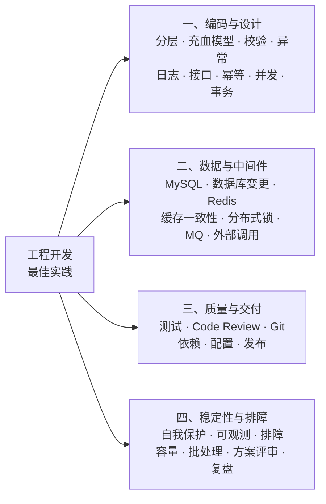
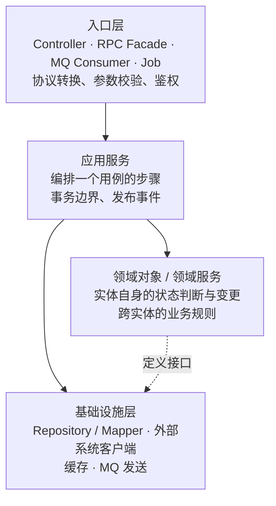
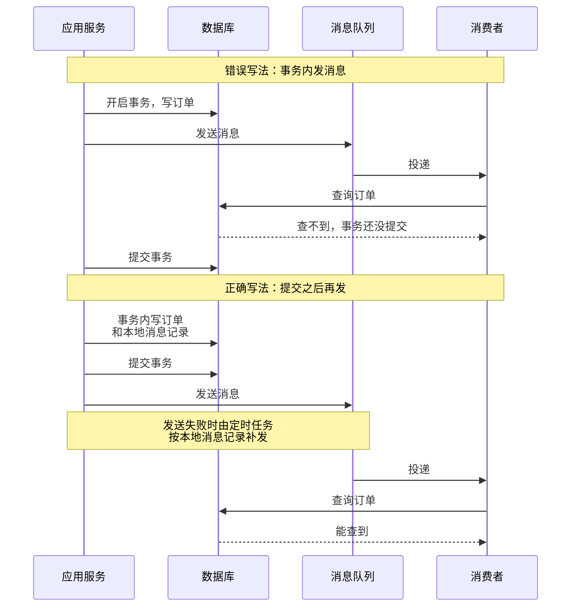
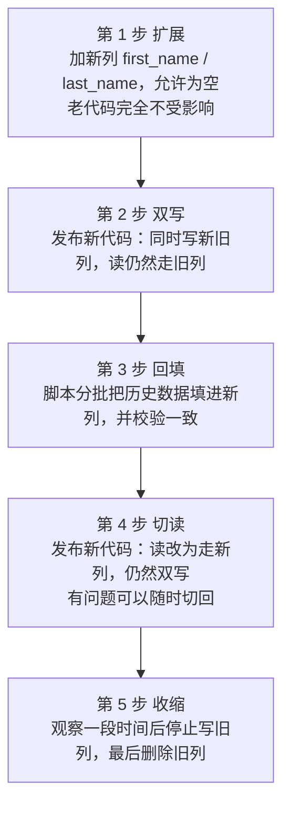
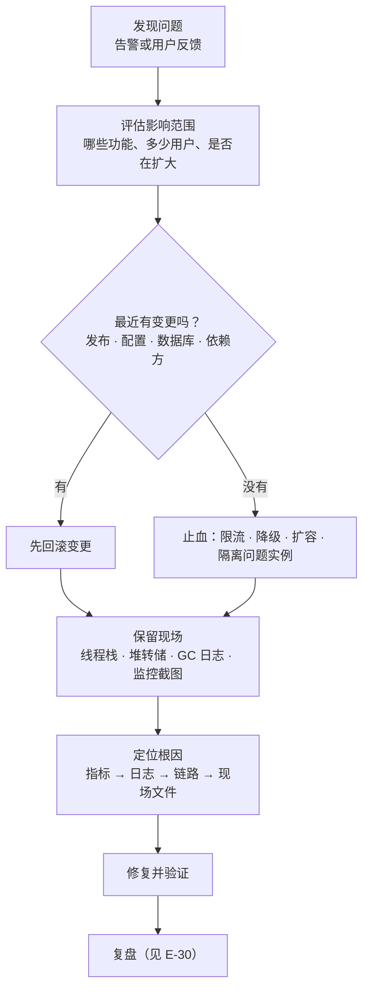

# 项目工程开发最佳实践

> 适用对象：做后端业务系统的开发和架构师。示例以 Java 为主，原则对 Python、Go 等语言的服务端项目同样适用。
> 版本基线：JDK 17+（并发部分涉及 JDK 21/24 的虚拟线程）、Spring Boot 3.x、MySQL 8.x、Redis 7.x。版本敏感的结论会写明版本。
> 内容来源：下面的踩坑点是业内反复出现的典型问题模式，不是某一次具体事故的复述。文中出现的数字阈值（线程数、超时、分页上限等）是经验起点，上线前要用自己的压测结果校准。
> 代码说明：标注「已运行」的代码只依赖 JDK，在本机 JDK 17 和 JDK 25 上实际跑过；标注「示意代码，未编译」的是依赖 Spring、Lombok 等框架的片段，用来说明写法。
> 相关分类：原理层面的内容在题库里已经讲过，这里只讲"怎么做"和"哪里会踩坑"，需要原理时点链接：[《03 Java 并发》](../01-Java核心/03-Java并发.md)、[《05 Spring》](../02-框架与容器/05-Spring.md)、[《15 MySQL》](../04-数据存储/15-MySQL.md)、[《17 Redis》](../04-数据存储/17-Redis.md)、[《20 MQ 通用与选型》](../05-消息队列/20-MQ通用与选型.md)、[《26 高可用》](../06-三高与架构/26-高可用.md)、[《31 单元测试》](../07-工程实践与稳定性/31-单元测试.md)、[《32 日志与可观测性》](../07-工程实践与稳定性/32-日志与可观测性.md)、[《33 线上问题排查》](../07-工程实践与稳定性/33-线上问题排查.md)、[《36 Maven · Git · IDEA》](../07-工程实践与稳定性/36-Maven·Git·IDEA.md)

## 怎么用这份手册

每条实践按同一个顺序写：**结论 → 为什么 → 怎么做 → 踩坑 → 检查清单**，没有实质内容的区块直接省略。

- 做方案或写代码之前：读对应条目的「结论」和「怎么做」。
- 提测或上线之前：过一遍对应条目的「检查清单」，以及文末的[上线前总检查清单](#上线前总检查清单)。
- 线上出了问题：先查文末的[踩坑速查表](#踩坑速查表)，按症状找到条目。

## 总览



## 条目索引

| 编号 | 实践 | 一句话结论 |
| --- | --- | --- |
| E-01 | 分层与职责归属 | 入口层做转换和校验，应用服务编排用例和事务，实体管自己的状态 |
| E-02 | 实体自己管状态 | 状态流转规则只写一处，更新时带上原状态做条件 |
| E-03 | 参数校验只在入口做一次 | 入口严格校验，下游信任契约，不要层层判空 |
| E-04 | 异常处理 | 区分业务异常和系统异常，只在处理的地方打一次日志 |
| E-05 | 日志 | 只用 info 和 error，带 traceId 和关键业务键，不打大对象和敏感信息 |
| E-06 | 常量与枚举 | 状态码、业务常量、配置键全部收敛，枚举入库用 code |
| E-07 | 接口设计与兼容 | 字段只增不删，分页有上限，Long 和金额对前端用字符串 |
| E-08 | 幂等 | 所有写接口都按"会被重复调用"来设计，靠数据库兜底 |
| E-09 | 并发与线程池 | 线程池有界、命名、按业务隔离，不用默认公共池 |
| E-10 | 事务 | 事务要短，里面不放远程调用，消息在提交之后发 |
| E-11 | MySQL 表设计与 SQL | 每条 SQL 上线前看执行计划，更新和删除必须走索引 |
| E-12 | 数据库变更 | 结构变更先于代码发布，新旧代码都要能跑 |
| E-13 | Redis 使用 | 所有 key 有过期时间，不放大 Key，不用阻塞命令 |
| E-14 | 缓存一致性 | 先更新数据库再删缓存，过期时间做最终兜底 |
| E-15 | 分布式锁 | 能用唯一索引或条件更新解决的不加锁；锁要包住事务 |
| E-16 | MQ 使用 | 生产方保证发出去，消费方保证幂等，失败有重试上限和死信 |
| E-17 | 外部调用 | 每个调用都显式设超时，重试只给幂等接口 |
| E-18 | 测试策略 | 核心逻辑用单测，数据库相关用真库，修 Bug 先写复现测试 |
| E-19 | Code Review | 小改动、先自审、看调用链上下游 |
| E-20 | Git 与提交 | 短分支、原子提交，密钥永远不进仓库 |
| E-21 | 依赖管理 | 版本集中管理，上线不带 SNAPSHOT，冲突用依赖树排查 |
| E-22 | 配置管理 | 改配置等于发布，要灰度、可回滚、有记录 |
| E-23 | 发布 | 灰度、可回滚、新旧版本能并存，实例优雅上下线 |
| E-24 | 自我保护 | 限流、隔离、降级在出事之前配好并演练过 |
| E-25 | 可观测性 | 每个接口和每个外部依赖都有耗时和错误率指标，告警必须可行动 |
| E-26 | 线上排障 | 先止血再定位，重启前留现场，先查最近的变更 |
| E-27 | 容量与压测 | 上线前压到拐点，连接池和线程池参数来自压测 |
| E-28 | 定时任务与批处理 | 防重复执行、可重入、分批限速、能断点续跑 |
| E-29 | 技术方案与评审 | 先写方案再写代码，方案里必须有非目标、上下游影响和回滚方式 |
| E-30 | 复盘与技术债 | 复盘追到流程和机制，技术债登记在册并跟着需求还 |

---

## 一、编码与设计

### E-01 分层与职责归属

**结论**：判断一段逻辑该放哪一层，看它回答的是哪个问题。"请求长什么样、合不合法"归入口层，"这个用例分几步、事务边界在哪"归应用服务，"这个对象现在能不能做这件事"归实体，"数据怎么存、外部系统怎么调"归基础设施层。

**为什么**：分层的目的是让变化只影响一层。接口协议变了只改入口层，存储换了只改基础设施层，业务规则变了只改领域对象。逻辑放错层，一次改动就要在多处同步修改，漏掉一处就是 Bug。

**怎么做**：



- 调用方向只能从上往下。入口层不直接调 Mapper，应用服务之间尽量不互相调用（需要复用时把公共部分下沉为领域服务）。
- 四类入口（HTTP、RPC、MQ 消费、定时任务）走同一个应用服务，校验逻辑也就只需要写一次。
- 存量项目如果是 Controller → Service → Mapper 的三层贫血结构，新增逻辑按职责放对位置就可以，不要顺手把旧代码整体重构。只有某个模块反复出问题、证明旧结构已经撑不住时，才单独立项重构。

**踩坑**：

| 现象 | 根因 | 做法 |
| --- | --- | --- |
| 同一条业务规则在 HTTP 接口生效，MQ 消费进来的数据却绕过去了 | 规则写在 Controller 里，其他入口没有走到 | 规则下沉到应用服务或实体 |
| Service 之间循环依赖，启动报错或靠 `@Lazy` 硬撑 | 两个应用服务互相调用，职责边界没划清 | 把被共用的逻辑抽成领域服务，两边都依赖它 |
| 一个 Service 几千行，谁都不敢改 | 所有用例都往一个类里加，成了上帝类 | 按用例拆应用服务，按实体收拢状态逻辑 |
| 领域对象里出现 `HttpServletRequest`、Mapper | 下层概念漏进了领域层 | 领域层只依赖自己定义的接口，由基础设施层实现 |

**检查清单**：

- [ ] 新增的业务规则，从 HTTP、RPC、MQ、定时任务四种入口进来都会经过它吗？
- [ ] Controller 里除了转换、校验、调用应用服务之外，还有别的逻辑吗？
- [ ] 这次改动有没有让某个类多承担了一类职责？

### E-02 实体自己管状态

**结论**：实体的状态判断和状态变更写在实体自己的方法里，流转规则只有一处。落库时带上原状态做条件更新，让数据库替你挡住并发。

**为什么**：状态判断散落在各个 Service 里时，新增一个状态就要全局搜索所有 `if (status == ...)`，漏掉一处就是线上问题。`setStatus()` 对谁都开放，等于没有规则。

**怎么做**（已运行，节选了枚举和实体，省略了 `main` 方法）：

```java
/** 订单状态：每个状态自己声明允许流转到哪里，流转规则只有这一处 */
enum OrderStatus {
    CREATED(10), PAID(20), SHIPPED(30), FINISHED(40), CANCELLED(90);

    /** 入库用 code，不用 ordinal()，否则调整枚举顺序会让历史数据错位 */
    private final int code;

    OrderStatus(int code) {
        this.code = code;
    }

    int code() {
        return code;
    }

    Set<OrderStatus> nextStatuses() {
        // switch 表达式不写 default：新增状态时编译器会在这里报错，逼你补上流转规则
        return switch (this) {
            case CREATED -> EnumSet.of(PAID, CANCELLED);
            case PAID -> EnumSet.of(SHIPPED, CANCELLED);
            case SHIPPED -> EnumSet.of(FINISHED);
            case FINISHED, CANCELLED -> EnumSet.noneOf(OrderStatus.class);
        };
    }
}

class Order {
    private final long id;
    private OrderStatus status = OrderStatus.CREATED;

    Order(long id) {
        this.id = id;
    }

    /** 支付成功。返回流转前的状态，持久层拿它拼 WHERE status = ? 做条件更新 */
    OrderStatus pay() {
        return transitTo(OrderStatus.PAID);
    }

    private OrderStatus transitTo(OrderStatus target) {
        if (!status.nextStatuses().contains(target)) {
            throw new IllegalStateException(
                    "order " + id + " cannot transit from " + status + " to " + target);
        }
        OrderStatus from = status;
        status = target;
        return from;
    }
}
```

连续调用两次 `pay()` 的实际输出：

```text
UPDATE t_order SET status = 20 WHERE id = 1001 AND status = 10
rejected: order 1001 cannot transit from PAID to PAID
```

第一行是持久层应该生成的 SQL：`WHERE` 里带着流转前的状态。两个线程同时支付时，内存里的校验都能通过，但数据库只会让一条 `UPDATE` 的影响行数为 1，另一条为 0。应用服务拿到 0 就知道状态已经被别人改了，按业务决定是报错还是当作成功。

**踩坑**：

| 现象 | 根因 | 做法 |
| --- | --- | --- |
| 已取消的订单又被改成了已支付 | 先 `select` 判断状态、再 `update` 不带状态条件，两步之间被并发修改 | `UPDATE ... WHERE id = ? AND status = ?`，检查影响行数 |
| 调整了枚举的声明顺序，线上历史数据的状态全错位 | 用 `ordinal()` 或 `@Enumerated(ORDINAL)` 入库 | 枚举显式定义 `code`，入库用 `code` |
| 新增了"部分退款"状态，某个报表把这类订单漏掉了 | 状态判断散落在多处，漏改 | 状态相关的判断收拢成实体方法，例如 `order.isRefundable()` |
| 贫血项目里强推充血，实体里注入了 Repository | 把跨聚合协调也塞进了实体 | 实体只管自己的状态；查别的聚合、调外部系统放在领域服务或应用服务 |

### E-03 参数校验只在入口做一次

**结论**：整条调用链只在入口层做一次严格校验，不合法立刻失败。入口之后的代码信任契约，不重复判空。

**为什么**：层层判空有两个坏处。第一，重复代码多，校验规则改了要改好几处。第二，更隐蔽也更严重：下游遇到 `null` 悄悄返回默认值，本该暴露的上游 Bug 被吞掉，数据带着错误继续往下走，等发现时已经落库。早失败比晚失败便宜得多。

**怎么做**（示意代码，未编译）：

```java
@Data
public class CreateOrderRequest {
    @NotNull
    private Long userId;

    /** 集合必须同时限制非空和上限，否则一次请求可以塞进几万条 */
    @NotEmpty
    @Size(max = OrderConstants.MAX_ITEMS_PER_ORDER)
    @Valid
    private List<OrderItemRequest> items;

    @NotBlank
    @Size(max = OrderConstants.REQUEST_ID_MAX_LENGTH)
    private String requestId;
}

@PostMapping("/orders")
public Result<Long> create(@RequestBody @Valid CreateOrderRequest request) {
    return Result.success(orderAppService.create(request));
}
```

- 格式类校验（必填、长度、范围、枚举值）用 Bean Validation 声明在入参对象上。
- 业务前置校验（用户是否存在、库存是否足够）放在应用服务的开头，同样只做一次。
- MQ 消费者和定时任务也是入口，同样要校验。它们的"入参"是消息体和任务参数。
- 字符串判空用 `StringUtils.isBlank`，集合判空用 `CollectionUtils.isEmpty`，团队统一一套工具类。

**踩坑**：

| 现象 | 根因 | 做法 |
| --- | --- | --- |
| 嵌套对象上的 `@NotNull` 不生效 | 外层字段缺少 `@Valid`，校验不会递归进去 | 嵌套对象、集合元素的字段上加 `@Valid` |
| Service 方法上的校验注解不生效 | 类上没加 `@Validated`，或者是同类内部调用，没经过代理 | 校验放在入口层；确需在 Service 校验时注意代理限制 |
| 入参 `List` 一次传了几万条，接口超时、内存飙升 | 没有限制集合大小 | 所有集合入参加 `@Size(max = ...)` |
| 下游方法遇到 `null` 返回空集合，上游的 Bug 半年后才被发现 | 过度防御把错误吞了 | 下游不判空，或者判空后直接抛异常，不返回默认值 |
| 只在前端做了校验 | 后端认为前端校验过了 | 前端校验只为体验，后端入口必须完整校验 |

### E-04 异常处理

**结论**：把异常分成两类。业务异常是预期内的（余额不足、状态不允许），带错误码返回给调用方；系统异常是预期外的（空指针、数据库超时），记录完整堆栈并告警。异常只在真正处理它的地方打一次日志。

**怎么做**（示意代码，未编译）：

```java
/** 错误码收敛为枚举，接口文档、日志、监控都用同一套 */
@Getter
@AllArgsConstructor
public enum OrderErrorCode {
    ORDER_NOT_FOUND("ORDER_1001", "订单不存在"),
    STATUS_NOT_ALLOWED("ORDER_1002", "当前状态不允许该操作");

    private final String code;
    private final String message;
}

@Slf4j
@RestControllerAdvice
public class GlobalExceptionHandler {

    /** 业务异常：预期内，不需要堆栈，info 级别即可 */
    @ExceptionHandler(BizException.class)
    public Result<Void> handleBiz(BizException e) {
        log.info("biz rejected, errorCode={}, message={}", e.getErrorCode(), e.getMessage());
        return Result.fail(e.getErrorCode(), e.getMessage());
    }

    /** 系统异常：预期外，必须带完整堆栈，对外只返回通用提示，不暴露内部细节 */
    @ExceptionHandler(Exception.class)
    public Result<Void> handleSystem(Exception e, HttpServletRequest request) {
        log.error("request failed, errorCode={}, uri={}",
                CommonErrorCode.SYSTEM_ERROR.getCode(), request.getRequestURI(), e);
        return Result.fail(CommonErrorCode.SYSTEM_ERROR);
    }
}
```

- 中间层不要 `catch` 之后打日志再原样抛出，否则一个异常在日志里出现三四遍，排查时反而被干扰。
- 包装异常时保留原异常：`throw new BizException(errorCode, e)`，不要丢掉 cause。
- 调用外部系统的地方把对方的异常转换成自己的异常，不让第三方 SDK 的异常类型一路传到入口。

**踩坑**：

| 现象 | 根因 | 做法 |
| --- | --- | --- |
| 日志里只有 `NullPointerException`，没有堆栈 | 写成了 `log.error("failed: " + e.getMessage())` | 异常对象作为最后一个参数传入：`log.error("...", param, e)` |
| 方法抛了异常，事务却没回滚 | `@Transactional` 默认只对 `RuntimeException` 和 `Error` 回滚，受检异常不回滚 | 显式写 `rollbackFor = Exception.class`，或只抛运行时异常 |
| 代码里 `catch` 住异常后返回了失败结果，事务照样提交 | 异常没有传播出事务方法，事务管理器感知不到 | 需要回滚就让异常抛出去，或者手动 `setRollbackOnly()` |
| 线程池关不掉，或者任务取消不了 | `catch (Exception e)` 把 `InterruptedException` 吞了 | 捕获后恢复中断标记：`Thread.currentThread().interrupt()` |
| `finally` 里写了 `return`，异常消失了 | `finally` 的 `return` 会覆盖 `try` 中抛出的异常 | `finally` 只做资源释放 |
| 用异常做正常分支的流程控制，接口很慢 | 创建异常要填充堆栈，高频路径上开销明显 | 预期内的分支用返回值表达 |
| 前端页面上显示了 SQL 语句或类名 | 系统异常的 message 直接返回给了调用方 | 对外统一返回通用错误码，细节只进日志 |

### E-05 日志

**结论**：日志写给排查问题的人看。每条日志要能回答三个问题：哪一次请求（traceId）、哪个业务对象（订单号、用户 ID）、发生了什么。本手册约定只用 `info` 和 `error` 两个级别，日志正文用英文。

**为什么只用两级**：`warn` 在实践中容易变成"不知道算不算问题"的灰色地带，量一大就没人看，也没法配告警。只留两级之后规则很清楚：需要有人处理的用 `error` 并配告警，不需要人处理的用 `info`。日志正文用英文是为了避免编码问题，也方便检索和接入日志平台。

**怎么做**：

- 该打日志的位置：入口的请求和结果、外部调用的请求和结果（含耗时）、关键状态变更、异常。
- 一律用占位符：`log.info("order paid, orderId={}, amount={}", orderId, amount)`，不用字符串拼接。
- `error` 日志带错误码、关键参数，并把异常对象作为最后一个参数：`log.error("pay failed, errorCode={}, orderId={}", errorCode, orderId, e)`。
- traceId 放进 MDC，由日志格式统一输出；跨线程池、跨 MQ 时要显式传递。
- 手机号、身份证、银行卡、密码、令牌进日志前脱敏，脱敏逻辑收敛到一个工具类或日志框架的转换器里。

**踩坑**：

| 现象 | 根因 | 做法 |
| --- | --- | --- |
| 异步线程里的日志没有 traceId，链路断了 | MDC 基于 ThreadLocal，不会自动传到线程池里的线程 | 用 `TaskDecorator` 包装线程池，提交任务时复制 MDC，执行完清理 |
| 接口平时不慢，一开详细日志就超时 | 日志参数里做了大对象的 JSON 序列化，同步写盘 | 不打整个对象，只打关键字段；必要时用异步 Appender |
| 磁盘被日志写满 | 循环里逐条打日志，或者没配滚动和保留策略 | 循环内不打日志，改成循环结束后打汇总；配置按大小和时间滚动 |
| 一个异常在日志里出现了四遍 | 每一层都 `catch` → 打日志 → 再抛出 | 只在最终处理的地方打一次 |
| 日志里搜出了用户的完整手机号和 token | 直接打印了入参对象 | 脱敏；入参对象的 `toString` 排除敏感字段 |
| 出了问题发现关键位置没日志，只能加日志重新发版 | 只在异常时打日志，正常路径没有记录 | 关键状态变更和外部调用无论成败都打一条 `info` |

### E-06 常量与枚举

**结论**：状态码、业务常量、配置键、缓存 key 前缀都不直接写在逻辑里，收敛为常量或枚举。有限取值的概念用枚举，孤立的数值和字符串用常量。

**踩坑**：

| 现象 | 根因 | 做法 |
| --- | --- | --- |
| 接口新增了一个枚举值，老版本的调用方反序列化直接报错 | RPC 接口的出参里用了枚举类型，调用方的 jar 包里没有新值 | 对外接口用 `code`（数字或字符串）传递，各方自己转换；内部代码再用枚举 |
| `if (type == 3)` 没人知道 3 是什么 | 魔法值 | 定义枚举，逻辑里写 `OrderType.GROUP_BUY` |
| 同一个缓存 key 的前缀，写的地方和删的地方拼得不一样 | 字符串字面量散落在各处 | key 的拼装收敛成一个方法 |
| 数据库里出现了枚举中不存在的值，查询时抛异常 | `code` 转枚举时没有处理未知值 | 转换方法对未知值明确抛出带 `code` 的异常，不要返回 `null` 让下游空指针 |

### E-07 接口设计与兼容

**结论**：接口一旦有调用方，就只能做向后兼容的修改。字段只增不删、不改含义、不改类型。设计时就把分页上限、幂等键、错误码定下来。

**怎么做**：

- **兼容性**：新增字段给默认值，老调用方不传也能工作；要废弃的字段先标记，确认无人使用后再删。无法兼容的改动开新接口或新版本，新旧并存一段时间。
- **分页**：`pageSize` 必须有上限（例如 100）。数据量大的列表用游标分页（传上一页最后一条的 ID），不用 `offset`。
- **数字**：返回给浏览器的 `Long` 型 ID 序列化成字符串。JavaScript 的 `Number` 只能精确表示到 2^53 − 1，雪花 ID 超过这个范围，末尾几位会变。
- **金额**：内部用 `BigDecimal` 或以"分"为单位的 `long`，对外用字符串或整数分，不用 `double`。
- **时间**：对外用带时区的 ISO 8601 字符串或毫秒时间戳，不传不带时区的 `yyyy-MM-dd HH:mm:ss`。
- **错误**：返回机器可判断的错误码加给人看的错误信息，调用方按错误码写逻辑，不按文案。
- **写接口**：入参带幂等键（见 E-08）。

**踩坑**：

| 现象 | 根因 | 做法 |
| --- | --- | --- |
| 前端拿到的订单号和后端日志里的最后几位不一样 | `Long` 超过 JS 安全整数范围，精度丢失 | `Long` 序列化为字符串 |
| 有人传 `pageSize=100000`，把数据库和内存都打满 | 分页没有上限 | 服务端强制上限，超过直接拒绝 |
| 布尔字段 `isDeleted` 序列化出来成了 `deleted`，调用方取不到 | 不同序列化框架对 `is` 前缀的 getter 处理不一致 | 布尔字段不加 `is` 前缀，命名为 `deleted` |
| 改了某个字段的含义（元改成分），调用方资损 | 复用旧字段名承载新含义 | 含义变了就新增字段，旧字段保持原含义直到下线 |
| 接口返回了数据库实体，表里加个字段，接口就多暴露一个字段 | 没有单独的出参对象 | 接口出参用专门的 DTO，和存储模型分开 |

### E-08 幂等

**结论**：所有写接口都要假设自己会被重复调用。网络超时后调用方重试、MQ 重复投递、用户连点、任务失败重跑，都会产生重复请求。幂等的最后一道防线必须在数据库。

**怎么做**：按适用范围从宽到窄有三种手段，通常组合使用。

| 手段 | 做法 | 适用 |
| --- | --- | --- |
| 唯一索引 | 给业务幂等键（请求号、外部流水号）建唯一索引，重复插入时捕获唯一键冲突 | 创建类操作 |
| 状态条件更新 | `UPDATE ... WHERE id = ? AND status = ?`，影响行数为 0 说明已经处理过 | 状态流转类操作 |
| 去重表 | 单独一张表记录"已处理的消息 ID / 请求 ID"，和业务操作放在同一个本地事务里 | 没有天然唯一键的操作，如 MQ 消费 |

重复请求进来时，返回第一次处理的结果，不要返回"重复请求"的错误。调用方重试的原因是没拿到结果，它需要的是那个结果。

**踩坑**：

| 现象 | 根因 | 做法 |
| --- | --- | --- |
| 做了"先查是否存在，不存在再插入"，还是插了两条 | 查和插之间有并发窗口，两个请求都查到不存在 | 唯一索引兜底，捕获冲突后查出已有记录返回 |
| 幂等键存在 Redis 里，一天后同一笔请求又被处理了一遍 | 幂等记录有过期时间，过期后失效；Redis 主从切换也可能丢 | 幂等判定落在数据库；Redis 只用来做前置的快速拦截 |
| 第二次请求返回"请勿重复提交"，调用方当成失败又发起了一笔新的 | 幂等返回了错误而不是首次结果 | 重复请求返回首次的处理结果 |
| 幂等键是服务端生成的 | 每次重试生成的键都不同，起不到作用 | 幂等键由发起方在第一次请求前生成，重试时原样带上 |
| 第一次请求还在处理中，重试的请求进来又处理了一遍 | 只判断了"是否已完成"，没处理"处理中" | 先插入幂等记录（状态为处理中）再执行业务，重复请求看到处理中时返回"处理中" |

### E-09 并发与线程池

**结论**：线程池必须有界、有名字、按业务隔离，拒绝策略要显式指定。不使用任何"默认的公共线程池"。

**怎么做**（示意代码，未编译）：

```java
/** 线程池参数来自压测，这里的数值只是示例；队列必须有界 */
@Bean
public ThreadPoolExecutor orderQueryExecutor() {
    ThreadFactory factory = new ThreadFactoryBuilder()
            .setNameFormat(ExecutorConstants.ORDER_QUERY_THREAD_NAME_FORMAT)
            .build();
    return new ThreadPoolExecutor(
            ExecutorConstants.ORDER_QUERY_CORE_SIZE,
            ExecutorConstants.ORDER_QUERY_MAX_SIZE,
            ExecutorConstants.KEEP_ALIVE_SECONDS, TimeUnit.SECONDS,
            new ArrayBlockingQueue<>(ExecutorConstants.ORDER_QUERY_QUEUE_CAPACITY),
            factory,
            // 队列满了让调用线程自己执行，起到反压作用；不能丢的任务不要用 Discard 系列策略
            new ThreadPoolExecutor.CallerRunsPolicy());
}
```

- 不同业务用不同的线程池。慢任务和快任务共用一个池，慢任务会把线程占满，快任务跟着超时。
- `CompletableFuture.supplyAsync(...)` 的第二个参数一定要传自己的线程池。
- `ThreadLocal` 在 `finally` 里 `remove()`。线程池里的线程会复用，不清理就会把上一个请求的数据带给下一个请求。
- 线程池的活跃线程数、队列长度、拒绝次数接入监控。
- JDK 21+ 的虚拟线程适合阻塞 IO 多的场景。虚拟线程不要池化，每个任务新建一个；需要限制并发量时用 `Semaphore`。

**踩坑**：

| 现象 | 根因 | 做法 |
| --- | --- | --- |
| 内存慢慢涨上去，最后 OOM | `Executors.newFixedThreadPool` 等工厂方法用的是无界队列，任务堆积；`newCachedThreadPool` 线程数没有上限 | 手动 `new ThreadPoolExecutor`，使用有界队列 |
| 一个接口慢了，整个应用里不相关的异步任务都卡住 | `CompletableFuture` 不传线程池时用的是 `ForkJoinPool.commonPool()`，`parallelStream` 也用它，全应用共享 | 显式传入业务自己的线程池；不在请求路径上用 `parallelStream` 做 IO |
| 线程池里所有线程都在等待，任务永远不结束 | 父任务在池里等待子任务的结果，子任务也提交到了同一个池，排在队列里没线程执行 | 父子任务用不同的线程池 |
| 异步任务抛了异常，日志里什么都没有 | `submit()` 提交的任务，异常被封装进 `Future`，不调用 `get()` 就看不到 | 任务内部自己 `try/catch` 并记录；或用 `execute()` 配合异常处理器 |
| Spring Boot 里 `@Async` 的任务越积越多 | Boot 自动配置的执行器默认核心线程 8、队列无界 | 自定义执行器并指定有界队列，或配置 `spring.task.execution.pool.*` |
| 用户 A 看到了用户 B 的数据 | `ThreadLocal` 没有清理，线程复用时带出了旧值 | `try { ... } finally { threadLocal.remove(); }` |
| 用上虚拟线程后吞吐反而下降（JDK 21~23） | 虚拟线程在 `synchronized` 块里阻塞时会钉住载体线程 | JDK 24 起已解决（JEP 491）；JDK 21~23 上把热点路径的 `synchronized` 换成 `ReentrantLock` |
| 压测时偶发日期解析出错 | `SimpleDateFormat` 线程不安全，却被定义成了静态共享变量 | 用 `DateTimeFormatter`（不可变、线程安全） |

### E-10 事务

**结论**：事务要短，只包住"必须一起成功或一起失败"的那几条数据库操作。远程调用、发消息、读写文件都不放在事务里。

**为什么**：事务持有数据库连接和行锁。事务里放一个 2 秒的 RPC，这个连接和这些锁就被占 2 秒。并发一上来，连接池耗尽，其他请求全部排队，接着就是整个服务不可用。

**怎么做**：



- 先在事务外把该查的查完、该调的远程接口调完，再开事务写库。
- "写库成功后一定要发出消息"用本地消息表或事务消息保证，见[《20 MQ 通用与选型》](../05-消息队列/20-MQ通用与选型.md)的 20-09。
- 只需要"提交后做一件允许丢的事"（比如清本地缓存）时，用 `TransactionSynchronization.afterCommit` 或 `@TransactionalEventListener`。
- 用编程式事务（`TransactionTemplate`）可以把事务范围精确到几行代码，比在整个方法上加 `@Transactional` 更容易控制。

**踩坑**：

| 现象 | 根因 | 做法 |
| --- | --- | --- |
| 方法加了 `@Transactional` 却不生效 | 同一个类里的方法直接调用，没有经过 Spring 代理；或者方法是 `private` | 把事务方法放到另一个 Bean，或用 `TransactionTemplate` |
| 消费者收到消息去查数据，查不到 | 消息在事务提交前就发出去了 | 提交后再发 |
| 消息发出去了，事务却回滚了，下游拿到一条不存在的数据 | 同上，发消息在事务内且不受事务控制 | 本地消息表或事务消息 |
| 连接池耗尽，线程全部卡在获取连接 | 外层事务占着一个连接，内层 `REQUIRES_NEW` 又要一个新连接；并发量达到池大小时互相等待 | 少用 `REQUIRES_NEW`，优先把内层逻辑移到外层事务之外；确实要用时，连接池大小至少为"并发线程数 ×（单线程同时持有的连接数 − 1）+ 1" |
| 数据库出现大量锁等待，主从延迟变大 | 事务里循环处理了几万条数据，成了大事务 | 分批提交，每批几百到一千条 |
| 加了 `@Transactional` 的方法里用多线程写库，部分数据没回滚 | 事务上下文绑定在线程上，子线程不在同一个事务里 | 事务内不开线程写库；要并行就各自独立事务，加补偿 |

---

## 二、数据与中间件

### E-11 MySQL 表设计与 SQL

**结论**：表结构决定了后面所有 SQL 的上限。每条新 SQL 上线前都看一遍执行计划，`UPDATE` 和 `DELETE` 的条件必须走索引。

**怎么做**：

- **建表**：主键用 `BIGINT`（自增或雪花 ID），不用 UUID 字符串做主键。每张表都有创建时间和更新时间。字符集统一 `utf8mb4`，同一个库里的排序规则保持一致。字段尽量 `NOT NULL` 并给默认值。金额用 `DECIMAL` 或整数分。
- **索引**：按查询条件建联合索引，等值条件的列放前面，范围条件的列放后面。单表索引数量控制在 5 个左右，写多读少的表更要克制。
- **查询**：只查需要的列。条件里不要对索引列做函数运算或类型转换。大表不用 `offset` 深分页，改成 `WHERE id > 上一页最后的 id ORDER BY id LIMIT n`。
- **写入**：批量插入每批几百条。大批量更新和删除按主键范围分批执行，批与批之间留间隔。
- **上线前**：对新 SQL 跑 `EXPLAIN`，重点看 `type`（避免 `ALL`）、`key`（是否用上预期的索引）、`rows`（预估扫描行数）和 `Extra`（是否出现 `Using filesort`、`Using temporary`）。

**踩坑**：

| 现象 | 根因 | 做法 |
| --- | --- | --- |
| 字段有索引，查询却走了全表扫描 | 字段是 `VARCHAR`，条件里传的是数字，MySQL 把每一行的字段值转成数字再比较，索引失效 | 参数类型和字段类型保持一致 |
| 两张表关联查询很慢，关联字段都有索引 | 两张表的字符集或排序规则不一致，关联时发生隐式转换 | 统一字符集和排序规则 |
| 一条 `UPDATE` 把整张表锁住，其他写入全部超时 | 条件没有走索引。在默认的可重复读隔离级别下，会给扫描到的所有行和间隙加锁 | 更新、删除的条件必须命中索引；上线前 `EXPLAIN` |
| 翻到第一万页时接口超时 | `LIMIT 100000, 20` 要先扫描并丢弃前十万行 | 游标分页；或者先用覆盖索引查出主键，再回表 |
| 逻辑删除后，同样的数据无法再次新增 | 唯一索引里没有包含删除标记，已删除的行仍然占着唯一键 | 唯一索引加一列：未删除时为 0，删除时写入该行主键 |
| 一次删除几百万行，从库延迟了几十分钟 | 大事务产生巨量 binlog，从库回放慢 | 按主键分批删除；能按时间分区的表直接删分区 |
| `IN` 列表里拼了几万个值 | SQL 过长，优化器的估算也不准，可能放弃索引 | 分批查询，每批几百个 |
| 数据量上来之后，某条 SQL 突然从毫秒级变成秒级 | 统计信息变化，优化器换了索引，常见于 `ORDER BY ... LIMIT` | 调整索引让排序和过滤能用同一个索引；必要时 `FORCE INDEX`，并补一个更合适的联合索引 |

### E-12 数据库变更

**结论**：表结构变更先于代码发布，而且每一步都要保证新旧两个版本的代码同时能跑。按"扩展 → 迁移 → 收缩"三步走，不要一步到位。

**怎么做**：以"把字段 `name` 拆成 `first_name` 和 `last_name`"为例。



- 每一步都可以独立回滚。第 4 步出问题就把读切回旧列，数据不会丢，因为一直在双写。
- 加列：MySQL 8.0 支持 `ALGORITHM=INSTANT` 加列（8.0.29 起可以加在任意位置），只改元数据，不重建表。执行时显式写上 `ALGORITHM=INSTANT`，不支持时会直接报错，不会悄悄退化成重建表。
- 加索引、改列类型这类需要重建表或长时间执行的变更，大表上用 gh-ost、pt-online-schema-change 这类在线变更工具，并在低峰期执行。
- 数据修复脚本要满足四点：执行前备份受影响的数据、分批并限速、可以重复执行、有校验 SQL 确认结果。

**踩坑**：

| 现象 | 根因 | 做法 |
| --- | --- | --- |
| 发布过程中老实例大量报错 `Unknown column` | 代码先发、表后改；或者直接删列、改列名 | 表先改，且只做兼容性变更 |
| 新增了 `NOT NULL` 且没有默认值的列，老代码的插入全部失败 | 老代码的 `INSERT` 不包含这一列 | 新列允许为空或带默认值 |
| 一条 `ALTER TABLE` 执行后，整个库的请求都堵住了 | DDL 需要元数据锁，前面有一个没提交的长事务，DDL 排队等锁，后面所有对这张表的请求又排在 DDL 之后 | 执行前检查长事务；DDL 设置 `lock_wait_timeout`，拿不到锁就快速失败再重试 |
| 回滚代码后，发现新版本写入的数据老版本处理不了 | 新版本写了老代码不认识的枚举值或数据格式 | 发布分两次：先发"能读新格式"的版本，全量后再发"开始写新格式"的版本 |
| 修数据的脚本跑到一半失败，不敢重跑 | 脚本不可重入 | 脚本按主键范围推进并记录进度，更新带条件，重复执行结果不变 |

### E-13 Redis 使用

**结论**：Redis 是单线程处理命令的内存数据库，一条慢命令会拖慢所有请求。使用规范围绕三件事：每个 key 都有过期时间，不存大 Key，不执行耗时命令。

**怎么做**：

- **命名**：`业务:模块:含义:标识`，例如 `trade:order:detail:1001`。key 的拼装收敛到一个类里。
- **过期**：所有缓存 key 都设过期时间，并在基础值上加一个随机偏移，避免同一批 key 同时过期。
- **大小**：String 类型的 value 控制在 10KB 以内；集合类型的元素个数控制在几千以内。超过就拆分。
- **批量**：多个命令用 pipeline 合并网络往返。集群模式下批量操作的 key 要落在同一个 slot，可以用 hash tag（`{user:1001}:profile`）。
- **禁用**：生产环境禁用 `KEYS`、`FLUSHALL`、`FLUSHDB`；遍历用 `SCAN`；删除大 Key 用 `UNLINK`（后台线程异步释放内存）。
- **定位**：Redis 用来做缓存和有限的协调（限流计数、分布式锁），不当作唯一的数据存储。丢了会造成业务损失的数据必须在数据库里有一份。

**踩坑**：

| 现象 | 根因 | 做法 |
| --- | --- | --- |
| Redis 偶发整体变慢，所有接口一起抖动 | 有人对一个几十万元素的 Hash 执行了 `HGETALL`，或者 `DEL` 了一个大 Key | 拆分大 Key；分批读取用 `HSCAN`；删除用 `UNLINK` |
| 整点时数据库压力突增 | 大量 key 设置了相同的过期时间，同时失效 | 过期时间加随机偏移 |
| 不存在的 ID 被反复查询，每次都打到数据库 | 缓存穿透：查不到的结果没有缓存 | 缓存空值（过期时间设短）；或用布隆过滤器前置拦截 |
| 一个热点 key 过期的瞬间，数据库被打满 | 缓存击穿：大量并发同时回源 | 回源加互斥（同一个 key 只放一个线程去查库）；或者热点数据不过期、由后台刷新 |
| 内存持续增长直到触发淘汰，命中率骤降 | 存在没设过期时间的 key，只增不减 | 所有 key 设过期；定期用工具扫描无过期时间的 key 和大 Key |
| 集群模式下 `MGET` 报错 `CROSSSLOT` | 多个 key 分布在不同的 slot | 用 hash tag 让相关的 key 落在同一 slot，或者由客户端按 slot 分组后分别请求 |
| 用 List 做消息队列，丢消息 | 消费者取出后宕机，消息就没了，没有确认机制 | 需要可靠投递时用真正的 MQ |
| 业务高峰期连接超时 | 连接池太小，或者每次操作都新建连接 | 配置连接池并监控等待数；检查是否有慢命令占住连接 |

### E-14 缓存一致性

**结论**：默认方案是"先更新数据库，再删除缓存"，并且给缓存设过期时间作为最终兜底。缓存和数据库之间做不到强一致，能做到的是把不一致的时间窗口压到业务可以接受的范围。

**为什么是"删"而不是"更新"缓存**：两个线程并发更新同一条数据时，更新数据库的顺序和更新缓存的顺序可能不一致，缓存里会留下旧值，而且一直留到过期。删除是幂等的，谁先谁后结果都一样，下一次读取时再从数据库加载。

**为什么是"先更新库再删缓存"**：反过来（先删缓存再更新库）时，在删除和更新之间只要有一个读请求进来，就会把旧值重新写回缓存。读请求远多于写请求，这个窗口很容易被撞上。

**怎么做**：

| 一致性要求 | 方案 |
| --- | --- |
| 一般（商品详情、配置） | 更新库后删缓存 + 过期时间兜底 |
| 较高（库存展示、余额展示） | 上面的方案 + 删除失败时重试（发 MQ 或记录后由任务补删） |
| 高，且有主从延迟 | 订阅 binlog（如 Canal）异步删除缓存，不依赖业务代码；或延迟一小段时间再删一次 |
| 强一致（扣款、扣库存的判定） | 不走缓存，直接读写数据库或用数据库事务 |

**踩坑**：

| 现象 | 根因 | 做法 |
| --- | --- | --- |
| 更新成功后，缓存里长期是旧值 | 删缓存那一步失败了（网络抖动），没有重试 | 删除失败要重试；过期时间是最后的保障 |
| 更新后立刻查询，偶尔读到旧值并且被缓存住了 | 读走的是从库，从库有延迟，读到旧数据后又写进了缓存 | 更新后的短时间内读主库；或者基于 binlog 位点延迟删除 |
| 多个实例的本地缓存内容不一致 | 本地缓存各存各的，一个实例更新了，其他实例不知道 | 通过广播消息通知所有实例失效；本地缓存的过期时间设得很短（秒级） |
| 缓存里的数据和数据库对不上，却查不出是谁写的 | 多处代码各自往同一个 key 写不同结构的数据 | 一个 key 只由一个类负责读写 |

### E-15 分布式锁

**结论**：加锁之前先问能不能不加。唯一索引、带条件的更新、乐观锁版本号能解决的问题，都比分布式锁更可靠。必须加锁时，锁要包在事务外面，并且关键数据仍然由数据库兜底。

**为什么**：基于 Redis 的分布式锁在主从切换、进程长时间停顿（GC、容器被挂起）时都可能失效，出现两个客户端同时认为自己持有锁的情况。它适合用来"减少并发冲突、避免重复劳动"，不适合作为资金、库存这类数据正确性的唯一保障。

**怎么做**（示意代码，未编译）：

```java
public void deduct(Long accountId, BigDecimal amount) {
    RLock lock = redissonClient.getLock(LockKeys.account(accountId));
    // 不传 leaseTime：由看门狗自动续期，业务没执行完锁不会过期
    if (!lock.tryLock()) {
        throw new BizException(CommonErrorCode.CONCURRENT_OPERATION);
    }
    try {
        // 事务在锁的里面：锁释放时事务已经提交，下一个拿到锁的线程能读到最新数据
        transactionTemplate.executeWithoutResult(status -> accountDomainService.deduct(accountId, amount));
    } finally {
        lock.unlock();
    }
}
```

- 锁的粒度尽量细（按订单号、账户号加锁，不按业务类型加一把大锁）。
- 拿不到锁时要明确怎么处理：直接失败、有限次重试，还是排队等待。不要无限等待。
- 数据层再加一道保障：扣减用 `UPDATE ... SET balance = balance - ? WHERE id = ? AND balance >= ?`，或者用版本号做乐观锁。

**踩坑**：

| 现象 | 根因 | 做法 |
| --- | --- | --- |
| 加了锁，还是出现了超卖 | 锁写在 `@Transactional` 方法的内部，方法返回时先释放锁、之后事务才提交。下一个线程拿到锁时读到的还是旧数据 | 锁包住事务，不要事务包住锁 |
| 线程 A 的锁被线程 B 释放了 | 锁超时自动过期后被 B 拿到，A 执行完又去释放，删掉的是 B 的锁 | 释放时校验持有者（Redisson 已内置）；自己实现时用 Lua 脚本先比较再删除 |
| 业务还没执行完，锁就过期了 | 指定了固定的 `leaseTime`，业务耗时超过了它 | 不指定 `leaseTime`，使用看门狗续期；或者按压测结果留足余量 |
| 加锁成功后进程崩溃，锁一直不释放 | 用 `SETNX` 和 `EXPIRE` 两条命令加锁，中间崩溃导致没有过期时间 | 用一条命令 `SET key value NX PX 毫秒数` |
| 主从切换后两个客户端同时持有锁 | 锁还没同步到从库，主库就宕机了 | 接受这个概率，由数据库层的条件更新或唯一索引兜底 |

### E-16 MQ 使用

**结论**：用 MQ 要守住三件事：生产方保证消息一定发得出去，消费方保证重复消费不出错，消费失败有重试上限和死信兜底。

**怎么做**：

- **生产**：业务写库和发消息的一致性用本地消息表或事务消息保证（见 E-10）。发送失败要重试并有告警。
- **消息体**：只放必要的字段（业务主键、事件类型、发生时间、版本号）。需要详情时，消费者拿主键回查。消息里带上唯一的业务键，供消费方做幂等。
- **消费**：先做幂等判断再执行业务（见 E-08）。业务处理成功后再确认消息。处理失败时抛出异常或返回失败，让 MQ 重试。
- **重试与死信**：设置最大重试次数，超过后进入死信队列，死信队列要有监控和处理流程。
- **顺序**：只有确实需要顺序的场景才用顺序消息（同一个订单的状态变更），并且把顺序范围限制到最小（按订单号分区）。
- **积压**：监控消费延迟。消费者的处理逻辑要快，慢操作异步化或拆到另一个 topic。

各 MQ 的具体机制见[《20 MQ 通用与选型》](../05-消息队列/20-MQ通用与选型.md)、[《21 Kafka》](../05-消息队列/21-Kafka.md)、[《22 RocketMQ》](../05-消息队列/22-RocketMQ.md)。

**踩坑**：

| 现象 | 根因 | 做法 |
| --- | --- | --- |
| 消息丢了，但 MQ 本身没有任何异常 | 消费者里 `catch` 住异常后正常返回，MQ 认为消费成功 | 处理失败必须让 MQ 知道（抛异常或返回重试状态） |
| 一条有问题的消息把整个队列堵住 | 消费失败后无限重试，后面的消息排不上 | 设置最大重试次数，超过进死信 |
| 同一条消息被处理了两次 | 消费完成但确认前实例重启，或发生了消费组再平衡 | 消费逻辑幂等 |
| Kafka 消费者频繁再平衡，消费进度反复回退 | 单批消息处理时间超过 `max.poll.interval.ms`（默认 5 分钟），被踢出消费组 | 减小 `max.poll.records`；把耗时逻辑异步化 |
| 消息积压，加了消费者实例却没有效果 | Kafka 同一个消费组里，一个分区只能被一个消费者消费，实例数超过分区数后多出来的在空闲 | 先增加分区数（注意会影响按 key 的顺序），或者消费者内部用线程池并行处理 |
| 批量消费时一条失败，整批都被重试 | 批量确认是整批一起的 | 批内逐条处理并记录失败的，单独投递到重试 topic |
| 顺序消息中间一条失败，后面的全部卡住 | 顺序消费必须前一条成功才能处理下一条 | 评估是否真的需要顺序；失败有限次重试后转人工处理并跳过 |
| 消费者收到消息后查不到对应的数据 | 生产者在事务提交前发了消息 | 见 E-10 |
| 消息体几 MB，Broker 压力大、消费慢 | 把整个对象甚至文件内容放进了消息 | 消息只放主键和关键字段，大内容放对象存储，消息里带地址 |

### E-17 外部调用

**结论**：调用任何外部系统（HTTP、RPC、数据库、缓存）都必须显式设置超时。重试只用于幂等接口，并且要有次数上限和退避。

**为什么**：不设超时的调用，在对方变慢时会一直占着线程。对方慢 → 自己的线程占满 → 自己也不可用 → 自己的上游也跟着不可用，这就是雪崩的传播路径。超时是切断这条传播链成本最低的手段。

**怎么做**：

- **超时分三种**：连接超时（建立连接的时间，一般几百毫秒到 1 秒）、读超时（等待响应的时间，按接口的 P99 耗时留余量）、从连接池获取连接的超时。三个都要设。
- **超时逐层递减**：上游的超时要大于下游的超时。入口总超时 3 秒时，内部调用的超时之和不能超过 3 秒，否则下游还在处理，上游已经超时返回，下游的工作白做。
- **重试**：只重试幂等接口；只对超时和网络错误重试，不对业务错误重试；最多 2~3 次；每次间隔指数增长并加随机抖动。
- **只在一层重试**：调用链上每一层都重试 3 次，三层下来最底层会收到 27 倍的流量。重试放在最靠近用户的一层，或者最靠近故障点的一层，不要层层都做。
- **熔断与降级**：对方持续失败时熔断，直接走降级逻辑。降级结果要有明确的业务含义（返回缓存数据、返回默认推荐、提示稍后再试），不能只是把异常吞掉。

限流、熔断、隔离的原理见[《26 高可用》](../06-三高与架构/26-高可用.md)。

**踩坑**：

| 现象 | 根因 | 做法 |
| --- | --- | --- |
| 第三方接口卡住，自己的 Tomcat 线程全部耗尽 | HTTP 客户端没设读超时。JDK 的 `HttpURLConnection` 和 `java.net.http.HttpClient` 默认都是无限等待 | 每个客户端显式设置连接超时和读超时 |
| 并发稍微高一点，请求就大量排队 | 连接池太小。Apache HttpClient 4.x 默认每个目标地址只有 2 个连接、总共 20 个 | 按压测结果配置每路由连接数和总连接数 |
| 对方只是抖动了一下，却被重试流量彻底打垮 | 多层重试相乘，并且重试没有间隔 | 只在一层重试；指数退避加抖动；配合熔断 |
| 重试导致重复下单、重复扣款 | 对非幂等接口做了重试 | 写接口必须带幂等键才能重试 |
| 连接数持续上涨，最后报连接池耗尽 | 响应没有关闭，连接没有归还到池里 | 用 `try-with-resources` 关闭响应；用封装好的客户端 |
| 对方更换了 IP，自己的服务一直连旧地址 | 连接池里的长连接和 DNS 缓存没有刷新 | 设置连接的最大存活时间；检查 JVM 的 DNS 缓存时间 |
| 设置了 3 秒超时，实际等了 9 秒才失败 | 框架默认带重试，3 次 × 3 秒 | 弄清楚所用客户端的默认重试行为，按需关闭 |

---

## 三、质量与交付

### E-18 测试策略

**结论**：单元测试覆盖核心业务规则，集成测试覆盖数据库和外部交互，端到端测试只覆盖主流程。修 Bug 时先写一个能复现问题的失败测试，再改代码。

**怎么做**：

- **测什么**：优先给领域对象和业务规则写单测，它们逻辑密集、没有外部依赖，写起来快、跑起来快。胶水代码（纯转发的 Controller、简单的 CRUD）靠集成测试覆盖。
- **测行为**：断言"输入什么、得到什么结果、状态变成什么"。不要断言"内部调用了某个方法几次"，否则一重构测试就全部失败。
- **数据库**：涉及 SQL 的测试用 Testcontainers 启动和生产同版本的真实数据库。
- **时间和随机**：代码里不直接调用 `LocalDateTime.now()`，注入一个 `Clock`，测试时传入固定时间。
- **Bug 修复**：按"分析为什么没测到 → 写复现测试并确认失败 → 修根因 → 测试通过并回归"的顺序做。复现测试留在代码库里，防止同样的问题再次出现。

详细内容见[《31 单元测试》](../07-工程实践与稳定性/31-单元测试.md)。

**踩坑**：

| 现象 | 根因 | 做法 |
| --- | --- | --- |
| 测试全部通过，上线后 SQL 报语法错误 | 测试用的是 H2，它和 MySQL 的语法、函数、锁行为都有差异 | 用 Testcontainers 跑真实的 MySQL |
| 覆盖率 90%，Bug 一个没少 | 为了覆盖率写的测试，只执行代码、没有断言 | 评审测试时看断言；覆盖率只用来发现完全没测到的地方 |
| 所有依赖都 mock 了，测试验证的只是 mock 的返回值 | mock 过度 | 只 mock 外部系统和不可控的依赖；自己的领域对象用真实实例 |
| 测试有时过有时不过 | 依赖当前时间、执行顺序、共享的静态变量或真实网络 | 注入时钟；每个测试自己准备和清理数据；隔离外部依赖 |
| 月底那天测试突然失败 | 测试里有日期计算，没有固定时间 | 固定时钟 |
| 测试太慢，大家不愿意在本地跑 | 每个测试都启动完整的 Spring 上下文 | 领域逻辑用纯单测；Spring 测试用切片注解并复用上下文 |

### E-19 Code Review

**结论**：评审的顺序是正确性、设计、可读性。格式和命名风格交给工具自动检查。一次评审的改动控制在几百行以内。

**怎么做**：

- **提交者**：提交前自己先完整看一遍 diff。描述里写清楚改了什么、为什么改、怎么验证的、影响范围。大需求拆成多个可以独立评审的小改动。
- **评审者**：不只看 diff。打开被修改方法的调用方，确认这次改动对它们的影响；看下游，确认新的调用方式符合对方的契约。
- **评审清单**：
  - 逻辑是否正确，边界条件（空、零、最大值、并发、重复请求）是否考虑。
  - 逻辑放的层对不对（E-01），有没有引入重复代码。
  - 新增的 SQL 有没有走索引（E-11），事务范围是否合理（E-10）。
  - 外部调用有没有超时（E-17），写操作是否幂等（E-08）。
  - 异常和日志是否符合规范（E-04、E-05）。
  - 有没有对应的测试。
  - 上线是否需要配置、数据库变更、发布顺序上的配合。

**踩坑**：

| 现象 | 根因 | 做法 |
| --- | --- | --- |
| 两千行的改动，评审意见只有"LGTM" | 改动太大，评审者没法真正看懂 | 拆小；超过一定行数的改动要求先做方案评审 |
| 改了一个公共方法，另一个业务线出了问题 | 只看了 diff，没看这个方法还有谁在调用 | 评审时查看调用方；公共方法的行为变更要通知所有使用方 |
| 评审意见全是空格和命名 | 没有自动格式化和静态检查 | 格式化、静态检查接入 CI，不通过不能合并 |
| 评审成了走过场，评审者不对结果负责 | 没有明确责任 | 线上问题复盘时同时回看评审环节 |

### E-20 Git 与提交

**结论**：分支活得越短越好，提交要原子化，密钥和密码永远不进仓库。

**怎么做**：

- **分支**：功能分支从主干拉出，几天内合回。长期并行开发用功能开关控制，而不是用长期分支。
- **提交**：一个提交只做一件事，可以独立回滚。提交信息写清楚"做了什么、为什么"，团队统一格式（例如 Conventional Commits：`fix(order): 修复重复支付时状态被覆盖`）。
- **合并前**：先同步主干最新代码并解决冲突，确认 CI 通过。
- **保护**：主干分支禁止直接推送和强制推送，合并必须经过评审和 CI。
- **提交前**：检查 `git config user.name` 和 `git config user.email`，公司项目和个人项目的身份不要混用。

**踩坑**：

| 现象 | 根因 | 做法 |
| --- | --- | --- |
| 数据库密码、云厂商密钥被提交到了仓库 | 配置文件里写了明文，没有被忽略 | 密钥放配置中心或密钥管理服务；CI 里加密钥扫描 |
| 发现密钥泄露后删掉了那个文件，以为没事了 | 文件还在 Git 历史里，任何有仓库权限的人都能翻出来 | 第一时间轮换密钥。清理历史是其次，轮换才是关键 |
| 开发了两个月的分支，合并时冲突了上百个文件 | 分支存活太久 | 小步合并；用功能开关隐藏未完成的功能 |
| 同事的提交不见了 | 对公共分支执行了 `git push --force` | 公共分支禁止强推；自己的分支确需强推时用 `--force-with-lease` |
| 线上出问题想回滚某个功能，发现它和别的改动混在同一个提交里 | 提交不原子 | 一个提交一件事 |
| 仓库越来越大，拉取越来越慢 | 提交了构建产物、依赖包或大文件 | 完善 `.gitignore`；大文件用对象存储或 Git LFS |
| 个人开源项目的提交记录里出现了公司邮箱 | 没有按目录区分 Git 身份 | 用 `includeIf` 按目录自动切换身份，提交前核对 |

### E-21 依赖管理

**结论**：依赖版本集中在一处管理，线上版本不依赖 SNAPSHOT，定期升级并扫描已知漏洞。

**怎么做**：

- 多模块项目在父 POM 的 `dependencyManagement` 里统一声明版本，子模块引用时不写版本号。能用官方 BOM（Spring Boot、Spring Cloud）的优先用 BOM。
- 用 `maven-enforcer-plugin` 做约束：禁止 SNAPSHOT 依赖出现在发布版本里、禁止重复的类、检查依赖版本收敛。
- 引入新依赖前看三点：是否还在维护、许可证是否允许商用、会传递引入哪些依赖。
- 把依赖漏洞扫描接入 CI。高危漏洞要有明确的修复时限。

依赖冲突的原理和排查方法见[《36 Maven · Git · IDEA》](../07-工程实践与稳定性/36-Maven·Git·IDEA.md)。

**踩坑**：

| 现象 | 根因 | 做法 |
| --- | --- | --- |
| 本地能跑，线上启动报 `NoSuchMethodError` 或 `ClassNotFoundException` | 同一个库被传递引入了多个版本，Maven 按"路径最近优先"选了旧版本 | `mvn dependency:tree -Dverbose` 找到冲突来源，在 `dependencyManagement` 里锁定版本 |
| 代码没改，重新打包后行为变了 | 依赖了 SNAPSHOT 版本，对方重新发布了 | 发布版本禁止依赖 SNAPSHOT |
| 启动时出现多个日志实现的警告，日志配置不生效 | 类路径上同时存在多个日志绑定 | 排除多余的日志实现，全项目只留一套 |
| 被通报存在安全漏洞，发现是三年前引入后没动过的库 | 没有定期升级和扫描机制 | CI 集成漏洞扫描；每个季度安排一次依赖升级 |
| 为了一个工具方法引入了整个大库，包体积增加几十 MB | 引入依赖没有评估 | 看依赖树；只用到一两个方法时自己实现 |

### E-22 配置管理

**结论**：修改配置和发布代码的风险是同一个级别，要走同样的流程：评审、灰度、可回滚、有记录。

**怎么做**：

- **分类**：环境相关的（地址、账号）、业务参数（阈值、开关）、敏感信息（密码、密钥）分开管理。敏感信息放密钥管理服务或配置中心的加密配置。
- **变更**：配置中心的修改要有审批和变更记录，先在少量实例上灰度生效，观察指标之后再全量推送。
- **默认值**：代码里给每个配置项一个安全的默认值。配置中心不可用时，应用可以用本地缓存的配置或默认值启动。
- **开关**：功能开关命名带上用途和预计下线时间。功能全量并稳定之后，删除开关和旧的代码分支。
- **校验**：应用启动时校验必需的配置项，缺失或格式不对就直接启动失败，不要带着错误配置运行。

**踩坑**：

| 现象 | 根因 | 做法 |
| --- | --- | --- |
| 改错了一个配置，几秒钟内所有实例同时出问题 | 配置中心一次性全量推送，没有灰度 | 配置变更灰度发布；高风险配置增加审批 |
| 在配置中心改了值，应用里没有生效 | 用 `@Value` 注入的字段不会自动刷新 | 使用支持动态刷新的方式（`@ConfigurationProperties` 配合刷新机制，或配置中心客户端的监听器） |
| 测试环境没问题，生产环境出错 | 各环境的配置项不一致，生产少配了一项或者值不同 | 配置项清单纳入版本管理；发布前比对各环境的配置差异 |
| 代码里的 `if (switchOn)` 没人敢删 | 开关上线后一直留着，几年后没人知道它的作用 | 开关登记并设定清理期限 |
| 限流阈值配成了 0，所有请求被拒绝 | 配置值没有做范围校验 | 配置项加范围校验，非法值拒绝生效并告警 |
| 配置中心故障，所有应用无法启动 | 启动强依赖配置中心 | 客户端启用本地缓存，启动时允许降级读取缓存 |

### E-23 发布

**结论**：每次发布都要回答四个问题：怎么灰度、怎么判断正常、怎么回滚、新旧版本同时在线时会不会出问题。

**怎么做**：

- **灰度**：先发一台或 1% 的流量，观察错误率、耗时和核心业务指标，再逐步放大（例如 1% → 10% → 50% → 100%）。每一步都要有明确的观察时间和通过标准。
- **发布顺序**：数据库变更 → 被调用方 → 调用方。消息相关的是：先发能处理新消息格式的消费者，再发会发出新格式的生产者。
- **新旧并存**：滚动发布期间新旧版本同时在处理请求。新版本写入的数据、发出的消息、返回的字段，老版本都要能处理。
- **回滚**：发布前就确定回滚方式并且确认它是可行的。用功能开关把"代码发布"和"功能生效"分开，出问题时关开关比回滚代码更快。
- **优雅下线**：先从注册中心和负载均衡摘除实例 → 等待调用方感知 → 处理完进行中的请求 → 停止 MQ 消费和定时任务 → 关闭进程。Spring Boot 的 `server.shutdown=graceful` 会等待进行中的 HTTP 请求（3.4 起默认开启）。
- **优雅上线**：应用完全初始化（连接池建好、缓存预热完）之后，就绪检查才返回成功，然后才接入流量。

灰度发布和优雅上下线的原理见[《26 高可用》](../06-三高与架构/26-高可用.md)的 26-13、26-14。

**踩坑**：

| 现象 | 根因 | 做法 |
| --- | --- | --- |
| 每次发布都有少量请求报错 | 实例被直接终止，进行中的请求被中断；或者调用方还在往已下线的实例发请求 | 优雅下线；Kubernetes 里配置 `preStop` 等待，让流量先摘除再停进程 |
| 新实例刚启动就收到流量，大量超时 | 没有配置就绪检查，或者就绪检查通过得太早 | 配置 readiness 探针，检查内容包含关键依赖的初始化状态 |
| 刚发布完的几分钟里响应时间明显偏高 | JVM 刚启动时代码还在解释执行，连接池和缓存也是空的 | 启动后先预热（预先建立连接、加载热点缓存），流量逐步放入 |
| 回滚代码后发现数据已经被新版本写乱了 | 新版本写入了旧版本无法处理的数据 | 分两次发布：先上线兼容读取的版本，再上线写入新格式的版本（见 E-12） |
| 发布过程中，正在执行的定时任务被中断，数据只处理了一半 | 停机时没有等待任务结束，任务也没有做到可重入 | 发布避开任务执行的时间；任务支持断点续跑（见 E-28） |
| 周五傍晚发布，出问题时找不到人 | 发布时间不合适 | 约定发布窗口，避开高峰期和节假日前 |
| 发布之后没人盯，问题由用户反馈才发现 | 没有发布后的观察环节 | 发布清单里写明要看哪些指标、看多久、由谁看 |

---

## 四、稳定性与排障

### E-24 自我保护

**结论**：E-17 讲的是调用别人时怎么保护自己，这一条讲的是被别人调用时怎么保护自己。限流、隔离、降级三件事要在出问题之前配置好，并且演练过。

**怎么做**：

- **限流**：入口按接口设置限流阈值，阈值来自压测得到的容量（见 E-27）。超过阈值的请求快速拒绝，并返回明确的错误码。对调用方按身份分别限流，避免一个调用方用光所有配额。
- **隔离**：核心接口和非核心接口使用不同的线程池或实例组。慢的依赖用独立的线程池或信号量隔离，防止它占满公共资源。
- **降级**：提前把功能分级。资源不足时按预案关闭非核心功能（推荐、评论、统计），保住核心链路（下单、支付）。降级开关要能一键操作。
- **演练**：定期在预发或生产的低峰期演练限流和降级，确认开关真的能用、降级之后页面和流程是正常的。

**踩坑**：

| 现象 | 根因 | 做法 |
| --- | --- | --- |
| 配了限流，流量上来服务还是挂了 | 阈值是随手填的，远高于实际容量 | 阈值来自压测，并留出余量 |
| 一个运营后台的导出功能把线上交易拖垮了 | 后台功能和交易共用同一个应用、连接池和线程池 | 后台和在线交易分开部署，至少分开连接池和线程池 |
| 出事时打开降级开关，发现降级后的页面直接报错 | 降级分支从来没被执行过 | 定期演练 |
| 触发限流后调用方立刻重试，流量反而更大 | 被限流的请求没有带退避提示，调用方不知道该等多久 | 限流响应里带上建议的重试间隔；调用方实现退避 |

### E-25 可观测性

**结论**：每个接口、每个外部依赖都要有请求量、错误率、耗时三项指标。每条告警都必须对应一个明确的处理动作，做不到的告警应该删掉。

**怎么做**：

- **指标**：接口层面看请求量、错误率、耗时分位数（P50、P99）。资源层面看使用率、饱和度（队列长度、等待数）、错误数。耗时用分位数，不用平均值，平均值会把长尾请求掩盖掉。
- **业务指标**：下单量、支付成功率这类业务指标要单独监控。很多故障在系统指标上完全正常（接口都返回 200），业务指标却已经掉下来了。
- **日志与链路**：日志带 traceId（见 E-05），链路追踪覆盖所有跨进程调用，包括 MQ 和线程池。
- **告警**：按严重程度分级，不同级别对应不同的通知方式和响应时限。告警信息里带上影响范围、可能的原因和处理手册的链接。

详细内容见[《32 日志与可观测性》](../07-工程实践与稳定性/32-日志与可观测性.md)。

**踩坑**：

| 现象 | 根因 | 做法 |
| --- | --- | --- |
| 告警群一天几百条消息，没人看，真正的故障被淹没 | 告警阈值过于敏感，大量告警不需要处理 | 定期清理：一条告警连续多次触发后都没有人采取动作，就调整阈值或者删除 |
| 监控系统自己被打挂，或者查询极慢 | 把用户 ID、订单号这类取值无限多的字段放进了指标的标签，时间序列数量爆炸 | 标签只放取值有限的维度（接口名、状态码、机房）；明细数据查日志和链路 |
| 平均响应时间正常，用户却在投诉慢 | 只看了平均值 | 看 P99 和 P999 |
| 接口全部返回成功，订单量却掉了一半 | 只监控了系统指标 | 核心业务指标配置同比、环比的波动告警 |
| 链路追踪里，请求经过 MQ 或线程池之后就断了 | trace 上下文没有跨线程、跨消息传递 | 使用支持自动传递的埋点组件，或者手动把上下文放进消息头 |
| 排查时发现需要的那条日志被采样丢弃了 | 日志采样不区分重要程度 | 错误日志和关键业务日志不采样 |

### E-26 线上排障

**结论**：线上出问题时的优先级是：先止血，再保留现场，然后定位，最后修复。排查的第一步永远是看最近有什么变更。

**怎么做**：



- **止血的常用手段**：回滚最近的变更、把有问题的实例摘除流量、限流、降级非核心功能、扩容、切换到备用机房。目标是先让用户恢复正常。
- **保留现场**：重启之前至少保留一个问题实例的线程栈（`jstack`，间隔几秒连续抓几次）和堆转储。做法是把这个实例从负载均衡摘除但不重启，在它上面取证，其他实例正常重启。
- **定位的顺序**：先看监控确定问题出现的时间点和范围，再和变更记录对照，然后用日志和链路追踪缩小到具体的接口和实例，最后用线程栈、堆转储、Arthas 定位到代码。
- **修复**：线上直接修改数据之前必须先备份，并由第二个人复核 SQL。

CPU、内存、线程、连接池等各类问题的具体排查步骤见[《33 线上问题排查》](../07-工程实践与稳定性/33-线上问题排查.md)。

**踩坑**：

| 现象 | 根因 | 做法 |
| --- | --- | --- |
| 重启之后恢复了，过几天又出现，还是不知道原因 | 重启前没有保留现场 | 摘除一台实例留作取证，再重启其他实例 |
| 花了一个小时定位根因，期间故障一直持续 | 把定位排在了止血前面 | 能回滚就先回滚，恢复之后再慢慢查 |
| 根据猜测改了一个参数就发布，问题没有解决，又引入了新问题 | 没有证据的修改 | 每个结论都要有监控数据、日志或现场文件支撑 |
| 为了修数据执行了一条 `UPDATE`，忘了加 `WHERE` | 线上手工操作没有保护措施 | 先备份、先用 `SELECT` 验证条件、在事务里执行并确认影响行数、由第二个人复核 |
| 每天固定时间出现一批超时，查应用查不出问题 | 原因在应用之外：定时任务、备份、其他系统的批处理在抢资源 | 把排查范围扩大到数据库、中间件、宿主机上的定时活动 |

### E-27 容量与压测

**结论**：系统能承受多大流量，要靠压测得到，不能靠估计。线程池、连接池、限流阈值这些参数都应该来自压测结果。

**怎么做**：

- **压测目标**：逐步加压，找到系统的拐点，也就是吞吐量不再上升、响应时间开始明显变长的位置。把拐点之前的某个水位（例如拐点吞吐量的 60%~70%）定为日常容量上限，限流阈值按它设置。
- **压测环境**：尽量贴近生产（数据量、配置、网络拓扑）。生产环境做全链路压测时，用压测标记把流量路由到影子表和影子队列，避免污染真实数据。
- **压测数据**：数据量和数据分布要接近真实情况。只用几个用户 ID 反复请求，测到的是缓存的性能。
- **观察内容**：除了吞吐量和响应时间，还要看应用的 CPU、GC、线程池队列，数据库的连接数、慢查询、锁等待，以及缓存和 MQ 的各项指标。瓶颈通常出在最弱的那一环。
- **连接数核算**：应用实例数 × 每个实例的连接池上限，必须小于数据库允许的最大连接数，并且给其他应用和运维操作留出余量。

**踩坑**：

| 现象 | 根因 | 做法 |
| --- | --- | --- |
| 应用层扩容一倍，数据库反而被打挂 | 实例数翻倍，连接总数超过了数据库的 `max_connections` | 扩容前核算连接总数；必要时使用连接代理或调小单实例连接池 |
| 压测结果很好，上线后性能远不如预期 | 压测数据太少、全部命中缓存；或者只压了单个接口，没有模拟真实的接口比例 | 使用接近生产的数据量和流量模型 |
| 把连接池调大之后，性能反而下降 | 连接数超过数据库的处理能力后，数据库内部的线程切换和锁竞争增加 | 连接池大小通过压测确定，通常远小于直觉上的值 |
| 压测产生的订单出现在了真实的报表里 | 压测数据没有隔离 | 压测流量打标记，全链路识别并路由到影子存储 |
| 大促时某个平时不起眼的接口成了瓶颈 | 只压测了核心接口，没有覆盖被核心链路依赖的周边接口 | 按完整链路压测，覆盖所有同步依赖 |

### E-28 定时任务与批处理

**结论**：定时任务要做到四点：多实例部署时不重复执行、重复执行不出错、数据分批并限速处理、中断之后能从断点继续。

**怎么做**：

- **防重复执行**：多实例部署时用分布式调度框架（XXL-JOB、ElasticJob 等）或分布式锁，保证同一时刻只有一个实例在执行。
- **可重入**：任务以"处理所有满足条件的未处理数据"的方式来写，不要写成"处理某个时间段的数据"。这样任务失败后重跑、或者补跑历史数据都很自然。
- **分批**：按主键范围分批读取（`WHERE id > ? ORDER BY id LIMIT ?`），不用 `offset`，也不要一次把全表加载进内存。
- **限速**：批与批之间留间隔，控制并发数，避免批处理把在线业务的数据库和下游接口打满。
- **进度与告警**：记录处理进度。任务执行失败、执行超时、长时间没有执行都要有告警。
- **错开时间**：不要把所有任务都配置在整点和凌晨零点。

调度框架的原理见[《34 定时任务》](../07-工程实践与稳定性/34-定时任务.md)。

**踩坑**：

| 现象 | 根因 | 做法 |
| --- | --- | --- |
| 同一批数据被处理了两次，用户收到两条通知 | 用 `@Scheduled` 的应用部署了多个实例，每个实例都在执行 | 分布式调度或分布式锁；处理逻辑幂等 |
| 上一次任务还没跑完，下一次又开始了，两次互相干扰 | 执行时间超过了调度间隔 | 调度框架配置成"上一次未结束则跳过"；或者任务内加互斥 |
| 任务运行到一半，应用 OOM | 一次性把全表数据查进了内存 | 分批读取，或使用流式游标 |
| 任务越跑越慢，后面的批次要几十秒 | 使用 `LIMIT offset, size` 翻页，越到后面扫描的行越多 | 按主键范围翻页 |
| 凌晨跑批时，在线接口大量超时 | 批处理占满了数据库连接或把数据库 CPU 打满 | 批处理使用独立的连接池并限制并发；重的任务走从库或离线数仓 |
| 任务已经停了一周，没人知道 | 只有失败告警，没有"该执行却没执行"的告警 | 增加心跳类监控：超过预期时间没有成功记录就告警 |
| 服务器时区调整或夏令时切换后，任务执行时间不对 | cron 表达式依赖服务器本地时区 | 调度配置里显式指定时区 |

### E-29 技术方案与评审

**结论**：超过几天工作量的需求，先写技术方案再写代码。方案的价值在于逼自己在动手前把问题想清楚，并让其他人有机会在成本最低的阶段指出问题。

**怎么做**：一份方案至少包含下面这些内容。

| 章节 | 要回答的问题 |
| --- | --- |
| 背景与目标 | 要解决什么问题？做完之后用什么指标衡量成功？ |
| 非目标 | 这次明确不做什么？ |
| 现状 | 现有的调用链、数据模型是什么样的？ |
| 方案对比 | 考虑过哪几种方案？各自的代价是什么？为什么选这一个？ |
| 详细设计 | 数据模型、接口定义、核心流程、状态流转 |
| 上下游影响 | 上游调用方有哪些，是否需要配合修改？下游依赖哪些系统，对方的容量和契约能否支持？影响哪些业务场景？ |
| 稳定性 | 幂等、超时、限流、降级怎么处理？ |
| 上线计划 | 数据库变更、发布顺序、灰度步骤、回滚方式 |
| 监控与验证 | 上线后看哪些指标确认正常？ |
| 风险与遗留问题 | 已知的风险有哪些？哪些问题还没有结论？ |

重要的技术决策单独记录成架构决策记录（ADR）：当时的背景、可选的方案、最终的决定和理由。一年之后有人问"为什么当时这么设计"，可以直接查到。

**踩坑**：

| 现象 | 根因 | 做法 |
| --- | --- | --- |
| 需求做着做着范围越来越大，迟迟不能上线 | 方案里没有写非目标，每个相关的问题都被拉进来 | 明确写出"这次不做什么" |
| 上线后才发现下游系统扛不住新增的调用量 | 方案里没有评估下游的容量 | 上下游影响作为必填章节，并提前和对方确认 |
| 方案里只写了一种做法 | 没有对比，评审者无从判断它是不是最合适的 | 至少写出一种备选方案和放弃它的理由 |
| 为了"以后可能会用"预留了大量扩展点，后来一个都没用上 | 过度设计 | 抽象等到出现第二个真实使用场景时再引入 |
| 方案评审通过了，实现时改了设计，文档没有更新 | 文档和代码脱节 | 实现阶段的设计变更同步更新文档，重大变更重新评审 |

### E-30 复盘与技术债

**结论**：复盘的产出是具体的改进项，每一项都有负责人和完成期限。复盘的对象是流程和机制，不追究个人。

**怎么做**：

- **复盘内容**：时间线（什么时候发生、什么时候发现、什么时候恢复）、影响范围、直接原因、根本原因、改进措施。
- **追问到机制层**：对每个原因继续问"为什么"。"某人执行了错误的 SQL"不是根因，继续问：为什么线上可以直接执行未经复核的 SQL？为什么没有备份？追到可以用流程或工具解决的层面为止。
- **改进措施分三类**：怎样更早发现（监控和告警）、怎样更快恢复（预案和工具）、怎样避免再次发生（流程和设计）。
- **技术债**：登记成清单，写明影响和偿还成本。偿还工作和业务需求一起排期：改到相关模块时顺手处理一部分，或者每个迭代固定留出一定比例的时间。
- **重构的时机**：一个模块反复出现同类问题，说明原有的设计已经不适应现在的需求，这时提出重构才有依据。没有反复出问题的模块，不要以"架构演进"为理由改动。

**踩坑**：

| 现象 | 根因 | 做法 |
| --- | --- | --- |
| 同样的故障半年后又发生了一次 | 复盘的改进项没有负责人和期限，会后没人跟进 | 改进项录入任务系统并跟踪到关闭 |
| 复盘结论是"加强责任心，下次注意" | 把原因归结到个人 | 追问到流程和工具层面 |
| 大家出了问题不愿意上报 | 复盘变成了追责 | 明确对事不对人，鼓励暴露问题 |
| 技术债越积越多，最后只能推倒重写 | 一直给业务需求让路，从来不安排偿还 | 固定留出时间；把技术债导致的故障和效率损失量化出来争取资源 |
| 花了一个季度重构，业务上看不出任何收益 | 重构的理由是"代码不好看"，没有对应的实际问题 | 重构要有明确的问题和可以衡量的目标 |

---

## 踩坑速查表

按线上症状查可能的原因和对应条目。

| 症状 | 优先怀疑 | 条目 |
| --- | --- | --- |
| 数据重复（重复下单、重复扣款、重复通知） | 写接口不幂等；重试了非幂等接口；定时任务多实例重复执行 | E-08、E-17、E-28 |
| 状态被错误覆盖 | 更新时没有带原状态做条件 | E-02 |
| 超卖、余额变成负数 | 只靠分布式锁，数据库没有兜底；锁在事务内部 | E-15 |
| 加了事务却没有回滚 | 同类内部调用；异常被捕获；抛的是受检异常 | E-10、E-04 |
| 消费者查不到刚写入的数据 | 事务提交前就发了消息；读的是有延迟的从库 | E-10、E-14 |
| 连接池耗尽 | 事务里有远程调用；慢 SQL；连接没有归还；`REQUIRES_NEW` 嵌套 | E-10、E-11、E-17 |
| 线程池打满、接口全部超时 | 外部调用没有超时；共用了公共线程池；父子任务同一个池 | E-17、E-09 |
| 内存持续上涨、OOM | 无界队列；全表加载进内存；`ThreadLocal` 没清理 | E-09、E-28 |
| 某条 SQL 突然变慢 | 隐式类型转换；深分页；执行计划改变 | E-11 |
| 数据库大面积锁等待 | 更新没走索引；大事务；DDL 等待元数据锁 | E-11、E-10、E-12 |
| Redis 整体抖动 | 大 Key；慢命令；大量 key 同时过期 | E-13 |
| 缓存里是旧数据 | 删除缓存失败没有重试；从库延迟导致旧值回填 | E-14 |
| 消息积压 | 消费逻辑慢；有问题的消息无限重试；分区数不够 | E-16 |
| 消息丢失 | 消费者吞掉异常后返回了成功 | E-16 |
| 发布时出现报错 | 没有优雅上下线；新旧版本不兼容；发布顺序错误 | E-23、E-12 |
| 发布后响应时间出现尖刺 | 没有预热 | E-23 |
| 改完配置后全站故障 | 配置全量推送，没有灰度 | E-22 |
| 启动时报 `NoSuchMethodError` | 依赖版本冲突 | E-21 |
| 前端显示的 ID 和后端对不上 | `Long` 精度丢失 | E-07 |
| 日志里没有 traceId、链路断开 | MDC 和 trace 上下文没有跨线程传递 | E-05、E-25 |
| 下游只是抖动，自己却被拖垮 | 没有超时、熔断和隔离；重试风暴 | E-17、E-24 |

## 上线前总检查清单

**代码**

- [ ] 新增的写接口是幂等的吗？重复调用的结果正确吗？
- [ ] 所有外部调用（HTTP、RPC、数据库、缓存）都设置了超时吗？
- [ ] 事务里有没有远程调用或者发消息？
- [ ] 新增的线程池是有界的吗？有名字、有监控吗？
- [ ] 入口的参数校验完整吗？集合入参有上限吗？
- [ ] 异常日志带了错误码、关键参数和堆栈吗？日志里有没有敏感信息？
- [ ] 有没有魔法值？

**数据**

- [ ] 新增和修改的 SQL 都看过执行计划了吗？
- [ ] `UPDATE` 和 `DELETE` 的条件走索引了吗？
- [ ] 表结构变更对老代码兼容吗？大表变更的执行方式和时间确定了吗？
- [ ] 新增的缓存 key 有过期时间吗？会不会成为大 Key？
- [ ] 缓存和数据库的更新顺序是什么？删除失败怎么办？

**交付**

- [ ] 核心逻辑有测试吗？这次修的 Bug 有复现测试吗？
- [ ] 改动经过评审了吗？评审者看过调用方了吗？
- [ ] 配置在各个环境都准备好了吗？配置变更有灰度吗？
- [ ] 发布顺序明确吗？（数据库 → 被调用方 → 调用方）
- [ ] 新旧版本同时在线时，数据、消息、接口互相兼容吗？
- [ ] 回滚方式是什么？回滚之后新版本写入的数据怎么处理？

**稳定性**

- [ ] 新接口有请求量、错误率、耗时的监控吗？有告警吗？
- [ ] 评估过新增流量对下游的影响吗？下游知道吗？
- [ ] 限流阈值和降级开关配置好了吗？
- [ ] 发布之后看哪些指标、看多久、由谁看？
